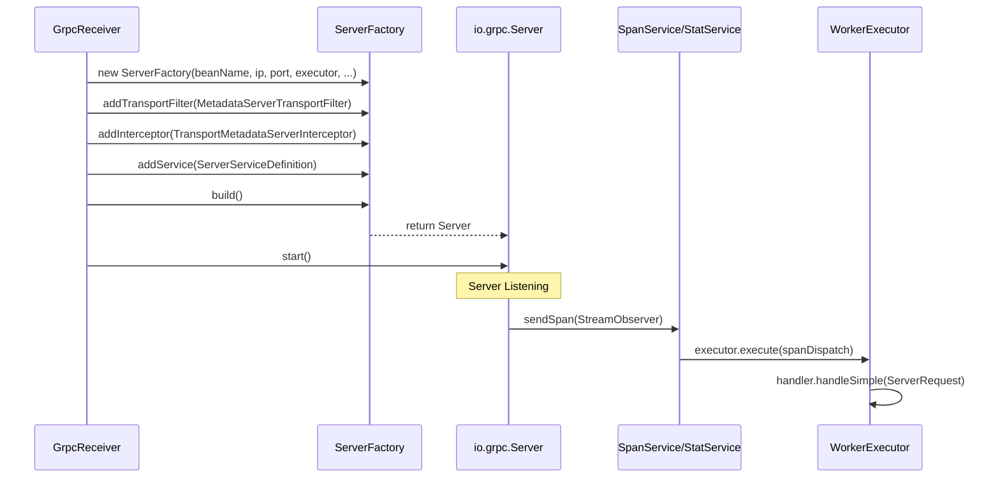
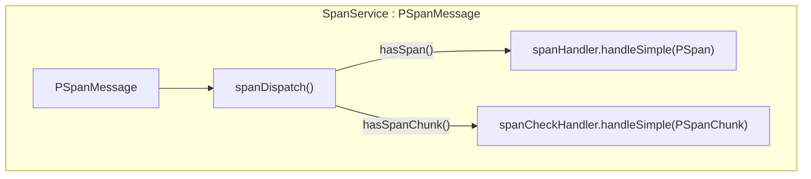

<!-- source: DeepWiki mcp.deepwiki.com · repo pinpoint-apm/pinpoint · page 5.2 gRPC Receivers · fetched 2026-10-29 -->

# gRPC Receivers

Relevant source files

The following files were used as context for generating this wiki page:

- [collector/src/main/java/com/navercorp/pinpoint/collector/dao/AgentInfoDao.java](collector/src/main/java/com/navercorp/pinpoint/collector/dao/AgentInfoDao.java)
- [collector/src/main/java/com/navercorp/pinpoint/collector/grpc/config/GrpcAgentConfiguration.java](collector/src/main/java/com/navercorp/pinpoint/collector/grpc/config/GrpcAgentConfiguration.java)
- [collector/src/main/java/com/navercorp/pinpoint/collector/grpc/config/GrpcComponentConfiguration.java](collector/src/main/java/com/navercorp/pinpoint/collector/grpc/config/GrpcComponentConfiguration.java)
- [collector/src/main/java/com/navercorp/pinpoint/collector/grpc/config/GrpcPropertiesServerOptionBuilder.java](collector/src/main/java/com/navercorp/pinpoint/collector/grpc/config/GrpcPropertiesServerOptionBuilder.java)
- [collector/src/main/java/com/navercorp/pinpoint/collector/grpc/config/GrpcSpanReceiverConfiguration.java](collector/src/main/java/com/navercorp/pinpoint/collector/grpc/config/GrpcSpanReceiverConfiguration.java)
- [collector/src/main/java/com/navercorp/pinpoint/collector/grpc/config/GrpcStatReceiverConfiguration.java](collector/src/main/java/com/navercorp/pinpoint/collector/grpc/config/GrpcStatReceiverConfiguration.java)
- [collector/src/main/java/com/navercorp/pinpoint/collector/grpc/config/ServerServiceDefinitions.java](collector/src/main/java/com/navercorp/pinpoint/collector/grpc/config/ServerServiceDefinitions.java)
- [collector/src/main/java/com/navercorp/pinpoint/collector/grpc/lifecycle/DefaultPingEventHandler.java](collector/src/main/java/com/navercorp/pinpoint/collector/grpc/lifecycle/DefaultPingEventHandler.java)
- [collector/src/main/java/com/navercorp/pinpoint/collector/grpc/lifecycle/DefaultPingSessionRegistry.java](collector/src/main/java/com/navercorp/pinpoint/collector/grpc/lifecycle/DefaultPingSessionRegistry.java)
- [collector/src/main/java/com/navercorp/pinpoint/collector/grpc/lifecycle/PingEventHandler.java](collector/src/main/java/com/navercorp/pinpoint/collector/grpc/lifecycle/PingEventHandler.java)
- [collector/src/main/java/com/navercorp/pinpoint/collector/grpc/lifecycle/PingSession.java](collector/src/main/java/com/navercorp/pinpoint/collector/grpc/lifecycle/PingSession.java)
- [collector/src/main/java/com/navercorp/pinpoint/collector/grpc/lifecycle/PingSessionRegistry.java](collector/src/main/java/com/navercorp/pinpoint/collector/grpc/lifecycle/PingSessionRegistry.java)
- [collector/src/main/java/com/navercorp/pinpoint/collector/grpc/ssl/GrpcSslModule.java](collector/src/main/java/com/navercorp/pinpoint/collector/grpc/ssl/GrpcSslModule.java)
- [collector/src/main/java/com/navercorp/pinpoint/collector/grpc/ssl/GrpcSslProperties.java](collector/src/main/java/com/navercorp/pinpoint/collector/grpc/ssl/GrpcSslProperties.java)
- [collector/src/main/java/com/navercorp/pinpoint/collector/grpc/ssl/GrpcSslReceiverProperties.java](collector/src/main/java/com/navercorp/pinpoint/collector/grpc/ssl/GrpcSslReceiverProperties.java)
- [collector/src/main/java/com/navercorp/pinpoint/collector/receiver/grpc/GrpcReceiver.java](collector/src/main/java/com/navercorp/pinpoint/collector/receiver/grpc/GrpcReceiver.java)
- [collector/src/main/java/com/navercorp/pinpoint/collector/receiver/grpc/flow/RateLimitClientStreamServerInterceptor.java](collector/src/main/java/com/navercorp/pinpoint/collector/receiver/grpc/flow/RateLimitClientStreamServerInterceptor.java)
- [collector/src/main/java/com/navercorp/pinpoint/collector/receiver/grpc/service/AgentLifecycleListener.java](collector/src/main/java/com/navercorp/pinpoint/collector/receiver/grpc/service/AgentLifecycleListener.java)
- [collector/src/main/java/com/navercorp/pinpoint/collector/receiver/grpc/service/AgentService.java](collector/src/main/java/com/navercorp/pinpoint/collector/receiver/grpc/service/AgentService.java)
- [collector/src/main/java/com/navercorp/pinpoint/collector/receiver/grpc/service/DefaultServerRequestFactory.java](collector/src/main/java/com/navercorp/pinpoint/collector/receiver/grpc/service/DefaultServerRequestFactory.java)
- [collector/src/main/java/com/navercorp/pinpoint/collector/receiver/grpc/service/KeepAliveService.java](collector/src/main/java/com/navercorp/pinpoint/collector/receiver/grpc/service/KeepAliveService.java)
- [collector/src/main/java/com/navercorp/pinpoint/collector/receiver/grpc/service/MetadataService.java](collector/src/main/java/com/navercorp/pinpoint/collector/receiver/grpc/service/MetadataService.java)
- [collector/src/main/java/com/navercorp/pinpoint/collector/receiver/grpc/service/ServerCallStream.java](collector/src/main/java/com/navercorp/pinpoint/collector/receiver/grpc/service/ServerCallStream.java)
- [collector/src/main/java/com/navercorp/pinpoint/collector/receiver/grpc/service/ServerRequestFactory.java](collector/src/main/java/com/navercorp/pinpoint/collector/receiver/grpc/service/ServerRequestFactory.java)
- [collector/src/main/java/com/navercorp/pinpoint/collector/receiver/grpc/service/SpanService.java](collector/src/main/java/com/navercorp/pinpoint/collector/receiver/grpc/service/SpanService.java)
- [collector/src/main/java/com/navercorp/pinpoint/collector/receiver/grpc/service/StatService.java](collector/src/main/java/com/navercorp/pinpoint/collector/receiver/grpc/service/StatService.java)
- [collector/src/main/java/com/navercorp/pinpoint/collector/service/async/AgentProperty.java](collector/src/main/java/com/navercorp/pinpoint/collector/service/async/AgentProperty.java)
- [collector/src/main/java/com/navercorp/pinpoint/collector/service/async/DefaultAgentProperty.java](collector/src/main/java/com/navercorp/pinpoint/collector/service/async/DefaultAgentProperty.java)
- [collector/src/main/resources/pinpoint-collector-grpc-root.properties](collector/src/main/resources/pinpoint-collector-grpc-root.properties)
- [collector/src/test/java/com/navercorp/pinpoint/collector/grpc/lifecycle/DefaultPingSessionRegistryTest.java](collector/src/test/java/com/navercorp/pinpoint/collector/grpc/lifecycle/DefaultPingSessionRegistryTest.java)
- [collector/src/test/java/com/navercorp/pinpoint/collector/grpc/lifecycle/PingSessionTest.java](collector/src/test/java/com/navercorp/pinpoint/collector/grpc/lifecycle/PingSessionTest.java)
- [collector/src/test/java/com/navercorp/pinpoint/collector/receiver/grpc/AgentClientMock.java](collector/src/test/java/com/navercorp/pinpoint/collector/receiver/grpc/AgentClientMock.java)
- [collector/src/test/java/com/navercorp/pinpoint/collector/receiver/grpc/AgentServerTestMain.java](collector/src/test/java/com/navercorp/pinpoint/collector/receiver/grpc/AgentServerTestMain.java)
- [collector/src/test/java/com/navercorp/pinpoint/collector/receiver/grpc/MetadataClientMock.java](collector/src/test/java/com/navercorp/pinpoint/collector/receiver/grpc/MetadataClientMock.java)
- [collector/src/test/java/com/navercorp/pinpoint/collector/receiver/grpc/SpanClientMock.java](collector/src/test/java/com/navercorp/pinpoint/collector/receiver/grpc/SpanClientMock.java)
- [collector/src/test/java/com/navercorp/pinpoint/collector/receiver/grpc/SpanClientTestMain.java](collector/src/test/java/com/navercorp/pinpoint/collector/receiver/grpc/SpanClientTestMain.java)
- [collector/src/test/java/com/navercorp/pinpoint/collector/receiver/grpc/SpanServerTestMain.java](collector/src/test/java/com/navercorp/pinpoint/collector/receiver/grpc/SpanServerTestMain.java)
- [collector/src/test/java/com/navercorp/pinpoint/collector/receiver/grpc/StatClientMock.java](collector/src/test/java/com/navercorp/pinpoint/collector/receiver/grpc/StatClientMock.java)
- [collector/src/test/java/com/navercorp/pinpoint/collector/receiver/grpc/StatServerTestMain.java](collector/src/test/java/com/navercorp/pinpoint/collector/receiver/grpc/StatServerTestMain.java)
- [collector/src/test/java/com/navercorp/pinpoint/collector/receiver/grpc/flow/StreamRateLimitServerInterceptorTest.java](collector/src/test/java/com/navercorp/pinpoint/collector/receiver/grpc/flow/StreamRateLimitServerInterceptorTest.java)
- [collector/src/test/java/com/navercorp/pinpoint/collector/receiver/grpc/service/ServerCallStreamTest.java](collector/src/test/java/com/navercorp/pinpoint/collector/receiver/grpc/service/ServerCallStreamTest.java)
- [commons-server/src/main/java/com/navercorp/pinpoint/common/server/dao/hbase/mapper/SingleResultsExtractor.java](commons-server/src/main/java/com/navercorp/pinpoint/common/server/dao/hbase/mapper/SingleResultsExtractor.java)
- [grpc/src/main/java/com/navercorp/pinpoint/grpc/client/ChannelFactory.java](grpc/src/main/java/com/navercorp/pinpoint/grpc/client/ChannelFactory.java)
- [grpc/src/main/java/com/navercorp/pinpoint/grpc/client/ChannelFactoryBuilder.java](grpc/src/main/java/com/navercorp/pinpoint/grpc/client/ChannelFactoryBuilder.java)
- [grpc/src/main/java/com/navercorp/pinpoint/grpc/client/DefaultChannelFactory.java](grpc/src/main/java/com/navercorp/pinpoint/grpc/client/DefaultChannelFactory.java)
- [grpc/src/main/java/com/navercorp/pinpoint/grpc/client/DefaultChannelFactoryBuilder.java](grpc/src/main/java/com/navercorp/pinpoint/grpc/client/DefaultChannelFactoryBuilder.java)
- [grpc/src/main/java/com/navercorp/pinpoint/grpc/server/ServerFactory.java](grpc/src/main/java/com/navercorp/pinpoint/grpc/server/ServerFactory.java)
- [grpc/src/main/java/com/navercorp/pinpoint/grpc/server/ServerOption.java](grpc/src/main/java/com/navercorp/pinpoint/grpc/server/ServerOption.java)
- [grpc/src/test/java/com/navercorp/pinpoint/grpc/ChannelFactoryTest.java](grpc/src/test/java/com/navercorp/pinpoint/grpc/ChannelFactoryTest.java)

## Purpose and Scope

This document details the gRPC receiver infrastructure in the Pinpoint Collector that handles incoming trace, statistic, and agent data. The collector operates multiple specialized gRPC servers on dedicated ports to receive different types of monitoring data. This page covers receiver implementation, message dispatching, executor architecture, and profile-based tuning.

For information about the data processing pipeline after reception, see [Data Collection Pipeline](#5.1). For collector configuration beyond gRPC settings, see [Collector Configuration](#5.3).

## Overview

The Pinpoint Collector uses gRPC as its primary transport protocol for receiving monitoring data from instrumented applications. The collector operates four distinct gRPC receivers, each handling a specific data type and bound to a dedicated port:

| Receiver Type | Default Port | SSL Port | Service Implementation | Purpose |
|---------------|--------------|----------|------------------------|---------|
| Agent | 9991 | 9441 | `AgentService` | Agent lifecycle, metadata, and pings |
| Stat | 9992 | 9442 | `StatService` | JVM metrics, CPU, memory, and URI stats |
| Span | 9993 | 9443 | `SpanService` | Distributed trace spans and span chunks |
| OTLP Trace | 9998 | 9448 | `OtlpTraceService` | OpenTelemetry Protocol trace data |

Each receiver operates independently with its own thread pools and server options, allowing fine-grained performance tuning based on data volume.

**Sources:**
- [collector/src/main/resources/profiles/local/pinpoint-collector-grpc.properties:1-107]()
- [collector/src/main/java/com/navercorp/pinpoint/collector/receiver/grpc/service/AgentService.java:49-50]()
- [collector/src/main/java/com/navercorp/pinpoint/collector/receiver/grpc/service/StatService.java:47-48]()
- [collector/src/main/java/com/navercorp/pinpoint/collector/receiver/grpc/service/SpanService.java:46-47]()

## Receiver Architecture

### Component Interaction

The `GrpcReceiver` class acts as the primary container for the gRPC server instance. It integrates with Spring's lifecycle to initialize the `ServerFactory`, configure interceptors, and start the Netty-based server.

**Diagram: gRPC Receiver Startup and Request Flow**

**Sources:**
- [collector/src/main/java/com/navercorp/pinpoint/collector/receiver/grpc/GrpcReceiver.java:89-163]()
- [collector/src/main/java/com/navercorp/pinpoint/collector/receiver/grpc/service/SpanService.java:77-115]()

### Data Dispatching Mechanism

Each service implementation (Span, Stat, Agent) is responsible for unwrapping gRPC messages and dispatching them to the appropriate business logic handlers.

#### SpanService Dispatching
The `SpanService` handles `PSpanMessage` objects, which can contain either a `PSpan` or a `PSpanChunk`. It uses a `ServerRequestFactory` to wrap the protobuf message into a `ServerRequest` for the handlers.

**Diagram: Span Message Dispatching**

**Sources:**
- [collector/src/main/java/com/navercorp/pinpoint/collector/receiver/grpc/service/SpanService.java:99-115]()
- [collector/src/main/java/com/navercorp/pinpoint/collector/receiver/grpc/service/SpanService.java:117-126]()

#### StatService Dispatching
The `StatService` processes `PStatMessage` objects, routing them based on the specific statistic type:
- `PAgentStat`: Individual agent metrics.
- `PAgentStatBatch`: Batched agent metrics.
- `PAgentUriStat`: URI-level performance statistics.

**Sources:**
- [collector/src/main/java/com/navercorp/pinpoint/collector/receiver/grpc/service/StatService.java:102-117]()

## Executor Architecture

Pinpoint uses a tiered executor model to prevent I/O blocking and manage backpressure.

| Executor Name | Class/Source | Purpose |
|---------------|--------------|---------|
| Server Executor | `ServerFactory.serverExecutor` | Handles Netty I/O and gRPC protocol events. |
| Worker Executor | `SpanService.executor` | Processes the actual monitoring data (decoding, storage). |
| Boss/Worker Groups | `ServerFactory.bossEventLoopGroup` | Low-level Netty event loops for connection management. |

### Backpressure and Flow Control
To protect the collector from spikes, receivers can be configured with `RateLimitClientStreamServerInterceptor`. This uses a token bucket algorithm (via `Bandwidth`) to limit the rate of incoming messages per stream.

**Sources:**
- [collector/src/main/java/com/navercorp/pinpoint/collector/grpc/config/GrpcSpanReceiverConfiguration.java:61-80]()
- [collector/src/main/java/com/navercorp/pinpoint/collector/receiver/grpc/flow/RateLimitClientStreamServerInterceptor.java:1-30]() (Reference only)
- [grpc/src/main/java/com/navercorp/pinpoint/grpc/server/ServerFactory.java:107-113]()

## Agent Lifecycle and KeepAlive

The `AgentService` manages bidirectional communication and agent health.

### Ping Session Management
The collector maintains a `PingSession` for every connected agent. The `AgentService.pingSession` method establishes a stream where the agent sends `PPing` messages.

1. **Ping Reception**: When a ping arrives, `PingEventHandler.ping(pingSession)` is called.
2. **State Updates**: The `KeepAliveService` periodically scans `PingSessionRegistry` to update the agent's lifecycle state in HBase (e.g., from `SHUTDOWN` to `RUNNING`).
3. **Response**: The collector immediately sends a `PPing` back to the agent if the stream is ready.

**Sources:**
- [collector/src/main/java/com/navercorp/pinpoint/collector/receiver/grpc/service/AgentService.java:105-159]()
- [collector/src/main/java/com/navercorp/pinpoint/collector/receiver/grpc/service/KeepAliveService.java:57-65]()
- [collector/src/main/java/com/navercorp/pinpoint/collector/receiver/grpc/service/KeepAliveService.java:101-121]()

## Server Configuration

### ServerOption Tuning
The `ServerOption` class defines low-level gRPC/Netty parameters used by `ServerFactory`. Key parameters include:

- `keepAliveTime`: Interval between pings to check connection health.
- `maxInboundMessageSize`: Defaulted to 4MB to prevent oversized payloads.
- `flowControlWindow`: Initial HTTP/2 flow control window size.
- `maxConcurrentCallsPerConnection`: Limits the number of active RPCs on a single channel.

**Sources:**
- [grpc/src/main/java/com/navercorp/pinpoint/grpc/server/ServerOption.java:29-50]()
- [grpc/src/main/java/com/navercorp/pinpoint/grpc/server/ServerFactory.java:148-167]()

### SSL/TLS Support
If an `SslContext` is provided to `GrpcReceiver`, the `ServerFactory` configures the `NettyServerBuilder` to use encryption. This is typically used on the 944x ports.

**Sources:**
- [collector/src/main/java/com/navercorp/pinpoint/collector/receiver/grpc/GrpcReceiver.java:102-106]()
- [grpc/src/main/java/com/navercorp/pinpoint/grpc/server/ServerFactory.java:168-171]()

## Profile-Based Thread Configuration

The collector uses Spring profiles to scale thread pools. The `GrpcSpanReceiverConfiguration` and `GrpcStatReceiverConfiguration` classes wire these executors into the services.

| Profile | Span Worker Threads | Stat Worker Threads |
|---------|---------------------|---------------------|
| Local | 32 | 16 |
| Release | 512 | 64 |

**Sources:**
- [collector/src/main/resources/profiles/local/pinpoint-collector-grpc.properties:17-54]()
- [collector/src/main/resources/profiles/release/pinpoint-collector-grpc.properties:18-60]()
- [collector/src/main/java/com/navercorp/pinpoint/collector/grpc/config/GrpcSpanReceiverConfiguration.java:82-94]()
- [collector/src/main/java/com/navercorp/pinpoint/collector/grpc/config/GrpcStatReceiverConfiguration.java:77-89]()

## Monitoring and Metrics

The `GrpcReceiver` supports monitoring via the `Monitor` interface. It tracks:
- `CurrentTransport`: Number of active gRPC connections via `ConnectionCountServerTransportFilter`.
- `CurrentGrpcStream`: Number of active streams via `StreamCountInterceptor`.

**Sources:**
- [collector/src/main/java/com/navercorp/pinpoint/collector/receiver/grpc/GrpcReceiver.java:111-130]()
- [collector/src/main/java/com/navercorp/pinpoint/collector/receiver/grpc/GrpcReceiver.java:141-143]()

---

