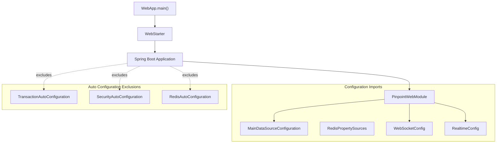
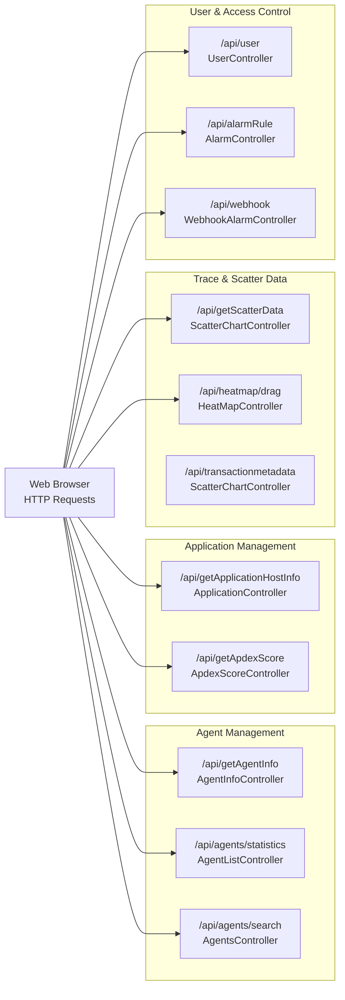
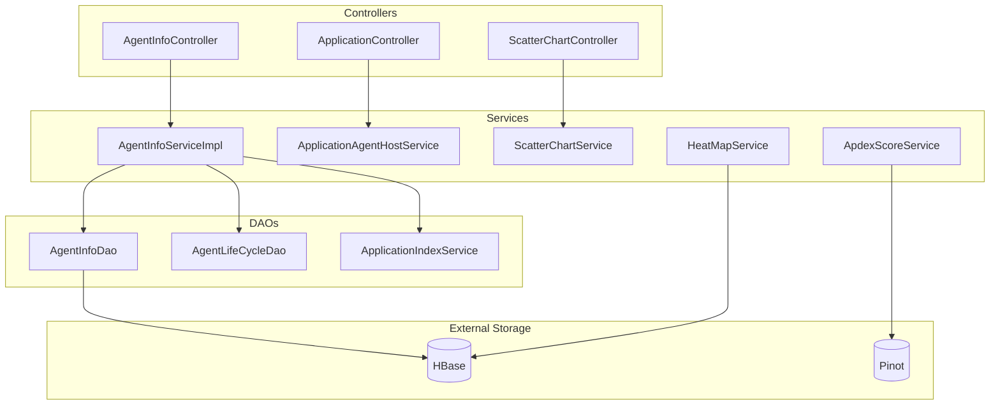
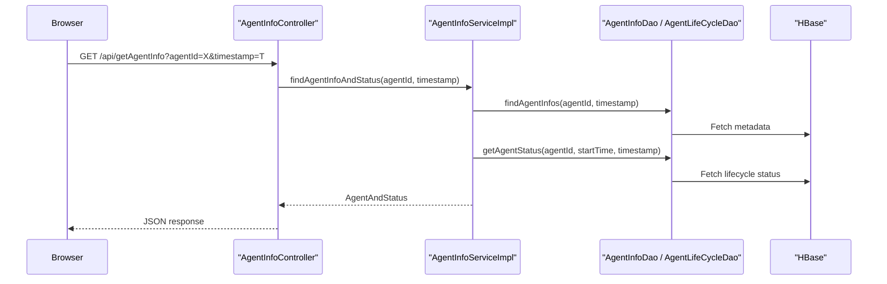

<!-- source: DeepWiki mcp.deepwiki.com · repo pinpoint-apm/pinpoint · page 6 Web Application · fetched 2026-10-29 -->

# Web Application

<details>
<summary>Relevant source files</summary>

The following files were used as context for generating this wiki page:

- [service-module/pom.xml](service-module/pom.xml)
- [web/src/main/java/com/navercorp/pinpoint/web/PinpointWebModule.java](web/src/main/java/com/navercorp/pinpoint/web/PinpointWebModule.java)
- [web/src/main/java/com/navercorp/pinpoint/web/WebMvcConfig.java](web/src/main/java/com/navercorp/pinpoint/web/WebMvcConfig.java)
- [web/src/main/java/com/navercorp/pinpoint/web/agentlist/AgentsFactory.java](web/src/main/java/com/navercorp/pinpoint/web/agentlist/AgentsFactory.java)
- [web/src/main/java/com/navercorp/pinpoint/web/agentlist/config/AgentListModule.java](web/src/main/java/com/navercorp/pinpoint/web/agentlist/config/AgentListModule.java)
- [web/src/main/java/com/navercorp/pinpoint/web/agentlist/controller/AgentsController.java](web/src/main/java/com/navercorp/pinpoint/web/agentlist/controller/AgentsController.java)
- [web/src/main/java/com/navercorp/pinpoint/web/agentlist/service/AgentsService.java](web/src/main/java/com/navercorp/pinpoint/web/agentlist/service/AgentsService.java)
- [web/src/main/java/com/navercorp/pinpoint/web/agentlist/service/AgentsServiceImpl.java](web/src/main/java/com/navercorp/pinpoint/web/agentlist/service/AgentsServiceImpl.java)
- [web/src/main/java/com/navercorp/pinpoint/web/applicationmap/dao/ApplicationResponse.java](web/src/main/java/com/navercorp/pinpoint/web/applicationmap/dao/ApplicationResponse.java)
- [web/src/main/java/com/navercorp/pinpoint/web/applicationmap/histogram/AgentTimeHistogramBuilder.java](web/src/main/java/com/navercorp/pinpoint/web/applicationmap/histogram/AgentTimeHistogramBuilder.java)
- [web/src/main/java/com/navercorp/pinpoint/web/applicationmap/histogram/ApplicationTimeHistogramBuilder.java](web/src/main/java/com/navercorp/pinpoint/web/applicationmap/histogram/ApplicationTimeHistogramBuilder.java)
- [web/src/main/java/com/navercorp/pinpoint/web/applicationmap/rawdata/AgentHistogram.java](web/src/main/java/com/navercorp/pinpoint/web/applicationmap/rawdata/AgentHistogram.java)
- [web/src/main/java/com/navercorp/pinpoint/web/applicationmap/rawdata/AgentHistogramList.java](web/src/main/java/com/navercorp/pinpoint/web/applicationmap/rawdata/AgentHistogramList.java)
- [web/src/main/java/com/navercorp/pinpoint/web/applicationmap/rawdata/LinkCallData.java](web/src/main/java/com/navercorp/pinpoint/web/applicationmap/rawdata/LinkCallData.java)
- [web/src/main/java/com/navercorp/pinpoint/web/applicationmap/rawdata/LinkCallDataMap.java](web/src/main/java/com/navercorp/pinpoint/web/applicationmap/rawdata/LinkCallDataMap.java)
- [web/src/main/java/com/navercorp/pinpoint/web/applicationmap/rawdata/LinkData.java](web/src/main/java/com/navercorp/pinpoint/web/applicationmap/rawdata/LinkData.java)
- [web/src/main/java/com/navercorp/pinpoint/web/applicationmap/rawdata/LinkDataMap.java](web/src/main/java/com/navercorp/pinpoint/web/applicationmap/rawdata/LinkDataMap.java)
- [web/src/main/java/com/navercorp/pinpoint/web/applicationmap/view/ResponseTimeViewModelBuilder.java](web/src/main/java/com/navercorp/pinpoint/web/applicationmap/view/ResponseTimeViewModelBuilder.java)
- [web/src/main/java/com/navercorp/pinpoint/web/applicationmap/view/TimeHistogramView.java](web/src/main/java/com/navercorp/pinpoint/web/applicationmap/view/TimeHistogramView.java)
- [web/src/main/java/com/navercorp/pinpoint/web/applicationmap/view/TimeseriesHistogramView.java](web/src/main/java/com/navercorp/pinpoint/web/applicationmap/view/TimeseriesHistogramView.java)
- [web/src/main/java/com/navercorp/pinpoint/web/applicationmap/view/TimeseriesHistogramViewBuilder.java](web/src/main/java/com/navercorp/pinpoint/web/applicationmap/view/TimeseriesHistogramViewBuilder.java)
- [web/src/main/java/com/navercorp/pinpoint/web/authorization/controller/ActiveThreadDumpController.java](web/src/main/java/com/navercorp/pinpoint/web/authorization/controller/ActiveThreadDumpController.java)
- [web/src/main/java/com/navercorp/pinpoint/web/authorization/controller/AdminController.java](web/src/main/java/com/navercorp/pinpoint/web/authorization/controller/AdminController.java)
- [web/src/main/java/com/navercorp/pinpoint/web/authorization/controller/AgentInfoController.java](web/src/main/java/com/navercorp/pinpoint/web/authorization/controller/AgentInfoController.java)
- [web/src/main/java/com/navercorp/pinpoint/web/authorization/controller/AgentListController.java](web/src/main/java/com/navercorp/pinpoint/web/authorization/controller/AgentListController.java)
- [web/src/main/java/com/navercorp/pinpoint/web/authorization/controller/AlarmController.java](web/src/main/java/com/navercorp/pinpoint/web/authorization/controller/AlarmController.java)
- [web/src/main/java/com/navercorp/pinpoint/web/authorization/controller/HeatMapController.java](web/src/main/java/com/navercorp/pinpoint/web/authorization/controller/HeatMapController.java)
- [web/src/main/java/com/navercorp/pinpoint/web/authorization/controller/ScatterChartController.java](web/src/main/java/com/navercorp/pinpoint/web/authorization/controller/ScatterChartController.java)
- [web/src/main/java/com/navercorp/pinpoint/web/authorization/controller/UserController.java](web/src/main/java/com/navercorp/pinpoint/web/authorization/controller/UserController.java)
- [web/src/main/java/com/navercorp/pinpoint/web/authorization/controller/UserGroupController.java](web/src/main/java/com/navercorp/pinpoint/web/authorization/controller/UserGroupController.java)
- [web/src/main/java/com/navercorp/pinpoint/web/authorization/controller/WebhookAlarmController.java](web/src/main/java/com/navercorp/pinpoint/web/authorization/controller/WebhookAlarmController.java)
- [web/src/main/java/com/navercorp/pinpoint/web/controller/ApdexScoreController.java](web/src/main/java/com/navercorp/pinpoint/web/controller/ApdexScoreController.java)
- [web/src/main/java/com/navercorp/pinpoint/web/controller/ApplicationController.java](web/src/main/java/com/navercorp/pinpoint/web/controller/ApplicationController.java)
- [web/src/main/java/com/navercorp/pinpoint/web/problem/CustomExceptionHandler.java](web/src/main/java/com/navercorp/pinpoint/web/problem/CustomExceptionHandler.java)
- [web/src/main/java/com/navercorp/pinpoint/web/problem/ProblemSpringWebConfig.java](web/src/main/java/com/navercorp/pinpoint/web/problem/ProblemSpringWebConfig.java)
- [web/src/main/java/com/navercorp/pinpoint/web/response/CodeResult.java](web/src/main/java/com/navercorp/pinpoint/web/response/CodeResult.java)
- [web/src/main/java/com/navercorp/pinpoint/web/scatter/DragAreaQuery.java](web/src/main/java/com/navercorp/pinpoint/web/scatter/DragAreaQuery.java)
- [web/src/main/java/com/navercorp/pinpoint/web/scatter/ElpasedTimeDotPredicate.java](web/src/main/java/com/navercorp/pinpoint/web/scatter/ElpasedTimeDotPredicate.java)
- [web/src/main/java/com/navercorp/pinpoint/web/service/AgentInfoService.java](web/src/main/java/com/navercorp/pinpoint/web/service/AgentInfoService.java)
- [web/src/main/java/com/navercorp/pinpoint/web/service/AgentInfoServiceImpl.java](web/src/main/java/com/navercorp/pinpoint/web/service/AgentInfoServiceImpl.java)
- [web/src/main/java/com/navercorp/pinpoint/web/service/ApdexScoreService.java](web/src/main/java/com/navercorp/pinpoint/web/service/ApdexScoreService.java)
- [web/src/main/java/com/navercorp/pinpoint/web/service/ApdexScoreServiceImpl.java](web/src/main/java/com/navercorp/pinpoint/web/service/ApdexScoreServiceImpl.java)
- [web/src/main/java/com/navercorp/pinpoint/web/service/DotExtractor.java](web/src/main/java/com/navercorp/pinpoint/web/service/DotExtractor.java)
- [web/src/main/java/com/navercorp/pinpoint/web/service/ProxyRequestTypeRegistryServiceImpl.java](web/src/main/java/com/navercorp/pinpoint/web/service/ProxyRequestTypeRegistryServiceImpl.java)
- [web/src/main/java/com/navercorp/pinpoint/web/vo/ResponseHistograms.java](web/src/main/java/com/navercorp/pinpoint/web/vo/ResponseHistograms.java)
- [web/src/main/java/com/navercorp/pinpoint/web/vo/timeline/inspector/AgentStatusTimelineBuilder.java](web/src/main/java/com/navercorp/pinpoint/web/vo/timeline/inspector/AgentStatusTimelineBuilder.java)
- [web/src/test/java/com/navercorp/pinpoint/web/service/ApdexScoreServiceImplTest.java](web/src/test/java/com/navercorp/pinpoint/web/service/ApdexScoreServiceImplTest.java)
- [web/src/test/java/com/navercorp/pinpoint/web/vo/ResponseHistogramsTest.java](web/src/test/java/com/navercorp/pinpoint/web/vo/ResponseHistogramsTest.java)

</details>


## Purpose and Scope

The Web Application is Pinpoint's backend server component that provides REST APIs, WebSocket endpoints, and serves the frontend UI. It queries trace data from HBase and aggregated metrics from Pinot, exposing this information through HTTP endpoints consumed by the React-based web interface. The Web Application runs as a Spring Boot application on port 8080 (or 8082 for multi-starter configuration).

For information about the Agent component that collects trace data, see [Agent](#4). For details on the Collector that receives and stores trace data, see [Collector](#5). For the frontend UI architecture, see [Frontend Architecture](#3.5).

---

## Application Structure and Entry Point

The Web Application is bootstrapped through `WebApp` as the main Spring Boot application class. It integrates multiple modules including authentication, authorization, data access, and caching via `PinpointWebModule`.

### Main Application Class

**Diagram: Web Application Bootstrap Flow**



**Sources:** [web/src/main/java/com/navercorp/pinpoint/web/PinpointWebModule.java:50-94](), [web/src/main/java/com/navercorp/pinpoint/web/WebApp.java:54-61]()

The `PinpointWebModule` acts as the central configuration hub, importing specialized modules like `ApplicationMapModule`, `WebHbaseModule`, and `AgentListModule` [web/src/main/java/com/navercorp/pinpoint/web/PinpointWebModule.java:68-70]().

---

## REST Controller Architecture

The Web Application exposes REST endpoints through specialized controllers organized by functional domain. All controllers are located under the `/api` base path.

### Controller Layer Organization

**Diagram: REST Controller Mapping Structure**



**Sources:** [web/src/main/java/com/navercorp/pinpoint/web/authorization/controller/AgentInfoController.java:56-58](), [web/src/main/java/com/navercorp/pinpoint/web/authorization/controller/AgentListController.java:25-27](), [web/src/main/java/com/navercorp/pinpoint/web/controller/ApplicationController.java:50-52](), [web/src/main/java/com/navercorp/pinpoint/web/authorization/controller/ScatterChartController.java:58-60](), [web/src/main/java/com/navercorp/pinpoint/web/authorization/controller/HeatMapController.java:50-52]()

### Key Controller Endpoints

| Controller | Primary Endpoints | Purpose |
|-----------|-------------------|---------|
| `AgentInfoController` | `/getAgentInfo`, `/getDetailedAgentInfo`, `/getAgentStatus`, `/getAgentEvents`, `/getAgentStatusTimeline` | Retrieve agent information, status, and event timelines [web/src/main/java/com/navercorp/pinpoint/web/authorization/controller/AgentInfoController.java:73-144]() |
| `AgentListController` | `/agents/statistics` | Get aggregated statistics for all agents [web/src/main/java/com/navercorp/pinpoint/web/authorization/controller/AgentListController.java:41-49]() |
| `ApplicationController` | `/getApplicationHostInfo`, `/isAvailableApplicationName` | List applications with agent/host info, validate application names [web/src/main/java/com/navercorp/pinpoint/web/controller/ApplicationController.java:72-146]() |
| `ScatterChartController` | `/getScatterData`, `/transactionmetadata` | Fetch scatter plot data and transaction metadata [web/src/main/java/com/navercorp/pinpoint/web/authorization/controller/ScatterChartController.java:85-107]() |
| `HeatMapController` | `/heatmap/drag` | Query transactions within a drag area on scatter chart [web/src/main/java/com/navercorp/pinpoint/web/authorization/controller/HeatMapController.java:68-70]() |
| `ApdexScoreController` | `/getApdexScore`, `/getApplicationStat/apdexScore/chart` | Retrieve Apdex scores and charts for applications/agents [web/src/main/java/com/navercorp/pinpoint/web/controller/ApdexScoreController.java:37-123]() |

### Authorization and Security

Controllers use Spring Security's `@PreAuthorize` annotations to enforce permission checks.

```java
// Example from AgentListController
@PreAuthorize("hasPermission(null, null, T(com.navercorp.pinpoint.web.security.PermissionChecker).PERMISSION_ADMINISTRATION_CALL_API_FOR_APP_AGENT_MANAGEMENT)")
@GetMapping(value = "/statistics")
public List<DetailedAgentAndStatus> getAllAgentStatistics() { ... }
```

**Sources:** [web/src/main/java/com/navercorp/pinpoint/web/authorization/controller/AgentListController.java:39-41](), [web/src/main/java/com/navercorp/pinpoint/web/authorization/controller/AgentInfoController.java:72-73]()

---

## Service Layer Architecture

The service layer implements business logic and coordinates data access. Services are injected into controllers and interact with DAOs.

### Service Layer Component Structure

**Diagram: Service Layer Dependencies**



**Sources:** [web/src/main/java/com/navercorp/pinpoint/web/service/AgentInfoServiceImpl.java:67-77](), [web/src/main/java/com/navercorp/pinpoint/web/controller/ApplicationController.java:65-70]()

### AgentInfoService Implementation

The `AgentInfoServiceImpl` provides core agent-related operations, querying both metadata and lifecycle status.

**Key Methods:**

| Method | Parameters | Return Type | Description |
|--------|------------|-------------|-------------|
| `getAgentsStatisticsList` | `Range` | `List<DetailedAgentAndStatus>` | Aggregates statistics across all applications [web/src/main/java/com/navercorp/pinpoint/web/service/AgentInfoServiceImpl.java:80-94]() |
| `findAgentInfoAndStatus` | `agentId`, `timestamp` | `AgentAndStatus` | Retrieves agent info and its status at a specific time [web/src/main/java/com/navercorp/pinpoint/web/service/AgentInfoServiceImpl.java:141-152]() |
| `getAgentStatusTimeline` | `applicationName`, `agentId`, `Range` | `InspectorTimeline` | Builds timeline with status and event segments [web/src/main/java/com/navercorp/pinpoint/web/service/AgentInfoServiceImpl.java:303-321]() |

**Sources:** [web/src/main/java/com/navercorp/pinpoint/web/service/AgentInfoService.java:35-60]()

---

## Configuration System

The Web Application uses Spring Boot's configuration system with `ConfigProperties` and specialized configuration classes.

### Core Configuration Properties

The `PinpointWebModule` defines primary configuration beans:
- `ConfigProperties`: General web application settings [web/src/main/java/com/navercorp/pinpoint/web/PinpointWebModule.java:97-99]().
- `LogProperties`: Logging specific configurations [web/src/main/java/com/navercorp/pinpoint/web/PinpointWebModule.java:102-104]().
- `ScatterChartProperties`: Limits and behavior for scatter charts [web/src/main/java/com/navercorp/pinpoint/web/PinpointWebModule.java:112-114]().

### Web MVC Configuration

`WebMvcConfig` configures static resource handling and interceptors:
- **Resource Caching**: Fonts and images are cached for 1 day, while JS/CSS are cached for 2 minutes [web/src/main/java/com/navercorp/pinpoint/web/WebMvcConfig.java:97-107]().
- **Admin Security**: `AdminAuthInterceptor` protects `/api/admin/**` endpoints using a configured password [web/src/main/java/com/navercorp/pinpoint/web/WebMvcConfig.java:78-81]().

---

## Request Processing Flow

### Typical API Request Flow

**Diagram: Request Processing Through Web Application**



**Sources:** [web/src/main/java/com/navercorp/pinpoint/web/authorization/controller/AgentInfoController.java:73-78](), [web/src/main/java/com/navercorp/pinpoint/web/service/AgentInfoServiceImpl.java:141-152]()

### Scatter Chart and Heatmap Queries

The `ScatterChartController` fetches transaction dots for a specific application and time range [web/src/main/java/com/navercorp/pinpoint/web/authorization/controller/ScatterChartController.java:106-141](). Users can then "drag" an area on the UI, which triggers the `HeatMapController` to query specific transaction metadata within that area [web/src/main/java/com/navercorp/pinpoint/web/authorization/controller/HeatMapController.java:68-109]().

---

## Management and Error Handling

### Custom Exception Handling

The `CustomExceptionHandler` provides a standardized `ProblemDetail` response for various exceptions, including `AccessDeniedException` (403 Forbidden) and `ResponseStatusException` [web/src/main/java/com/navercorp/pinpoint/web/problem/CustomExceptionHandler.java:73-133]().

### Child Pages

For more detailed technical documentation, see the following child pages:
- [REST API Reference](#6.1) — Detailed documentation of all `/api` endpoints.
- [Service Layer](#6.2) — In-depth look at `MapService`, `SpanService`, and `HistogramService`.
- [Web Configuration](#6.3) — Complete property reference and security settings.
- [WebSocket Real-time Features](#6.4) — Real-time monitoring implementation.

---

