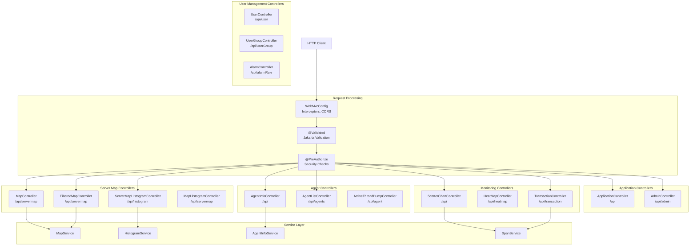

<!-- source: DeepWiki mcp.deepwiki.com · repo pinpoint-apm/pinpoint · page 6.1 REST API Reference · fetched 2026-10-29 -->

# REST API Reference

Relevant source files

The following files were used as context for generating this wiki page:

- [commons-server/src/main/java/com/navercorp/pinpoint/common/server/bo/serializer/metadata/MetadataDecoder.java](commons-server/src/main/java/com/navercorp/pinpoint/common/server/bo/serializer/metadata/MetadataDecoder.java)
- [commons-server/src/main/java/com/navercorp/pinpoint/common/server/bo/serializer/metadata/MetadataEncoder.java](commons-server/src/main/java/com/navercorp/pinpoint/common/server/bo/serializer/metadata/MetadataEncoder.java)
- [commons-server/src/main/java/com/navercorp/pinpoint/common/server/bo/serializer/metadata/uid/UidMetadataDecoder.java](commons-server/src/main/java/com/navercorp/pinpoint/common/server/bo/serializer/metadata/uid/UidMetadataDecoder.java)
- [commons-server/src/main/java/com/navercorp/pinpoint/common/server/bo/serializer/metadata/uid/UidMetadataEncoder.java](commons-server/src/main/java/com/navercorp/pinpoint/common/server/bo/serializer/metadata/uid/UidMetadataEncoder.java)
- [commons-server/src/main/java/com/navercorp/pinpoint/common/server/dao/hbase/mapper/AgentInfoBoMapper.java](commons-server/src/main/java/com/navercorp/pinpoint/common/server/dao/hbase/mapper/AgentInfoBoMapper.java)
- [web/src/main/java/com/navercorp/pinpoint/web/WebMvcConfig.java](web/src/main/java/com/navercorp/pinpoint/web/WebMvcConfig.java)
- [web/src/main/java/com/navercorp/pinpoint/web/applicationmap/config/ApplicationMapModule.java](web/src/main/java/com/navercorp/pinpoint/web/applicationmap/config/ApplicationMapModule.java)
- [web/src/main/java/com/navercorp/pinpoint/web/applicationmap/config/MapControllerConfiguration.java](web/src/main/java/com/navercorp/pinpoint/web/applicationmap/config/MapControllerConfiguration.java)
- [web/src/main/java/com/navercorp/pinpoint/web/applicationmap/config/MapProperties.java](web/src/main/java/com/navercorp/pinpoint/web/applicationmap/config/MapProperties.java)
- [web/src/main/java/com/navercorp/pinpoint/web/applicationmap/config/MapViewConfiguration.java](web/src/main/java/com/navercorp/pinpoint/web/applicationmap/config/MapViewConfiguration.java)
- [web/src/main/java/com/navercorp/pinpoint/web/applicationmap/controller/FilteredMapController.java](web/src/main/java/com/navercorp/pinpoint/web/applicationmap/controller/FilteredMapController.java)
- [web/src/main/java/com/navercorp/pinpoint/web/applicationmap/controller/MapController.java](web/src/main/java/com/navercorp/pinpoint/web/applicationmap/controller/MapController.java)
- [web/src/main/java/com/navercorp/pinpoint/web/applicationmap/controller/form/ApplicationForm.java](web/src/main/java/com/navercorp/pinpoint/web/applicationmap/controller/form/ApplicationForm.java)
- [web/src/main/java/com/navercorp/pinpoint/web/applicationmap/link/Link.java](web/src/main/java/com/navercorp/pinpoint/web/applicationmap/link/Link.java)
- [web/src/main/java/com/navercorp/pinpoint/web/applicationmap/link/LinkHistogramSummary.java](web/src/main/java/com/navercorp/pinpoint/web/applicationmap/link/LinkHistogramSummary.java)
- [web/src/main/java/com/navercorp/pinpoint/web/applicationmap/link/LinkName.java](web/src/main/java/com/navercorp/pinpoint/web/applicationmap/link/LinkName.java)
- [web/src/main/java/com/navercorp/pinpoint/web/applicationmap/link/ServiceLinkName.java](web/src/main/java/com/navercorp/pinpoint/web/applicationmap/link/ServiceLinkName.java)
- [web/src/main/java/com/navercorp/pinpoint/web/applicationmap/nodes/ApplicationNameEscaper.java](web/src/main/java/com/navercorp/pinpoint/web/applicationmap/nodes/ApplicationNameEscaper.java)
- [web/src/main/java/com/navercorp/pinpoint/web/applicationmap/nodes/Node.java](web/src/main/java/com/navercorp/pinpoint/web/applicationmap/nodes/Node.java)
- [web/src/main/java/com/navercorp/pinpoint/web/applicationmap/nodes/NodeName.java](web/src/main/java/com/navercorp/pinpoint/web/applicationmap/nodes/NodeName.java)
- [web/src/main/java/com/navercorp/pinpoint/web/applicationmap/nodes/ServiceNodeName.java](web/src/main/java/com/navercorp/pinpoint/web/applicationmap/nodes/ServiceNodeName.java)
- [web/src/main/java/com/navercorp/pinpoint/web/applicationmap/nodes/ServiceNodeNameParser.java](web/src/main/java/com/navercorp/pinpoint/web/applicationmap/nodes/ServiceNodeNameParser.java)
- [web/src/main/java/com/navercorp/pinpoint/web/applicationmap/service/AlertViewService.java](web/src/main/java/com/navercorp/pinpoint/web/applicationmap/service/AlertViewService.java)
- [web/src/main/java/com/navercorp/pinpoint/web/applicationmap/view/LinkRender.java](web/src/main/java/com/navercorp/pinpoint/web/applicationmap/view/LinkRender.java)
- [web/src/main/java/com/navercorp/pinpoint/web/applicationmap/view/LinkView.java](web/src/main/java/com/navercorp/pinpoint/web/applicationmap/view/LinkView.java)
- [web/src/main/java/com/navercorp/pinpoint/web/applicationmap/view/NodeRender.java](web/src/main/java/com/navercorp/pinpoint/web/applicationmap/view/NodeRender.java)
- [web/src/main/java/com/navercorp/pinpoint/web/applicationmap/view/NodeView.java](web/src/main/java/com/navercorp/pinpoint/web/applicationmap/view/NodeView.java)
- [web/src/main/java/com/navercorp/pinpoint/web/authorization/controller/ActiveThreadDumpController.java](web/src/main/java/com/navercorp/pinpoint/web/authorization/controller/ActiveThreadDumpController.java)
- [web/src/main/java/com/navercorp/pinpoint/web/authorization/controller/AdminController.java](web/src/main/java/com/navercorp/pinpoint/web/authorization/controller/AdminController.java)
- [web/src/main/java/com/navercorp/pinpoint/web/authorization/controller/AgentInfoController.java](web/src/main/java/com/navercorp/pinpoint/web/authorization/controller/AgentInfoController.java)
- [web/src/main/java/com/navercorp/pinpoint/web/authorization/controller/AgentListController.java](web/src/main/java/com/navercorp/pinpoint/web/authorization/controller/AgentListController.java)
- [web/src/main/java/com/navercorp/pinpoint/web/authorization/controller/AlarmController.java](web/src/main/java/com/navercorp/pinpoint/web/authorization/controller/AlarmController.java)
- [web/src/main/java/com/navercorp/pinpoint/web/authorization/controller/HeatMapController.java](web/src/main/java/com/navercorp/pinpoint/web/authorization/controller/HeatMapController.java)
- [web/src/main/java/com/navercorp/pinpoint/web/authorization/controller/ScatterChartController.java](web/src/main/java/com/navercorp/pinpoint/web/authorization/controller/ScatterChartController.java)
- [web/src/main/java/com/navercorp/pinpoint/web/authorization/controller/UserController.java](web/src/main/java/com/navercorp/pinpoint/web/authorization/controller/UserController.java)
- [web/src/main/java/com/navercorp/pinpoint/web/authorization/controller/UserGroupController.java](web/src/main/java/com/navercorp/pinpoint/web/authorization/controller/UserGroupController.java)
- [web/src/main/java/com/navercorp/pinpoint/web/authorization/controller/WebhookAlarmController.java](web/src/main/java/com/navercorp/pinpoint/web/authorization/controller/WebhookAlarmController.java)
- [web/src/main/java/com/navercorp/pinpoint/web/controller/ApplicationController.java](web/src/main/java/com/navercorp/pinpoint/web/controller/ApplicationController.java)
- [web/src/main/java/com/navercorp/pinpoint/web/response/CodeResult.java](web/src/main/java/com/navercorp/pinpoint/web/response/CodeResult.java)
- [web/src/main/java/com/navercorp/pinpoint/web/scatter/Coordinates.java](web/src/main/java/com/navercorp/pinpoint/web/scatter/Coordinates.java)
- [web/src/main/java/com/navercorp/pinpoint/web/scatter/DotGroup.java](web/src/main/java/com/navercorp/pinpoint/web/scatter/DotGroup.java)
- [web/src/main/java/com/navercorp/pinpoint/web/scatter/DotGroups.java](web/src/main/java/com/navercorp/pinpoint/web/scatter/DotGroups.java)
- [web/src/main/java/com/navercorp/pinpoint/web/scatter/DragAreaQuery.java](web/src/main/java/com/navercorp/pinpoint/web/scatter/DragAreaQuery.java)
- [web/src/main/java/com/navercorp/pinpoint/web/scatter/ElpasedTimeDotPredicate.java](web/src/main/java/com/navercorp/pinpoint/web/scatter/ElpasedTimeDotPredicate.java)
- [web/src/main/java/com/navercorp/pinpoint/web/scatter/ScatterAgentMetaData.java](web/src/main/java/com/navercorp/pinpoint/web/scatter/ScatterAgentMetaData.java)
- [web/src/main/java/com/navercorp/pinpoint/web/scatter/ScatterAgentMetadataRepository.java](web/src/main/java/com/navercorp/pinpoint/web/scatter/ScatterAgentMetadataRepository.java)
- [web/src/main/java/com/navercorp/pinpoint/web/scatter/ScatterData.java](web/src/main/java/com/navercorp/pinpoint/web/scatter/ScatterData.java)
- [web/src/main/java/com/navercorp/pinpoint/web/scatter/ScatterDataBuilder.java](web/src/main/java/com/navercorp/pinpoint/web/scatter/ScatterDataBuilder.java)
- [web/src/main/java/com/navercorp/pinpoint/web/scatter/Status.java](web/src/main/java/com/navercorp/pinpoint/web/scatter/Status.java)
- [web/src/main/java/com/navercorp/pinpoint/web/security/ServerMapDataFilter.java](web/src/main/java/com/navercorp/pinpoint/web/security/ServerMapDataFilter.java)
- [web/src/main/java/com/navercorp/pinpoint/web/service/AgentInfoService.java](web/src/main/java/com/navercorp/pinpoint/web/service/AgentInfoService.java)
- [web/src/main/java/com/navercorp/pinpoint/web/service/AgentInfoServiceImpl.java](web/src/main/java/com/navercorp/pinpoint/web/service/AgentInfoServiceImpl.java)
- [web/src/main/java/com/navercorp/pinpoint/web/service/HeatMapService.java](web/src/main/java/com/navercorp/pinpoint/web/service/HeatMapService.java)
- [web/src/main/java/com/navercorp/pinpoint/web/service/HeatMapServiceImpl.java](web/src/main/java/com/navercorp/pinpoint/web/service/HeatMapServiceImpl.java)
- [web/src/main/java/com/navercorp/pinpoint/web/service/ScatterChartService.java](web/src/main/java/com/navercorp/pinpoint/web/service/ScatterChartService.java)
- [web/src/main/java/com/navercorp/pinpoint/web/service/ScatterChartServiceImpl.java](web/src/main/java/com/navercorp/pinpoint/web/service/ScatterChartServiceImpl.java)
- [web/src/main/java/com/navercorp/pinpoint/web/trace/controller/TransactionController.java](web/src/main/java/com/navercorp/pinpoint/web/trace/controller/TransactionController.java)
- [web/src/main/java/com/navercorp/pinpoint/web/trace/view/TransactionCallTreeViewModel.java](web/src/main/java/com/navercorp/pinpoint/web/trace/view/TransactionCallTreeViewModel.java)
- [web/src/main/java/com/navercorp/pinpoint/web/view/DotSerializer.java](web/src/main/java/com/navercorp/pinpoint/web/view/DotSerializer.java)
- [web/src/main/java/com/navercorp/pinpoint/web/view/LogLinkBuilder.java](web/src/main/java/com/navercorp/pinpoint/web/view/LogLinkBuilder.java)
- [web/src/main/java/com/navercorp/pinpoint/web/view/LogLinkView.java](web/src/main/java/com/navercorp/pinpoint/web/view/LogLinkView.java)
- [web/src/main/java/com/navercorp/pinpoint/web/view/ScatterAgentMetaDataSerializer.java](web/src/main/java/com/navercorp/pinpoint/web/view/ScatterAgentMetaDataSerializer.java)
- [web/src/main/java/com/navercorp/pinpoint/web/view/ScatterDataSerializer.java](web/src/main/java/com/navercorp/pinpoint/web/view/ScatterDataSerializer.java)
- [web/src/main/java/com/navercorp/pinpoint/web/view/TransactionServerMapViewModel.java](web/src/main/java/com/navercorp/pinpoint/web/view/TransactionServerMapViewModel.java)
- [web/src/main/java/com/navercorp/pinpoint/web/vo/AgentParam.java](web/src/main/java/com/navercorp/pinpoint/web/vo/AgentParam.java)
- [web/src/test/java/com/navercorp/pinpoint/web/applicationmap/controller/MapControllerTest.java](web/src/test/java/com/navercorp/pinpoint/web/applicationmap/controller/MapControllerTest.java)
- [web/src/test/java/com/navercorp/pinpoint/web/applicationmap/service/AlertViewServiceTest.java](web/src/test/java/com/navercorp/pinpoint/web/applicationmap/service/AlertViewServiceTest.java)
- [web/src/test/java/com/navercorp/pinpoint/web/scatter/ElpasedTimeDotPredicateTest.java](web/src/test/java/com/navercorp/pinpoint/web/scatter/ElpasedTimeDotPredicateTest.java)
- [web/src/test/java/com/navercorp/pinpoint/web/scatter/ScatterDataTest.java](web/src/test/java/com/navercorp/pinpoint/web/scatter/ScatterDataTest.java)
- [web/src/test/java/com/navercorp/pinpoint/web/service/HeatMapServiceImplTest.java](web/src/test/java/com/navercorp/pinpoint/web/service/HeatMapServiceImplTest.java)
- [web/src/test/java/com/navercorp/pinpoint/web/trace/view/TransactionInfoViewModelTest.java](web/src/test/java/com/navercorp/pinpoint/web/trace/view/TransactionInfoViewModelTest.java)
- [web/src/test/java/com/navercorp/pinpoint/web/view/AgentEventMarkerSerializerTest.java](web/src/test/java/com/navercorp/pinpoint/web/view/AgentEventMarkerSerializerTest.java)
- [web/src/test/java/com/navercorp/pinpoint/web/view/LinkViewTest.java](web/src/test/java/com/navercorp/pinpoint/web/view/LinkViewTest.java)

This document provides a comprehensive reference for all REST API endpoints exposed by the Pinpoint Web application. These APIs enable programmatic access to trace data, server maps, agent information, statistics, and administrative functions.

For information about the service layer that implements the business logic behind these APIs, see [Service Layer](#6.2). For WebSocket-based real-time features, see [WebSocket Real-time Features](#6.4). For web application configuration, see [Web Configuration](#6.3).

## API Architecture Overview

The Pinpoint Web application exposes REST APIs through Spring MVC controllers organized by functional domain. All controllers are mapped under the `/api` base path and return JSON responses.

**Controller Architecture**

**Sources:**
- [web/src/main/java/com/navercorp/pinpoint/web/WebMvcConfig.java:40-138]()
- [web/src/main/java/com/navercorp/pinpoint/web/applicationmap/controller/MapController.java:58-135]()
- [web/src/main/java/com/navercorp/pinpoint/web/authorization/controller/AgentInfoController.java:55-174]()

## Request Validation and Error Handling

All API endpoints use Jakarta Bean Validation annotations for request parameter validation. Controllers are annotated with `@Validated` to enable automatic validation.

**Common Validation Annotations:**
- `@NotBlank` - String must not be null or empty [web/src/main/java/com/navercorp/pinpoint/web/authorization/controller/AgentInfoController.java:75]()
- `@PositiveOrZero` - Number must be >= 0 [web/src/main/java/com/navercorp/pinpoint/web/authorization/controller/AgentInfoController.java:76]()
- `@Positive` - Number must be > 0 [web/src/main/java/com/navercorp/pinpoint/web/controller/ApplicationController.java:74]()
- `@Valid` - Validates nested objects [web/src/main/java/com/navercorp/pinpoint/web/applicationmap/controller/MapController.java:95]()

**Error Response Pattern:**
Invalid requests return HTTP 400 with error messages. Internal errors return HTTP 500. Access denied returns HTTP 403, handled by `AccessDeniedExceptionHandler` [web/src/main/java/com/navercorp/pinpoint/web/authorization/controller/AgentInfoController.java:58]().

**Sources:**
- [web/src/main/java/com/navercorp/pinpoint/web/applicationmap/controller/MapController.java:61]()
- [web/src/main/java/com/navercorp/pinpoint/web/authorization/controller/AgentInfoController.java:58]()

## Server Map APIs

Server map APIs provide topology visualization showing application relationships and traffic flow.

### GET /api/servermap/serverMap

Retrieves the application map for a specified application and time range.

**Parameters:**

| Parameter | Type | Required | Description |
|-----------|------|----------|-------------|
| applicationName | String | Yes | Target application name |
| serviceTypeCode | Integer | No | Service type numeric code |
| serviceTypeName | String | No | Service type name |
| from | Long | Yes | Start timestamp (milliseconds) |
| to | Long | Yes | End timestamp (milliseconds) |
| callerRange | Integer | No | Caller search depth (default: 4) |
| calleeRange | Integer | No | Callee search depth (default: 4) |
| bidirectional | Boolean | No | Search both directions |
| wasOnly | Boolean | No | Include only WAS nodes |
| useStatisticsAgentState | Boolean | No | Use aggregated agent states |

**Response:** `MapWrap` [web/src/main/java/com/navercorp/pinpoint/web/applicationmap/MapWrap.java:27]()

Contains `ApplicationMapView` with node and link data structures:
- `nodeDataArray` - Array of `NodeView` objects [web/src/main/java/com/navercorp/pinpoint/web/applicationmap/view/NodeView.java:38]()
- `linkDataArray` - Array of `LinkView` objects [web/src/main/java/com/navercorp/pinpoint/web/applicationmap/view/LinkView.java:37]()

**Node Structure (`NodeView`):**
- `key` - Node identifier [web/src/main/java/com/navercorp/pinpoint/web/applicationmap/view/NodeView.java:110]()
- `applicationName` - Application display name [web/src/main/java/com/navercorp/pinpoint/web/applicationmap/view/NodeView.java:121]()
- `serviceType` - Service type string [web/src/main/java/com/navercorp/pinpoint/web/applicationmap/view/NodeView.java:125]()
- `serviceTypeCode` - Service type numeric code [web/src/main/java/com/navercorp/pinpoint/web/applicationmap/view/NodeView.java:126]()
- `apdex` - Apdex score [web/src/main/java/com/navercorp/pinpoint/web/applicationmap/view/NodeView.java:133]()
- `agents` - Agent server group list [web/src/main/java/com/navercorp/pinpoint/web/applicationmap/view/NodeView.java:157]()

**Link Structure (`LinkView`):**
- `key` - Link identifier [web/src/main/java/com/navercorp/pinpoint/web/applicationmap/view/LinkView.java:84]()
- `from` - Source node key [web/src/main/java/com/navercorp/pinpoint/web/applicationmap/view/LinkView.java:85]()
- `to` - Target node key [web/src/main/java/com/navercorp/pinpoint/web/applicationmap/view/LinkView.java:86]()
- `totalCount` - Total calls [web/src/main/java/com/navercorp/pinpoint/web/applicationmap/view/LinkView.java:107]()
- `errorCount` - Failed calls [web/src/main/java/com/navercorp/pinpoint/web/applicationmap/view/LinkView.java:108]()

**Implementation Flow:**

```mermaid
graph LR
    Request["GET /api/servermap/serverMap"] --> MapController
    MapController["MapController.getServerMapData()"] --> Validation["Range Validation<br/>Application Validation"]
    Validation --> MapService["MapService.selectApplicationMap()"]
    MapService --> AppMapBuilder["ApplicationMapBuilderFactory"]
    AppMapBuilder --> ViewRender["NodeRender<br/>LinkRender"]
    ViewRender --> Response["MapWrap<br/>ApplicationMapViewV3"]
```

**Sources:**
- [web/src/main/java/com/navercorp/pinpoint/web/applicationmap/controller/MapController.java:93-124]()
- [web/src/main/java/com/navercorp/pinpoint/web/applicationmap/view/NodeView.java:92-139]()
- [web/src/main/java/com/navercorp/pinpoint/web/applicationmap/view/LinkView.java:67-130]()

### GET /api/servermap/filterServerMap

Retrieves filtered server map based on transaction trace sampling and filter criteria.

**Parameters:**
Includes `limit` (max 10000), `filter` expression, and `traceIndexReadV2` flag [web/src/main/java/com/navercorp/pinpoint/web/applicationmap/controller/FilteredMapController.java:101-115]().

**Implementation:**
This endpoint performs trace-driven filtering by scanning the trace index via `TraceIndexService` [web/src/main/java/com/navercorp/pinpoint/web/applicationmap/controller/FilteredMapController.java:127]() and building a map from the resulting spans.

**Sources:**
- [web/src/main/java/com/navercorp/pinpoint/web/applicationmap/controller/FilteredMapController.java:100-141]()

## Agent APIs

Agent APIs provide information about monitored agents, their status, and events.

### GET /api/getAgentInfo

Retrieves agent information with status [web/src/main/java/com/navercorp/pinpoint/web/authorization/controller/AgentInfoController.java:73]().

**Parameters:**
- `agentId`: String (required)
- `timestamp`: Long (required)

**Response:** `AgentAndStatus` [web/src/main/java/com/navercorp/pinpoint/web/vo/agent/AgentAndStatus.java:29]()
Contains `AgentInfo` (metadata) and `AgentStatus` (current state: RUNNING, SHUTDOWN, etc.).

**Authorization:** Requires `inspector` permission [web/src/main/java/com/navercorp/pinpoint/web/authorization/controller/AgentInfoController.java:72]().

**Sources:**
- [web/src/main/java/com/navercorp/pinpoint/web/authorization/controller/AgentInfoController.java:72-78]()
- [web/src/main/java/com/navercorp/pinpoint/web/service/AgentInfoServiceImpl.java:141-151]()

### GET /api/getDetailedAgentInfo

Retrieves detailed agent information including JVM details [web/src/main/java/com/navercorp/pinpoint/web/authorization/controller/AgentInfoController.java:81]().

**Response:** `DetailedAgentAndStatus` [web/src/main/java/com/navercorp/pinpoint/web/vo/agent/DetailedAgentAndStatus.java:25]()
Includes JVM configuration like version and GC type.

**Sources:**
- [web/src/main/java/com/navercorp/pinpoint/web/authorization/controller/AgentInfoController.java:80-85]()
- [web/src/main/java/com/navercorp/pinpoint/web/service/AgentInfoServiceImpl.java:154-165]()

### GET /api/getAgentStatusTimeline

Retrieves agent status timeline with events [web/src/main/java/com/navercorp/pinpoint/web/authorization/controller/AgentInfoController.java:133]().

**Response:** `InspectorTimeline` [web/src/main/java/com/navercorp/pinpoint/web/vo/timeline/inspector/InspectorTimeline.java:26]()
Combines status segments and lifecycle events (AGENT_CONNECTED, AGENT_SHUTDOWN).

**Sources:**
- [web/src/main/java/com/navercorp/pinpoint/web/authorization/controller/AgentInfoController.java:132-154]()
- [web/src/main/java/com/navercorp/pinpoint/web/service/AgentInfoServiceImpl.java:303-321]()

### GET /api/agents/statistics

Retrieves statistics for all agents within a time range [web/src/main/java/com/navercorp/pinpoint/web/authorization/controller/AgentListController.java:49]().

**Authorization:** Requires `PERMISSION_ADMINISTRATION_CALL_API_FOR_APP_AGENT_MANAGEMENT` [web/src/main/java/com/navercorp/pinpoint/web/authorization/controller/AgentListController.java:48]().

**Sources:**
- [web/src/main/java/com/navercorp/pinpoint/web/authorization/controller/AgentListController.java:40-59]()
- [web/src/main/java/com/navercorp/pinpoint/web/service/AgentInfoServiceImpl.java:80-94]()

## Application APIs

### GET /api/getApplicationHostInfo

Retrieves application and agent information with pagination and activity duration filtering [web/src/main/java/com/navercorp/pinpoint/web/controller/ApplicationController.java:72]().

**Parameters:**
- `offset`: Page start (default 1)
- `limit`: Page size (default 100)
- `durationDays`: Filter by activity in last X days
- `isContainer`: Filter for containerized agents [web/src/main/java/com/navercorp/pinpoint/web/controller/ApplicationController.java:82]()

**Sources:**
- [web/src/main/java/com/navercorp/pinpoint/web/controller/ApplicationController.java:72-100]()

### GET /api/isAvailableApplicationName

Validates if a proposed application name is valid and available [web/src/main/java/com/navercorp/pinpoint/web/controller/ApplicationController.java:124]().

**Sources:**
- [web/src/main/java/com/navercorp/pinpoint/web/controller/ApplicationController.java:124-145]()

## Scatter Chart and Heatmap APIs

### GET /api/getScatterData

Retrieves scatter plot data for an application [web/src/main/java/com/navercorp/pinpoint/web/authorization/controller/ScatterChartController.java:105]().

**Response:** `ScatterData` [web/src/main/java/com/navercorp/pinpoint/web/scatter/ScatterData.java:23]()
Contains groups of dots representing transactions, grouped by X (time) and Y (response time) units [web/src/main/java/com/navercorp/pinpoint/web/scatter/ScatterDataBuilder.java:109]().

**Sources:**
- [web/src/main/java/com/navercorp/pinpoint/web/authorization/controller/ScatterChartController.java:105-141]()
- [web/src/main/java/com/navercorp/pinpoint/web/service/ScatterChartServiceImpl.java:104-123]()

### GET /api/heatmap/drag

Retrieves transaction details for a dragged region in the scatter chart [web/src/main/java/com/navercorp/pinpoint/web/authorization/controller/HeatMapController.java:68]().

**Parameters:** `x1, x2` (time range), `y1, y2` (response time range) [web/src/main/java/com/navercorp/pinpoint/web/scatter/DragAreaQuery.java:25]().

**Sources:**
- [web/src/main/java/com/navercorp/pinpoint/web/authorization/controller/HeatMapController.java:68-108]()

## Authentication and Authorization

API security is enforced through Spring Security with method-level annotations and custom `PermissionChecker`.

**Permission Mapping:**

| Permission | Controller / Method |
|------------|---------------------|
| `inspector` | `AgentInfoController.getAgentInfo`, `HeatMapController.getDragData` |
| `PERMISSION_ADMINISTRATION_CALL_API_FOR_APP_AGENT_MANAGEMENT` | `AgentListController.getAllAgentStatistics`, `AdminController` |
| `PERMISSION_ADMINISTRATION_EDIT_USER` | `UserController.create` |

**Sources:**
- [web/src/main/java/com/navercorp/pinpoint/web/authorization/controller/AgentInfoController.java:72]()
- [web/src/main/java/com/navercorp/pinpoint/web/authorization/controller/AgentListController.java:48]()
- [web/src/main/java/com/navercorp/pinpoint/web/authorization/controller/AdminController.java:46]()

## Configuration and Customization

API behavior is controlled through `ConfigProperties` and `MapProperties`.

**Key Configuration Properties:**
- `pinpoint.web.cache-resources`: Enable static resource caching [web/src/main/java/com/navercorp/pinpoint/web/WebMvcConfig.java:57]()
- `web.servermap.creator.worker`: Worker thread pool for map creation [web/src/main/java/com/navercorp/pinpoint/web/applicationmap/config/ApplicationMapModule.java:113]()
- `pinpoint.server-map.read-limit`: Limit on number of applications in map [web/src/main/java/com/navercorp/pinpoint/web/applicationmap/config/ApplicationMapModule.java:98]()

**Sources:**
- [web/src/main/java/com/navercorp/pinpoint/web/WebMvcConfig.java:57-114]()
- [web/src/main/java/com/navercorp/pinpoint/web/applicationmap/config/ApplicationMapModule.java:70-160]()

---

