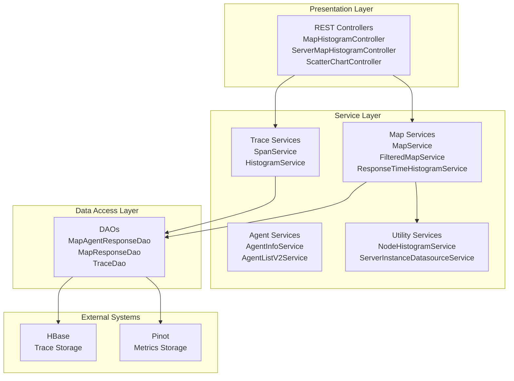
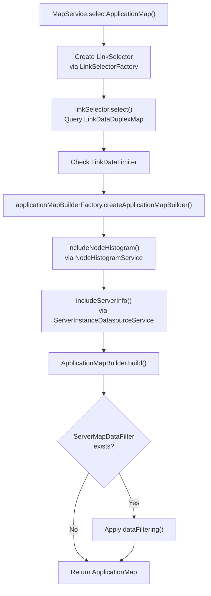
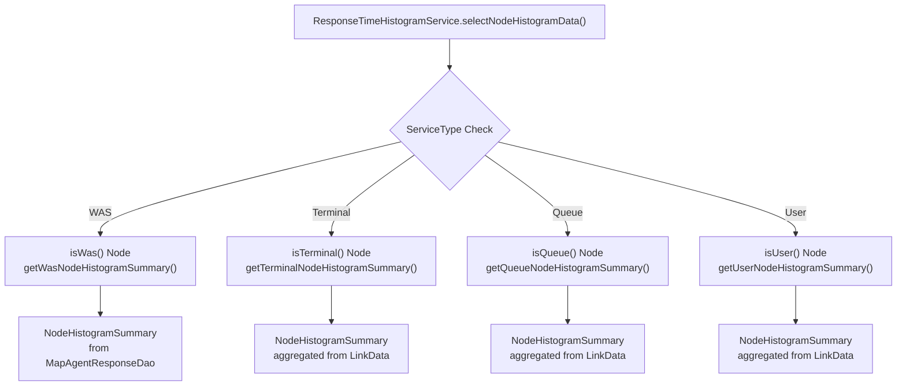

<!-- source: DeepWiki mcp.deepwiki.com · repo pinpoint-apm/pinpoint · page 6.2 Service Layer · fetched 2026-10-29 -->

# Service Layer

<details>
<summary>Relevant source files</summary>

The following files were used as context for generating this wiki page:

- [agent-module/plugins/dameng-jdbc/src/main/java/com/navercorp/pinpoint/plugin/jdbc/dameng/DamengJdbcUrlParser.java](agent-module/plugins/dameng-jdbc/src/main/java/com/navercorp/pinpoint/plugin/jdbc/dameng/DamengJdbcUrlParser.java)
- [agent-module/profiler/src/main/java/com/navercorp/pinpoint/profiler/plugin/PluginPackageClassRequirementFilter.java](agent-module/profiler/src/main/java/com/navercorp/pinpoint/profiler/plugin/PluginPackageClassRequirementFilter.java)
- [collector/src/main/java/com/navercorp/pinpoint/collector/grpc/channelz/service/ChannelzSocketLookup.java](collector/src/main/java/com/navercorp/pinpoint/collector/grpc/channelz/service/ChannelzSocketLookup.java)
- [commons-server/src/test/java/com/navercorp/pinpoint/common/util/KeyValueTokenizerTest.java](commons-server/src/test/java/com/navercorp/pinpoint/common/util/KeyValueTokenizerTest.java)
- [commons/src/main/java/com/navercorp/pinpoint/common/util/KeyValueTokenizer.java](commons/src/main/java/com/navercorp/pinpoint/common/util/KeyValueTokenizer.java)
- [inspector-module/inspector-web/src/main/java/com/navercorp/pinpoint/inspector/web/definition/metric/field/Field.java](inspector-module/inspector-web/src/main/java/com/navercorp/pinpoint/inspector/web/definition/metric/field/Field.java)
- [metric-module/metric-commons/src/main/java/com/navercorp/pinpoint/metric/common/model/TagUtils.java](metric-module/metric-commons/src/main/java/com/navercorp/pinpoint/metric/common/model/TagUtils.java)
- [metric-module/metric-commons/src/main/java/com/navercorp/pinpoint/metric/common/util/TagUtils.java](metric-module/metric-commons/src/main/java/com/navercorp/pinpoint/metric/common/util/TagUtils.java)
- [metric-module/metric-commons/src/test/java/com/navercorp/pinpoint/metric/common/util/TagUtilsTest.java](metric-module/metric-commons/src/test/java/com/navercorp/pinpoint/metric/common/util/TagUtilsTest.java)
- [metric-module/metric/src/main/java/com/navercorp/pinpoint/metric/web/mapping/Field.java](metric-module/metric/src/main/java/com/navercorp/pinpoint/metric/web/mapping/Field.java)
- [redis/src/main/java/com/navercorp/pinpoint/channel/redis/kv/RedisKVPubChannelProvider.java](redis/src/main/java/com/navercorp/pinpoint/channel/redis/kv/RedisKVPubChannelProvider.java)
- [redis/src/main/java/com/navercorp/pinpoint/channel/redis/kv/RedisKVSubChannelProvider.java](redis/src/main/java/com/navercorp/pinpoint/channel/redis/kv/RedisKVSubChannelProvider.java)
- [web/src/main/java/com/navercorp/pinpoint/web/applicationmap/ApplicationMap.java](web/src/main/java/com/navercorp/pinpoint/web/applicationmap/ApplicationMap.java)
- [web/src/main/java/com/navercorp/pinpoint/web/applicationmap/ApplicationMapBuilder.java](web/src/main/java/com/navercorp/pinpoint/web/applicationmap/ApplicationMapBuilder.java)
- [web/src/main/java/com/navercorp/pinpoint/web/applicationmap/ApplicationMapFactory.java](web/src/main/java/com/navercorp/pinpoint/web/applicationmap/ApplicationMapFactory.java)
- [web/src/main/java/com/navercorp/pinpoint/web/applicationmap/ApplicationMapView.java](web/src/main/java/com/navercorp/pinpoint/web/applicationmap/ApplicationMapView.java)
- [web/src/main/java/com/navercorp/pinpoint/web/applicationmap/ApplicationMapViewV3.java](web/src/main/java/com/navercorp/pinpoint/web/applicationmap/ApplicationMapViewV3.java)
- [web/src/main/java/com/navercorp/pinpoint/web/applicationmap/FilterMapViewV3.java](web/src/main/java/com/navercorp/pinpoint/web/applicationmap/FilterMapViewV3.java)
- [web/src/main/java/com/navercorp/pinpoint/web/applicationmap/MapView.java](web/src/main/java/com/navercorp/pinpoint/web/applicationmap/MapView.java)
- [web/src/main/java/com/navercorp/pinpoint/web/applicationmap/MapWrap.java](web/src/main/java/com/navercorp/pinpoint/web/applicationmap/MapWrap.java)
- [web/src/main/java/com/navercorp/pinpoint/web/applicationmap/SimpleApplicationMap.java](web/src/main/java/com/navercorp/pinpoint/web/applicationmap/SimpleApplicationMap.java)
- [web/src/main/java/com/navercorp/pinpoint/web/applicationmap/appender/histogram/DefaultNodeHistogramAppender.java](web/src/main/java/com/navercorp/pinpoint/web/applicationmap/appender/histogram/DefaultNodeHistogramAppender.java)
- [web/src/main/java/com/navercorp/pinpoint/web/applicationmap/appender/histogram/NodeHistogramAppender.java](web/src/main/java/com/navercorp/pinpoint/web/applicationmap/appender/histogram/NodeHistogramAppender.java)
- [web/src/main/java/com/navercorp/pinpoint/web/applicationmap/appender/server/DefaultServerGroupListFactory.java](web/src/main/java/com/navercorp/pinpoint/web/applicationmap/appender/server/DefaultServerGroupListFactory.java)
- [web/src/main/java/com/navercorp/pinpoint/web/applicationmap/appender/server/DefaultServerInfoAppender.java](web/src/main/java/com/navercorp/pinpoint/web/applicationmap/appender/server/DefaultServerInfoAppender.java)
- [web/src/main/java/com/navercorp/pinpoint/web/applicationmap/appender/server/EmptyServerGroupListFactory.java](web/src/main/java/com/navercorp/pinpoint/web/applicationmap/appender/server/EmptyServerGroupListFactory.java)
- [web/src/main/java/com/navercorp/pinpoint/web/applicationmap/appender/server/ServerGroupListFactory.java](web/src/main/java/com/navercorp/pinpoint/web/applicationmap/appender/server/ServerGroupListFactory.java)
- [web/src/main/java/com/navercorp/pinpoint/web/applicationmap/appender/server/ServerInfoAppender.java](web/src/main/java/com/navercorp/pinpoint/web/applicationmap/appender/server/ServerInfoAppender.java)
- [web/src/main/java/com/navercorp/pinpoint/web/applicationmap/appender/server/StatisticsServerGroupListFactory.java](web/src/main/java/com/navercorp/pinpoint/web/applicationmap/appender/server/StatisticsServerGroupListFactory.java)
- [web/src/main/java/com/navercorp/pinpoint/web/applicationmap/appender/server/datasource/AgentInfoServerGroupListDataSource.java](web/src/main/java/com/navercorp/pinpoint/web/applicationmap/appender/server/datasource/AgentInfoServerGroupListDataSource.java)
- [web/src/main/java/com/navercorp/pinpoint/web/applicationmap/appender/server/datasource/ServerGroupListDataSource.java](web/src/main/java/com/navercorp/pinpoint/web/applicationmap/appender/server/datasource/ServerGroupListDataSource.java)
- [web/src/main/java/com/navercorp/pinpoint/web/applicationmap/controller/MapHistogramController.java](web/src/main/java/com/navercorp/pinpoint/web/applicationmap/controller/MapHistogramController.java)
- [web/src/main/java/com/navercorp/pinpoint/web/applicationmap/controller/ServerMapHistogramController.java](web/src/main/java/com/navercorp/pinpoint/web/applicationmap/controller/ServerMapHistogramController.java)
- [web/src/main/java/com/navercorp/pinpoint/web/applicationmap/histogram/TimeHistogramFormat.java](web/src/main/java/com/navercorp/pinpoint/web/applicationmap/histogram/TimeHistogramFormat.java)
- [web/src/main/java/com/navercorp/pinpoint/web/applicationmap/link/LinkList.java](web/src/main/java/com/navercorp/pinpoint/web/applicationmap/link/LinkList.java)
- [web/src/main/java/com/navercorp/pinpoint/web/applicationmap/map/LinkSelectorType.java](web/src/main/java/com/navercorp/pinpoint/web/applicationmap/map/LinkSelectorType.java)
- [web/src/main/java/com/navercorp/pinpoint/web/applicationmap/nodes/AgentServerGroupListWriter.java](web/src/main/java/com/navercorp/pinpoint/web/applicationmap/nodes/AgentServerGroupListWriter.java)
- [web/src/main/java/com/navercorp/pinpoint/web/applicationmap/nodes/NodeList.java](web/src/main/java/com/navercorp/pinpoint/web/applicationmap/nodes/NodeList.java)
- [web/src/main/java/com/navercorp/pinpoint/web/applicationmap/nodes/ServerGroup.java](web/src/main/java/com/navercorp/pinpoint/web/applicationmap/nodes/ServerGroup.java)
- [web/src/main/java/com/navercorp/pinpoint/web/applicationmap/nodes/ServerGroupList.java](web/src/main/java/com/navercorp/pinpoint/web/applicationmap/nodes/ServerGroupList.java)
- [web/src/main/java/com/navercorp/pinpoint/web/applicationmap/service/CollisionReporter.java](web/src/main/java/com/navercorp/pinpoint/web/applicationmap/service/CollisionReporter.java)
- [web/src/main/java/com/navercorp/pinpoint/web/applicationmap/service/FilteredMapServiceImpl.java](web/src/main/java/com/navercorp/pinpoint/web/applicationmap/service/FilteredMapServiceImpl.java)
- [web/src/main/java/com/navercorp/pinpoint/web/applicationmap/service/HistogramService.java](web/src/main/java/com/navercorp/pinpoint/web/applicationmap/service/HistogramService.java)
- [web/src/main/java/com/navercorp/pinpoint/web/applicationmap/service/HistogramServiceImpl.java](web/src/main/java/com/navercorp/pinpoint/web/applicationmap/service/HistogramServiceImpl.java)
- [web/src/main/java/com/navercorp/pinpoint/web/applicationmap/service/MapServiceImpl.java](web/src/main/java/com/navercorp/pinpoint/web/applicationmap/service/MapServiceImpl.java)
- [web/src/main/java/com/navercorp/pinpoint/web/applicationmap/service/ResponseTimeHistogramService.java](web/src/main/java/com/navercorp/pinpoint/web/applicationmap/service/ResponseTimeHistogramService.java)
- [web/src/main/java/com/navercorp/pinpoint/web/applicationmap/service/ResponseTimeHistogramServiceImpl.java](web/src/main/java/com/navercorp/pinpoint/web/applicationmap/service/ResponseTimeHistogramServiceImpl.java)
- [web/src/main/java/com/navercorp/pinpoint/web/applicationmap/util/CancellableHistogramFactory.java](web/src/main/java/com/navercorp/pinpoint/web/applicationmap/util/CancellableHistogramFactory.java)
- [web/src/main/java/com/navercorp/pinpoint/web/applicationmap/util/TimeoutWatcher.java](web/src/main/java/com/navercorp/pinpoint/web/applicationmap/util/TimeoutWatcher.java)
- [web/src/main/java/com/navercorp/pinpoint/web/applicationmap/view/AgentHistogramNodeView.java](web/src/main/java/com/navercorp/pinpoint/web/applicationmap/view/AgentHistogramNodeView.java)
- [web/src/main/java/com/navercorp/pinpoint/web/applicationmap/view/AgentLinkView.java](web/src/main/java/com/navercorp/pinpoint/web/applicationmap/view/AgentLinkView.java)
- [web/src/main/java/com/navercorp/pinpoint/web/applicationmap/view/AgentTimeSeriesHistogramNodeView.java](web/src/main/java/com/navercorp/pinpoint/web/applicationmap/view/AgentTimeSeriesHistogramNodeView.java)
- [web/src/main/java/com/navercorp/pinpoint/web/applicationmap/view/FilteredHistogramView.java](web/src/main/java/com/navercorp/pinpoint/web/applicationmap/view/FilteredHistogramView.java)
- [web/src/main/java/com/navercorp/pinpoint/web/applicationmap/view/LinkHistogramSummaryView.java](web/src/main/java/com/navercorp/pinpoint/web/applicationmap/view/LinkHistogramSummaryView.java)
- [web/src/main/java/com/navercorp/pinpoint/web/applicationmap/view/NodeHistogramSummaryView.java](web/src/main/java/com/navercorp/pinpoint/web/applicationmap/view/NodeHistogramSummaryView.java)
- [web/src/main/java/com/navercorp/pinpoint/web/trace/dao/TraceDao.java](web/src/main/java/com/navercorp/pinpoint/web/trace/dao/TraceDao.java)
- [web/src/main/java/com/navercorp/pinpoint/web/trace/dao/hbase/HbaseTraceDaoV2.java](web/src/main/java/com/navercorp/pinpoint/web/trace/dao/hbase/HbaseTraceDaoV2.java)
- [web/src/main/java/com/navercorp/pinpoint/web/trace/dao/hbase/SpanQuery.java](web/src/main/java/com/navercorp/pinpoint/web/trace/dao/hbase/SpanQuery.java)
- [web/src/main/java/com/navercorp/pinpoint/web/trace/dao/hbase/SpanQueryBuilder.java](web/src/main/java/com/navercorp/pinpoint/web/trace/dao/hbase/SpanQueryBuilder.java)
- [web/src/main/java/com/navercorp/pinpoint/web/trace/dao/mapper/SpanMapperFactory.java](web/src/main/java/com/navercorp/pinpoint/web/trace/dao/mapper/SpanMapperFactory.java)
- [web/src/main/java/com/navercorp/pinpoint/web/trace/service/SpanService.java](web/src/main/java/com/navercorp/pinpoint/web/trace/service/SpanService.java)
- [web/src/main/java/com/navercorp/pinpoint/web/view/ApplicationTimeHistogramViewModel.java](web/src/main/java/com/navercorp/pinpoint/web/view/ApplicationTimeHistogramViewModel.java)
- [web/src/main/java/com/navercorp/pinpoint/web/vo/ApplicationPair.java](web/src/main/java/com/navercorp/pinpoint/web/vo/ApplicationPair.java)
- [web/src/main/java/com/navercorp/pinpoint/web/vo/ApplicationPairs.java](web/src/main/java/com/navercorp/pinpoint/web/vo/ApplicationPairs.java)
- [web/src/main/java/com/navercorp/pinpoint/web/vo/ApplicationPairsConverter.java](web/src/main/java/com/navercorp/pinpoint/web/vo/ApplicationPairsConverter.java)
- [web/src/main/java/com/navercorp/pinpoint/web/vo/SearchOption.java](web/src/main/java/com/navercorp/pinpoint/web/vo/SearchOption.java)
- [web/src/test/java/com/navercorp/pinpoint/web/applicationmap/ApplicationMapBuilderTest.java](web/src/test/java/com/navercorp/pinpoint/web/applicationmap/ApplicationMapBuilderTest.java)
- [web/src/test/java/com/navercorp/pinpoint/web/applicationmap/ApplicationMapTest.java](web/src/test/java/com/navercorp/pinpoint/web/applicationmap/ApplicationMapTest.java)
- [web/src/test/java/com/navercorp/pinpoint/web/applicationmap/ApplicationMapVerifier.java](web/src/test/java/com/navercorp/pinpoint/web/applicationmap/ApplicationMapVerifier.java)
- [web/src/test/java/com/navercorp/pinpoint/web/applicationmap/appender/server/ServerInfoAppenderTest.java](web/src/test/java/com/navercorp/pinpoint/web/applicationmap/appender/server/ServerInfoAppenderTest.java)
- [web/src/test/java/com/navercorp/pinpoint/web/applicationmap/service/FilteredMapServiceImplTest.java](web/src/test/java/com/navercorp/pinpoint/web/applicationmap/service/FilteredMapServiceImplTest.java)
- [web/src/test/java/com/navercorp/pinpoint/web/applicationmap/service/ResponseTimeHistogramServiceImplTest.java](web/src/test/java/com/navercorp/pinpoint/web/applicationmap/service/ResponseTimeHistogramServiceImplTest.java)
- [web/src/test/java/com/navercorp/pinpoint/web/applicationmap/util/TimeoutWatcherTest.java](web/src/test/java/com/navercorp/pinpoint/web/applicationmap/util/TimeoutWatcherTest.java)

</details>


## Purpose and Scope

The Service Layer provides the business logic tier of the Pinpoint Web application, mediating between REST controllers and data access objects (DAOs). This layer encapsulates complex data processing, aggregation, and transformation logic required to support the web UI and APIs. Services coordinate multiple DAO calls, apply business rules, and construct domain objects for presentation.

For information about the REST API endpoints that consume these services, see [REST API Reference](#6.1). For details on Web configuration, see [Web Configuration](#6.3).

## Service Layer Architecture

The service layer follows a standard three-tier architecture pattern where services sit between controllers and DAOs, providing transaction boundaries and business logic encapsulation.

### Architectural Position



**Sources:**
- [web/src/main/java/com/navercorp/pinpoint/web/applicationmap/service/MapServiceImpl.java:52-81]()
- [web/src/main/java/com/navercorp/pinpoint/web/applicationmap/controller/MapHistogramController.java:71-100]()
- [web/src/main/java/com/navercorp/pinpoint/web/applicationmap/service/ResponseTimeHistogramServiceImpl.java:61-81]()

## Core Service Categories

### Application Map Services

Application map services construct and visualize the distributed system topology and performance characteristics.

#### MapService

`MapService` is the primary service for building application maps by querying historical data across time ranges.

**Core Functionality:**

The `selectApplicationMap()` method [web/src/main/java/com/navercorp/pinpoint/web/applicationmap/service/MapServiceImpl.java:87-128]() orchestrates the map building process:



The service delegates to:
- `LinkSelectorFactory` to create appropriate link selectors (UNIDIRECTIONAL/BIDIRECTIONAL) [web/src/main/java/com/navercorp/pinpoint/web/applicationmap/service/MapServiceImpl.java:103-103]()
- `NodeHistogramService` to compute response time histograms [web/src/main/java/com/navercorp/pinpoint/web/applicationmap/service/MapServiceImpl.java:148-149]()
- `ServerInstanceDatasourceService` to aggregate server instance information [web/src/main/java/com/navercorp/pinpoint/web/applicationmap/service/MapServiceImpl.java:152-153]()
- `ApplicationMapBuilderFactory` to construct the final map [web/src/main/java/com/navercorp/pinpoint/web/applicationmap/service/MapServiceImpl.java:137-137]()

**Sources:**
- [web/src/main/java/com/navercorp/pinpoint/web/applicationmap/service/MapServiceImpl.java:1-154]()
- [web/src/main/java/com/navercorp/pinpoint/web/applicationmap/ApplicationMapBuilder.java:112-138]()

#### FilteredMapService

`FilteredMapService` builds application maps from specific transaction traces, useful for analyzing individual request flows.

The service operates on lists of transaction IDs (`ServerTraceId`) and reconstructs the application topology from those specific traces [web/src/main/java/com/navercorp/pinpoint/web/applicationmap/service/FilteredMapServiceImpl.java:110-119]():

1. **Fetch spans**: Retrieve filtered spans from `TraceDao` [web/src/main/java/com/navercorp/pinpoint/web/applicationmap/service/FilteredMapServiceImpl.java:111-111]()
2. **Build filtered map**: Use `FilteredMapBuilder` to process spans and extract link data [web/src/main/java/com/navercorp/pinpoint/web/applicationmap/service/FilteredMapServiceImpl.java:113-116]()
3. **Create map**: Build `ApplicationMap` with histogram and server info appenders [web/src/main/java/com/navercorp/pinpoint/web/applicationmap/service/FilteredMapServiceImpl.java:118-118]()

The `selectApplicationMapWithScatterData()` method [web/src/main/java/com/navercorp/pinpoint/web/applicationmap/service/FilteredMapServiceImpl.java:141-167]() additionally extracts scatter plot data for each application node.

**Sources:**
- [web/src/main/java/com/navercorp/pinpoint/web/applicationmap/service/FilteredMapServiceImpl.java:63-167]()
- [web/src/test/java/com/navercorp/pinpoint/web/applicationmap/service/FilteredMapServiceImplTest.java:121-128]()

#### ResponseTimeHistogramService

`ResponseTimeHistogramService` computes response time histograms for individual nodes and links in the application map. This service handles different node types with specialized logic.

**Node Type Processing:**



**WAS Node Processing** [web/src/main/java/com/navercorp/pinpoint/web/applicationmap/service/ResponseTimeHistogramServiceImpl.java:103-104]():
- Queries `MapAgentResponseDao.selectResponseTime()` directly [web/src/main/java/com/navercorp/pinpoint/web/applicationmap/service/ResponseTimeHistogramServiceImpl.java:93-93]()
- Fetches server instances from `ServerGroupListFactory` [web/src/main/java/com/navercorp/pinpoint/web/applicationmap/service/ResponseTimeHistogramServiceImpl.java:83-85]()

**Terminal/User/Queue Node Processing**:
- Scans links using `LinkSelector` with appropriate filters like `SourceApplicationFilter` or `DestinationApplicationFilter` [web/src/main/java/com/navercorp/pinpoint/web/applicationmap/service/ResponseTimeHistogramServiceImpl.java:128-130]()
- Aggregates histogram data from the resulting `LinkDataDuplexMap` [web/src/main/java/com/navercorp/pinpoint/web/applicationmap/service/ResponseTimeHistogramServiceImpl.java:137-140]()

**Sources:**
- [web/src/main/java/com/navercorp/pinpoint/web/applicationmap/service/ResponseTimeHistogramServiceImpl.java:91-116]()
- [web/src/test/java/com/navercorp/pinpoint/web/applicationmap/service/ResponseTimeHistogramServiceImplTest.java:101-131]()

#### HistogramService

`HistogramService` provides specialized link data retrieval and application relationship mapping.

**Key Responsibilities:**
- `selectLinkDataDuplexMap()`: Retrieves raw link data between applications based on search depth [web/src/main/java/com/navercorp/pinpoint/web/applicationmap/service/HistogramServiceImpl.java:67-93]().
- `selectLinkHistogramData()`: Builds a `LinkHistogramSummary` for a specific link between two applications [web/src/main/java/com/navercorp/pinpoint/web/applicationmap/service/HistogramServiceImpl.java:97-125]().
- `getFromApplications()` / `getToApplications()`: Extracts caller or callee application lists from a `LinkDataDuplexMap` [web/src/main/java/com/navercorp/pinpoint/web/applicationmap/service/HistogramServiceImpl.java:135-142]().

**Sources:**
- [web/src/main/java/com/navercorp/pinpoint/web/applicationmap/service/HistogramServiceImpl.java:54-142]()
- [web/src/main/java/com/navercorp/pinpoint/web/applicationmap/controller/ServerMapHistogramController.java:137-138]()

#### NodeHistogramService

`NodeHistogramService` provides factory methods for creating different types of histogram data sources.

**Implementation Details:**
The `NodeHistogramServiceImpl` creates `DefaultNodeHistogramFactory` instances using different data sources [web/src/main/java/com/navercorp/pinpoint/web/applicationmap/service/NodeHistogramServiceImpl.java:33-53]():
- `MapApplicationResponseNodeHistogramDataSource`: Uses `MapResponseDao` for application-level aggregates.
- `MapAgentResponseNodeHistogramDataSource`: Uses `MapAgentResponseDao` for agent-specific details.

**Sources:**
- [web/src/main/java/com/navercorp/pinpoint/web/applicationmap/service/NodeHistogramServiceImpl.java:1-53]()

## Key Implementation Classes

### ApplicationMapBuilder

The `ApplicationMapBuilder` is the central engine for assembling the `ApplicationMap`. It coordinates "Appenders" to enrich the map with performance data.

| Class | Function |
|-------|----------|
| `NodeHistogramAppender` | Appends response time histograms to each node in the map [web/src/main/java/com/navercorp/pinpoint/web/applicationmap/ApplicationMapBuilder.java:93-93](). |
| `ServerInfoAppender` | Appends server instance information (agent list, status) to nodes [web/src/main/java/com/navercorp/pinpoint/web/applicationmap/ApplicationMapBuilder.java:133-134](). |
| `LinkListFactory` | Creates the collection of links between nodes from raw data [web/src/main/java/com/navercorp/pinpoint/web/applicationmap/ApplicationMapBuilder.java:118-118](). |

**Sources:**
- [web/src/main/java/com/navercorp/pinpoint/web/applicationmap/ApplicationMapBuilder.java:48-140]()
- [web/src/main/java/com/navercorp/pinpoint/web/applicationmap/appender/server/DefaultServerInfoAppender.java:56-69]()

### ServerInfoAppender

The `DefaultServerInfoAppender` performs asynchronous retrieval of server information for all nodes in the map to improve performance.

**Asynchronous Execution:**
It uses `CompletableFuture` and a dedicated `Executor` to fetch `ServerGroupList` for each node [web/src/main/java/com/navercorp/pinpoint/web/applicationmap/appender/server/DefaultServerInfoAppender.java:94-113](). It then joins these futures with a configurable timeout [web/src/main/java/com/navercorp/pinpoint/web/applicationmap/appender/server/DefaultServerInfoAppender.java:116-133]().

**Sources:**
- [web/src/main/java/com/navercorp/pinpoint/web/applicationmap/appender/server/DefaultServerInfoAppender.java:42-149]()

## Service Implementation Patterns

### Dependency Injection and Component Scanning
Services are marked with the `@Service` annotation and use constructor-based injection for their DAOs and supporting factories.

Example from `FilteredMapServiceImpl` [web/src/main/java/com/navercorp/pinpoint/web/applicationmap/service/FilteredMapServiceImpl.java:83-97]():
```java
public FilteredMapServiceImpl(TraceDao traceDao,
                              ServiceTypeRegistryService registry,
                              ApplicationFactory applicationFactory,
                              NodeHistogramService nodeHistogramService,
                              ServerInstanceDatasourceService serverInstanceDatasourceService,
                              Optional<ServerMapDataFilter> serverMapDataFilter,
                              ApplicationMapBuilderFactory applicationMapBuilderFactory) {
    // ... assignment logic
}
```

### Timeout Management
Many service operations involving large data sets or multiple external calls (like HBase) implement timeout watchers. `ApplicationMapBuilder` uses a `TimeoutWatcher` to ensure map building doesn't exceed the global `web.servermap.build.timeout` [web/src/main/java/com/navercorp/pinpoint/web/applicationmap/ApplicationMapBuilder.java:126-127]().

**Sources:**
- [web/src/main/java/com/navercorp/pinpoint/web/applicationmap/service/MapServiceImpl.java:66-67]()
- [web/src/main/java/com/navercorp/pinpoint/web/applicationmap/ApplicationMapBuilder.java:112-138]()

---

