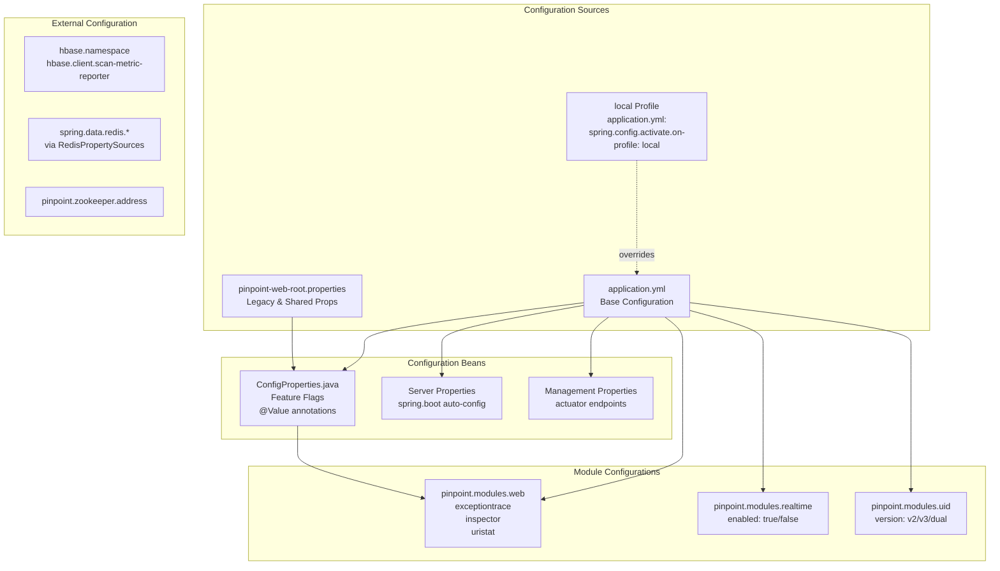
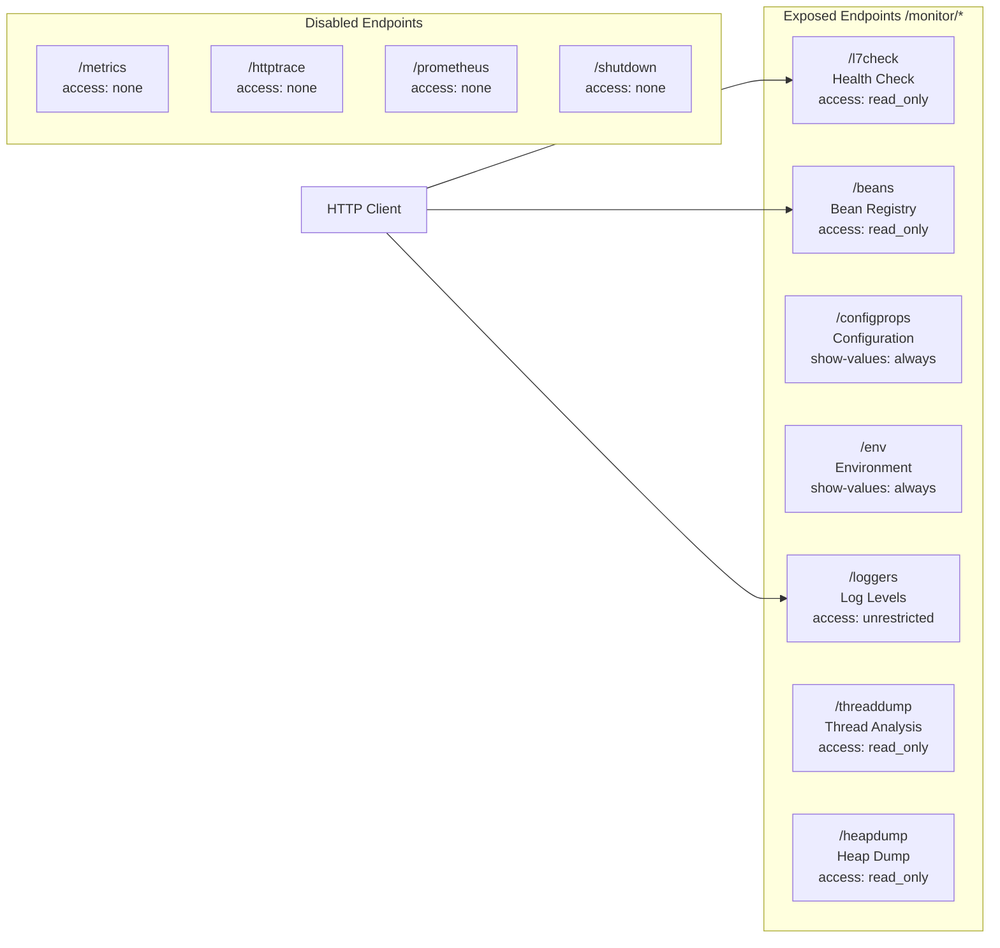
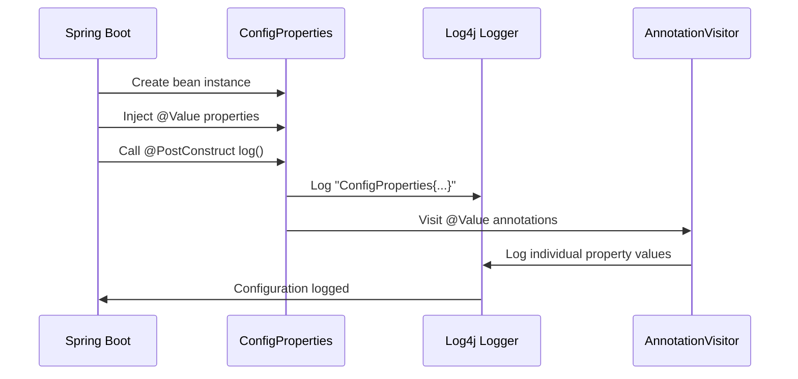

<!-- source: DeepWiki mcp.deepwiki.com · repo pinpoint-apm/pinpoint · page 6.3 Web Configuration · fetched 2026-10-29 -->

# Web Configuration

<details>
<summary>Relevant source files</summary>

The following files were used as context for generating this wiki page:

- [collector-starter/src/main/java/com/navercorp/pinpoint/collector/starter/multi/application/BasicCollectorApp.java](collector-starter/src/main/java/com/navercorp/pinpoint/collector/starter/multi/application/BasicCollectorApp.java)
- [collector-starter/src/main/java/com/navercorp/pinpoint/collector/starter/multi/application/PinpointCollectorStarter.java](collector-starter/src/main/java/com/navercorp/pinpoint/collector/starter/multi/application/PinpointCollectorStarter.java)
- [collector-starter/src/main/java/com/navercorp/pinpoint/collector/starter/multi/application/type/CollectorType.java](collector-starter/src/main/java/com/navercorp/pinpoint/collector/starter/multi/application/type/CollectorType.java)
- [collector-starter/src/main/java/com/navercorp/pinpoint/collector/starter/multi/application/type/CollectorTypeParser.java](collector-starter/src/main/java/com/navercorp/pinpoint/collector/starter/multi/application/type/CollectorTypeParser.java)
- [collector-starter/src/main/java/com/navercorp/pinpoint/collector/starter/multi/application/type/CollectorTypeSet.java](collector-starter/src/main/java/com/navercorp/pinpoint/collector/starter/multi/application/type/CollectorTypeSet.java)
- [collector-starter/src/main/java/com/navercorp/pinpoint/collector/starter/multi/application/type/FallbackCollectorTypeParser.java](collector-starter/src/main/java/com/navercorp/pinpoint/collector/starter/multi/application/type/FallbackCollectorTypeParser.java)
- [collector-starter/src/main/java/com/navercorp/pinpoint/collector/starter/multi/application/type/ShellBlockerConfig.java](collector-starter/src/main/java/com/navercorp/pinpoint/collector/starter/multi/application/type/ShellBlockerConfig.java)
- [collector-starter/src/main/java/com/navercorp/pinpoint/collector/starter/multi/application/type/ShellCollectorTypeParser.java](collector-starter/src/main/java/com/navercorp/pinpoint/collector/starter/multi/application/type/ShellCollectorTypeParser.java)
- [collector-starter/src/main/java/com/navercorp/pinpoint/collector/starter/multi/application/type/SimpleCollectorTypeParser.java](collector-starter/src/main/java/com/navercorp/pinpoint/collector/starter/multi/application/type/SimpleCollectorTypeParser.java)
- [collector-starter/src/main/resources/.gitignore](collector-starter/src/main/resources/.gitignore)
- [collector-starter/src/main/resources/application.yml](collector-starter/src/main/resources/application.yml)
- [collector/src/main/java/com/navercorp/pinpoint/collector/CollectorApp.java](collector/src/main/java/com/navercorp/pinpoint/collector/CollectorApp.java)
- [collector/src/main/java/com/navercorp/pinpoint/collector/PinpointCollectorModule.java](collector/src/main/java/com/navercorp/pinpoint/collector/PinpointCollectorModule.java)
- [collector/src/main/java/com/navercorp/pinpoint/collector/config/CollectorConfiguration.java](collector/src/main/java/com/navercorp/pinpoint/collector/config/CollectorConfiguration.java)
- [collector/src/main/java/com/navercorp/pinpoint/collector/event/SpanStorePublisher.java](collector/src/main/java/com/navercorp/pinpoint/collector/event/SpanStorePublisher.java)
- [collector/src/main/java/com/navercorp/pinpoint/collector/event/SpanStorePublisherImpl.java](collector/src/main/java/com/navercorp/pinpoint/collector/event/SpanStorePublisherImpl.java)
- [collector/src/main/java/com/navercorp/pinpoint/collector/event/config/CollectorEventConfiguration.java](collector/src/main/java/com/navercorp/pinpoint/collector/event/config/CollectorEventConfiguration.java)
- [collector/src/main/resources/application.yml](collector/src/main/resources/application.yml)
- [collector/src/main/resources/pinpoint-collector-root.properties](collector/src/main/resources/pinpoint-collector-root.properties)
- [collector/src/main/resources/profiles/local/pinpoint-collector-grpc.properties](collector/src/main/resources/profiles/local/pinpoint-collector-grpc.properties)
- [collector/src/main/resources/profiles/release/pinpoint-collector-grpc.properties](collector/src/main/resources/profiles/release/pinpoint-collector-grpc.properties)
- [commons-hbase/src/main/java/com/navercorp/pinpoint/common/hbase/config/HbaseNamespaceConfiguration.java](commons-hbase/src/main/java/com/navercorp/pinpoint/common/hbase/config/HbaseNamespaceConfiguration.java)
- [commons-server/src/main/java/com/navercorp/pinpoint/common/server/event/ContextData.java](commons-server/src/main/java/com/navercorp/pinpoint/common/server/event/ContextData.java)
- [commons-server/src/main/java/com/navercorp/pinpoint/common/server/event/ContextSupplier.java](commons-server/src/main/java/com/navercorp/pinpoint/common/server/event/ContextSupplier.java)
- [commons-server/src/main/java/com/navercorp/pinpoint/common/server/event/InsertEvent.java](commons-server/src/main/java/com/navercorp/pinpoint/common/server/event/InsertEvent.java)
- [commons-server/src/main/java/com/navercorp/pinpoint/common/server/event/SimpleContextSupplier.java](commons-server/src/main/java/com/navercorp/pinpoint/common/server/event/SimpleContextSupplier.java)
- [commons-server/src/main/java/com/navercorp/pinpoint/common/server/event/SpanChunkInsertEvent.java](commons-server/src/main/java/com/navercorp/pinpoint/common/server/event/SpanChunkInsertEvent.java)
- [commons-server/src/main/java/com/navercorp/pinpoint/common/server/event/SpanInsertEvent.java](commons-server/src/main/java/com/navercorp/pinpoint/common/server/event/SpanInsertEvent.java)
- [datasource/src/main/java/com/navercorp/pinpoint/datasource/MainDataSourceConfiguration.java](datasource/src/main/java/com/navercorp/pinpoint/datasource/MainDataSourceConfiguration.java)
- [otlpmetric/otlpmetric-web/src/main/resources/otlpmetric/web/profiles/local/otlpmetric-web.properties](otlpmetric/otlpmetric-web/src/main/resources/otlpmetric/web/profiles/local/otlpmetric-web.properties)
- [otlpmetric/otlpmetric-web/src/main/resources/otlpmetric/web/profiles/release/otlpmetric-web.properties](otlpmetric/otlpmetric-web/src/main/resources/otlpmetric/web/profiles/release/otlpmetric-web.properties)
- [realtime/realtime-collector/src/main/java/com/navercorp/pinpoint/realtime/collector/RealtimeCollectorServerConfig.java](realtime/realtime-collector/src/main/java/com/navercorp/pinpoint/realtime/collector/RealtimeCollectorServerConfig.java)
- [redis/src/main/java/com/navercorp/pinpoint/redis/RedisBasicConfig.java](redis/src/main/java/com/navercorp/pinpoint/redis/RedisBasicConfig.java)
- [redis/src/main/java/com/navercorp/pinpoint/redis/RedisPropertySources.java](redis/src/main/java/com/navercorp/pinpoint/redis/RedisPropertySources.java)
- [redis/src/main/resources/redis/profiles/local/redis.properties](redis/src/main/resources/redis/profiles/local/redis.properties)
- [redis/src/main/resources/redis/profiles/release/redis.properties](redis/src/main/resources/redis/profiles/release/redis.properties)
- [redis/src/main/resources/redis/redis-root.properties](redis/src/main/resources/redis/redis-root.properties)
- [web-starter/src/main/java/com/navercorp/pinpoint/web/starter/multi/PinpointWebStarter.java](web-starter/src/main/java/com/navercorp/pinpoint/web/starter/multi/PinpointWebStarter.java)
- [web-starter/src/main/resources/application.yml](web-starter/src/main/resources/application.yml)
- [web/src/main/java/com/navercorp/pinpoint/web/WebApp.java](web/src/main/java/com/navercorp/pinpoint/web/WebApp.java)
- [web/src/main/java/com/navercorp/pinpoint/web/config/ConfigProperties.java](web/src/main/java/com/navercorp/pinpoint/web/config/ConfigProperties.java)
- [web/src/main/java/com/navercorp/pinpoint/web/servlet/HttpIntentRoutingFilter.java](web/src/main/java/com/navercorp/pinpoint/web/servlet/HttpIntentRoutingFilter.java)
- [web/src/main/resources/application.yml](web/src/main/resources/application.yml)
- [web/src/main/resources/pinpoint-web-root.properties](web/src/main/resources/pinpoint-web-root.properties)
- [web/src/test/java/com/navercorp/pinpoint/web/servlet/HttpIntentRoutingFilterTest.java](web/src/test/java/com/navercorp/pinpoint/web/servlet/HttpIntentRoutingFilterTest.java)

</details>


This document describes the configuration system for the Pinpoint Web application, including Spring Boot properties, feature flags, API limits, module settings, and external dependency configuration. For REST API endpoint documentation, see [REST API Reference](#6.1). For WebSocket-specific real-time features, see [WebSocket Real-time Features](#6.4).

## Configuration Overview

The Pinpoint Web application uses Spring Boot's hierarchical configuration system with YAML files and Java `@Value` annotated beans. Configuration is organized into multiple layers:

- **Base Configuration**: Core Spring Boot and Pinpoint settings in `application.yml` [web/src/main/resources/application.yml:1-114]().
- **Root Properties**: Legacy and component-specific properties in `pinpoint-web-root.properties` [web/src/main/resources/pinpoint-web-root.properties:1-145]().
- **Profile Configuration**: Environment-specific overrides (local, release) [web/src/main/resources/application.yml:115-117]().
- **Module Configuration**: Feature module enablement under `pinpoint.modules.web` [web-starter/src/main/resources/application.yml:85-104]().

The configuration system supports dynamic feature toggling, API rate limiting, and external service integration.

**Sources**: [web/src/main/resources/application.yml:1-120](), [web/src/main/java/com/navercorp/pinpoint/web/config/ConfigProperties.java:32-225](), [web/src/main/resources/pinpoint-web-root.properties:1-145]()

## Configuration File Structure



**Sources**: [web/src/main/resources/application.yml:1-120](), [web/src/main/java/com/navercorp/pinpoint/web/WebApp.java:35-63](), [web/src/main/resources/pinpoint-web-root.properties:1-145]()

## Server Configuration

### Basic Server Settings

The web application runs as an embedded Tomcat server with configurable ports and error handling.

| Property | Default | Description |
|----------|---------|-------------|
| `server.port` | `8080` | Main HTTP port for web application [web/src/main/resources/application.yml:12]() |
| `server.error.path` | `/api/error` | Custom error handling endpoint [web/src/main/resources/application.yml:14]() |
| `server.max-http-request-header-size` | `32KB` | Maximum HTTP header size [web/src/main/resources/application.yml:21]() |
| `management.server.port` | `8443` | Management/actuator endpoint port [web/src/main/resources/application.yml:81]() |

### HTTP Compression

Response compression is enabled for JSON payloads to reduce bandwidth:

```yaml
server:
  compression:
    enabled: true
    mime-types: application/json
    min-response-size: 2KB
```
**Sources**: [web/src/main/resources/application.yml:22-25]()

### Error Handling

Error responses include full diagnostic information for debugging by default:

```yaml
server:
  error:
    include-exception: true
    include-message: always
    include-binding-errors: always
    include-stacktrace: always
```
**Sources**: [web/src/main/resources/application.yml:13-20]()

## Management Endpoints

Spring Boot Actuator endpoints provide operational monitoring and management capabilities. The web application exposes selected endpoints with role-based access control.



**Endpoint Configuration**:
- **Base Path**: `/monitor` [web/src/main/resources/application.yml:75]()
- **Health Mapping**: `/monitor/l7check` for load balancer checks [web/src/main/resources/application.yml:77]()
- **Exposure**: Includes `health,beans,conditions,configprops,env,logfile,loggers,mappings,info,threaddump,heapdump,pause` [web/src/main/resources/application.yml:74-76]()

**Sources**: [web/src/main/resources/application.yml:27-82](), [web-starter/src/main/resources/application.yml:29-83]()

## Feature Flags

The `ConfigProperties` class [web/src/main/java/com/navercorp/pinpoint/web/config/ConfigProperties.java:32-225]() provides boolean flags to enable/disable UI features and functionality.

### UI Display Toggles

| Property | Default | Description |
|----------|---------|-------------|
| `config.show.activeThread` | `false` | Show real-time active thread counts in UI [web/src/main/java/com/navercorp/pinpoint/web/config/ConfigProperties.java:42-43]() |
| `config.show.activeThreadDump` | `false` | Display thread dump viewer UI [web/src/main/java/com/navercorp/pinpoint/web/config/ConfigProperties.java:45-46]() |
| `config.show.applicationStat` | `false` | Show application-level statistics [web/src/main/java/com/navercorp/pinpoint/web/config/ConfigProperties.java:60-61]() |
| `pinpoint.modules.web.systemmetric.enabled` | `false` | Enable system metric visualization [web/src/main/java/com/navercorp/pinpoint/web/config/ConfigProperties.java:66-67]() |
| `pinpoint.modules.web.uristat.enabled` | `false` | Enable URI statistics page [web/src/main/java/com/navercorp/pinpoint/web/config/ConfigProperties.java:69-70]() |
| `pinpoint.modules.web.exceptiontrace.enabled` | `false` | Show exception trace analysis [web/src/main/java/com/navercorp/pinpoint/web/config/ConfigProperties.java:72-73]() |
| `pinpoint.modules.web.inspector.enabled` | `false` | Enable inspector module UI [web/src/main/java/com/navercorp/pinpoint/web/config/ConfigProperties.java:78-79]() |
| `pinpoint.modules.web.heatmap.enabled` | `false` | Enable heatmap visualizations [web/src/main/java/com/navercorp/pinpoint/web/config/ConfigProperties.java:81-82]() |

### Capability Toggles

| Property | Default | Description |
|----------|---------|-------------|
| `config.enable.activeThreadDump` | `false` | Allow thread dump capture from agents [web/src/main/java/com/navercorp/pinpoint/web/config/ConfigProperties.java:48-49]() |
| `config.enable.serverMapRealTime` | `false` | Enable real-time server map updates [web/src/main/java/com/navercorp/pinpoint/web/config/ConfigProperties.java:51-52]() |
| `config.editUserInfo` | `true` | Allow users to edit profile information [web/src/main/java/com/navercorp/pinpoint/web/config/ConfigProperties.java:39-40]() |
| `pinpoint.modules.web.webhook` | `false` | Enable webhook notification system [web/src/main/java/com/navercorp/pinpoint/web/config/ConfigProperties.java:87-88]() |

**Sources**: [web/src/main/java/com/navercorp/pinpoint/web/config/ConfigProperties.java:36-189](), [web/src/main/resources/pinpoint-web-root.properties:14-25]()

## API Limits and Periods

The web application enforces query time range limits and provides predefined intervals for data aggregation.

### Server Map Configuration

| Property | Default | Description |
|----------|---------|-------------|
| `web.servermap.api.period.max` | `2` (days) | Maximum allowed lookback period for Server Map API [web/src/main/resources/pinpoint-web-root.properties:60]() |
| `web.servermap.api.period.interval` | `5m,20m,1h,3h,6h,12h,1d,2d` | Predefined aggregation intervals for Server Map [web/src/main/resources/pinpoint-web-root.properties:61]() |

### Inspector Configuration

| Property | Default | Description |
|----------|---------|-------------|
| `web.inspector.api.period.max` | `42` (days) | Maximum allowed lookback period for Inspector API [web/src/main/resources/pinpoint-web-root.properties:62]() |
| `web.inspector.api.period.interval` | `5m...6w` | Predefined aggregation intervals for Inspector [web/src/main/resources/pinpoint-web-root.properties:63]() |

**Sources**: [web/src/main/java/com/navercorp/pinpoint/web/config/ConfigProperties.java:90-101](), [web/src/main/resources/pinpoint-web-root.properties:57-63]()

## Module Configuration

The `pinpoint.modules` namespace controls feature modules that can be independently enabled or disabled.

### Core Module Settings

```yaml
pinpoint:
  modules:
    web:
      install:
        type: github  # or url [web/src/main/resources/application.yml:88]
      login: basicLogin # [web/src/main/resources/application.yml:90]
      webhook: true # [web/src/main/resources/application.yml:91]
    realtime:
      enabled: false # [web/src/main/resources/application.yml:93]
    uid:
      version: v3 # v2: legacy, v3: new, dual: migration [web/src/main/resources/application.yml:96]
```

### Module Enablement in Web-Starter

The `web-starter` application enables most advanced modules by default:

```yaml
pinpoint:
  modules:
    web:
      exceptiontrace.enabled: true
      inspector.enabled: true
      otlpmetric.enabled: true
      heatmap.enabled: true
      uristat.enabled: true
      systemmetric.enabled: true
    realtime.enabled: true
```
**Sources**: [web-starter/src/main/resources/application.yml:85-104]()

## WebSocket Configuration

WebSocket connections support real-time features like active thread count monitoring. Configuration controls timeouts and buffer sizes.

| Property | Default | Description |
|----------|---------|-------------|
| `pinpoint.web.websocket.max-session-idle-timeout` | `10800000` (3h) | Max idle time before session cleanup [web/src/main/resources/application.yml:110]() |
| `websocket.allowedOrigins` | `null` | CORS configuration for WebSocket [web/src/main/java/com/navercorp/pinpoint/web/config/ConfigProperties.java:84-85]() |

**Sources**: [web/src/main/resources/application.yml:108-113](), [web/src/main/java/com/navercorp/pinpoint/web/config/ConfigProperties.java:159-161]()

## External Dependencies Configuration

### HBase Configuration

HBase client settings and namespace configuration:

| Property | Default | Description |
|----------|---------|-------------|
| `hbase.client.scan-metric-reporter.enable` | `false` | Enable HBase scan metrics [web/src/main/resources/application.yml:104]() |
| `web.hbase.selectSpans.limit` | `500` | Limit for span selection queries [web/src/main/resources/pinpoint-web-root.properties:26]() |
| `web.hbase.trace.max.results.limit` | `50000` | Max results for trace queries [web/src/main/resources/pinpoint-web-root.properties:28]() |

### Redis Configuration

Redis is used for real-time data pub-sub and caching. Configuration is loaded via `RedisPropertySources` [redis/src/main/java/com/navercorp/pinpoint/redis/RedisPropertySources.java:24-32]().

```properties
# From redis-root.properties
spring.data.redis.host=localhost
spring.data.redis.port=6379
```
**Sources**: [redis/src/main/resources/redis/redis-root.properties:1-4](), [redis/src/main/resources/redis/profiles/local/redis.properties:1-14]()

### ZooKeeper Configuration

ZooKeeper address for service coordination:

```properties
pinpoint.zookeeper.address=localhost
```
**Sources**: [web/src/main/resources/pinpoint-web-root.properties:1]()

## Configuration Bean Lifecycle

Configuration properties are loaded and validated through Spring's bean lifecycle with diagnostic logging.



### Configuration Logging

The `ConfigProperties` class uses `@PostConstruct` to log all configuration values at startup:

```java
@PostConstruct
public void log() {
    logger.info("{}", this);
    AnnotationVisitor<Value> annotationVisitor = new AnnotationVisitor<>(Value.class);
    annotationVisitor.visit(this, new LoggingEvent(this.logger));
}
```
**Sources**: [web/src/main/java/com/navercorp/pinpoint/web/config/ConfigProperties.java:191-196]()

## Experimental Configuration

Experimental flags for features under development or performance tuning:

| Property | Default | Description |
|----------|---------|-------------|
| `experimental.enableServerSideScanForScatter.value` | `false` | Server-side scanning for scatter charts [web/src/main/resources/pinpoint-web-root.properties:137]() |
| `experimental.sampleScatter.value` | `true` | Sample data in scatter charts [web/src/main/resources/pinpoint-web-root.properties:143]() |
| `experimental.enableServiceMap.value` | `false` | Enable service-based application map grouping [web/src/main/resources/pinpoint-web-root.properties:145]() |

**Sources**: [web/src/main/resources/pinpoint-web-root.properties:136-145]()

---

