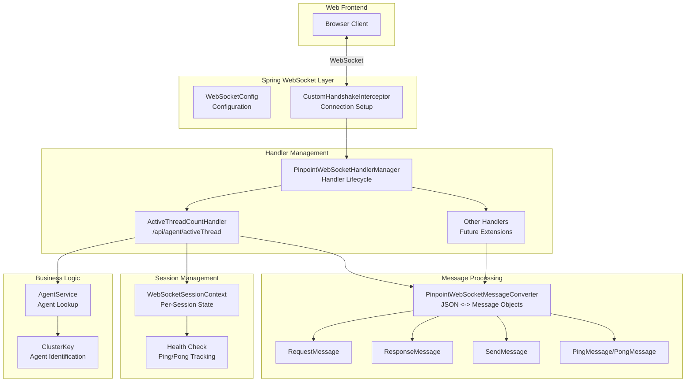
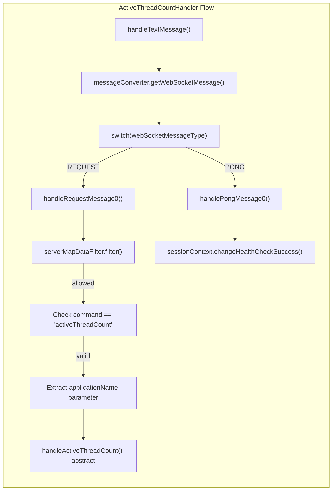
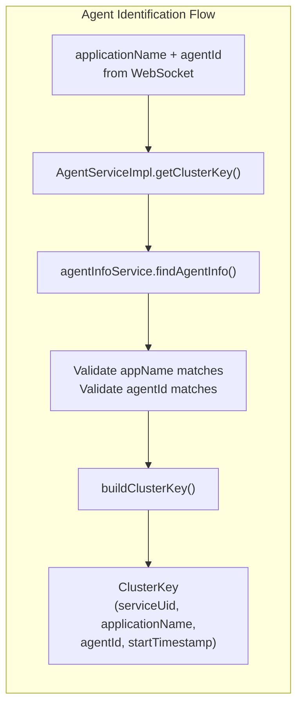

<!-- source: DeepWiki mcp.deepwiki.com · repo pinpoint-apm/pinpoint · page 6.4 WebSocket Real-time Features · fetched 2026-10-29 -->

# WebSocket Real-time Features

<details>
<summary>Relevant source files</summary>

The following files were used as context for generating this wiki page:

- [agent-module/profiler/src/main/java/com/navercorp/pinpoint/profiler/context/active/DefaultActiveTraceRepository.java](agent-module/profiler/src/main/java/com/navercorp/pinpoint/profiler/context/active/DefaultActiveTraceRepository.java)
- [agent-module/profiler/src/main/java/com/navercorp/pinpoint/profiler/context/active/EmptyActiveTraceRepository.java](agent-module/profiler/src/main/java/com/navercorp/pinpoint/profiler/context/active/EmptyActiveTraceRepository.java)
- [agent-module/profiler/src/test/java/com/navercorp/pinpoint/profiler/context/active/DefaultActiveTraceHistogramTest.java](agent-module/profiler/src/test/java/com/navercorp/pinpoint/profiler/context/active/DefaultActiveTraceHistogramTest.java)
- [agent-module/profiler/src/test/java/com/navercorp/pinpoint/profiler/context/active/EmptyActiveTraceHistogramTest.java](agent-module/profiler/src/test/java/com/navercorp/pinpoint/profiler/context/active/EmptyActiveTraceHistogramTest.java)
- [agent-module/profiler/src/test/java/com/navercorp/pinpoint/profiler/monitor/metric/rpc/DefaultAcceptHistogram.java](agent-module/profiler/src/test/java/com/navercorp/pinpoint/profiler/monitor/metric/rpc/DefaultAcceptHistogram.java)
- [commons/src/main/java/com/navercorp/pinpoint/common/trace/BaseHistogramSchema.java](commons/src/main/java/com/navercorp/pinpoint/common/trace/BaseHistogramSchema.java)
- [commons/src/main/java/com/navercorp/pinpoint/common/trace/HistogramSchema.java](commons/src/main/java/com/navercorp/pinpoint/common/trace/HistogramSchema.java)
- [commons/src/main/java/com/navercorp/pinpoint/common/trace/HistogramSchemas.java](commons/src/main/java/com/navercorp/pinpoint/common/trace/HistogramSchemas.java)
- [commons/src/main/java/com/navercorp/pinpoint/common/trace/HistogramSlot.java](commons/src/main/java/com/navercorp/pinpoint/common/trace/HistogramSlot.java)
- [commons/src/main/java/com/navercorp/pinpoint/common/trace/HistogramSlotGroup.java](commons/src/main/java/com/navercorp/pinpoint/common/trace/HistogramSlotGroup.java)
- [commons/src/main/java/com/navercorp/pinpoint/common/trace/NodeCategory.java](commons/src/main/java/com/navercorp/pinpoint/common/trace/NodeCategory.java)
- [commons/src/main/java/com/navercorp/pinpoint/common/trace/ServiceTypeCategory.java](commons/src/main/java/com/navercorp/pinpoint/common/trace/ServiceTypeCategory.java)
- [commons/src/main/java/com/navercorp/pinpoint/common/trace/SlotType.java](commons/src/main/java/com/navercorp/pinpoint/common/trace/SlotType.java)
- [commons/src/test/java/com/navercorp/pinpoint/common/trace/BaseHistogramSchemaTest.java](commons/src/test/java/com/navercorp/pinpoint/common/trace/BaseHistogramSchemaTest.java)
- [web/src/main/java/com/navercorp/pinpoint/web/applicationmap/histogram/AgentTimeHistogram.java](web/src/main/java/com/navercorp/pinpoint/web/applicationmap/histogram/AgentTimeHistogram.java)
- [web/src/main/java/com/navercorp/pinpoint/web/applicationmap/histogram/ApplicationTimeHistogram.java](web/src/main/java/com/navercorp/pinpoint/web/applicationmap/histogram/ApplicationTimeHistogram.java)
- [web/src/main/java/com/navercorp/pinpoint/web/applicationmap/histogram/Histogram.java](web/src/main/java/com/navercorp/pinpoint/web/applicationmap/histogram/Histogram.java)
- [web/src/main/java/com/navercorp/pinpoint/web/service/AgentService.java](web/src/main/java/com/navercorp/pinpoint/web/service/AgentService.java)
- [web/src/main/java/com/navercorp/pinpoint/web/service/AgentServiceImpl.java](web/src/main/java/com/navercorp/pinpoint/web/service/AgentServiceImpl.java)
- [web/src/main/java/com/navercorp/pinpoint/web/view/HistogramSerializer.java](web/src/main/java/com/navercorp/pinpoint/web/view/HistogramSerializer.java)
- [web/src/main/java/com/navercorp/pinpoint/web/vo/ResponseTime.java](web/src/main/java/com/navercorp/pinpoint/web/vo/ResponseTime.java)
- [web/src/main/java/com/navercorp/pinpoint/web/websocket/ActiveThreadCountHandler.java](web/src/main/java/com/navercorp/pinpoint/web/websocket/ActiveThreadCountHandler.java)
- [web/src/main/java/com/navercorp/pinpoint/web/websocket/CustomHandshakeInterceptor.java](web/src/main/java/com/navercorp/pinpoint/web/websocket/CustomHandshakeInterceptor.java)
- [web/src/main/java/com/navercorp/pinpoint/web/websocket/DefaultWebSocketHandlerDecoratorFactory.java](web/src/main/java/com/navercorp/pinpoint/web/websocket/DefaultWebSocketHandlerDecoratorFactory.java)
- [web/src/main/java/com/navercorp/pinpoint/web/websocket/PinpointWebSocketHandlerManager.java](web/src/main/java/com/navercorp/pinpoint/web/websocket/PinpointWebSocketHandlerManager.java)
- [web/src/main/java/com/navercorp/pinpoint/web/websocket/message/PingMessage.java](web/src/main/java/com/navercorp/pinpoint/web/websocket/message/PingMessage.java)
- [web/src/main/java/com/navercorp/pinpoint/web/websocket/message/PinpointWebSocketMessageConverter.java](web/src/main/java/com/navercorp/pinpoint/web/websocket/message/PinpointWebSocketMessageConverter.java)
- [web/src/main/java/com/navercorp/pinpoint/web/websocket/message/PongMessage.java](web/src/main/java/com/navercorp/pinpoint/web/websocket/message/PongMessage.java)
- [web/src/main/java/com/navercorp/pinpoint/web/websocket/message/RequestMessage.java](web/src/main/java/com/navercorp/pinpoint/web/websocket/message/RequestMessage.java)
- [web/src/main/java/com/navercorp/pinpoint/web/websocket/message/ResponseMessage.java](web/src/main/java/com/navercorp/pinpoint/web/websocket/message/ResponseMessage.java)
- [web/src/main/java/com/navercorp/pinpoint/web/websocket/message/SendMessage.java](web/src/main/java/com/navercorp/pinpoint/web/websocket/message/SendMessage.java)
- [web/src/main/java/com/navercorp/pinpoint/web/websocket/message/UnknownMessage.java](web/src/main/java/com/navercorp/pinpoint/web/websocket/message/UnknownMessage.java)
- [web/src/test/java/com/navercorp/pinpoint/web/applicationmap/histogram/AgentTimeHistogramTest.java](web/src/test/java/com/navercorp/pinpoint/web/applicationmap/histogram/AgentTimeHistogramTest.java)
- [web/src/test/java/com/navercorp/pinpoint/web/applicationmap/histogram/ApplicationTimeHistogramTest.java](web/src/test/java/com/navercorp/pinpoint/web/applicationmap/histogram/ApplicationTimeHistogramTest.java)
- [web/src/test/java/com/navercorp/pinpoint/web/applicationmap/histogram/HistogramTest.java](web/src/test/java/com/navercorp/pinpoint/web/applicationmap/histogram/HistogramTest.java)
- [web/src/test/java/com/navercorp/pinpoint/web/websocket/message/PinpointWebSocketMessageConverterTest.java](web/src/test/java/com/navercorp/pinpoint/web/websocket/message/PinpointWebSocketMessageConverterTest.java)

</details>


## Purpose and Scope

This document covers the WebSocket-based real-time monitoring features in the Pinpoint Web application. WebSocket connections enable bidirectional communication between the frontend and backend, allowing the Web UI to receive live updates without polling. The primary use case is **Active Thread Count (ATC)** monitoring, which displays real-time thread activity for monitored agents.

For general Web application architecture, see [Web Application Architecture](#3.4). For REST API endpoints, see [REST API Reference](#6.1). For frontend WebSocket client implementation, see [Frontend Architecture](#7.1).

---

## WebSocket Architecture Overview

The WebSocket subsystem in Pinpoint Web is built on Spring WebSocket with a custom message protocol. It supports multiple concurrent handlers, each registered to specific endpoints.

Title: WebSocket System Architecture


**Sources:** [web/src/main/java/com/navercorp/pinpoint/web/websocket/ActiveThreadCountHandler.java:39-59](), [web/src/main/java/com/navercorp/pinpoint/web/websocket/PinpointWebSocketHandlerManager.java:31-72](), [web/src/main/java/com/navercorp/pinpoint/web/websocket/message/PinpointWebSocketMessageConverter.java:34-144]()

---

## Message Protocol

Pinpoint WebSocket communication uses a JSON-based message protocol with five message types defined in `PinpointWebSocketMessageType`.

### Message Types

| Type | Direction | Purpose | Message Class |
|------|-----------|---------|---------------|
| `REQUEST` | Client → Server | Request data or action | `RequestMessage` |
| `RESPONSE` | Server → Client | Response to request | `ResponseMessage` |
| `SEND` | Client → Server | Send data without expecting response | `SendMessage` |
| `PING` | Client → Server | Health check request | `PingMessage` |
| `PONG` | Server → Client | Health check response | `PongMessage` |

### Message Structure

All messages include a `type` field. Command-based messages (`REQUEST`, `RESPONSE`, `SEND`) include additional fields:

**RequestMessage Format:**
```json
{
  "type": "REQUEST",
  "command": "activeThreadCount",
  "parameters": {
    "applicationName": "myapp"
  }
}
```

**ResponseMessage Format:**
```json
{
  "type": "RESPONSE",
  "command": "activeThreadCount",
  "result": {
    "status": "ok",
    "data": {...}
  }
}
```

**Sources:** [web/src/main/java/com/navercorp/pinpoint/web/websocket/message/RequestMessage.java:23-51](), [web/src/main/java/com/navercorp/pinpoint/web/websocket/message/ResponseMessage.java:23-52](), [web/src/main/java/com/navercorp/pinpoint/web/websocket/message/SendMessage.java:23-52]()

### Message Converter

The `PinpointWebSocketMessageConverter` class handles serialization and deserialization using Jackson ObjectMapper.

**Key Methods:**

| Method | Purpose |
|--------|---------|
| `getWebSocketMessage(String)` | Parse JSON string into message object |
| `getRequestTextMessage(String, Map)` | Create REQUEST message JSON |
| `getResponseTextMessage(String, Map)` | Create RESPONSE message JSON |
| `getPingTextMessage()` | Create PING message JSON |

The converter uses Jackson's `readTree()` method to parse messages safely, determining the message type by inspecting the `type` field [web/src/main/java/com/navercorp/pinpoint/web/websocket/message/PinpointWebSocketMessageConverter.java:66-87]().

**Sources:** [web/src/main/java/com/navercorp/pinpoint/web/websocket/message/PinpointWebSocketMessageConverter.java:34-143](), [web/src/test/java/com/navercorp/pinpoint/web/websocket/message/PinpointWebSocketMessageConverterTest.java:40-129]()

---

## Active Thread Count Monitoring

The primary WebSocket feature is real-time Active Thread Count (ATC) monitoring, which tracks the number of active threads in each agent.

Title: ActiveThreadCountHandler Request Processing


**Sources:** [web/src/main/java/com/navercorp/pinpoint/web/websocket/ActiveThreadCountHandler.java:75-116]()

### Request Flow

When a client requests active thread count data:

1. **Client sends REQUEST message** with `command: "activeThreadCount"` and `parameters: { applicationName: "..." }` [web/src/main/java/com/navercorp/pinpoint/web/websocket/ActiveThreadCountHandler.java:96-98]()

2. **Handler validates** the message through `ServerMapDataFilter` (if configured) [web/src/main/java/com/navercorp/pinpoint/web/websocket/ActiveThreadCountHandler.java:91-94]()

3. **Extract application name** from request parameters using `MapUtils.getString()` [web/src/main/java/com/navercorp/pinpoint/web/websocket/ActiveThreadCountHandler.java:107-108]()

4. **Delegate to abstract method** `handleActiveThreadCount(WebSocketSession, String)` which subclasses implement [web/src/main/java/com/navercorp/pinpoint/web/websocket/ActiveThreadCountHandler.java:116]()

**Sources:** [web/src/main/java/com/navercorp/pinpoint/web/websocket/ActiveThreadCountHandler.java:90-116]()

---

## Agent Identification and Clustering

WebSocket handlers use `AgentService` to identify agents and obtain `ClusterKey` objects for routing commands.

Title: Agent Identification to ClusterKey


**Sources:** [web/src/main/java/com/navercorp/pinpoint/web/service/AgentServiceImpl.java:40-88]()

### ClusterKey Resolution

The `AgentServiceImpl` handles the translation of string identifiers into structured `ClusterKey` objects used for inter-component communication:

| Method | DB Check | Purpose |
|--------|----------|---------|
| `getClusterKey(String, String)` | Yes | Basic lookup using current time [web/src/main/java/com/navercorp/pinpoint/web/service/AgentServiceImpl.java:40-54]() |
| `getClusterKey(String, String, long, boolean)` | Optional | Lookup with specific timestamp. If `checkDB` is false, it constructs the key directly [web/src/main/java/com/navercorp/pinpoint/web/service/AgentServiceImpl.java:62-81]() |

**Sources:** [web/src/main/java/com/navercorp/pinpoint/web/service/AgentServiceImpl.java:31-88]()

---

## Real-time Statistics and Histograms

While ATC provides thread counts, Pinpoint also uses Histograms to represent response time distributions which can be visualized in real-time.

### Histogram Schema and Slots

Histograms are structured according to a `HistogramSchema`, which defines slots for different response time categories (Fast, Normal, Slow, Very Slow).

| Slot Type | Purpose |
|-----------|---------|
| `FAST` | Successful requests within fast threshold |
| `NORMAL` | Successful requests within normal threshold |
| `SLOW` | Successful requests within slow threshold |
| `VERY_SLOW` | Successful requests exceeding slow threshold |
| `FAST_ERROR` | Failed requests within fast threshold |
| `SUM_STAT` | Cumulative elapsed time |
| `PING` | Internal health check count |

**Sources:** [commons/src/main/java/com/navercorp/pinpoint/common/trace/SlotType.java:22-29](), [commons/src/main/java/com/navercorp/pinpoint/common/trace/BaseHistogramSchema.java:28-55]()

### Agent Time Histograms

The `AgentTimeHistogram` class aggregates these statistics per agent over a time window, often used to calculate real-time Apdex scores.

**Key Operations:**
- `calculateApdexScore(timeHistogram)`: Derives Apdex from slot counts [web/src/main/java/com/navercorp/pinpoint/web/applicationmap/histogram/AgentTimeHistogram.java:93]().
- `getApplicationApdexScoreList(TimeWindow)`: Aggregates agent-level Apdex into application-level statistics [web/src/main/java/com/navercorp/pinpoint/web/applicationmap/histogram/AgentTimeHistogram.java:118-145]().

**Sources:** [web/src/main/java/com/navercorp/pinpoint/web/applicationmap/histogram/AgentTimeHistogram.java:44-145](), [web/src/main/java/com/navercorp/pinpoint/web/applicationmap/histogram/Histogram.java:74-80]()

---

## Session and Health Management

### WebSocketSessionContext

Each session maintains a `WebSocketSessionContext` to track health and lifecycle. The handler retrieves it via `getSessionContext(WebSocketSession)` [web/src/main/java/com/navercorp/pinpoint/web/websocket/ActiveThreadCountHandler.java:66-72]().

### Health Check (Ping/Pong)

To ensure connections remain active:
1. The handler processes `PONG` messages in `handleTextMessage` [web/src/main/java/com/navercorp/pinpoint/web/websocket/ActiveThreadCountHandler.java:82]().
2. It calls `sessionContext.changeHealthCheckSuccess()` to reset health status [web/src/main/java/com/navercorp/pinpoint/web/websocket/ActiveThreadCountHandler.java:128]().
3. It also overrides `handlePongMessage` for protocol-level PONG frames [web/src/main/java/com/navercorp/pinpoint/web/websocket/ActiveThreadCountHandler.java:132-136]().

**Sources:** [web/src/main/java/com/navercorp/pinpoint/web/websocket/ActiveThreadCountHandler.java:66-138]()

---

## Security and Filtering

Real-time data access can be restricted using `ServerMapDataFilter`.

```java
// From ActiveThreadCountHandler.handleRequestMessage0
if (serverMapDataFilter != null && serverMapDataFilter.filter(webSocketSession, requestMessage)) {
    closeSession(webSocketSession, serverMapDataFilter.getCloseStatus(requestMessage));
    return;
}
```

If the filter determines the session should be rejected, the connection is closed with a status provided by the filter [web/src/main/java/com/navercorp/pinpoint/web/websocket/ActiveThreadCountHandler.java:91-94]().

**Sources:** [web/src/main/java/com/navercorp/pinpoint/web/websocket/ActiveThreadCountHandler.java:49](), [web/src/main/java/com/navercorp/pinpoint/web/websocket/ActiveThreadCountHandler.java:91-94]()

---

