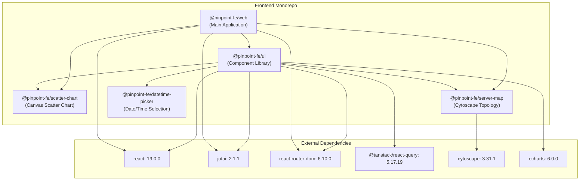
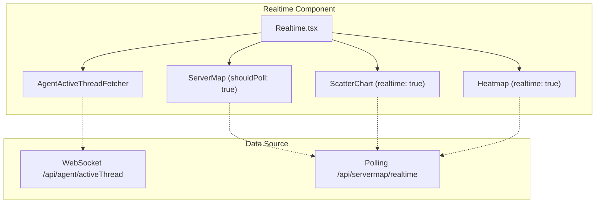

<!-- source: DeepWiki mcp.deepwiki.com · repo pinpoint-apm/pinpoint · page 7 User Interface · fetched 2026-10-29 -->

# User Interface

Relevant source files

The following files were used as context for generating this wiki page:

- [.github/workflows/frontend-test.yml](.github/workflows/frontend-test.yml)
- [web-frontend/src/main/v3/.gitignore](web-frontend/src/main/v3/.gitignore)
- [web-frontend/src/main/v3/.husky/pre-commit](web-frontend/src/main/v3/.husky/pre-commit)
- [web-frontend/src/main/v3/apps/web/.gitignore](web-frontend/src/main/v3/apps/web/.gitignore)
- [web-frontend/src/main/v3/apps/web/package.json](web-frontend/src/main/v3/apps/web/package.json)
- [web-frontend/src/main/v3/apps/web/playwright.config.ts](web-frontend/src/main/v3/apps/web/playwright.config.ts)
- [web-frontend/src/main/v3/apps/web/src/hooks/useMenuItems.tsx](web-frontend/src/main/v3/apps/web/src/hooks/useMenuItems.tsx)
- [web-frontend/src/main/v3/apps/web/src/pages/ScatterOrHeatmapFullScreen.tsx](web-frontend/src/main/v3/apps/web/src/pages/ScatterOrHeatmapFullScreen.tsx)
- [web-frontend/src/main/v3/package.json](web-frontend/src/main/v3/package.json)
- [web-frontend/src/main/v3/packages/datetime-picker/.storybook/main.ts](web-frontend/src/main/v3/packages/datetime-picker/.storybook/main.ts)
- [web-frontend/src/main/v3/packages/datetime-picker/jest.config.cjs](web-frontend/src/main/v3/packages/datetime-picker/jest.config.cjs)
- [web-frontend/src/main/v3/packages/datetime-picker/package.json](web-frontend/src/main/v3/packages/datetime-picker/package.json)
- [web-frontend/src/main/v3/packages/datetime-picker/src/test/mock/svgMock.tsx](web-frontend/src/main/v3/packages/datetime-picker/src/test/mock/svgMock.tsx)
- [web-frontend/src/main/v3/packages/datetime-picker/src/types/custom.d.ts](web-frontend/src/main/v3/packages/datetime-picker/src/types/custom.d.ts)
- [web-frontend/src/main/v3/packages/scatter-chart/.storybook/main.js](web-frontend/src/main/v3/packages/scatter-chart/.storybook/main.js)
- [web-frontend/src/main/v3/packages/scatter-chart/eslint.config.js](web-frontend/src/main/v3/packages/scatter-chart/eslint.config.js)
- [web-frontend/src/main/v3/packages/scatter-chart/package.json](web-frontend/src/main/v3/packages/scatter-chart/package.json)
- [web-frontend/src/main/v3/packages/scatter-chart/test/__snapshots__/axis.test.ts.snap](web-frontend/src/main/v3/packages/scatter-chart/test/__snapshots__/axis.test.ts.snap)
- [web-frontend/src/main/v3/packages/scatter-chart/test/__snapshots__/scatter.test.ts.snap](web-frontend/src/main/v3/packages/scatter-chart/test/__snapshots__/scatter.test.ts.snap)
- [web-frontend/src/main/v3/packages/scatter-chart/test/scatter.test.ts](web-frontend/src/main/v3/packages/scatter-chart/test/scatter.test.ts)
- [web-frontend/src/main/v3/packages/scatter-chart/tsconfig.json](web-frontend/src/main/v3/packages/scatter-chart/tsconfig.json)
- [web-frontend/src/main/v3/packages/server-map/.storybook/main.js](web-frontend/src/main/v3/packages/server-map/.storybook/main.js)
- [web-frontend/src/main/v3/packages/server-map/package.json](web-frontend/src/main/v3/packages/server-map/package.json)
- [web-frontend/src/main/v3/packages/server-map/src/storybook/index.stories.tsx](web-frontend/src/main/v3/packages/server-map/src/storybook/index.stories.tsx)
- [web-frontend/src/main/v3/packages/server-map/tsconfig.json](web-frontend/src/main/v3/packages/server-map/tsconfig.json)
- [web-frontend/src/main/v3/packages/ui/babel.config.cjs](web-frontend/src/main/v3/packages/ui/babel.config.cjs)
- [web-frontend/src/main/v3/packages/ui/jest.config.cjs](web-frontend/src/main/v3/packages/ui/jest.config.cjs)
- [web-frontend/src/main/v3/packages/ui/package.json](web-frontend/src/main/v3/packages/ui/package.json)
- [web-frontend/src/main/v3/packages/ui/src/atoms/serverMap.ts](web-frontend/src/main/v3/packages/ui/src/atoms/serverMap.ts)
- [web-frontend/src/main/v3/packages/ui/src/atoms/serverMapMock.ts](web-frontend/src/main/v3/packages/ui/src/atoms/serverMapMock.ts)
- [web-frontend/src/main/v3/packages/ui/src/components/Agent/AgentSearchList.tsx](web-frontend/src/main/v3/packages/ui/src/components/Agent/AgentSearchList.tsx)
- [web-frontend/src/main/v3/packages/ui/src/components/Chart/Load/LoadChart.stories.tsx](web-frontend/src/main/v3/packages/ui/src/components/Chart/Load/LoadChart.stories.tsx)
- [web-frontend/src/main/v3/packages/ui/src/components/Chart/Load/LoadChart.tsx](web-frontend/src/main/v3/packages/ui/src/components/Chart/Load/LoadChart.tsx)
- [web-frontend/src/main/v3/packages/ui/src/components/Chart/ResponseAvgMax/ResponseAvgMaxChart.stories.tsx](web-frontend/src/main/v3/packages/ui/src/components/Chart/ResponseAvgMax/ResponseAvgMaxChart.stories.tsx)
- [web-frontend/src/main/v3/packages/ui/src/components/Chart/ResponseAvgMax/ResponseAvgMaxChart.tsx](web-frontend/src/main/v3/packages/ui/src/components/Chart/ResponseAvgMax/ResponseAvgMaxChart.tsx)
- [web-frontend/src/main/v3/packages/ui/src/components/Chart/ResponseSummary/ResponseSummaryChart.stories.tsx](web-frontend/src/main/v3/packages/ui/src/components/Chart/ResponseSummary/ResponseSummaryChart.stories.tsx)
- [web-frontend/src/main/v3/packages/ui/src/components/Chart/ResponseSummary/ResponseSummaryChart.tsx](web-frontend/src/main/v3/packages/ui/src/components/Chart/ResponseSummary/ResponseSummaryChart.tsx)
- [web-frontend/src/main/v3/packages/ui/src/components/ChartsBoard/ChartsBoard.tsx](web-frontend/src/main/v3/packages/ui/src/components/ChartsBoard/ChartsBoard.tsx)
- [web-frontend/src/main/v3/packages/ui/src/components/Drawer/Drawer.stories.tsx](web-frontend/src/main/v3/packages/ui/src/components/Drawer/Drawer.stories.tsx)
- [web-frontend/src/main/v3/packages/ui/src/components/Heatmap/Heatmap.tsx](web-frontend/src/main/v3/packages/ui/src/components/Heatmap/Heatmap.tsx)
- [web-frontend/src/main/v3/packages/ui/src/components/Heatmap/HeatmapFetcher.tsx](web-frontend/src/main/v3/packages/ui/src/components/Heatmap/HeatmapFetcher.tsx)
- [web-frontend/src/main/v3/packages/ui/src/components/Heatmap/HeatmapRealtimeFetcher.tsx](web-frontend/src/main/v3/packages/ui/src/components/Heatmap/HeatmapRealtimeFetcher.tsx)
- [web-frontend/src/main/v3/packages/ui/src/components/Heatmap/core/HeatmapChart.tsx](web-frontend/src/main/v3/packages/ui/src/components/Heatmap/core/HeatmapChart.tsx)
- [web-frontend/src/main/v3/packages/ui/src/components/Heatmap/core/HeatmapChartCore.tsx](web-frontend/src/main/v3/packages/ui/src/components/Heatmap/core/HeatmapChartCore.tsx)
- [web-frontend/src/main/v3/packages/ui/src/components/Heatmap/core/HeatmapSetting.tsx](web-frontend/src/main/v3/packages/ui/src/components/Heatmap/core/HeatmapSetting.tsx)
- [web-frontend/src/main/v3/packages/ui/src/components/Heatmap/index.tsx](web-frontend/src/main/v3/packages/ui/src/components/Heatmap/index.tsx)
- [web-frontend/src/main/v3/packages/ui/src/components/Inspector/charts/InspectorChart.tsx](web-frontend/src/main/v3/packages/ui/src/components/Inspector/charts/InspectorChart.tsx)
- [web-frontend/src/main/v3/packages/ui/src/components/MainHeader/MainHeader.tsx](web-frontend/src/main/v3/packages/ui/src/components/MainHeader/MainHeader.tsx)
- [web-frontend/src/main/v3/packages/ui/src/components/ProgressBar/ProgressBar.stories.tsx](web-frontend/src/main/v3/packages/ui/src/components/ProgressBar/ProgressBar.stories.tsx)
- [web-frontend/src/main/v3/packages/ui/src/components/ProgressBar/ProgressBarWithControls.stories.tsx](web-frontend/src/main/v3/packages/ui/src/components/ProgressBar/ProgressBarWithControls.stories.tsx)
- [web-frontend/src/main/v3/packages/ui/src/components/Realtime/Realtime.tsx](web-frontend/src/main/v3/packages/ui/src/components/Realtime/Realtime.tsx)
- [web-frontend/src/main/v3/packages/ui/src/components/ScatterChart/core/ScatterChartCore.tsx](web-frontend/src/main/v3/packages/ui/src/components/ScatterChart/core/ScatterChartCore.tsx)
- [web-frontend/src/main/v3/packages/ui/src/components/ServerMap/ChartTypeButtons.tsx](web-frontend/src/main/v3/packages/ui/src/components/ServerMap/ChartTypeButtons.tsx)
- [web-frontend/src/main/v3/packages/ui/src/components/ServerMap/index.tsx](web-frontend/src/main/v3/packages/ui/src/components/ServerMap/index.tsx)
- [web-frontend/src/main/v3/packages/ui/src/components/Sidebar/Sidebar.stories.tsx](web-frontend/src/main/v3/packages/ui/src/components/Sidebar/Sidebar.stories.tsx)
- [web-frontend/src/main/v3/packages/ui/src/components/index.ts](web-frontend/src/main/v3/packages/ui/src/components/index.ts)
- [web-frontend/src/main/v3/packages/ui/src/constants/ExperimentalConfigKeys.ts](web-frontend/src/main/v3/packages/ui/src/constants/ExperimentalConfigKeys.ts)
- [web-frontend/src/main/v3/packages/ui/src/constants/locales/index.ts](web-frontend/src/main/v3/packages/ui/src/constants/locales/index.ts)
- [web-frontend/src/main/v3/packages/ui/src/constants/path.ts](web-frontend/src/main/v3/packages/ui/src/constants/path.ts)
- [web-frontend/src/main/v3/packages/ui/src/constants/types/Configuration.ts](web-frontend/src/main/v3/packages/ui/src/constants/types/Configuration.ts)
- [web-frontend/src/main/v3/packages/ui/src/constants/types/FilteredMap.ts](web-frontend/src/main/v3/packages/ui/src/constants/types/FilteredMap.ts)
- [web-frontend/src/main/v3/packages/ui/src/constants/types/GetHeatmapAppData.ts](web-frontend/src/main/v3/packages/ui/src/constants/types/GetHeatmapAppData.ts)
- [web-frontend/src/main/v3/packages/ui/src/constants/types/GetScatter.ts](web-frontend/src/main/v3/packages/ui/src/constants/types/GetScatter.ts)
- [web-frontend/src/main/v3/packages/ui/src/constants/types/GetServerMap.ts](web-frontend/src/main/v3/packages/ui/src/constants/types/GetServerMap.ts)
- [web-frontend/src/main/v3/packages/ui/src/constants/types/MenuItem.ts](web-frontend/src/main/v3/packages/ui/src/constants/types/MenuItem.ts)
- [web-frontend/src/main/v3/packages/ui/src/hooks/api/useGetHeatmapDrag.ts](web-frontend/src/main/v3/packages/ui/src/hooks/api/useGetHeatmapDrag.ts)
- [web-frontend/src/main/v3/packages/ui/src/hooks/api/useGetScatterData.ts](web-frontend/src/main/v3/packages/ui/src/hooks/api/useGetScatterData.ts)
- [web-frontend/src/main/v3/packages/ui/src/hooks/api/useGetScatterRealtimeData.ts](web-frontend/src/main/v3/packages/ui/src/hooks/api/useGetScatterRealtimeData.ts)
- [web-frontend/src/main/v3/packages/ui/src/hooks/index.ts](web-frontend/src/main/v3/packages/ui/src/hooks/index.ts)
- [web-frontend/src/main/v3/packages/ui/src/hooks/serverMap/index.tsx](web-frontend/src/main/v3/packages/ui/src/hooks/serverMap/index.tsx)
- [web-frontend/src/main/v3/packages/ui/src/hooks/serverMap/useFilterWizardOnClickApply.ts](web-frontend/src/main/v3/packages/ui/src/hooks/serverMap/useFilterWizardOnClickApply.ts)
- [web-frontend/src/main/v3/packages/ui/src/hooks/serverMap/useServerMapOnClickMenuItem.ts](web-frontend/src/main/v3/packages/ui/src/hooks/serverMap/useServerMapOnClickMenuItem.ts)
- [web-frontend/src/main/v3/packages/ui/src/hooks/utility/useExperimentals.ts](web-frontend/src/main/v3/packages/ui/src/hooks/utility/useExperimentals.ts)
- [web-frontend/src/main/v3/packages/ui/src/loader/index.ts](web-frontend/src/main/v3/packages/ui/src/loader/index.ts)
- [web-frontend/src/main/v3/packages/ui/src/pages/FilteredMap.tsx](web-frontend/src/main/v3/packages/ui/src/pages/FilteredMap.tsx)
- [web-frontend/src/main/v3/packages/ui/src/pages/Realtime.tsx](web-frontend/src/main/v3/packages/ui/src/pages/Realtime.tsx)
- [web-frontend/src/main/v3/packages/ui/src/pages/ScatterOrHeatmapFullScreen.tsx](web-frontend/src/main/v3/packages/ui/src/pages/ScatterOrHeatmapFullScreen.tsx)
- [web-frontend/src/main/v3/packages/ui/src/pages/ServerMap.tsx](web-frontend/src/main/v3/packages/ui/src/pages/ServerMap.tsx)
- [web-frontend/src/main/v3/packages/ui/src/pages/config/Help.tsx](web-frontend/src/main/v3/packages/ui/src/pages/config/Help.tsx)
- [web-frontend/src/main/v3/packages/ui/src/utils/helper/filteredMap/merge.test.ts](web-frontend/src/main/v3/packages/ui/src/utils/helper/filteredMap/merge.test.ts)
- [web-frontend/src/main/v3/packages/ui/src/utils/helper/filteredMap/merge.ts](web-frontend/src/main/v3/packages/ui/src/utils/helper/filteredMap/merge.ts)
- [web-frontend/src/main/v3/packages/ui/src/utils/helper/filteredMap/mergeMock.ts](web-frontend/src/main/v3/packages/ui/src/utils/helper/filteredMap/mergeMock.ts)
- [web-frontend/src/main/v3/packages/ui/src/utils/helper/route.ts](web-frontend/src/main/v3/packages/ui/src/utils/helper/route.ts)
- [web-frontend/src/main/v3/packages/ui/vite.config.ts](web-frontend/src/main/v3/packages/ui/vite.config.ts)
- [web-frontend/src/main/v3/yarn.lock](web-frontend/src/main/v3/yarn.lock)

## Purpose and Scope

This document describes the Pinpoint APM web user interface, which provides visualization and monitoring capabilities through a React-based frontend application. The UI enables users to view application topology maps, trace transactions, monitor agent health, and analyze performance metrics.

For information about the backend REST APIs that serve data to this UI, see [Web Application](#6). For details on specific visualization features, see [Application Map Visualization](#7.2), [Transaction Tracing and CallStack](#7.3), and [Agent Management Dashboard](#7.4). For the complete frontend architecture including monorepo structure and build system, see [Frontend Architecture](#7.1).

---

## Frontend Technology Stack

The Pinpoint UI is built as a modern React application with the following core technologies:

| Technology | Version | Purpose |
|------------|---------|---------|
| React | 19.0.0 | UI framework |
| TypeScript | 5.2.2+ | Type-safe development |
| Vite | 6.4.1 | Build tool and dev server |
| Jotai | 2.1.1+ | Atomic state management |
| React Router | 6.10.0+ | Client-side routing |
| Tailwind CSS | 3.4.1+ | Utility-first styling |
| Radix UI | Various | Accessible component primitives |
| i18next | 23.2.11+ | Internationalization |
| ECharts | 6.0.0 | High-performance charting engine |

**Sources:**
- [web-frontend/src/main/v3/packages/ui/package.json:23-26]()
- [web-frontend/src/main/v3/packages/ui/package.json:67]()
- [web-frontend/src/main/v3/apps/web/package.json:19-33]()

---

## Monorepo Package Structure

The frontend is organized as a Yarn workspace monorepo with specialized packages:

**Package Responsibilities:**

- **`@pinpoint-fe/web`**: Main application entry point, routing configuration, and page-level components [web-frontend/src/main/v3/apps/web/package.json:1-5]()
- **`@pinpoint-fe/ui`**: Reusable UI components (buttons, charts, layouts, dialogs), hooks, and utilities [web-frontend/src/main/v3/packages/ui/package.json:1-6]()
- **`@pinpoint-fe/scatter-chart`**: High-performance canvas-based scatter plot for request/response patterns [web-frontend/src/main/v3/packages/scatter-chart/package.json:1-4]()
- **`@pinpoint-fe/server-map`**: Application topology visualization using Cytoscape.js [web-frontend/src/main/v3/packages/server-map/package.json:1-4]()
- **`@pinpoint-fe/datetime-picker`**: Custom date range and time picker components [web-frontend/src/main/v3/packages/datetime-picker/package.json:1-9]()

---

## Core Visualization Components

### ServerMap Page
The `ServerMapPage` is the primary landing page for application monitoring. It integrates the topology map with real-time performance charts.

- **`ServerMap` Component**: Visualizes the dependency graph between services [web-frontend/src/main/v3/packages/ui/src/pages/ServerMap.tsx:30]().
- **`DatetimePicker`**: Controls the global time range for data analysis [web-frontend/src/main/v3/packages/ui/src/pages/ServerMap.tsx:177-187]().
- **`ServerMapChartsBoard`**: Side panel displaying metrics for the selected node or link [web-frontend/src/main/v3/packages/ui/src/pages/ServerMap.tsx:41]().

**Sources:**
- [web-frontend/src/main/v3/packages/ui/src/pages/ServerMap.tsx:51-191]()

### Heatmap Visualization
The `HeatmapChart` provides a density visualization of request latency over time, using ECharts for high-performance rendering.

- **Coordinate System**: X-axis represents `timestamp`, Y-axis represents `elapsedTime` [web-frontend/src/main/v3/packages/ui/src/components/Heatmap/core/HeatmapChart.tsx:176-191]().
- **Selection**: Supports drag-selection to drill down into specific transaction lists via `onDragEnd` [web-frontend/src/main/v3/packages/ui/src/components/Heatmap/core/HeatmapChartCore.tsx:104-118]().
- **Real-time Mode**: Supports continuous updates for live monitoring [web-frontend/src/main/v3/packages/ui/src/components/Heatmap/HeatmapRealtimeFetcher.tsx:1-20]().

**Sources:**
- [web-frontend/src/main/v3/packages/ui/src/components/Heatmap/core/HeatmapChart.tsx:57-123]()
- [web-frontend/src/main/v3/packages/ui/src/components/Heatmap/HeatmapFetcher.tsx:17-75]()

### Response Summary Chart
A compact bar chart built with ECharts that categorizes response times into buckets (e.g., 1s, 3s, 5s, Slow, Error).

- **Dynamic Axis Breaks**: Automatically calculates Y-axis breaks to handle large variances in request counts between buckets [web-frontend/src/main/v3/packages/ui/src/components/Chart/ResponseSummary/ResponseSummaryChart.tsx:52-102]().
- **Color Mapping**: Uses standard status colors: `#34b994` (Success) to `#e95459` (Error) [web-frontend/src/main/v3/packages/ui/src/components/Chart/ResponseSummary/ResponseSummaryChart.tsx:33]().

**Sources:**
- [web-frontend/src/main/v3/packages/ui/src/components/Chart/ResponseSummary/ResponseSummaryChart.tsx:35-213]()

---

## Real-time Monitoring Architecture

The Real-time UI leverages WebSockets and polling to provide instantaneous feedback on system health.

- **`AgentActiveThreadFetcher`**: Visualizes active threads across instances using real-time streaming [web-frontend/src/main/v3/packages/ui/src/components/Realtime/Realtime.tsx:123-128]().
- **`ApdexScore`**: Real-time calculation of Application Performance Index [web-frontend/src/main/v3/packages/ui/src/components/Realtime/Realtime.tsx:180-184]().

**Sources:**
- [web-frontend/src/main/v3/packages/ui/src/components/Realtime/Realtime.tsx:44-208]()

---

## State Management with Jotai

The application uses atomic state management to coordinate data between the map, charts, and navigation.

| Atom Name | Type | Purpose |
|-----------|------|---------|
| `serverMapDataAtom` | `GetServerMap.ApplicationMapData` | Holds the complete topology graph data [web-frontend/src/main/v3/packages/ui/src/atoms/serverMap.ts]() |
| `serverMapCurrentTargetAtom` | `CurrentTarget` | Stores the currently selected Node or Link [web-frontend/src/main/v3/packages/ui/src/atoms/serverMap.ts]() |
| `serverMapChartTypeAtom` | `'scatter' \| 'heatmap'` | Toggles between scatter and heatmap visualizations [web-frontend/src/main/v3/packages/ui/src/components/Realtime/Realtime.tsx:29]() |

**Sources:**
- [web-frontend/src/main/v3/packages/ui/src/pages/ServerMap.tsx:15-18]()
- [web-frontend/src/main/v3/packages/ui/src/components/Realtime/Realtime.tsx:24-30]()

---

## Build and Development

The UI is built using Vite and integrated into the Maven lifecycle.

- **Development**: `yarn dev` starts the Vite development server with HMR [web-frontend/src/main/v3/apps/web/package.json:7]().
- **Production Build**: `yarn build` runs TypeScript compilation and Vite optimization [web-frontend/src/main/v3/apps/web/package.json:8]().
- **Component Documentation**: Storybook is used for isolated component development [web-frontend/src/main/v3/packages/ui/package.json:12]().

**Sources:**
- [web-frontend/src/main/v3/apps/web/package.json:6-18]()
- [web-frontend/src/main/v3/packages/ui/package.json:7-18]()

---

