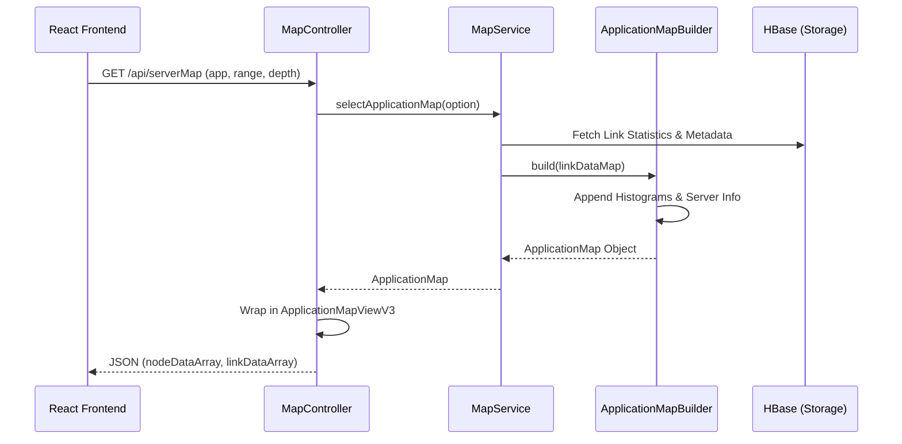
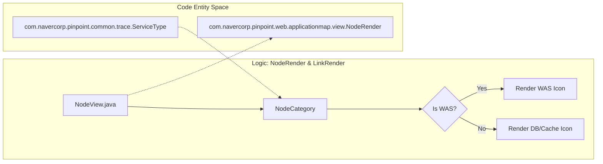
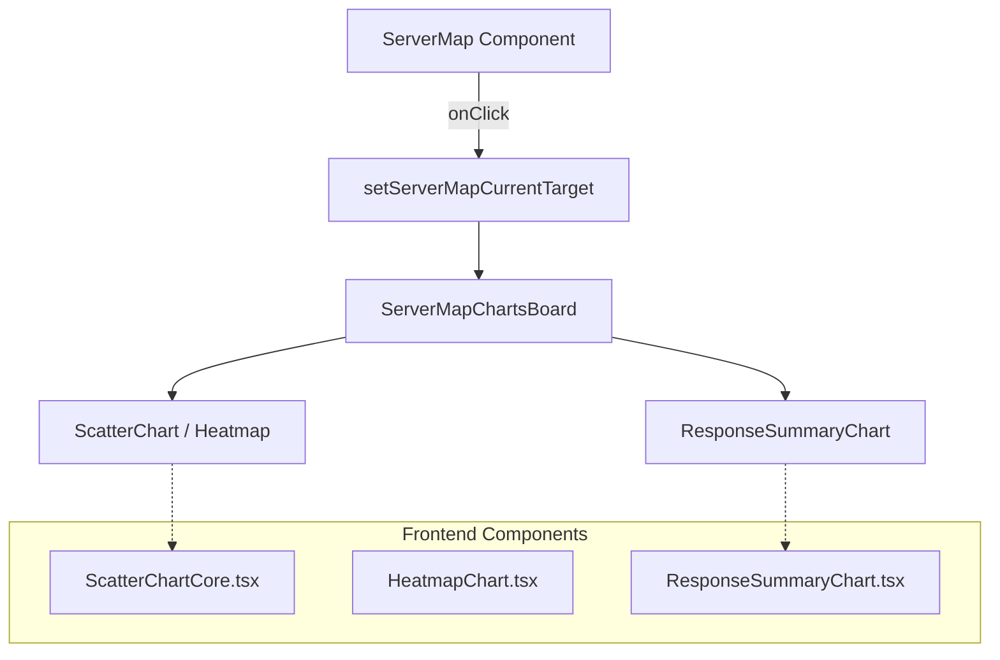

<!-- source: DeepWiki mcp.deepwiki.com · repo pinpoint-apm/pinpoint · page 7.2 Application Map Visualization · fetched 2026-10-29 -->

# Application Map Visualization

Relevant source files

The following files were used as context for generating this wiki page:

- [web-frontend/src/main/v3/.husky/pre-commit](web-frontend/src/main/v3/.husky/pre-commit)
- [web-frontend/src/main/v3/apps/web/src/hooks/useMenuItems.tsx](web-frontend/src/main/v3/apps/web/src/hooks/useMenuItems.tsx)
- [web-frontend/src/main/v3/apps/web/src/pages/ScatterOrHeatmapFullScreen.tsx](web-frontend/src/main/v3/apps/web/src/pages/ScatterOrHeatmapFullScreen.tsx)
- [web-frontend/src/main/v3/package.json](web-frontend/src/main/v3/package.json)
- [web-frontend/src/main/v3/packages/ui/src/atoms/serverMap.ts](web-frontend/src/main/v3/packages/ui/src/atoms/serverMap.ts)
- [web-frontend/src/main/v3/packages/ui/src/atoms/serverMapMock.ts](web-frontend/src/main/v3/packages/ui/src/atoms/serverMapMock.ts)
- [web-frontend/src/main/v3/packages/ui/src/components/Agent/AgentIdNameTooltip.tsx](web-frontend/src/main/v3/packages/ui/src/components/Agent/AgentIdNameTooltip.tsx)
- [web-frontend/src/main/v3/packages/ui/src/components/Agent/AgentListFetcher.tsx](web-frontend/src/main/v3/packages/ui/src/components/Agent/AgentListFetcher.tsx)
- [web-frontend/src/main/v3/packages/ui/src/components/Agent/AgentListSortBySelector.tsx](web-frontend/src/main/v3/packages/ui/src/components/Agent/AgentListSortBySelector.tsx)
- [web-frontend/src/main/v3/packages/ui/src/components/Agent/AgentSearchList.tsx](web-frontend/src/main/v3/packages/ui/src/components/Agent/AgentSearchList.tsx)
- [web-frontend/src/main/v3/packages/ui/src/components/AgentActiveThread/AgentActiveChart.tsx](web-frontend/src/main/v3/packages/ui/src/components/AgentActiveThread/AgentActiveChart.tsx)
- [web-frontend/src/main/v3/packages/ui/src/components/AgentActiveThread/AgentActiveSetting.tsx](web-frontend/src/main/v3/packages/ui/src/components/AgentActiveThread/AgentActiveSetting.tsx)
- [web-frontend/src/main/v3/packages/ui/src/components/AgentActiveThread/AgentActiveTable.tsx](web-frontend/src/main/v3/packages/ui/src/components/AgentActiveThread/AgentActiveTable.tsx)
- [web-frontend/src/main/v3/packages/ui/src/components/AgentActiveThread/AgentActiveThreadFetcher.tsx](web-frontend/src/main/v3/packages/ui/src/components/AgentActiveThread/AgentActiveThreadFetcher.tsx)
- [web-frontend/src/main/v3/packages/ui/src/components/AgentActiveThread/AgentActiveThreadSkeleton.tsx](web-frontend/src/main/v3/packages/ui/src/components/AgentActiveThread/AgentActiveThreadSkeleton.tsx)
- [web-frontend/src/main/v3/packages/ui/src/components/AgentActiveThread/AgentActiveThreadView.tsx](web-frontend/src/main/v3/packages/ui/src/components/AgentActiveThread/AgentActiveThreadView.tsx)
- [web-frontend/src/main/v3/packages/ui/src/components/Chart/Load/LoadChart.tsx](web-frontend/src/main/v3/packages/ui/src/components/Chart/Load/LoadChart.tsx)
- [web-frontend/src/main/v3/packages/ui/src/components/Chart/ResponseAvgMax/ResponseAvgMaxChart.tsx](web-frontend/src/main/v3/packages/ui/src/components/Chart/ResponseAvgMax/ResponseAvgMaxChart.tsx)
- [web-frontend/src/main/v3/packages/ui/src/components/Chart/ResponseSummary/ResponseSummaryChart.tsx](web-frontend/src/main/v3/packages/ui/src/components/Chart/ResponseSummary/ResponseSummaryChart.tsx)
- [web-frontend/src/main/v3/packages/ui/src/components/ChartsBoard/ChartsBoard.tsx](web-frontend/src/main/v3/packages/ui/src/components/ChartsBoard/ChartsBoard.tsx)
- [web-frontend/src/main/v3/packages/ui/src/components/Config/agentStatistic/AgentStatisticChartContainer.tsx](web-frontend/src/main/v3/packages/ui/src/components/Config/agentStatistic/AgentStatisticChartContainer.tsx)
- [web-frontend/src/main/v3/packages/ui/src/components/Config/agentStatistic/AgentStatisticFetcher.tsx](web-frontend/src/main/v3/packages/ui/src/components/Config/agentStatistic/AgentStatisticFetcher.tsx)
- [web-frontend/src/main/v3/packages/ui/src/components/Config/agentStatistic/AgentStatisticTable.tsx](web-frontend/src/main/v3/packages/ui/src/components/Config/agentStatistic/AgentStatisticTable.tsx)
- [web-frontend/src/main/v3/packages/ui/src/components/Heatmap/Heatmap.tsx](web-frontend/src/main/v3/packages/ui/src/components/Heatmap/Heatmap.tsx)
- [web-frontend/src/main/v3/packages/ui/src/components/Heatmap/HeatmapFetcher.tsx](web-frontend/src/main/v3/packages/ui/src/components/Heatmap/HeatmapFetcher.tsx)
- [web-frontend/src/main/v3/packages/ui/src/components/Heatmap/HeatmapRealtimeFetcher.tsx](web-frontend/src/main/v3/packages/ui/src/components/Heatmap/HeatmapRealtimeFetcher.tsx)
- [web-frontend/src/main/v3/packages/ui/src/components/Heatmap/core/HeatmapChart.tsx](web-frontend/src/main/v3/packages/ui/src/components/Heatmap/core/HeatmapChart.tsx)
- [web-frontend/src/main/v3/packages/ui/src/components/Heatmap/core/HeatmapChartCore.tsx](web-frontend/src/main/v3/packages/ui/src/components/Heatmap/core/HeatmapChartCore.tsx)
- [web-frontend/src/main/v3/packages/ui/src/components/Heatmap/core/HeatmapSetting.tsx](web-frontend/src/main/v3/packages/ui/src/components/Heatmap/core/HeatmapSetting.tsx)
- [web-frontend/src/main/v3/packages/ui/src/components/Heatmap/index.tsx](web-frontend/src/main/v3/packages/ui/src/components/Heatmap/index.tsx)
- [web-frontend/src/main/v3/packages/ui/src/components/HighLightCode/HighLightCode.tsx](web-frontend/src/main/v3/packages/ui/src/components/HighLightCode/HighLightCode.tsx)
- [web-frontend/src/main/v3/packages/ui/src/components/Inspector/agent-info/InspectorAgentInfoFetcher.tsx](web-frontend/src/main/v3/packages/ui/src/components/Inspector/agent-info/InspectorAgentInfoFetcher.tsx)
- [web-frontend/src/main/v3/packages/ui/src/components/Inspector/charts/InspectorChart.tsx](web-frontend/src/main/v3/packages/ui/src/components/Inspector/charts/InspectorChart.tsx)
- [web-frontend/src/main/v3/packages/ui/src/components/Realtime/Realtime.tsx](web-frontend/src/main/v3/packages/ui/src/components/Realtime/Realtime.tsx)
- [web-frontend/src/main/v3/packages/ui/src/components/ScatterChart/core/ScatterChartCore.tsx](web-frontend/src/main/v3/packages/ui/src/components/ScatterChart/core/ScatterChartCore.tsx)
- [web-frontend/src/main/v3/packages/ui/src/components/ServerList/ServerList.tsx](web-frontend/src/main/v3/packages/ui/src/components/ServerList/ServerList.tsx)
- [web-frontend/src/main/v3/packages/ui/src/components/ServerList/ServerListFetcher.tsx](web-frontend/src/main/v3/packages/ui/src/components/ServerList/ServerListFetcher.tsx)
- [web-frontend/src/main/v3/packages/ui/src/components/ServerMap/ChartTypeButtons.tsx](web-frontend/src/main/v3/packages/ui/src/components/ServerMap/ChartTypeButtons.tsx)
- [web-frontend/src/main/v3/packages/ui/src/components/ServerMap/ServerMapChartBoard.tsx](web-frontend/src/main/v3/packages/ui/src/components/ServerMap/ServerMapChartBoard.tsx)
- [web-frontend/src/main/v3/packages/ui/src/components/ServerMap/index.tsx](web-frontend/src/main/v3/packages/ui/src/components/ServerMap/index.tsx)
- [web-frontend/src/main/v3/packages/ui/src/components/index.ts](web-frontend/src/main/v3/packages/ui/src/components/index.ts)
- [web-frontend/src/main/v3/packages/ui/src/components/ui/chart.tsx](web-frontend/src/main/v3/packages/ui/src/components/ui/chart.tsx)
- [web-frontend/src/main/v3/packages/ui/src/constants/EndPoints.ts](web-frontend/src/main/v3/packages/ui/src/constants/EndPoints.ts)
- [web-frontend/src/main/v3/packages/ui/src/constants/ExperimentalConfigKeys.ts](web-frontend/src/main/v3/packages/ui/src/constants/ExperimentalConfigKeys.ts)
- [web-frontend/src/main/v3/packages/ui/src/constants/locales/en.json](web-frontend/src/main/v3/packages/ui/src/constants/locales/en.json)
- [web-frontend/src/main/v3/packages/ui/src/constants/locales/ko.json](web-frontend/src/main/v3/packages/ui/src/constants/locales/ko.json)
- [web-frontend/src/main/v3/packages/ui/src/constants/path.ts](web-frontend/src/main/v3/packages/ui/src/constants/path.ts)
- [web-frontend/src/main/v3/packages/ui/src/constants/types/AgentActiveThread.ts](web-frontend/src/main/v3/packages/ui/src/constants/types/AgentActiveThread.ts)
- [web-frontend/src/main/v3/packages/ui/src/constants/types/AgentList.ts](web-frontend/src/main/v3/packages/ui/src/constants/types/AgentList.ts)
- [web-frontend/src/main/v3/packages/ui/src/constants/types/Configuration.ts](web-frontend/src/main/v3/packages/ui/src/constants/types/Configuration.ts)
- [web-frontend/src/main/v3/packages/ui/src/constants/types/FilteredMap.ts](web-frontend/src/main/v3/packages/ui/src/constants/types/FilteredMap.ts)
- [web-frontend/src/main/v3/packages/ui/src/constants/types/GetHeatmapAppData.ts](web-frontend/src/main/v3/packages/ui/src/constants/types/GetHeatmapAppData.ts)
- [web-frontend/src/main/v3/packages/ui/src/constants/types/GetHistogramStatistics.ts](web-frontend/src/main/v3/packages/ui/src/constants/types/GetHistogramStatistics.ts)
- [web-frontend/src/main/v3/packages/ui/src/constants/types/GetScatter.ts](web-frontend/src/main/v3/packages/ui/src/constants/types/GetScatter.ts)
- [web-frontend/src/main/v3/packages/ui/src/constants/types/GetServerMap.ts](web-frontend/src/main/v3/packages/ui/src/constants/types/GetServerMap.ts)
- [web-frontend/src/main/v3/packages/ui/src/constants/types/MenuItem.ts](web-frontend/src/main/v3/packages/ui/src/constants/types/MenuItem.ts)
- [web-frontend/src/main/v3/packages/ui/src/constants/types/index.ts](web-frontend/src/main/v3/packages/ui/src/constants/types/index.ts)
- [web-frontend/src/main/v3/packages/ui/src/hooks/api/index.ts](web-frontend/src/main/v3/packages/ui/src/hooks/api/index.ts)
- [web-frontend/src/main/v3/packages/ui/src/hooks/api/useAgentsStatistics.ts](web-frontend/src/main/v3/packages/ui/src/hooks/api/useAgentsStatistics.ts)
- [web-frontend/src/main/v3/packages/ui/src/hooks/api/useGetAgentList.ts](web-frontend/src/main/v3/packages/ui/src/hooks/api/useGetAgentList.ts)
- [web-frontend/src/main/v3/packages/ui/src/hooks/api/useGetHeatmapDrag.ts](web-frontend/src/main/v3/packages/ui/src/hooks/api/useGetHeatmapDrag.ts)
- [web-frontend/src/main/v3/packages/ui/src/hooks/api/useGetScatterData.ts](web-frontend/src/main/v3/packages/ui/src/hooks/api/useGetScatterData.ts)
- [web-frontend/src/main/v3/packages/ui/src/hooks/api/useGetScatterRealtimeData.ts](web-frontend/src/main/v3/packages/ui/src/hooks/api/useGetScatterRealtimeData.ts)
- [web-frontend/src/main/v3/packages/ui/src/hooks/index.ts](web-frontend/src/main/v3/packages/ui/src/hooks/index.ts)
- [web-frontend/src/main/v3/packages/ui/src/hooks/serverMap/index.tsx](web-frontend/src/main/v3/packages/ui/src/hooks/serverMap/index.tsx)
- [web-frontend/src/main/v3/packages/ui/src/hooks/serverMap/useFilterWizardOnClickApply.ts](web-frontend/src/main/v3/packages/ui/src/hooks/serverMap/useFilterWizardOnClickApply.ts)
- [web-frontend/src/main/v3/packages/ui/src/hooks/serverMap/useServerMapOnClickMenuItem.ts](web-frontend/src/main/v3/packages/ui/src/hooks/serverMap/useServerMapOnClickMenuItem.ts)
- [web-frontend/src/main/v3/packages/ui/src/hooks/utility/useAgentListSortBy.ts](web-frontend/src/main/v3/packages/ui/src/hooks/utility/useAgentListSortBy.ts)
- [web-frontend/src/main/v3/packages/ui/src/hooks/utility/useExperimentals.ts](web-frontend/src/main/v3/packages/ui/src/hooks/utility/useExperimentals.ts)
- [web-frontend/src/main/v3/packages/ui/src/loader/index.ts](web-frontend/src/main/v3/packages/ui/src/loader/index.ts)
- [web-frontend/src/main/v3/packages/ui/src/pages/FilteredMap.tsx](web-frontend/src/main/v3/packages/ui/src/pages/FilteredMap.tsx)
- [web-frontend/src/main/v3/packages/ui/src/pages/Realtime.tsx](web-frontend/src/main/v3/packages/ui/src/pages/Realtime.tsx)
- [web-frontend/src/main/v3/packages/ui/src/pages/ScatterOrHeatmapFullScreen.tsx](web-frontend/src/main/v3/packages/ui/src/pages/ScatterOrHeatmapFullScreen.tsx)
- [web-frontend/src/main/v3/packages/ui/src/pages/ServerMap.tsx](web-frontend/src/main/v3/packages/ui/src/pages/ServerMap.tsx)
- [web-frontend/src/main/v3/packages/ui/src/pages/config/Help.tsx](web-frontend/src/main/v3/packages/ui/src/pages/config/Help.tsx)
- [web-frontend/src/main/v3/packages/ui/src/utils/helper/filteredMap/merge.test.ts](web-frontend/src/main/v3/packages/ui/src/utils/helper/filteredMap/merge.test.ts)
- [web-frontend/src/main/v3/packages/ui/src/utils/helper/filteredMap/merge.ts](web-frontend/src/main/v3/packages/ui/src/utils/helper/filteredMap/merge.ts)
- [web-frontend/src/main/v3/packages/ui/src/utils/helper/filteredMap/mergeMock.ts](web-frontend/src/main/v3/packages/ui/src/utils/helper/filteredMap/mergeMock.ts)
- [web-frontend/src/main/v3/packages/ui/src/utils/helper/route.ts](web-frontend/src/main/v3/packages/ui/src/utils/helper/route.ts)
- [web/src/main/java/com/navercorp/pinpoint/web/applicationmap/config/ApplicationMapModule.java](web/src/main/java/com/navercorp/pinpoint/web/applicationmap/config/ApplicationMapModule.java)
- [web/src/main/java/com/navercorp/pinpoint/web/applicationmap/config/MapControllerConfiguration.java](web/src/main/java/com/navercorp/pinpoint/web/applicationmap/config/MapControllerConfiguration.java)
- [web/src/main/java/com/navercorp/pinpoint/web/applicationmap/config/MapProperties.java](web/src/main/java/com/navercorp/pinpoint/web/applicationmap/config/MapProperties.java)
- [web/src/main/java/com/navercorp/pinpoint/web/applicationmap/config/MapViewConfiguration.java](web/src/main/java/com/navercorp/pinpoint/web/applicationmap/config/MapViewConfiguration.java)
- [web/src/main/java/com/navercorp/pinpoint/web/applicationmap/controller/FilteredMapController.java](web/src/main/java/com/navercorp/pinpoint/web/applicationmap/controller/FilteredMapController.java)
- [web/src/main/java/com/navercorp/pinpoint/web/applicationmap/controller/MapController.java](web/src/main/java/com/navercorp/pinpoint/web/applicationmap/controller/MapController.java)
- [web/src/main/java/com/navercorp/pinpoint/web/applicationmap/controller/form/ApplicationForm.java](web/src/main/java/com/navercorp/pinpoint/web/applicationmap/controller/form/ApplicationForm.java)
- [web/src/main/java/com/navercorp/pinpoint/web/applicationmap/link/Link.java](web/src/main/java/com/navercorp/pinpoint/web/applicationmap/link/Link.java)
- [web/src/main/java/com/navercorp/pinpoint/web/applicationmap/link/LinkHistogramSummary.java](web/src/main/java/com/navercorp/pinpoint/web/applicationmap/link/LinkHistogramSummary.java)
- [web/src/main/java/com/navercorp/pinpoint/web/applicationmap/link/LinkName.java](web/src/main/java/com/navercorp/pinpoint/web/applicationmap/link/LinkName.java)
- [web/src/main/java/com/navercorp/pinpoint/web/applicationmap/link/ServiceLinkName.java](web/src/main/java/com/navercorp/pinpoint/web/applicationmap/link/ServiceLinkName.java)
- [web/src/main/java/com/navercorp/pinpoint/web/applicationmap/nodes/ApplicationNameEscaper.java](web/src/main/java/com/navercorp/pinpoint/web/applicationmap/nodes/ApplicationNameEscaper.java)
- [web/src/main/java/com/navercorp/pinpoint/web/applicationmap/nodes/Node.java](web/src/main/java/com/navercorp/pinpoint/web/applicationmap/nodes/Node.java)
- [web/src/main/java/com/navercorp/pinpoint/web/applicationmap/nodes/NodeName.java](web/src/main/java/com/navercorp/pinpoint/web/applicationmap/nodes/NodeName.java)
- [web/src/main/java/com/navercorp/pinpoint/web/applicationmap/nodes/ServiceNodeName.java](web/src/main/java/com/navercorp/pinpoint/web/applicationmap/nodes/ServiceNodeName.java)
- [web/src/main/java/com/navercorp/pinpoint/web/applicationmap/nodes/ServiceNodeNameParser.java](web/src/main/java/com/navercorp/pinpoint/web/applicationmap/nodes/ServiceNodeNameParser.java)
- [web/src/main/java/com/navercorp/pinpoint/web/applicationmap/service/AlertViewService.java](web/src/main/java/com/navercorp/pinpoint/web/applicationmap/service/AlertViewService.java)
- [web/src/main/java/com/navercorp/pinpoint/web/applicationmap/view/LinkRender.java](web/src/main/java/com/navercorp/pinpoint/web/applicationmap/view/LinkRender.java)
- [web/src/main/java/com/navercorp/pinpoint/web/applicationmap/view/LinkView.java](web/src/main/java/com/navercorp/pinpoint/web/applicationmap/view/LinkView.java)
- [web/src/main/java/com/navercorp/pinpoint/web/applicationmap/view/NodeRender.java](web/src/main/java/com/navercorp/pinpoint/web/applicationmap/view/NodeRender.java)
- [web/src/main/java/com/navercorp/pinpoint/web/applicationmap/view/NodeView.java](web/src/main/java/com/navercorp/pinpoint/web/applicationmap/view/NodeView.java)
- [web/src/main/java/com/navercorp/pinpoint/web/security/ServerMapDataFilter.java](web/src/main/java/com/navercorp/pinpoint/web/security/ServerMapDataFilter.java)
- [web/src/main/java/com/navercorp/pinpoint/web/trace/controller/TransactionController.java](web/src/main/java/com/navercorp/pinpoint/web/trace/controller/TransactionController.java)
- [web/src/main/java/com/navercorp/pinpoint/web/trace/view/TransactionCallTreeViewModel.java](web/src/main/java/com/navercorp/pinpoint/web/trace/view/TransactionCallTreeViewModel.java)
- [web/src/main/java/com/navercorp/pinpoint/web/view/LogLinkBuilder.java](web/src/main/java/com/navercorp/pinpoint/web/view/LogLinkBuilder.java)
- [web/src/main/java/com/navercorp/pinpoint/web/view/LogLinkView.java](web/src/main/java/com/navercorp/pinpoint/web/view/LogLinkView.java)
- [web/src/main/java/com/navercorp/pinpoint/web/view/TransactionServerMapViewModel.java](web/src/main/java/com/navercorp/pinpoint/web/view/TransactionServerMapViewModel.java)
- [web/src/main/java/com/navercorp/pinpoint/web/vo/AgentParam.java](web/src/main/java/com/navercorp/pinpoint/web/vo/AgentParam.java)
- [web/src/test/java/com/navercorp/pinpoint/web/applicationmap/controller/MapControllerTest.java](web/src/test/java/com/navercorp/pinpoint/web/applicationmap/controller/MapControllerTest.java)
- [web/src/test/java/com/navercorp/pinpoint/web/applicationmap/service/AlertViewServiceTest.java](web/src/test/java/com/navercorp/pinpoint/web/applicationmap/service/AlertViewServiceTest.java)
- [web/src/test/java/com/navercorp/pinpoint/web/trace/view/TransactionInfoViewModelTest.java](web/src/test/java/com/navercorp/pinpoint/web/trace/view/TransactionInfoViewModelTest.java)
- [web/src/test/java/com/navercorp/pinpoint/web/view/LinkViewTest.java](web/src/test/java/com/navercorp/pinpoint/web/view/LinkViewTest.java)

The Application Map (ServerMap) is the primary topological visualization in Pinpoint APM. It renders a distributed system's architecture by aggregating trace data into nodes (applications) and links (call relationships). This page details the technical implementation of the map, including data retrieval, merging logic, and the frontend integration with Cytoscape.

## 1. Data Flow and Architecture

The Application Map data is generated by the Web module by querying HBase for trace statistics and metadata. The data is then transformed into a JSON structure compatible with the frontend visualization engine.

### 1.1. Backend Data Processing
The entry point for map data is `MapController` or `FilteredMapController`. These controllers use `MapService` to orchestrate the building of the `ApplicationMap` object.

Sources: [web/src/main/java/com/navercorp/pinpoint/web/applicationmap/controller/MapController.java:93-124](), [web/src/main/java/com/navercorp/pinpoint/web/applicationmap/config/ApplicationMapModule.java:76-80]()

### 1.2. Key Classes in Map Construction
*   `Node`: Represents a logical application group. It contains a `NodeHistogram` and a `ServerGroupList` [web/src/main/java/com/navercorp/pinpoint/web/applicationmap/nodes/Node.java:32-45]().
*   `Link`: Represents the RPC or database call between two nodes. It encapsulates call statistics and response time distributions [web/src/main/java/com/navercorp/pinpoint/web/applicationmap/link/Link.java:50-70]().
*   `ApplicationMap`: The container for the entire topology, holding collections of nodes and links [web/src/main/java/com/navercorp/pinpoint/web/applicationmap/ApplicationMap.java:27-34]().

## 2. ServerMap Rendering Logic

The frontend utilizes a specialized version of the map for standard monitoring and a filtered version for trace analysis.

### 2.1. Serialization for Frontend
To ensure the frontend receives all necessary metadata for rendering (icons, labels, colors), the `NodeView` and `LinkView` classes handle Jackson serialization.

| Field | Source | Description |
| :--- | :--- | :--- |
| `key` | `node.getNodeName()` | Unique identifier for Cytoscape nodes [web/src/main/java/com/navercorp/pinpoint/web/applicationmap/view/NodeView.java:112-115](). |
| `serviceType` | `node.getServiceType()` | Determines the icon rendered on the node [web/src/main/java/com/navercorp/pinpoint/web/applicationmap/view/NodeView.java:123-126](). |
| `histogram` | `link.getHistogram()` | Data used to render the call count labels on links [web/src/main/java/com/navercorp/pinpoint/web/applicationmap/view/LinkView.java:106-115](). |
| `agents` | `ServerGroupList` | List of active agents within a node for the "View Servers" functionality [web/src/main/java/com/navercorp/pinpoint/web/applicationmap/view/NodeView.java:153-161](). |

Sources: [web/src/main/java/com/navercorp/pinpoint/web/applicationmap/view/NodeView.java:103-139](), [web/src/main/java/com/navercorp/pinpoint/web/applicationmap/view/LinkView.java:79-130]()

### 2.2. Node Merging and Categorization
Nodes are categorized based on their `ServiceType`. For example, multiple instances of the same application are merged into a single node unless they belong to different `ServiceTypes`.

Sources: [web/src/main/java/com/navercorp/pinpoint/web/applicationmap/view/NodeRender.java:25-35](), [web/src/main/java/com/navercorp/pinpoint/web/applicationmap/view/NodeView.java:128-130]()

## 3. Frontend Integration (Cytoscape & React)

The Pinpoint v3 frontend uses `ServerMap.tsx` as the primary container for the visualization.

### 3.1. State Management
The map state is managed using `jotai` atoms. When a user clicks a node or link, the `serverMapCurrentTargetAtom` is updated, triggering the sidebar charts to refresh.

*   `serverMapDataAtom`: Stores the full `nodeDataArray` and `linkDataArray` [web-frontend/src/main/v3/packages/ui/src/atoms/serverMap.ts:15-18]().
*   `serverMapCurrentTargetAtom`: Stores the currently selected node/link ID and metadata [web-frontend/src/main/v3/packages/ui/src/atoms/serverMap.ts:25-30]().

### 3.2. Interaction and Drill-down
Clicking a node or link opens the `ServerMapChartsBoard`, which displays:
1.  **Response Summary Chart**: An ECharts-based bar chart showing response time distribution (1s, 3s, 5s, Slow, Error) [web-frontend/src/main/v3/packages/ui/src/components/Chart/ResponseSummary/ResponseSummaryChart.tsx:35-43]().
2.  **Scatter Chart / Heatmap**: Visualizes individual transaction execution times over time [web-frontend/src/main/v3/packages/ui/src/components/ServerMap/ServerMapChartBoard.tsx:186-200]().

Sources: [web-frontend/src/main/v3/packages/ui/src/pages/ServerMap.tsx:91-118](), [web-frontend/src/main/v3/packages/ui/src/components/ServerMap/ServerMapChartBoard.tsx:91-103](), [web-frontend/src/main/v3/packages/ui/src/components/Chart/ResponseSummary/ResponseSummaryChart.tsx:129-166]()

## 4. Real-time Visualization

In "Realtime" mode, the map polls the backend periodically. The `Realtime.tsx` component handles the layout where the `ServerMap` is paired with the `AgentActiveThreadFetcher`.

*   **Polling**: The map updates its node and link counts based on the latest sliding window data [web-frontend/src/main/v3/packages/ui/src/components/Realtime/Realtime.tsx:119-120]().
*   **Active Threads**: Real-time active thread counts are fetched via WebSocket or gRPC and rendered as overlays or in the sidebar [web-frontend/src/main/v3/packages/ui/src/components/Realtime/Realtime.tsx:123-128]().

Sources: [web-frontend/src/main/v3/packages/ui/src/components/Realtime/Realtime.tsx:44-64](), [web-frontend/src/main/v3/packages/ui/src/components/Realtime/Realtime.tsx:113-130]()

## 5. Filtered Map and Scatter Chart Integration

When a user drags an area on the Scatter Chart, the UI navigates to a `FilteredMap`. This map only shows nodes and links involved in the specific transactions selected in the scatter plot.

*   **Filter Mapping**: The `FilteredMapController` uses a `Filter` expression (e.g., `from`, `to`, `response time`) to reconstruct the topology from specific `SpanBo` objects [web/src/main/java/com/navercorp/pinpoint/web/applicationmap/controller/FilteredMapController.java:120-138]().
*   **Trace Index**: It utilizes `TraceIndexService` to efficiently find transactions within the selected bounds [web/src/main/java/com/navercorp/pinpoint/web/applicationmap/controller/FilteredMapController.java:125-131]().

Sources: [web/src/main/java/com/navercorp/pinpoint/web/applicationmap/controller/FilteredMapController.java:101-115](), [web-frontend/src/main/v3/packages/ui/src/components/Heatmap/core/HeatmapChartCore.tsx:104-118]()

---

