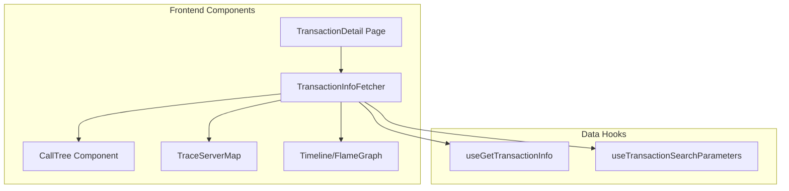
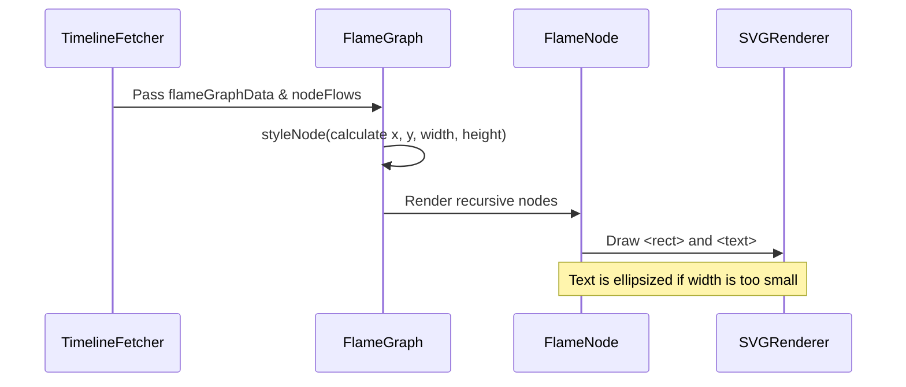

<!-- source: DeepWiki mcp.deepwiki.com · repo pinpoint-apm/pinpoint · page 7.3 Transaction Tracing and CallStack · fetched 2026-10-29 -->

# Transaction Tracing and CallStack

Relevant source files

The following files were used as context for generating this wiki page:

- [commons-server/src/main/java/com/navercorp/pinpoint/common/server/util/AnnotationUtils.java](commons-server/src/main/java/com/navercorp/pinpoint/common/server/util/AnnotationUtils.java)
- [commons-server/src/test/java/com/navercorp/pinpoint/common/server/util/AnnotationUtilsTest.java](commons-server/src/test/java/com/navercorp/pinpoint/common/server/util/AnnotationUtilsTest.java)
- [commons/src/main/java/com/navercorp/pinpoint/common/trace/ErrorCategory.java](commons/src/main/java/com/navercorp/pinpoint/common/trace/ErrorCategory.java)
- [commons/src/main/java/com/navercorp/pinpoint/common/trace/MethodType.java](commons/src/main/java/com/navercorp/pinpoint/common/trace/MethodType.java)
- [web-frontend/src/main/v3/apps/web/src/components/Layout/LayoutWithConfiguration.tsx](web-frontend/src/main/v3/apps/web/src/components/Layout/LayoutWithConfiguration.tsx)
- [web-frontend/src/main/v3/apps/web/src/main.tsx](web-frontend/src/main/v3/apps/web/src/main.tsx)
- [web-frontend/src/main/v3/apps/web/src/routes/index.tsx](web-frontend/src/main/v3/apps/web/src/routes/index.tsx)
- [web-frontend/src/main/v3/apps/web/stats.html](web-frontend/src/main/v3/apps/web/stats.html)
- [web-frontend/src/main/v3/apps/web/tsconfig.json](web-frontend/src/main/v3/apps/web/tsconfig.json)
- [web-frontend/src/main/v3/apps/web/vite.config.ts](web-frontend/src/main/v3/apps/web/vite.config.ts)
- [web-frontend/src/main/v3/packages/scatter-chart/src/style/index.css](web-frontend/src/main/v3/packages/scatter-chart/src/style/index.css)
- [web-frontend/src/main/v3/packages/scatter-chart/src/ui/Guide.ts](web-frontend/src/main/v3/packages/scatter-chart/src/ui/Guide.ts)
- [web-frontend/src/main/v3/packages/scatter-chart/src/ui/Legend.ts](web-frontend/src/main/v3/packages/scatter-chart/src/ui/Legend.ts)
- [web-frontend/src/main/v3/packages/scatter-chart/src/ui/ScatterChart.ts](web-frontend/src/main/v3/packages/scatter-chart/src/ui/ScatterChart.ts)
- [web-frontend/src/main/v3/packages/server-map/src/constants/style/theme-helper.ts](web-frontend/src/main/v3/packages/server-map/src/constants/style/theme-helper.ts)
- [web-frontend/src/main/v3/packages/server-map/src/core/merge.ts](web-frontend/src/main/v3/packages/server-map/src/core/merge.ts)
- [web-frontend/src/main/v3/packages/ui/src/components/Button/ClipboardCopyButton.tsx](web-frontend/src/main/v3/packages/ui/src/components/Button/ClipboardCopyButton.tsx)
- [web-frontend/src/main/v3/packages/ui/src/components/Config/agentManagement/AgentManagementFetcher.tsx](web-frontend/src/main/v3/packages/ui/src/components/Config/agentManagement/AgentManagementFetcher.tsx)
- [web-frontend/src/main/v3/packages/ui/src/components/Config/agentManagement/AgentManagementRemovePopup.tsx](web-frontend/src/main/v3/packages/ui/src/components/Config/agentManagement/AgentManagementRemovePopup.tsx)
- [web-frontend/src/main/v3/packages/ui/src/components/Config/agentManagement/AgentManagementTable.tsx](web-frontend/src/main/v3/packages/ui/src/components/Config/agentManagement/AgentManagementTable.tsx)
- [web-frontend/src/main/v3/packages/ui/src/components/FlameGraph/FlameArrow.tsx](web-frontend/src/main/v3/packages/ui/src/components/FlameGraph/FlameArrow.tsx)
- [web-frontend/src/main/v3/packages/ui/src/components/FlameGraph/FlameAxis.tsx](web-frontend/src/main/v3/packages/ui/src/components/FlameGraph/FlameAxis.tsx)
- [web-frontend/src/main/v3/packages/ui/src/components/FlameGraph/FlameGraph.tsx](web-frontend/src/main/v3/packages/ui/src/components/FlameGraph/FlameGraph.tsx)
- [web-frontend/src/main/v3/packages/ui/src/components/FlameGraph/FlameGraphConfigContext.tsx](web-frontend/src/main/v3/packages/ui/src/components/FlameGraph/FlameGraphConfigContext.tsx)
- [web-frontend/src/main/v3/packages/ui/src/components/FlameGraph/FlameNode.tsx](web-frontend/src/main/v3/packages/ui/src/components/FlameGraph/FlameNode.tsx)
- [web-frontend/src/main/v3/packages/ui/src/components/FlameGraph/FlameTimeline.tsx](web-frontend/src/main/v3/packages/ui/src/components/FlameGraph/FlameTimeline.tsx)
- [web-frontend/src/main/v3/packages/ui/src/components/FlameGraph/index.ts](web-frontend/src/main/v3/packages/ui/src/components/FlameGraph/index.ts)
- [web-frontend/src/main/v3/packages/ui/src/components/HelpPopover/HelpPopover.tsx](web-frontend/src/main/v3/packages/ui/src/components/HelpPopover/HelpPopover.tsx)
- [web-frontend/src/main/v3/packages/ui/src/components/Layout/LayoutWithHorizontalResizable.tsx](web-frontend/src/main/v3/packages/ui/src/components/Layout/LayoutWithHorizontalResizable.tsx)
- [web-frontend/src/main/v3/packages/ui/src/components/ProgressBar/ProgressBar.tsx](web-frontend/src/main/v3/packages/ui/src/components/ProgressBar/ProgressBar.tsx)
- [web-frontend/src/main/v3/packages/ui/src/components/Transaction/call-tree/CallTree.tsx](web-frontend/src/main/v3/packages/ui/src/components/Transaction/call-tree/CallTree.tsx)
- [web-frontend/src/main/v3/packages/ui/src/components/Transaction/call-tree/CallTreeTable.tsx](web-frontend/src/main/v3/packages/ui/src/components/Transaction/call-tree/CallTreeTable.tsx)
- [web-frontend/src/main/v3/packages/ui/src/components/Transaction/call-tree/CallTreeTableColumnsSetting.tsx](web-frontend/src/main/v3/packages/ui/src/components/Transaction/call-tree/CallTreeTableColumnsSetting.tsx)
- [web-frontend/src/main/v3/packages/ui/src/components/Transaction/call-tree/callTreeTableColumns.tsx](web-frontend/src/main/v3/packages/ui/src/components/Transaction/call-tree/callTreeTableColumns.tsx)
- [web-frontend/src/main/v3/packages/ui/src/components/Transaction/timeline/Timeline.tsx](web-frontend/src/main/v3/packages/ui/src/components/Transaction/timeline/Timeline.tsx)
- [web-frontend/src/main/v3/packages/ui/src/components/Transaction/timeline/TimelineDetail.tsx](web-frontend/src/main/v3/packages/ui/src/components/Transaction/timeline/TimelineDetail.tsx)
- [web-frontend/src/main/v3/packages/ui/src/components/Transaction/timeline/TimelineFetcher.tsx](web-frontend/src/main/v3/packages/ui/src/components/Transaction/timeline/TimelineFetcher.tsx)
- [web-frontend/src/main/v3/packages/ui/src/components/Transaction/transaction-info/TransactionInfoFetcher.tsx](web-frontend/src/main/v3/packages/ui/src/components/Transaction/transaction-info/TransactionInfoFetcher.tsx)
- [web-frontend/src/main/v3/packages/ui/src/components/Transaction/transaction-list/TransactionListTable.tsx](web-frontend/src/main/v3/packages/ui/src/components/Transaction/transaction-list/TransactionListTable.tsx)
- [web-frontend/src/main/v3/packages/ui/src/components/Transaction/transaction-list/transactionListTableColumns.tsx](web-frontend/src/main/v3/packages/ui/src/components/Transaction/transaction-list/transactionListTableColumns.tsx)
- [web-frontend/src/main/v3/packages/ui/src/constants/appSettingKeys.ts](web-frontend/src/main/v3/packages/ui/src/constants/appSettingKeys.ts)
- [web-frontend/src/main/v3/packages/ui/src/constants/types/AgentOverview.ts](web-frontend/src/main/v3/packages/ui/src/constants/types/AgentOverview.ts)
- [web-frontend/src/main/v3/packages/ui/src/constants/types/TransactionInfo.ts](web-frontend/src/main/v3/packages/ui/src/constants/types/TransactionInfo.ts)
- [web-frontend/src/main/v3/packages/ui/src/hooks/api/useGetTransactionInfo.ts](web-frontend/src/main/v3/packages/ui/src/hooks/api/useGetTransactionInfo.ts)
- [web-frontend/src/main/v3/packages/ui/src/lib/colors.ts](web-frontend/src/main/v3/packages/ui/src/lib/colors.ts)
- [web-frontend/src/main/v3/packages/ui/src/pages/ThreadDump.tsx](web-frontend/src/main/v3/packages/ui/src/pages/ThreadDump.tsx)
- [web-frontend/src/main/v3/packages/ui/src/pages/TransactionDetail.tsx](web-frontend/src/main/v3/packages/ui/src/pages/TransactionDetail.tsx)
- [web-frontend/src/main/v3/packages/ui/src/pages/TransactionList.tsx](web-frontend/src/main/v3/packages/ui/src/pages/TransactionList.tsx)
- [web-frontend/src/main/v3/packages/ui/src/pages/config/index.ts](web-frontend/src/main/v3/packages/ui/src/pages/config/index.ts)
- [web/src/main/java/com/navercorp/pinpoint/web/applicationmap/histogram/AgentResponse.java](web/src/main/java/com/navercorp/pinpoint/web/applicationmap/histogram/AgentResponse.java)
- [web/src/main/java/com/navercorp/pinpoint/web/applicationmap/histogram/LoadHistogram.java](web/src/main/java/com/navercorp/pinpoint/web/applicationmap/histogram/LoadHistogram.java)
- [web/src/main/java/com/navercorp/pinpoint/web/scatter/ScatterView.java](web/src/main/java/com/navercorp/pinpoint/web/scatter/ScatterView.java)
- [web/src/main/java/com/navercorp/pinpoint/web/vo/tree/ApplicationAgentHostList.java](web/src/main/java/com/navercorp/pinpoint/web/vo/tree/ApplicationAgentHostList.java)

Transaction Tracing in Pinpoint provides a deep-dive visualization of distributed transactions. It allows engineers to inspect the exact execution path of a request across multiple JVMs, including method-level call stacks, database queries, and asynchronous boundaries.

## Transaction Detail View

The Transaction Detail view is the primary interface for analyzing a single distributed transaction. In the React-based frontend (v3), this is managed by the `TransactionDetail` page component, which utilizes the `TransactionInfoFetcher` to coordinate data retrieval and tabbed visualization.

### Route and Navigation
The transaction detail is accessed via the path defined in `APP_PATH.TRANSACTION_DETAIL` [web-frontend/src/main/v3/apps/web/src/routes/index.tsx:144-147](). It requires parameters such as `agentId`, `traceId`, and `spanId` to uniquely identify the transaction in HBase [web-frontend/src/main/v3/packages/ui/src/constants/types/TransactionInfo.ts:3-8]().

### UI Components and Tabs
The detail view is split into three primary visualization modes [web-frontend/src/main/v3/packages/ui/src/components/Transaction/transaction-info/TransactionInfoFetcher.tsx:27-31]():
1.  **Call Tree**: A hierarchical table showing method execution and timing.
2.  **Server Map**: A transaction-specific topology map showing the flow between instances for this specific trace.
3.  **Flame Graph (Timeline)**: A temporal visualization of spans and events.

Sources: [web-frontend/src/main/v3/packages/ui/src/components/Transaction/transaction-info/TransactionInfoFetcher.tsx:142-167](), [web-frontend/src/main/v3/apps/web/src/routes/index.tsx:37-37]().

## Call Tree Rendering

The Call Tree provides a tabular representation of the `callStack` data returned by the backend. The data structure is an array of arrays where indices are mapped via a `callStackIndex` object [web-frontend/src/main/v3/packages/ui/src/constants/types/TransactionInfo.ts:10-29]().

### Data Transformation
The raw `callStack` (any[][]) is converted into a hierarchical tree structure suitable for `@tanstack/react-table`.
1.  **getMapData**: Maps the flat array into key-value objects using `callStackIndex` [web-frontend/src/main/v3/packages/ui/src/hooks/api/useGetTransactionInfo.ts:38-54]().
2.  **convertToTree**: Recursively builds the parent-child relationships using `id` and `parentId` fields [web-frontend/src/main/v3/packages/ui/src/hooks/api/useGetTransactionInfo.ts:56-78]().

### CallTree Table Columns
The table displays several critical metrics for performance analysis:
-   **Gap**: The time difference between the end of the previous event and the start of the current one [web-frontend/src/main/v3/packages/ui/src/components/Transaction/call-tree/callTreeTableColumns.tsx:143-154]().
-   **Exec (ms)**: The total elapsed time for the method/span [web-frontend/src/main/v3/packages/ui/src/components/Transaction/call-tree/callTreeTableColumns.tsx:156-171]().
-   **Self (ms)**: The execution time of the method itself, excluding child calls [web-frontend/src/main/v3/packages/ui/src/components/Transaction/call-tree/callTreeTableColumns.tsx:204-219]().

| Column ID | Description | Source |
| :--- | :--- | :--- |
| `title` | Method name or API call | [callTreeTableColumns.tsx:94]() |
| `arguments` | Method arguments or SQL Bind variables | [callTreeTableColumns.tsx:119]() |
| `executionPercentage` | Visual progress bar of execution time | [callTreeTableColumns.tsx:173]() |
| `agent` | ID of the agent that captured the event | [callTreeTableColumns.tsx:256]() |

Sources: [web-frontend/src/main/v3/packages/ui/src/components/Transaction/call-tree/callTreeTableColumns.tsx:71-279]().

## Timeline and Flame Graph

The Timeline view (implemented as a Flame Graph) provides a horizontal temporal view of the transaction. It is rendered using the `FlameGraph` component which handles zooming, panning, and node selection [web-frontend/src/main/v3/packages/ui/src/components/FlameGraph/FlameGraph.tsx:28-36]().

### Data Flow for Timeline
1.  **Data Retrieval**: `TimelineFetcher` calls `useGetTraceViewerData` to get the `traceEvents` [web-frontend/src/main/v3/packages/ui/src/components/Transaction/timeline/TimelineFetcher.tsx:40-45]().
2.  **Flame Graph Construction**: The `genFlameGraphData` function transforms trace events into `FlameNodeType` objects with `start`, `duration`, and `children` [web-frontend/src/main/v3/packages/ui/src/components/FlameGraph/FlameNode.tsx:5-18]().
3.  **Search & Highlight**: Users can search for specific events using `fuse.js` for fuzzy matching. The UI highlights the selected node and its "flow" (previous and next related nodes) [web-frontend/src/main/v3/packages/ui/src/components/Transaction/timeline/TimelineFetcher.tsx:55-130]().

### Rendering Logic
The `FlameGraph` uses SVG to render nodes. Each `FlameNode` calculates its width based on the `duration` and a `widthRatio` derived from the total transaction time [web-frontend/src/main/v3/packages/ui/src/components/FlameGraph/FlameGraph.tsx:157-171]().

Sources: [web-frontend/src/main/v3/packages/ui/src/components/FlameGraph/FlameGraph.tsx:173-219](), [web-frontend/src/main/v3/packages/ui/src/components/FlameGraph/FlameNode.tsx:139-175]().

## Advanced Features

### SQL and Bind Variable Visualization
When a call stack entry represents a database query (e.g., "SQL"), Pinpoint can bind captured parameters to the SQL template.
-   The `CallTree` component detects `SQL-BindValue` or `MONGO-JSON-BindValue` in the subsequent call stack entry [web-frontend/src/main/v3/packages/ui/src/components/Transaction/call-tree/CallTree.tsx:62-75]().
-   It uses the `usePostBind` hook to send the template and bind variables to the backend, which returns the obfuscated/reconstructed SQL [web-frontend/src/main/v3/packages/ui/src/components/Transaction/call-tree/CallTree.tsx:85-91]().

### Log Integration
If `logLinkEnable` is true in the transaction response, the UI displays a log button. This allows users to jump from a specific trace directly to the corresponding logs in an external log management system (e.g., ELK) using the `logPageUrl` [web-frontend/src/main/v3/packages/ui/src/components/Transaction/transaction-info/TransactionInfoFetcher.tsx:117-139]().

### Exception Tracing
Nodes with exceptions are highlighted in the Call Tree. The `hasException` filter allows users to quickly jump to error points within a large trace [web-frontend/src/main/v3/packages/ui/src/components/Transaction/call-tree/CallTree.tsx:113-117]().

Sources: [web-frontend/src/main/v3/packages/ui/src/constants/types/TransactionInfo.ts:10-29](), [web-frontend/src/main/v3/packages/ui/src/components/Transaction/call-tree/CallTree.tsx:38-43]().

---

