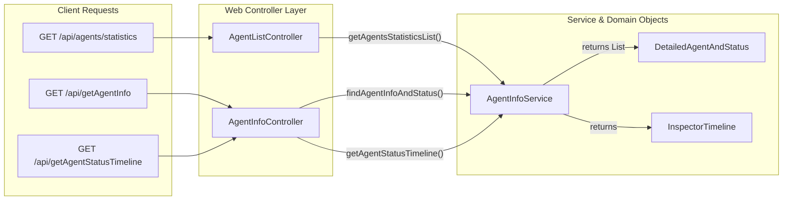

<!-- source: DeepWiki mcp.deepwiki.com · repo pinpoint-apm/pinpoint · page 7.4 Agent Management Dashboard · fetched 2026-10-29 -->

# Agent Management Dashboard

Relevant source files

The following files were used as context for generating this wiki page:

- [web/src/main/java/com/navercorp/pinpoint/web/WebMvcConfig.java](web/src/main/java/com/navercorp/pinpoint/web/WebMvcConfig.java)
- [web/src/main/java/com/navercorp/pinpoint/web/authorization/controller/ActiveThreadDumpController.java](web/src/main/java/com/navercorp/pinpoint/web/authorization/controller/ActiveThreadDumpController.java)
- [web/src/main/java/com/navercorp/pinpoint/web/authorization/controller/AdminController.java](web/src/main/java/com/navercorp/pinpoint/web/authorization/controller/AdminController.java)
- [web/src/main/java/com/navercorp/pinpoint/web/authorization/controller/AgentInfoController.java](web/src/main/java/com/navercorp/pinpoint/web/authorization/controller/AgentInfoController.java)
- [web/src/main/java/com/navercorp/pinpoint/web/authorization/controller/AgentListController.java](web/src/main/java/com/navercorp/pinpoint/web/authorization/controller/AgentListController.java)
- [web/src/main/java/com/navercorp/pinpoint/web/authorization/controller/AlarmController.java](web/src/main/java/com/navercorp/pinpoint/web/authorization/controller/AlarmController.java)
- [web/src/main/java/com/navercorp/pinpoint/web/authorization/controller/HeatMapController.java](web/src/main/java/com/navercorp/pinpoint/web/authorization/controller/HeatMapController.java)
- [web/src/main/java/com/navercorp/pinpoint/web/authorization/controller/ScatterChartController.java](web/src/main/java/com/navercorp/pinpoint/web/authorization/controller/ScatterChartController.java)
- [web/src/main/java/com/navercorp/pinpoint/web/authorization/controller/UserController.java](web/src/main/java/com/navercorp/pinpoint/web/authorization/controller/UserController.java)
- [web/src/main/java/com/navercorp/pinpoint/web/authorization/controller/UserGroupController.java](web/src/main/java/com/navercorp/pinpoint/web/authorization/controller/UserGroupController.java)
- [web/src/main/java/com/navercorp/pinpoint/web/authorization/controller/WebhookAlarmController.java](web/src/main/java/com/navercorp/pinpoint/web/authorization/controller/WebhookAlarmController.java)
- [web/src/main/java/com/navercorp/pinpoint/web/controller/ApplicationController.java](web/src/main/java/com/navercorp/pinpoint/web/controller/ApplicationController.java)
- [web/src/main/java/com/navercorp/pinpoint/web/response/CodeResult.java](web/src/main/java/com/navercorp/pinpoint/web/response/CodeResult.java)
- [web/src/main/java/com/navercorp/pinpoint/web/scatter/DragAreaQuery.java](web/src/main/java/com/navercorp/pinpoint/web/scatter/DragAreaQuery.java)
- [web/src/main/java/com/navercorp/pinpoint/web/scatter/ElpasedTimeDotPredicate.java](web/src/main/java/com/navercorp/pinpoint/web/scatter/ElpasedTimeDotPredicate.java)
- [web/src/main/java/com/navercorp/pinpoint/web/service/AgentInfoService.java](web/src/main/java/com/navercorp/pinpoint/web/service/AgentInfoService.java)
- [web/src/main/java/com/navercorp/pinpoint/web/service/AgentInfoServiceImpl.java](web/src/main/java/com/navercorp/pinpoint/web/service/AgentInfoServiceImpl.java)

The Agent Management Dashboard provides a comprehensive interface for viewing, filtering, and monitoring Pinpoint agents deployed across applications. This page covers the backend services, REST APIs, and data models that power agent listing, status monitoring, filtering capabilities, and detailed inspector views.

## Overview

The Agent Management Dashboard enables administrators and developers to:
- View all agents across all applications with pagination support.
- Filter agents by status (active/inactive), container type, and time duration.
- Monitor real-time agent status and lifecycle events.
- Access detailed agent information including JVM properties and system metrics.
- View agent status timelines with event history.
- Inspect individual agent performance and warnings.

The dashboard architecture consists of a service layer (`AgentInfoService`), REST controllers (`AgentListController`, `AgentInfoController`, `ApplicationController`), and data access objects that query HBase for agent metadata.

## Backend Service Architecture

The following diagram maps the logical components of the Agent Management system to their corresponding code entities.

### System to Code Entity Mapping
Title: Agent Management Service Dependencies

```mermaid
graph TB
    subgraph "REST Controllers"
        AgentListController["AgentListController<br/>/api/agents"]
        AgentInfoController["AgentInfoController<br/>/api"]
        ApplicationController["ApplicationController<br/>/api"]
        AdminController["AdminController<br/>/api/admin"]
    end
    
    subgraph "Service Layer"
        AgentInfoService["AgentInfoService"]
        AgentInfoServiceImpl["AgentInfoServiceImpl"]
        AgentEventService["AgentEventService"]
        AgentWarningStatService["AgentWarningStatService"]
        ApplicationIndexService["ApplicationIndexService"]
    end
    
    subgraph "DAO Layer"
        AgentInfoDao["AgentInfoDao"]
        AgentLifeCycleDao["AgentLifeCycleDao"]
    end
    
    subgraph "Data Models"
        AgentInfo["AgentInfo"]
        DetailedAgentInfo["DetailedAgentInfo"]
        AgentAndStatus["AgentAndStatus"]
        DetailedAgentAndStatus["DetailedAgentAndStatus"]
        AgentStatus["AgentStatus"]
        InspectorTimeline["InspectorTimeline"]
    end
    
    AgentListController --> AgentInfoServiceImpl
    AgentInfoController --> AgentInfoServiceImpl
    ApplicationController --> AgentInfoServiceImpl
    AdminController --> AgentInfoServiceImpl
    
    AgentInfoServiceImpl -.implements.-> AgentInfoService
    AgentInfoServiceImpl --> AgentEventService
    AgentInfoServiceImpl --> AgentWarningStatService
    AgentInfoServiceImpl --> AgentInfoDao
    AgentInfoServiceImpl --> AgentLifeCycleDao
    AgentInfoServiceImpl --> ApplicationIndexService
    
    AgentInfoServiceImpl --> AgentInfo
    AgentInfoServiceImpl --> DetailedAgentInfo
    AgentInfoServiceImpl --> AgentAndStatus
    AgentInfoServiceImpl --> DetailedAgentAndStatus
    AgentInfoServiceImpl --> AgentStatus
    AgentInfoServiceImpl --> InspectorTimeline
```

**Sources:**
- [web/src/main/java/com/navercorp/pinpoint/web/service/AgentInfoServiceImpl.java:56-77]()
- [web/src/main/java/com/navercorp/pinpoint/web/service/AgentInfoService.java:35-60]()
- [web/src/main/java/com/navercorp/pinpoint/web/authorization/controller/AgentListController.java:24-37]()
- [web/src/main/java/com/navercorp/pinpoint/web/authorization/controller/AgentInfoController.java:59-70]()

### AgentInfoServiceImpl

The `AgentInfoServiceImpl` class is the primary service implementation for agent management operations. It coordinates between multiple DAOs and other services to construct complete agent views with status, events, and warning information.

| Method | Purpose |
|--------|---------|
| `getAgentsStatisticsList(Range range)` | Retrieves all agents across all applications within a time range. [web/src/main/java/com/navercorp/pinpoint/web/service/AgentInfoServiceImpl.java:80-94]() |
| `findAgentInfoAndStatus(String agentId, long timestamp)` | Finds basic agent info and its status at a specific time. [web/src/main/java/com/navercorp/pinpoint/web/service/AgentInfoServiceImpl.java:141-151]() |
| `findDetailedAgentInfoAndStatus(String agentId, long timestamp)` | Finds detailed agent info (JVM, etc.) and its status. [web/src/main/java/com/navercorp/pinpoint/web/service/AgentInfoServiceImpl.java:154-165]() |
| `getAgentStatusTimeline(...)` | Builds a timeline of agent status changes and events. [web/src/main/java/com/navercorp/pinpoint/web/service/AgentInfoServiceImpl.java:303-321]() |

**Sources:**
- [web/src/main/java/com/navercorp/pinpoint/web/service/AgentInfoServiceImpl.java:56-165]()
- [web/src/main/java/com/navercorp/pinpoint/web/service/AgentInfoService.java:35-60]()

## REST API Endpoints

The Web component exposes several endpoints for managing and inspecting agents.

### Agent Statistics and Listing
Title: Agent Data Flow and API Mapping

**Sources:**
- [web/src/main/java/com/navercorp/pinpoint/web/authorization/controller/AgentListController.java:40-59]()
- [web/src/main/java/com/navercorp/pinpoint/web/authorization/controller/AgentInfoController.java:73-85]()
- [web/src/main/java/com/navercorp/pinpoint/web/authorization/controller/AgentInfoController.java:133-154]()

### Detailed API Reference

| Endpoint | Controller | Description |
|----------|------------|-------------|
| `/api/agents/statistics` | `AgentListController` | Returns a list of all agents and their statuses. Supports `from` and `to` params. [web/src/main/java/com/navercorp/pinpoint/web/authorization/controller/AgentListController.java:41-59]() |
| `/api/getAgentInfo` | `AgentInfoController` | Returns `AgentAndStatus` for a specific `agentId` and `timestamp`. [web/src/main/java/com/navercorp/pinpoint/web/authorization/controller/AgentInfoController.java:73-78]() |
| `/api/getDetailedAgentInfo` | `AgentInfoController` | Returns `DetailedAgentAndStatus` including JVM details. [web/src/main/java/com/navercorp/pinpoint/web/authorization/controller/AgentInfoController.java:80-85]() |
| `/api/getAgentStatusTimeline` | `AgentInfoController` | Returns `InspectorTimeline` for an agent over a range. [web/src/main/java/com/navercorp/pinpoint/web/authorization/controller/AgentInfoController.java:133-154]() |
| `/api/getApplicationHostInfo` | `ApplicationController` | Returns paginated list of hosts/agents for applications. [web/src/main/java/com/navercorp/pinpoint/web/controller/ApplicationController.java:72-100]() |

**Sources:**
- [web/src/main/java/com/navercorp/pinpoint/web/authorization/controller/AgentListController.java:40-59]()
- [web/src/main/java/com/navercorp/pinpoint/web/authorization/controller/AgentInfoController.java:73-154]()
- [web/src/main/java/com/navercorp/pinpoint/web/controller/ApplicationController.java:72-100]()

## Agent Listing and Filtering

The agent listing system supports filtering by application, container status, and activity duration.

### Filtering and Pagination
- **Container Filtering**: The `ApplicationController` uses `AgentInfoFilter` to filter agents based on whether they are running in a container. [web/src/main/java/com/navercorp/pinpoint/web/controller/ApplicationController.java:102-107]()
- **Pagination**: The `/api/getApplicationHostInfo` endpoint supports `offset` and `limit` (max 100). [web/src/main/java/com/navercorp/pinpoint/web/controller/ApplicationController.java:72-87]()
- **Duration Filtering**: Agents can be filtered by how recently they were active using `durationHours` or `durationDays`. [web/src/main/java/com/navercorp/pinpoint/web/controller/ApplicationController.java:72-100]()

**Sources:**
- [web/src/main/java/com/navercorp/pinpoint/web/controller/ApplicationController.java:72-107]()

## Agent Status Monitoring

Agent status is tracked through lifecycle events (e.g., START, SHUTDOWN, UNEXPECTED_SHUTDOWN).

### Data Flow for Status Retrieval
1. `AgentInfoServiceImpl` requests agent status from `AgentLifeCycleDao`. [web/src/main/java/com/navercorp/pinpoint/web/service/AgentInfoServiceImpl.java:101-102]()
2. The `AgentStatusQuery` is built using the agent's `agentId` and `startTimestamp`. [web/src/main/java/com/navercorp/pinpoint/web/service/AgentInfoServiceImpl.java:100]()
3. Status is combined with metadata into `AgentAndStatus` or `DetailedAgentAndStatus`. [web/src/main/java/com/navercorp/pinpoint/web/service/AgentInfoServiceImpl.java:106]()

**Sources:**
- [web/src/main/java/com/navercorp/pinpoint/web/service/AgentInfoServiceImpl.java:96-109]()
- [web/src/main/java/com/navercorp/pinpoint/web/vo/agent/AgentAndStatus.java]()

## Inspector Views and Timelines

The Inspector view provides a deep dive into an agent's health and history using timelines.

### InspectorTimeline Construction
The `InspectorTimeline` is composed of:
- **AgentStatusTimeline**: Segments showing when the agent was running or stopped. [web/src/main/java/com/navercorp/pinpoint/web/service/AgentInfoServiceImpl.java:303-311]()
- **AgentEventTimeline**: Points in time where specific events occurred (e.g., GC, property changes). [web/src/main/java/com/navercorp/pinpoint/web/service/AgentInfoServiceImpl.java:313-318]()

The `AgentStatusTimelineBuilder` and `AgentEventTimelineBuilder` are used to aggregate this data from the `AgentLifeCycleDao` and `AgentEventService`.

**Sources:**
- [web/src/main/java/com/navercorp/pinpoint/web/service/AgentInfoServiceImpl.java:303-321]()
- [web/src/main/java/com/navercorp/pinpoint/web/authorization/controller/AgentInfoController.java:133-154]()

## Administrative Actions

The `AdminController` provides endpoints for managing the lifecycle of agent and application metadata in the storage layer.

| Action | Endpoint | Description |
|--------|----------|-------------|
| Remove Agent | `/api/admin/removeAgentId` | Deletes metadata for a specific `agentId`. [web/src/main/java/com/navercorp/pinpoint/web/authorization/controller/AdminController.java:91-124]() |
| Remove Application | `/api/admin/removeApplication` | Deletes an entire application and its associated agents. [web/src/main/java/com/navercorp/pinpoint/web/authorization/controller/AdminController.java:73-89]() |
| Cleanup Inactive | `/api/admin/removeInactiveAgents` | Batch removes agents inactive for a specified duration. [web/src/main/java/com/navercorp/pinpoint/web/authorization/controller/AdminController.java:126-140]() |

**Sources:**
- [web/src/main/java/com/navercorp/pinpoint/web/authorization/controller/AdminController.java:73-140]()

## Authorization and Security

Access to agent management APIs is protected by Spring Security permissions:
- `PERMISSION_ADMINISTRATION_CALL_API_FOR_APP_AGENT_MANAGEMENT`: Required for statistics and administrative tasks. [web/src/main/java/com/navercorp/pinpoint/web/authorization/controller/AgentListController.java:39]()
- `inspector` permission on `AgentParam`: Required for viewing specific agent details and timelines. [web/src/main/java/com/navercorp/pinpoint/web/authorization/controller/AgentInfoController.java:72]()

**Sources:**
- [web/src/main/java/com/navercorp/pinpoint/web/authorization/controller/AgentListController.java:39-41]()
- [web/src/main/java/com/navercorp/pinpoint/web/authorization/controller/AgentInfoController.java:72-73]()
- [web/src/main/java/com/navercorp/pinpoint/web/authorization/controller/AdminController.java:46-47]()

---

