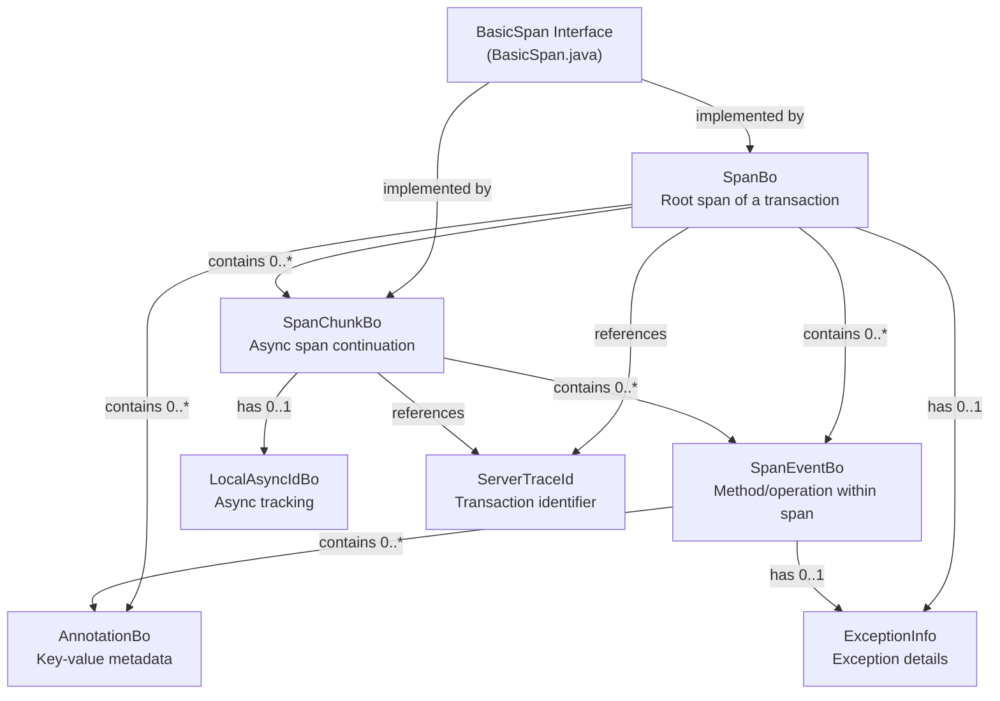
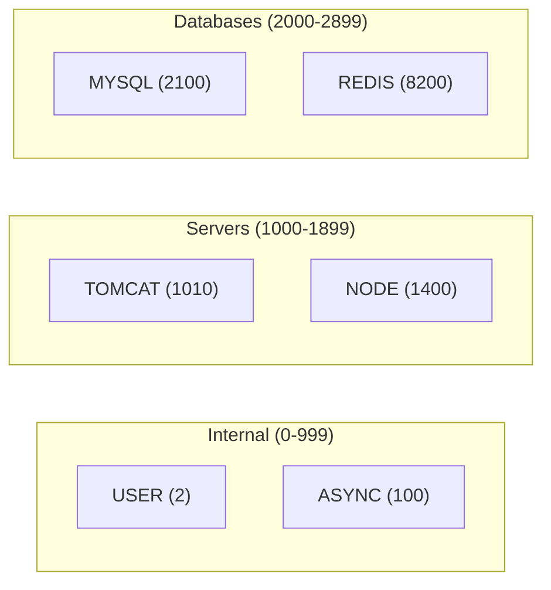
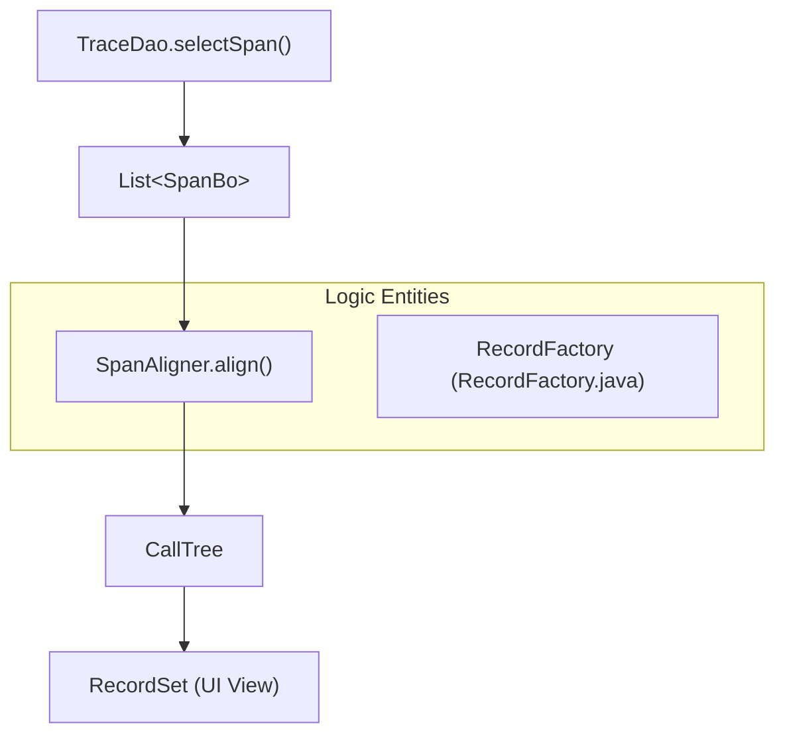

<!-- source: DeepWiki mcp.deepwiki.com · repo pinpoint-apm/pinpoint · page 8 Data Model · fetched 2026-10-29 -->

# Data Model

Relevant source files

The following files were used as context for generating this wiki page:

- [agent-module/profiler/src/main/java/com/navercorp/pinpoint/profiler/context/exception/model/ExceptionWrapper.java](agent-module/profiler/src/main/java/com/navercorp/pinpoint/profiler/context/exception/model/ExceptionWrapper.java)
- [agent-module/profiler/src/main/java/com/navercorp/pinpoint/profiler/monitor/metric/uri/URIKey.java](agent-module/profiler/src/main/java/com/navercorp/pinpoint/profiler/monitor/metric/uri/URIKey.java)
- [collector/src/main/java/com/navercorp/pinpoint/collector/util/MultipleAddress.java](collector/src/main/java/com/navercorp/pinpoint/collector/util/MultipleAddress.java)
- [commons-profiler/src/main/java/com/navercorp/pinpoint/common/profiler/trace/DefaultDisplayArgument.java](commons-profiler/src/main/java/com/navercorp/pinpoint/common/profiler/trace/DefaultDisplayArgument.java)
- [commons-server/src/main/java/com/navercorp/pinpoint/common/server/bo/BasicSpan.java](commons-server/src/main/java/com/navercorp/pinpoint/common/server/bo/BasicSpan.java)
- [commons-server/src/main/java/com/navercorp/pinpoint/common/server/bo/SpanBo.java](commons-server/src/main/java/com/navercorp/pinpoint/common/server/bo/SpanBo.java)
- [commons-server/src/main/java/com/navercorp/pinpoint/common/server/bo/SpanChunkBo.java](commons-server/src/main/java/com/navercorp/pinpoint/common/server/bo/SpanChunkBo.java)
- [commons-server/src/main/java/com/navercorp/pinpoint/common/server/bo/SpanEventBo.java](commons-server/src/main/java/com/navercorp/pinpoint/common/server/bo/SpanEventBo.java)
- [commons-server/src/main/java/com/navercorp/pinpoint/common/server/bo/SpanEventComparator.java](commons-server/src/main/java/com/navercorp/pinpoint/common/server/bo/SpanEventComparator.java)
- [commons-server/src/main/java/com/navercorp/pinpoint/common/server/bo/serializer/trace/v2/bitfield/SpanBitField.java](commons-server/src/main/java/com/navercorp/pinpoint/common/server/bo/serializer/trace/v2/bitfield/SpanBitField.java)
- [commons-server/src/main/java/com/navercorp/pinpoint/common/server/util/json/TypeRef.java](commons-server/src/main/java/com/navercorp/pinpoint/common/server/util/json/TypeRef.java)
- [commons-server/src/test/java/com/navercorp/pinpoint/common/server/bo/SpanBoTest.java](commons-server/src/test/java/com/navercorp/pinpoint/common/server/bo/SpanBoTest.java)
- [commons/src/main/java/com/navercorp/pinpoint/common/trace/AnnotationKey.java](commons/src/main/java/com/navercorp/pinpoint/common/trace/AnnotationKey.java)
- [commons/src/main/java/com/navercorp/pinpoint/common/trace/ErrorCategoryResolver.java](commons/src/main/java/com/navercorp/pinpoint/common/trace/ErrorCategoryResolver.java)
- [commons/src/main/java/com/navercorp/pinpoint/common/trace/OpenTelemetryServiceTypeCategory.java](commons/src/main/java/com/navercorp/pinpoint/common/trace/OpenTelemetryServiceTypeCategory.java)
- [commons/src/main/java/com/navercorp/pinpoint/common/trace/ServiceType.java](commons/src/main/java/com/navercorp/pinpoint/common/trace/ServiceType.java)
- [commons/src/test/java/com/navercorp/pinpoint/common/trace/ErrorCategoryResolverTest.java](commons/src/test/java/com/navercorp/pinpoint/common/trace/ErrorCategoryResolverTest.java)
- [web-frontend/src/main/v3/apps/web/public/img/icons/OPENTELEMETRY_SERVER.png](web-frontend/src/main/v3/apps/web/public/img/icons/OPENTELEMETRY_SERVER.png)
- [web-frontend/src/main/v3/apps/web/public/img/servers/OPENTELEMETRY_SERVER.png](web-frontend/src/main/v3/apps/web/public/img/servers/OPENTELEMETRY_SERVER.png)
- [web-frontend/src/main/v3/apps/web/public/img/servers/OPENTELEMETY_DB.png](web-frontend/src/main/v3/apps/web/public/img/servers/OPENTELEMETY_DB.png)
- [web/src/main/java/com/navercorp/pinpoint/web/applicationmap/map/FilteredMapBuilder.java](web/src/main/java/com/navercorp/pinpoint/web/applicationmap/map/FilteredMapBuilder.java)
- [web/src/main/java/com/navercorp/pinpoint/web/filter/responsetime/DefaultExecutionTypeFilter.java](web/src/main/java/com/navercorp/pinpoint/web/filter/responsetime/DefaultExecutionTypeFilter.java)
- [web/src/main/java/com/navercorp/pinpoint/web/filter/responsetime/SpanResponseConditionFilter.java](web/src/main/java/com/navercorp/pinpoint/web/filter/responsetime/SpanResponseConditionFilter.java)
- [web/src/main/java/com/navercorp/pinpoint/web/trace/dao/mapper/SpanMapperV2.java](web/src/main/java/com/navercorp/pinpoint/web/trace/dao/mapper/SpanMapperV2.java)
- [web/src/main/java/com/navercorp/pinpoint/web/trace/service/SpanServiceImpl.java](web/src/main/java/com/navercorp/pinpoint/web/trace/service/SpanServiceImpl.java)
- [web/src/main/java/com/navercorp/pinpoint/web/trace/service/TransactionInfoService.java](web/src/main/java/com/navercorp/pinpoint/web/trace/service/TransactionInfoService.java)
- [web/src/main/java/com/navercorp/pinpoint/web/trace/service/TransactionInfoServiceImpl.java](web/src/main/java/com/navercorp/pinpoint/web/trace/service/TransactionInfoServiceImpl.java)
- [web/src/main/java/com/navercorp/pinpoint/web/trace/span/Align.java](web/src/main/java/com/navercorp/pinpoint/web/trace/span/Align.java)
- [web/src/main/java/com/navercorp/pinpoint/web/trace/span/AlignComparator.java](web/src/main/java/com/navercorp/pinpoint/web/trace/span/AlignComparator.java)
- [web/src/main/java/com/navercorp/pinpoint/web/trace/span/CallTreeNode.java](web/src/main/java/com/navercorp/pinpoint/web/trace/span/CallTreeNode.java)
- [web/src/main/java/com/navercorp/pinpoint/web/trace/span/Link.java](web/src/main/java/com/navercorp/pinpoint/web/trace/span/Link.java)
- [web/src/main/java/com/navercorp/pinpoint/web/trace/span/LinkMap.java](web/src/main/java/com/navercorp/pinpoint/web/trace/span/LinkMap.java)
- [web/src/main/java/com/navercorp/pinpoint/web/trace/span/Node.java](web/src/main/java/com/navercorp/pinpoint/web/trace/span/Node.java)
- [web/src/main/java/com/navercorp/pinpoint/web/trace/span/NodeList.java](web/src/main/java/com/navercorp/pinpoint/web/trace/span/NodeList.java)
- [web/src/main/java/com/navercorp/pinpoint/web/trace/span/SpanAlign.java](web/src/main/java/com/navercorp/pinpoint/web/trace/span/SpanAlign.java)
- [web/src/main/java/com/navercorp/pinpoint/web/trace/span/SpanAligner.java](web/src/main/java/com/navercorp/pinpoint/web/trace/span/SpanAligner.java)
- [web/src/main/java/com/navercorp/pinpoint/web/trace/span/SpanEventAlign.java](web/src/main/java/com/navercorp/pinpoint/web/trace/span/SpanEventAlign.java)
- [web/src/test/java/com/navercorp/pinpoint/web/trace/callstacks/RecordFactoryTest.java](web/src/test/java/com/navercorp/pinpoint/web/trace/callstacks/RecordFactoryTest.java)

## Purpose and Scope

This document describes Pinpoint's internal data model used to represent distributed traces, including the core Business Objects (Bo), metadata classification systems, and serialization formats. This covers the data structures created by agents and processed by the collector for storage in HBase.

For information about how traces are collected from agents, see [Agent](#4). For details on how the web application queries and renders this data, see [Web Application](#6).

---

## Core Trace Data Structures

Pinpoint represents distributed traces using a hierarchy of Business Objects (Bo classes). These objects model the execution flow across distributed services.

### Span Hierarchy

**Diagram: Span Object Hierarchy and Relationships**

Sources: [commons-server/src/main/java/com/navercorp/pinpoint/common/server/bo/BasicSpan.java:24-58](), [commons-server/src/main/java/com/navercorp/pinpoint/common/server/bo/SpanBo.java:35-92](), [commons-server/src/main/java/com/navercorp/pinpoint/common/server/bo/SpanChunkBo.java:33-62](), [commons-server/src/main/java/com/navercorp/pinpoint/common/server/bo/SpanEventBo.java:26-55]()

### SpanBo - Root Span

`SpanBo` represents the root span of a distributed transaction. It captures the entry point of a request into an application. For detailed structure and serialization, see [Trace Data Structures](#8.1).

| Field | Type | Purpose |
|-------|------|---------|
| `transactionId` | `ServerTraceId` | Globally unique transaction identifier [commons-server/src/main/java/com/navercorp/pinpoint/common/server/bo/SpanBo.java:55]() |
| `spanId` | `long` | Unique span identifier within transaction [commons-server/src/main/java/com/navercorp/pinpoint/common/server/bo/SpanBo.java:57]() |
| `parentSpanId` | `long` | Parent span ID (-1 for root) [commons-server/src/main/java/com/navercorp/pinpoint/common/server/bo/SpanBo.java:58]() |
| `agentId` | `String` | Agent identifier [commons-server/src/main/java/com/navercorp/pinpoint/common/server/bo/SpanBo.java:44]() |
| `applicationName` | `String` | Application name [commons-server/src/main/java/com/navercorp/pinpoint/common/server/bo/SpanBo.java:48]() |
| `startTime` | `long` | Span start timestamp [commons-server/src/main/java/com/navercorp/pinpoint/common/server/bo/SpanBo.java:63]() |
| `elapsed` | `int` | Span duration [commons-server/src/main/java/com/navercorp/pinpoint/common/server/bo/SpanBo.java:64]() |
| `serviceType` | `int` | Service type code [commons-server/src/main/java/com/navercorp/pinpoint/common/server/bo/SpanBo.java:67]() |
| `rpc` | `String` | RPC method/endpoint [commons-server/src/main/java/com/navercorp/pinpoint/common/server/bo/SpanBo.java:66]() |

Sources: [commons-server/src/main/java/com/navercorp/pinpoint/common/server/bo/SpanBo.java:35-92]()

### SpanChunkBo - Async Continuation

`SpanChunkBo` represents asynchronous continuations of a span, used when work is dispatched to different threads or external systems.

| Field | Type | Purpose |
|-------|------|---------|
| `localAsyncId` | `LocalAsyncIdBo` | Async identifier for tracking [commons-server/src/main/java/com/navercorp/pinpoint/common/server/bo/SpanChunkBo.java:60]() |
| `spanEventBoList` | `List<SpanEventBo>` | Span events in this chunk [commons-server/src/main/java/com/navercorp/pinpoint/common/server/bo/SpanChunkBo.java:56]() |
| `keyTime` | `long` | Key timestamp for ordering [commons-server/src/main/java/com/navercorp/pinpoint/common/server/bo/SpanChunkBo.java:61]() |

Sources: [commons-server/src/main/java/com/navercorp/pinpoint/common/server/bo/SpanChunkBo.java:33-233]()

### SpanEventBo - Method Invocation

`SpanEventBo` represents a single method invocation or operation within a span (e.g., database query, remote call).

| Field | Type | Purpose |
|-------|------|---------|
| `sequence` | `short` | Sequence number within span [commons-server/src/main/java/com/navercorp/pinpoint/common/server/bo/SpanEventBo.java:32]() |
| `startElapsed` | `int` | Start time relative to span [commons-server/src/main/java/com/navercorp/pinpoint/common/server/bo/SpanEventBo.java:34]() |
| `depth` | `int` | Call stack depth [commons-server/src/main/java/com/navercorp/pinpoint/common/server/bo/SpanEventBo.java:46]() |
| `nextSpanId` | `long` | Next span ID if RPC call [commons-server/src/main/java/com/navercorp/pinpoint/common/server/bo/SpanEventBo.java:47]() |

Sources: [commons-server/src/main/java/com/navercorp/pinpoint/common/server/bo/SpanEventBo.java:26-212]()

---

## ServiceType and Annotation Classification

Pinpoint uses a classification system to identify technologies and attach metadata to traces. For a complete list of definitions, see [Service Types and Annotations](#8.2).

### ServiceType Classification

`ServiceType` classifies components (WAS, DB, Cache, etc.) and determines how they are visualized on the ServerMap.

**Diagram: ServiceType Code Ranges**

Sources: [commons/src/main/java/com/navercorp/pinpoint/common/trace/ServiceType.java:24-170]()

### Annotation System

Annotations provide flexible key-value metadata. `AnnotationKey` defines standard keys like `SQL` (21) or `HTTP_URL` (40).

| Category | Key Range | Examples |
|----------|-----------|----------|
| Arguments | -1 to -11 | `args[0]`, `args[N]` [commons/src/main/java/com/navercorp/pinpoint/common/trace/AnnotationKey.java:26-36]() |
| SQL | 20 to 24 | `SQL`, `SQL-PARAM` [commons/src/main/java/com/navercorp/pinpoint/common/trace/AnnotationKey.java:60-64]() |
| HTTP | 40 to 49 | `http.url`, `http.status.code` [commons/src/main/java/com/navercorp/pinpoint/common/trace/AnnotationKey.java:66-72]() |

Sources: [commons/src/main/java/com/navercorp/pinpoint/common/trace/AnnotationKey.java:23-147]()

---

## Trace Reconstruction

The web application uses these structures to reconstruct the call tree and application map.

### CallTree Construction

`SpanServiceImpl` and `TransactionInfoServiceImpl` are responsible for aligning spans and events into a coherent trace.

**Diagram: Trace Reconstruction Pipeline**

Sources: [web/src/main/java/com/navercorp/pinpoint/web/trace/service/SpanServiceImpl.java:136-158](), [web/src/main/java/com/navercorp/pinpoint/web/trace/service/TransactionInfoServiceImpl.java:77-138]()

### Application Map Building

`FilteredMapBuilder` processes spans to calculate statistics and links between applications.

- **Link Data**: Created by matching `SpanBo` (inbound) with `SpanEventBo` having `nextSpanId` (outbound) [web/src/main/java/com/navercorp/pinpoint/web/applicationmap/map/FilteredMapBuilder.java:102-148]().
- **Histograms**: Response times are aggregated into slots based on the `ServiceType` schema [web/src/main/java/com/navercorp/pinpoint/web/applicationmap/map/FilteredMapBuilder.java:109-111]().

Sources: [web/src/main/java/com/navercorp/pinpoint/web/applicationmap/map/FilteredMapBuilder.java:59-150]()

---

