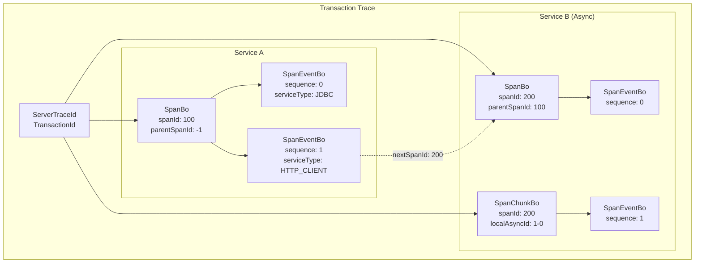
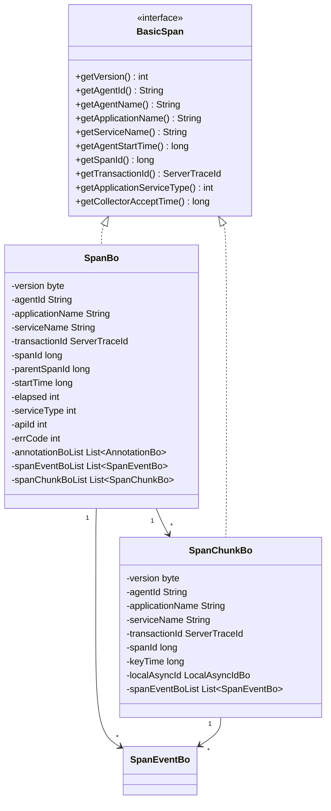
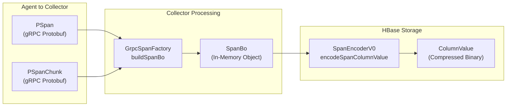
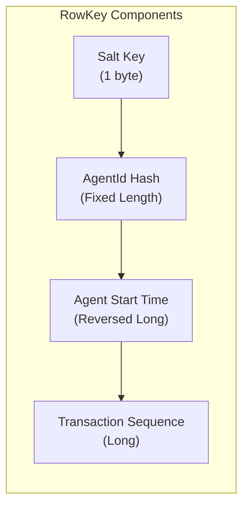

<!-- source: DeepWiki mcp.deepwiki.com · repo pinpoint-apm/pinpoint · page 8.1 Trace Data Structures · fetched 2026-10-29 -->

# Trace Data Structures

Relevant source files

The following files were used as context for generating this wiki page:

- [agent-module/profiler/src/main/java/com/navercorp/pinpoint/profiler/context/exception/model/ExceptionWrapper.java](agent-module/profiler/src/main/java/com/navercorp/pinpoint/profiler/context/exception/model/ExceptionWrapper.java)
- [agent-module/profiler/src/main/java/com/navercorp/pinpoint/profiler/monitor/metric/uri/URIKey.java](agent-module/profiler/src/main/java/com/navercorp/pinpoint/profiler/monitor/metric/uri/URIKey.java)
- [collector/src/main/java/com/navercorp/pinpoint/collector/applicationmap/dao/v3/HostRowKeyEncoderV3.java](collector/src/main/java/com/navercorp/pinpoint/collector/applicationmap/dao/v3/HostRowKeyEncoderV3.java)
- [collector/src/main/java/com/navercorp/pinpoint/collector/dao/hbase/encode/ApplicationIndexRowKeyEncoder.java](collector/src/main/java/com/navercorp/pinpoint/collector/dao/hbase/encode/ApplicationIndexRowKeyEncoder.java)
- [collector/src/main/java/com/navercorp/pinpoint/collector/handler/grpc/GrpcSpanChunkHandler.java](collector/src/main/java/com/navercorp/pinpoint/collector/handler/grpc/GrpcSpanChunkHandler.java)
- [collector/src/main/java/com/navercorp/pinpoint/collector/handler/grpc/GrpcSpanHandler.java](collector/src/main/java/com/navercorp/pinpoint/collector/handler/grpc/GrpcSpanHandler.java)
- [collector/src/main/java/com/navercorp/pinpoint/collector/scatter/dao/hbase/HbaseApplicationTraceIndexDao.java](collector/src/main/java/com/navercorp/pinpoint/collector/scatter/dao/hbase/HbaseApplicationTraceIndexDao.java)
- [collector/src/main/java/com/navercorp/pinpoint/collector/util/MultipleAddress.java](collector/src/main/java/com/navercorp/pinpoint/collector/util/MultipleAddress.java)
- [collector/src/test/java/com/navercorp/pinpoint/collector/applicationmap/dao/hbase/HostRowKeyEncoderV2Test.java](collector/src/test/java/com/navercorp/pinpoint/collector/applicationmap/dao/hbase/HostRowKeyEncoderV2Test.java)
- [collector/src/test/java/com/navercorp/pinpoint/collector/dao/hbase/encode/ApplicationIndexRowKeyEncoderTest.java](collector/src/test/java/com/navercorp/pinpoint/collector/dao/hbase/encode/ApplicationIndexRowKeyEncoderTest.java)
- [commons-buffer/pom.xml](commons-buffer/pom.xml)
- [commons-buffer/src/main/java/com/navercorp/pinpoint/common/buffer/AutomaticBuffer.java](commons-buffer/src/main/java/com/navercorp/pinpoint/common/buffer/AutomaticBuffer.java)
- [commons-buffer/src/main/java/com/navercorp/pinpoint/common/buffer/Buffer.java](commons-buffer/src/main/java/com/navercorp/pinpoint/common/buffer/Buffer.java)
- [commons-buffer/src/main/java/com/navercorp/pinpoint/common/buffer/ByteArrayUtils.java](commons-buffer/src/main/java/com/navercorp/pinpoint/common/buffer/ByteArrayUtils.java)
- [commons-buffer/src/main/java/com/navercorp/pinpoint/common/buffer/CachedStringAllocator.java](commons-buffer/src/main/java/com/navercorp/pinpoint/common/buffer/CachedStringAllocator.java)
- [commons-buffer/src/main/java/com/navercorp/pinpoint/common/buffer/FixedBuffer.java](commons-buffer/src/main/java/com/navercorp/pinpoint/common/buffer/FixedBuffer.java)
- [commons-buffer/src/main/java/com/navercorp/pinpoint/common/buffer/StringAllocator.java](commons-buffer/src/main/java/com/navercorp/pinpoint/common/buffer/StringAllocator.java)
- [commons-buffer/src/main/java/com/navercorp/pinpoint/common/buffer/StringCacheableBuffer.java](commons-buffer/src/main/java/com/navercorp/pinpoint/common/buffer/StringCacheableBuffer.java)
- [commons-buffer/src/test/java/com/navercorp/pinpoint/common/buffer/AutomaticBufferTest.java](commons-buffer/src/test/java/com/navercorp/pinpoint/common/buffer/AutomaticBufferTest.java)
- [commons-buffer/src/test/java/com/navercorp/pinpoint/common/buffer/ByteArrayUtilsTest.java](commons-buffer/src/test/java/com/navercorp/pinpoint/common/buffer/ByteArrayUtilsTest.java)
- [commons-buffer/src/test/java/com/navercorp/pinpoint/common/buffer/CachedStringAllocatorTest.java](commons-buffer/src/test/java/com/navercorp/pinpoint/common/buffer/CachedStringAllocatorTest.java)
- [commons-buffer/src/test/java/com/navercorp/pinpoint/common/buffer/FixedBufferTest.java](commons-buffer/src/test/java/com/navercorp/pinpoint/common/buffer/FixedBufferTest.java)
- [commons-buffer/src/test/java/com/navercorp/pinpoint/common/buffer/StringCacheableBufferTest.java](commons-buffer/src/test/java/com/navercorp/pinpoint/common/buffer/StringCacheableBufferTest.java)
- [commons-buffer/src/test/java/com/navercorp/pinpoint/common/util/BytesUtilsTest.java](commons-buffer/src/test/java/com/navercorp/pinpoint/common/util/BytesUtilsTest.java)
- [commons-profiler/pom.xml](commons-profiler/pom.xml)
- [commons-server/src/main/java/com/navercorp/pinpoint/common/server/CommonsHbaseConfiguration.java](commons-server/src/main/java/com/navercorp/pinpoint/common/server/CommonsHbaseConfiguration.java)
- [commons-server/src/main/java/com/navercorp/pinpoint/common/server/applicationmap/statistics/UidAgentRowKey.java](commons-server/src/main/java/com/navercorp/pinpoint/common/server/applicationmap/statistics/UidAgentRowKey.java)
- [commons-server/src/main/java/com/navercorp/pinpoint/common/server/applicationmap/statistics/UidAppRowKey.java](commons-server/src/main/java/com/navercorp/pinpoint/common/server/applicationmap/statistics/UidAppRowKey.java)
- [commons-server/src/main/java/com/navercorp/pinpoint/common/server/applicationmap/statistics/UidLinkRowKey.java](commons-server/src/main/java/com/navercorp/pinpoint/common/server/applicationmap/statistics/UidLinkRowKey.java)
- [commons-server/src/main/java/com/navercorp/pinpoint/common/server/bo/BasicSpan.java](commons-server/src/main/java/com/navercorp/pinpoint/common/server/bo/BasicSpan.java)
- [commons-server/src/main/java/com/navercorp/pinpoint/common/server/bo/SpanBo.java](commons-server/src/main/java/com/navercorp/pinpoint/common/server/bo/SpanBo.java)
- [commons-server/src/main/java/com/navercorp/pinpoint/common/server/bo/SpanChunkBo.java](commons-server/src/main/java/com/navercorp/pinpoint/common/server/bo/SpanChunkBo.java)
- [commons-server/src/main/java/com/navercorp/pinpoint/common/server/bo/SpanEventBo.java](commons-server/src/main/java/com/navercorp/pinpoint/common/server/bo/SpanEventBo.java)
- [commons-server/src/main/java/com/navercorp/pinpoint/common/server/bo/serializer/agent/ApplicationNameRowKeyEncoder.java](commons-server/src/main/java/com/navercorp/pinpoint/common/server/bo/serializer/agent/ApplicationNameRowKeyEncoder.java)
- [commons-server/src/main/java/com/navercorp/pinpoint/common/server/bo/serializer/agent/IdRowKeyEncoder.java](commons-server/src/main/java/com/navercorp/pinpoint/common/server/bo/serializer/agent/IdRowKeyEncoder.java)
- [commons-server/src/main/java/com/navercorp/pinpoint/common/server/bo/serializer/trace/v2/SpanDecoder.java](commons-server/src/main/java/com/navercorp/pinpoint/common/server/bo/serializer/trace/v2/SpanDecoder.java)
- [commons-server/src/main/java/com/navercorp/pinpoint/common/server/bo/serializer/trace/v2/SpanDecoderV0.java](commons-server/src/main/java/com/navercorp/pinpoint/common/server/bo/serializer/trace/v2/SpanDecoderV0.java)
- [commons-server/src/main/java/com/navercorp/pinpoint/common/server/bo/serializer/trace/v2/SpanDecodingContext.java](commons-server/src/main/java/com/navercorp/pinpoint/common/server/bo/serializer/trace/v2/SpanDecodingContext.java)
- [commons-server/src/main/java/com/navercorp/pinpoint/common/server/bo/serializer/trace/v2/SpanEncoderV0.java](commons-server/src/main/java/com/navercorp/pinpoint/common/server/bo/serializer/trace/v2/SpanEncoderV0.java)
- [commons-server/src/main/java/com/navercorp/pinpoint/common/server/bo/serializer/trace/v2/TraceRowKeyDecoderV2.java](commons-server/src/main/java/com/navercorp/pinpoint/common/server/bo/serializer/trace/v2/TraceRowKeyDecoderV2.java)
- [commons-server/src/main/java/com/navercorp/pinpoint/common/server/bo/serializer/trace/v2/TraceRowKeyEncoderV2.java](commons-server/src/main/java/com/navercorp/pinpoint/common/server/bo/serializer/trace/v2/TraceRowKeyEncoderV2.java)
- [commons-server/src/main/java/com/navercorp/pinpoint/common/server/bo/serializer/trace/v2/bitfield/SpanBitField.java](commons-server/src/main/java/com/navercorp/pinpoint/common/server/bo/serializer/trace/v2/bitfield/SpanBitField.java)
- [commons-server/src/main/java/com/navercorp/pinpoint/common/server/bo/serializer/trace/v2/bitfield/SpanEventBitField.java](commons-server/src/main/java/com/navercorp/pinpoint/common/server/bo/serializer/trace/v2/bitfield/SpanEventBitField.java)
- [commons-server/src/main/java/com/navercorp/pinpoint/common/server/bo/serializer/trace/v2/bitfield/SpanEventQualifierBitField.java](commons-server/src/main/java/com/navercorp/pinpoint/common/server/bo/serializer/trace/v2/bitfield/SpanEventQualifierBitField.java)
- [commons-server/src/main/java/com/navercorp/pinpoint/common/server/scatter/TraceIndexValue.java](commons-server/src/main/java/com/navercorp/pinpoint/common/server/scatter/TraceIndexValue.java)
- [commons-server/src/main/java/com/navercorp/pinpoint/common/server/trace/OtelServerTraceId.java](commons-server/src/main/java/com/navercorp/pinpoint/common/server/trace/OtelServerTraceId.java)
- [commons-server/src/main/java/com/navercorp/pinpoint/common/server/trace/PinpointServerTraceId.java](commons-server/src/main/java/com/navercorp/pinpoint/common/server/trace/PinpointServerTraceId.java)
- [commons-server/src/main/java/com/navercorp/pinpoint/common/server/trace/ServerTraceId.java](commons-server/src/main/java/com/navercorp/pinpoint/common/server/trace/ServerTraceId.java)
- [commons-server/src/main/java/com/navercorp/pinpoint/common/server/util/AgentIdRowKeyUtils.java](commons-server/src/main/java/com/navercorp/pinpoint/common/server/util/AgentIdRowKeyUtils.java)
- [commons-server/src/main/java/com/navercorp/pinpoint/common/server/util/ApplicationRowKeyUtils.java](commons-server/src/main/java/com/navercorp/pinpoint/common/server/util/ApplicationRowKeyUtils.java)
- [commons-server/src/main/java/com/navercorp/pinpoint/common/server/util/RowKeyUtils.java](commons-server/src/main/java/com/navercorp/pinpoint/common/server/util/RowKeyUtils.java)
- [commons-server/src/main/java/com/navercorp/pinpoint/common/server/util/SpanUtils.java](commons-server/src/main/java/com/navercorp/pinpoint/common/server/util/SpanUtils.java)
- [commons-server/src/main/java/com/navercorp/pinpoint/common/server/util/TransactionIdParser.java](commons-server/src/main/java/com/navercorp/pinpoint/common/server/util/TransactionIdParser.java)
- [commons-server/src/main/java/com/navercorp/pinpoint/common/server/util/json/TypeRef.java](commons-server/src/main/java/com/navercorp/pinpoint/common/server/util/json/TypeRef.java)
- [commons-server/src/test/java/com/navercorp/pinpoint/common/server/bo/RandomTSpan.java](commons-server/src/test/java/com/navercorp/pinpoint/common/server/bo/RandomTSpan.java)
- [commons-server/src/test/java/com/navercorp/pinpoint/common/server/bo/SpanBoTest.java](commons-server/src/test/java/com/navercorp/pinpoint/common/server/bo/SpanBoTest.java)
- [commons-server/src/test/java/com/navercorp/pinpoint/common/server/bo/SpanFactoryAssert.java](commons-server/src/test/java/com/navercorp/pinpoint/common/server/bo/SpanFactoryAssert.java)
- [commons-server/src/test/java/com/navercorp/pinpoint/common/server/bo/serializer/agent/ApplicationNameRowKeyEncoderTest.java](commons-server/src/test/java/com/navercorp/pinpoint/common/server/bo/serializer/agent/ApplicationNameRowKeyEncoderTest.java)
- [commons-server/src/test/java/com/navercorp/pinpoint/common/server/bo/serializer/trace/v2/SpanEncoderTest.java](commons-server/src/test/java/com/navercorp/pinpoint/common/server/bo/serializer/trace/v2/SpanEncoderTest.java)
- [commons-server/src/test/java/com/navercorp/pinpoint/common/server/bo/serializer/trace/v2/bitfield/SpanEventBitFieldTest.java](commons-server/src/test/java/com/navercorp/pinpoint/common/server/bo/serializer/trace/v2/bitfield/SpanEventBitFieldTest.java)
- [commons-server/src/test/java/com/navercorp/pinpoint/common/server/scatter/TraceIndexValueTest.java](commons-server/src/test/java/com/navercorp/pinpoint/common/server/scatter/TraceIndexValueTest.java)
- [commons-server/src/test/java/com/navercorp/pinpoint/common/server/util/AgentIdRowKeyUtilsTest.java](commons-server/src/test/java/com/navercorp/pinpoint/common/server/util/AgentIdRowKeyUtilsTest.java)
- [commons-server/src/test/java/com/navercorp/pinpoint/common/server/util/RowKeyUtilsTest.java](commons-server/src/test/java/com/navercorp/pinpoint/common/server/util/RowKeyUtilsTest.java)
- [commons/src/main/java/com/navercorp/pinpoint/common/PinpointConstants.java](commons/src/main/java/com/navercorp/pinpoint/common/PinpointConstants.java)
- [commons/src/main/java/com/navercorp/pinpoint/common/cache/Cache.java](commons/src/main/java/com/navercorp/pinpoint/common/cache/Cache.java)
- [commons/src/main/java/com/navercorp/pinpoint/common/cache/LRUCache.java](commons/src/main/java/com/navercorp/pinpoint/common/cache/LRUCache.java)
- [commons/src/main/java/com/navercorp/pinpoint/common/trace/ErrorCategoryResolver.java](commons/src/main/java/com/navercorp/pinpoint/common/trace/ErrorCategoryResolver.java)
- [commons/src/main/java/com/navercorp/pinpoint/common/util/BytesUtils.java](commons/src/main/java/com/navercorp/pinpoint/common/util/BytesUtils.java)
- [commons/src/test/java/com/navercorp/pinpoint/common/cache/LRUCacheTest.java](commons/src/test/java/com/navercorp/pinpoint/common/cache/LRUCacheTest.java)
- [commons/src/test/java/com/navercorp/pinpoint/common/trace/ErrorCategoryResolverTest.java](commons/src/test/java/com/navercorp/pinpoint/common/trace/ErrorCategoryResolverTest.java)
- [grpc/src/main/java/com/navercorp/pinpoint/grpc/Header.java](grpc/src/main/java/com/navercorp/pinpoint/grpc/Header.java)
- [grpc/src/main/java/com/navercorp/pinpoint/grpc/client/retry/RetryHeaderFactory.java](grpc/src/main/java/com/navercorp/pinpoint/grpc/client/retry/RetryHeaderFactory.java)
- [web/src/main/java/com/navercorp/pinpoint/web/applicationmap/dao/mapper/HostScanKeyFactoryV2.java](web/src/main/java/com/navercorp/pinpoint/web/applicationmap/dao/mapper/HostScanKeyFactoryV2.java)
- [web/src/main/java/com/navercorp/pinpoint/web/applicationmap/dao/v3/HostApplicationMapperV3.java](web/src/main/java/com/navercorp/pinpoint/web/applicationmap/dao/v3/HostApplicationMapperV3.java)
- [web/src/main/java/com/navercorp/pinpoint/web/applicationmap/dao/v3/HostScanKeyFactoryV3.java](web/src/main/java/com/navercorp/pinpoint/web/applicationmap/dao/v3/HostScanKeyFactoryV3.java)
- [web/src/main/java/com/navercorp/pinpoint/web/filter/responsetime/DefaultExecutionTypeFilter.java](web/src/main/java/com/navercorp/pinpoint/web/filter/responsetime/DefaultExecutionTypeFilter.java)
- [web/src/main/java/com/navercorp/pinpoint/web/filter/responsetime/SpanResponseConditionFilter.java](web/src/main/java/com/navercorp/pinpoint/web/filter/responsetime/SpanResponseConditionFilter.java)
- [web/src/main/java/com/navercorp/pinpoint/web/scatter/dao/mapper/TraceIndexMetaScatterMapper.java](web/src/main/java/com/navercorp/pinpoint/web/scatter/dao/mapper/TraceIndexMetaScatterMapper.java)
- [web/src/main/java/com/navercorp/pinpoint/web/scatter/dao/mapper/TraceIndexScatterMapper.java](web/src/main/java/com/navercorp/pinpoint/web/scatter/dao/mapper/TraceIndexScatterMapper.java)
- [web/src/main/java/com/navercorp/pinpoint/web/scatter/dao/mapper/TransactionIdMapper.java](web/src/main/java/com/navercorp/pinpoint/web/scatter/dao/mapper/TransactionIdMapper.java)
- [web/src/main/java/com/navercorp/pinpoint/web/scatter/vo/DotMetaData.java](web/src/main/java/com/navercorp/pinpoint/web/scatter/vo/DotMetaData.java)
- [web/src/main/java/com/navercorp/pinpoint/web/trace/service/TransactionInfoService.java](web/src/main/java/com/navercorp/pinpoint/web/trace/service/TransactionInfoService.java)
- [web/src/main/java/com/navercorp/pinpoint/web/trace/service/TransactionInfoServiceImpl.java](web/src/main/java/com/navercorp/pinpoint/web/trace/service/TransactionInfoServiceImpl.java)
- [web/src/test/java/com/navercorp/pinpoint/web/trace/callstacks/RecordFactoryTest.java](web/src/test/java/com/navercorp/pinpoint/web/trace/callstacks/RecordFactoryTest.java)

## Purpose and Scope

This document details the internal trace data structures used by Pinpoint to represent distributed transaction traces. These structures form the backbone of trace storage and retrieval operations, bridging the gap between the Protocol Buffer format received from agents and the serialized byte format stored in HBase.

For information about how these structures are created from agent data, see [Data Collection Pipeline](#5.1). For details on service types and annotation keys used within these structures, see [Service Types and Annotations](#8.2).

## Overview of Trace Data Model

Pinpoint's trace data model is hierarchical and optimized for distributed transaction tracking across multiple services. The model consists of three primary components:

| Component | Class | Purpose |
|-----------|-------|---------|
| **Span** | `SpanBo` | Represents a complete RPC call, typically at service boundaries (HTTP request/response) |
| **Span Chunk** | `SpanChunkBo` | Represents additional events for async operations or when span events exceed transmission limits |
| **Span Event** | `SpanEventBo` | Represents method calls, DB queries, external calls within a span |

These structures share the `BasicSpan` interface and are enriched with `AnnotationBo` metadata describing business context.

**Trace Hierarchy Diagram**

**Sources:**
- [commons-server/src/main/java/com/navercorp/pinpoint/common/server/bo/SpanBo.java:35-92]()
- [commons-server/src/main/java/com/navercorp/pinpoint/common/server/bo/SpanChunkBo.java:33-62]()
- [commons-server/src/main/java/com/navercorp/pinpoint/common/server/bo/SpanEventBo.java:26-55]()
- [commons-server/src/main/java/com/navercorp/pinpoint/common/server/bo/BasicSpan.java:24-58]()

## Core Data Structures

### BasicSpan Interface

The `BasicSpan` interface defines common properties shared by both `SpanBo` and `SpanChunkBo`.

**Class Relationship Diagram**

**Sources:**
- [commons-server/src/main/java/com/navercorp/pinpoint/common/server/bo/BasicSpan.java:24-58]()
- [commons-server/src/main/java/com/navercorp/pinpoint/common/server/bo/SpanBo.java:35-92]()
- [commons-server/src/main/java/com/navercorp/pinpoint/common/server/bo/SpanChunkBo.java:33-62]()

### SpanBo

`SpanBo` represents a complete span in a distributed trace. It captures the entry/exit point of a service in a transaction.

| Field | Type | Description |
|-------|------|-------------|
| `version` | `byte` | Serialization format version (0 = v2) |
| `agentId` | `String` | Unique agent identifier |
| `applicationName` | `String` | Application name |
| `transactionId` | `ServerTraceId` | Global transaction identifier |
| `spanId` | `long` | Unique span identifier within transaction |
| `parentSpanId` | `long` | Parent span ID (-1 for root) |
| `startTime` | `long` | Span start timestamp (milliseconds) |
| `elapsed` | `int` | Span duration (milliseconds) |
| `rpc` | `String` | RPC method/URI |
| `serviceType` | `int` | Service type code (e.g., 1010 for Tomcat) |
| `annotationBoList` | `List<AnnotationBo>` | Business metadata annotations |
| `spanEventBoList` | `List<SpanEventBo>` | Child span events |
| `collectorAcceptTime` | `long` | Timestamp when collector received the data |

**Sources:**
- [commons-server/src/main/java/com/navercorp/pinpoint/common/server/bo/SpanBo.java:35-92]()
- [commons-server/src/main/java/com/navercorp/pinpoint/common/server/bo/SpanBo.java:201-277]()

### SpanChunkBo

`SpanChunkBo` represents additional span events that couldn't fit in the original `SpanBo` or belong to asynchronous execution contexts.

| Field | Type | Description |
|-------|------|-------------|
| `transactionId` | `ServerTraceId` | Global transaction identifier |
| `spanId` | `long` | Associated span ID |
| `keyTime` | `long` | Key timestamp for v2 format |
| `localAsyncId` | `LocalAsyncIdBo` | Async execution context identifier |
| `spanEventBoList` | `List<SpanEventBo>` | Span events in this chunk |

**Sources:**
- [commons-server/src/main/java/com/navercorp/pinpoint/common/server/bo/SpanChunkBo.java:33-62]()
- [commons-server/src/main/java/com/navercorp/pinpoint/common/server/bo/SpanChunkBo.java:184-212]()

### SpanEventBo

`SpanEventBo` represents individual method calls or operations within a span.

| Field | Type | Description |
|-------|------|-------------|
| `sequence` | `short` | Event sequence number within span |
| `startElapsed` | `int` | Start time relative to span start (ms) |
| `endElapsed` | `int` | Duration (milliseconds) |
| `serviceType` | `int` | Service type code (e.g., 2100 for MySQL) |
| `apiId` | `int` | API metadata identifier |
| `depth` | `int` | Call stack depth |
| `nextSpanId` | `long` | Next span ID for RPC calls (-1 if none) |
| `nextAsyncId` | `int` | Next async context ID (-1 if none) |

**Sources:**
- [commons-server/src/main/java/com/navercorp/pinpoint/common/server/bo/SpanEventBo.java:26-55]()
- [commons-server/src/main/java/com/navercorp/pinpoint/common/server/bo/SpanEventBo.java:69-145]()

## Serialization and Deserialization

### Encoding Architecture

Pinpoint uses a custom binary encoding format optimized for space efficiency through delta encoding and bit field compression.

**Trace Data Flow**

**Sources:**
- [collector/src/main/java/com/navercorp/pinpoint/collector/handler/grpc/GrpcSpanHandler.java:78-83]()
- [commons-server/src/main/java/com/navercorp/pinpoint/common/server/bo/serializer/trace/v2/SpanEncoderV0.java:33-45]()

### SpanDecoderV0

`SpanDecoderV0` reverses the encoding process to reconstruct `SpanBo` and `SpanChunkBo` objects from byte buffers.

| Method | Role | Logic |
|--------|------|-------|
| `decode` | Entry point | Determines type (Span vs Chunk) from first byte [commons-server/src/main/java/com/navercorp/pinpoint/common/server/bo/serializer/trace/v2/SpanDecoderV0.java:52-63]() |
| `readSpanValue` | Main Decoder | Reads bitfields and populates `SpanBo` [commons-server/src/main/java/com/navercorp/pinpoint/common/server/bo/serializer/trace/v2/SpanDecoderV0.java:107-171]() |
| `readSpanEvent` | Event Decoder | Iteratively decodes delta-encoded events [commons-server/src/main/java/com/navercorp/pinpoint/common/server/bo/serializer/trace/v2/SpanDecoderV0.java:173-189]() |

**Delta Decoding for Start Time:**
The `startTime` is reconstructed by subtracting a `VLong` delta from the `collectorAcceptTime`:
`final long startTime = span.getCollectorAcceptTime() - buffer.readVLong();` [commons-server/src/main/java/com/navercorp/pinpoint/common/server/bo/serializer/trace/v2/SpanDecoderV0.java:134-136]()

**Sources:**
- [commons-server/src/main/java/com/navercorp/pinpoint/common/server/bo/serializer/trace/v2/SpanDecoderV0.java:43-189]()

### Variable-Length Encoding

Pinpoint relies on `BytesUtils` to perform variable-length encoding (ZigZag/Varint) to minimize byte usage for integers and longs.

**Utility Functions:**
- `bytesToVar32`: Reads a variable-length 32-bit integer [commons/src/main/java/com/navercorp/pinpoint/common/util/BytesUtils.java:123-169]()
- `bytesToSVar32`: Reads a ZigZag encoded signed 32-bit integer [commons/src/main/java/com/navercorp/pinpoint/common/util/BytesUtils.java:119-121]()
- `bytesToVar64`: Reads a variable-length 64-bit long [commons/src/main/java/com/navercorp/pinpoint/common/util/BytesUtils.java:175-226]()

**Sources:**
- [commons/src/main/java/com/navercorp/pinpoint/common/util/BytesUtils.java:119-226]()

## Row Key Design

### Trace Row Key (HBase)

The row key for trace data in HBase is designed for efficient lookup by `TransactionId` while distributing write load.

**TraceRowKey Distribution**

The `TraceRowKeyEncoderV2` handles the generation of these keys, supporting both standard Pinpoint IDs and OpenTelemetry trace IDs. [commons-server/src/main/java/com/navercorp/pinpoint/common/server/bo/serializer/trace/v2/TraceRowKeyEncoderV2.java:32-69]()

**Sources:**
- [commons-server/src/main/java/com/navercorp/pinpoint/common/server/bo/serializer/trace/v2/TraceRowKeyEncoderV2.java:44-68]()
- [commons-server/src/main/java/com/navercorp/pinpoint/common/server/trace/ServerTraceId.java:19-25]()

### Application Statistics Row Key

For application map statistics, row keys like `UidLinkRowKey` use a combination of service UIDs and hashed application names to enable fast aggregation.

**Key Structure:**
`UidPrefix (16 bytes) + outApplicationNameHash (4 bytes) + outServiceType (4 bytes) + applicationName + outApplicationName + outSubLink` [commons-server/src/main/java/com/navercorp/pinpoint/common/server/applicationmap/statistics/UidLinkRowKey.java:100-101]()

**Sources:**
- [commons-server/src/main/java/com/navercorp/pinpoint/common/server/applicationmap/statistics/UidLinkRowKey.java:110-139]()

## Testing Round-trip Serialization

The `SpanEncoderTest` class provides verification that the serialization and deserialization processes are lossless.

**Test Flow:**
1. Generate a random `SpanBo` using `RandomTSpan`.
2. Encode it using `SpanEncoderV0`.
3. Decode it using `SpanDecoderV0`.
4. Assert that the original and decoded objects match using recursive comparison. [commons-server/src/test/java/com/navercorp/pinpoint/common/server/bo/serializer/trace/v2/SpanEncoderTest.java:145-170]()

**Sources:**
- [commons-server/src/test/java/com/navercorp/pinpoint/common/server/bo/serializer/trace/v2/SpanEncoderTest.java:52-170]()
- [commons-server/src/test/java/com/navercorp/pinpoint/common/server/bo/RandomTSpan.java:1-50]()

---

