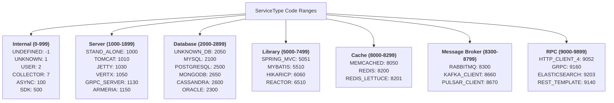
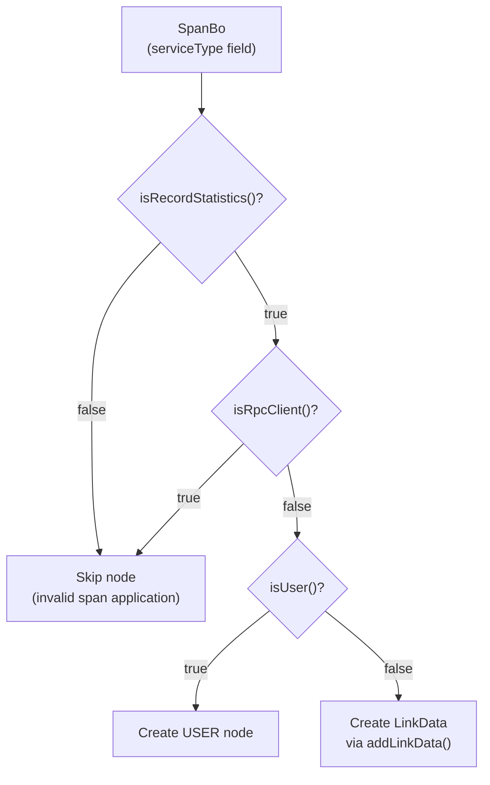
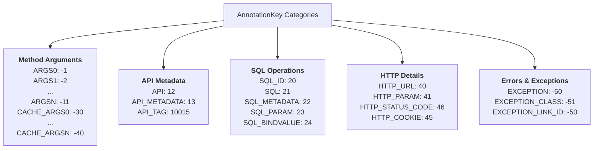
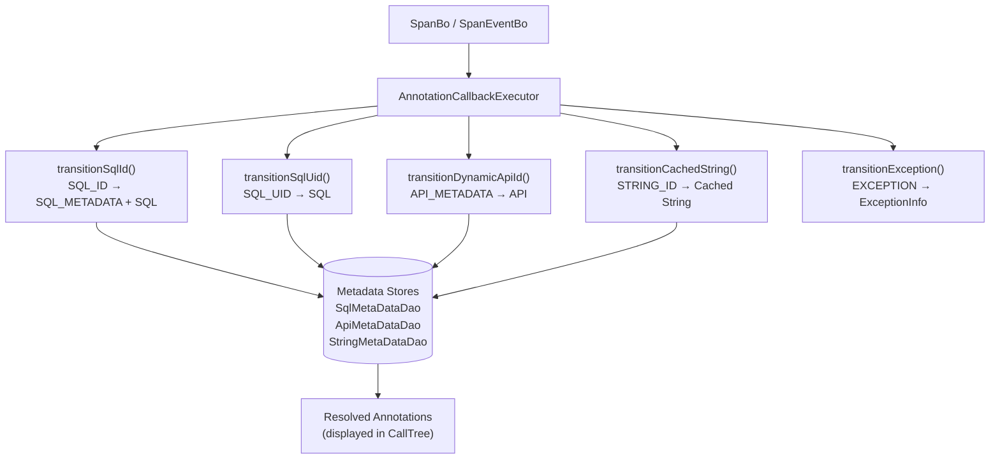

<!-- source: DeepWiki mcp.deepwiki.com · repo pinpoint-apm/pinpoint · page 8.2 Service Types and Annotations · fetched 2026-10-29 -->

# Service Types and Annotations

Relevant source files

The following files were used as context for generating this wiki page:

- [commons-profiler/src/main/java/com/navercorp/pinpoint/common/profiler/trace/DefaultDisplayArgument.java](commons-profiler/src/main/java/com/navercorp/pinpoint/common/profiler/trace/DefaultDisplayArgument.java)
- [commons-server/src/main/java/com/navercorp/pinpoint/common/server/bo/SpanEventComparator.java](commons-server/src/main/java/com/navercorp/pinpoint/common/server/bo/SpanEventComparator.java)
- [commons-server/src/main/java/com/navercorp/pinpoint/common/server/util/AnnotationUtils.java](commons-server/src/main/java/com/navercorp/pinpoint/common/server/util/AnnotationUtils.java)
- [commons-server/src/test/java/com/navercorp/pinpoint/common/server/util/AnnotationUtilsTest.java](commons-server/src/test/java/com/navercorp/pinpoint/common/server/util/AnnotationUtilsTest.java)
- [commons/src/main/java/com/navercorp/pinpoint/common/trace/AnnotationKey.java](commons/src/main/java/com/navercorp/pinpoint/common/trace/AnnotationKey.java)
- [commons/src/main/java/com/navercorp/pinpoint/common/trace/ErrorCategory.java](commons/src/main/java/com/navercorp/pinpoint/common/trace/ErrorCategory.java)
- [commons/src/main/java/com/navercorp/pinpoint/common/trace/MethodType.java](commons/src/main/java/com/navercorp/pinpoint/common/trace/MethodType.java)
- [commons/src/main/java/com/navercorp/pinpoint/common/trace/OpenTelemetryServiceTypeCategory.java](commons/src/main/java/com/navercorp/pinpoint/common/trace/OpenTelemetryServiceTypeCategory.java)
- [commons/src/main/java/com/navercorp/pinpoint/common/trace/ServiceType.java](commons/src/main/java/com/navercorp/pinpoint/common/trace/ServiceType.java)
- [web-frontend/src/main/v3/apps/web/public/img/icons/OPENTELEMETRY_SERVER.png](web-frontend/src/main/v3/apps/web/public/img/icons/OPENTELEMETRY_SERVER.png)
- [web-frontend/src/main/v3/apps/web/public/img/servers/OPENTELEMETRY_SERVER.png](web-frontend/src/main/v3/apps/web/public/img/servers/OPENTELEMETRY_SERVER.png)
- [web-frontend/src/main/v3/apps/web/public/img/servers/OPENTELEMETY_DB.png](web-frontend/src/main/v3/apps/web/public/img/servers/OPENTELEMETY_DB.png)
- [web/src/main/java/com/navercorp/pinpoint/web/applicationmap/histogram/AgentResponse.java](web/src/main/java/com/navercorp/pinpoint/web/applicationmap/histogram/AgentResponse.java)
- [web/src/main/java/com/navercorp/pinpoint/web/applicationmap/histogram/LoadHistogram.java](web/src/main/java/com/navercorp/pinpoint/web/applicationmap/histogram/LoadHistogram.java)
- [web/src/main/java/com/navercorp/pinpoint/web/applicationmap/map/FilteredMapBuilder.java](web/src/main/java/com/navercorp/pinpoint/web/applicationmap/map/FilteredMapBuilder.java)
- [web/src/main/java/com/navercorp/pinpoint/web/scatter/ScatterView.java](web/src/main/java/com/navercorp/pinpoint/web/scatter/ScatterView.java)
- [web/src/main/java/com/navercorp/pinpoint/web/trace/dao/mapper/SpanMapperV2.java](web/src/main/java/com/navercorp/pinpoint/web/trace/dao/mapper/SpanMapperV2.java)
- [web/src/main/java/com/navercorp/pinpoint/web/trace/service/SpanServiceImpl.java](web/src/main/java/com/navercorp/pinpoint/web/trace/service/SpanServiceImpl.java)
- [web/src/main/java/com/navercorp/pinpoint/web/trace/span/Align.java](web/src/main/java/com/navercorp/pinpoint/web/trace/span/Align.java)
- [web/src/main/java/com/navercorp/pinpoint/web/trace/span/AlignComparator.java](web/src/main/java/com/navercorp/pinpoint/web/trace/span/AlignComparator.java)
- [web/src/main/java/com/navercorp/pinpoint/web/trace/span/CallTreeNode.java](web/src/main/java/com/navercorp/pinpoint/web/trace/span/CallTreeNode.java)
- [web/src/main/java/com/navercorp/pinpoint/web/trace/span/Link.java](web/src/main/java/com/navercorp/pinpoint/web/trace/span/Link.java)
- [web/src/main/java/com/navercorp/pinpoint/web/trace/span/LinkMap.java](web/src/main/java/com/navercorp/pinpoint/web/trace/span/LinkMap.java)
- [web/src/main/java/com/navercorp/pinpoint/web/trace/span/Node.java](web/src/main/java/com/navercorp/pinpoint/web/trace/span/Node.java)
- [web/src/main/java/com/navercorp/pinpoint/web/trace/span/NodeList.java](web/src/main/java/com/navercorp/pinpoint/web/trace/span/NodeList.java)
- [web/src/main/java/com/navercorp/pinpoint/web/trace/span/SpanAlign.java](web/src/main/java/com/navercorp/pinpoint/web/trace/span/SpanAlign.java)
- [web/src/main/java/com/navercorp/pinpoint/web/trace/span/SpanAligner.java](web/src/main/java/com/navercorp/pinpoint/web/trace/span/SpanAligner.java)
- [web/src/main/java/com/navercorp/pinpoint/web/trace/span/SpanEventAlign.java](web/src/main/java/com/navercorp/pinpoint/web/trace/span/SpanEventAlign.java)
- [web/src/main/java/com/navercorp/pinpoint/web/vo/tree/ApplicationAgentHostList.java](web/src/main/java/com/navercorp/pinpoint/web/vo/tree/ApplicationAgentHostList.java)

**Purpose**: This document describes Pinpoint's `ServiceType` and `AnnotationKey` systems, which categorize monitored components and enrich trace data with contextual information. `ServiceTypes` classify instrumented applications and external dependencies (databases, caches, message queues), while `AnnotationKeys` attach metadata (SQL queries, HTTP parameters, method arguments) to trace spans. Together, they enable precise identification and detailed inspection of distributed transaction flows.

---

## ServiceType System

ServiceTypes are numeric identifiers that classify monitored components in distributed traces. Each ServiceType has a unique code (represented as a `short`), a human-readable name, optional descriptive text, and behavioral properties that control how Pinpoint processes and displays trace data.

**Core Interface**: [commons/src/main/java/com/navercorp/pinpoint/common/trace/ServiceType.java:317-416]()

### ServiceType Properties

The `ServiceType` interface defines several methods that control behavior:

| Method | Purpose |
|--------|---------|
| `getCode()` | Returns unique numeric identifier (short) |
| `getName()` | Returns display name |
| `isRecordStatistics()` | Whether to record response time statistics |
| `isRpcClient()` | Indicates RPC client-side operations |
| `isTerminal()` | Marks terminal nodes (databases, external services) |
| `isQueue()` | Identifies message queue components |
| `isAlias()` | Indicates aliased external services |
| `isUnknown()` | Marks unidentified service types |
| `isUser()` | Marks user-initiated requests |
| `isWas()` | Identifies web application servers |
| `getHistogramSchema()` | Returns response time histogram configuration |

**Sources**: [commons/src/main/java/com/navercorp/pinpoint/common/trace/ServiceType.java:317-416]()

### ServiceType Categories and Code Ranges

ServiceTypes are organized into numeric ranges by category:

**Sources**: [commons/src/main/java/com/navercorp/pinpoint/common/trace/ServiceType.java:24-316]()

### ServiceType Usage in Trace Processing

The `FilteredMapBuilder` class demonstrates how ServiceTypes control trace data processing and node generation in the ServerMap:

**Key Logic in FilteredMapBuilder**:
- `addTransaction()` - Evaluates `isRecordStatistics()`, `isRpcClient()`, and `isUser()` to determine if a span should generate a node or link in the map ([web/src/main/java/com/navercorp/pinpoint/web/applicationmap/map/FilteredMapBuilder.java:102-150]()).
- `getHistogramSlotTime()` - Retrieves the specific response time slot (e.g., 1s, 3s) based on the `ServiceType`'s `HistogramSchema` ([web/src/main/java/com/navercorp/pinpoint/web/applicationmap/map/FilteredMapBuilder.java:158-160]()).

**Sources**: [web/src/main/java/com/navercorp/pinpoint/web/applicationmap/map/FilteredMapBuilder.java:59-161]()

### OpenTelemetry ServiceTypes

Pinpoint defines special ServiceTypes for OpenTelemetry integration to handle external trace ingestion:

| ServiceType | Code | Category |
|-------------|------|----------|
| `OPENTELEMETRY_SERVER` | 1220 | Server-side spans |
| `OPENTELEMETRY_INTERNAL` | 1221 | Internal operations |
| `OPENTELEMETRY_DB` | 2060 | Database operations |
| `OPENTELEMETRY_DB_EXECUTE_QUERY` | 2061 | Query execution |
| `OPENTELEMETRY_CLIENT` | 9310 | Client-side operations |

The `OpenTelemetryServiceTypeCategory` class provides utility methods like `contains(ServiceType)` to identify these types during trace alignment ([commons/src/main/java/com/navercorp/pinpoint/common/trace/OpenTelemetryServiceTypeCategory.java:19-39]()).

**Sources**: 
- [commons/src/main/java/com/navercorp/pinpoint/common/trace/ServiceType.java:411-416]()
- [commons/src/main/java/com/navercorp/pinpoint/common/trace/OpenTelemetryServiceTypeCategory.java:1-40]()

---

## Annotation System

Annotations attach metadata to trace spans and span events. Each `AnnotationKey` has a unique integer code and a name describing the data it represents.

**Core Interface**: [commons/src/main/java/com/navercorp/pinpoint/common/trace/AnnotationKey.java:153-260]()

### Annotation Categories

**Sources**: [commons/src/main/java/com/navercorp/pinpoint/common/trace/AnnotationKey.java:23-147]()

### Annotation Replacement and Metadata Resolution

The `SpanServiceImpl` class transforms annotation references (IDs) into human-readable values (Strings/SQL) through a callback system using `AnnotationCallbackExecutor` ([web/src/main/java/com/navercorp/pinpoint/web/trace/service/SpanServiceImpl.java:125-133]()).

**Key Replacement Flows**:

1. **SQL_ID Resolution**: Extracts SQL template from `SqlMetaDataDao` using the `SQL_ID` and substitutes parameters ([web/src/main/java/com/navercorp/pinpoint/web/trace/service/SpanServiceImpl.java:230-295]()).
2. **API Metadata Resolution**: Resolves dynamic API IDs to method signatures via `ApiMetaDataDao` ([web/src/main/java/com/navercorp/pinpoint/web/trace/service/SpanServiceImpl.java:351-397]()).
3. **Exception Resolution**: Converts raw exception data into `ExceptionInfo` for UI display ([web/src/main/java/com/navercorp/pinpoint/web/trace/service/SpanServiceImpl.java:428-449]()).

**Sources**: [web/src/main/java/com/navercorp/pinpoint/web/trace/service/SpanServiceImpl.java:125-449]()

### Annotation Utilities

The `AnnotationUtils` class provides helper methods for searching and filtering annotations within a list of `AnnotationBo` objects:
- `findApiAnnotation(List<AnnotationBo>)`: Specifically looks for the `AnnotationKey.API` code ([commons-server/src/main/java/com/navercorp/pinpoint/common/server/util/AnnotationUtils.java:36-38]()).
- `findAnnotation(List<AnnotationBo>, AnnotationKey)`: Generic search for a specific key ([commons-server/src/main/java/com/navercorp/pinpoint/common/server/util/AnnotationUtils.java:90-92]()).

**Sources**: [commons-server/src/main/java/com/navercorp/pinpoint/common/server/util/AnnotationUtils.java:32-124]()

---

## Trace Alignment and Sorting

When building the CallTree, `SpanAligner` uses `ServiceType` and `AnnotationKey` to order events correctly, especially for asynchronous and OpenTelemetry spans.

### OpenTelemetry Sorting Logic
For OpenTelemetry ServiceTypes, the `Node` class uses a specialized sorting mechanism because standard sequence numbers may not be present or reliable:

1. **Detection**: `Node` checks if a span is OpenTelemetry via `OpenTelemetryServiceTypeCategory.contains(span.getServiceType())` ([web/src/main/java/com/navercorp/pinpoint/web/trace/span/Node.java:52]()).
2. **Sorting**: Uses `AlignComparator.OPENTELEMETRY_START_TIME` which compares the nanosecond start times provided in OpenTelemetry metadata ([web/src/main/java/com/navercorp/pinpoint/web/trace/span/Node.java:158]()).
3. **Re-sequencing**: After sorting by time, it manually assigns `depth` and `sequence` to the `SpanEventBo` objects to ensure the UI renders them in the correct hierarchical order ([web/src/main/java/com/navercorp/pinpoint/web/trace/span/Node.java:160-173]()).

**Sources**: 
- [web/src/main/java/com/navercorp/pinpoint/web/trace/span/Node.java:135-174]()
- [web/src/main/java/com/navercorp/pinpoint/web/trace/span/AlignComparator.java:26-30]()
- [commons-server/src/main/java/com/navercorp/pinpoint/common/server/bo/SpanEventComparator.java:1-11]()

### Standard Sorting
For non-OpenTelemetry spans, `SpanEventComparator` is used to sort `SpanEventBo` by their sequence number ([commons-server/src/main/java/com/navercorp/pinpoint/common/server/bo/SpanEventComparator.java:10]()).

**Sources**: [commons-server/src/main/java/com/navercorp/pinpoint/common/server/bo/SpanEventComparator.java:1-11]()

---

