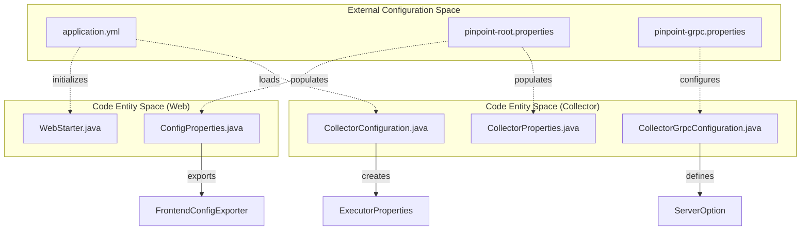
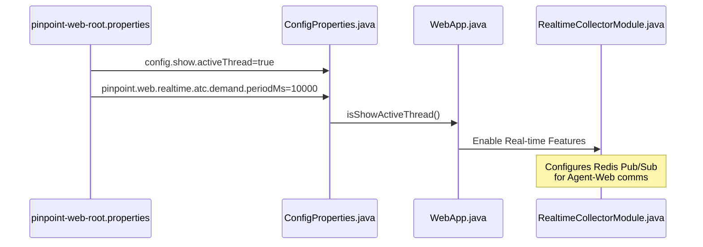

<!-- source: DeepWiki mcp.deepwiki.com · repo pinpoint-apm/pinpoint · page 9 Configuration Reference · fetched 2026-10-29 -->

# Configuration Reference

Relevant source files

The following files were used as context for generating this wiki page:

- [collector-starter/src/main/java/com/navercorp/pinpoint/collector/starter/multi/application/BasicCollectorApp.java](collector-starter/src/main/java/com/navercorp/pinpoint/collector/starter/multi/application/BasicCollectorApp.java)
- [collector-starter/src/main/java/com/navercorp/pinpoint/collector/starter/multi/application/PinpointCollectorStarter.java](collector-starter/src/main/java/com/navercorp/pinpoint/collector/starter/multi/application/PinpointCollectorStarter.java)
- [collector-starter/src/main/java/com/navercorp/pinpoint/collector/starter/multi/application/type/CollectorType.java](collector-starter/src/main/java/com/navercorp/pinpoint/collector/starter/multi/application/type/CollectorType.java)
- [collector-starter/src/main/java/com/navercorp/pinpoint/collector/starter/multi/application/type/CollectorTypeParser.java](collector-starter/src/main/java/com/navercorp/pinpoint/collector/starter/multi/application/type/CollectorTypeParser.java)
- [collector-starter/src/main/java/com/navercorp/pinpoint/collector/starter/multi/application/type/CollectorTypeSet.java](collector-starter/src/main/java/com/navercorp/pinpoint/collector/starter/multi/application/type/CollectorTypeSet.java)
- [collector-starter/src/main/java/com/navercorp/pinpoint/collector/starter/multi/application/type/FallbackCollectorTypeParser.java](collector-starter/src/main/java/com/navercorp/pinpoint/collector/starter/multi/application/type/FallbackCollectorTypeParser.java)
- [collector-starter/src/main/java/com/navercorp/pinpoint/collector/starter/multi/application/type/ShellBlockerConfig.java](collector-starter/src/main/java/com/navercorp/pinpoint/collector/starter/multi/application/type/ShellBlockerConfig.java)
- [collector-starter/src/main/java/com/navercorp/pinpoint/collector/starter/multi/application/type/ShellCollectorTypeParser.java](collector-starter/src/main/java/com/navercorp/pinpoint/collector/starter/multi/application/type/ShellCollectorTypeParser.java)
- [collector-starter/src/main/java/com/navercorp/pinpoint/collector/starter/multi/application/type/SimpleCollectorTypeParser.java](collector-starter/src/main/java/com/navercorp/pinpoint/collector/starter/multi/application/type/SimpleCollectorTypeParser.java)
- [collector-starter/src/main/resources/.gitignore](collector-starter/src/main/resources/.gitignore)
- [collector-starter/src/main/resources/application.yml](collector-starter/src/main/resources/application.yml)
- [collector/src/main/java/com/navercorp/pinpoint/collector/CollectorApp.java](collector/src/main/java/com/navercorp/pinpoint/collector/CollectorApp.java)
- [collector/src/main/java/com/navercorp/pinpoint/collector/PinpointCollectorModule.java](collector/src/main/java/com/navercorp/pinpoint/collector/PinpointCollectorModule.java)
- [collector/src/main/java/com/navercorp/pinpoint/collector/config/CollectorConfiguration.java](collector/src/main/java/com/navercorp/pinpoint/collector/config/CollectorConfiguration.java)
- [collector/src/main/java/com/navercorp/pinpoint/collector/event/SpanStorePublisher.java](collector/src/main/java/com/navercorp/pinpoint/collector/event/SpanStorePublisher.java)
- [collector/src/main/java/com/navercorp/pinpoint/collector/event/SpanStorePublisherImpl.java](collector/src/main/java/com/navercorp/pinpoint/collector/event/SpanStorePublisherImpl.java)
- [collector/src/main/java/com/navercorp/pinpoint/collector/event/config/CollectorEventConfiguration.java](collector/src/main/java/com/navercorp/pinpoint/collector/event/config/CollectorEventConfiguration.java)
- [collector/src/main/resources/application.yml](collector/src/main/resources/application.yml)
- [collector/src/main/resources/pinpoint-collector-root.properties](collector/src/main/resources/pinpoint-collector-root.properties)
- [collector/src/main/resources/profiles/local/pinpoint-collector-grpc.properties](collector/src/main/resources/profiles/local/pinpoint-collector-grpc.properties)
- [collector/src/main/resources/profiles/release/pinpoint-collector-grpc.properties](collector/src/main/resources/profiles/release/pinpoint-collector-grpc.properties)
- [commons-hbase/src/main/java/com/navercorp/pinpoint/common/hbase/config/HbaseNamespaceConfiguration.java](commons-hbase/src/main/java/com/navercorp/pinpoint/common/hbase/config/HbaseNamespaceConfiguration.java)
- [commons-server/src/main/java/com/navercorp/pinpoint/common/server/event/ContextData.java](commons-server/src/main/java/com/navercorp/pinpoint/common/server/event/ContextData.java)
- [commons-server/src/main/java/com/navercorp/pinpoint/common/server/event/ContextSupplier.java](commons-server/src/main/java/com/navercorp/pinpoint/common/server/event/ContextSupplier.java)
- [commons-server/src/main/java/com/navercorp/pinpoint/common/server/event/InsertEvent.java](commons-server/src/main/java/com/navercorp/pinpoint/common/server/event/InsertEvent.java)
- [commons-server/src/main/java/com/navercorp/pinpoint/common/server/event/SimpleContextSupplier.java](commons-server/src/main/java/com/navercorp/pinpoint/common/server/event/SimpleContextSupplier.java)
- [commons-server/src/main/java/com/navercorp/pinpoint/common/server/event/SpanChunkInsertEvent.java](commons-server/src/main/java/com/navercorp/pinpoint/common/server/event/SpanChunkInsertEvent.java)
- [commons-server/src/main/java/com/navercorp/pinpoint/common/server/event/SpanInsertEvent.java](commons-server/src/main/java/com/navercorp/pinpoint/common/server/event/SpanInsertEvent.java)
- [datasource/src/main/java/com/navercorp/pinpoint/datasource/MainDataSourceConfiguration.java](datasource/src/main/java/com/navercorp/pinpoint/datasource/MainDataSourceConfiguration.java)
- [otlpmetric/otlpmetric-web/src/main/resources/otlpmetric/web/profiles/local/otlpmetric-web.properties](otlpmetric/otlpmetric-web/src/main/resources/otlpmetric/web/profiles/local/otlpmetric-web.properties)
- [otlpmetric/otlpmetric-web/src/main/resources/otlpmetric/web/profiles/release/otlpmetric-web.properties](otlpmetric/otlpmetric-web/src/main/resources/otlpmetric/web/profiles/release/otlpmetric-web.properties)
- [realtime/realtime-collector/src/main/java/com/navercorp/pinpoint/realtime/collector/RealtimeCollectorServerConfig.java](realtime/realtime-collector/src/main/java/com/navercorp/pinpoint/realtime/collector/RealtimeCollectorServerConfig.java)
- [redis/src/main/java/com/navercorp/pinpoint/redis/RedisBasicConfig.java](redis/src/main/java/com/navercorp/pinpoint/redis/RedisBasicConfig.java)
- [redis/src/main/java/com/navercorp/pinpoint/redis/RedisPropertySources.java](redis/src/main/java/com/navercorp/pinpoint/redis/RedisPropertySources.java)
- [redis/src/main/resources/redis/profiles/local/redis.properties](redis/src/main/resources/redis/profiles/local/redis.properties)
- [redis/src/main/resources/redis/profiles/release/redis.properties](redis/src/main/resources/redis/profiles/release/redis.properties)
- [redis/src/main/resources/redis/redis-root.properties](redis/src/main/resources/redis/redis-root.properties)
- [web-starter/src/main/java/com/navercorp/pinpoint/web/starter/multi/PinpointWebStarter.java](web-starter/src/main/java/com/navercorp/pinpoint/web/starter/multi/PinpointWebStarter.java)
- [web-starter/src/main/resources/application.yml](web-starter/src/main/resources/application.yml)
- [web/src/main/java/com/navercorp/pinpoint/web/WebApp.java](web/src/main/java/com/navercorp/pinpoint/web/WebApp.java)
- [web/src/main/java/com/navercorp/pinpoint/web/config/ConfigProperties.java](web/src/main/java/com/navercorp/pinpoint/web/config/ConfigProperties.java)
- [web/src/main/java/com/navercorp/pinpoint/web/servlet/HttpIntentRoutingFilter.java](web/src/main/java/com/navercorp/pinpoint/web/servlet/HttpIntentRoutingFilter.java)
- [web/src/main/resources/application.yml](web/src/main/resources/application.yml)
- [web/src/main/resources/pinpoint-web-root.properties](web/src/main/resources/pinpoint-web-root.properties)
- [web/src/test/java/com/navercorp/pinpoint/web/servlet/HttpIntentRoutingFilterTest.java](web/src/test/java/com/navercorp/pinpoint/web/servlet/HttpIntentRoutingFilterTest.java)

This page provides a high-level reference for the configuration architecture of Pinpoint APM. Pinpoint uses a modular configuration system primarily driven by Spring Boot `application.yml` files, traditional `.properties` files, and Java-based `@ConfigurationProperties` classes.

## Configuration Overview

The Pinpoint ecosystem is divided into several functional modules, each with its own configuration scope. The system bridges external environment variables, property files, and internal Java entities to define behavior for data collection, storage, and visualization.

### Configuration Flow

The following diagram illustrates how configuration flows from physical files into the functional code entities of the Pinpoint Collector and Web applications.

**Configuration Entity Mapping**

Sources: [collector/src/main/java/com/navercorp/pinpoint/collector/config/CollectorConfiguration.java:40-42](), [web/src/main/java/com/navercorp/pinpoint/web/config/ConfigProperties.java:32-35](), [collector/src/main/java/com/navercorp/pinpoint/collector/PinpointCollectorModule.java:41-68]()

## Application Configuration
The base configuration for Pinpoint components (Web, Collector, Batch) is managed via Spring Boot's `application.yml`. This file defines active profiles (e.g., `release`, `local`), server ports, and management endpoints.

*   **Profiles**: Pinpoint uses profiles to separate environments. Common profiles include `release` for production and `local` for development [web/src/main/resources/application.yml:1-3]().
*   **Actuator**: Management endpoints are exposed under `/monitor`, with the health check mapped to `/monitor/l7check` [web/src/main/resources/application.yml:71-79]().
*   **Module Toggles**: High-level features like `realtime`, `inspector`, and `uristat` are enabled or disabled here [web-starter/src/main/resources/application.yml:85-101]().

For details, see [Application Configuration](#9.1).

## Collector Configuration Reference
The Collector manages the ingestion of trace and statistic data. Its configuration focuses on gRPC receivers, thread pool sizing for workers, and data sampling.

*   **gRPC Receivers**: Separate configurations exist for `agent`, `stat`, and `span` receivers, defining ports (e.g., 9991, 9992, 9993) and SSL settings [collector/src/main/resources/profiles/local/pinpoint-collector-grpc.properties:1-44]().
*   **Worker Pools**: The `CollectorConfiguration` class defines executors like `agentEventWorker` to handle incoming events asynchronously [collector/src/main/java/com/navercorp/pinpoint/collector/config/CollectorConfiguration.java:59-69]().
*   **Sampling**: Sampling rates can be defined using `MOD` or `PERCENT` types to control the volume of data persisted to HBase [collector/src/main/resources/pinpoint-collector-root.properties:31-44]().

For details, see [Collector Configuration Reference](#9.2).

## Web Configuration Reference
The Web application configuration controls the UI behavior, API limits, and security settings.

*   **Feature Flags**: Controlled via `ConfigProperties.java`, including toggles for `showActiveThread`, `showSystemMetric`, and `showUrlStat` [web/src/main/java/com/navercorp/pinpoint/web/config/ConfigProperties.java:42-70]().
*   **API Limits**: To prevent system overload, the Web component limits the number of spans or results returned by HBase queries (e.g., `web.hbase.selectSpans.limit`) [web/src/main/resources/pinpoint-web-root.properties:26-28]().
*   **WebSocket**: Configuration for real-time features, including `allowedOrigins` and session timeouts [web/src/main/resources/application.yml:108-113]().

For details, see [Web Configuration Reference](#9.3).

## Agent Configuration
The Agent is configured via `pinpoint.config`. It controls which plugins are active, the sampling rate at the source, and the connection details for the Collector.

*   **Instrumentation**: Control over bytecode transformation and specific plugin behavior.
*   **Profiler**: Settings for the profiler engine, including sampling frequency and buffer sizes.

For details, see [Agent Configuration](#9.4).

## Component Interaction Diagram
The following diagram shows how different configuration files and classes interact across the system boundary to enable a feature like **Real-time Active Thread Count**.

**Feature Configuration Trace: Real-time Monitoring**

Sources: [web/src/main/resources/pinpoint-web-root.properties:17-19](), [web/src/main/java/com/navercorp/pinpoint/web/config/ConfigProperties.java:42-43](), [collector/src/main/java/com/navercorp/pinpoint/collector/PinpointCollectorModule.java:60-61]()

---

