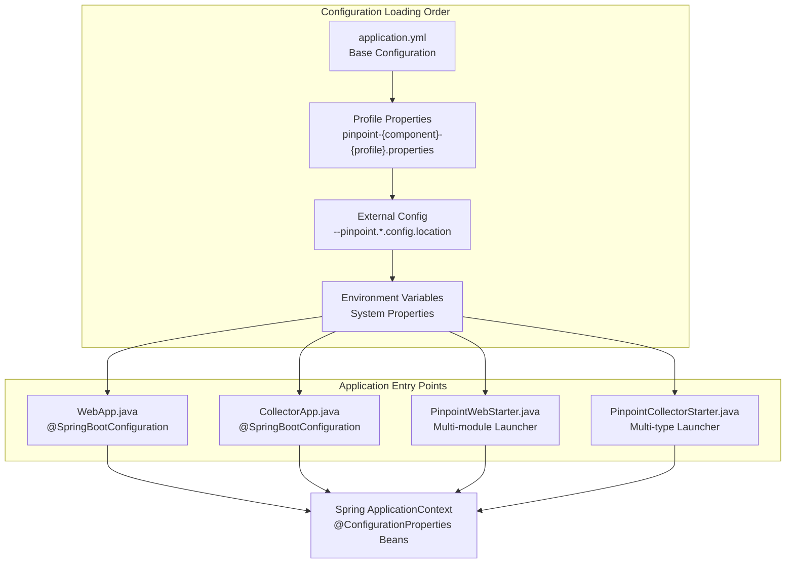
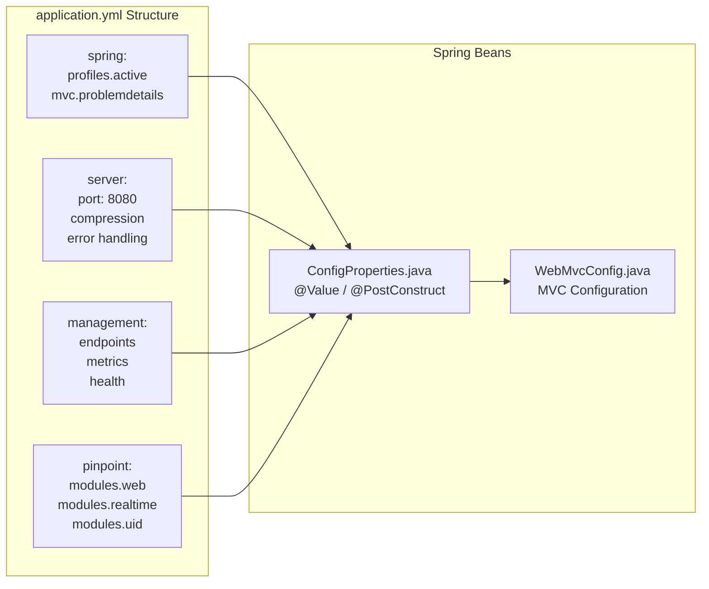
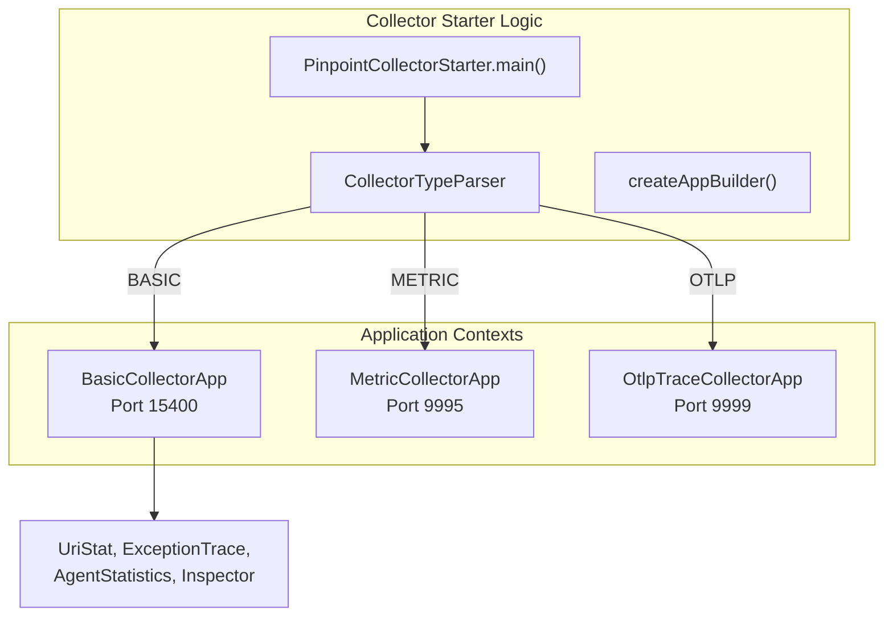
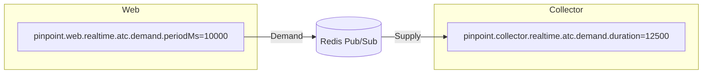

<!-- source: DeepWiki mcp.deepwiki.com · repo pinpoint-apm/pinpoint · page 9.1 Application Configuration · fetched 2026-10-29 -->

# Application Configuration

<details>
<summary>Relevant source files</summary>

The following files were used as context for generating this wiki page:

- [collector-starter/src/main/java/com/navercorp/pinpoint/collector/starter/multi/application/BasicCollectorApp.java](collector-starter/src/main/java/com/navercorp/pinpoint/collector/starter/multi/application/BasicCollectorApp.java)
- [collector-starter/src/main/java/com/navercorp/pinpoint/collector/starter/multi/application/PinpointCollectorStarter.java](collector-starter/src/main/java/com/navercorp/pinpoint/collector/starter/multi/application/PinpointCollectorStarter.java)
- [collector-starter/src/main/java/com/navercorp/pinpoint/collector/starter/multi/application/type/CollectorType.java](collector-starter/src/main/java/com/navercorp/pinpoint/collector/starter/multi/application/type/CollectorType.java)
- [collector-starter/src/main/java/com/navercorp/pinpoint/collector/starter/multi/application/type/CollectorTypeParser.java](collector-starter/src/main/java/com/navercorp/pinpoint/collector/starter/multi/application/type/CollectorTypeParser.java)
- [collector-starter/src/main/java/com/navercorp/pinpoint/collector/starter/multi/application/type/CollectorTypeSet.java](collector-starter/src/main/java/com/navercorp/pinpoint/collector/starter/multi/application/type/CollectorTypeSet.java)
- [collector-starter/src/main/java/com/navercorp/pinpoint/collector/starter/multi/application/type/FallbackCollectorTypeParser.java](collector-starter/src/main/java/com/navercorp/pinpoint/collector/starter/multi/application/type/FallbackCollectorTypeParser.java)
- [collector-starter/src/main/java/com/navercorp/pinpoint/collector/starter/multi/application/type/ShellBlockerConfig.java](collector-starter/src/main/java/com/navercorp/pinpoint/collector/starter/multi/application/type/ShellBlockerConfig.java)
- [collector-starter/src/main/java/com/navercorp/pinpoint/collector/starter/multi/application/type/ShellCollectorTypeParser.java](collector-starter/src/main/java/com/navercorp/pinpoint/collector/starter/multi/application/type/ShellCollectorTypeParser.java)
- [collector-starter/src/main/java/com/navercorp/pinpoint/collector/starter/multi/application/type/SimpleCollectorTypeParser.java](collector-starter/src/main/java/com/navercorp/pinpoint/collector/starter/multi/application/type/SimpleCollectorTypeParser.java)
- [collector-starter/src/main/resources/.gitignore](collector-starter/src/main/resources/.gitignore)
- [collector-starter/src/main/resources/application.yml](collector-starter/src/main/resources/application.yml)
- [collector/src/main/java/com/navercorp/pinpoint/collector/CollectorApp.java](collector/src/main/java/com/navercorp/pinpoint/collector/CollectorApp.java)
- [collector/src/main/java/com/navercorp/pinpoint/collector/PinpointCollectorModule.java](collector/src/main/java/com/navercorp/pinpoint/collector/PinpointCollectorModule.java)
- [collector/src/main/java/com/navercorp/pinpoint/collector/config/CollectorConfiguration.java](collector/src/main/java/com/navercorp/pinpoint/collector/config/CollectorConfiguration.java)
- [collector/src/main/java/com/navercorp/pinpoint/collector/event/SpanStorePublisher.java](collector/src/main/java/com/navercorp/pinpoint/collector/event/SpanStorePublisher.java)
- [collector/src/main/java/com/navercorp/pinpoint/collector/event/SpanStorePublisherImpl.java](collector/src/main/java/com/navercorp/pinpoint/collector/event/SpanStorePublisherImpl.java)
- [collector/src/main/java/com/navercorp/pinpoint/collector/event/config/CollectorEventConfiguration.java](collector/src/main/java/com/navercorp/pinpoint/collector/event/config/CollectorEventConfiguration.java)
- [collector/src/main/resources/application.yml](collector/src/main/resources/application.yml)
- [collector/src/main/resources/pinpoint-collector-root.properties](collector/src/main/resources/pinpoint-collector-root.properties)
- [collector/src/main/resources/profiles/local/pinpoint-collector-grpc.properties](collector/src/main/resources/profiles/local/pinpoint-collector-grpc.properties)
- [collector/src/main/resources/profiles/release/pinpoint-collector-grpc.properties](collector/src/main/resources/profiles/release/pinpoint-collector-grpc.properties)
- [commons-hbase/src/main/java/com/navercorp/pinpoint/common/hbase/config/HbaseNamespaceConfiguration.java](commons-hbase/src/main/java/com/navercorp/pinpoint/common/hbase/config/HbaseNamespaceConfiguration.java)
- [commons-server/src/main/java/com/navercorp/pinpoint/common/server/event/ContextData.java](commons-server/src/main/java/com/navercorp/pinpoint/common/server/event/ContextData.java)
- [commons-server/src/main/java/com/navercorp/pinpoint/common/server/event/ContextSupplier.java](commons-server/src/main/java/com/navercorp/pinpoint/common/server/event/ContextSupplier.java)
- [commons-server/src/main/java/com/navercorp/pinpoint/common/server/event/InsertEvent.java](commons-server/src/main/java/com/navercorp/pinpoint/common/server/event/InsertEvent.java)
- [commons-server/src/main/java/com/navercorp/pinpoint/common/server/event/SimpleContextSupplier.java](commons-server/src/main/java/com/navercorp/pinpoint/common/server/event/SimpleContextSupplier.java)
- [commons-server/src/main/java/com/navercorp/pinpoint/common/server/event/SpanChunkInsertEvent.java](commons-server/src/main/java/com/navercorp/pinpoint/common/server/event/SpanChunkInsertEvent.java)
- [commons-server/src/main/java/com/navercorp/pinpoint/common/server/event/SpanInsertEvent.java](commons-server/src/main/java/com/navercorp/pinpoint/common/server/event/SpanInsertEvent.java)
- [datasource/src/main/java/com/navercorp/pinpoint/datasource/MainDataSourceConfiguration.java](datasource/src/main/java/com/navercorp/pinpoint/datasource/MainDataSourceConfiguration.java)
- [otlpmetric/otlpmetric-web/src/main/resources/otlpmetric/web/profiles/local/otlpmetric-web.properties](otlpmetric/otlpmetric-web/src/main/resources/otlpmetric/web/profiles/local/otlpmetric-web.properties)
- [otlpmetric/otlpmetric-web/src/main/resources/otlpmetric/web/profiles/release/otlpmetric-web.properties](otlpmetric/otlpmetric-web/src/main/resources/otlpmetric/web/profiles/release/otlpmetric-web.properties)
- [realtime/realtime-collector/src/main/java/com/navercorp/pinpoint/realtime/collector/RealtimeCollectorServerConfig.java](realtime/realtime-collector/src/main/java/com/navercorp/pinpoint/realtime/collector/RealtimeCollectorServerConfig.java)
- [redis/src/main/java/com/navercorp/pinpoint/redis/RedisBasicConfig.java](redis/src/main/java/com/navercorp/pinpoint/redis/RedisBasicConfig.java)
- [redis/src/main/java/com/navercorp/pinpoint/redis/RedisPropertySources.java](redis/src/main/java/com/navercorp/pinpoint/redis/RedisPropertySources.java)
- [redis/src/main/resources/redis/profiles/local/redis.properties](redis/src/main/resources/redis/profiles/local/redis.properties)
- [redis/src/main/resources/redis/profiles/release/redis.properties](redis/src/main/resources/redis/profiles/release/redis.properties)
- [redis/src/main/resources/redis/redis-root.properties](redis/src/main/resources/redis/redis-root.properties)
- [web-starter/src/main/java/com/navercorp/pinpoint/web/starter/multi/PinpointWebStarter.java](web-starter/src/main/java/com/navercorp/pinpoint/web/starter/multi/PinpointWebStarter.java)
- [web-starter/src/main/resources/application.yml](web-starter/src/main/resources/application.yml)
- [web/src/main/java/com/navercorp/pinpoint/web/WebApp.java](web/src/main/java/com/navercorp/pinpoint/web/WebApp.java)
- [web/src/main/java/com/navercorp/pinpoint/web/config/ConfigProperties.java](web/src/main/java/com/navercorp/pinpoint/web/config/ConfigProperties.java)
- [web/src/main/java/com/navercorp/pinpoint/web/servlet/HttpIntentRoutingFilter.java](web/src/main/java/com/navercorp/pinpoint/web/servlet/HttpIntentRoutingFilter.java)
- [web/src/main/resources/application.yml](web/src/main/resources/application.yml)
- [web/src/main/resources/pinpoint-web-root.properties](web/src/main/resources/pinpoint-web-root.properties)
- [web/src/test/java/com/navercorp/pinpoint/web/servlet/HttpIntentRoutingFilterTest.java](web/src/test/java/com/navercorp/pinpoint/web/servlet/HttpIntentRoutingFilterTest.java)

</details>


## Purpose and Scope

This page documents the Spring Boot `application.yml` configuration for Pinpoint's Web and Collector applications. These files manage application-level settings, including server ports, management endpoints, Spring profiles, and feature module toggles.

For component-specific properties, refer to:
- Collector-specific properties (gRPC, sampling, workers): [Collector Configuration Reference](9.2)
- Web-specific properties (feature flags, API limits): [Web Configuration Reference](9.3)
- Agent instrumentation settings: [Agent Configuration](9.4)

---

## Configuration System Overview

Pinpoint utilizes a hierarchical configuration system. Spring Boot `application.yml` files provide the base configuration, which is supplemented by profile-specific properties files for component tuning.

**Configuration Hierarchy**



**Sources**: [web/src/main/resources/application.yml:1-120](), [collector/src/main/resources/application.yml:1-78](), [web/src/main/java/com/navercorp/pinpoint/web/WebApp.java:35-51](), [collector-starter/src/main/java/com/navercorp/pinpoint/collector/starter/multi/application/PinpointCollectorStarter.java:41-53]()

---

## Web Application Configuration

The Web application's `application.yml` configures the REST API server, frontend behavior, and monitoring endpoints.

### Base Configuration Structure



**Sources**: [web/src/main/resources/application.yml:1-120](), [web/src/main/java/com/navercorp/pinpoint/web/config/ConfigProperties.java:32-196]()

### Server and Spring Settings

| Property | Default Value | Description |
|----------|---------------|-------------|
| `spring.profiles.active` | `release` | Active Spring profile (local, release) |
| `server.port` | `8080` | HTTP port for REST API and frontend |
| `server.error.path` | `/api/error` | Base path for error responses |
| `server.compression.enabled` | `true` | Gzip compression for `application/json` |

**Sources**: [web/src/main/resources/application.yml:1-26]()

### Management Endpoints (Actuator)

Pinpoint exposes Actuator endpoints under the `/monitor` base path for system health and diagnostics.

| Endpoint | Path Mapping | Access Level |
|----------|--------------|--------------|
| `health` | `l7check` | `read_only` |
| `loggers` | `loggers` | `unrestricted` |
| `configprops` | `configprops` | `read_only` |
| `env` | `env` | `read_only` |

**Sources**: [web/src/main/resources/application.yml:27-81]()

### Pinpoint Feature Toggles

The `ConfigProperties` class captures feature toggles from `application.yml` and properties files to control UI visibility and backend logic.

| Property | Default | Class Field |
|----------|---------|-------------|
| `config.show.activeThread` | `false` | `showActiveThread` |
| `config.enable.serverMapRealTime` | `false` | `enableServerMapRealTime` |
| `pinpoint.modules.web.uristat.enabled` | `false` | `showUrlStat` |
| `pinpoint.modules.web.inspector.enabled` | `false` | `showInspector` |

**Sources**: [web/src/main/java/com/navercorp/pinpoint/web/config/ConfigProperties.java:36-82](), [web/src/main/resources/pinpoint-web-root.properties:14-25]()

---

## Collector Application Configuration

The Collector application manages data ingestion from agents via gRPC.

### Collector Base Configuration

```yaml
server:
  port: 8081
pinpoint:
  modules:
    collector:
      grpc:
        ssl:
          enabled: false
    uid:
      version: v3
```

**Sources**: [collector/src/main/resources/application.yml:5-77]()

### Collector Multi-Type Launcher

The `PinpointCollectorStarter` allows launching different collector types (BASIC, METRIC, OTLP_TRACE, LOG) based on arguments.



**Sources**: [collector-starter/src/main/java/com/navercorp/pinpoint/collector/starter/multi/application/PinpointCollectorStarter.java:59-112]()

---

## Component Configuration Reference

### gRPC Receiver Configuration

gRPC receivers are typically configured in profile-specific properties (e.g., `pinpoint-collector-grpc.properties`).

| Receiver | Default Port | SSL Port | Worker Executor Threads |
|----------|--------------|----------|-------------------------|
| Agent | `9991` | `9441` | `16` |
| Stat | `9992` | `9442` | `16` |
| Span | `9993` | `9443` | `32` |
| OTLP Trace | `9998` | `9448` | `16` |

**Sources**: [collector/src/main/resources/profiles/local/pinpoint-collector-grpc.properties:3-102]()

### Sampling Configuration

The collector can sample spans to reduce storage load.

| Property | Default | Description |
|----------|---------|-------------|
| `collector.span.sampling.enable` | `false` | Enable/Disable sampling |
| `collector.span.sampling.type` | `MOD` | Sampling strategy (`MOD` or `PERCENT`) |
| `collector.span.sampling.mod.sampling-rate` | `1` | 1 out of N transactions (1 = 100%) |

**Sources**: [collector/src/main/resources/pinpoint-collector-root.properties:31-44]()

### Real-time Features (Redis)

Real-time features like Active Thread Count (ATC) require Redis for message passing between collectors and the web application.



**Sources**: [web/src/main/resources/pinpoint-web-root.properties:93-96](), [collector/src/main/resources/pinpoint-collector-root.properties:59-62]()

---

## Infrastructure Configuration

### HBase and DataSources

HBase configuration is handled via `MainDataSourcePropertySource` and `HbaseNamespaceConfiguration`.

| Property | Default | Description |
|----------|---------|-------------|
| `hbase.client.host` | `localhost` | Zookeeper host for HBase |
| `hbase.namespace` | `default` | HBase namespace for tables |
| `pinpoint.modules.uid.version` | `v3` | Table schema version for UIDs |

**Sources**: [web/src/main/resources/application.yml:94-96](), [commons-hbase/src/main/java/com/navercorp/pinpoint/common/hbase/config/HbaseNamespaceConfiguration.java:12-26]()

### Redis Property Loading

Redis properties are loaded through `RedisPropertySources`, which looks for `redis-root.properties` and profile-specific overrides.

| Property | Default |
|----------|---------|
| `spring.data.redis.host` | `localhost` |
| `spring.data.redis.port` | `6379` |
| `spring.data.redis.cluster.nodes` | (null) |

**Sources**: [redis/src/main/java/com/navercorp/pinpoint/redis/RedisPropertySources.java:24-31](), [redis/src/main/java/com/navercorp/pinpoint/redis/RedisBasicConfig.java:49-65]()

---

