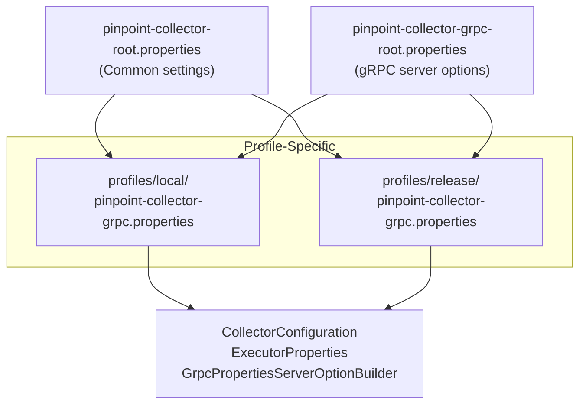
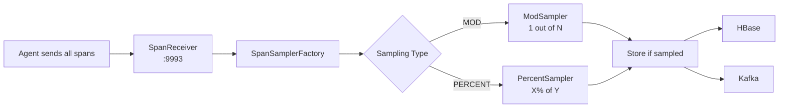
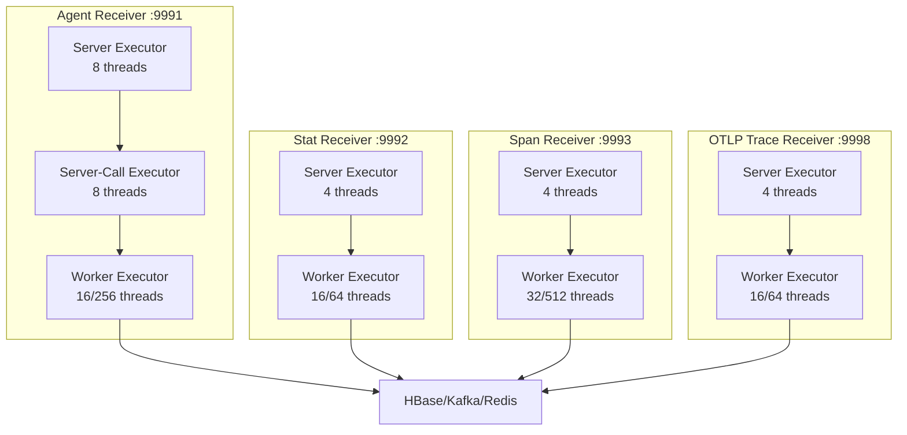
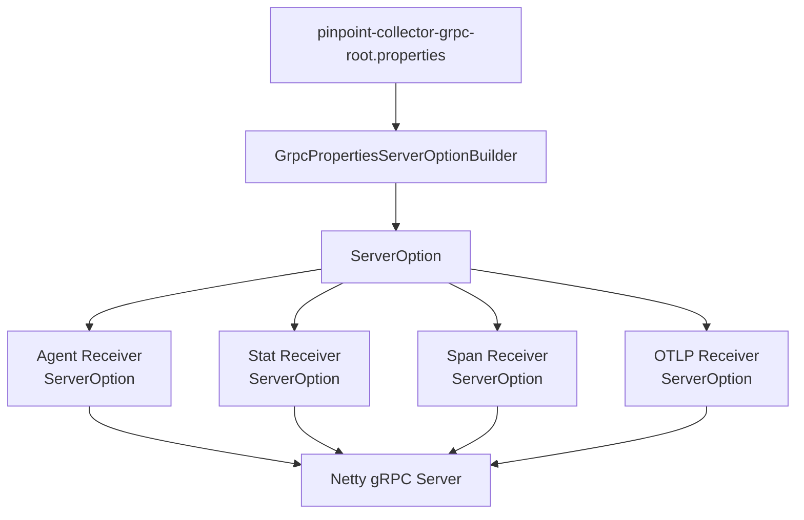
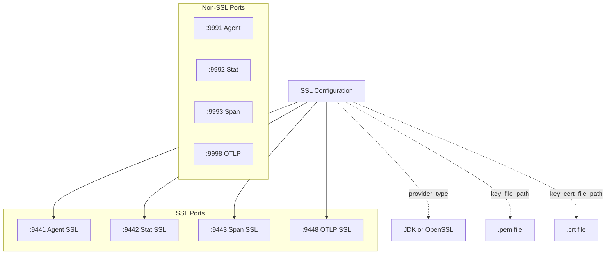
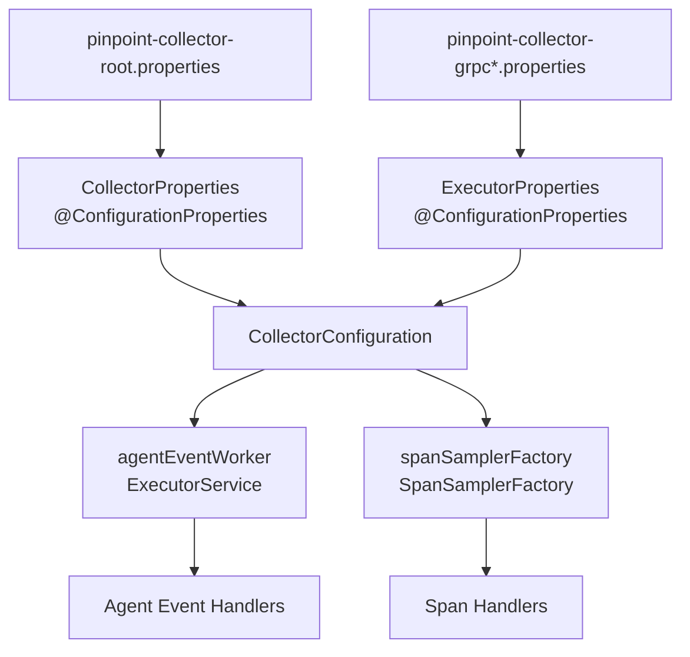

<!-- source: DeepWiki mcp.deepwiki.com · repo pinpoint-apm/pinpoint · page 9.2 Collector Configuration Reference · fetched 2026-10-29 -->

# Collector Configuration Reference

Relevant source files

The following files were used as context for generating this wiki page:

- [collector-starter/src/main/java/com/navercorp/pinpoint/collector/starter/multi/application/type/CollectorType.java](collector-starter/src/main/java/com/navercorp/pinpoint/collector/starter/multi/application/type/CollectorType.java)
- [collector-starter/src/main/java/com/navercorp/pinpoint/collector/starter/multi/application/type/CollectorTypeParser.java](collector-starter/src/main/java/com/navercorp/pinpoint/collector/starter/multi/application/type/CollectorTypeParser.java)
- [collector-starter/src/main/java/com/navercorp/pinpoint/collector/starter/multi/application/type/CollectorTypeSet.java](collector-starter/src/main/java/com/navercorp/pinpoint/collector/starter/multi/application/type/CollectorTypeSet.java)
- [collector-starter/src/main/java/com/navercorp/pinpoint/collector/starter/multi/application/type/FallbackCollectorTypeParser.java](collector-starter/src/main/java/com/navercorp/pinpoint/collector/starter/multi/application/type/FallbackCollectorTypeParser.java)
- [collector-starter/src/main/java/com/navercorp/pinpoint/collector/starter/multi/application/type/ShellBlockerConfig.java](collector-starter/src/main/java/com/navercorp/pinpoint/collector/starter/multi/application/type/ShellBlockerConfig.java)
- [collector-starter/src/main/java/com/navercorp/pinpoint/collector/starter/multi/application/type/ShellCollectorTypeParser.java](collector-starter/src/main/java/com/navercorp/pinpoint/collector/starter/multi/application/type/ShellCollectorTypeParser.java)
- [collector-starter/src/main/java/com/navercorp/pinpoint/collector/starter/multi/application/type/SimpleCollectorTypeParser.java](collector-starter/src/main/java/com/navercorp/pinpoint/collector/starter/multi/application/type/SimpleCollectorTypeParser.java)
- [collector-starter/src/main/resources/.gitignore](collector-starter/src/main/resources/.gitignore)
- [collector/src/main/java/com/navercorp/pinpoint/collector/config/CollectorConfiguration.java](collector/src/main/java/com/navercorp/pinpoint/collector/config/CollectorConfiguration.java)
- [collector/src/main/java/com/navercorp/pinpoint/collector/dao/AgentInfoDao.java](collector/src/main/java/com/navercorp/pinpoint/collector/dao/AgentInfoDao.java)
- [collector/src/main/java/com/navercorp/pinpoint/collector/grpc/config/GrpcAgentConfiguration.java](collector/src/main/java/com/navercorp/pinpoint/collector/grpc/config/GrpcAgentConfiguration.java)
- [collector/src/main/java/com/navercorp/pinpoint/collector/grpc/config/GrpcComponentConfiguration.java](collector/src/main/java/com/navercorp/pinpoint/collector/grpc/config/GrpcComponentConfiguration.java)
- [collector/src/main/java/com/navercorp/pinpoint/collector/grpc/config/GrpcSpanReceiverConfiguration.java](collector/src/main/java/com/navercorp/pinpoint/collector/grpc/config/GrpcSpanReceiverConfiguration.java)
- [collector/src/main/java/com/navercorp/pinpoint/collector/grpc/config/GrpcStatReceiverConfiguration.java](collector/src/main/java/com/navercorp/pinpoint/collector/grpc/config/GrpcStatReceiverConfiguration.java)
- [collector/src/main/java/com/navercorp/pinpoint/collector/grpc/config/ServerServiceDefinitions.java](collector/src/main/java/com/navercorp/pinpoint/collector/grpc/config/ServerServiceDefinitions.java)
- [collector/src/main/java/com/navercorp/pinpoint/collector/grpc/lifecycle/DefaultPingEventHandler.java](collector/src/main/java/com/navercorp/pinpoint/collector/grpc/lifecycle/DefaultPingEventHandler.java)
- [collector/src/main/java/com/navercorp/pinpoint/collector/grpc/lifecycle/DefaultPingSessionRegistry.java](collector/src/main/java/com/navercorp/pinpoint/collector/grpc/lifecycle/DefaultPingSessionRegistry.java)
- [collector/src/main/java/com/navercorp/pinpoint/collector/grpc/lifecycle/PingEventHandler.java](collector/src/main/java/com/navercorp/pinpoint/collector/grpc/lifecycle/PingEventHandler.java)
- [collector/src/main/java/com/navercorp/pinpoint/collector/grpc/lifecycle/PingSession.java](collector/src/main/java/com/navercorp/pinpoint/collector/grpc/lifecycle/PingSession.java)
- [collector/src/main/java/com/navercorp/pinpoint/collector/grpc/lifecycle/PingSessionRegistry.java](collector/src/main/java/com/navercorp/pinpoint/collector/grpc/lifecycle/PingSessionRegistry.java)
- [collector/src/main/java/com/navercorp/pinpoint/collector/grpc/ssl/GrpcSslModule.java](collector/src/main/java/com/navercorp/pinpoint/collector/grpc/ssl/GrpcSslModule.java)
- [collector/src/main/java/com/navercorp/pinpoint/collector/grpc/ssl/GrpcSslProperties.java](collector/src/main/java/com/navercorp/pinpoint/collector/grpc/ssl/GrpcSslProperties.java)
- [collector/src/main/java/com/navercorp/pinpoint/collector/grpc/ssl/GrpcSslReceiverProperties.java](collector/src/main/java/com/navercorp/pinpoint/collector/grpc/ssl/GrpcSslReceiverProperties.java)
- [collector/src/main/java/com/navercorp/pinpoint/collector/receiver/grpc/flow/RateLimitClientStreamServerInterceptor.java](collector/src/main/java/com/navercorp/pinpoint/collector/receiver/grpc/flow/RateLimitClientStreamServerInterceptor.java)
- [collector/src/main/java/com/navercorp/pinpoint/collector/receiver/grpc/service/AgentLifecycleListener.java](collector/src/main/java/com/navercorp/pinpoint/collector/receiver/grpc/service/AgentLifecycleListener.java)
- [collector/src/main/java/com/navercorp/pinpoint/collector/receiver/grpc/service/AgentService.java](collector/src/main/java/com/navercorp/pinpoint/collector/receiver/grpc/service/AgentService.java)
- [collector/src/main/java/com/navercorp/pinpoint/collector/receiver/grpc/service/DefaultServerRequestFactory.java](collector/src/main/java/com/navercorp/pinpoint/collector/receiver/grpc/service/DefaultServerRequestFactory.java)
- [collector/src/main/java/com/navercorp/pinpoint/collector/receiver/grpc/service/KeepAliveService.java](collector/src/main/java/com/navercorp/pinpoint/collector/receiver/grpc/service/KeepAliveService.java)
- [collector/src/main/java/com/navercorp/pinpoint/collector/receiver/grpc/service/MetadataService.java](collector/src/main/java/com/navercorp/pinpoint/collector/receiver/grpc/service/MetadataService.java)
- [collector/src/main/java/com/navercorp/pinpoint/collector/receiver/grpc/service/ServerCallStream.java](collector/src/main/java/com/navercorp/pinpoint/collector/receiver/grpc/service/ServerCallStream.java)
- [collector/src/main/java/com/navercorp/pinpoint/collector/receiver/grpc/service/ServerRequestFactory.java](collector/src/main/java/com/navercorp/pinpoint/collector/receiver/grpc/service/ServerRequestFactory.java)
- [collector/src/main/java/com/navercorp/pinpoint/collector/receiver/grpc/service/SpanService.java](collector/src/main/java/com/navercorp/pinpoint/collector/receiver/grpc/service/SpanService.java)
- [collector/src/main/java/com/navercorp/pinpoint/collector/receiver/grpc/service/StatService.java](collector/src/main/java/com/navercorp/pinpoint/collector/receiver/grpc/service/StatService.java)
- [collector/src/main/java/com/navercorp/pinpoint/collector/service/async/AgentProperty.java](collector/src/main/java/com/navercorp/pinpoint/collector/service/async/AgentProperty.java)
- [collector/src/main/java/com/navercorp/pinpoint/collector/service/async/DefaultAgentProperty.java](collector/src/main/java/com/navercorp/pinpoint/collector/service/async/DefaultAgentProperty.java)
- [collector/src/main/resources/pinpoint-collector-root.properties](collector/src/main/resources/pinpoint-collector-root.properties)
- [collector/src/main/resources/profiles/local/pinpoint-collector-grpc.properties](collector/src/main/resources/profiles/local/pinpoint-collector-grpc.properties)
- [collector/src/main/resources/profiles/release/pinpoint-collector-grpc.properties](collector/src/main/resources/profiles/release/pinpoint-collector-grpc.properties)
- [collector/src/test/java/com/navercorp/pinpoint/collector/grpc/lifecycle/DefaultPingSessionRegistryTest.java](collector/src/test/java/com/navercorp/pinpoint/collector/grpc/lifecycle/DefaultPingSessionRegistryTest.java)
- [collector/src/test/java/com/navercorp/pinpoint/collector/grpc/lifecycle/PingSessionTest.java](collector/src/test/java/com/navercorp/pinpoint/collector/grpc/lifecycle/PingSessionTest.java)
- [collector/src/test/java/com/navercorp/pinpoint/collector/receiver/grpc/AgentServerTestMain.java](collector/src/test/java/com/navercorp/pinpoint/collector/receiver/grpc/AgentServerTestMain.java)
- [collector/src/test/java/com/navercorp/pinpoint/collector/receiver/grpc/SpanServerTestMain.java](collector/src/test/java/com/navercorp/pinpoint/collector/receiver/grpc/SpanServerTestMain.java)
- [collector/src/test/java/com/navercorp/pinpoint/collector/receiver/grpc/StatServerTestMain.java](collector/src/test/java/com/navercorp/pinpoint/collector/receiver/grpc/StatServerTestMain.java)
- [collector/src/test/java/com/navercorp/pinpoint/collector/receiver/grpc/flow/StreamRateLimitServerInterceptorTest.java](collector/src/test/java/com/navercorp/pinpoint/collector/receiver/grpc/flow/StreamRateLimitServerInterceptorTest.java)
- [collector/src/test/java/com/navercorp/pinpoint/collector/receiver/grpc/service/ServerCallStreamTest.java](collector/src/test/java/com/navercorp/pinpoint/collector/receiver/grpc/service/ServerCallStreamTest.java)
- [commons-server/src/main/java/com/navercorp/pinpoint/common/server/dao/hbase/mapper/SingleResultsExtractor.java](commons-server/src/main/java/com/navercorp/pinpoint/common/server/dao/hbase/mapper/SingleResultsExtractor.java)
- [otlpmetric/otlpmetric-web/src/main/resources/otlpmetric/web/profiles/local/otlpmetric-web.properties](otlpmetric/otlpmetric-web/src/main/resources/otlpmetric/web/profiles/local/otlpmetric-web.properties)
- [otlpmetric/otlpmetric-web/src/main/resources/otlpmetric/web/profiles/release/otlpmetric-web.properties](otlpmetric/otlpmetric-web/src/main/resources/otlpmetric/web/profiles/release/otlpmetric-web.properties)
- [web/src/main/java/com/navercorp/pinpoint/web/config/ConfigProperties.java](web/src/main/java/com/navercorp/pinpoint/web/config/ConfigProperties.java)
- [web/src/main/java/com/navercorp/pinpoint/web/servlet/HttpIntentRoutingFilter.java](web/src/main/java/com/navercorp/pinpoint/web/servlet/HttpIntentRoutingFilter.java)
- [web/src/main/resources/pinpoint-web-root.properties](web/src/main/resources/pinpoint-web-root.properties)
- [web/src/test/java/com/navercorp/pinpoint/web/servlet/HttpIntentRoutingFilterTest.java](web/src/test/java/com/navercorp/pinpoint/web/servlet/HttpIntentRoutingFilterTest.java)

This page provides a complete reference for all Pinpoint Collector configuration properties. The Collector receives trace data, statistics, and agent information via gRPC receivers, processes the data through worker thread pools, and stores it in HBase and other storage systems.

For general Spring Boot application configuration (datasources, HBase, Redis), see [Application Configuration](#9.1). For architectural details about the Collector's data processing pipeline, see [Collector Architecture](#3.3). For tuning and operational guidance, see [Collector Configuration](#5.3).

---

## Configuration File Structure

The Collector uses a hierarchical property file structure organized by profile and component:

**Sources:** 
- [collector/src/main/resources/pinpoint-collector-root.properties:1-123]()
- [collector/src/main/resources/profiles/local/pinpoint-collector-grpc.properties:1-107]()
- [collector/src/main/resources/profiles/release/pinpoint-collector-grpc.properties:1-113]()

---

## Core Collector Properties

### ZooKeeper Configuration

| Property | Default | Description |
|----------|---------|-------------|
| `pinpoint.zookeeper.address` | `localhost` | ZooKeeper connection string for service coordination |

**Sources:** [collector/src/main/resources/pinpoint-collector-root.properties:1]()

### L4 Health Check Configuration

| Property | Default | Description |
|----------|---------|-------------|
| `collector.l4.ip` | (empty) | L4 load balancer IP addresses to ignore in health check logs. Supports raw addresses and CIDR notation (e.g., `10.0.0.1,10.0.0.1/24`) |

**Sources:** [collector/src/main/resources/pinpoint-collector-root.properties:3-5]()

### Agent Event Worker Thread Pool

| Property | Default | Description |
|----------|---------|-------------|
| `collector.agentEventWorker.corePoolSize` | `4` | Core thread pool size for agent event processing |
| `collector.agentEventWorker.maxPoolSize` | `4` | Maximum thread pool size for agent event processing |
| `collector.agentEventWorker.queueCapacity` | `1024` | Queue capacity for pending agent events |

These properties bind to `ExecutorProperties` via `@ConfigurationProperties` in `CollectorConfiguration`.

**Sources:** 
- [collector/src/main/resources/pinpoint-collector-root.properties:13-17]()
- [collector/src/main/java/com/navercorp/pinpoint/collector/config/CollectorConfiguration.java:54-57]()
- [collector/src/main/java/com/navercorp/pinpoint/collector/config/CollectorConfiguration.java:60-69]()

### Metrics Configuration

| Property | Default | Description |
|----------|---------|-------------|
| `collector.metric.jmx` | `false` | Register `CollectorMetric` metrics to JMX |
| `collector.metric.jmx.domain` | `pinpoint.collector.metrics` | JMX domain for metrics registration |

**Sources:** [collector/src/main/resources/pinpoint-collector-root.properties:19-21]()

### Statistics Configuration

| Property | Default | Description |
|----------|---------|-------------|
| `statistics.flushPeriod` | `1000` | Flush period in milliseconds for statistics data |
| `collector.statistics.agent-state.enable` | `true` | Enable statistics-based agent state tracking |

**Sources:** [collector/src/main/resources/pinpoint-collector-root.properties:23-25]()

---

## Span Sampling Configuration

The Collector can sample spans to reduce storage volume while maintaining trace coverage.

### Sampling Properties

| Property | Default | Description |
|----------|---------|-------------|
| `collector.span.sampling.enable` | `false` | Enable span sampling at the collector level |
| `collector.span.sampling.type` | `MOD` | Sampling algorithm: `MOD` or `PERCENT` |
| `collector.span.sampling.mod.sampling-rate` | `1` | For MOD: sample 1 out of N transactions (1=100%, 20=5%, 100=1%) |
| `collector.span.sampling.percent.sampling-rate` | `100` | For PERCENT: sample X% of transactions (100=100%, 50=50%, 0.01=0.01%) |

### Span Event Limits

| Property | Default | Description |
|----------|---------|-------------|
| `collector.spanEvent.sequence.limit` | `5000` | Maximum number of span events per span |

**Sources:** 
- [collector/src/main/resources/pinpoint-collector-root.properties:31-46]()
- [collector/src/main/java/com/navercorp/pinpoint/collector/config/CollectorConfiguration.java:71-74]()

---

## Cached Statistics DAO Configuration

| Property | Default | Description |
|----------|---------|-------------|
| `collector.cachedStatDao.caller.limit` | `-1` | Cache size for caller statistics (-1 = unlimited) |
| `collector.cachedStatDao.callee.limit` | `-1` | Cache size for callee statistics (-1 = unlimited) |
| `collector.cachedStatDao.self.limit` | `-1` | Cache size for self statistics (-1 = unlimited) |
| `collector.cachedStatDao.bulk.enable` | `true` | Enable bulk flushing for cached statistics |

**Sources:** [collector/src/main/resources/pinpoint-collector-root.properties:48-53]()

### Map Link Statistics

| Property | Default | Description |
|----------|---------|-------------|
| `collector.map-link.avg.enable` | `true` | Enable average response time calculation for map links |
| `collector.map-link.avg.flush-interval` | `5000` | Flush interval in milliseconds for average statistics |
| `collector.map-link.max.enable` | `true` | Enable max response time calculation for map links |
| `collector.map-link.max.flush-interval` | `5000` | Flush interval in milliseconds for max statistics |

**Sources:** [collector/src/main/resources/pinpoint-collector-root.properties:54-57]()

---

## Real-time Active Thread Count Configuration

| Property | Default | Description |
|----------|---------|-------------|
| `pinpoint.collector.realtime.atc.demand.duration` | `12500` | Duration in milliseconds for ATC demand requests |
| `pinpoint.collector.realtime.atc.supply.throttle.termMillis` | `100` | Throttle interval for ATC supply responses |
| `pinpoint.collector.realtime.atc.enable-count-metric` | `false` | Enable ATC count metrics collection |

**Sources:** [collector/src/main/resources/pinpoint-collector-root.properties:59-62]()

---

## Service UID Cache Configuration

| Property | Default | Description |
|----------|---------|-------------|
| `pinpoint.modules.service.dao.type` | `empty` | Service DAO type: `empty` or `mysql` |
| `collector.service.uid.cache.initialCapacity` | `16` | Initial capacity of service UID cache |
| `collector.service.uid.cache.maximumSize` | `500` | Maximum size of service UID cache |
| `collector.service.uid.cache.recordStat` | `false` | Record cache statistics |
| `collector.service.uid.cache.expireAfterWrite` | `-1s` | Expiration time after write (negative = no expire) |
| `collector.service.uid.cache.expireAfterAccess` | `-1s` | Expiration time after access (negative = no expire) |
| `collector.service.uid.cache.nullValueExpireAfterWrite` | `1m` | Expiration for null values (unregistered service groups) |
| `collector.service.uid.cache.bulk.update.enabled` | `true` | Enable periodic bulk cache updates |
| `collector.service.uid.cache.bulk.update.interval` | `60000` | Bulk update interval in milliseconds |

**Sources:** [collector/src/main/resources/pinpoint-collector-root.properties:64-77]()

---

## Index Version Configuration

| Property | Default | Description |
|----------|---------|-------------|
| `pinpoint.collector.application.index.v1.enabled` | `true` | Enable v1 application index |
| `pinpoint.collector.application.index.v2.enabled` | `false` | Enable v2 application index (under development) |
| `pinpoint.collector.application.trace.index.v1.enabled` | `true` | Enable v1 trace index |
| `pinpoint.collector.application.trace.index.v2.enabled` | `false` | Enable v2 trace index (under development) |

**Sources:** [collector/src/main/resources/pinpoint-collector-root.properties:79-85]()

---

## gRPC Receiver Configuration

The Collector operates four gRPC receivers on separate ports. Each receiver has three executor layers: server executor, server-call executor, and worker executor.

### Agent Receiver (Port 9991)

Handles agent lifecycle events via `AgentService`, agent information updates, and ping messages.

| Property | Profile | Local | Release |
|----------|---------|-------|---------|
| `collector.receiver.grpc.agent.enable` | Both | `true` | `true` |
| `collector.receiver.grpc.agent.bindaddress.ip` | Both | `0.0.0.0` | `0.0.0.0` |
| `collector.receiver.grpc.agent.bindaddress.port` | Both | `9991` | `9991` |
| **Server Executor** | | | |
| `collector.receiver.grpc.agent.server.executor.corePoolSize` | Both | `8` | `8` |
| `collector.receiver.grpc.agent.server.executor.maxPoolSize` | Both | `8` | `8` |
| `collector.receiver.grpc.agent.server.executor.queueCapacity` | Both | `256` | `256` |
| `collector.receiver.grpc.agent.server.executor.monitor-enable` | Both | `false` | `false` |
| **Server-Call Executor** | | | |
| `collector.receiver.grpc.agent.server-call.executor.corePoolSize` | Both | `8` | `8` |
| `collector.receiver.grpc.agent.server-call.executor.maxPoolSize` | Both | `8` | `8` |
| `collector.receiver.grpc.agent.server-call.executor.queueCapacity` | Both | `256` | `256` |
| `collector.receiver.grpc.agent.server-call.executor.monitor-enable` | Both | `true` | `true` |
| `collector.receiver.grpc.agent.server-call.executor.monitor.duration.enable` | Release | - | `false` |
| **Worker Executor** | | | |
| `collector.receiver.grpc.agent.worker.executor.corePoolSize` | ⚠️ | `16` | `256` |
| `collector.receiver.grpc.agent.worker.executor.maxPoolSize` | ⚠️ | `16` | `256` |
| `collector.receiver.grpc.agent.worker.executor.queueCapacity` | ⚠️ | `1024` | `5120` |
| `collector.receiver.grpc.agent.worker.executor.monitor-enable` | Both | `true` | `true` |
| `collector.receiver.grpc.agent.worker.executor.monitor.duration.enable` | Release | - | `true` |

**Sources:** 
- [collector/src/main/resources/profiles/local/pinpoint-collector-grpc.properties:2-20]()
- [collector/src/main/resources/profiles/release/pinpoint-collector-grpc.properties:2-22]()
- [collector/src/main/java/com/navercorp/pinpoint/collector/receiver/grpc/service/AgentService.java:49-71]()

### Stat Receiver (Port 9992)

Handles agent statistics data via `StatService` (CPU, memory, transaction counts, response times).

| Property | Profile | Local | Release |
|----------|---------|-------|---------|
| `collector.receiver.grpc.stat.enable` | Both | `true` | `true` |
| `collector.receiver.grpc.stat.bindaddress.ip` | Both | `0.0.0.0` | `0.0.0.0` |
| `collector.receiver.grpc.stat.bindaddress.port` | Both | `9992` | `9992` |
| **Server Executor** | | | |
| `collector.receiver.grpc.stat.server.executor.corePoolSize` | Both | `4` | `4` |
| `collector.receiver.grpc.stat.server.executor.maxPoolSize` | Both | `4` | `4` |
| `collector.receiver.grpc.stat.server.executor.queueCapacity` | Both | `256` | `256` |
| `collector.receiver.grpc.stat.server.executor.monitor-enable` | Both | `true` | `true` |
| `collector.receiver.grpc.stat.server.executor.monitor.duration.enable` | Release | - | `false` |
| **Worker Executor** | | | |
| `collector.receiver.grpc.stat.worker.executor.corePoolSize` | ⚠️ | `16` | `64` |
| `collector.receiver.grpc.stat.worker.executor.maxPoolSize` | ⚠️ | `16` | `64` |
| `collector.receiver.grpc.stat.worker.executor.queueCapacity` | ⚠️ | `1024` | `5120` |
| `collector.receiver.grpc.stat.worker.executor.monitor-enable` | Both | `true` | `true` |
| `collector.receiver.grpc.stat.worker.executor.monitor.duration.enable` | Release | - | `true` |
| `collector.receiver.grpc.stat.stream.throttled_logger_ratio` | Both | `100` | `100` |

**Sources:** 
- [collector/src/main/resources/profiles/local/pinpoint-collector-grpc.properties:23-38]()
- [collector/src/main/resources/profiles/release/pinpoint-collector-grpc.properties:25-42]()
- [collector/src/main/java/com/navercorp/pinpoint/collector/receiver/grpc/service/StatService.java:47-78]()

### Span Receiver (Port 9993)

Handles span and span chunk data via `SpanService` (transaction traces).

| Property | Profile | Local | Release |
|----------|---------|-------|---------|
| `collector.receiver.grpc.span.enable` | Both | `true` | `true` |
| `collector.receiver.grpc.span.bindaddress.ip` | Both | `0.0.0.0` | `0.0.0.0` |
| `collector.receiver.grpc.span.bindaddress.port` | Both | `9993` | `9993` |
| **Server Executor** | | | |
| `collector.receiver.grpc.span.server.executor.corePoolSize` | Both | `4` | `4` |
| `collector.receiver.grpc.span.server.executor.maxPoolSize` | Both | `4` | `4` |
| `collector.receiver.grpc.span.server.executor.queueCapacity` | Both | `256` | `256` |
| `collector.receiver.grpc.span.server.executor.monitor-enable` | Both | `true` | `true` |
| `collector.receiver.grpc.span.server.executor.monitor.duration.enable` | Release | - | `false` |
| **Worker Executor** | | | |
| `collector.receiver.grpc.span.worker.executor.corePoolSize` | ⚠️ | `32` | `512` |
| `collector.receiver.grpc.span.worker.executor.maxPoolSize` | ⚠️ | `32` | `512` |
| `collector.receiver.grpc.span.worker.executor.queueCapacity` | ⚠️ | `1024` | `10240` |
| `collector.receiver.grpc.span.worker.executor.monitor-enable` | Both | `true` | `true` |
| `collector.receiver.grpc.span.worker.executor.monitor.duration.enable` | Release | - | `true` |
| `collector.receiver.grpc.span.stream.throttled_logger_ratio` | Both | `100` | `100` |

**Sources:** 
- [collector/src/main/resources/profiles/local/pinpoint-collector-grpc.properties:41-57]()
- [collector/src/main/resources/profiles/release/pinpoint-collector-grpc.properties:45-62]()
- [collector/src/main/java/com/navercorp/pinpoint/collector/receiver/grpc/service/SpanService.java:46-74]()

### OTLP Trace Receiver (Port 9998)

Handles OpenTelemetry Protocol (OTLP) trace data.

| Property | Profile | Local | Release |
|----------|---------|-------|---------|
| `collector.receiver.grpc.otlp.trace.enable` | Both | `true` | `true` |
| `collector.receiver.grpc.otlp.trace.bindaddress.ip` | Both | `0.0.0.0` | `0.0.0.0` |
| `collector.receiver.grpc.otlp.trace.bindaddress.port` | Both | `9998` | `9998` |
| **Server Executor** | | | |
| `collector.receiver.grpc.otlp.trace.server.executor.corePoolSize` | Both | `4` | `4` |
| `collector.receiver.grpc.otlp.trace.server.executor.maxPoolSize` | Both | `4` | `4` |
| `collector.receiver.grpc.otlp.trace.server.executor.queueCapacity` | Both | `256` | `256` |
| `collector.receiver.grpc.otlp.trace.server.executor.monitor-enable` | Both | `true` | `true` |
| `collector.receiver.grpc.otlp.trace.server.executor.monitor.duration.enable` | Release | - | `false` |
| **Worker Executor** | | | |
| `collector.receiver.grpc.otlp.trace.worker.executor.corePoolSize` | ⚠️ | `16` | `64` |
| `collector.receiver.grpc.otlp.trace.worker.executor.maxPoolSize` | ⚠️ | `16` | `64` |
| `collector.receiver.grpc.otlp.trace.worker.executor.queueCapacity` | ⚠️ | `1024` | `10240` |
| `collector.receiver.grpc.otlp.trace.worker.executor.monitor-enable` | Both | `true` | `true` |
| `collector.receiver.grpc.otlp.trace.worker.executor.monitor.duration.enable` | Release | - | `true` |
| `collector.receiver.grpc.otlp.trace.stream.throttled_logger_ratio` | Both | `100` | `100` |

**Sources:** 
- [collector/src/main/resources/profiles/local/pinpoint-collector-grpc.properties:59-75]()
- [collector/src/main/resources/profiles/release/pinpoint-collector-grpc.properties:64-81]()

---

## gRPC Server Options

These properties control low-level gRPC/HTTP/2 server behavior and are shared across all receivers via inheritance from common root configurations.

### Server Flow Control

The collector uses `RateLimitClientStreamServerInterceptor` to prevent overloading the system.

| Property | Default | Description |
|----------|---------|-------------|
| `collector.receiver.grpc.span.stream.flow-control.rate-limit.capacity` | `5000` | Bucket capacity for Span stream rate limiting |
| `collector.receiver.grpc.span.stream.flow-control.rate-limit.refill-greedy` | `1000` | Tokens refilled per second for Span stream |
| `collector.receiver.grpc.stat.stream.flow-control.rate-limit.capacity` | `1000` | Bucket capacity for Stat stream rate limiting |
| `collector.receiver.grpc.stat.stream.flow-control.rate-limit.refill-greedy` | `200` | Tokens refilled per second for Stat stream |

**Sources:** 
- [collector/src/main/java/com/navercorp/pinpoint/collector/grpc/config/GrpcSpanReceiverConfiguration.java:61-80]()
- [collector/src/main/java/com/navercorp/pinpoint/collector/grpc/config/GrpcStatReceiverConfiguration.java:63-75]()
- [collector/src/main/java/com/navercorp/pinpoint/collector/receiver/grpc/flow/RateLimitClientStreamServerInterceptor.java:25-45]()

---

## SSL/TLS Configuration

Each gRPC receiver has an SSL-enabled counterpart on alternate ports.

### SSL Port Mapping

| Receiver | Non-SSL Port | SSL Port | Property Prefix |
|----------|--------------|----------|-----------------|
| Agent | `9991` | `9441` | `collector.receiver.grpc.agent.ssl.bindaddress` |
| Stat | `9992` | `9442` | `collector.receiver.grpc.stat.ssl.bindaddress` |
| Span | `9993` | `9443` | `collector.receiver.grpc.span.ssl.bindaddress` |
| OTLP Trace | `9998` | `9448` | `collector.receiver.grpc.otlp.trace.ssl.bindaddress` |

**Sources:** 
- [collector/src/main/resources/profiles/local/pinpoint-collector-grpc.properties:78-102]()
- [collector/src/main/resources/profiles/release/pinpoint-collector-grpc.properties:83-107]()

---

## Configuration Bean Binding

### CollectorConfiguration Class

The `CollectorConfiguration` class creates Spring beans for executor services and sampling.

**Key Beans:**

| Bean Method | Property Prefix | Return Type | Description |
|-------------|-----------------|-------------|-------------|
| `agentEventWorkerExecutorProperties()` | `collector.agent-event-worker` | `ExecutorProperties` | Properties for agent event worker executor |
| `agentEventWorker()` | - | `FactoryBean<ExecutorService>` | Thread pool for processing agent events |
| `spanSamplerFactory()` | - | `SpanSamplerFactory` | Factory creating span samplers based on `CollectorProperties` |

**Sources:** [collector/src/main/java/com/navercorp/pinpoint/collector/config/CollectorConfiguration.java:39-81]()

---

## Profile Comparison: Local vs Release

The Collector uses Spring profiles to adjust thread pool sizes for different environments.

### Worker Executor Sizing Comparison

| Receiver | Executor | Local | Release | Factor |
|----------|----------|-------|---------|--------|
| Agent | Worker Core Pool | 16 | 256 | 16x |
| Agent | Worker Max Pool | 16 | 256 | 16x |
| Agent | Worker Queue | 1024 | 5120 | 5x |
| Stat | Worker Core Pool | 16 | 64 | 4x |
| Stat | Worker Max Pool | 16 | 64 | 4x |
| Stat | Worker Queue | 1024 | 5120 | 5x |
| Span | Worker Core Pool | 32 | 512 | 16x |
| Span | Worker Max Pool | 32 | 512 | 16x |
| Span | Worker Queue | 1024 | 10240 | 10x |

**Monitoring Differences:**

The release profile enables duration monitoring for worker executors:
- `collector.receiver.grpc.*.worker.executor.monitor.duration.enable=true` (release only)

**Sources:** 
- [collector/src/main/resources/profiles/local/pinpoint-collector-grpc.properties:1-107]()
- [collector/src/main/resources/profiles/release/pinpoint-collector-grpc.properties:1-113]()

---

## Banner Configuration

The Collector displays a startup banner showing key configuration values.

| Property | Default | Description |
|----------|---------|-------------|
| `pinpoint.banner.mode` | `console` | Banner output mode: `OFF`, `CONSOLE`, or `LOG` |
| `pinpoint.banner.configs` | (see list below) | Comma-separated list of properties to display |

**Displayed Properties:**
- `spring.active.profile`, `server.port`, `pinpoint.zookeeper.address`
- `collector.receiver.grpc.agent.enable`, `collector.receiver.grpc.stat.enable`, `collector.receiver.grpc.span.enable`
- `hbase.client.host`, `hbase.client.port`, `hbase.client.znode`
- `collector.span.sampling.enable`, `collector.span.sampling.type`

**Sources:** [collector/src/main/resources/pinpoint-collector-root.properties:92-122]()

---

## Collector Type Selection

The `collector-starter` module supports running specialized collector types that enable/disable specific receivers via `CollectorType`.

| Type | Description |
|------|-------------|
| `ALL` | Enables all collector receivers (default) |
| `BASIC` | Enables Agent, Stat, and Span receivers |
| `BASIC_WITH_INSPECTOR` | Enables BASIC receivers plus Inspector module |
| `METRIC` | Enables only metric-related receivers |
| `LOG` | Enables only log-related receivers |

**Sources:** 
- [collector-starter/src/main/java/com/navercorp/pinpoint/collector/starter/multi/application/type/CollectorType.java:19-37]()
- [collector-starter/src/main/java/com/navercorp/pinpoint/collector/starter/multi/application/type/SimpleCollectorTypeParser.java:33-65]()

---

