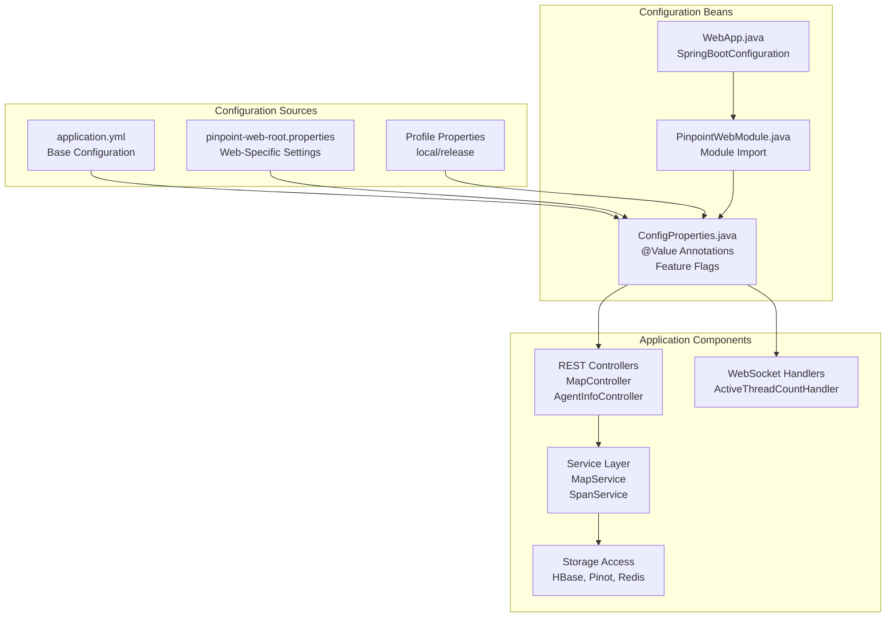
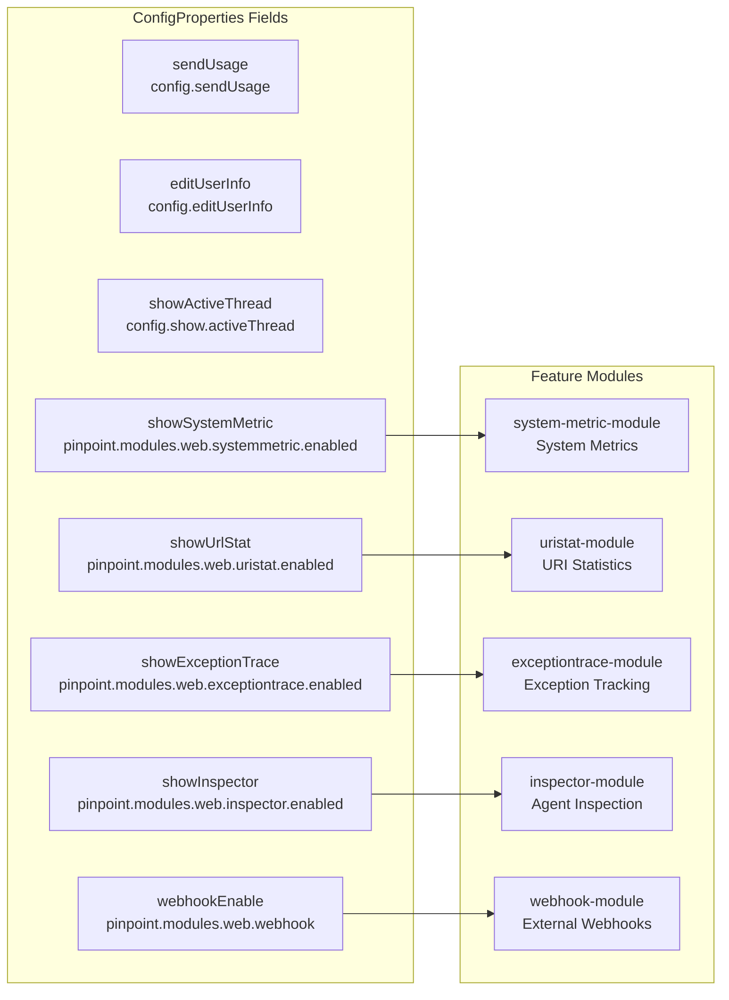
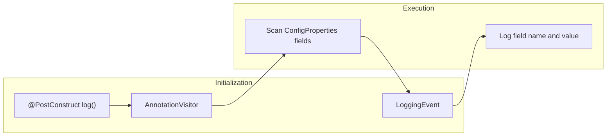

<!-- source: DeepWiki mcp.deepwiki.com · repo pinpoint-apm/pinpoint · page 9.3 Web Configuration Reference · fetched 2026-10-29 -->

# Web Configuration Reference

Relevant source files

The following files were used as context for generating this wiki page:

- [collector-starter/src/main/java/com/navercorp/pinpoint/collector/starter/multi/application/BasicCollectorApp.java](collector-starter/src/main/java/com/navercorp/pinpoint/collector/starter/multi/application/BasicCollectorApp.java)
- [collector-starter/src/main/java/com/navercorp/pinpoint/collector/starter/multi/application/PinpointCollectorStarter.java](collector-starter/src/main/java/com/navercorp/pinpoint/collector/starter/multi/application/PinpointCollectorStarter.java)
- [collector-starter/src/main/java/com/navercorp/pinpoint/collector/starter/multi/application/type/CollectorType.java](collector-starter/src/main/java/com/navercorp/pinpoint/collector/starter/multi/application/type/CollectorType.java)
- [collector-starter/src/main/java/com/navercorp/pinpoint/collector/starter/multi/application/type/CollectorTypeParser.java](collector-starter/src/main/java/com/navercorp/pinpoint/collector/starter/multi/application/type/CollectorTypeParser.java)
- [collector-starter/src/main/java/com/navercorp/pinpoint/collector/starter/multi/application/type/CollectorTypeSet.java](collector-starter/src/main/java/com/navercorp/pinpoint/collector/starter/multi/application/type/CollectorTypeSet.java)
- [collector-starter/src/main/java/com/navercorp/pinpoint/collector/starter/multi/application/type/FallbackCollectorTypeParser.java](collector-starter/src/main/java/com/navercorp/pinpoint/collector/starter/multi/application/type/FallbackCollectorTypeParser.java)
- [collector-starter/src/main/java/com/navercorp/pinpoint/collector/starter/multi/application/type/ShellBlockerConfig.java](collector-starter/src/main/java/com/navercorp/pinpoint/collector/starter/multi/application/type/ShellBlockerConfig.java)
- [collector-starter/src/main/java/com/navercorp/pinpoint/collector/starter/multi/application/type/ShellCollectorTypeParser.java](collector-starter/src/main/java/com/navercorp/pinpoint/collector/starter/multi/application/type/ShellCollectorTypeParser.java)
- [collector-starter/src/main/java/com/navercorp/pinpoint/collector/starter/multi/application/type/SimpleCollectorTypeParser.java](collector-starter/src/main/java/com/navercorp/pinpoint/collector/starter/multi/application/type/SimpleCollectorTypeParser.java)
- [collector-starter/src/main/resources/.gitignore](collector-starter/src/main/resources/.gitignore)
- [collector-starter/src/main/resources/application.yml](collector-starter/src/main/resources/application.yml)
- [collector/src/main/java/com/navercorp/pinpoint/collector/CollectorApp.java](collector/src/main/java/com/navercorp/pinpoint/collector/CollectorApp.java)
- [collector/src/main/java/com/navercorp/pinpoint/collector/PinpointCollectorModule.java](collector/src/main/java/com/navercorp/pinpoint/collector/PinpointCollectorModule.java)
- [collector/src/main/java/com/navercorp/pinpoint/collector/config/CollectorConfiguration.java](collector/src/main/java/com/navercorp/pinpoint/collector/config/CollectorConfiguration.java)
- [collector/src/main/java/com/navercorp/pinpoint/collector/event/SpanStorePublisher.java](collector/src/main/java/com/navercorp/pinpoint/collector/event/SpanStorePublisher.java)
- [collector/src/main/java/com/navercorp/pinpoint/collector/event/SpanStorePublisherImpl.java](collector/src/main/java/com/navercorp/pinpoint/collector/event/SpanStorePublisherImpl.java)
- [collector/src/main/java/com/navercorp/pinpoint/collector/event/config/CollectorEventConfiguration.java](collector/src/main/java/com/navercorp/pinpoint/collector/event/config/CollectorEventConfiguration.java)
- [collector/src/main/resources/application.yml](collector/src/main/resources/application.yml)
- [collector/src/main/resources/pinpoint-collector-root.properties](collector/src/main/resources/pinpoint-collector-root.properties)
- [collector/src/main/resources/profiles/local/pinpoint-collector-grpc.properties](collector/src/main/resources/profiles/local/pinpoint-collector-grpc.properties)
- [collector/src/main/resources/profiles/release/pinpoint-collector-grpc.properties](collector/src/main/resources/profiles/release/pinpoint-collector-grpc.properties)
- [commons-hbase/src/main/java/com/navercorp/pinpoint/common/hbase/config/HbaseNamespaceConfiguration.java](commons-hbase/src/main/java/com/navercorp/pinpoint/common/hbase/config/HbaseNamespaceConfiguration.java)
- [commons-server/src/main/java/com/navercorp/pinpoint/common/server/event/ContextData.java](commons-server/src/main/java/com/navercorp/pinpoint/common/server/event/ContextData.java)
- [commons-server/src/main/java/com/navercorp/pinpoint/common/server/event/ContextSupplier.java](commons-server/src/main/java/com/navercorp/pinpoint/common/server/event/ContextSupplier.java)
- [commons-server/src/main/java/com/navercorp/pinpoint/common/server/event/InsertEvent.java](commons-server/src/main/java/com/navercorp/pinpoint/common/server/event/InsertEvent.java)
- [commons-server/src/main/java/com/navercorp/pinpoint/common/server/event/SimpleContextSupplier.java](commons-server/src/main/java/com/navercorp/pinpoint/common/server/event/SimpleContextSupplier.java)
- [commons-server/src/main/java/com/navercorp/pinpoint/common/server/event/SpanChunkInsertEvent.java](commons-server/src/main/java/com/navercorp/pinpoint/common/server/event/SpanChunkInsertEvent.java)
- [commons-server/src/main/java/com/navercorp/pinpoint/common/server/event/SpanInsertEvent.java](commons-server/src/main/java/com/navercorp/pinpoint/common/server/event/SpanInsertEvent.java)
- [datasource/src/main/java/com/navercorp/pinpoint/datasource/MainDataSourceConfiguration.java](datasource/src/main/java/com/navercorp/pinpoint/datasource/MainDataSourceConfiguration.java)
- [otlpmetric/otlpmetric-web/src/main/resources/otlpmetric/web/profiles/local/otlpmetric-web.properties](otlpmetric/otlpmetric-web/src/main/resources/otlpmetric/web/profiles/local/otlpmetric-web.properties)
- [otlpmetric/otlpmetric-web/src/main/resources/otlpmetric/web/profiles/release/otlpmetric-web.properties](otlpmetric/otlpmetric-web/src/main/resources/otlpmetric/web/profiles/release/otlpmetric-web.properties)
- [realtime/realtime-collector/src/main/java/com/navercorp/pinpoint/realtime/collector/RealtimeCollectorServerConfig.java](realtime/realtime-collector/src/main/java/com/navercorp/pinpoint/realtime/collector/RealtimeCollectorServerConfig.java)
- [redis/src/main/java/com/navercorp/pinpoint/redis/RedisBasicConfig.java](redis/src/main/java/com/navercorp/pinpoint/redis/RedisBasicConfig.java)
- [redis/src/main/java/com/navercorp/pinpoint/redis/RedisPropertySources.java](redis/src/main/java/com/navercorp/pinpoint/redis/RedisPropertySources.java)
- [redis/src/main/resources/redis/profiles/local/redis.properties](redis/src/main/resources/redis/profiles/local/redis.properties)
- [redis/src/main/resources/redis/profiles/release/redis.properties](redis/src/main/resources/redis/profiles/release/redis.properties)
- [redis/src/main/resources/redis/redis-root.properties](redis/src/main/resources/redis/redis-root.properties)
- [web-starter/src/main/java/com/navercorp/pinpoint/web/starter/multi/PinpointWebStarter.java](web-starter/src/main/java/com/navercorp/pinpoint/web/starter/multi/PinpointWebStarter.java)
- [web-starter/src/main/resources/application.yml](web-starter/src/main/resources/application.yml)
- [web/src/main/java/com/navercorp/pinpoint/web/WebApp.java](web/src/main/java/com/navercorp/pinpoint/web/WebApp.java)
- [web/src/main/java/com/navercorp/pinpoint/web/config/ConfigProperties.java](web/src/main/java/com/navercorp/pinpoint/web/config/ConfigProperties.java)
- [web/src/main/java/com/navercorp/pinpoint/web/servlet/HttpIntentRoutingFilter.java](web/src/main/java/com/navercorp/pinpoint/web/servlet/HttpIntentRoutingFilter.java)
- [web/src/main/resources/application.yml](web/src/main/resources/application.yml)
- [web/src/main/resources/pinpoint-web-root.properties](web/src/main/resources/pinpoint-web-root.properties)
- [web/src/test/java/com/navercorp/pinpoint/web/servlet/HttpIntentRoutingFilterTest.java](web/src/test/java/com/navercorp/pinpoint/web/servlet/HttpIntentRoutingFilterTest.java)

This document provides a complete reference for configuring the Pinpoint Web application. It covers all configuration properties that control web server behavior, feature toggles, API limits, security settings, and integration with storage systems. For general Spring Boot application configuration, see [Application Configuration](#9.1). For collector-specific configuration, see [Collector Configuration Reference](#9.2).

## Configuration Overview

The Pinpoint Web application is configured through Spring Boot's configuration system, primarily using properties files and `application.yml`. Configuration properties are bound to Java objects using the `@Value` annotation in the `ConfigProperties` class. The `WebApp` class serves as the entry point, importing the `PinpointWebModule` which sets up the core application context.

**Sources**: [web/src/main/java/com/navercorp/pinpoint/web/config/ConfigProperties.java:1-225](), [web/src/main/java/com/navercorp/pinpoint/web/WebApp.java:35-51]()

## Feature Flag Configuration

Feature flags enable or disable specific functionality in the Pinpoint Web application. These flags are primarily managed through the `ConfigProperties` class and control UI visibility and backend processing.

### Core Feature Flags

| Property | Default | Description |
|----------|---------|-------------|
| `config.sendUsage` | `true` | Enable anonymous usage statistics reporting to Google Analytics [web/src/main/resources/pinpoint-web-root.properties:14-14]() |
| `config.editUserInfo` | `true` | Allow editing user information in UI [web/src/main/resources/pinpoint-web-root.properties:15-15]() |
| `config.openSource` | `true` | Enable open-source mode features [web/src/main/resources/pinpoint-web-root.properties:16-16]() |
| `config.show.stackTraceOnError` | `true` | Display stack traces in error responses [web/src/main/resources/pinpoint-web-root.properties:21-21]() |

**Sources**: [web/src/main/java/com/navercorp/pinpoint/web/config/ConfigProperties.java:36-64](), [web/src/main/resources/pinpoint-web-root.properties:14-21]()

### Active Thread Monitoring

| Property | Default | Description |
|----------|---------|-------------|
| `config.show.activeThread` | `true` | Show active thread count in UI [web/src/main/resources/pinpoint-web-root.properties:17-17]() |
| `config.show.activeThreadDump` | `true` | Show thread dump visualization [web/src/main/resources/pinpoint-web-root.properties:18-18]() |
| `config.enable.activeThreadDump` | `true` | Enable thread dump collection from agents [web/src/main/resources/pinpoint-web-root.properties:19-19]() |
| `config.enable.serverMapRealTime` | `false` | Enable real-time server map updates (experimental) [web/src/main/resources/pinpoint-web-root.properties:24-24]() |

**Sources**: [web/src/main/java/com/navercorp/pinpoint/web/config/ConfigProperties.java:42-52](), [web/src/main/resources/pinpoint-web-root.properties:17-24]()

### Module Enablement Flags

These flags control optional Pinpoint modules that must be explicitly enabled in `application.yml` or properties files:

| Property | Default | Module | Description |
|----------|---------|--------|-------------|
| `pinpoint.modules.web.systemmetric.enabled` | `false` | system-metric | System-level metrics (CPU, memory, disk) [web/src/main/java/com/navercorp/pinpoint/web/config/ConfigProperties.java:66-67]() |
| `pinpoint.modules.web.uristat.enabled` | `false` | uristat | URI-level statistics and histograms [web/src/main/java/com/navercorp/pinpoint/web/config/ConfigProperties.java:69-70]() |
| `pinpoint.modules.web.exceptiontrace.enabled` | `false` | exceptiontrace | Exception tracking and grouping [web/src/main/java/com/navercorp/pinpoint/web/config/ConfigProperties.java:72-73]() |
| `pinpoint.modules.web.otlpmetric.enabled` | `false` | otlpmetric | OpenTelemetry metrics ingestion [web/src/main/java/com/navercorp/pinpoint/web/config/ConfigProperties.java:75-76]() |
| `pinpoint.modules.web.inspector.enabled` | `false` | inspector | Detailed agent inspection views [web/src/main/java/com/navercorp/pinpoint/web/config/ConfigProperties.java:78-79]() |
| `pinpoint.modules.web.heatmap.enabled` | `false` | heatmap | Response time heatmap visualization [web/src/main/java/com/navercorp/pinpoint/web/config/ConfigProperties.java:81-82]() |
| `pinpoint.modules.web.webhook` | `false` | webhook | Webhook notifications for alerts [web/src/main/java/com/navercorp/pinpoint/web/config/ConfigProperties.java:87-88]() |

**Sources**: [web/src/main/java/com/navercorp/pinpoint/web/config/ConfigProperties.java:66-88](), [web-starter/src/main/resources/application.yml:85-101]()

## API and Storage Limits

The Web application enforces limits on data retrieval to maintain system stability and performance.

### Query Period Limits

| Property | Default | Description |
|----------|---------|-------------|
| `web.servermap.api.period.max` | `2` | Max days for server map queries [web/src/main/resources/pinpoint-web-root.properties:60-60]() |
| `web.servermap.api.period.interval` | `5m,20m,1h,3h,6h,12h,1d,2d` | Allowed preset time ranges [web/src/main/resources/pinpoint-web-root.properties:61-61]() |
| `web.inspector.api.period.max` | `42` | Max days for inspector queries [web/src/main/resources/pinpoint-web-root.properties:62-62]() |
| `web.inspector.api.period.interval` | `5m...6w` | Allowed preset time ranges for inspector [web/src/main/resources/pinpoint-web-root.properties:63-63]() |

**Sources**: [web/src/main/java/com/navercorp/pinpoint/web/config/ConfigProperties.java:90-100](), [web/src/main/resources/pinpoint-web-root.properties:57-63]()

### HBase Retrieval Limits

| Property | Default | Description |
|----------|---------|-------------|
| `web.hbase.selectSpans.limit` | `500` | Limit for individual span selection [web/src/main/resources/pinpoint-web-root.properties:26-26]() |
| `web.hbase.trace.max.results.limit` | `50000` | Hard limit for trace result sets [web/src/main/resources/pinpoint-web-root.properties:28-28]() |
| `web.callstack.selectSpans.limit` | `10000` | Limit for callstack visualization [web/src/main/resources/pinpoint-web-root.properties:67-67]() |
| `web.servermap.linkData.limit` | `500,000,000` | Max link data points allowed [web/src/main/resources/pinpoint-web-root.properties:52-52]() |

**Sources**: [web/src/main/resources/pinpoint-web-root.properties:26-68]()

## WebSocket and Real-time Configuration

WebSocket settings control the behavior of real-time monitoring features like the Active Thread Count (ATC).

| Property | Default | Description |
|----------|---------|-------------|
| `websocket.allowedOrigins` | (empty) | CORS allowed origins for WebSockets [web/src/main/resources/pinpoint-web-root.properties:73-73]() |
| `pinpoint.web.websocket.max-session-idle-timeout` | `10800000` | 3 hours session timeout [web/src/main/resources/application.yml:110-110]() |
| `pinpoint.web.realtime.atc.demand.periodMs` | `10000` | Frequency of ATC data requests [web/src/main/resources/pinpoint-web-root.properties:93-93]() |
| `pinpoint.web.realtime.atc.supply.flush.periodMs` | `1000` | Frequency of flushing ATC data to UI [web/src/main/resources/pinpoint-web-root.properties:94-94]() |

**Sources**: [web/src/main/resources/application.yml:108-112](), [web/src/main/resources/pinpoint-web-root.properties:70-96]()

## Security and Authentication

Pinpoint Web supports basic authentication and security URL redirection.

| Property | Default | Description |
|----------|---------|-------------|
| `admin.password` | `admin` | Default password for admin functions [web/src/main/resources/pinpoint-web-root.properties:4-4]() |
| `security.guide.url` | `null` | URL for security guidelines displayed in UI [web/src/main/java/com/navercorp/pinpoint/web/config/ConfigProperties.java:57-58]() |
| `web.security.auth.user` | `null` | Comma-separated `user:password` pairs [web/src/main/resources/pinpoint-web-root.properties:82-82]() |
| `web.security.auth.jwt.secretkey` | `null` | Secret key for JWT token signing [web/src/main/resources/pinpoint-web-root.properties:84-84]() |

**Sources**: [web/src/main/java/com/navercorp/pinpoint/web/config/ConfigProperties.java:57-58](), [web/src/main/resources/pinpoint-web-root.properties:4-84]()

## Configuration Lifecycle and Logging

The `ConfigProperties` class uses a post-construction hook to log the final resolved configuration state, which is critical for verifying property overrides.

The `log()` method utilizes an `AnnotationVisitor` to inspect fields annotated with `@Value` and writes them to the log via `LoggingEvent`. This ensures that even properties loaded from external sources or environment variables are visible in the application logs during startup.

**Sources**: [web/src/main/java/com/navercorp/pinpoint/web/config/ConfigProperties.java:191-196](), [web/src/main/java/com/navercorp/pinpoint/web/config/ConfigProperties.java:199-224]()

## Module-Specific Application Defaults

The standard `application.yml` provides defaults for Spring Boot and Pinpoint modules.

| Property | Default | Description |
|----------|---------|-------------|
| `server.port` | `8080` | HTTP port for the web application [web/src/main/resources/application.yml:12-12]() |
| `management.endpoints.web.base-path` | `/monitor` | Base path for Actuator endpoints [web/src/main/resources/application.yml:75-75]() |
| `pinpoint.modules.uid.version` | `v3` | Version of the UID mapping table [web/src/main/resources/application.yml:96-96]() |
| `pinpoint.web.cache-resources` | `true` | Enable caching of static resources [web/src/main/resources/application.yml:106-106]() |

**Sources**: [web/src/main/resources/application.yml:1-112]()

---

