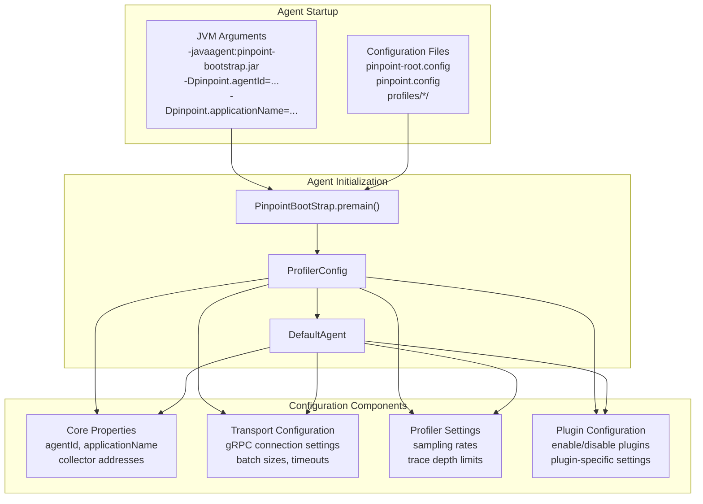
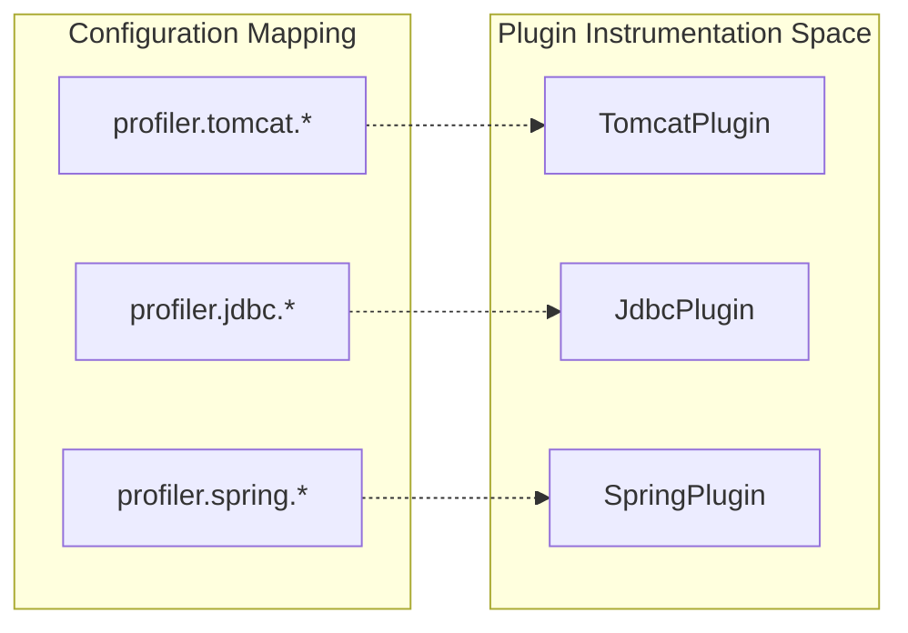

<!-- source: DeepWiki mcp.deepwiki.com · repo pinpoint-apm/pinpoint · page 9.4 Agent Configuration · fetched 2026-10-29 -->

# Agent Configuration

Relevant source files

The following files were used as context for generating this wiki page:

- [agent-module/agent/src/main/resources/pinpoint-root.config](agent-module/agent/src/main/resources/pinpoint-root.config)
- [agent-module/agent/src/main/resources/profiles/local/pinpoint.config](agent-module/agent/src/main/resources/profiles/local/pinpoint.config)
- [agent-module/agent/src/main/resources/profiles/release/pinpoint.config](agent-module/agent/src/main/resources/profiles/release/pinpoint.config)
- [agent-module/plugins-it/cxf-it/cxf-3-0-it/src/test/resources/cxf/pinpoint-cxf-test.config](agent-module/plugins-it/cxf-it/cxf-3-0-it/src/test/resources/cxf/pinpoint-cxf-test.config)
- [agent-module/plugins-it/cxf-it/cxf-3-6-it/src/test/resources/cxf/pinpoint-cxf-test.config](agent-module/plugins-it/cxf-it/cxf-3-6-it/src/test/resources/cxf/pinpoint-cxf-test.config)
- [agent-module/plugins-it/druid-it/src/test/resources/druid/pinpoint-druid-test.config](agent-module/plugins-it/druid-it/src/test/resources/druid/pinpoint-druid-test.config)
- [agent-module/plugins-it/fastjson-it/src/test/resources/fastjson/pinpoint-fastjson-test.config](agent-module/plugins-it/fastjson-it/src/test/resources/fastjson/pinpoint-fastjson-test.config)
- [agent-module/plugins-it/hbase-it/src/test/resources/hbase/pinpoint-hbase-test.config](agent-module/plugins-it/hbase-it/src/test/resources/hbase/pinpoint-hbase-test.config)
- [agent-module/plugins-it/hystrix-it/src/test/resources/hystrix/pinpoint-hystrix.config](agent-module/plugins-it/hystrix-it/src/test/resources/hystrix/pinpoint-hystrix.config)
- [agent-module/plugins-it/jtds-it/src/test/resources/pinpoint.config](agent-module/plugins-it/jtds-it/src/test/resources/pinpoint.config)
- [agent-module/plugins-it/rxjava-it/src/test/resources/rxjava/pinpoint-rxjava.config](agent-module/plugins-it/rxjava-it/src/test/resources/rxjava/pinpoint-rxjava.config)
- [agent-module/plugins/akka-http/src/test/resources/pinpoint.config](agent-module/plugins/akka-http/src/test/resources/pinpoint.config)

This page documents configuration options for the Pinpoint Agent, which instruments applications for distributed tracing. Agent configuration controls instrumentation behavior, data collection, sampling, and communication with the Collector.

For configuration of server components, see [Collector Configuration Reference](#9.2) and [Web Configuration Reference](#9.3). For application-level Spring Boot configuration, see [Application Configuration](#9.1).

## Purpose and Scope

The Pinpoint Agent is loaded into the JVM via the `-javaagent` flag and requires configuration to:
- Identify the agent and application being monitored.
- Connect to the Pinpoint Collector infrastructure.
- Control which methods and libraries are instrumented.
- Tune performance and sampling behavior.
- Enable or disable specific plugin modules.

Agent configuration is applied at JVM startup and generally requires an application restart to modify.

---

## Configuration Overview

The agent utilizes a hierarchical configuration system. The `pinpoint-root.config` file serves as the base configuration [agent-module/agent/src/main/resources/pinpoint-root.config:1-13](), while profile-specific files like `profiles/release/pinpoint.config` or `profiles/local/pinpoint.config` provide overrides [agent-module/agent/src/main/resources/profiles/release/pinpoint.config:5-6]().

**Sources:**
- [agent-module/agent/src/main/resources/pinpoint-root.config:1-13]()
- [agent-module/agent/src/main/resources/profiles/release/pinpoint.config:1-12]()

---

## Agent Identification

The agent requires two mandatory properties for identification, typically passed as JVM system properties:

| Property | Description | Example |
|----------|-------------|---------|
| `pinpoint.agentId` | Unique identifier for this agent instance | `test-agent`, `web-server-01` |
| `pinpoint.applicationName` | Logical application name grouping multiple agents | `TESTAPP`, `UserService` |

**Namespace Configuration:**
To differentiate between external pinpoint agents or multi-tenant environments, use `profiler.application.namespace` [agent-module/agent/src/main/resources/profiles/release/pinpoint.config:30-31]().

**Sources:**
- [agent-module/agent/src/main/resources/profiles/release/pinpoint.config:28-31]()

---

## Collector Connection Configuration

Pinpoint uses gRPC as the default transport module [agent-module/agent/src/main/resources/pinpoint-root.config:30]().

### gRPC Endpoint Configuration

The agent connects to different ports on the Collector for different data types:

| Port | Purpose | Configuration Key |
|------|---------|-------------------|
| 9991 | Agent metadata and registration | `profiler.transport.grpc.agent.collector.port` [agent-module/agent/src/main/resources/pinpoint-root.config:42]() |
| 9992 | Statistics (JVM metrics, response times) | `profiler.transport.grpc.stat.collector.port` [agent-module/agent/src/main/resources/pinpoint-root.config:85]() |
| 9993 | Span and trace data | `profiler.transport.grpc.span.collector.port` [agent-module/agent/src/main/resources/pinpoint-root.config:105]() |

### Transport Tuning
Key gRPC parameters include:
- **Flow Control:** `profiler.transport.grpc.agent.sender.flow-control.window.size` (Default: 1M) [agent-module/agent/src/main/resources/pinpoint-root.config:52]().
- **Keepalive:** `profiler.transport.grpc.agent.sender.keepalive.time.millis` (Default: 30000) [agent-module/agent/src/main/resources/pinpoint-root.config:46]().
- **SSL:** `profiler.transport.grpc.ssl.enable` (Default: false) [agent-module/agent/src/main/resources/pinpoint-root.config:134]().

**Sources:**
- [agent-module/agent/src/main/resources/pinpoint-root.config:30-134]()

---

## Sampling Configuration

Sampling controls the percentage of transactions that are traced. Reducing sampling decreases overhead but may miss important transactions.

### Sampling Strategies

Pinpoint supports two primary sampling types: `COUNTING` and `PERCENT` [agent-module/agent/src/main/resources/profiles/release/pinpoint.config:54-58]().

| Type | Configuration Key | Description |
|------|-------------------|-------------|
| **COUNTING** | `profiler.sampling.counting.sampling-rate` | 1 out of N transactions (e.g., 20 = 5%) [agent-module/agent/src/main/resources/profiles/release/pinpoint.config:61-63]() |
| **PERCENT** | `profiler.sampling.percent.sampling-rate` | N% of transactions (e.g., 5 = 5%) [agent-module/agent/src/main/resources/profiles/release/pinpoint.config:67-70]() |

### Throughput Control
You can limit the number of sampled transactions per second to prevent overloading the collector:
- `profiler.sampling.new.throughput`: Limit for new transactions [agent-module/agent/src/main/resources/profiles/release/pinpoint.config:74]().
- `profiler.sampling.continue.throughput`: Limit for continued (distributed) transactions [agent-module/agent/src/main/resources/profiles/release/pinpoint.config:76]().

**Sources:**
- [agent-module/agent/src/main/resources/profiles/release/pinpoint.config:52-78]()

---

## Instrumentation Control

### Plugin Enable/Disable
Plugins can be globally or specifically disabled to reduce overhead:
- `pinpoint.disable`: Completely disables the agent [agent-module/agent/src/main/resources/profiles/release/pinpoint.config:16]().
- `profiler.plugin.disable`: Comma-separated list of plugin `groupId:artifactId` to ignore [agent-module/agent/src/main/resources/profiles/release/pinpoint.config:191-193]().

### Custom Instrumentation
Users can manually include classes or entry points for profiling:
- `profiler.include`: List of fully qualified class or package names (e.g., `foo.bar.*`) [agent-module/plugins/akka-http/src/test/resources/pinpoint.config:106-107]().
- `profiler.entrypoint`: Specific methods to treat as trace start points [agent-module/plugins/akka-http/src/test/resources/pinpoint.config:110-111]().

### Call Stack and Trace Limits
- `profiler.callstack.max.depth`: Maximum depth of the trace tree (Default: 64) [agent-module/agent/src/main/resources/profiles/release/pinpoint.config:124]().
- `profiler.interceptor.exception.propagate`: Whether to propagate exceptions from Pinpoint interceptors to the application [agent-module/agent/src/main/resources/profiles/release/pinpoint.config:128-129]().

**Sources:**
- [agent-module/agent/src/main/resources/profiles/release/pinpoint.config:122-129]()
- [agent-module/plugins/akka-http/src/test/resources/pinpoint.config:100-111]()

---

## Plugin-Specific Configuration

Many plugins have specialized settings for fine-grained control over what data is captured.

### HTTP/Web Servers (Tomcat, Jetty, JBoss)
- `profiler.tomcat.excludeurl`: Ant-style patterns for URLs to ignore [agent-module/plugins-it/druid-it/src/test/resources/druid/pinpoint-druid-test.config:147]().
- `profiler.tomcat.tracerequestparam`: Whether to record HTTP request parameters [agent-module/plugins-it/druid-it/src/test/resources/druid/pinpoint-druid-test.config:150]().
- `profiler.tomcat.realipheader`: Header used to determine client IP (e.g., `X-Forwarded-For`) [agent-module/plugins-it/druid-it/src/test/resources/druid/pinpoint-druid-test.config:154]().

### Database (JDBC)
- `profiler.jdbc`: Enable/disable JDBC tracing [agent-module/plugins-it/jtds-it/src/test/resources/pinpoint.config:137]().
- `profiler.jdbc.sqlcachesize`: Size of the SQL string cache [agent-module/plugins-it/jtds-it/src/test/resources/pinpoint.config:138]().
- `profiler.jdbc.maxsqlbindvaluesize`: Max length of SQL bind values to record [agent-module/plugins-it/jtds-it/src/test/resources/pinpoint.config:139]().

**Sources:**
- [agent-module/plugins-it/druid-it/src/test/resources/druid/pinpoint-druid-test.config:133-158]()
- [agent-module/plugins-it/jtds-it/src/test/resources/pinpoint.config:135-193]()

---

## Configuration Profiles

The agent supports multiple profiles (e.g., `release`, `local`) located in the `profiles/` directory [agent-module/agent/src/main/resources/pinpoint-root.config:5-13]().

### Profile Resolution Logic
1. The active profile is determined by `-Dpinpoint.profiler.profiles.active` [agent-module/agent/src/main/resources/pinpoint-root.config:5]().
2. If the active profile matches an alias, it is resolved to the target profile [agent-module/agent/src/main/resources/pinpoint-root.config:15-20]().
3. The configuration is loaded from `$PINPOINT_AGENT_DIR/profiles/$PROFILE/pinpoint.config` [agent-module/agent/src/main/resources/profiles/release/pinpoint.config:8-9]().

### External Configuration
To use a configuration file outside the agent directory, use:
`-Dpinpoint.config=$MY_CONFIG_PATH/pinpoint.config` [agent-module/agent/src/main/resources/profiles/release/pinpoint.config:12]().

**Sources:**
- [agent-module/agent/src/main/resources/pinpoint-root.config:1-21]()
- [agent-module/agent/src/main/resources/profiles/release/pinpoint.config:1-12]()

---

