# Page: Pinpoint APM Overview

# Pinpoint APM Overview

<details>
<summary>Relevant source files</summary>

The following files were used as context for generating this wiki page:

- [.github/ISSUE_TEMPLATE/bug_report.md](.github/ISSUE_TEMPLATE/bug_report.md)
- [.github/ISSUE_TEMPLATE/feature_request.md](.github/ISSUE_TEMPLATE/feature_request.md)
- [.github/ISSUE_TEMPLATE/question.md](.github/ISSUE_TEMPLATE/question.md)
- [.github/ISSUE_TEMPLATE/troubleshooting.md](.github/ISSUE_TEMPLATE/troubleshooting.md)
- [README.md](README.md)
- [agent-module/plugins/undertow-servlet/README.md](agent-module/plugins/undertow-servlet/README.md)
- [batch/pom.xml](batch/pom.xml)
- [collector/pom.xml](collector/pom.xml)
- [commons-hbase/pom.xml](commons-hbase/pom.xml)
- [commons-server/pom.xml](commons-server/pom.xml)
- [commons/pom.xml](commons/pom.xml)
- [commons/src/main/java/com/navercorp/pinpoint/common/Version.java](commons/src/main/java/com/navercorp/pinpoint/common/Version.java)
- [doc/images/ss_error-analysis1.png](doc/images/ss_error-analysis1.png)
- [doc/images/ss_error-analysis3.gif](doc/images/ss_error-analysis3.gif)
- [doc/modules.md](doc/modules.md)
- [hbase/pom.xml](hbase/pom.xml)
- [pom.xml](pom.xml)
- [quickstart/README.md](quickstart/README.md)
- [web/pom.xml](web/pom.xml)

</details>


## Purpose and Scope

This document provides a high-level introduction to Pinpoint APM, explaining its purpose as a distributed tracing solution, its architecture, and core components. It is intended for developers, operators, and architects who want to understand what Pinpoint does and how its components fit together.

For detailed information about specific components, see:
- Main features and capabilities: [Key Features and Capabilities](#1.1)
- Fundamental data structures: [Core Concepts and Data Model](#1.2)
- Agent instrumentation and plugins: [Agent Architecture](#3.2)
- Collector data processing: [Collector Architecture](#3.3)
- Web backend and APIs: [Web Application Architecture](#3.4)
- User interface features: [Frontend Architecture](#3.5)
- Installation and deployment: [Getting Started](#2)

**Sources:**
- [README.md:23-46]()
- [pom.xml:1-35]()

## What is Pinpoint APM

Pinpoint is an open-source **Application Performance Management (APM)** tool designed for large-scale distributed systems, primarily targeting applications written in Java, with support for PHP and Python through the [pinpoint-c-agent](https://github.com/pinpoint-apm/pinpoint-c-agent) [README.md:23-25]().

Inspired by Google's [Dapper paper](http://research.google.com/pubs/pub36356.html), Pinpoint enables you to:

| Capability | Description |
|------------|-------------|
| **Distributed Tracing** | Track individual transactions as they flow across multiple services in a distributed architecture [README.md:27-28]() |
| **Topology Visualization** | Automatically discover and visualize application topology through the ServerMap feature [README.md:48-49]() |
| **Real-time Monitoring** | Monitor active threads, request/response patterns, and system metrics in real-time [README.md:49-50]() |
| **Code-level Visibility** | Drill down into individual transactions to see method-level call stacks and execution times [README.md:54-56]() |
| **Zero Code Changes** | Install APM agents without modifying application code via Java agent bytecode instrumentation [README.md:34-35]() |
| **Low Overhead** | Minimal performance impact, typically around 3% resource overhead [README.md:35-36]() |

Pinpoint is maintained by Naver Corporation and has been in development since 2012 [pom.xml:21-43](). The current version is 3.1.0-SNAPSHOT, licensed under Apache License 2.0 [pom.xml:27-41]().

**Sources:**
- [README.md:23-36]()
- [pom.xml:21-43]()

## System Architecture Overview

Pinpoint consists of three primary components that work together to collect, process, store, and visualize application performance data:

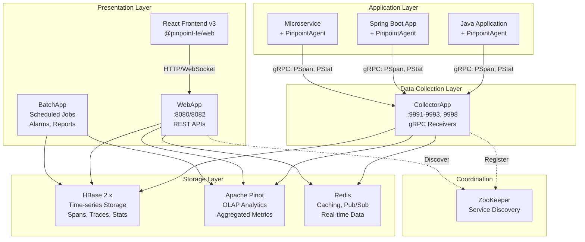

**Pinpoint System Architecture** - Shows the three-tier architecture with monitored applications, data processing infrastructure, and presentation layer.

### Data Flow

The following diagram illustrates how performance data flows through Pinpoint from instrumented applications to user interfaces, mapping to actual code entities:

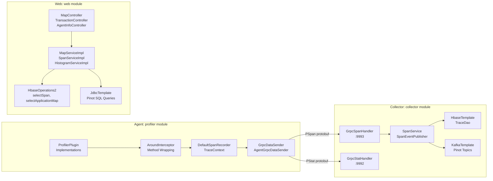

**Data Flow Through Pinpoint Components** - Traces the journey from agent instrumentation through collectors to storage and query layers.

**Sources:**
- [pom.xml:81-125]()
- [README.md:44-70]()
- [collector/pom.xml:27-28]()
- [web/pom.xml:27-28]()

## Core Components

### Pinpoint Agent

The **Pinpoint Agent** is a Java agent that attaches to target applications using the `-javaagent` JVM flag [quickstart/README.md:58](). It operates through bytecode instrumentation without requiring source code changes.

**Key Agent Modules:**
- `agent-module`: Parent module for agent-related code [pom.xml:83]().
- `profiler`: Core agent implementation (contained within agent-module).
- `plugins`: Instrumentation for frameworks like Spring, Tomcat, MySQL, Redis [README.md:73-85]().

**Java Version Support:** Agents support Java 8 and above [README.md:73]().

**Sources:**
- [README.md:73-85]()
- [pom.xml:83]()
- [quickstart/README.md:58]()

### Pinpoint Collector

The **Pinpoint Collector** (`pinpoint-collector`) is a Java application that receives trace data from agents via gRPC and processes it for storage [collector/pom.xml:27-28]().

**Collector Responsibilities:**
- Receives Agent metadata, statistics, and Span data via gRPC [README.md:77, 96]().
- Performs sampling and routing of trace data to storage backends like HBase and Pinot [collector/pom.xml:63, 79]().

**Technology:** Java 17, Spring Boot, gRPC [collector/pom.xml:32, 75, 183]().

**Sources:**
- [collector/pom.xml:27-183]()
- [README.md:77, 96]()

### Pinpoint Web

The **Pinpoint Web** component (`pinpoint-web`) provides the REST API backend and serves the frontend [web/pom.xml:27, 76]().

**Web Capabilities:**
- REST endpoints for querying traces, application maps, and agent information.
- WebSocket support for real-time features like Active Thread Count [web/pom.xml:179]().
- Integration with HBase for trace queries and Pinot for aggregated metrics [web/pom.xml:63, 107]().

**Technology:** Java 17, Spring Framework [web/pom.xml:32, 155]().

**Sources:**
- [web/pom.xml:27-179]()

### Pinpoint Batch

The **Pinpoint Batch** application (`pinpoint-batch`) runs scheduled background jobs [batch/pom.xml:12-13]():
- Alarm evaluation and notification [batch/pom.xml:46]().
- Data aggregation for URI statistics [batch/pom.xml:36]().

**Sources:**
- [batch/pom.xml:12-46]()

### Frontend Application

The Pinpoint frontend (`pinpoint-web-frontend`) is a modern React application [pom.xml:104](). It communicates with the Web backend via HTTP REST APIs and WebSocket for real-time updates.

**Key Visualizations:**
- **ServerMap**: Visualizes distributed system topology [README.md:48]().
- **Scatter Chart**: Visualizes request/response patterns [README.md:50]().
- **CallStack**: Provides code-level visibility into transactions [README.md:54]().

**Sources:**
- [pom.xml:104]()
- [README.md:48-54]()

## Storage Architecture

Pinpoint uses a multi-database architecture optimized for different query patterns:

| Storage | Purpose | Data Types |
|---------|---------|------------|
| **HBase** | Primary trace storage [pom.xml:93]() | Spans, Traces, Agent Metadata |
| **Apache Pinot** | OLAP analytics [pom.xml:108]() | Aggregated metrics, URI stats, Exceptions |
| **Redis** | Caching and real-time [pom.xml:112]() | Active thread counts, session data |
| **ZooKeeper** | Service coordination | Service discovery and synchronization |

**Sources:**
- [pom.xml:93, 108, 112]()
- [README.md:103-130]()

## Supported Modules

Pinpoint provides extensive plugin support for popular Java frameworks [doc/modules.md:4-86]():

- **Web Servers**: Tomcat, Jetty, JBoss, Weblogic, Undertow [doc/modules.md:6-13]().
- **Frameworks**: Spring, Spring Boot, Spring WebFlux, Vert.x [doc/modules.md:20-26]().
- **Databases**: MySQL, Oracle, MS SQL, PostgreSQL, MariaDB, MongoDB, Cassandra [doc/modules.md:50-66]().
- **Messaging**: Kafka, RabbitMQ, ActiveMQ, Paho MQTT [doc/modules.md:40, 73-77]().
- **HTTP Clients**: Apache HttpClient 3/4, OkHttp, Google HTTP Client [doc/modules.md:32-38]().

**Sources:**
- [doc/modules.md:4-86]()

## Deployment Options

Pinpoint supports multiple deployment strategies:

- **Docker**: Official Docker images are available for all components [quickstart/README.md:7]().
- **Kubernetes**: Manifests for deploying to K8s clusters [README.md:42]().
- **Standalone**: Running executable JARs for Collector, Web, and Batch [quickstart/README.md:31-38]().
- **Quickstart**: A pre-configured environment for testing [quickstart/README.md:1-2]().

**Sources:**
- [README.md:42]()
- [quickstart/README.md:1-38]()

---

# Page: Key Features and Capabilities

# Key Features and Capabilities

<details>
<summary>Relevant source files</summary>

The following files were used as context for generating this wiki page:

- [.github/ISSUE_TEMPLATE/bug_report.md](.github/ISSUE_TEMPLATE/bug_report.md)
- [.github/ISSUE_TEMPLATE/feature_request.md](.github/ISSUE_TEMPLATE/feature_request.md)
- [.github/ISSUE_TEMPLATE/question.md](.github/ISSUE_TEMPLATE/question.md)
- [.github/ISSUE_TEMPLATE/troubleshooting.md](.github/ISSUE_TEMPLATE/troubleshooting.md)
- [README.md](README.md)
- [agent-module/plugins/undertow-servlet/README.md](agent-module/plugins/undertow-servlet/README.md)
- [commons-profiler/src/main/java/com/navercorp/pinpoint/common/profiler/trace/DefaultDisplayArgument.java](commons-profiler/src/main/java/com/navercorp/pinpoint/common/profiler/trace/DefaultDisplayArgument.java)
- [commons-server/src/main/java/com/navercorp/pinpoint/common/server/bo/SpanEventComparator.java](commons-server/src/main/java/com/navercorp/pinpoint/common/server/bo/SpanEventComparator.java)
- [commons/src/main/java/com/navercorp/pinpoint/common/trace/AnnotationKey.java](commons/src/main/java/com/navercorp/pinpoint/common/trace/AnnotationKey.java)
- [commons/src/main/java/com/navercorp/pinpoint/common/trace/OpenTelemetryServiceTypeCategory.java](commons/src/main/java/com/navercorp/pinpoint/common/trace/OpenTelemetryServiceTypeCategory.java)
- [commons/src/main/java/com/navercorp/pinpoint/common/trace/ServiceType.java](commons/src/main/java/com/navercorp/pinpoint/common/trace/ServiceType.java)
- [doc/images/ss_error-analysis1.png](doc/images/ss_error-analysis1.png)
- [doc/images/ss_error-analysis3.gif](doc/images/ss_error-analysis3.gif)
- [doc/modules.md](doc/modules.md)
- [quickstart/README.md](quickstart/README.md)
- [web-frontend/src/main/v3/apps/web/public/img/icons/OPENTELEMETRY_SERVER.png](web-frontend/src/main/v3/apps/web/public/img/icons/OPENTELEMETRY_SERVER.png)
- [web-frontend/src/main/v3/apps/web/public/img/servers/OPENTELEMETRY_SERVER.png](web-frontend/src/main/v3/apps/web/public/img/servers/OPENTELEMETRY_SERVER.png)
- [web-frontend/src/main/v3/apps/web/public/img/servers/OPENTELEMETY_DB.png](web-frontend/src/main/v3/apps/web/public/img/servers/OPENTELEMETY_DB.png)
- [web/src/main/java/com/navercorp/pinpoint/web/applicationmap/map/FilteredMapBuilder.java](web/src/main/java/com/navercorp/pinpoint/web/applicationmap/map/FilteredMapBuilder.java)
- [web/src/main/java/com/navercorp/pinpoint/web/trace/dao/mapper/SpanMapperV2.java](web/src/main/java/com/navercorp/pinpoint/web/trace/dao/mapper/SpanMapperV2.java)
- [web/src/main/java/com/navercorp/pinpoint/web/trace/service/SpanServiceImpl.java](web/src/main/java/com/navercorp/pinpoint/web/trace/service/SpanServiceImpl.java)
- [web/src/main/java/com/navercorp/pinpoint/web/trace/span/Align.java](web/src/main/java/com/navercorp/pinpoint/web/trace/span/Align.java)
- [web/src/main/java/com/navercorp/pinpoint/web/trace/span/AlignComparator.java](web/src/main/java/com/navercorp/pinpoint/web/trace/span/AlignComparator.java)
- [web/src/main/java/com/navercorp/pinpoint/web/trace/span/CallTreeNode.java](web/src/main/java/com/navercorp/pinpoint/web/trace/span/CallTreeNode.java)
- [web/src/main/java/com/navercorp/pinpoint/web/trace/span/Link.java](web/src/main/java/com/navercorp/pinpoint/web/trace/span/Link.java)
- [web/src/main/java/com/navercorp/pinpoint/web/trace/span/LinkMap.java](web/src/main/java/com/navercorp/pinpoint/web/trace/span/LinkMap.java)
- [web/src/main/java/com/navercorp/pinpoint/web/trace/span/Node.java](web/src/main/java/com/navercorp/pinpoint/web/trace/span/Node.java)
- [web/src/main/java/com/navercorp/pinpoint/web/trace/span/NodeList.java](web/src/main/java/com/navercorp/pinpoint/web/trace/span/NodeList.java)
- [web/src/main/java/com/navercorp/pinpoint/web/trace/span/SpanAlign.java](web/src/main/java/com/navercorp/pinpoint/web/trace/span/SpanAlign.java)
- [web/src/main/java/com/navercorp/pinpoint/web/trace/span/SpanAligner.java](web/src/main/java/com/navercorp/pinpoint/web/trace/span/SpanAligner.java)
- [web/src/main/java/com/navercorp/pinpoint/web/trace/span/SpanEventAlign.java](web/src/main/java/com/navercorp/pinpoint/web/trace/span/SpanEventAlign.java)

</details>


## Purpose and Scope

This document details the primary features and capabilities of Pinpoint APM, including visualization tools, monitoring dashboards, transaction tracing, and the extensive plugin ecosystem. For fundamental concepts like `ServiceType` and trace data structures, see [Core Concepts and Data Model](1.2). For system architecture, see [System Architecture](3).

Pinpoint provides comprehensive Application Performance Management for distributed systems through:
- **Visual topology mapping** of application dependencies.
- **Real-time monitoring** of application health and performance.
- **Detailed transaction tracing** with code-level visibility.
- **Non-invasive instrumentation** requiring zero code changes.
- **Extensive technology support** via a plugin architecture.

---

## ServerMap: Application Topology Visualization

ServerMap provides an interactive visualization of distributed system topology, displaying how application components interconnect and communicate. The feature renders nodes representing applications and links representing RPC/HTTP calls between them.

### ServerMap Architecture and Data Flow

The following diagram bridges the visual representation in the UI to the backend logic that assembles the map from distributed trace data.

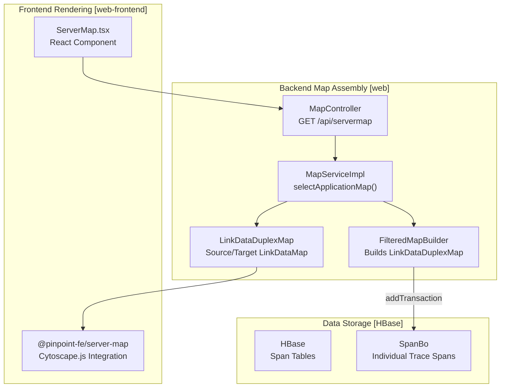

### Key Components

| Component | Location | Purpose |
|-----------|----------|---------|
| `MapController` | [web/src/main/java/com/navercorp/pinpoint/web/applicationmap/controller/MapController.java]() | REST endpoint for ServerMap data. |
| `FilteredMapBuilder` | [web/src/main/java/com/navercorp/pinpoint/web/applicationmap/map/FilteredMapBuilder.java:59-150]() | Logic to build maps from a list of `SpanBo` objects. |
| `LinkDataDuplexMap` | [web/src/main/java/com/navercorp/pinpoint/web/applicationmap/rawdata/LinkDataDuplexMap.java]() | Container for both inbound and outbound link data. |
| `@pinpoint-fe/server-map` | [web-frontend/src/main/v3/packages/server-map/package.json:1-29]() | Cytoscape-based topology renderer. |

### Features

- **Interactive Navigation**: Click nodes to reveal component details such as current status and transaction count [README.md:48]().
- **Node Merging**: Applications are grouped by `ServiceType` to reduce visual complexity.
- **Link Statistics**: Visualizes request count and response patterns between components [README.md:50]().

**Sources**: [README.md:48-52](), [web/src/main/java/com/navercorp/pinpoint/web/applicationmap/map/FilteredMapBuilder.java:59-150](), [web-frontend/src/main/v3/packages/server-map/package.json:1-29]()

---

## Real-time Active Thread Monitoring

Pinpoint monitors active thread counts inside applications in real-time, providing immediate visibility into application load [README.md:49]().

```mermaid
graph LR
    subgraph "Agent Instrumentation"
        ThreadCounter["Active Thread Counter"]
    end
    
    subgraph "Data Transport [gRPC]"
        StatSender["StatDataSender<br/>PStatMessage"]
    end
    
    subgraph "Collector Processing"
        StatReceiver["StatReceiver<br/>Port: 9992"]
    }
    
    subgraph "Real-time Messaging"
        RedisPub["Redis Publisher<br/>Real-time Channel"]
    end
    
    subgraph "Web Backend"
        ATCWS["ActiveThreadCountHandler<br/>WebSocket Endpoint"]
    end

    ThreadCounter --> StatSender
    StatSender --> StatReceiver
    StatReceiver --> RedisPub
    RedisPub --> ATCWS
```

### Implementation Details

- **WebSocket Support**: Real-time data is pushed to the UI via WebSockets [web/src/main/java/com/navercorp/pinpoint/web/websocket/ActiveThreadCountHandler.java:1-110]().
- **Agent Statistics**: The agent collects JVM and application stats (CPU, Memory, TPS) and streams them to the collector [README.md:58-60]().

**Sources**: [README.md:49](), [web/src/main/java/com/navercorp/pinpoint/web/websocket/ActiveThreadCountHandler.java:1-110]()

---

## Transaction Tracing and CallStack

Pinpoint provides code-level visibility into every transaction in a distributed environment, identifying bottlenecks and points of failure [README.md:54]().

### CallStack Data Model

The `SpanServiceImpl` is responsible for retrieving and ordering spans into a hierarchical call tree.

| Class | Location | Role |
|-------|----------|------|
| `SpanBo` | [commons-server/src/main/java/com/navercorp/pinpoint/common/server/bo/SpanBo.java]() | Represents a single RPC call or entry point. |
| `SpanEventBo` | [commons-server/src/main/java/com/navercorp/pinpoint/common/server/bo/SpanEventBo.java]() | Represents a method call within a Span. |
| `SpanServiceImpl` | [web/src/main/java/com/navercorp/pinpoint/web/trace/service/SpanServiceImpl.java:80-158]() | Selects and orders spans into a `CallTree`. |
| `SpanEventComparator` | [commons-server/src/main/java/com/navercorp/pinpoint/common/server/bo/SpanEventComparator.java:8-11]() | Sorts span events by sequence number. |

### Trace Visualization Flow

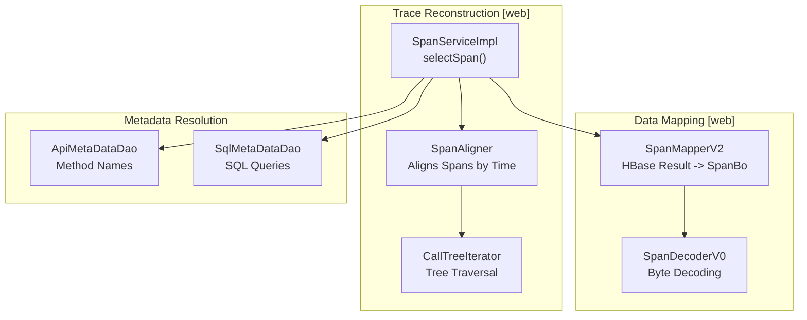

**Sources**: [README.md:54-56](), [web/src/main/java/com/navercorp/pinpoint/web/trace/service/SpanServiceImpl.java:80-158](), [web/src/main/java/com/navercorp/pinpoint/web/trace/dao/mapper/SpanMapperV2.java:58-144]()

---

## Supported Technologies and Plugins

Pinpoint supports a vast ecosystem of libraries and frameworks through its plugin architecture. Instrumentation is applied at runtime without changing the application code [README.md:34]().

### Key Supported Modules

| Category | Supported Technologies | Versions |
|----------|------------------------|----------|
| **Web Servers** | Tomcat, Jetty, JBoss, WebSphere, Vertx, WebLogic, Undertow [README.md:74](), [doc/modules.md:6-13]() | 6.x - 9.x (Tomcat) |
| **Frameworks** | Spring, Spring Boot, Spring WebFlux [README.md:75](), [doc/modules.md:20-26]() | 3.0.7 - 5.3.6 (SpringMVC) |
| **HTTP Clients** | Apache HttpClient (3/4/5), OkHttp, GoogleHttpClient [README.md:76](), [doc/modules.md:32-38]() | 4.0 - 4.5.4 (HttpClient4) |
| **RPC** | gRPC, Thrift, Dubbo, Apache CXF [README.md:77](), [doc/modules.md:34, 41, 82]() | 1.8.0 - 1.37.0 (gRPC) |
| **Databases** | MySQL, Oracle, MSSQL, PostgreSQL, MongoDB, Cassandra, Redis [README.md:79-81](), [doc/modules.md:55-69]() | 5.0 - 8.x (MySQL) |
| **Messaging** | Kafka, RabbitMQ, ActiveMQ, RocketMQ, Paho MQTT [README.md:78](), [doc/modules.md:40, 73, 75-77]() | 0.11.0.1+ (Kafka) |

### Metadata and Annotations

Pinpoint uses `ServiceType` and `AnnotationKey` to categorize and enrich trace data.

- **ServiceType**: Defines the type of node or event (e.g., `TOMCAT`=1010, `MYSQL`=2100) [commons/src/main/java/com/navercorp/pinpoint/common/trace/ServiceType.java:48, 113]().
- **AnnotationKey**: Keys for additional metadata like `http.url` (40) or `sql` (21) [commons/src/main/java/com/navercorp/pinpoint/common/trace/AnnotationKey.java:61, 66]().

**Sources**: [README.md:72-85](), [doc/modules.md:1-86](), [commons/src/main/java/com/navercorp/pinpoint/common/trace/ServiceType.java](), [commons/src/main/java/com/navercorp/pinpoint/common/trace/AnnotationKey.java]()

---

## Advanced Monitoring Capabilities

### Inspector
View deep details of application health including CPU usage, Memory/GC, TPS, and JVM arguments [README.md:58]().

### URI Metrics
Aggregates performance statistics (latency, throughput) at the URI level, allowing developers to identify specific slow endpoints [README.md:62]().

### Error Analysis
Provides grouped views of exceptions and errors across the system, enabling rapid identification of failure patterns [README.md:68-70]().

**Sources**: [README.md:58-71]()

---

# Page: Core Concepts and Data Model

# Core Concepts and Data Model

<details>
<summary>Relevant source files</summary>

The following files were used as context for generating this wiki page:

- [agent-module/profiler/src/main/java/com/navercorp/pinpoint/profiler/context/exception/model/ExceptionWrapper.java](agent-module/profiler/src/main/java/com/navercorp/pinpoint/profiler/context/exception/model/ExceptionWrapper.java)
- [agent-module/profiler/src/main/java/com/navercorp/pinpoint/profiler/monitor/metric/uri/URIKey.java](agent-module/profiler/src/main/java/com/navercorp/pinpoint/profiler/monitor/metric/uri/URIKey.java)
- [collector/src/main/java/com/navercorp/pinpoint/collector/util/MultipleAddress.java](collector/src/main/java/com/navercorp/pinpoint/collector/util/MultipleAddress.java)
- [commons-profiler/src/main/java/com/navercorp/pinpoint/common/profiler/trace/DefaultDisplayArgument.java](commons-profiler/src/main/java/com/navercorp/pinpoint/common/profiler/trace/DefaultDisplayArgument.java)
- [commons-server/src/main/java/com/navercorp/pinpoint/common/server/bo/BasicSpan.java](commons-server/src/main/java/com/navercorp/pinpoint/common/server/bo/BasicSpan.java)
- [commons-server/src/main/java/com/navercorp/pinpoint/common/server/bo/SpanBo.java](commons-server/src/main/java/com/navercorp/pinpoint/common/server/bo/SpanBo.java)
- [commons-server/src/main/java/com/navercorp/pinpoint/common/server/bo/SpanChunkBo.java](commons-server/src/main/java/com/navercorp/pinpoint/common/server/bo/SpanChunkBo.java)
- [commons-server/src/main/java/com/navercorp/pinpoint/common/server/bo/SpanEventBo.java](commons-server/src/main/java/com/navercorp/pinpoint/common/server/bo/SpanEventBo.java)
- [commons-server/src/main/java/com/navercorp/pinpoint/common/server/bo/SpanEventComparator.java](commons-server/src/main/java/com/navercorp/pinpoint/common/server/bo/SpanEventComparator.java)
- [commons-server/src/main/java/com/navercorp/pinpoint/common/server/bo/serializer/trace/v2/bitfield/SpanBitField.java](commons-server/src/main/java/com/navercorp/pinpoint/common/server/bo/serializer/trace/v2/bitfield/SpanBitField.java)
- [commons-server/src/main/java/com/navercorp/pinpoint/common/server/util/json/TypeRef.java](commons-server/src/main/java/com/navercorp/pinpoint/common/server/util/json/TypeRef.java)
- [commons-server/src/test/java/com/navercorp/pinpoint/common/server/bo/SpanBoTest.java](commons-server/src/test/java/com/navercorp/pinpoint/common/server/bo/SpanBoTest.java)
- [commons/src/main/java/com/navercorp/pinpoint/common/trace/AnnotationKey.java](commons/src/main/java/com/navercorp/pinpoint/common/trace/AnnotationKey.java)
- [commons/src/main/java/com/navercorp/pinpoint/common/trace/ErrorCategoryResolver.java](commons/src/main/java/com/navercorp/pinpoint/common/trace/ErrorCategoryResolver.java)
- [commons/src/main/java/com/navercorp/pinpoint/common/trace/OpenTelemetryServiceTypeCategory.java](commons/src/main/java/com/navercorp/pinpoint/common/trace/OpenTelemetryServiceTypeCategory.java)
- [commons/src/main/java/com/navercorp/pinpoint/common/trace/ServiceType.java](commons/src/main/java/com/navercorp/pinpoint/common/trace/ServiceType.java)
- [commons/src/test/java/com/navercorp/pinpoint/common/trace/ErrorCategoryResolverTest.java](commons/src/test/java/com/navercorp/pinpoint/common/trace/ErrorCategoryResolverTest.java)
- [web-frontend/src/main/v3/apps/web/public/img/icons/OPENTELEMETRY_SERVER.png](web-frontend/src/main/v3/apps/web/public/img/icons/OPENTELEMETRY_SERVER.png)
- [web-frontend/src/main/v3/apps/web/public/img/servers/OPENTELEMETRY_SERVER.png](web-frontend/src/main/v3/apps/web/public/img/servers/OPENTELEMETRY_SERVER.png)
- [web-frontend/src/main/v3/apps/web/public/img/servers/OPENTELEMETY_DB.png](web-frontend/src/main/v3/apps/web/public/img/servers/OPENTELEMETY_DB.png)
- [web/src/main/java/com/navercorp/pinpoint/web/applicationmap/map/FilteredMapBuilder.java](web/src/main/java/com/navercorp/pinpoint/web/applicationmap/map/FilteredMapBuilder.java)
- [web/src/main/java/com/navercorp/pinpoint/web/filter/responsetime/DefaultExecutionTypeFilter.java](web/src/main/java/com/navercorp/pinpoint/web/filter/responsetime/DefaultExecutionTypeFilter.java)
- [web/src/main/java/com/navercorp/pinpoint/web/filter/responsetime/SpanResponseConditionFilter.java](web/src/main/java/com/navercorp/pinpoint/web/filter/responsetime/SpanResponseConditionFilter.java)
- [web/src/main/java/com/navercorp/pinpoint/web/trace/dao/mapper/SpanMapperV2.java](web/src/main/java/com/navercorp/pinpoint/web/trace/dao/mapper/SpanMapperV2.java)
- [web/src/main/java/com/navercorp/pinpoint/web/trace/service/SpanServiceImpl.java](web/src/main/java/com/navercorp/pinpoint/web/trace/service/SpanServiceImpl.java)
- [web/src/main/java/com/navercorp/pinpoint/web/trace/service/TransactionInfoService.java](web/src/main/java/com/navercorp/pinpoint/web/trace/service/TransactionInfoService.java)
- [web/src/main/java/com/navercorp/pinpoint/web/trace/service/TransactionInfoServiceImpl.java](web/src/main/java/com/navercorp/pinpoint/web/trace/service/TransactionInfoServiceImpl.java)
- [web/src/main/java/com/navercorp/pinpoint/web/trace/span/Align.java](web/src/main/java/com/navercorp/pinpoint/web/trace/span/Align.java)
- [web/src/main/java/com/navercorp/pinpoint/web/trace/span/AlignComparator.java](web/src/main/java/com/navercorp/pinpoint/web/trace/span/AlignComparator.java)
- [web/src/main/java/com/navercorp/pinpoint/web/trace/span/CallTreeNode.java](web/src/main/java/com/navercorp/pinpoint/web/trace/span/CallTreeNode.java)
- [web/src/main/java/com/navercorp/pinpoint/web/trace/span/Link.java](web/src/main/java/com/navercorp/pinpoint/web/trace/span/Link.java)
- [web/src/main/java/com/navercorp/pinpoint/web/trace/span/LinkMap.java](web/src/main/java/com/navercorp/pinpoint/web/trace/span/LinkMap.java)
- [web/src/main/java/com/navercorp/pinpoint/web/trace/span/Node.java](web/src/main/java/com/navercorp/pinpoint/web/trace/span/Node.java)
- [web/src/main/java/com/navercorp/pinpoint/web/trace/span/NodeList.java](web/src/main/java/com/navercorp/pinpoint/web/trace/span/NodeList.java)
- [web/src/main/java/com/navercorp/pinpoint/web/trace/span/SpanAlign.java](web/src/main/java/com/navercorp/pinpoint/web/trace/span/SpanAlign.java)
- [web/src/main/java/com/navercorp/pinpoint/web/trace/span/SpanAligner.java](web/src/main/java/com/navercorp/pinpoint/web/trace/span/SpanAligner.java)
- [web/src/main/java/com/navercorp/pinpoint/web/trace/span/SpanEventAlign.java](web/src/main/java/com/navercorp/pinpoint/web/trace/span/SpanEventAlign.java)
- [web/src/test/java/com/navercorp/pinpoint/web/trace/callstacks/RecordFactoryTest.java](web/src/test/java/com/navercorp/pinpoint/web/trace/callstacks/RecordFactoryTest.java)

</details>


This page explains the fundamental data structures and models that form the foundation of Pinpoint APM. Understanding these concepts is essential for working with Pinpoint, whether you're analyzing application performance or extending its functionality.

## Distributed Tracing Model

Pinpoint's core functionality is built around distributed transaction tracing. The tracing model consists of the following key elements:

| Entity | Description | Code Reference |
| :--- | :--- | :--- |
| **TransactionId** | Uniquely identifies a transaction across multiple applications. Consists of AgentId, AgentStartTime, and a Sequence Number. | [commons-server/src/main/java/com/navercorp/pinpoint/common/server/bo/BasicSpan.java:46-47]() |
| **Span** | Represents a single RPC (Remote Procedure Call) or a unit of work within a single node (application instance). | [commons-server/src/main/java/com/navercorp/pinpoint/common/server/bo/SpanBo.java:35-35]() |
| **SpanEvent** | Represents an event within a Span, such as a method call, database query, or an external API call. | [commons-server/src/main/java/com/navercorp/pinpoint/common/server/bo/SpanEventBo.java:26-26]() |
| **SpanChunk** | A fragment of a Span, typically used to send SpanEvents that occur during an asynchronous process or a long-running transaction. | [commons-server/src/main/java/com/navercorp/pinpoint/common/server/bo/SpanChunkBo.java:33-33]() |
| **Annotation** | Key-value pairs (metadata) attached to Spans or SpanEvents to provide additional context (e.g., SQL queries, HTTP parameters). | [commons-server/src/main/java/com/navercorp/pinpoint/common/server/bo/AnnotationBo.java:23-23]() |

### Trace Data Hierarchy
The following diagram illustrates how these entities relate to each other in the code space:

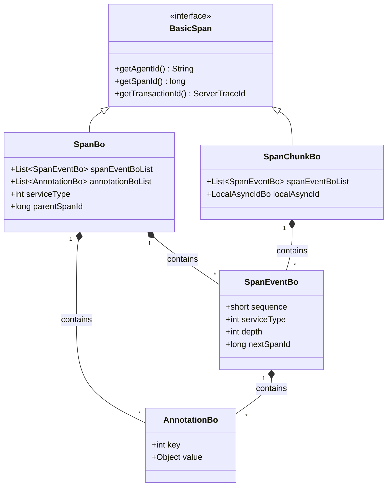
Sources: [commons-server/src/main/java/com/navercorp/pinpoint/common/server/bo/BasicSpan.java:24-57](), [commons-server/src/main/java/com/navercorp/pinpoint/common/server/bo/SpanBo.java:35-76](), [commons-server/src/main/java/com/navercorp/pinpoint/common/server/bo/SpanChunkBo.java:33-62](), [commons-server/src/main/java/com/navercorp/pinpoint/common/server/bo/SpanEventBo.java:26-55]()

## ServiceType

`ServiceType` is a fundamental concept that categorizes the types of components Pinpoint monitors. Each service type has a unique code and specific properties that determine how the Collector and Web UI handle the data.

### Code Ranges and Categories
Service types are organized into specific numeric ranges:

| Range | Category | Examples |
| :--- | :--- | :--- |
| 0 ~ 999 | Pinpoint Internal | `UNDEFINED` (-1), `USER` (2), `ASYNC` (100) |
| 1000 ~ 1899 | Server (WAS) | `TOMCAT` (1010), `JETTY` (1030), `GRPC_SERVER` (1130) |
| 2000 ~ 2899 | Database | `MYSQL` (2100), `ORACLE` (2300), `MONGO` (2650) |
| 5000 ~ 7499 | Library | `SPRING` (5050), `MYBATIS` (5510) |
| 8000 ~ 8999 | Cache / Message Queue | `REDIS` (8200), `KAFKA_CLIENT` (8660) |
| 9000 ~ 9999 | RPC Client | `HTTP_CLIENT_4` (9052), `DUBBO_CONSUMER` (9110) |

### Key Properties
The behavior of a `ServiceType` is governed by `ServiceTypeProperty` flags:
*   `RECORD_STATISTICS`: If set, Pinpoint records performance statistics (TPS, response time) for this type. [commons/src/main/java/com/navercorp/pinpoint/common/trace/ServiceTypeProperty.java:21-21]()
*   `TERMINAL`: Indicates the node is a leaf in the ServerMap (e.g., a Database or Cache). [commons/src/main/java/com/navercorp/pinpoint/common/trace/ServiceTypeProperty.java:22-22]()
*   `INCLUDE_DESTINATION_ID`: Whether to include the destination address (e.g., DB IP/Port) in the visualization. [commons/src/main/java/com/navercorp/pinpoint/common/trace/ServiceTypeProperty.java:20-20]()

Sources: [commons/src/main/java/com/navercorp/pinpoint/common/trace/ServiceType.java:27-161](), [commons/src/main/java/com/navercorp/pinpoint/common/trace/ServiceTypeProperty.java:19-23]()

## AnnotationKey

`AnnotationKey` defines the metadata keys used to store additional information within a Span or SpanEvent.

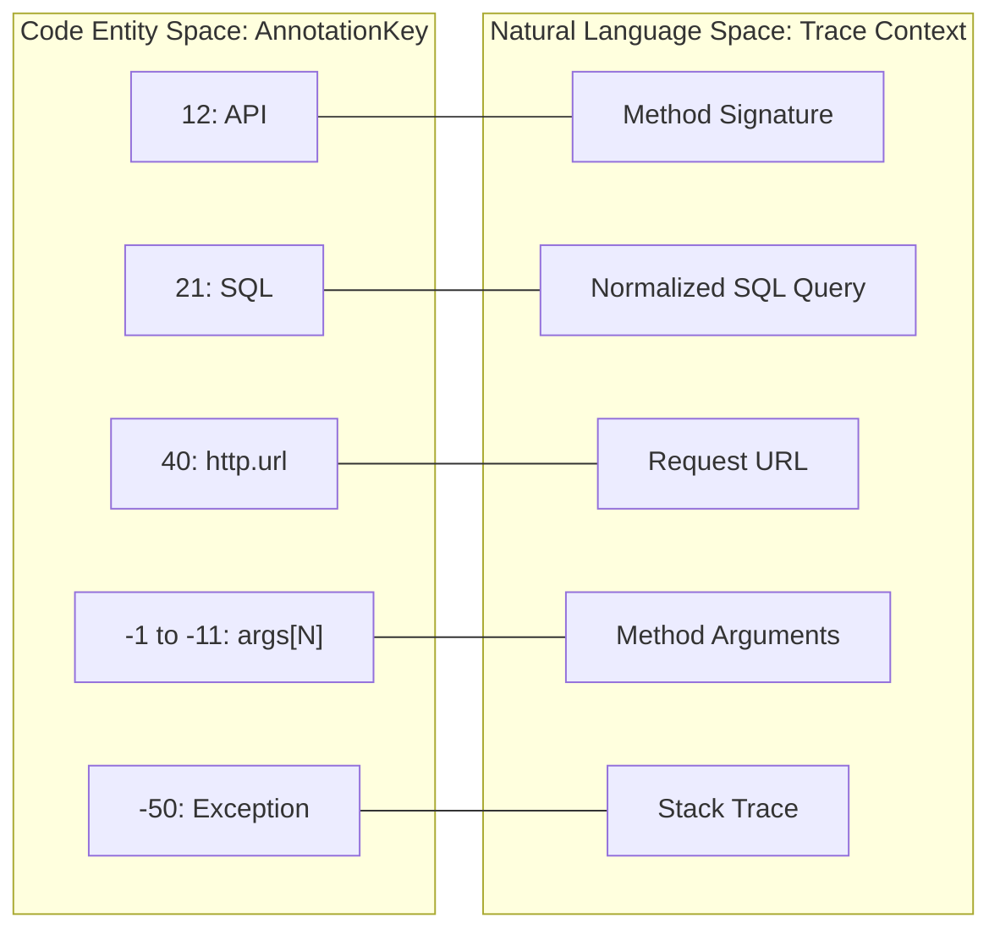

### Notable Annotation Keys
*   **API (12) / API_METADATA (13)**: Used to store method signatures or mapping IDs to method names. [commons/src/main/java/com/navercorp/pinpoint/common/trace/AnnotationKey.java:54-55]()
*   **SQL (21) / SQL-ID (20)**: Used to store normalized SQL statements or IDs for cached SQL. [commons/src/main/java/com/navercorp/pinpoint/common/trace/AnnotationKey.java:60-61]()
*   **Exception (-50)**: Stores the exception message and stack trace. [commons/src/main/java/com/navercorp/pinpoint/common/trace/AnnotationKey.java:48-48]()

Sources: [commons/src/main/java/com/navercorp/pinpoint/common/trace/AnnotationKey.java:26-147]()

## Data Flow and Reconstruction

When a user requests a transaction view in the Web UI, Pinpoint reconstructs the call tree from individual `SpanBo` and `SpanEventBo` objects.

### Reconstruction Logic
The `SpanServiceImpl` and `TransactionInfoServiceImpl` collaborate to transform raw HBase data into a visual `RecordSet`.

1.  **Select Spans**: `SpanServiceImpl.selectSpan` fetches all spans associated with a `ServerTraceId`. [web/src/main/java/com/navercorp/pinpoint/web/trace/service/SpanServiceImpl.java:136-146]()
2.  **Align Call Tree**: `SpanAligner` orders spans based on `parentSpanId` and `spanId`. Within a span, `SpanEventBo` objects are ordered by their `sequence`. [web/src/main/java/com/navercorp/pinpoint/web/trace/service/SpanServiceImpl.java:157-158](), [commons-server/src/main/java/com/navercorp/pinpoint/common/server/bo/SpanEventComparator.java:10-10]()
3.  **Create RecordSet**: `TransactionInfoServiceImpl.createRecordSet` iterates through the aligned `CallTree` to create `Record` objects for the UI. [web/src/main/java/com/navercorp/pinpoint/web/trace/service/TransactionInfoServiceImpl.java:77-82]()
4.  **Identify Focus**: It identifies the "ViewPoint" (the specific span the user clicked on) and marks it in the `RecordSet`. [web/src/main/java/com/navercorp/pinpoint/web/trace/service/TransactionInfoServiceImpl.java:88-90]()

### Error Handling in Data
Errors are categorized using `ErrorCategory` bitmasks. The `ErrorCategoryResolver` decodes the `errCode` in a `SpanBo` to determine if it was a generic exception, a timeout, or a specific protocol error. [commons/src/main/java/com/navercorp/pinpoint/common/trace/ErrorCategoryResolver.java:36-44]()

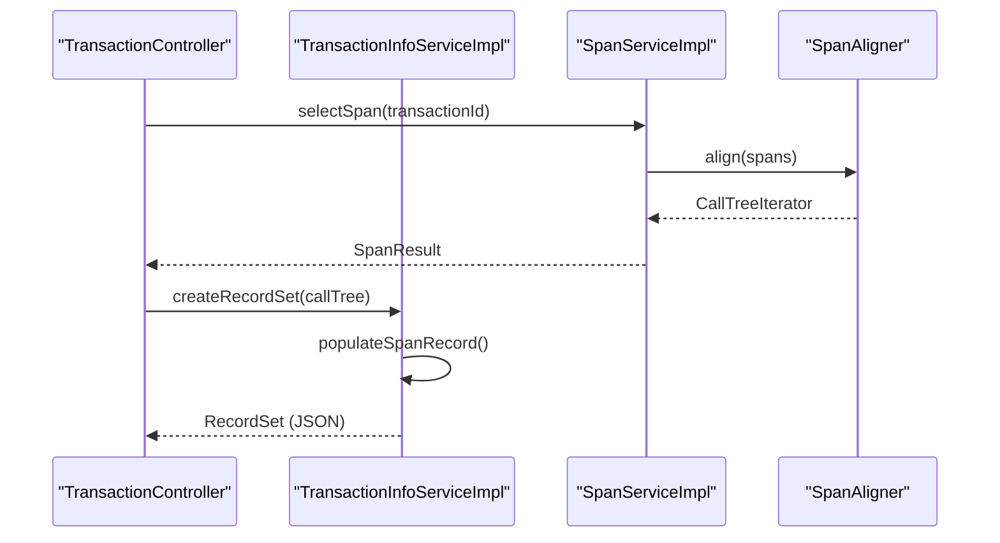

Sources: [web/src/main/java/com/navercorp/pinpoint/web/trace/service/SpanServiceImpl.java:136-160](), [web/src/main/java/com/navercorp/pinpoint/web/trace/service/TransactionInfoServiceImpl.java:77-138](), [commons/src/main/java/com/navercorp/pinpoint/common/trace/ErrorCategoryResolver.java:25-45]()

## ServerMap Data Model

The ServerMap (Application Topology) is built using `FilteredMapBuilder`. It processes `SpanBo` objects to identify links between applications.

*   **Inbound Links**: Created by looking at the `parentApplicationName` and `parentApplicationServiceType` of a `SpanBo`. [commons-server/src/main/java/com/navercorp/pinpoint/common/server/bo/SpanBo.java:60-61](), [web/src/main/java/com/navercorp/pinpoint/web/applicationmap/map/FilteredMapBuilder.java:130-138]()
*   **Outbound Links**: Created by iterating through `SpanEventBo` list. If a `SpanEventBo` has a `nextSpanId` or a `destinationId`, it indicates a call to an external system. [commons-server/src/main/java/com/navercorp/pinpoint/common/server/bo/SpanEventBo.java:47-47](), [web/src/main/java/com/navercorp/pinpoint/web/applicationmap/map/FilteredMapBuilder.java:147-147]()

Sources: [web/src/main/java/com/navercorp/pinpoint/web/applicationmap/map/FilteredMapBuilder.java:102-149](), [commons-server/src/main/java/com/navercorp/pinpoint/common/server/bo/SpanBo.java:60-61](), [commons-server/src/main/java/com/navercorp/pinpoint/common/server/bo/SpanEventBo.java:117-123]()

---

# Page: Getting Started

# Getting Started

<details>
<summary>Relevant source files</summary>

The following files were used as context for generating this wiki page:

- [.github/ISSUE_TEMPLATE/bug_report.md](.github/ISSUE_TEMPLATE/bug_report.md)
- [.github/ISSUE_TEMPLATE/feature_request.md](.github/ISSUE_TEMPLATE/feature_request.md)
- [.github/ISSUE_TEMPLATE/question.md](.github/ISSUE_TEMPLATE/question.md)
- [.github/ISSUE_TEMPLATE/troubleshooting.md](.github/ISSUE_TEMPLATE/troubleshooting.md)
- [README.md](README.md)
- [agent-module/plugins/undertow-servlet/README.md](agent-module/plugins/undertow-servlet/README.md)
- [doc/images/ss_error-analysis1.png](doc/images/ss_error-analysis1.png)
- [doc/images/ss_error-analysis3.gif](doc/images/ss_error-analysis3.gif)
- [doc/modules.md](doc/modules.md)
- [quickstart/README.md](quickstart/README.md)
- [quickstart/testapp/pom.xml](quickstart/testapp/pom.xml)
- [quickstart/testapp/src/main/java/com/navercorp/pinpoint/testapp/controller/ApisController.java](quickstart/testapp/src/main/java/com/navercorp/pinpoint/testapp/controller/ApisController.java)
- [quickstart/testapp/src/main/java/com/navercorp/pinpoint/testapp/controller/CallSelfController.java](quickstart/testapp/src/main/java/com/navercorp/pinpoint/testapp/controller/CallSelfController.java)
- [quickstart/testapp/src/main/java/com/navercorp/pinpoint/testapp/controller/HttpClient4Controller.java](quickstart/testapp/src/main/java/com/navercorp/pinpoint/testapp/controller/HttpClient4Controller.java)
- [quickstart/testapp/src/main/java/com/navercorp/pinpoint/testapp/controller/SimpleController.java](quickstart/testapp/src/main/java/com/navercorp/pinpoint/testapp/controller/SimpleController.java)
- [quickstart/testapp/src/main/java/com/navercorp/pinpoint/testapp/controller/StressController.java](quickstart/testapp/src/main/java/com/navercorp/pinpoint/testapp/controller/StressController.java)
- [quickstart/testapp/src/main/java/com/navercorp/pinpoint/testapp/service/remote/HttpRemoteService.java](quickstart/testapp/src/main/java/com/navercorp/pinpoint/testapp/service/remote/HttpRemoteService.java)

</details>


This page provides an overview of how to set up and deploy Pinpoint APM for the first time. It covers system requirements, architectural components that need to be deployed, and the available installation methods. For detailed step-by-step instructions, see the child pages: [Quick Start Guide](#2.1) for a rapid local setup, [Building from Source](#2.2) for development and customization, or [Deployment Options](#2.3) for production deployments using Docker or Kubernetes.

## Pinpoint System Components

Pinpoint APM consists of four primary components that must be deployed to create a working monitoring system:

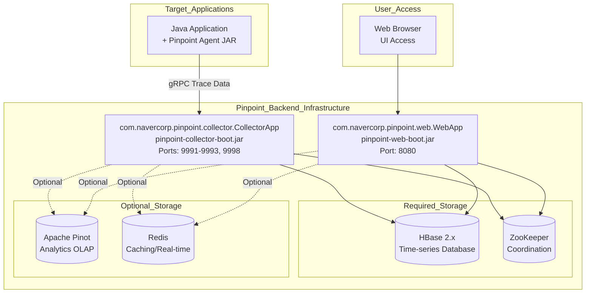

**Component Roles:**

| Component | Purpose | Deployment Target |
|-----------|---------|------------------|
| **Pinpoint Agent** | Bytecode instrumentation of target applications; collects trace data without code changes | Attached to each monitored JVM via `-javaagent` flag |
| **Pinpoint Collector** | Receives trace data via gRPC; processes and stores in HBase/Pinot | Standalone Java application (Spring Boot) |
| **Pinpoint Web** | REST API server and UI; queries stored traces; serves React frontend | Standalone Java application (Spring Boot) |
| **HBase** | Primary storage for detailed trace data (`SpanBo`, `SpanChunkBo`) | Distributed database cluster |
| **ZooKeeper** | Service coordination between Collector and Web instances | Required for cluster coordination |

**Sources:** [README.md:25-60](), [quickstart/README.md:1-41](), [quickstart/README.md:113-115]()

## Prerequisites and System Requirements

### Java Version Requirements

Pinpoint requires JDK 8 or higher for monitored applications, while the backend components have specific requirements:

| Component | Requirement |
|-----------|-------------|
| **Target Application (Agent)** | JDK 8+ [README.md:73-73]() |
| **Building Pinpoint** | JDK 8+ [quickstart/README.md:46-46]() |
| **Quickstart TestApp** | Java 1.8 [quickstart/testapp/pom.xml:30-32]() |

### Storage Compatibility

| Component | Version | Role |
|-----------|---------|------|
| **HBase** | 1.2.x+ | Primary trace storage [quickstart/README.md:12-13]() |
| **ZooKeeper** | Required | Coordination for Collector/Web [quickstart/README.md:31-38]() |

**Sources:** [README.md:73-73](), [quickstart/README.md:12-46](), [quickstart/testapp/pom.xml:30-32]()

## Installation Deployment Flow

The typical deployment sequence for Pinpoint involves initializing storage before starting the application logic:

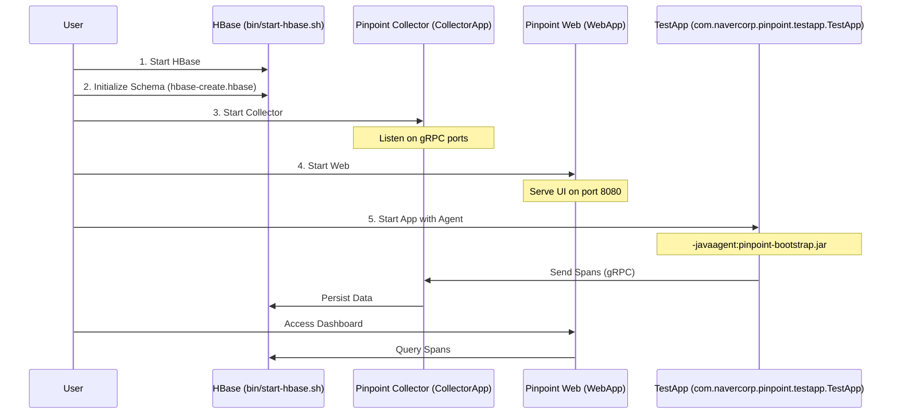

**Critical Configuration Points:**

1. **HBase Schema**: Run the creation script located in `hbase/scripts` [quickstart/README.md:21-25]().
2. **ZooKeeper Address**: Pass `-Dpinpoint.zookeeper.address` to both Collector and Web [quickstart/README.md:31-38]().
3. **Agent Identity**: Each agent requires a unique `pinpoint.agentId` and a logical `pinpoint.applicationName` [quickstart/README.md:58-59]().

**Sources:** [quickstart/README.md:12-59](), [quickstart/testapp/pom.xml:36-36]()

## Installation Approaches

Pinpoint offers three main approaches for installation:

### 1. Quick Start (Fastest - Local Testing)
**Use Case:** Evaluation and local development.
**Method:** Download pre-built binaries from the [Latest Release](https://github.com/pinpoint-apm/pinpoint/releases/latest).
**Components:** Includes `pinpoint-agent`, `pinpoint-collector-boot`, `pinpoint-web-boot`, and a `pinpoint-quickstart-testapp`.
**See:** [Quick Start Guide](#2.1) for details.
**Sources:** [quickstart/README.md:1-54]()

### 2. Building from Source
**Use Case:** Customization and contributing.
**Method:** Clone the repository and build using the Maven wrapper:
```bash
./mvnw install -DskipTests=true
```
**See:** [Building from Source](#2.2) for details.
**Sources:** [quickstart/README.md:61-68]()

### 3. Container Deployment (Production)
**Use Case:** Scalable production environments.
**Method:** Use the official [Pinpoint-Docker](https://github.com/pinpoint-apm/pinpoint-docker) or [Pinpoint-Kubernetes](https://github.com/pinpoint-apm/pinpoint-kubernetes) repositories.
**See:** [Deployment Options](#2.3) for details.
**Sources:** [README.md:41-42](), [quickstart/README.md:4-7]()

## Agent Attachment

The Pinpoint Agent instruments applications at runtime using the `-javaagent` JVM argument. No code changes are required in the target application [README.md:34-34]().

```bash
java -jar -javaagent:pinpoint-bootstrap.jar \
     -Dpinpoint.agentId=test-agent \
     -Dpinpoint.applicationName=TESTAPP \
     your-application.jar
```

**Required Parameters:**
* `pinpoint.agentId`: A unique ID for the specific instance (max 24 characters).
* `pinpoint.applicationName`: A name to group multiple instances of the same service.

**Sources:** [quickstart/README.md:56-59](), [README.md:34-34]()

## Verification

After deployment, you can verify the setup by accessing the Web UI at `http://localhost:8080` [README.md:17-17]().

If using the `pinpoint-quickstart-testapp`, you can generate sample traffic by visiting `http://localhost:8082` [quickstart/README.md:113-113](). The test application provides several endpoints to simulate different behaviors:
* `/getCurrentTimestamp`: Simple success response [quickstart/testapp/src/main/java/com/navercorp/pinpoint/testapp/controller/SimpleController.java:17-24]().
* `/sleep3`, `/sleep5`, `/sleep7`: Simulates latency [quickstart/testapp/src/main/java/com/navercorp/pinpoint/testapp/controller/SimpleController.java:35-66]().
* `/httpclient4/getGeoCode`: Simulates external HTTP calls using `HttpClient4` [quickstart/testapp/src/main/java/com/navercorp/pinpoint/testapp/controller/HttpClient4Controller.java:32-40]().

**Sources:** [README.md:17-17](), [quickstart/README.md:113-113](), [quickstart/testapp/src/main/java/com/navercorp/pinpoint/testapp/controller/SimpleController.java:17-66](), [quickstart/testapp/src/main/java/com/navercorp/pinpoint/testapp/controller/HttpClient4Controller.java:32-40]()

---

# Page: Quick Start Guide

# Quick Start Guide

<details>
<summary>Relevant source files</summary>

The following files were used as context for generating this wiki page:

- [.github/ISSUE_TEMPLATE/bug_report.md](.github/ISSUE_TEMPLATE/bug_report.md)
- [.github/ISSUE_TEMPLATE/feature_request.md](.github/ISSUE_TEMPLATE/feature_request.md)
- [.github/ISSUE_TEMPLATE/question.md](.github/ISSUE_TEMPLATE/question.md)
- [.github/ISSUE_TEMPLATE/troubleshooting.md](.github/ISSUE_TEMPLATE/troubleshooting.md)
- [README.md](README.md)
- [agent-module/plugins/undertow-servlet/README.md](agent-module/plugins/undertow-servlet/README.md)
- [doc/images/ss_error-analysis1.png](doc/images/ss_error-analysis1.png)
- [doc/images/ss_error-analysis3.gif](doc/images/ss_error-analysis3.gif)
- [doc/modules.md](doc/modules.md)
- [quickstart/README.md](quickstart/README.md)
- [quickstart/testapp/pom.xml](quickstart/testapp/pom.xml)
- [quickstart/testapp/src/main/java/com/navercorp/pinpoint/testapp/controller/ApisController.java](quickstart/testapp/src/main/java/com/navercorp/pinpoint/testapp/controller/ApisController.java)
- [quickstart/testapp/src/main/java/com/navercorp/pinpoint/testapp/controller/CallSelfController.java](quickstart/testapp/src/main/java/com/navercorp/pinpoint/testapp/controller/CallSelfController.java)
- [quickstart/testapp/src/main/java/com/navercorp/pinpoint/testapp/controller/HttpClient4Controller.java](quickstart/testapp/src/main/java/com/navercorp/pinpoint/testapp/controller/HttpClient4Controller.java)
- [quickstart/testapp/src/main/java/com/navercorp/pinpoint/testapp/controller/SimpleController.java](quickstart/testapp/src/main/java/com/navercorp/pinpoint/testapp/controller/SimpleController.java)
- [quickstart/testapp/src/main/java/com/navercorp/pinpoint/testapp/controller/StressController.java](quickstart/testapp/src/main/java/com/navercorp/pinpoint/testapp/controller/StressController.java)
- [quickstart/testapp/src/main/java/com/navercorp/pinpoint/testapp/service/remote/HttpRemoteService.java](quickstart/testapp/src/main/java/com/navercorp/pinpoint/testapp/service/remote/HttpRemoteService.java)

</details>


This document provides step-by-step instructions for running Pinpoint locally using pre-built release binaries and the provided quickstart package. By following this guide, you will set up a complete Pinpoint environment including HBase storage, Collector, Web UI, and attach an agent to a test application.

**Sources:** [README.md:37-39](), [quickstart/README.md:1-3]()

---

## System Architecture and Data Flow

The following diagram illustrates the interaction between the QuickStart components and the primary data flow from the instrumented application to the storage layer.

### System Component Mapping
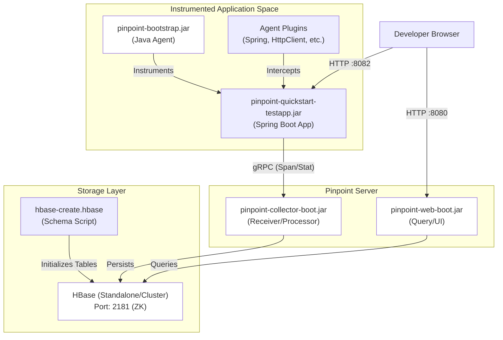

**Sources:** [quickstart/README.md:12-39](), [README.md:45-60]()

---

## Installation Steps

### 1. Storage Setup (HBase)
Pinpoint uses Apache HBase as its primary time-series data store. For the quickstart, a standalone HBase instance is sufficient.

1. **Download and Start:**
   Extract the HBase binary and execute the start script.
   ```bash
   $ tar xzvf hbase-x.x.x-bin.tar.gz
   $ cd hbase-x.x.x/
   $ ./bin/start-hbase.sh
   ```
2. **Initialize Schema:**
   Run the provided HBase shell script to create the necessary tables (e.g., `AgentInfo`, `TraceV2`, `ApplicationStatAggre`).
   ```bash
   $ ./bin/hbase shell hbase-create.hbase
   ```

**Sources:** [quickstart/README.md:12-25]()

### 2. Pinpoint Collector
The Collector receives data from agents via gRPC and persists it to HBase.

```bash
$ java -jar -Dpinpoint.zookeeper.address=localhost pinpoint-collector-boot-3.0.4.jar
```
*   **Key Parameter:** `-Dpinpoint.zookeeper.address` points the collector to the HBase ZooKeeper instance for data persistence coordination.

**Sources:** [quickstart/README.md:27-32]()

### 3. Pinpoint Web
The Web component provides the graphical user interface and REST APIs for analyzing trace data.

```bash
$ java -jar -Dpinpoint.zookeeper.address=localhost pinpoint-web-boot-3.0.4.jar
```
Once started, the UI is typically accessible at `http://localhost:8080`.

**Sources:** [quickstart/README.md:34-39]()

---

## Running the Quickstart TestApp

The Pinpoint repository includes a `quickstart/testapp` module. This is a Spring Boot application designed to demonstrate Pinpoint's tracing capabilities across various scenarios (HTTP calls, errors, etc.).

### Agent Attachment Mechanism
The agent is attached to the JVM using the `-javaagent` argument. It performs bytecode transformation at class-loading time.

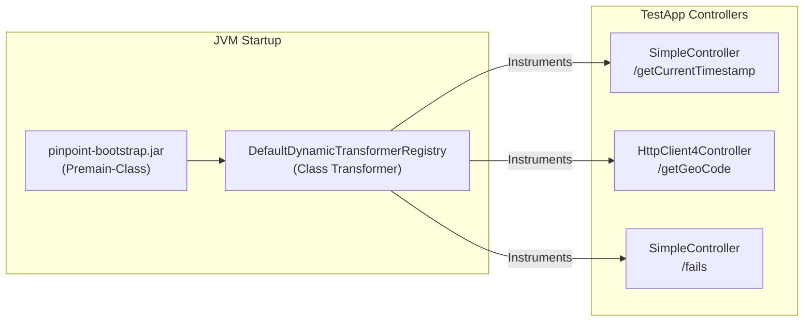

### Execution Command
To run the test application with the agent:
```bash
$ java -jar \
  -javaagent:pinpoint-agent-3.0.4/pinpoint-bootstrap.jar \
  -Dpinpoint.agentId=test-agent \
  -Dpinpoint.applicationName=TESTAPP \
  pinpoint-quickstart-testapp-3.0.4.jar
```

**Required System Properties:**
*   `pinpoint.agentId`: A unique ID for the specific JVM instance (max 24 characters).
*   `pinpoint.applicationName`: A logical group name for the service (max 24 characters).

**Sources:** [quickstart/README.md:41-59](), [quickstart/testapp/pom.xml:24-36]()

---

## Exploring the Test Application

The `TestApp` exposes several endpoints via `ApisController` to simulate real-world behavior:

| Endpoint | Controller | Description |
| :--- | :--- | :--- |
| `/getCurrentTimestamp` | `SimpleController` | Simple request returning server time. |
| `/httpclient4/getGeoCode` | `HttpClient4Controller` | Traces an external HTTP GET call using Apache HttpClient. |
| `/sleep3`, `/sleep5` | `SimpleController` | Simulates latency (3s and 5s respectively). |
| `/fails` | `SimpleController` | Simulates an application error (RuntimeException). |
| `/randomResponseTime` | `SimpleController` | Simulates random latency and intermittent failures (20% chance). |

**Code Implementation Details:**
*   The `ApisController` uses `RequestMappingHandlerMapping` to dynamically discover and list available test endpoints at the index page [quickstart/testapp/src/main/java/com/navercorp/pinpoint/testapp/controller/ApisController.java:27-57]().
*   External calls in `HttpClient4Controller` are handled by `HttpRemoteService`, which utilizes `CloseableHttpClient` [quickstart/testapp/src/main/java/com/navercorp/pinpoint/testapp/service/remote/HttpRemoteService.java:94-100]().

**Sources:** [quickstart/testapp/src/main/java/com/navercorp/pinpoint/testapp/controller/SimpleController.java:17-90](), [quickstart/testapp/src/main/java/com/navercorp/pinpoint/testapp/controller/HttpClient4Controller.java:32-47]()

---

## Verifying Results

After generating traffic to `http://localhost:8082`, verify the data in the Pinpoint Web UI:

1.  **ServerMap:** You should see a node named `TESTAPP`. Clicking it reveals the transaction volume and health.
2.  **Scatter Chart:** Drag over the dots in the scatter chart to view the **Transaction List**.
3.  **CallStack:** Select a transaction to see the method-level execution trace. For `/httpclient4/getGeoCode`, you will see the internal Spring Controller call followed by the `HttpClient` execution [README.md:48-56]().
4.  **Inspector:** Check the "Inspector" tab to see JVM metrics like Heap usage and CPU load for the `test-agent` [README.md:58-60]().

**Sources:** [README.md:48-70](), [quickstart/README.md:113-115]()

---

# Page: Building from Source

# Building from Source

<details>
<summary>Relevant source files</summary>

The following files were used as context for generating this wiki page:

- [.github/workflows/homepage.yml](.github/workflows/homepage.yml)
- [.github/workflows/it-command.yml](.github/workflows/it-command.yml)
- [.github/workflows/it-schedule.yml](.github/workflows/it-schedule.yml)
- [.github/workflows/maven-central-deploy.yml](.github/workflows/maven-central-deploy.yml)
- [.github/workflows/maven.yml](.github/workflows/maven.yml)
- [.github/workflows/slash-command-dispatch.yml](.github/workflows/slash-command-dispatch.yml)
- [batch/pom.xml](batch/pom.xml)
- [collector/pom.xml](collector/pom.xml)
- [commons-hbase/pom.xml](commons-hbase/pom.xml)
- [commons-server/pom.xml](commons-server/pom.xml)
- [commons/pom.xml](commons/pom.xml)
- [commons/src/main/java/com/navercorp/pinpoint/common/Version.java](commons/src/main/java/com/navercorp/pinpoint/common/Version.java)
- [grpc/src/main/java/com/navercorp/pinpoint/grpc/security/SslOption.java](grpc/src/main/java/com/navercorp/pinpoint/grpc/security/SslOption.java)
- [hbase/pom.xml](hbase/pom.xml)
- [pom.xml](pom.xml)
- [web/pom.xml](web/pom.xml)

</details>


This document provides technical instructions for building Pinpoint APM from source code. Pinpoint uses a multi-module Maven project structure and requires specific Java environments for different components.

## Prerequisites

Pinpoint 3.x requires a specific matrix of Java Development Kits (JDK) due to the architectural split between the instrumentation agent and the server-side components.

| Component | Requirement | Configuration Property |
|-----------|-------------|------------------------|
| **Agent** | JDK 8 - 21 | `jdk.version` 1.8 [pom.xml:131-133]() |
| **Collector** | JDK 17+ | `jdk.version` 17 [collector/pom.xml:32-33]() |
| **Web** | JDK 17+ | `jdk.version` 17 [web/pom.xml:32-33]() |
| **Batch** | JDK 17+ | `jdk.version` 17 [batch/pom.xml:16-17]() |
| **HBase Tooling** | JDK 17+ | `jdk.version` 17 [hbase/pom.xml:17-18]() |

### Environment Variables
The build system relies on environment variables to locate different JDK installations:
- `JAVA_8_HOME`: Points to the JDK 8 installation path [pom.xml:134-135]().
- `JAVA_17_HOME`: Points to the JDK 17 installation path [web/pom.xml:33]().

Sources: [pom.xml:131-136](), [web/pom.xml:31-34](), [collector/pom.xml:31-34](), [.github/workflows/maven.yml:39-44]()

## Build Process Overview

The build process bridges the Java source code (Maven) and the React-based frontend. The `pinpoint-web-frontend` module is integrated into the Maven lifecycle, allowing a single command to produce a deployable artifact.

### Natural Language to Code Entity Mapping: Build Pipeline

The following diagram maps high-level build stages to specific Maven modules and CI steps.

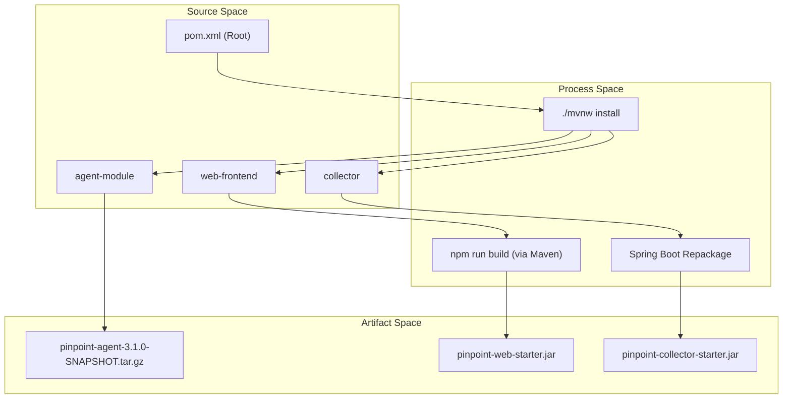
Sources: [pom.xml:81-125](), [.github/workflows/maven.yml:47-48](), [web/pom.xml:74-77]()

## Build Commands

### Standard Full Build
To build the entire project while skipping unit tests:
```bash
./mvnw clean install -DskipTests
```
This command triggers the `templating-maven-plugin` in `pinpoint-commons` [commons/pom.xml:41-44]() and handles the frontend build within `web-frontend` [pom.xml:104]().

### Building Specific Components
You can use Maven's project list (`-pl`) and also-make (`-am`) flags to build individual components:

| Target | Command | Output Location |
|--------|---------|-----------------|
| **Collector** | `./mvnw install -pl collector-starter -am` | `collector-starter/target/` |
| **Web** | `./mvnw install -pl web-starter -am` | `web-starter/target/` |
| **Agent** | `./mvnw install -pl agent-module/agent -am` | `agent-module/agent/target/` |
| **Batch** | `./mvnw install -pl batch -am` | `batch/target/` |

Sources: [pom.xml:81-125](), [batch/pom.xml:85-97]()

## Build Configuration and Profiles

The root `pom.xml` defines several properties and profiles that control the build output.

### Key Build Properties
- `build.frontend.skip`: Set to `true` to skip the React frontend build when working only on the Java backend [pom.xml:144]().
- `maven.compiler.executable`: Dynamically points to the `javac` of the required JDK [pom.xml:135]().

### Maven Profiles
- `it-module`: Includes integration test modules [it-command.yml:61]().
- `code.coverage`: Enables JaCoCo for testing [maven.yml:48]().
- `maven.central.release`: Configures GPG signing and deployment for Maven Central [maven-central-deploy.yml:63]().

Sources: [pom.xml:127-144](), [.github/workflows/maven.yml:48-50](), [.github/workflows/it-command.yml:61]()

## Dependency Management and Data Flow

The build architecture ensures that shared logic (HBase templates, gRPC definitions) is compiled before the application starters.

### Natural Language to Code Entity Mapping: Module Dependencies

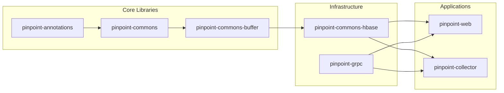
Sources: [web/pom.xml:41-120](), [collector/pom.xml:37-85](), [commons-hbase/pom.xml:37-56](), [commons-server/pom.xml:38-73]()

## Advanced Build Options

### Docker Integration
Pinpoint supports building Docker images directly via Maven using the `jib-maven-plugin` or `docker-maven-plugin`.
- **Batch Module**: Uses Jib to containerize the Spring Boot application [batch/pom.xml:98-110]().
- **HBase Module**: Uses `docker-maven-plugin` to build schema-management images [hbase/pom.xml:49-68]().

### Integration Testing (IT)
The `it-module` profile is used for running extensive plugin integration tests. These tests are executed in the `agent-module/plugins-it` directory [it-command.yml:64-69]().

Sources: [batch/pom.xml:98-110](), [hbase/pom.xml:49-68](), [.github/workflows/it-command.yml:61-69]()

## Troubleshooting the Build

1.  **Node/NPM Cache**: If the frontend build fails, clear the `node_modules` or the `node_install` directory [maven.yml:25-38]().
2.  **JDK Pathing**: Ensure `JAVA_8_HOME` and `JAVA_17_HOME` are correctly exported. The build will fail if it cannot find the `javac` executable at `${jdk.home}/bin/javac` [pom.xml:135]().
3.  **Memory Constraints**: The CI environment uses `ubuntu-22.04` with resource cleanup to handle the large build footprint [it-schedule.yml:7-35]().

Sources: [.github/workflows/maven.yml:25-44](), [.github/workflows/it-schedule.yml:31-41]()

---

# Page: Deployment Options

# Deployment Options

<details>
<summary>Relevant source files</summary>

The following files were used as context for generating this wiki page:

- [batch/pom.xml](batch/pom.xml)
- [collector-starter/src/main/java/com/navercorp/pinpoint/collector/starter/multi/application/BasicCollectorApp.java](collector-starter/src/main/java/com/navercorp/pinpoint/collector/starter/multi/application/BasicCollectorApp.java)
- [collector-starter/src/main/java/com/navercorp/pinpoint/collector/starter/multi/application/PinpointCollectorStarter.java](collector-starter/src/main/java/com/navercorp/pinpoint/collector/starter/multi/application/PinpointCollectorStarter.java)
- [collector-starter/src/main/resources/application.yml](collector-starter/src/main/resources/application.yml)
- [collector/pom.xml](collector/pom.xml)
- [collector/src/main/java/com/navercorp/pinpoint/collector/CollectorApp.java](collector/src/main/java/com/navercorp/pinpoint/collector/CollectorApp.java)
- [collector/src/main/java/com/navercorp/pinpoint/collector/PinpointCollectorModule.java](collector/src/main/java/com/navercorp/pinpoint/collector/PinpointCollectorModule.java)
- [collector/src/main/java/com/navercorp/pinpoint/collector/event/SpanStorePublisher.java](collector/src/main/java/com/navercorp/pinpoint/collector/event/SpanStorePublisher.java)
- [collector/src/main/java/com/navercorp/pinpoint/collector/event/SpanStorePublisherImpl.java](collector/src/main/java/com/navercorp/pinpoint/collector/event/SpanStorePublisherImpl.java)
- [collector/src/main/java/com/navercorp/pinpoint/collector/event/config/CollectorEventConfiguration.java](collector/src/main/java/com/navercorp/pinpoint/collector/event/config/CollectorEventConfiguration.java)
- [collector/src/main/resources/application.yml](collector/src/main/resources/application.yml)
- [commons-hbase/pom.xml](commons-hbase/pom.xml)
- [commons-hbase/src/main/java/com/navercorp/pinpoint/common/hbase/config/HbaseNamespaceConfiguration.java](commons-hbase/src/main/java/com/navercorp/pinpoint/common/hbase/config/HbaseNamespaceConfiguration.java)
- [commons-server/pom.xml](commons-server/pom.xml)
- [commons-server/src/main/java/com/navercorp/pinpoint/common/server/event/ContextData.java](commons-server/src/main/java/com/navercorp/pinpoint/common/server/event/ContextData.java)
- [commons-server/src/main/java/com/navercorp/pinpoint/common/server/event/ContextSupplier.java](commons-server/src/main/java/com/navercorp/pinpoint/common/server/event/ContextSupplier.java)
- [commons-server/src/main/java/com/navercorp/pinpoint/common/server/event/InsertEvent.java](commons-server/src/main/java/com/navercorp/pinpoint/common/server/event/InsertEvent.java)
- [commons-server/src/main/java/com/navercorp/pinpoint/common/server/event/SimpleContextSupplier.java](commons-server/src/main/java/com/navercorp/pinpoint/common/server/event/SimpleContextSupplier.java)
- [commons-server/src/main/java/com/navercorp/pinpoint/common/server/event/SpanChunkInsertEvent.java](commons-server/src/main/java/com/navercorp/pinpoint/common/server/event/SpanChunkInsertEvent.java)
- [commons-server/src/main/java/com/navercorp/pinpoint/common/server/event/SpanInsertEvent.java](commons-server/src/main/java/com/navercorp/pinpoint/common/server/event/SpanInsertEvent.java)
- [commons/pom.xml](commons/pom.xml)
- [commons/src/main/java/com/navercorp/pinpoint/common/Version.java](commons/src/main/java/com/navercorp/pinpoint/common/Version.java)
- [datasource/src/main/java/com/navercorp/pinpoint/datasource/MainDataSourceConfiguration.java](datasource/src/main/java/com/navercorp/pinpoint/datasource/MainDataSourceConfiguration.java)
- [hbase/pom.xml](hbase/pom.xml)
- [pom.xml](pom.xml)
- [realtime/realtime-collector/src/main/java/com/navercorp/pinpoint/realtime/collector/RealtimeCollectorServerConfig.java](realtime/realtime-collector/src/main/java/com/navercorp/pinpoint/realtime/collector/RealtimeCollectorServerConfig.java)
- [redis/src/main/java/com/navercorp/pinpoint/redis/RedisBasicConfig.java](redis/src/main/java/com/navercorp/pinpoint/redis/RedisBasicConfig.java)
- [redis/src/main/java/com/navercorp/pinpoint/redis/RedisPropertySources.java](redis/src/main/java/com/navercorp/pinpoint/redis/RedisPropertySources.java)
- [redis/src/main/resources/redis/profiles/local/redis.properties](redis/src/main/resources/redis/profiles/local/redis.properties)
- [redis/src/main/resources/redis/profiles/release/redis.properties](redis/src/main/resources/redis/profiles/release/redis.properties)
- [redis/src/main/resources/redis/redis-root.properties](redis/src/main/resources/redis/redis-root.properties)
- [web-starter/src/main/java/com/navercorp/pinpoint/web/starter/multi/PinpointWebStarter.java](web-starter/src/main/java/com/navercorp/pinpoint/web/starter/multi/PinpointWebStarter.java)
- [web-starter/src/main/resources/application.yml](web-starter/src/main/resources/application.yml)
- [web/pom.xml](web/pom.xml)
- [web/src/main/java/com/navercorp/pinpoint/web/WebApp.java](web/src/main/java/com/navercorp/pinpoint/web/WebApp.java)
- [web/src/main/resources/application.yml](web/src/main/resources/application.yml)

</details>


## Purpose and Scope

This page describes the various deployment options available for Pinpoint server components (Collector, Web, Batch). It covers Docker-based deployment via Jib, Kubernetes orchestration, and traditional Spring Boot executable JAR deployment. This guide details implementation specifics of the `PinpointCollectorStarter` and `PinpointWebStarter` modules, data flow between components, and environment-specific configuration management.

**Sources:** [pom.xml:26-34](), [collector/src/main/java/com/navercorp/pinpoint/collector/CollectorApp.java:52-64](), [web/src/main/java/com/navercorp/pinpoint/web/WebApp.java:51-63]()

## Deployment Methods Overview

Pinpoint server components are built as Spring Boot applications and support three primary deployment methods:

| Method | Use Case | Components | Implementation |
|--------|----------|------------|----------------|
| **Docker** | Containerized environments | All | `jib-maven-plugin` creates layered images |
| **Kubernetes** | Production orchestration | All | Helm charts (external) + ConfigMaps/Secrets |
| **Traditional JAR** | Bare metal / VMs | All | `spring-boot-maven-plugin` executable JARs |

Each method utilizes Spring Profiles (`local`, `release`) to toggle between development and production-grade thread pool and buffer configurations.

**Sources:** [pom.xml:141-144](), [collector/src/main/resources/application.yml:1-3](), [web/src/main/resources/application.yml:1-3]()

---

## Docker Deployment Architecture

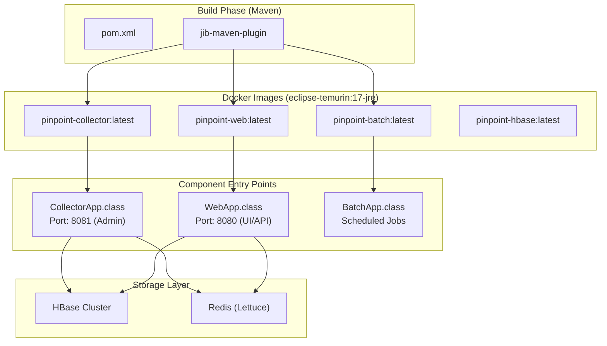

### Docker Image Build Process
Pinpoint uses the **Jib Maven Plugin** to build optimized, daemon-less Docker images. The configuration is centralized in the parent `pom.xml` [pom.xml:141-144]() and specific modules like `batch/pom.xml` [batch/pom.xml:98-110]().

**Image Build Command:**
```bash
./mvnw clean package -DskipTests jib:dockerBuild
```

**Sources:** [pom.xml:141-144](), [batch/pom.xml:98-110](), [hbase/pom.xml:50-67]()

---

## Multi-Application Deployment (Starters)

Pinpoint provides "Starter" modules that allow running multiple functional types within a single JVM process to optimize resource utilization.

### PinpointCollectorStarter
The `PinpointCollectorStarter` [collector-starter/src/main/java/com/navercorp/pinpoint/collector/starter/multi/application/PinpointCollectorStarter.java:53-55]() uses a `CollectorType` parameter to determine which modules to initialize.

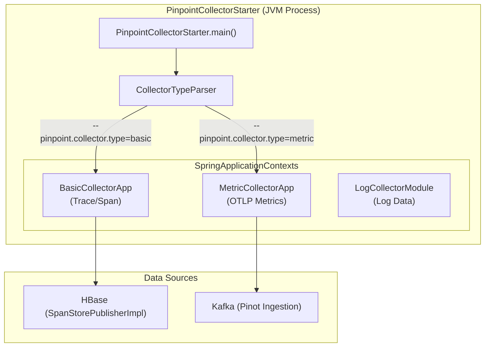

- **BasicCollectorApp**: Configures receivers for agent statistics, spans, and traces [collector-starter/src/main/java/com/navercorp/pinpoint/collector/starter/multi/application/BasicCollectorApp.java:36-57]().
- **Data Flow**: Spans are processed and published via `SpanStorePublisherImpl` [collector/src/main/java/com/navercorp/pinpoint/collector/event/SpanStorePublisherImpl.java:31-35]().

**Sources:** [collector-starter/src/main/java/com/navercorp/pinpoint/collector/starter/multi/application/PinpointCollectorStarter.java:53-125](), [collector-starter/src/main/java/com/navercorp/pinpoint/collector/starter/multi/application/BasicCollectorApp.java:36-57]()

### PinpointWebStarter
The `PinpointWebStarter` [web-starter/src/main/java/com/navercorp/pinpoint/web/starter/multi/PinpointWebStarter.java:46-48]() aggregates all web-related feature modules into a single interface.

**Enabled Features (via application.yml):**
- **Exception Trace**: `pinpoint.modules.web.exceptiontrace.enabled=true` [web-starter/src/main/resources/application.yml:88-89]()
- **Inspector**: `pinpoint.modules.web.inspector.enabled=true` [web-starter/src/main/resources/application.yml:90-91]()
- **OTLP Metric**: `pinpoint.modules.web.otlpmetric.enabled=true` [web-starter/src/main/resources/application.yml:92-93]()

---

## Configuration Management

Pinpoint uses a hierarchical configuration system combining YAML and Properties files.

### Spring Profiles
- **local**: Used for development. Disables resource caching [web/src/main/resources/application.yml:116-117]().
- **release**: Default production profile. Enables optimized thread pools and production storage settings [web/src/main/resources/application.yml:1-3]().

### Component Configuration
| Component | Configuration File | Key Properties |
|-----------|--------------------|----------------|
| **Web** | `web/src/main/resources/application.yml` | `server.port: 8080`, `pinpoint.web.websocket` [web/src/main/resources/application.yml:12,108]() |
| **Collector** | `collector/src/main/resources/application.yml` | `server.port: 8081`, `pinpoint.modules.collector.grpc.ssl` [collector/src/main/resources/application.yml:6,70-72]() |
| **Redis** | `redis/src/main/resources/redis/profiles/release/redis.properties` | `spring.data.redis.host`, `spring.data.redis.lettuce` [redis/src/main/resources/redis/profiles/release/redis.properties:1-10]() |

### Storage Layer Configuration
- **HBase**: Configured via `HbaseNamespaceConfiguration` to support multi-tenancy [commons-hbase/src/main/java/com/navercorp/pinpoint/common/hbase/config/HbaseNamespaceConfiguration.java:12-26]().
- **Redis**: Initialized via `RedisBasicConfig` using Lettuce [redis/src/main/java/com/navercorp/pinpoint/redis/RedisBasicConfig.java:46-60]().

**Sources:** [web/src/main/resources/application.yml:1-120](), [collector/src/main/resources/application.yml:1-78](), [redis/src/main/java/com/navercorp/pinpoint/redis/RedisBasicConfig.java:46-146]()

---

## Traditional JAR Deployment

For deployments on virtual machines or bare metal, Pinpoint components are packaged as executable JARs.

### Build and Run
1. **Build**:
   ```bash
   ./mvnw clean package -DskipTests
   ```
2. **Execute Collector**:
   ```bash
   java -jar collector/target/pinpoint-collector-boot.jar --spring.profiles.active=release
   ```
3. **Execute Web**:
   ```bash
   java -jar web/target/pinpoint-web-boot.jar --spring.profiles.active=release
   ```

### JVM Requirements
- **JDK 17**: Required for Web and Collector modules [web/pom.xml:32](), [collector/pom.xml:32]().
- **JDK 8**: Required for the Agent module [pom.xml:131-135]().

**Sources:** [web/pom.xml:32](), [collector/pom.xml:32](), [pom.xml:131-135](), [batch/pom.xml:88-97]()

---

## Deployment Verification

### Health Checks
Pinpoint components expose health endpoints via Spring Boot Actuator.
- **Web**: `http://<web-host>:8080/monitor/l7check` [web/src/main/resources/application.yml:75-77]()
- **Collector**: `http://<collector-host>:8081/monitor/l7check` [collector/src/main/resources/application.yml:63-65]()

### Actuator Exposure
The following endpoints are exposed for monitoring: `health, beans, conditions, configprops, env, logfile, loggers, mappings, info, threaddump, heapdump` [web/src/main/resources/application.yml:73-74]().

**Sources:** [web/src/main/resources/application.yml:27-82](), [collector/src/main/resources/application.yml:11-66]()

---

# Page: System Architecture

# System Architecture

<details>
<summary>Relevant source files</summary>

The following files were used as context for generating this wiki page:

- [.github/ISSUE_TEMPLATE/bug_report.md](.github/ISSUE_TEMPLATE/bug_report.md)
- [.github/ISSUE_TEMPLATE/feature_request.md](.github/ISSUE_TEMPLATE/feature_request.md)
- [.github/ISSUE_TEMPLATE/question.md](.github/ISSUE_TEMPLATE/question.md)
- [.github/ISSUE_TEMPLATE/troubleshooting.md](.github/ISSUE_TEMPLATE/troubleshooting.md)
- [README.md](README.md)
- [agent-module/plugins/undertow-servlet/README.md](agent-module/plugins/undertow-servlet/README.md)
- [batch/pom.xml](batch/pom.xml)
- [collector/pom.xml](collector/pom.xml)
- [commons-hbase/pom.xml](commons-hbase/pom.xml)
- [commons-server/pom.xml](commons-server/pom.xml)
- [commons/pom.xml](commons/pom.xml)
- [commons/src/main/java/com/navercorp/pinpoint/common/Version.java](commons/src/main/java/com/navercorp/pinpoint/common/Version.java)
- [doc/images/ss_error-analysis1.png](doc/images/ss_error-analysis1.png)
- [doc/images/ss_error-analysis3.gif](doc/images/ss_error-analysis3.gif)
- [doc/modules.md](doc/modules.md)
- [hbase/pom.xml](hbase/pom.xml)
- [pom.xml](pom.xml)
- [quickstart/README.md](quickstart/README.md)
- [web/pom.xml](web/pom.xml)

</details>


This document provides a comprehensive overview of Pinpoint APM's multi-module architecture and the interactions between its core components. Pinpoint is a distributed tracing solution designed for large-scale systems, providing code-level visibility and application topology mapping.

For detailed information on specific areas, please refer to the following child pages:
- [Module Structure](#3.1) — Maven organization and build system.
- [Agent Architecture](#3.2) — Bytecode instrumentation and plugin system.
- [Collector Architecture](#3.3) — Data reception and processing pipeline.
- [Web Application Architecture](#3.4) — Backend services and REST APIs.
- [Frontend Architecture](#3.5) — React-based UI and visualization.
- [gRPC Communication Layer](#3.6) — Transport protocols and channel security.
- [Channel and Messaging Infrastructure](#3.7) — Inter-service communication via Redis.

## High-Level Component Interaction

Pinpoint follows a traditional collector-agent model where telemetry data flows from instrumented applications to a centralized storage and visualization layer.

### System Components Diagram
The following diagram bridges the natural language components to the actual code modules and entities found in the repository.

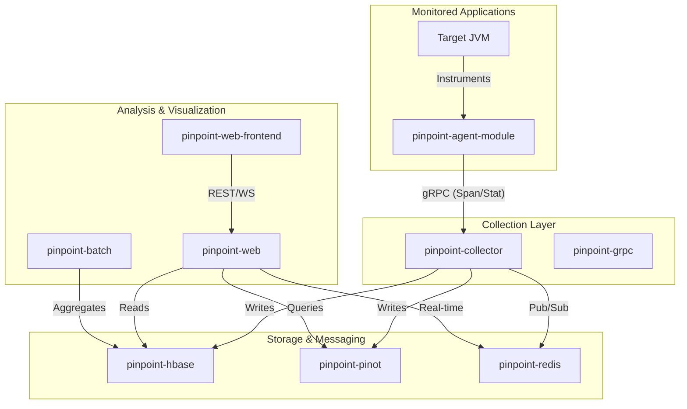

Sources:
- [pom.xml:81-125]()
- [README.md:23-43]()
- [collector/pom.xml:36-102]()

## Core Component Overview

### 1. Agent Module
The agent is a Java agent that performs bytecode instrumentation at runtime using `pinpoint-bootstrap.jar`. It uses a plugin-based system to intercept library calls without manual code changes.

For details, see [Agent Architecture](#3.2).

### 2. Collector
The collector is responsible for receiving telemetry data (Spans, Stats, and Agent information) via gRPC. It handles sampling, data normalization, and persistence into HBase or Pinot.

For details, see [Collector Architecture](#3.3).

### 3. Web and Frontend
The Web application (`pinpoint-web`) serves as the API backend, while `pinpoint-web-frontend` is a React monorepo that provides the dashboard, ServerMap, and CallStack views.

For details, see [Web Application Architecture](#3.4) and [Frontend Architecture](#3.5).

### 4. Storage Layer
Pinpoint uses HBase as its primary trace storage and Pinot for high-performance OLAP queries (URI statistics, Inspector metrics).

| Component | Code Entity / Module | Role |
| :--- | :--- | :--- |
| **HBase** | `pinpoint-commons-hbase` | Primary Trace/Span storage [commons-hbase/pom.xml:27-28]() |
| **Pinot** | `pinpoint-pinot` | Metrics and OLAP analytics [pom.xml:108]() |
| **Redis** | `pinpoint-redis` | Real-time data and messaging [pom.xml:112]() |

Sources:
- [pom.xml:93-112]()
- [hbase/pom.xml:11-12]()

## Data Flow and Communication

The system relies on a unified gRPC layer for agent-to-collector communication and a Redis-backed channel for inter-service messaging.

### Communication Bridge Diagram
This diagram maps communication paths to specific code identifiers.

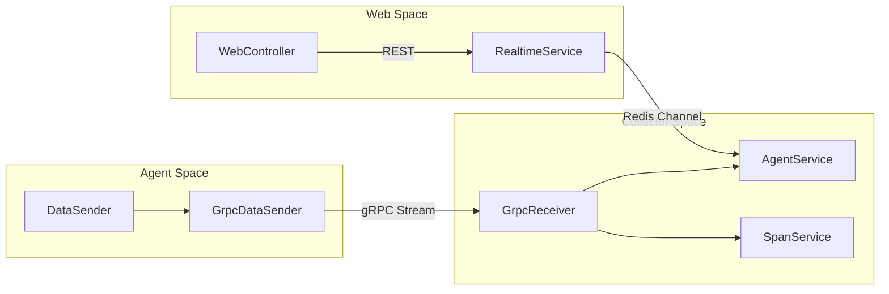

Sources:
- [grpc/pom.xml:1-20]()
- [collector/pom.xml:75-76]()
- [web/pom.xml:94-96]()
- [channel/pom.xml:1-20]()

## Compatibility and Deployment
Pinpoint is built primarily with Java 17 for the server-side components (Web, Collector, Batch) while the Agent maintains compatibility with JDK 8+.

- **JDK Version**: Server modules use JDK 17 [web/pom.xml:32-33](), [collector/pom.xml:32-33]().
- **Build System**: Maven multi-module project [pom.xml:18-29]().
- **Deployment**: Supports Docker, Kubernetes, and standalone JAR execution [quickstart/README.md:4-40]().

Sources:
- [pom.xml:131-136]()
- [web/pom.xml:32-34]()
- [collector/pom.xml:32-34]()
- [batch/pom.xml:16-18]()
- [quickstart/README.md:1-115]()

---

# Page: Module Structure

# Module Structure

<details>
<summary>Relevant source files</summary>

The following files were used as context for generating this wiki page:

- [batch/pom.xml](batch/pom.xml)
- [collector-starter/src/main/java/com/navercorp/pinpoint/collector/starter/multi/application/BasicCollectorApp.java](collector-starter/src/main/java/com/navercorp/pinpoint/collector/starter/multi/application/BasicCollectorApp.java)
- [collector-starter/src/main/java/com/navercorp/pinpoint/collector/starter/multi/application/PinpointCollectorStarter.java](collector-starter/src/main/java/com/navercorp/pinpoint/collector/starter/multi/application/PinpointCollectorStarter.java)
- [collector-starter/src/main/resources/application.yml](collector-starter/src/main/resources/application.yml)
- [collector/pom.xml](collector/pom.xml)
- [collector/src/main/java/com/navercorp/pinpoint/collector/CollectorApp.java](collector/src/main/java/com/navercorp/pinpoint/collector/CollectorApp.java)
- [collector/src/main/java/com/navercorp/pinpoint/collector/PinpointCollectorModule.java](collector/src/main/java/com/navercorp/pinpoint/collector/PinpointCollectorModule.java)
- [collector/src/main/java/com/navercorp/pinpoint/collector/event/SpanStorePublisher.java](collector/src/main/java/com/navercorp/pinpoint/collector/event/SpanStorePublisher.java)
- [collector/src/main/java/com/navercorp/pinpoint/collector/event/SpanStorePublisherImpl.java](collector/src/main/java/com/navercorp/pinpoint/collector/event/SpanStorePublisherImpl.java)
- [collector/src/main/java/com/navercorp/pinpoint/collector/event/config/CollectorEventConfiguration.java](collector/src/main/java/com/navercorp/pinpoint/collector/event/config/CollectorEventConfiguration.java)
- [collector/src/main/resources/application.yml](collector/src/main/resources/application.yml)
- [commons-hbase/pom.xml](commons-hbase/pom.xml)
- [commons-hbase/src/main/java/com/navercorp/pinpoint/common/hbase/config/HbaseNamespaceConfiguration.java](commons-hbase/src/main/java/com/navercorp/pinpoint/common/hbase/config/HbaseNamespaceConfiguration.java)
- [commons-server/pom.xml](commons-server/pom.xml)
- [commons-server/src/main/java/com/navercorp/pinpoint/common/server/event/ContextData.java](commons-server/src/main/java/com/navercorp/pinpoint/common/server/event/ContextData.java)
- [commons-server/src/main/java/com/navercorp/pinpoint/common/server/event/ContextSupplier.java](commons-server/src/main/java/com/navercorp/pinpoint/common/server/event/ContextSupplier.java)
- [commons-server/src/main/java/com/navercorp/pinpoint/common/server/event/InsertEvent.java](commons-server/src/main/java/com/navercorp/pinpoint/common/server/event/InsertEvent.java)
- [commons-server/src/main/java/com/navercorp/pinpoint/common/server/event/SimpleContextSupplier.java](commons-server/src/main/java/com/navercorp/pinpoint/common/server/event/SimpleContextSupplier.java)
- [commons-server/src/main/java/com/navercorp/pinpoint/common/server/event/SpanChunkInsertEvent.java](commons-server/src/main/java/com/navercorp/pinpoint/common/server/event/SpanChunkInsertEvent.java)
- [commons-server/src/main/java/com/navercorp/pinpoint/common/server/event/SpanInsertEvent.java](commons-server/src/main/java/com/navercorp/pinpoint/common/server/event/SpanInsertEvent.java)
- [commons/pom.xml](commons/pom.xml)
- [commons/src/main/java/com/navercorp/pinpoint/common/Version.java](commons/src/main/java/com/navercorp/pinpoint/common/Version.java)
- [datasource/src/main/java/com/navercorp/pinpoint/datasource/MainDataSourceConfiguration.java](datasource/src/main/java/com/navercorp/pinpoint/datasource/MainDataSourceConfiguration.java)
- [hbase/pom.xml](hbase/pom.xml)
- [pom.xml](pom.xml)
- [realtime/realtime-collector/src/main/java/com/navercorp/pinpoint/realtime/collector/RealtimeCollectorServerConfig.java](realtime/realtime-collector/src/main/java/com/navercorp/pinpoint/realtime/collector/RealtimeCollectorServerConfig.java)
- [redis/src/main/java/com/navercorp/pinpoint/redis/RedisBasicConfig.java](redis/src/main/java/com/navercorp/pinpoint/redis/RedisBasicConfig.java)
- [redis/src/main/java/com/navercorp/pinpoint/redis/RedisPropertySources.java](redis/src/main/java/com/navercorp/pinpoint/redis/RedisPropertySources.java)
- [redis/src/main/resources/redis/profiles/local/redis.properties](redis/src/main/resources/redis/profiles/local/redis.properties)
- [redis/src/main/resources/redis/profiles/release/redis.properties](redis/src/main/resources/redis/profiles/release/redis.properties)
- [redis/src/main/resources/redis/redis-root.properties](redis/src/main/resources/redis/redis-root.properties)
- [web-starter/src/main/java/com/navercorp/pinpoint/web/starter/multi/PinpointWebStarter.java](web-starter/src/main/java/com/navercorp/pinpoint/web/starter/multi/PinpointWebStarter.java)
- [web-starter/src/main/resources/application.yml](web-starter/src/main/resources/application.yml)
- [web/pom.xml](web/pom.xml)
- [web/src/main/java/com/navercorp/pinpoint/web/WebApp.java](web/src/main/java/com/navercorp/pinpoint/web/WebApp.java)
- [web/src/main/resources/application.yml](web/src/main/resources/application.yml)

</details>


This document explains Pinpoint's Maven-based module organization, dependency management hierarchy, and build system architecture. It describes how the codebase is divided into modules, their relationships, and how they are built and packaged. For information about specific component architectures within these modules, see [Agent Architecture](#3.2), [Collector Architecture](#3.3), [Web Application Architecture](#3.4), and [Frontend Architecture](#3.5).

## Maven Parent POM Structure

Pinpoint uses a multi-module Maven project structure with a parent POM at [pom.xml:18-287]() that manages all child modules. The parent POM defines shared properties, dependency versions, and build configurations inherited by all modules.

**Parent POM Configuration:**

| Property | Value | Purpose |
|----------|-------|---------|
| `groupId` | `com.navercorp.pinpoint` | Maven group identifier [pom.xml:25-25]() |
| `artifactId` | `pinpoint` | Parent artifact name [pom.xml:26-26]() |
| `version` | `3.1.0-SNAPSHOT` | Project version [pom.xml:27-27]() |
| `packaging` | `pom` | Indicates aggregator project [pom.xml:29-29]() |
| `jdk.version` | `1.8` | Default Java version [pom.xml:131-131]() |

The parent POM declares over 40 modules in [pom.xml:81-125]() and centralizes dependency version management through properties in [pom.xml:127-287](). This ensures consistent library versions across all modules.

**Key Managed Dependency Versions:**
- `spring-boot.version`: Defined via properties [pom.xml:181-184]()
- `hbase.shaded.client.version`: `2.5.12-hadoop3` [pom.xml:147-147]()
- `pinot.client.version`: `1.3.0` [pom.xml:152-152]()
- `jackson.version`: `2.19.2` [pom.xml:164-164]()

**Sources:** [pom.xml:18-287](), [pom.xml:81-125](), [pom.xml:127-184]()

## Module Categories

Pinpoint's modules are organized into functional categories. Each category serves a specific architectural role in the APM system.

```mermaid
graph TB
    Parent["pinpoint<br/>(Parent POM)"]
    
    subgraph "Core Modules"
        Commons["pinpoint-commons"]
        CommonsBuffer["pinpoint-commons-buffer"]
        CommonsConfig["pinpoint-commons-config"]
        CommonsProfiler["pinpoint-commons-profiler"]
        CommonsServer["pinpoint-commons-server"]
        CommonsHBase["pinpoint-commons-hbase"]
        CommonsTimeseries["pinpoint-commons-timeseries"]
        Annotations["pinpoint-annotations"]
        Datasource["pinpoint-datasource"]
        Grpc["pinpoint-grpc"]
    end
    
    subgraph "Agent Modules"
        AgentModule["agent-module"]
        AgentStats["agent-statistics"]
    end
    
    subgraph "Server Modules"
        Collector["pinpoint-collector"]
        CollectorStarter["pinpoint-collector-starter"]
        Web["pinpoint-web"]
        WebStarter["pinpoint-web-starter"]
        Batch["pinpoint-batch"]
    end
    
    subgraph "Frontend Module"
        WebFrontend["pinpoint-web-frontend"]
    end
    
    subgraph "Feature Modules"
        MetricModule["metric-module"]
        Uristat["uristat"]
        InspectorModule["inspector-module"]
        Realtime["realtime"]
        Redis["redis"]
        Pinot["pinot"]
        Exceptiontrace["exceptiontrace"]
        OtlpMetric["otlpmetric"]
        OtlpTrace["otlptrace"]
        HBase["hbase"]
    end
    
    Parent --> Commons
    Parent --> AgentModule
    Parent --> Collector
    Parent --> Web
    Parent --> WebFrontend
    Parent --> MetricModule
```

**Sources:** [pom.xml:81-125]()

### Core Modules

Core modules provide foundational utilities, data structures, and abstractions used by both agent and server components.

| Module | Artifact ID | Purpose |
|--------|-------------|---------|
| commons | `pinpoint-commons` | Base utilities and Version class [commons/pom.xml:11-11]() |
| commons-buffer | `pinpoint-commons-buffer` | Binary serialization utilities [pom.xml:90-90]() |
| commons-profiler | `pinpoint-commons-profiler` | Trace data model [pom.xml:92-92]() |
| commons-server | `pinpoint-commons-server` | Server-side data models and events [commons-server/pom.xml:27-27]() |
| commons-hbase | `pinpoint-commons-hbase` | HBase client abstraction and configuration [commons-hbase/pom.xml:27-27]() |
| grpc | `pinpoint-grpc` | gRPC communication layer [pom.xml:100-100]() |

**Key Code Entities:**
- `com.navercorp.pinpoint.common.Version`: Version information [commons/src/main/java/com/navercorp/pinpoint/common/Version.java:1-4]()
- `SpanInsertEvent`: Server-side event for trace data [commons-server/src/main/java/com/navercorp/pinpoint/common/server/event/SpanInsertEvent.java:1-10]()
- `HbaseNamespaceConfiguration`: HBase connection setup [commons-hbase/src/main/java/com/navercorp/pinpoint/common/hbase/config/HbaseNamespaceConfiguration.java:1-10]()

**Sources:** [pom.xml:89-100](), [commons/pom.xml:1-47](), [commons-server/pom.xml:1-189](), [commons-hbase/pom.xml:1-137]()

### Server Modules

Server modules implement the data collection and web serving infrastructure. These modules require Java 17 [collector/pom.xml:32-33](), [web/pom.xml:32-33]().

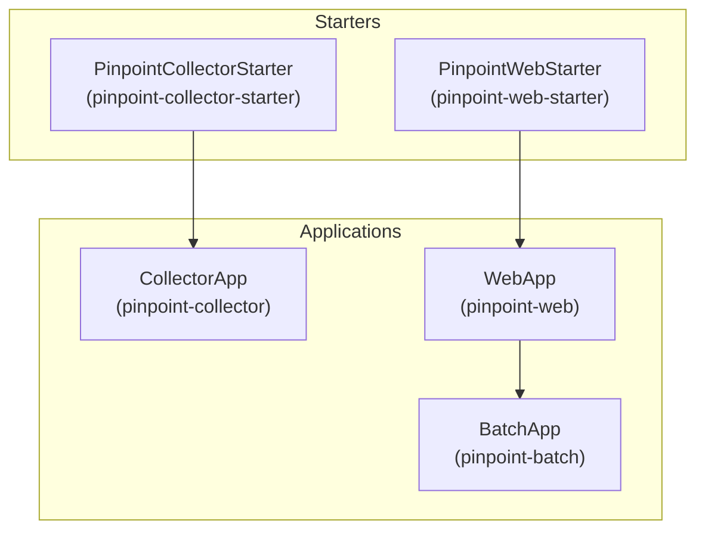

**Module Details:**

- **Collector (`pinpoint-collector`)**: Receives trace data via gRPC. It depends on `pinpoint-grpc`, `pinpoint-commons-hbase`, and `pinpoint-realtime-collector` [collector/pom.xml:36-101]().
- **Web (`pinpoint-web`)**: Serves REST APIs and the UI. It depends on `pinpoint-web-frontend`, `pinpoint-commons-hbase`, and `pinpoint-pinot-datasource` [web/pom.xml:36-120]().
- **Batch (`pinpoint-batch`)**: Handles background jobs like alarms. It depends on `pinpoint-web` and `spring-batch-core` [batch/pom.xml:20-61]().

**Sources:** [collector/pom.xml:1-278](), [web/pom.xml:1-410](), [batch/pom.xml:1-125]()

### Feature and Specialized Modules

Feature modules provide optional capabilities enabled via Spring profiles or configuration [web-starter/src/main/resources/application.yml:85-101]().

- **Real-time**: `realtime-collector` and `realtime-web` for active thread monitoring [collector/pom.xml:39-39](), [web/pom.xml:39-39]().
- **Pinot**: Integration for OLAP metrics [web/pom.xml:107-112]().
- **HBase UID**: `pinpoint-hbase-uid-module` for mapping application names to IDs [web/pom.xml:115-116]().
- **Redis**: Caching and pub/sub infrastructure [pom.xml:112-112]().
- **OTLP**: Support for OpenTelemetry metrics and traces [pom.xml:120-121]().

**Sources:** [pom.xml:108-125](), [web-starter/src/main/resources/application.yml:85-101]()

## Build System Architecture

Pinpoint uses a complex build pipeline involving Java compilation, Node.js frontend builds, and Docker image generation.

### Dependency Management Hierarchy

The parent POM uses `<dependencyManagement>` to control versions [pom.xml:317-1457]().

```mermaid
graph TD
    Parent["Parent POM<br/>(dependencyManagement)"]
    Collector["pinpoint-collector<br/>(pom.xml)"]
    Web["pinpoint-web<br/>(pom.xml)"]
    CommonsHBase["pinpoint-commons-hbase<br/>(pom.xml)"]

    Parent -- "manages" --> Collector
    Parent -- "manages" --> Web
    Parent -- "manages" --> CommonsHBase

    Collector -- "uses" --> CommonsHBase
    Web -- "uses" --> CommonsHBase
```

**Sources:** [pom.xml:317-1457](), [collector/pom.xml:63-63](), [web/pom.xml:63-63]()

### Build and Deployment

Pinpoint utilizes the `spring-boot-maven-plugin` for creating executable JARs and `jib-maven-plugin` for Docker images.

| Module | Main Class | Docker Image |
|--------|------------|--------------|
| Collector | `com.navercorp.pinpoint.collector.CollectorApp` [collector/pom.xml:251-251]() | `pinpointdocker/pinpoint-collector` [collector/pom.xml:263-263]() |
| Web | `com.navercorp.pinpoint.web.WebApp` [web/pom.xml:385-385]() | `pinpointdocker/pinpoint-web` [web/pom.xml:397-397]() |
| Batch | `com.navercorp.pinpoint.batch.BatchApp` [batch/pom.xml:91-91]() | `pinpointdocker/pinpoint-batch` [batch/pom.xml:103-103]() |

**Sources:** [collector/pom.xml:247-271](), [web/pom.xml:381-406](), [batch/pom.xml:86-110]()

## Configuration Data Flow

Configuration is managed through `application.yml` files in the starter and application modules.

```mermaid
graph LR
    subgraph "Web Config"
        WApp["web/application.yml"]
        WStart["web-starter/application.yml"]
    end

    subgraph "Collector Config"
        CApp["collector/application.yml"]
        CStart["collector-starter/application.yml"]
    end

    WStart -- "overrides" --> WApp
    CStart -- "overrides" --> CApp
```

**Key Configuration Keys:**
- `pinpoint.modules.realtime.enabled`: Controls real-time features [web-starter/src/main/resources/application.yml:100-101]().
- `pinpoint.modules.uid.version`: Controls HBase UID table version (e.g., `v3`) [web/src/main/resources/application.yml:94-96]().
- `server.port`: Web server port (8080 for Web, 8081 for Collector) [web/src/main/resources/application.yml:12-12](), [collector/src/main/resources/application.yml:6-6]().

**Sources:** [web/src/main/resources/application.yml:1-114](), [collector/src/main/resources/application.yml:1-78](), [web-starter/src/main/resources/application.yml:1-110](), [collector-starter/src/main/resources/application.yml:1-95]()

---

# Page: Agent Architecture

# Agent Architecture

<details>
<summary>Relevant source files</summary>

The following files were used as context for generating this wiki page:

- [collector/src/main/java/com/navercorp/pinpoint/collector/util/PacketUtils.java](collector/src/main/java/com/navercorp/pinpoint/collector/util/PacketUtils.java)

</details>


This document details the architecture and core components of the Pinpoint Agent, which is responsible for instrumenting applications to collect performance data without modifying application code.

## Overview

The Pinpoint Agent is a Java agent that uses bytecode instrumentation to monitor applications at runtime. It collects transaction data, performance metrics, and distributed trace information, which is then sent to the Pinpoint Collector. The agent is designed to have minimal impact on application performance.

```mermaid
graph TB
    subgraph "Monitored_Application_JVM" [Monitored Application JVM]
        App["Application Code"]
        
        subgraph "Pinpoint_Agent" [Pinpoint Agent]
            Bootstrap["PinpointBootstrap"]
            AgentCore["DefaultAgent"]
            
            subgraph "Instrumentation_Engine" [Instrumentation]
                ClassTransformer["ClassFileTransformer"]
                InterceptorRegistry["InterceptorRegistry"]
                BytecodeEngine["ASM-based Transformation"]
            end
            
            subgraph "Trace_Collection" [Trace Collection]
                TraceContext["TraceContext"]
                SpanFactory["SpanFactory"]
                SpanRecorder["SpanRecorder"]
            end
            
            subgraph "Plugin_System" [Plugins]
                PluginLoader["PluginLoader"]
                Plugins["Framework Plugins"]
            end
            
            DataSender["gRPC DataSender"]
        end
    end
    
    Collector["Pinpoint Collector"]
    
    Bootstrap --> AgentCore
    AgentCore --> ClassTransformer
    AgentCore --> PluginLoader
    PluginLoader --> Plugins
    Plugins --> ClassTransformer
    ClassTransformer --> BytecodeEngine
    BytecodeEngine --> InterceptorRegistry
    InterceptorRegistry -- "Intercepts" --> App
    
    App -- "Generates Trace Data" --> TraceContext
    TraceContext --> SpanFactory
    SpanFactory --> SpanRecorder
    SpanRecorder --> DataSender
    DataSender -- "gRPC" --> Collector
```

Sources:
- `pom.xml`
- `README.md`

## Agent Initialization Process

The agent initialization follows these steps:

1. JVM starts with the `-javaagent:pinpoint-bootstrap.jar` parameter.
2. Java's Instrumentation API calls the `premain` method in the bootstrap.
3. Bootstrap loads the agent's core classes using a separate class loader.
4. Agent core discovers and loads available plugins via `PluginLoader`.
5. Plugins register their target classes and transformation rules.
6. `ClassFileTransformer` is registered with the JVM to intercept class loading.
7. Agent connects to the Collector using gRPC.

```mermaid
sequenceDiagram
    participant JVM
    participant PinpointBootstrap
    participant AgentClassLoader
    participant DefaultAgent
    participant PluginLoader
    participant Transformer as "ClassFileTransformer"
    participant DataSender as "gRPC DataSender"
    participant App as "Application Classes"
    
    JVM->>PinpointBootstrap: premain(args, instrumentation)
    PinpointBootstrap->>AgentClassLoader: create
    PinpointBootstrap->>AgentClassLoader: load DefaultAgent
    AgentClassLoader->>DefaultAgent: create
    DefaultAgent->>PluginLoader: loadPlugins()
    PluginLoader-->>DefaultAgent: return loaded plugins
    DefaultAgent->>Transformer: registerTransformers
    DefaultAgent->>JVM: addTransformer(transformer)
    DefaultAgent->>DataSender: initialize()
    DataSender-->>DefaultAgent: ready
    
    JVM->>App: load classes
    JVM->>Transformer: transform(className, classBytes)
    Transformer-->>JVM: return transformed bytecode
```

Sources:
- `README.md`
- `quickstart/README.md`

## Bytecode Instrumentation Mechanism

Pinpoint uses bytecode instrumentation to monitor applications without code modifications:

1.  **Class Transformation**: When a class is loaded, the agent's `ClassFileTransformer` intercepts it.
2.  **Matcher Application**: The transformer checks if the class matches any plugin's transformation targets.
3.  **Bytecode Modification**: If matched, the class bytecode is modified (typically using ASM) to inject interceptor calls at method entry/exit points.
4.  **Interceptor Registration**: Interceptors for the transformed methods are registered in the `InterceptorRegistry`.
5.  **Runtime Interception**: When the instrumented methods execute, the injected code calls the corresponding interceptors.

```mermaid
graph TB
    ClassLoader["JVM ClassLoader"]
    Transformer["ClassFileTransformer"]
    Matcher["ClassMatcher"]
    Transformer2["BytecodeTransformer"]
    Registry["InterceptorRegistry"]
    Class["Transformed Class"]
    Interceptor["Method Interceptor"]
    
    ClassLoader -- "1. Load Class" --> Transformer
    Transformer -- "2. Check if target" --> Matcher
    Matcher -- "3. Match found" --> Transformer2
    Transformer2 -- "4. Transform bytecode" --> Class
    Transformer2 -- "5. Register interceptor" --> Registry
    Class -- "6. Method executed" --> Registry
    Registry -- "7. Invoke" --> Interceptor
    Interceptor -- "8. Collect data" --> Interceptor
```

Sources:
- `commons/src/main/java/com/navercorp/pinpoint/common/trace/ServiceType.java`
- `commons/src/main/java/com/navercorp/pinpoint/common/trace/AnnotationKey.java`

## Trace Data Model

Pinpoint's data model consists of several key components that represent a distributed transaction:

*   **Trace**: A complete transaction that may span multiple applications.
*   **Span**: A unit of work in a single application. Each trace has one or more spans.
*   **SpanEvent**: A method call within a span (e.g., a database query or external service call).
*   **Annotations**: Additional metadata attached to spans and span events via `AnnotationKey`.

```mermaid
graph TD
    Trace["Trace (Transaction)"] --> Span1["Span (App1)"]
    Trace --> Span2["Span (App2)"]
    Trace --> Span3["Span (App3)"]
    
    Span1 --> SpanEvent1["SpanEvent (Method Call)"]
    Span1 --> SpanEvent2["SpanEvent (DB Query)"]
    SpanEvent2 --> Annotation1["SQL Query Text"]
    
    Span2 --> SpanEvent3["SpanEvent (External Call)"]
    SpanEvent3 --> Annotation2["HTTP URL"]
    SpanEvent3 --> Annotation3["HTTP Status"]
```

Each Span includes:
- Transaction ID (unique across the distributed system).
- Application information.
- Start/end timestamps.
- Success/failure information.

Each SpanEvent includes:
- Reference to its parent span.
- Method information.
- Execution time.
- `ServiceType` (e.g., `TOMCAT`, `MYSQL`).

Sources:
- `commons/src/main/java/com/navercorp/pinpoint/common/trace/ServiceType.java:1-100`()
- `commons/src/main/java/com/navercorp/pinpoint/common/trace/AnnotationKey.java:1-100`()

## Plugin System

The Pinpoint Agent includes an extensive plugin system that allows it to monitor various frameworks and libraries. Plugins are decoupled from the agent core.

1.  **Plugin Structure**:
    *   Each plugin defines which classes to transform.
    *   Plugins provide custom interceptors for specific methods.
    *   Plugins register unique `ServiceType` and `AnnotationKey` constants.
2.  **Plugin Loading**:
    *   Plugins are loaded from the agent's plugin directory.
    *   Each plugin has its own class loader to avoid version conflicts.
3.  **Supported Technologies**:
    *   Web servers: Tomcat, Jetty, JBoss, etc.
    *   Databases: MySQL, Oracle, PostgreSQL, etc.
    *   Messaging: Kafka, RabbitMQ, Pulsar.

```mermaid
graph LR
    subgraph "Plugin_System_Infrastructure" [Plugin System]
        PluginJar["Plugin JAR Files"]
        PluginLoader["PluginLoader"]
        PluginContext["Plugin Context"]
        
        subgraph "Example_Plugins" [Example Plugins]
            PulsarPlugin["Pulsar Plugin"]
            MySQLPlugin["MySQL Plugin"]
            SpringPlugin["Spring Plugin"]
        end
        
        subgraph "Transformers_Interceptors" [Transformers & Interceptors]
            PulsarTransformer["Pulsar Transformer"]
            JDBCTransformer["JDBC Transformer"]
            
            PulsarInterceptor["Pulsar Interceptor"]
            JDBCInterceptor["JDBC Interceptor"]
        end
    end
    
    PluginJar --> PluginLoader
    PluginLoader --> PluginContext
    PluginContext --> PulsarPlugin
    PluginContext --> MySQLPlugin
    PluginContext --> SpringPlugin
    
    PulsarPlugin --> PulsarTransformer
    MySQLPlugin --> JDBCTransformer
    
    PulsarTransformer --> PulsarInterceptor
    JDBCTransformer --> JDBCInterceptor
```

Sources:
- `agent-module/plugins/pulsar/src/main/java/com/navercorp/pinpoint/plugin/pulsar/PulsarConstants.java:1-50`()
- `pom.xml`

## Data Collection and Transmission

1.  **Data Collection**: Interceptors collect data when instrumented methods execute. Data is organized into `Span` and `SpanEvent` objects.
2.  **Data Processing**: The agent processes data asynchronously to minimize application impact. It uses sampling to control volume.
3.  **Data Transmission**: The agent uses gRPC to communicate with the Collector.
    *   Data is batched and compressed before transmission.
    *   Utility classes like `PacketUtils` are used for debugging and logging packet contents.

```mermaid
graph LR
    subgraph "Application_Runtime" [Application]
        App["Application Code"]
        Interceptors["Method Interceptors"]
    end
    
    subgraph "Pinpoint_Agent_Internals" [Pinpoint Agent]
        TraceManager["Trace Manager"]
        SpanProcessor["Span Processor"]
        Buffer["Data Buffer"]
        Sender["gRPC Sender"]
    end
    
    Collector["Pinpoint Collector"]
    
    App --> Interceptors
    Interceptors --> TraceManager
    TraceManager --> SpanProcessor
    SpanProcessor --> Buffer
    Buffer --> Sender
    Sender --> Collector
```

Sources:
- `collector/src/main/java/com/navercorp/pinpoint/collector/util/PacketUtils.java:26-43`()
- `collector/pom.xml`

## Performance Considerations

The Pinpoint Agent is designed for production environments with minimal overhead:

*   **Low Overhead**: Typically adds ~3% performance overhead to the application.
*   **Sampling**: Only a percentage of transactions are recorded based on configuration.
*   **Async Processing**: Data processing and transmission occur in separate background threads.
*   **Adaptive Behavior**: The agent can reduce activity under high system load.
*   **Optimized Data Structures**: Uses compact byte-level serialization for efficient transmission.

Sources:
- `README.md`
- `collector/src/main/java/com/navercorp/pinpoint/collector/util/PacketUtils.java:30-35`()

## Compatibility

Pinpoint Agent supports a wide range of Java versions:

| Pinpoint Version | Java Version Support |
|------------------|----------------------|
| 2.5.x            | Java 8-19            |
| 3.0.x            | Java 8-21            |
| 3.1.x            | Java 8-24            |

Sources:
- `README.md`

---

# Page: Collector Architecture

# Collector Architecture

<details>
<summary>Relevant source files</summary>

The following files were used as context for generating this wiki page:

- [agent-module/profiler/src/main/java/com/navercorp/pinpoint/profiler/name/v1/ObjectNameResolverV1.java](agent-module/profiler/src/main/java/com/navercorp/pinpoint/profiler/name/v1/ObjectNameResolverV1.java)
- [collector-starter/src/main/java/com/navercorp/pinpoint/collector/starter/multi/application/type/CollectorType.java](collector-starter/src/main/java/com/navercorp/pinpoint/collector/starter/multi/application/type/CollectorType.java)
- [collector-starter/src/main/java/com/navercorp/pinpoint/collector/starter/multi/application/type/CollectorTypeParser.java](collector-starter/src/main/java/com/navercorp/pinpoint/collector/starter/multi/application/type/CollectorTypeParser.java)
- [collector-starter/src/main/java/com/navercorp/pinpoint/collector/starter/multi/application/type/CollectorTypeSet.java](collector-starter/src/main/java/com/navercorp/pinpoint/collector/starter/multi/application/type/CollectorTypeSet.java)
- [collector-starter/src/main/java/com/navercorp/pinpoint/collector/starter/multi/application/type/FallbackCollectorTypeParser.java](collector-starter/src/main/java/com/navercorp/pinpoint/collector/starter/multi/application/type/FallbackCollectorTypeParser.java)
- [collector-starter/src/main/java/com/navercorp/pinpoint/collector/starter/multi/application/type/ShellBlockerConfig.java](collector-starter/src/main/java/com/navercorp/pinpoint/collector/starter/multi/application/type/ShellBlockerConfig.java)
- [collector-starter/src/main/java/com/navercorp/pinpoint/collector/starter/multi/application/type/ShellCollectorTypeParser.java](collector-starter/src/main/java/com/navercorp/pinpoint/collector/starter/multi/application/type/ShellCollectorTypeParser.java)
- [collector-starter/src/main/java/com/navercorp/pinpoint/collector/starter/multi/application/type/SimpleCollectorTypeParser.java](collector-starter/src/main/java/com/navercorp/pinpoint/collector/starter/multi/application/type/SimpleCollectorTypeParser.java)
- [collector-starter/src/main/resources/.gitignore](collector-starter/src/main/resources/.gitignore)
- [collector/src/main/java/com/navercorp/pinpoint/collector/applicationmap/config/ApplicationMapModule.java](collector/src/main/java/com/navercorp/pinpoint/collector/applicationmap/config/ApplicationMapModule.java)
- [collector/src/main/java/com/navercorp/pinpoint/collector/applicationmap/config/MapDualWriteConfiguration.java](collector/src/main/java/com/navercorp/pinpoint/collector/applicationmap/config/MapDualWriteConfiguration.java)
- [collector/src/main/java/com/navercorp/pinpoint/collector/applicationmap/config/MapV2Configuration.java](collector/src/main/java/com/navercorp/pinpoint/collector/applicationmap/config/MapV2Configuration.java)
- [collector/src/main/java/com/navercorp/pinpoint/collector/applicationmap/config/MapV2Import.java](collector/src/main/java/com/navercorp/pinpoint/collector/applicationmap/config/MapV2Import.java)
- [collector/src/main/java/com/navercorp/pinpoint/collector/applicationmap/config/MapV3Configuration.java](collector/src/main/java/com/navercorp/pinpoint/collector/applicationmap/config/MapV3Configuration.java)
- [collector/src/main/java/com/navercorp/pinpoint/collector/applicationmap/config/MapV3Import.java](collector/src/main/java/com/navercorp/pinpoint/collector/applicationmap/config/MapV3Import.java)
- [collector/src/main/java/com/navercorp/pinpoint/collector/applicationmap/dao/HostApplicationMapDao.java](collector/src/main/java/com/navercorp/pinpoint/collector/applicationmap/dao/HostApplicationMapDao.java)
- [collector/src/main/java/com/navercorp/pinpoint/collector/applicationmap/dao/HostApplicationMapDaoDelegate.java](collector/src/main/java/com/navercorp/pinpoint/collector/applicationmap/dao/HostApplicationMapDaoDelegate.java)
- [collector/src/main/java/com/navercorp/pinpoint/collector/applicationmap/dao/MapInLinkDao.java](collector/src/main/java/com/navercorp/pinpoint/collector/applicationmap/dao/MapInLinkDao.java)
- [collector/src/main/java/com/navercorp/pinpoint/collector/applicationmap/dao/MapOutLinkDao.java](collector/src/main/java/com/navercorp/pinpoint/collector/applicationmap/dao/MapOutLinkDao.java)
- [collector/src/main/java/com/navercorp/pinpoint/collector/applicationmap/dao/hbase/HbaseHostApplicationMapDao.java](collector/src/main/java/com/navercorp/pinpoint/collector/applicationmap/dao/hbase/HbaseHostApplicationMapDao.java)
- [collector/src/main/java/com/navercorp/pinpoint/collector/applicationmap/dao/hbase/HbaseMapInLinkDao.java](collector/src/main/java/com/navercorp/pinpoint/collector/applicationmap/dao/hbase/HbaseMapInLinkDao.java)
- [collector/src/main/java/com/navercorp/pinpoint/collector/applicationmap/dao/hbase/HbaseMapOutLinkDao.java](collector/src/main/java/com/navercorp/pinpoint/collector/applicationmap/dao/hbase/HbaseMapOutLinkDao.java)
- [collector/src/main/java/com/navercorp/pinpoint/collector/applicationmap/dao/hbase/InLinkFactory.java](collector/src/main/java/com/navercorp/pinpoint/collector/applicationmap/dao/hbase/InLinkFactory.java)
- [collector/src/main/java/com/navercorp/pinpoint/collector/applicationmap/dao/hbase/OutLinkFactory.java](collector/src/main/java/com/navercorp/pinpoint/collector/applicationmap/dao/hbase/OutLinkFactory.java)
- [collector/src/main/java/com/navercorp/pinpoint/collector/applicationmap/dao/hbase/SelfAgentNodeFactory.java](collector/src/main/java/com/navercorp/pinpoint/collector/applicationmap/dao/hbase/SelfAgentNodeFactory.java)
- [collector/src/main/java/com/navercorp/pinpoint/collector/applicationmap/dao/v3/InLinkFactoryV3.java](collector/src/main/java/com/navercorp/pinpoint/collector/applicationmap/dao/v3/InLinkFactoryV3.java)
- [collector/src/main/java/com/navercorp/pinpoint/collector/applicationmap/dao/v3/OutLinkFactoryV3.java](collector/src/main/java/com/navercorp/pinpoint/collector/applicationmap/dao/v3/OutLinkFactoryV3.java)
- [collector/src/main/java/com/navercorp/pinpoint/collector/applicationmap/dao/v3/SelfAgentNodeFactoryV3.java](collector/src/main/java/com/navercorp/pinpoint/collector/applicationmap/dao/v3/SelfAgentNodeFactoryV3.java)
- [collector/src/main/java/com/navercorp/pinpoint/collector/applicationmap/dao/v3/SelfAppNodeFactory.java](collector/src/main/java/com/navercorp/pinpoint/collector/applicationmap/dao/v3/SelfAppNodeFactory.java)
- [collector/src/main/java/com/navercorp/pinpoint/collector/applicationmap/dao/v3/SelfAppNodeFactoryV3.java](collector/src/main/java/com/navercorp/pinpoint/collector/applicationmap/dao/v3/SelfAppNodeFactoryV3.java)
- [collector/src/main/java/com/navercorp/pinpoint/collector/applicationmap/service/ApplicationMapService.java](collector/src/main/java/com/navercorp/pinpoint/collector/applicationmap/service/ApplicationMapService.java)
- [collector/src/main/java/com/navercorp/pinpoint/collector/applicationmap/service/HbaseApplicationMapService.java](collector/src/main/java/com/navercorp/pinpoint/collector/applicationmap/service/HbaseApplicationMapService.java)
- [collector/src/main/java/com/navercorp/pinpoint/collector/applicationmap/service/LinkService.java](collector/src/main/java/com/navercorp/pinpoint/collector/applicationmap/service/LinkService.java)
- [collector/src/main/java/com/navercorp/pinpoint/collector/applicationmap/service/LinkServiceDualWriteImpl.java](collector/src/main/java/com/navercorp/pinpoint/collector/applicationmap/service/LinkServiceDualWriteImpl.java)
- [collector/src/main/java/com/navercorp/pinpoint/collector/applicationmap/service/LinkServiceImpl.java](collector/src/main/java/com/navercorp/pinpoint/collector/applicationmap/service/LinkServiceImpl.java)
- [collector/src/main/java/com/navercorp/pinpoint/collector/applicationmap/statistics/ResponseColumnName.java](collector/src/main/java/com/navercorp/pinpoint/collector/applicationmap/statistics/ResponseColumnName.java)
- [collector/src/main/java/com/navercorp/pinpoint/collector/config/CollectorConfiguration.java](collector/src/main/java/com/navercorp/pinpoint/collector/config/CollectorConfiguration.java)
- [collector/src/main/java/com/navercorp/pinpoint/collector/dao/AgentInfoDao.java](collector/src/main/java/com/navercorp/pinpoint/collector/dao/AgentInfoDao.java)
- [collector/src/main/java/com/navercorp/pinpoint/collector/grpc/config/GrpcAgentConfiguration.java](collector/src/main/java/com/navercorp/pinpoint/collector/grpc/config/GrpcAgentConfiguration.java)
- [collector/src/main/java/com/navercorp/pinpoint/collector/grpc/config/GrpcComponentConfiguration.java](collector/src/main/java/com/navercorp/pinpoint/collector/grpc/config/GrpcComponentConfiguration.java)
- [collector/src/main/java/com/navercorp/pinpoint/collector/grpc/config/GrpcSpanReceiverConfiguration.java](collector/src/main/java/com/navercorp/pinpoint/collector/grpc/config/GrpcSpanReceiverConfiguration.java)
- [collector/src/main/java/com/navercorp/pinpoint/collector/grpc/config/GrpcStatReceiverConfiguration.java](collector/src/main/java/com/navercorp/pinpoint/collector/grpc/config/GrpcStatReceiverConfiguration.java)
- [collector/src/main/java/com/navercorp/pinpoint/collector/grpc/config/ServerServiceDefinitions.java](collector/src/main/java/com/navercorp/pinpoint/collector/grpc/config/ServerServiceDefinitions.java)
- [collector/src/main/java/com/navercorp/pinpoint/collector/grpc/lifecycle/DefaultPingEventHandler.java](collector/src/main/java/com/navercorp/pinpoint/collector/grpc/lifecycle/DefaultPingEventHandler.java)
- [collector/src/main/java/com/navercorp/pinpoint/collector/grpc/lifecycle/DefaultPingSessionRegistry.java](collector/src/main/java/com/navercorp/pinpoint/collector/grpc/lifecycle/DefaultPingSessionRegistry.java)
- [collector/src/main/java/com/navercorp/pinpoint/collector/grpc/lifecycle/PingEventHandler.java](collector/src/main/java/com/navercorp/pinpoint/collector/grpc/lifecycle/PingEventHandler.java)
- [collector/src/main/java/com/navercorp/pinpoint/collector/grpc/lifecycle/PingSession.java](collector/src/main/java/com/navercorp/pinpoint/collector/grpc/lifecycle/PingSession.java)
- [collector/src/main/java/com/navercorp/pinpoint/collector/grpc/lifecycle/PingSessionRegistry.java](collector/src/main/java/com/navercorp/pinpoint/collector/grpc/lifecycle/PingSessionRegistry.java)
- [collector/src/main/java/com/navercorp/pinpoint/collector/grpc/ssl/GrpcSslModule.java](collector/src/main/java/com/navercorp/pinpoint/collector/grpc/ssl/GrpcSslModule.java)
- [collector/src/main/java/com/navercorp/pinpoint/collector/grpc/ssl/GrpcSslProperties.java](collector/src/main/java/com/navercorp/pinpoint/collector/grpc/ssl/GrpcSslProperties.java)
- [collector/src/main/java/com/navercorp/pinpoint/collector/grpc/ssl/GrpcSslReceiverProperties.java](collector/src/main/java/com/navercorp/pinpoint/collector/grpc/ssl/GrpcSslReceiverProperties.java)
- [collector/src/main/java/com/navercorp/pinpoint/collector/receiver/grpc/flow/RateLimitClientStreamServerInterceptor.java](collector/src/main/java/com/navercorp/pinpoint/collector/receiver/grpc/flow/RateLimitClientStreamServerInterceptor.java)
- [collector/src/main/java/com/navercorp/pinpoint/collector/receiver/grpc/service/AgentLifecycleListener.java](collector/src/main/java/com/navercorp/pinpoint/collector/receiver/grpc/service/AgentLifecycleListener.java)
- [collector/src/main/java/com/navercorp/pinpoint/collector/receiver/grpc/service/AgentService.java](collector/src/main/java/com/navercorp/pinpoint/collector/receiver/grpc/service/AgentService.java)
- [collector/src/main/java/com/navercorp/pinpoint/collector/receiver/grpc/service/DefaultServerRequestFactory.java](collector/src/main/java/com/navercorp/pinpoint/collector/receiver/grpc/service/DefaultServerRequestFactory.java)
- [collector/src/main/java/com/navercorp/pinpoint/collector/receiver/grpc/service/KeepAliveService.java](collector/src/main/java/com/navercorp/pinpoint/collector/receiver/grpc/service/KeepAliveService.java)
- [collector/src/main/java/com/navercorp/pinpoint/collector/receiver/grpc/service/MetadataService.java](collector/src/main/java/com/navercorp/pinpoint/collector/receiver/grpc/service/MetadataService.java)
- [collector/src/main/java/com/navercorp/pinpoint/collector/receiver/grpc/service/ServerCallStream.java](collector/src/main/java/com/navercorp/pinpoint/collector/receiver/grpc/service/ServerCallStream.java)
- [collector/src/main/java/com/navercorp/pinpoint/collector/receiver/grpc/service/ServerRequestFactory.java](collector/src/main/java/com/navercorp/pinpoint/collector/receiver/grpc/service/ServerRequestFactory.java)
- [collector/src/main/java/com/navercorp/pinpoint/collector/receiver/grpc/service/SpanService.java](collector/src/main/java/com/navercorp/pinpoint/collector/receiver/grpc/service/SpanService.java)
- [collector/src/main/java/com/navercorp/pinpoint/collector/receiver/grpc/service/StatService.java](collector/src/main/java/com/navercorp/pinpoint/collector/receiver/grpc/service/StatService.java)
- [collector/src/main/java/com/navercorp/pinpoint/collector/service/HbaseTraceService.java](collector/src/main/java/com/navercorp/pinpoint/collector/service/HbaseTraceService.java)
- [collector/src/main/java/com/navercorp/pinpoint/collector/service/async/AgentProperty.java](collector/src/main/java/com/navercorp/pinpoint/collector/service/async/AgentProperty.java)
- [collector/src/main/java/com/navercorp/pinpoint/collector/service/async/DefaultAgentProperty.java](collector/src/main/java/com/navercorp/pinpoint/collector/service/async/DefaultAgentProperty.java)
- [collector/src/main/resources/pinpoint-collector-root.properties](collector/src/main/resources/pinpoint-collector-root.properties)
- [collector/src/main/resources/profiles/local/pinpoint-collector-grpc.properties](collector/src/main/resources/profiles/local/pinpoint-collector-grpc.properties)
- [collector/src/main/resources/profiles/release/pinpoint-collector-grpc.properties](collector/src/main/resources/profiles/release/pinpoint-collector-grpc.properties)
- [collector/src/test/java/com/navercorp/pinpoint/collector/grpc/lifecycle/DefaultPingSessionRegistryTest.java](collector/src/test/java/com/navercorp/pinpoint/collector/grpc/lifecycle/DefaultPingSessionRegistryTest.java)
- [collector/src/test/java/com/navercorp/pinpoint/collector/grpc/lifecycle/PingSessionTest.java](collector/src/test/java/com/navercorp/pinpoint/collector/grpc/lifecycle/PingSessionTest.java)
- [collector/src/test/java/com/navercorp/pinpoint/collector/receiver/grpc/AgentServerTestMain.java](collector/src/test/java/com/navercorp/pinpoint/collector/receiver/grpc/AgentServerTestMain.java)
- [collector/src/test/java/com/navercorp/pinpoint/collector/receiver/grpc/SpanServerTestMain.java](collector/src/test/java/com/navercorp/pinpoint/collector/receiver/grpc/SpanServerTestMain.java)
- [collector/src/test/java/com/navercorp/pinpoint/collector/receiver/grpc/StatServerTestMain.java](collector/src/test/java/com/navercorp/pinpoint/collector/receiver/grpc/StatServerTestMain.java)
- [collector/src/test/java/com/navercorp/pinpoint/collector/receiver/grpc/flow/StreamRateLimitServerInterceptorTest.java](collector/src/test/java/com/navercorp/pinpoint/collector/receiver/grpc/flow/StreamRateLimitServerInterceptorTest.java)
- [collector/src/test/java/com/navercorp/pinpoint/collector/receiver/grpc/service/ServerCallStreamTest.java](collector/src/test/java/com/navercorp/pinpoint/collector/receiver/grpc/service/ServerCallStreamTest.java)
- [commons-server/src/main/java/com/navercorp/pinpoint/common/server/applicationmap/statistics/LinkRowKey.java](commons-server/src/main/java/com/navercorp/pinpoint/common/server/applicationmap/statistics/LinkRowKey.java)
- [commons-server/src/main/java/com/navercorp/pinpoint/common/server/bo/serializer/RowKeyDecoder.java](commons-server/src/main/java/com/navercorp/pinpoint/common/server/bo/serializer/RowKeyDecoder.java)
- [commons-server/src/main/java/com/navercorp/pinpoint/common/server/bo/serializer/RowKeyEncoder.java](commons-server/src/main/java/com/navercorp/pinpoint/common/server/bo/serializer/RowKeyEncoder.java)
- [commons-server/src/main/java/com/navercorp/pinpoint/common/server/dao/hbase/mapper/SingleResultsExtractor.java](commons-server/src/main/java/com/navercorp/pinpoint/common/server/dao/hbase/mapper/SingleResultsExtractor.java)
- [commons-server/src/main/java/com/navercorp/pinpoint/common/server/util/MapSlotUtils.java](commons-server/src/main/java/com/navercorp/pinpoint/common/server/util/MapSlotUtils.java)
- [commons-server/src/test/java/com/navercorp/pinpoint/common/server/applicationmap/statistics/LinkRowKeyTest.java](commons-server/src/test/java/com/navercorp/pinpoint/common/server/applicationmap/statistics/LinkRowKeyTest.java)
- [commons-server/src/test/java/com/navercorp/pinpoint/common/server/bo/serializer/metadata/MetadataEncoderTest.java](commons-server/src/test/java/com/navercorp/pinpoint/common/server/bo/serializer/metadata/MetadataEncoderTest.java)
- [otlpmetric/otlpmetric-web/src/main/resources/otlpmetric/web/profiles/local/otlpmetric-web.properties](otlpmetric/otlpmetric-web/src/main/resources/otlpmetric/web/profiles/local/otlpmetric-web.properties)
- [otlpmetric/otlpmetric-web/src/main/resources/otlpmetric/web/profiles/release/otlpmetric-web.properties](otlpmetric/otlpmetric-web/src/main/resources/otlpmetric/web/profiles/release/otlpmetric-web.properties)
- [web/src/main/java/com/navercorp/pinpoint/web/applicationmap/config/MapV3DaoConfiguration.java](web/src/main/java/com/navercorp/pinpoint/web/applicationmap/config/MapV3DaoConfiguration.java)
- [web/src/main/java/com/navercorp/pinpoint/web/applicationmap/dao/v3/ApplicationResponseTimeV3ResultExtractor.java](web/src/main/java/com/navercorp/pinpoint/web/applicationmap/dao/v3/ApplicationResponseTimeV3ResultExtractor.java)
- [web/src/main/java/com/navercorp/pinpoint/web/applicationmap/dao/v3/InLinkV3Mapper.java](web/src/main/java/com/navercorp/pinpoint/web/applicationmap/dao/v3/InLinkV3Mapper.java)
- [web/src/main/java/com/navercorp/pinpoint/web/applicationmap/dao/v3/OutLinkV3Mapper.java](web/src/main/java/com/navercorp/pinpoint/web/applicationmap/dao/v3/OutLinkV3Mapper.java)
- [web/src/main/java/com/navercorp/pinpoint/web/applicationmap/dao/v3/ResponseTimeV3ResultExtractor.java](web/src/main/java/com/navercorp/pinpoint/web/applicationmap/dao/v3/ResponseTimeV3ResultExtractor.java)
- [web/src/main/java/com/navercorp/pinpoint/web/applicationmap/dao/v3/UidAgentLinkRowKeyDecoder.java](web/src/main/java/com/navercorp/pinpoint/web/applicationmap/dao/v3/UidAgentLinkRowKeyDecoder.java)
- [web/src/main/java/com/navercorp/pinpoint/web/applicationmap/dao/v3/UidAppRowKeyDecoder.java](web/src/main/java/com/navercorp/pinpoint/web/applicationmap/dao/v3/UidAppRowKeyDecoder.java)
- [web/src/main/java/com/navercorp/pinpoint/web/applicationmap/dao/v3/UidLinkRowKeyDecoder.java](web/src/main/java/com/navercorp/pinpoint/web/applicationmap/dao/v3/UidLinkRowKeyDecoder.java)
- [web/src/main/java/com/navercorp/pinpoint/web/config/ConfigProperties.java](web/src/main/java/com/navercorp/pinpoint/web/config/ConfigProperties.java)
- [web/src/main/java/com/navercorp/pinpoint/web/servlet/HttpIntentRoutingFilter.java](web/src/main/java/com/navercorp/pinpoint/web/servlet/HttpIntentRoutingFilter.java)
- [web/src/main/resources/pinpoint-web-root.properties](web/src/main/resources/pinpoint-web-root.properties)
- [web/src/test/java/com/navercorp/pinpoint/web/servlet/HttpIntentRoutingFilterTest.java](web/src/test/java/com/navercorp/pinpoint/web/servlet/HttpIntentRoutingFilterTest.java)

</details>


## Purpose and Scope

This document explains the internal architecture of the Pinpoint Collector, focusing on how it receives, processes, and stores monitoring data. It details the gRPC service implementations, the internal service layer, and the integration with HBase and other storage backends.

For agent-side data collection details, see [Agent Architecture](#3.2). For data visualization, see [Web Application Architecture](#3.4).

---

## Data Reception Layer (gRPC Services)

The Collector acts as a gRPC server for Pinpoint Agents. It implements specific services defined in the Pinpoint gRPC protocol to handle different data streams: Agent metadata, Statistics, and Spans.

### Service Implementations

| gRPC Service | Class | Responsibility |
|--------------|-------|----------------|
| `AgentInfo` | `AgentService` | Handles `PAgentInfo` requests and `PPing` sessions for lifecycle management. |
| `Stat` | `StatService` | Receives `PAgentStat`, `PAgentStatBatch`, and `PAgentUriStat` messages. |
| `Span` | `SpanService` | Receives `PSpan` (full traces) and `PSpanChunk` (partial traces) messages. |

**1. Agent Service (`AgentService`)**
This service manages the agent's identity and connection state.
- **`requestAgentInfo`**: Processes initial agent registration. It updates the `TransportMutableContext` with the agent's `ServiceType` and notifies the `PingEventHandler` [collector/src/main/java/com/navercorp/pinpoint/collector/receiver/grpc/service/AgentService.java:74-92]().
- **`pingSession`**: Maintains a bi-directional stream for keep-alive. It creates a `PingSession` and responds to `PPing` messages [collector/src/main/java/com/navercorp/pinpoint/collector/receiver/grpc/service/AgentService.java:105-159]().

**2. Stat Service (`StatService`)**
Handles the ingestion of performance metrics.
- **`sendAgentStat`**: Opens a `ServerCallStream` to receive a stream of `PStatMessage` [collector/src/main/java/com/navercorp/pinpoint/collector/receiver/grpc/service/StatService.java:81-86]().
- **Dispatching**: Based on the message type, it routes data to `statHandler`, `statBatchHandler`, or `uriStatHandler` [collector/src/main/java/com/navercorp/pinpoint/collector/receiver/grpc/service/StatService.java:102-117]().

**3. Span Service (`SpanService`)**
The high-throughput endpoint for distributed tracing data.
- **`sendSpan`**: Receives `PSpanMessage` objects [collector/src/main/java/com/navercorp/pinpoint/collector/receiver/grpc/service/SpanService.java:77-83]().
- **Dispatching**: It distinguishes between full `PSpan` and `PSpanChunk` (used for long-running transactions) and delegates to the respective handlers [collector/src/main/java/com/navercorp/pinpoint/collector/receiver/grpc/service/SpanService.java:99-115]().

**Sources:**
- [collector/src/main/java/com/navercorp/pinpoint/collector/receiver/grpc/service/AgentService.java:49-161]()
- [collector/src/main/java/com/navercorp/pinpoint/collector/receiver/grpc/service/StatService.java:47-133]()
- [collector/src/main/java/com/navercorp/pinpoint/collector/receiver/grpc/service/SpanService.java:46-130]()

---

## Processing Pipeline

The Collector uses an asynchronous processing model to ensure gRPC network threads are not blocked by storage I/O.

### Threading and Flow Control

Each receiver is backed by a dedicated thread pool and flow control mechanism to prevent cascading failures during high load.

**Flow Control Diagram: gRPC to Worker**

```mermaid
graph TD
    subgraph "gRPC Network Layer"
        Netty["Netty EventLoop"]
        Interceptor["RateLimitClientStreamServerInterceptor"]
    end

    subgraph "Service Dispatcher"
        Service["SpanService / StatService"]
        Executor["grpcSpanWorkerExecutor / grpcStatWorkerExecutor"]
    end

    subgraph "Business Logic (Handlers)"
        Handler["SimpleHandler.handleSimple()"]
        HbaseService["HbaseTraceService"]
    end

    Netty --> Interceptor
    Interceptor --> Service
    Service -->|current.wrap| Executor
    Executor --> Handler
    Handler --> HbaseService
```

- **Rate Limiting**: `RateLimitClientStreamServerInterceptor` uses a `Bandwidth` bucket to throttle incoming streams if they exceed configured limits [collector/src/main/java/com/navercorp/pinpoint/collector/grpc/config/GrpcSpanReceiverConfiguration.java:64-80]().
- **Executors**: Business logic is executed in worker pools like `grpcSpanWorkerExecutor` [collector/src/main/java/com/navercorp/pinpoint/collector/grpc/config/GrpcSpanReceiverConfiguration.java:86-93]().

**Sources:**
- [collector/src/main/java/com/navercorp/pinpoint/collector/grpc/config/GrpcSpanReceiverConfiguration.java:61-93]()
- [collector/src/main/java/com/navercorp/pinpoint/collector/receiver/grpc/flow/RateLimitClientStreamServerInterceptor.java:1-50]()

---

## Trace Service and Storage Integration

The `HbaseTraceService` is the primary orchestrator for persisting trace data and updating auxiliary structures like the ServerMap and Scatter Chart.

### Trace Processing Flow

When a span arrives, `HbaseTraceService.insertSpan` performs the following actions:

1. **Context Capture**: Captures the current span context using `SpanStorePublisher` [collector/src/main/java/com/navercorp/pinpoint/collector/service/HbaseTraceService.java:78]().
2. **Asynchronous HBase Write**: Calls `traceDao.asyncInsert(spanBo)` to write the raw trace to HBase [collector/src/main/java/com/navercorp/pinpoint/collector/service/HbaseTraceService.java:80]().
3. **Scatter Chart Update**: Sends data to `scatterService` to populate the UI's response time scatter plot [collector/src/main/java/com/navercorp/pinpoint/collector/service/HbaseTraceService.java:82]().
4. **Application Map Update**: Updates the `applicationMapService` to build the topology of service interactions [collector/src/main/java/com/navercorp/pinpoint/collector/service/HbaseTraceService.java:84]().
5. **Event Publication**: Upon completion of the HBase write, it publishes a `SpanInsertEvent` via the `publisher` [collector/src/main/java/com/navercorp/pinpoint/collector/service/HbaseTraceService.java:86-92]().

**Entity Mapping Diagram: Logic to Storage**

```mermaid
graph LR
    subgraph "Logic Entities"
        SpanBo["SpanBo (Trace Data)"]
        SpanChunkBo["SpanChunkBo (Partial Trace)"]
    end

    subgraph "Services & DAOs"
        HbaseTraceService["HbaseTraceService.java"]
        TraceDao["TraceDao.java"]
        AppMapService["ApplicationMapService.java"]
    end

    subgraph "HBase Tables"
        TraceV2["TraceV2 Table"]
        ApplicationIndex["ApplicationIndex Table"]
    end

    SpanBo --> HbaseTraceService
    HbaseTraceService --> TraceDao
    HbaseTraceService --> AppMapService
    TraceDao --> TraceV2
    AppMapService --> ApplicationIndex
```

**Sources:**
- [collector/src/main/java/com/navercorp/pinpoint/collector/service/HbaseTraceService.java:40-94]()

---

## Lifecycle and Health Monitoring

The Collector tracks the state of connected agents through a heartbeat mechanism.

### KeepAlive Service (`KeepAliveService`)

The `KeepAliveService` is responsible for updating the `AgentLifeCycle` state in storage.
- **State Updates**: It transitions agent states (e.g., `RUNNING`, `SHUTDOWN`) based on `PingSession` events [collector/src/main/java/com/navercorp/pinpoint/collector/receiver/grpc/service/KeepAliveService.java:57-65]().
- **Asynchronous Execution**: It delegates heavy lifting to `AgentLifeCycleAsyncTaskService` and `AgentEventAsyncTaskService` [collector/src/main/java/com/navercorp/pinpoint/collector/receiver/grpc/service/KeepAliveService.java:116-117]().

### Configuration Reference

Key collector behaviors are tuned via `pinpoint-collector-root.properties`:
- **Sampling**: `collector.span.sampling.enable` toggles whether the collector drops traces to save space [collector/src/main/resources/pinpoint-collector-root.properties:33]().
- **Worker Pools**: `collector.agentEventWorker.corePoolSize` defines the concurrency for lifecycle events [collector/src/main/resources/pinpoint-collector-root.properties:14]().
- **Sequence Limits**: `collector.spanEvent.sequence.limit` prevents extremely large traces from overwhelming the system [collector/src/main/resources/pinpoint-collector-root.properties:46]().

**Sources:**
- [collector/src/main/java/com/navercorp/pinpoint/collector/receiver/grpc/service/KeepAliveService.java:40-133]()
- [collector/src/main/resources/pinpoint-collector-root.properties:1-123]()

---

# Page: Web Application Architecture

# Web Application Architecture

<details>
<summary>Relevant source files</summary>

The following files were used as context for generating this wiki page:

- [collector-starter/src/main/java/com/navercorp/pinpoint/collector/starter/multi/application/BasicCollectorApp.java](collector-starter/src/main/java/com/navercorp/pinpoint/collector/starter/multi/application/BasicCollectorApp.java)
- [collector-starter/src/main/java/com/navercorp/pinpoint/collector/starter/multi/application/PinpointCollectorStarter.java](collector-starter/src/main/java/com/navercorp/pinpoint/collector/starter/multi/application/PinpointCollectorStarter.java)
- [collector-starter/src/main/resources/application.yml](collector-starter/src/main/resources/application.yml)
- [collector/src/main/java/com/navercorp/pinpoint/collector/CollectorApp.java](collector/src/main/java/com/navercorp/pinpoint/collector/CollectorApp.java)
- [collector/src/main/java/com/navercorp/pinpoint/collector/PinpointCollectorModule.java](collector/src/main/java/com/navercorp/pinpoint/collector/PinpointCollectorModule.java)
- [collector/src/main/java/com/navercorp/pinpoint/collector/event/SpanStorePublisher.java](collector/src/main/java/com/navercorp/pinpoint/collector/event/SpanStorePublisher.java)
- [collector/src/main/java/com/navercorp/pinpoint/collector/event/SpanStorePublisherImpl.java](collector/src/main/java/com/navercorp/pinpoint/collector/event/SpanStorePublisherImpl.java)
- [collector/src/main/java/com/navercorp/pinpoint/collector/event/config/CollectorEventConfiguration.java](collector/src/main/java/com/navercorp/pinpoint/collector/event/config/CollectorEventConfiguration.java)
- [collector/src/main/resources/application.yml](collector/src/main/resources/application.yml)
- [commons-hbase/src/main/java/com/navercorp/pinpoint/common/hbase/config/HbaseNamespaceConfiguration.java](commons-hbase/src/main/java/com/navercorp/pinpoint/common/hbase/config/HbaseNamespaceConfiguration.java)
- [commons-server/src/main/java/com/navercorp/pinpoint/common/server/event/ContextData.java](commons-server/src/main/java/com/navercorp/pinpoint/common/server/event/ContextData.java)
- [commons-server/src/main/java/com/navercorp/pinpoint/common/server/event/ContextSupplier.java](commons-server/src/main/java/com/navercorp/pinpoint/common/server/event/ContextSupplier.java)
- [commons-server/src/main/java/com/navercorp/pinpoint/common/server/event/InsertEvent.java](commons-server/src/main/java/com/navercorp/pinpoint/common/server/event/InsertEvent.java)
- [commons-server/src/main/java/com/navercorp/pinpoint/common/server/event/SimpleContextSupplier.java](commons-server/src/main/java/com/navercorp/pinpoint/common/server/event/SimpleContextSupplier.java)
- [commons-server/src/main/java/com/navercorp/pinpoint/common/server/event/SpanChunkInsertEvent.java](commons-server/src/main/java/com/navercorp/pinpoint/common/server/event/SpanChunkInsertEvent.java)
- [commons-server/src/main/java/com/navercorp/pinpoint/common/server/event/SpanInsertEvent.java](commons-server/src/main/java/com/navercorp/pinpoint/common/server/event/SpanInsertEvent.java)
- [datasource/src/main/java/com/navercorp/pinpoint/datasource/MainDataSourceConfiguration.java](datasource/src/main/java/com/navercorp/pinpoint/datasource/MainDataSourceConfiguration.java)
- [realtime/realtime-collector/src/main/java/com/navercorp/pinpoint/realtime/collector/RealtimeCollectorServerConfig.java](realtime/realtime-collector/src/main/java/com/navercorp/pinpoint/realtime/collector/RealtimeCollectorServerConfig.java)
- [redis/src/main/java/com/navercorp/pinpoint/redis/RedisBasicConfig.java](redis/src/main/java/com/navercorp/pinpoint/redis/RedisBasicConfig.java)
- [redis/src/main/java/com/navercorp/pinpoint/redis/RedisPropertySources.java](redis/src/main/java/com/navercorp/pinpoint/redis/RedisPropertySources.java)
- [redis/src/main/resources/redis/profiles/local/redis.properties](redis/src/main/resources/redis/profiles/local/redis.properties)
- [redis/src/main/resources/redis/profiles/release/redis.properties](redis/src/main/resources/redis/profiles/release/redis.properties)
- [redis/src/main/resources/redis/redis-root.properties](redis/src/main/resources/redis/redis-root.properties)
- [service-module/pom.xml](service-module/pom.xml)
- [web-starter/src/main/java/com/navercorp/pinpoint/web/starter/multi/PinpointWebStarter.java](web-starter/src/main/java/com/navercorp/pinpoint/web/starter/multi/PinpointWebStarter.java)
- [web-starter/src/main/resources/application.yml](web-starter/src/main/resources/application.yml)
- [web/src/main/java/com/navercorp/pinpoint/web/PinpointWebModule.java](web/src/main/java/com/navercorp/pinpoint/web/PinpointWebModule.java)
- [web/src/main/java/com/navercorp/pinpoint/web/WebApp.java](web/src/main/java/com/navercorp/pinpoint/web/WebApp.java)
- [web/src/main/java/com/navercorp/pinpoint/web/agentlist/AgentsFactory.java](web/src/main/java/com/navercorp/pinpoint/web/agentlist/AgentsFactory.java)
- [web/src/main/java/com/navercorp/pinpoint/web/agentlist/config/AgentListModule.java](web/src/main/java/com/navercorp/pinpoint/web/agentlist/config/AgentListModule.java)
- [web/src/main/java/com/navercorp/pinpoint/web/agentlist/controller/AgentsController.java](web/src/main/java/com/navercorp/pinpoint/web/agentlist/controller/AgentsController.java)
- [web/src/main/java/com/navercorp/pinpoint/web/agentlist/service/AgentsService.java](web/src/main/java/com/navercorp/pinpoint/web/agentlist/service/AgentsService.java)
- [web/src/main/java/com/navercorp/pinpoint/web/agentlist/service/AgentsServiceImpl.java](web/src/main/java/com/navercorp/pinpoint/web/agentlist/service/AgentsServiceImpl.java)
- [web/src/main/java/com/navercorp/pinpoint/web/applicationmap/dao/ApplicationResponse.java](web/src/main/java/com/navercorp/pinpoint/web/applicationmap/dao/ApplicationResponse.java)
- [web/src/main/java/com/navercorp/pinpoint/web/applicationmap/histogram/AgentTimeHistogramBuilder.java](web/src/main/java/com/navercorp/pinpoint/web/applicationmap/histogram/AgentTimeHistogramBuilder.java)
- [web/src/main/java/com/navercorp/pinpoint/web/applicationmap/histogram/ApplicationTimeHistogramBuilder.java](web/src/main/java/com/navercorp/pinpoint/web/applicationmap/histogram/ApplicationTimeHistogramBuilder.java)
- [web/src/main/java/com/navercorp/pinpoint/web/applicationmap/rawdata/AgentHistogram.java](web/src/main/java/com/navercorp/pinpoint/web/applicationmap/rawdata/AgentHistogram.java)
- [web/src/main/java/com/navercorp/pinpoint/web/applicationmap/rawdata/AgentHistogramList.java](web/src/main/java/com/navercorp/pinpoint/web/applicationmap/rawdata/AgentHistogramList.java)
- [web/src/main/java/com/navercorp/pinpoint/web/applicationmap/rawdata/LinkCallData.java](web/src/main/java/com/navercorp/pinpoint/web/applicationmap/rawdata/LinkCallData.java)
- [web/src/main/java/com/navercorp/pinpoint/web/applicationmap/rawdata/LinkCallDataMap.java](web/src/main/java/com/navercorp/pinpoint/web/applicationmap/rawdata/LinkCallDataMap.java)
- [web/src/main/java/com/navercorp/pinpoint/web/applicationmap/rawdata/LinkData.java](web/src/main/java/com/navercorp/pinpoint/web/applicationmap/rawdata/LinkData.java)
- [web/src/main/java/com/navercorp/pinpoint/web/applicationmap/rawdata/LinkDataMap.java](web/src/main/java/com/navercorp/pinpoint/web/applicationmap/rawdata/LinkDataMap.java)
- [web/src/main/java/com/navercorp/pinpoint/web/applicationmap/view/ResponseTimeViewModelBuilder.java](web/src/main/java/com/navercorp/pinpoint/web/applicationmap/view/ResponseTimeViewModelBuilder.java)
- [web/src/main/java/com/navercorp/pinpoint/web/applicationmap/view/TimeHistogramView.java](web/src/main/java/com/navercorp/pinpoint/web/applicationmap/view/TimeHistogramView.java)
- [web/src/main/java/com/navercorp/pinpoint/web/applicationmap/view/TimeseriesHistogramView.java](web/src/main/java/com/navercorp/pinpoint/web/applicationmap/view/TimeseriesHistogramView.java)
- [web/src/main/java/com/navercorp/pinpoint/web/applicationmap/view/TimeseriesHistogramViewBuilder.java](web/src/main/java/com/navercorp/pinpoint/web/applicationmap/view/TimeseriesHistogramViewBuilder.java)
- [web/src/main/java/com/navercorp/pinpoint/web/controller/ApdexScoreController.java](web/src/main/java/com/navercorp/pinpoint/web/controller/ApdexScoreController.java)
- [web/src/main/java/com/navercorp/pinpoint/web/problem/CustomExceptionHandler.java](web/src/main/java/com/navercorp/pinpoint/web/problem/CustomExceptionHandler.java)
- [web/src/main/java/com/navercorp/pinpoint/web/problem/ProblemSpringWebConfig.java](web/src/main/java/com/navercorp/pinpoint/web/problem/ProblemSpringWebConfig.java)
- [web/src/main/java/com/navercorp/pinpoint/web/service/AgentService.java](web/src/main/java/com/navercorp/pinpoint/web/service/AgentService.java)
- [web/src/main/java/com/navercorp/pinpoint/web/service/AgentServiceImpl.java](web/src/main/java/com/navercorp/pinpoint/web/service/AgentServiceImpl.java)
- [web/src/main/java/com/navercorp/pinpoint/web/service/ApdexScoreService.java](web/src/main/java/com/navercorp/pinpoint/web/service/ApdexScoreService.java)
- [web/src/main/java/com/navercorp/pinpoint/web/service/ApdexScoreServiceImpl.java](web/src/main/java/com/navercorp/pinpoint/web/service/ApdexScoreServiceImpl.java)
- [web/src/main/java/com/navercorp/pinpoint/web/service/DotExtractor.java](web/src/main/java/com/navercorp/pinpoint/web/service/DotExtractor.java)
- [web/src/main/java/com/navercorp/pinpoint/web/service/ProxyRequestTypeRegistryServiceImpl.java](web/src/main/java/com/navercorp/pinpoint/web/service/ProxyRequestTypeRegistryServiceImpl.java)
- [web/src/main/java/com/navercorp/pinpoint/web/vo/ResponseHistograms.java](web/src/main/java/com/navercorp/pinpoint/web/vo/ResponseHistograms.java)
- [web/src/main/java/com/navercorp/pinpoint/web/vo/timeline/inspector/AgentStatusTimelineBuilder.java](web/src/main/java/com/navercorp/pinpoint/web/vo/timeline/inspector/AgentStatusTimelineBuilder.java)
- [web/src/main/java/com/navercorp/pinpoint/web/websocket/ActiveThreadCountHandler.java](web/src/main/java/com/navercorp/pinpoint/web/websocket/ActiveThreadCountHandler.java)
- [web/src/main/java/com/navercorp/pinpoint/web/websocket/CustomHandshakeInterceptor.java](web/src/main/java/com/navercorp/pinpoint/web/websocket/CustomHandshakeInterceptor.java)
- [web/src/main/java/com/navercorp/pinpoint/web/websocket/DefaultWebSocketHandlerDecoratorFactory.java](web/src/main/java/com/navercorp/pinpoint/web/websocket/DefaultWebSocketHandlerDecoratorFactory.java)
- [web/src/main/java/com/navercorp/pinpoint/web/websocket/PinpointWebSocketHandlerManager.java](web/src/main/java/com/navercorp/pinpoint/web/websocket/PinpointWebSocketHandlerManager.java)
- [web/src/main/java/com/navercorp/pinpoint/web/websocket/message/PingMessage.java](web/src/main/java/com/navercorp/pinpoint/web/websocket/message/PingMessage.java)
- [web/src/main/java/com/navercorp/pinpoint/web/websocket/message/PinpointWebSocketMessageConverter.java](web/src/main/java/com/navercorp/pinpoint/web/websocket/message/PinpointWebSocketMessageConverter.java)
- [web/src/main/java/com/navercorp/pinpoint/web/websocket/message/PongMessage.java](web/src/main/java/com/navercorp/pinpoint/web/websocket/message/PongMessage.java)
- [web/src/main/java/com/navercorp/pinpoint/web/websocket/message/RequestMessage.java](web/src/main/java/com/navercorp/pinpoint/web/websocket/message/RequestMessage.java)
- [web/src/main/java/com/navercorp/pinpoint/web/websocket/message/ResponseMessage.java](web/src/main/java/com/navercorp/pinpoint/web/websocket/message/ResponseMessage.java)
- [web/src/main/java/com/navercorp/pinpoint/web/websocket/message/SendMessage.java](web/src/main/java/com/navercorp/pinpoint/web/websocket/message/SendMessage.java)
- [web/src/main/java/com/navercorp/pinpoint/web/websocket/message/UnknownMessage.java](web/src/main/java/com/navercorp/pinpoint/web/websocket/message/UnknownMessage.java)
- [web/src/main/resources/application.yml](web/src/main/resources/application.yml)
- [web/src/test/java/com/navercorp/pinpoint/web/service/ApdexScoreServiceImplTest.java](web/src/test/java/com/navercorp/pinpoint/web/service/ApdexScoreServiceImplTest.java)
- [web/src/test/java/com/navercorp/pinpoint/web/vo/ResponseHistogramsTest.java](web/src/test/java/com/navercorp/pinpoint/web/vo/ResponseHistogramsTest.java)
- [web/src/test/java/com/navercorp/pinpoint/web/websocket/message/PinpointWebSocketMessageConverterTest.java](web/src/test/java/com/navercorp/pinpoint/web/websocket/message/PinpointWebSocketMessageConverterTest.java)

</details>


## Purpose and Scope

This document describes the architecture of the Pinpoint Web backend application, which serves as the API layer between the React frontend and the data storage systems (HBase, Pinot, Redis). It covers the Spring Boot application structure, REST API controllers, service layer design, WebSocket support for real-time features, and configuration management.

For information about the frontend UI components and React architecture, see [Frontend Architecture](#3.5). For details about the Collector's data ingestion pipeline, see [Collector Architecture](#3.3).

---

## Application Bootstrap and Module Structure

### Main Application Class

The Web application is a Spring Boot application launched via the `WebApp` class. It uses a custom `WebStarter` to initialize the application context with specific configuration modules.

**Application Entry Point**

```mermaid
graph TB
    Main["WebApp.main()"]
    Starter["WebStarter"]
    Config1["WebApp.class<br/>@SpringBootConfiguration"]
    Config2["PinpointBasicLoginConfig"]
    Config3["AuthorizationConfig"]
    Config4["PinpointWebModule"]
    
    Main --> Starter
    Starter --> Config1
    Starter --> Config2
    Starter --> Config3
    Config1 --> Config4
    
    Config4 --> DataSource["MainDataSourcePropertySource"]
    Config4 --> Redis["RedisPropertySources"]
    Config4 --> WebModule["Web Controllers<br/>Services<br/>DAOs"]
```

Sources: [web/src/main/java/com/navercorp/pinpoint/web/WebApp.java:54-61]()

The application excludes several Spring Boot auto-configurations to have fine-grained control over component initialization:
- `TransactionAutoConfiguration`
- `SecurityAutoConfiguration` 
- `SqlInitializationAutoConfiguration`
- `RedisAutoConfiguration` (custom Redis config used instead)

Sources: [web/src/main/java/com/navercorp/pinpoint/web/WebApp.java:36-44]()

### Multi-Application Starter

For deployments requiring multiple web features, the `PinpointWebStarter` provides a combined initialization that includes optional modules:

```mermaid
graph LR
    WebStarter["PinpointWebStarter.main()"]
    Core["PinpointWebModule"]
    
    WebStarter --> Core
    WebStarter --> Metric["MetricWebConfig<br/>@ConditionalOnProperty"]
    WebStarter --> UriStat["UriStatWebConfig"]
    WebStarter --> Inspector["InspectorWebConfig"]
    WebStarter --> Log["LogWebModule"]
    WebStarter --> Exception["ExceptionTraceWebConfig"]
    WebStarter --> OTLP["OtlpMetricWebConfig"]
```

Sources: [web-starter/src/main/java/com/navercorp/pinpoint/web/starter/multi/PinpointWebStarter.java:64-77]()

---

## Configuration Management

### Application Configuration Hierarchy

The Web application uses a layered configuration approach combining Spring Boot's `application.yml` with profile-specific properties files.

**Configuration Structure**

| Configuration File | Purpose | Profile |
|-------------------|---------|---------|
| `application.yml` | Base Spring Boot settings (server, management, actuator) | All |
| `pinpoint-web-root.properties` | Core web properties (feature flags, API limits) | All |
| `profiles/{profile}/pinpoint-web.properties` | Profile-specific overrides | local/release |

**Key Configuration Properties**

```mermaid
graph TB
    subgraph "Server Configuration"
        Port["server.port: 8080"]
        Compression["server.compression.enabled: true"]
        HeaderSize["server.max-http-request-header-size: 32KB"]
    end
    
    subgraph "Management Endpoints"
        BasePath["management.endpoints.web.base-path: /monitor"]
        Health["management.endpoint.health: l7check"]
        Exposure["management.endpoints.web.exposure.include"]
    end
    
    subgraph "Pinpoint Modules"
        Realtime["pinpoint.modules.realtime.enabled"]
        Webhook["pinpoint.modules.web.webhook"]
        UidVersion["pinpoint.modules.uid.version: v3"]
    end
    
    subgraph "WebSocket"
        IdleTimeout["pinpoint.web.websocket.max-session-idle-timeout: 10800000"]
    end
```

Sources: [web/src/main/resources/application.yml:1-120](), [web-starter/src/main/resources/application.yml:1-110]()

### ConfigProperties Bean

The `ConfigProperties` class binds YAML/properties to type-safe Java objects using Spring Boot's `@ConfigurationProperties`:

```mermaid
graph LR
    YAML["application.yml<br/>pinpoint.web.*"]
    Props["ConfigProperties<br/>@ConfigurationProperties"]
    Features["Feature Flags<br/>enableActiveThreadDump<br/>inspectorPeriodMax"]
    
    YAML --> Props
    Props --> Features
    Props --> Controllers["Controllers<br/>use ConfigProperties"]
```

Sources: [web/src/main/java/com/navercorp/pinpoint/web/PinpointWebModule.java:97-99]()

---

## REST API Layer

### Controller Architecture

The Web application exposes a comprehensive REST API through Spring MVC controllers organized by functional domain. Controllers are divided between public APIs and authorization-protected APIs.

**Controller Organization**

```mermaid
graph TB
    subgraph "Public API Controllers"
        Application["ApplicationController<br/>/api"]
    end
    
    subgraph "Authorization-Protected Controllers"
        AgentInfo["AgentInfoController<br/>/api"]
        AgentList["AgentListController<br/>/api/agents"]
        ScatterChart["ScatterChartController<br/>/api"]
        HeatMap["HeatMapController<br/>/api/heatmap"]
        Admin["AdminController<br/>/api/admin<br/>@PreAuthorize"]
        Alarm["AlarmController<br/>/api/alarmRule"]
        User["UserController<br/>/api/user"]
        UserGroup["UserGroupController<br/>/api/userGroup"]
        ActiveThread["ActiveThreadDumpController<br/>/api/agent"]
    end
    
    subgraph "AccessDeniedExceptionHandler"
        Handler["Provides access<br/>denied handling"]
    end
    
    AgentInfo --> Handler
    ScatterChart --> Handler
    ActiveThread --> Handler
```

Sources: [web/src/main/java/com/navercorp/pinpoint/web/PinpointWebModule.java:85-93]()

### Key Controller Endpoints

**Agent Management API**

| Endpoint | Method | Controller | Purpose |
|----------|--------|------------|---------|
| `/api/getAgentInfo` | GET | `AgentInfoController` | Retrieve agent info and status |
| `/api/getDetailedAgentInfo` | GET | `AgentInfoController` | Detailed agent info with JVM data |
| `/api/getAgentStatus` | GET | `AgentInfoController` | Current agent status |
| `/api/getAgentEvents` | GET | `AgentInfoController` | Agent lifecycle events |
| `/api/getAgentStatusTimeline` | GET | `AgentInfoController` | Status timeline with events |
| `/api/agents/statistics` | GET | `AgentsController` | All agents statistics |

Sources: [web/src/main/java/com/navercorp/pinpoint/web/agentlist/controller/AgentsController.java:44-65]()

**Application Data API**

| Endpoint | Method | Controller | Purpose |
|----------|--------|------------|---------|
| `/api/getApplicationHostInfo` | GET | `ApplicationController` | Application-agent-host hierarchy |
| `/api/isAvailableApplicationName` | GET | `ApplicationController` | Validate application name |
| `/api/isAvailableAgentId` | GET | `AgentInfoController` | Validate agent ID |

**Scatter Chart and Transaction API**

| Endpoint | Method | Controller | Purpose |
|----------|--------|------------|---------|
| `/api/getScatterData` | GET | `ScatterChartController` | Scatter plot data for response time distribution |
| `/api/transactionmetadata` | POST | `ScatterChartController` | Transaction metadata for selected points |
| `/api/heatmap/drag` | GET | `HeatMapController` | Drag selection on scatter chart |

**Administrative API**

| Endpoint | Method | Controller | Authorization |
|----------|--------|------------|---------------|
| `/api/admin/removeApplicationName` | POST | `AdminController` | `PERMISSION_ADMINISTRATION_CALL_API_FOR_APP_AGENT_MANAGEMENT` |
| `/api/admin/removeApplication` | POST | `AdminController` | `PERMISSION_ADMINISTRATION_CALL_API_FOR_APP_AGENT_MANAGEMENT` |
| `/api/admin/removeAgentId` | POST | `AdminController` | `PERMISSION_ADMINISTRATION_CALL_API_FOR_APP_AGENT_MANAGEMENT` |
| `/api/admin/agentIdMap` | GET | `AdminController` | `PERMISSION_ADMINISTRATION_CALL_API_FOR_APP_AGENT_MANAGEMENT` |
| `/api/admin/duplicateAgentIdMap` | GET | `AdminController` | `PERMISSION_ADMINISTRATION_CALL_API_FOR_APP_AGENT_MANAGEMENT` |

### Request Flow Architecture

**Typical Request Processing Flow**

```mermaid
graph TB
    Client["HTTP Client<br/>Browser/API"]
    
    subgraph "Spring MVC Layer"
        Filter["AdminAuthInterceptor<br/>CORS Handler"]
        Controller["REST Controller<br/>@RestController<br/>@RequestMapping"]
        Validation["@Validated<br/>Jakarta Validation"]
        Security["@PreAuthorize<br/>Spring Security"]
    end
    
    subgraph "Service Layer"
        Service["Service Interface<br/>e.g., AgentService"]
        ServiceImpl["Service Implementation<br/>e.g., AgentServiceImpl"]
    end
    
    subgraph "Data Access Layer"
        Dao["DAO Interface<br/>AgentInfoDao<br/>AgentLifeCycleDao"]
        HBase["HBase Tables<br/>AgentInfo<br/>AgentLifeCycle"]
        Pinot["Pinot Tables<br/>Metrics<br/>SystemMetric"]
        Redis["Redis<br/>Cache<br/>Real-time Data"]
    end
    
    Client --> Filter
    Filter --> Controller
    Controller --> Validation
    Validation --> Security
    Security --> Service
    Service --> ServiceImpl
    ServiceImpl --> Dao
    Dao --> HBase
    Dao --> Pinot
    Dao --> Redis
    
    Redis -.->|Cache Hit| ServiceImpl
    HBase -.->|Query Result| ServiceImpl
    Pinot -.->|Aggregated Data| ServiceImpl
    ServiceImpl -.->|Response DTO| Controller
    Controller -.->|JSON Response| Client
```

Sources: [web/src/main/java/com/navercorp/pinpoint/web/PinpointWebModule.java:51-84](), [web/src/main/java/com/navercorp/pinpoint/web/service/AgentServiceImpl.java:30-31]()

---

## Service Layer

### Service Architecture Pattern

The Web application follows a clean service layer pattern where controllers delegate business logic to service interfaces. Service implementations orchestrate data access through multiple DAOs.

**Service Layer Structure**

```mermaid
graph TB
    subgraph "Service Interfaces"
        AgentService["AgentService<br/>interface"]
        AgentsService["AgentsService<br/>interface"]
        ApdexScoreService["ApdexScoreService<br/>interface"]
        MapService["MapService<br/>interface"]
    end
    
    subgraph "Service Implementations"
        AgentServiceImpl["AgentServiceImpl<br/>@Service"]
        AgentsServiceImpl["AgentsServiceImpl<br/>@Service"]
        ApdexScoreServiceImpl["ApdexScoreServiceImpl<br/>@Service"]
    end
    
    subgraph "Supporting Services"
        AgentInfoService["AgentInfoService"]
    end
    
    AgentService --> AgentServiceImpl
    AgentServiceImpl --> AgentInfoService
    AgentsService --> AgentsServiceImpl
    ApdexScoreService --> ApdexScoreServiceImpl
```

Sources: [web/src/main/java/com/navercorp/pinpoint/web/service/AgentServiceImpl.java:30-38](), [web/src/main/java/com/navercorp/pinpoint/web/agentlist/service/AgentsServiceImpl.java:30-31]()

### AgentService Example

The `AgentServiceImpl` demonstrates cluster key resolution for communication with agents:

**Cluster Key Resolution**

```mermaid
graph LR
    subgraph "AgentServiceImpl Methods"
        GetClusterKey["getClusterKey(appName, agentId)<br/>Resolves via AgentInfoService"]
        BuildKey["buildClusterKey(AgentInfo)<br/>Constructs ClusterKey object"]
    end
    
    subgraph "Dependencies"
        D1["AgentInfoService"]
    end
    
    GetClusterKey --> D1
    GetClusterKey --> BuildKey
```

Sources: [web/src/main/java/com/navercorp/pinpoint/web/service/AgentServiceImpl.java:40-87]()

---

## WebSocket Support

### Real-time Features Architecture

The Web application provides WebSocket endpoints for real-time monitoring features, particularly Active Thread Count (ATC) monitoring.

**WebSocket Configuration**

```mermaid
graph TB
    subgraph "WebSocket Configuration"
        WSConfig["WebSocketConfig<br/>@Configuration"]
    end
    
    subgraph "WebSocket Handlers"
        ATCHandler["ActiveThreadCountHandler<br/>/api/agent/activeThread"]
        WSConverter["PinpointWebSocketMessageConverter"]
    end
    
    subgraph "Real-time Services"
        RealtimeService["Real-time data from Redis<br/>Active thread counts"]
    end
    
    subgraph "WebSocket Properties"
        Props["pinpoint.web.websocket.max-session-idle-timeout: 10800000<br/>3 hours"]
    end
    
    WSConfig --> ATCHandler
    ATCHandler --> WSConverter
    ATCHandler --> RealtimeService
    Props --> WSConfig
```

Sources: [web/src/main/resources/application.yml:108-112](), [web/src/main/java/com/navercorp/pinpoint/web/websocket/ActiveThreadCountHandler.java:39-59]()

### Active Thread Count Handler

The `ActiveThreadCountHandler` manages WebSocket sessions and handles incoming request messages for real-time thread data.

**Message Processing Flow**

1. `handleTextMessage` receives a JSON payload.
2. `PinpointWebSocketMessageConverter` deserializes the payload into a `PinpointWebSocketMessage`.
3. If the type is `REQUEST`, it extracts the command (e.g., `activeThreadCount`).
4. `handleActiveThreadCount` is invoked to subscribe the session to specific application updates.

Sources: [web/src/main/java/com/navercorp/pinpoint/web/websocket/ActiveThreadCountHandler.java:75-114]()

---

## Error Handling and Problem Details

### Custom Exception Handler

Pinpoint Web uses a centralized `CustomExceptionHandler` that extends `ResponseEntityExceptionHandler` to provide RFC 7807 Problem Details for HTTP APIs.

**Error Response Processing**

```mermaid
graph TB
    Ex["Throwable / Exception"]
    Handler["CustomExceptionHandler"]
    Problem["ProblemDetail"]
    
    Handler -->|Map| Problem
    Problem -->|Add| Hostname["hostname"]
    Problem -->|Add| Params["request parameters"]
    Problem -->|Add| Stack["stacktrace (if enabled)"]
```

Sources: [web/src/main/java/com/navercorp/pinpoint/web/problem/CustomExceptionHandler.java:73-94](), [web/src/main/java/com/navercorp/pinpoint/web/problem/CustomExceptionHandler.java:178-182]()

**Configuration for Error Responses**

| Property | Default | Purpose |
|----------|---------|--------|
| `server.error.include-stacktrace` | `always` | Include stack traces in API errors |
| `server.error.include-message` | `always` | Include exception messages |
| `spring.mvc.problemdetails.enabled` | `true` | Enable RFC 7807 support |

Sources: [web/src/main/resources/application.yml:5-20]()

---

## Data Storage Integration

### Storage System Architecture

The Web application integrates with three primary storage systems through dedicated configurations.

**Storage System Architecture**

```mermaid
graph TB
    subgraph "Web Services"
        Service["Service Layer"]
    end
    
    subgraph "HBase Integration"
        HBaseConn["HBase Connection<br/>WebHbaseModule"]
    end
    
    subgraph "Redis Integration"
        RedisTemplate["RedisTemplate<string,string>"]
        RedisConfig["RedisPropertySources"]
    end
    
    Service --> HBaseConn
    Service --> RedisTemplate
```

Sources: [web/src/main/java/com/navercorp/pinpoint/web/PinpointWebModule.java:62-69](), [web/src/main/java/com/navercorp/pinpoint/web/WebApp.java:46-50]()

### Redis Configuration

Redis is configured to support both standalone and cluster modes, used for caching and real-time message passing.

**Redis Connection Configuration**

```mermaid
graph TB
    subgraph "Redis Configuration"
        Config["RedisPropertySources"]
        Basic["RedisBasicConfig"]
    end
    
    subgraph "Connection Factory"
        Factory["LettuceConnectionFactory"]
        Template["RedisTemplate<string,string>"]
    end
    
    Config --> Basic
    Basic --> Factory
    Factory --> Template
```

Sources: [redis/src/main/java/com/navercorp/pinpoint/redis/RedisBasicConfig.java:90-104]()

---

## Management and Monitoring

### Spring Boot Actuator Endpoints

The Web application exposes various management endpoints through Spring Boot Actuator for operational monitoring.

**Actuator Configuration**

- Base path: `/monitor`
- Health endpoint mapped to: `l7check` (for load balancer health checks)
- Separate management port: `8443` (with SSL disabled by default)
- Tomcat mbean registry enabled for JMX monitoring

Sources: [web/src/main/resources/application.yml:8-11](), [web/src/main/resources/application.yml:71-81]()

---

## Summary

The Pinpoint Web application is a Spring Boot-based REST API server that provides:

1. **Controller Layer**: Domain-organized REST endpoints for agent management, application maps, and statistics.
2. **Service Layer**: Business logic orchestration, including cluster key resolution via `AgentService`.
3. **WebSocket Support**: Real-time active thread monitoring through `ActiveThreadCountHandler`.
4. **Error Handling**: Standardized RFC 7807 Problem Details via `CustomExceptionHandler`.
5. **Modularity**: Support for optional features like Inspector, OTLP metrics, and URI statistics via property-based module activation.

The architecture emphasizes separation of concerns, with clear boundaries between the web layer, business logic, and storage abstractions, ensuring scalability and maintainability for the Pinpoint APM ecosystem.

---

# Page: Frontend Architecture

# Frontend Architecture

<details>
<summary>Relevant source files</summary>

The following files were used as context for generating this wiki page:

- [.github/workflows/frontend-test.yml](.github/workflows/frontend-test.yml)
- [web-frontend/src/main/v3/.gitignore](web-frontend/src/main/v3/.gitignore)
- [web-frontend/src/main/v3/.husky/pre-commit](web-frontend/src/main/v3/.husky/pre-commit)
- [web-frontend/src/main/v3/apps/web/.gitignore](web-frontend/src/main/v3/apps/web/.gitignore)
- [web-frontend/src/main/v3/apps/web/package.json](web-frontend/src/main/v3/apps/web/package.json)
- [web-frontend/src/main/v3/apps/web/playwright.config.ts](web-frontend/src/main/v3/apps/web/playwright.config.ts)
- [web-frontend/src/main/v3/apps/web/src/components/Layout/LayoutWithSideNavigation.tsx](web-frontend/src/main/v3/apps/web/src/components/Layout/LayoutWithSideNavigation.tsx)
- [web-frontend/src/main/v3/apps/web/src/hooks/useMenuItems.tsx](web-frontend/src/main/v3/apps/web/src/hooks/useMenuItems.tsx)
- [web-frontend/src/main/v3/apps/web/src/pages/ErrorAnalysis.tsx](web-frontend/src/main/v3/apps/web/src/pages/ErrorAnalysis.tsx)
- [web-frontend/src/main/v3/apps/web/src/pages/FilteredMap.tsx](web-frontend/src/main/v3/apps/web/src/pages/FilteredMap.tsx)
- [web-frontend/src/main/v3/apps/web/src/pages/Inspector.tsx](web-frontend/src/main/v3/apps/web/src/pages/Inspector.tsx)
- [web-frontend/src/main/v3/apps/web/src/pages/OpenTelemetry.tsx](web-frontend/src/main/v3/apps/web/src/pages/OpenTelemetry.tsx)
- [web-frontend/src/main/v3/apps/web/src/pages/ScatterOrHeatmapFullScreen.tsx](web-frontend/src/main/v3/apps/web/src/pages/ScatterOrHeatmapFullScreen.tsx)
- [web-frontend/src/main/v3/apps/web/src/pages/ServerMap/Realtime.tsx](web-frontend/src/main/v3/apps/web/src/pages/ServerMap/Realtime.tsx)
- [web-frontend/src/main/v3/apps/web/src/pages/ServerMap/index.tsx](web-frontend/src/main/v3/apps/web/src/pages/ServerMap/index.tsx)
- [web-frontend/src/main/v3/apps/web/src/pages/SystemMetric.tsx](web-frontend/src/main/v3/apps/web/src/pages/SystemMetric.tsx)
- [web-frontend/src/main/v3/apps/web/src/pages/ThreadDump.tsx](web-frontend/src/main/v3/apps/web/src/pages/ThreadDump.tsx)
- [web-frontend/src/main/v3/apps/web/src/pages/UrlStatistic.tsx](web-frontend/src/main/v3/apps/web/src/pages/UrlStatistic.tsx)
- [web-frontend/src/main/v3/apps/web/src/pages/config/AgentManagement.tsx](web-frontend/src/main/v3/apps/web/src/pages/config/AgentManagement.tsx)
- [web-frontend/src/main/v3/apps/web/src/pages/config/AgentStatistic.tsx](web-frontend/src/main/v3/apps/web/src/pages/config/AgentStatistic.tsx)
- [web-frontend/src/main/v3/package.json](web-frontend/src/main/v3/package.json)
- [web-frontend/src/main/v3/packages/datetime-picker/.storybook/main.ts](web-frontend/src/main/v3/packages/datetime-picker/.storybook/main.ts)
- [web-frontend/src/main/v3/packages/datetime-picker/jest.config.cjs](web-frontend/src/main/v3/packages/datetime-picker/jest.config.cjs)
- [web-frontend/src/main/v3/packages/datetime-picker/package.json](web-frontend/src/main/v3/packages/datetime-picker/package.json)
- [web-frontend/src/main/v3/packages/datetime-picker/src/test/mock/svgMock.tsx](web-frontend/src/main/v3/packages/datetime-picker/src/test/mock/svgMock.tsx)
- [web-frontend/src/main/v3/packages/datetime-picker/src/types/custom.d.ts](web-frontend/src/main/v3/packages/datetime-picker/src/types/custom.d.ts)
- [web-frontend/src/main/v3/packages/scatter-chart/.storybook/main.js](web-frontend/src/main/v3/packages/scatter-chart/.storybook/main.js)
- [web-frontend/src/main/v3/packages/scatter-chart/eslint.config.js](web-frontend/src/main/v3/packages/scatter-chart/eslint.config.js)
- [web-frontend/src/main/v3/packages/scatter-chart/package.json](web-frontend/src/main/v3/packages/scatter-chart/package.json)
- [web-frontend/src/main/v3/packages/scatter-chart/test/__snapshots__/axis.test.ts.snap](web-frontend/src/main/v3/packages/scatter-chart/test/__snapshots__/axis.test.ts.snap)
- [web-frontend/src/main/v3/packages/scatter-chart/test/__snapshots__/scatter.test.ts.snap](web-frontend/src/main/v3/packages/scatter-chart/test/__snapshots__/scatter.test.ts.snap)
- [web-frontend/src/main/v3/packages/scatter-chart/test/scatter.test.ts](web-frontend/src/main/v3/packages/scatter-chart/test/scatter.test.ts)
- [web-frontend/src/main/v3/packages/scatter-chart/tsconfig.json](web-frontend/src/main/v3/packages/scatter-chart/tsconfig.json)
- [web-frontend/src/main/v3/packages/server-map/.storybook/main.js](web-frontend/src/main/v3/packages/server-map/.storybook/main.js)
- [web-frontend/src/main/v3/packages/server-map/package.json](web-frontend/src/main/v3/packages/server-map/package.json)
- [web-frontend/src/main/v3/packages/server-map/src/storybook/index.stories.tsx](web-frontend/src/main/v3/packages/server-map/src/storybook/index.stories.tsx)
- [web-frontend/src/main/v3/packages/server-map/tsconfig.json](web-frontend/src/main/v3/packages/server-map/tsconfig.json)
- [web-frontend/src/main/v3/packages/ui/babel.config.cjs](web-frontend/src/main/v3/packages/ui/babel.config.cjs)
- [web-frontend/src/main/v3/packages/ui/components.json](web-frontend/src/main/v3/packages/ui/components.json)
- [web-frontend/src/main/v3/packages/ui/jest.config.cjs](web-frontend/src/main/v3/packages/ui/jest.config.cjs)
- [web-frontend/src/main/v3/packages/ui/package.json](web-frontend/src/main/v3/packages/ui/package.json)
- [web-frontend/src/main/v3/packages/ui/src/atoms/index.ts](web-frontend/src/main/v3/packages/ui/src/atoms/index.ts)
- [web-frontend/src/main/v3/packages/ui/src/atoms/searchParameters.ts](web-frontend/src/main/v3/packages/ui/src/atoms/searchParameters.ts)
- [web-frontend/src/main/v3/packages/ui/src/atoms/serverMap.ts](web-frontend/src/main/v3/packages/ui/src/atoms/serverMap.ts)
- [web-frontend/src/main/v3/packages/ui/src/atoms/serverMapMock.ts](web-frontend/src/main/v3/packages/ui/src/atoms/serverMapMock.ts)
- [web-frontend/src/main/v3/packages/ui/src/components/Agent/AgentSearchList.tsx](web-frontend/src/main/v3/packages/ui/src/components/Agent/AgentSearchList.tsx)
- [web-frontend/src/main/v3/packages/ui/src/components/Chart/Load/LoadChart.stories.tsx](web-frontend/src/main/v3/packages/ui/src/components/Chart/Load/LoadChart.stories.tsx)
- [web-frontend/src/main/v3/packages/ui/src/components/Chart/Load/LoadChart.tsx](web-frontend/src/main/v3/packages/ui/src/components/Chart/Load/LoadChart.tsx)
- [web-frontend/src/main/v3/packages/ui/src/components/Chart/ResponseAvgMax/ResponseAvgMaxChart.stories.tsx](web-frontend/src/main/v3/packages/ui/src/components/Chart/ResponseAvgMax/ResponseAvgMaxChart.stories.tsx)
- [web-frontend/src/main/v3/packages/ui/src/components/Chart/ResponseAvgMax/ResponseAvgMaxChart.tsx](web-frontend/src/main/v3/packages/ui/src/components/Chart/ResponseAvgMax/ResponseAvgMaxChart.tsx)
- [web-frontend/src/main/v3/packages/ui/src/components/Chart/ResponseSummary/ResponseSummaryChart.stories.tsx](web-frontend/src/main/v3/packages/ui/src/components/Chart/ResponseSummary/ResponseSummaryChart.stories.tsx)
- [web-frontend/src/main/v3/packages/ui/src/components/Chart/ResponseSummary/ResponseSummaryChart.tsx](web-frontend/src/main/v3/packages/ui/src/components/Chart/ResponseSummary/ResponseSummaryChart.tsx)
- [web-frontend/src/main/v3/packages/ui/src/components/ChartsBoard/ChartsBoard.tsx](web-frontend/src/main/v3/packages/ui/src/components/ChartsBoard/ChartsBoard.tsx)
- [web-frontend/src/main/v3/packages/ui/src/components/Drawer/Drawer.stories.tsx](web-frontend/src/main/v3/packages/ui/src/components/Drawer/Drawer.stories.tsx)
- [web-frontend/src/main/v3/packages/ui/src/components/ErrorAnalysis/sidebar/ErrorAnalysisSidebar.tsx](web-frontend/src/main/v3/packages/ui/src/components/ErrorAnalysis/sidebar/ErrorAnalysisSidebar.tsx)
- [web-frontend/src/main/v3/packages/ui/src/components/Heatmap/Heatmap.tsx](web-frontend/src/main/v3/packages/ui/src/components/Heatmap/Heatmap.tsx)
- [web-frontend/src/main/v3/packages/ui/src/components/Heatmap/HeatmapFetcher.tsx](web-frontend/src/main/v3/packages/ui/src/components/Heatmap/HeatmapFetcher.tsx)
- [web-frontend/src/main/v3/packages/ui/src/components/Heatmap/HeatmapRealtimeFetcher.tsx](web-frontend/src/main/v3/packages/ui/src/components/Heatmap/HeatmapRealtimeFetcher.tsx)
- [web-frontend/src/main/v3/packages/ui/src/components/Heatmap/core/HeatmapChart.tsx](web-frontend/src/main/v3/packages/ui/src/components/Heatmap/core/HeatmapChart.tsx)
- [web-frontend/src/main/v3/packages/ui/src/components/Heatmap/core/HeatmapChartCore.tsx](web-frontend/src/main/v3/packages/ui/src/components/Heatmap/core/HeatmapChartCore.tsx)
- [web-frontend/src/main/v3/packages/ui/src/components/Heatmap/core/HeatmapSetting.tsx](web-frontend/src/main/v3/packages/ui/src/components/Heatmap/core/HeatmapSetting.tsx)
- [web-frontend/src/main/v3/packages/ui/src/components/Heatmap/index.tsx](web-frontend/src/main/v3/packages/ui/src/components/Heatmap/index.tsx)
- [web-frontend/src/main/v3/packages/ui/src/components/Inspector/charts/InspectorChart.tsx](web-frontend/src/main/v3/packages/ui/src/components/Inspector/charts/InspectorChart.tsx)
- [web-frontend/src/main/v3/packages/ui/src/components/Inspector/sidebar/InspectorSidebar.tsx](web-frontend/src/main/v3/packages/ui/src/components/Inspector/sidebar/InspectorSidebar.tsx)
- [web-frontend/src/main/v3/packages/ui/src/components/Layout/LayoutWithContentSidebar.tsx](web-frontend/src/main/v3/packages/ui/src/components/Layout/LayoutWithContentSidebar.tsx)
- [web-frontend/src/main/v3/packages/ui/src/components/Layout/LayoutWithSideNavigation.tsx](web-frontend/src/main/v3/packages/ui/src/components/Layout/LayoutWithSideNavigation.tsx)
- [web-frontend/src/main/v3/packages/ui/src/components/MainHeader/MainHeader.tsx](web-frontend/src/main/v3/packages/ui/src/components/MainHeader/MainHeader.tsx)
- [web-frontend/src/main/v3/packages/ui/src/components/ProgressBar/ProgressBar.stories.tsx](web-frontend/src/main/v3/packages/ui/src/components/ProgressBar/ProgressBar.stories.tsx)
- [web-frontend/src/main/v3/packages/ui/src/components/ProgressBar/ProgressBarWithControls.stories.tsx](web-frontend/src/main/v3/packages/ui/src/components/ProgressBar/ProgressBarWithControls.stories.tsx)
- [web-frontend/src/main/v3/packages/ui/src/components/Realtime/Realtime.tsx](web-frontend/src/main/v3/packages/ui/src/components/Realtime/Realtime.tsx)
- [web-frontend/src/main/v3/packages/ui/src/components/ScatterChart/core/ScatterChartCore.tsx](web-frontend/src/main/v3/packages/ui/src/components/ScatterChart/core/ScatterChartCore.tsx)
- [web-frontend/src/main/v3/packages/ui/src/components/ServerMap/ChartTypeButtons.tsx](web-frontend/src/main/v3/packages/ui/src/components/ServerMap/ChartTypeButtons.tsx)
- [web-frontend/src/main/v3/packages/ui/src/components/ServerMap/index.tsx](web-frontend/src/main/v3/packages/ui/src/components/ServerMap/index.tsx)
- [web-frontend/src/main/v3/packages/ui/src/components/Sidebar/Sidebar.stories.tsx](web-frontend/src/main/v3/packages/ui/src/components/Sidebar/Sidebar.stories.tsx)
- [web-frontend/src/main/v3/packages/ui/src/components/Sidebar/Sidebar.tsx](web-frontend/src/main/v3/packages/ui/src/components/Sidebar/Sidebar.tsx)
- [web-frontend/src/main/v3/packages/ui/src/components/URL/sidebar/UrlSidebar.tsx](web-frontend/src/main/v3/packages/ui/src/components/URL/sidebar/UrlSidebar.tsx)
- [web-frontend/src/main/v3/packages/ui/src/components/index.ts](web-frontend/src/main/v3/packages/ui/src/components/index.ts)
- [web-frontend/src/main/v3/packages/ui/src/components/ui/sidebar.tsx](web-frontend/src/main/v3/packages/ui/src/components/ui/sidebar.tsx)
- [web-frontend/src/main/v3/packages/ui/src/components/ui/skeleton.tsx](web-frontend/src/main/v3/packages/ui/src/components/ui/skeleton.tsx)
- [web-frontend/src/main/v3/packages/ui/src/constants/ExperimentalConfigKeys.ts](web-frontend/src/main/v3/packages/ui/src/constants/ExperimentalConfigKeys.ts)
- [web-frontend/src/main/v3/packages/ui/src/constants/locales/index.ts](web-frontend/src/main/v3/packages/ui/src/constants/locales/index.ts)
- [web-frontend/src/main/v3/packages/ui/src/constants/path.ts](web-frontend/src/main/v3/packages/ui/src/constants/path.ts)
- [web-frontend/src/main/v3/packages/ui/src/constants/types/Configuration.ts](web-frontend/src/main/v3/packages/ui/src/constants/types/Configuration.ts)
- [web-frontend/src/main/v3/packages/ui/src/constants/types/FilteredMap.ts](web-frontend/src/main/v3/packages/ui/src/constants/types/FilteredMap.ts)
- [web-frontend/src/main/v3/packages/ui/src/constants/types/GetHeatmapAppData.ts](web-frontend/src/main/v3/packages/ui/src/constants/types/GetHeatmapAppData.ts)
- [web-frontend/src/main/v3/packages/ui/src/constants/types/GetScatter.ts](web-frontend/src/main/v3/packages/ui/src/constants/types/GetScatter.ts)
- [web-frontend/src/main/v3/packages/ui/src/constants/types/GetServerMap.ts](web-frontend/src/main/v3/packages/ui/src/constants/types/GetServerMap.ts)
- [web-frontend/src/main/v3/packages/ui/src/constants/types/MenuItem.ts](web-frontend/src/main/v3/packages/ui/src/constants/types/MenuItem.ts)
- [web-frontend/src/main/v3/packages/ui/src/globals.css](web-frontend/src/main/v3/packages/ui/src/globals.css)
- [web-frontend/src/main/v3/packages/ui/src/hooks/api/useGetHeatmapDrag.ts](web-frontend/src/main/v3/packages/ui/src/hooks/api/useGetHeatmapDrag.ts)
- [web-frontend/src/main/v3/packages/ui/src/hooks/api/useGetScatterData.ts](web-frontend/src/main/v3/packages/ui/src/hooks/api/useGetScatterData.ts)
- [web-frontend/src/main/v3/packages/ui/src/hooks/api/useGetScatterRealtimeData.ts](web-frontend/src/main/v3/packages/ui/src/hooks/api/useGetScatterRealtimeData.ts)
- [web-frontend/src/main/v3/packages/ui/src/hooks/index.ts](web-frontend/src/main/v3/packages/ui/src/hooks/index.ts)
- [web-frontend/src/main/v3/packages/ui/src/hooks/searchParameters/useSearchParameters.ts](web-frontend/src/main/v3/packages/ui/src/hooks/searchParameters/useSearchParameters.ts)
- [web-frontend/src/main/v3/packages/ui/src/hooks/serverMap/index.tsx](web-frontend/src/main/v3/packages/ui/src/hooks/serverMap/index.tsx)
- [web-frontend/src/main/v3/packages/ui/src/hooks/serverMap/useFilterWizardOnClickApply.ts](web-frontend/src/main/v3/packages/ui/src/hooks/serverMap/useFilterWizardOnClickApply.ts)
- [web-frontend/src/main/v3/packages/ui/src/hooks/serverMap/useServerMapOnClickMenuItem.ts](web-frontend/src/main/v3/packages/ui/src/hooks/serverMap/useServerMapOnClickMenuItem.ts)
- [web-frontend/src/main/v3/packages/ui/src/hooks/use-mobile.tsx](web-frontend/src/main/v3/packages/ui/src/hooks/use-mobile.tsx)
- [web-frontend/src/main/v3/packages/ui/src/hooks/utility/useExperimentals.ts](web-frontend/src/main/v3/packages/ui/src/hooks/utility/useExperimentals.ts)
- [web-frontend/src/main/v3/packages/ui/src/loader/index.ts](web-frontend/src/main/v3/packages/ui/src/loader/index.ts)
- [web-frontend/src/main/v3/packages/ui/src/pages/ErrorAnalysis.tsx](web-frontend/src/main/v3/packages/ui/src/pages/ErrorAnalysis.tsx)
- [web-frontend/src/main/v3/packages/ui/src/pages/FilteredMap.tsx](web-frontend/src/main/v3/packages/ui/src/pages/FilteredMap.tsx)
- [web-frontend/src/main/v3/packages/ui/src/pages/Inspector.tsx](web-frontend/src/main/v3/packages/ui/src/pages/Inspector.tsx)
- [web-frontend/src/main/v3/packages/ui/src/pages/OpenTelemetry.tsx](web-frontend/src/main/v3/packages/ui/src/pages/OpenTelemetry.tsx)
- [web-frontend/src/main/v3/packages/ui/src/pages/Realtime.tsx](web-frontend/src/main/v3/packages/ui/src/pages/Realtime.tsx)
- [web-frontend/src/main/v3/packages/ui/src/pages/ScatterOrHeatmapFullScreen.tsx](web-frontend/src/main/v3/packages/ui/src/pages/ScatterOrHeatmapFullScreen.tsx)
- [web-frontend/src/main/v3/packages/ui/src/pages/ServerMap.tsx](web-frontend/src/main/v3/packages/ui/src/pages/ServerMap.tsx)
- [web-frontend/src/main/v3/packages/ui/src/pages/SystemMetric.tsx](web-frontend/src/main/v3/packages/ui/src/pages/SystemMetric.tsx)
- [web-frontend/src/main/v3/packages/ui/src/pages/UrlStatistic.tsx](web-frontend/src/main/v3/packages/ui/src/pages/UrlStatistic.tsx)
- [web-frontend/src/main/v3/packages/ui/src/pages/config/Alarm.tsx](web-frontend/src/main/v3/packages/ui/src/pages/config/Alarm.tsx)
- [web-frontend/src/main/v3/packages/ui/src/pages/config/Help.tsx](web-frontend/src/main/v3/packages/ui/src/pages/config/Help.tsx)
- [web-frontend/src/main/v3/packages/ui/src/pages/config/Webhook.tsx](web-frontend/src/main/v3/packages/ui/src/pages/config/Webhook.tsx)
- [web-frontend/src/main/v3/packages/ui/src/utils/helper/filteredMap/merge.test.ts](web-frontend/src/main/v3/packages/ui/src/utils/helper/filteredMap/merge.test.ts)
- [web-frontend/src/main/v3/packages/ui/src/utils/helper/filteredMap/merge.ts](web-frontend/src/main/v3/packages/ui/src/utils/helper/filteredMap/merge.ts)
- [web-frontend/src/main/v3/packages/ui/src/utils/helper/filteredMap/mergeMock.ts](web-frontend/src/main/v3/packages/ui/src/utils/helper/filteredMap/mergeMock.ts)
- [web-frontend/src/main/v3/packages/ui/src/utils/helper/route.ts](web-frontend/src/main/v3/packages/ui/src/utils/helper/route.ts)
- [web-frontend/src/main/v3/packages/ui/vite.config.ts](web-frontend/src/main/v3/packages/ui/vite.config.ts)
- [web-frontend/src/main/v3/yarn.lock](web-frontend/src/main/v3/yarn.lock)

</details>


## Purpose and Scope

This document details the React v3 frontend architecture for Pinpoint APM. The frontend is a modern TypeScript/React application organized as a monorepo, designed to consume REST APIs and WebSocket data from the Pinpoint Web backend. It features a custom UI component system, atomic state management using Jotai, and specialized high-performance visualization libraries for distributed tracing data.

**Sources**: [web-frontend/src/main/v3/packages/ui/package.json:1-140](), [web-frontend/src/main/v3/apps/web/package.json:1-54]()

---

## Monorepo Structure

The frontend utilizes a Yarn monorepo located at `web-frontend/src/main/v3/`. This structure allows for the separation of core visualization logic from the main application shell, promoting reusability and isolated testing.

### Workspace Organization

| Package | Path | Description |
|:---|:---|:---|
| `@pinpoint-fe/web` | `apps/web` | The main application entry point and route orchestrator. |
| `@pinpoint-fe/ui` | `packages/ui` | Core component library, hooks, atoms, and shared pages. |
| `@pinpoint-fe/scatter-chart` | `packages/scatter-chart` | Canvas-based engine for request/response pattern visualization. |
| `@pinpoint-fe/server-map` | `packages/server-map` | Cytoscape.js based topology visualization library. |
| `@pinpoint-fe/datetime-picker` | `packages/datetime-picker` | Specialized time-range selection component. |

**Sources**: [web-frontend/src/main/v3/package.json:1-40](), [web-frontend/src/main/v3/packages/ui/package.json:31-33]()

### Dependency Graph

The following diagram illustrates the internal and external dependencies of the Pinpoint v3 frontend.

```mermaid
graph TD
    subgraph "Applications"
        Web["@pinpoint-fe/web"]
    end
    
    subgraph "Internal Packages"
        UI["@pinpoint-fe/ui"]
        Scatter["@pinpoint-fe/scatter-chart"]
        SMap["@pinpoint-fe/server-map"]
        DTP["@pinpoint-fe/datetime-picker"]
    end

    subgraph "Core Technologies"
        React["React v19"]
        Jotai["Jotai (State)"]
        Query["TanStack Query (Data)"]
        Tailwind["Tailwind CSS (Styles)"]
        ECharts["Apache ECharts"]
        Cyto["Cytoscape.js"]
    end

    Web --> UI
    UI --> Scatter
    UI --> SMap
    UI --> DTP
    
    UI --> React
    UI --> Jotai
    UI --> Query
    UI --> Tailwind
    UI --> ECharts
    
    SMap --> Cyto
```

**Sources**: [web-frontend/src/main/v3/packages/ui/package.json:28-97](), [web-frontend/src/main/v3/apps/web/package.json:19-33]()

---

## Core Application Logic (@pinpoint-fe/web)

The `@pinpoint-fe/web` package acts as the deployment unit. It handles top-level routing and integrates the components provided by `@pinpoint-fe/ui`.

### Navigation and Layout
The application uses a side-navigation layout defined in `LayoutWithSideNavigation`. This component manages the sidebar state (collapsed vs. expanded) and renders menu items based on the current path.

- **Sidebar Widths**: Expanded is `200px`, Collapsed is `64px`. [web-frontend/src/main/v3/packages/ui/src/components/Layout/LayoutWithSideNavigation.tsx:43-44]()
- **Persistence**: The sidebar scale is persisted in `localStorage` using the key `APP_SETTING_KEYS.SIDE_NAV_BAR_SCALE`. [web-frontend/src/main/v3/packages/ui/src/components/Layout/LayoutWithSideNavigation.tsx:80]()

### State Management (Jotai Atoms)
Pinpoint uses an atomic state model. Key atoms include:
- `serverMapDataAtom`: Stores the current topology data. [web-frontend/src/main/v3/packages/ui/src/pages/ServerMap.tsx:15]()
- `serverMapCurrentTargetAtom`: Tracks the currently selected node or edge in the map. [web-frontend/src/main/v3/packages/ui/src/pages/ServerMap.tsx:16]()
- `globalSearchDisplayAtom`: Controls the visibility of the global search overlay. [web-frontend/src/main/v3/packages/ui/src/components/Layout/LayoutWithSideNavigation.tsx:25]()

**Sources**: [web-frontend/src/main/v3/packages/ui/src/components/Layout/LayoutWithSideNavigation.tsx:74-95](), [web-frontend/src/main/v3/packages/ui/src/pages/ServerMap.tsx:60-66]()

---

## Visualization Systems

### ServerMap Visualization
The ServerMap renders the application topology. It leverages `cytoscape` for graph management and custom logic for merging nodes.

- **Implementation**: The `ServerMapPage` component uses `useServerMapSearchParameters` to sync the view with URL parameters (from, to, application). [web-frontend/src/main/v3/packages/ui/src/pages/ServerMap.tsx:60-61]()
- **Real-time Support**: When in real-time mode, the `ServerMap` component is configured with `shouldPoll={true}`. [web-frontend/src/main/v3/packages/ui/src/components/Realtime/Realtime.tsx:119]()

### Heatmap and Scatter Chart
These components visualize request distributions.
- **Heatmap**: Implemented using `echarts`. It supports drag-selection to zoom into specific transaction clusters. [web-frontend/src/main/v3/packages/ui/src/components/Heatmap/core/HeatmapChart.tsx:22-27]()
- **Scatter Chart**: A high-performance canvas library (`@pinpoint-fe/scatter-chart`) specifically designed for large volumes of request data points. [web-frontend/src/main/v3/packages/scatter-chart/package.json:4]()

```mermaid
sequenceDiagram
    participant U as User
    participant H as HeatmapChart
    participant A as API / Hook
    participant T as TransactionList

    U->>H: Drag Select Area
    H->>A: useGetHeatmapDrag(params)
    A-->>H: Return Dot Data
    H->>T: window.open(TransactionListPath)
```

**Sources**: [web-frontend/src/main/v3/packages/ui/src/components/Heatmap/core/HeatmapChart.tsx:10-27](), [web-frontend/src/main/v3/packages/ui/src/components/Heatmap/core/HeatmapChartCore.tsx:104-118]()

---

## Component Architecture (@pinpoint-fe/ui)

The UI package contains the bulk of the feature implementations. It is built on `shadcn/ui` (Radix UI primitives) and `Tailwind CSS`.

### Key UI Components
- **ResponseSummaryChart**: Uses ECharts `BarChart` to show response time distributions (1s, 3s, 5s, Slow, Error). It features an "Axis Break" to handle outliers in data volume. [web-frontend/src/main/v3/packages/ui/src/components/Chart/ResponseSummary/ResponseSummaryChart.tsx:32-42]()
- **Realtime**: Orchestrates the `ServerMap` and `AgentActiveThreadFetcher` for live monitoring. [web-frontend/src/main/v3/packages/ui/src/components/Realtime/Realtime.tsx:44-130]()
- **MainHeader**: Provides a consistent header with breadcrumbs and the `DatetimePicker`. [web-frontend/src/main/v3/packages/ui/src/pages/ServerMap.tsx:159-191]()

### Data Fetching
The frontend uses `@tanstack/react-query` for server state. Hooks like `useGetHeatmapDrag` abstract the complexity of fetching and caching trace data. [web-frontend/src/main/v3/packages/ui/src/components/Heatmap/core/HeatmapChartCore.tsx:19-20]()

**Sources**: [web-frontend/src/main/v3/packages/ui/src/components/Chart/ResponseSummary/ResponseSummaryChart.tsx:1-12](), [web-frontend/src/main/v3/packages/ui/package.json:35-55]()

---

## Build and Integration

The frontend build is integrated into the main Pinpoint Maven lifecycle.

1. **Vite Compilation**: Each package uses Vite for fast bundling. The `apps/web` package runs `vite build` which outputs static assets. [web-frontend/src/main/v3/apps/web/package.json:8]()
2. **Asset Migration**: The `move:dist` script copies the built files from `dist/` to the Spring Boot static resources directory: `../../../../../target/classes/static/`. [web-frontend/src/main/v3/apps/web/package.json:15]()
3. **Maven Orchestration**: The `frontend-maven-plugin` ensures that `yarn install` and `yarn build` are executed during the Maven `compile` or `package` phases.

| Build Command | Purpose |
|:---|:---|
| `yarn dev` | Starts Vite dev server with HMR. |
| `yarn build` | Production build including Type checking (`tsc`). |
| `yarn lint` | Runs ESLint and Prettier for code quality. |
| `yarn storybook` | Starts isolated component documentation server. |

**Sources**: [web-frontend/src/main/v3/apps/web/package.json:6-17](), [web-frontend/src/main/v3/packages/ui/package.json:7-17]()

---

# Page: gRPC Communication Layer

# gRPC Communication Layer

<details>
<summary>Relevant source files</summary>

The following files were used as context for generating this wiki page:

- [.gitmodules](.gitmodules)
- [collector/src/main/java/com/navercorp/pinpoint/collector/grpc/config/GrpcPropertiesServerOptionBuilder.java](collector/src/main/java/com/navercorp/pinpoint/collector/grpc/config/GrpcPropertiesServerOptionBuilder.java)
- [collector/src/main/java/com/navercorp/pinpoint/collector/handler/grpc/GrpcSpanChunkHandler.java](collector/src/main/java/com/navercorp/pinpoint/collector/handler/grpc/GrpcSpanChunkHandler.java)
- [collector/src/main/java/com/navercorp/pinpoint/collector/handler/grpc/GrpcSpanHandler.java](collector/src/main/java/com/navercorp/pinpoint/collector/handler/grpc/GrpcSpanHandler.java)
- [collector/src/main/java/com/navercorp/pinpoint/collector/receiver/grpc/GrpcReceiver.java](collector/src/main/java/com/navercorp/pinpoint/collector/receiver/grpc/GrpcReceiver.java)
- [collector/src/main/resources/pinpoint-collector-grpc-root.properties](collector/src/main/resources/pinpoint-collector-grpc-root.properties)
- [collector/src/test/java/com/navercorp/pinpoint/collector/receiver/grpc/AgentClientMock.java](collector/src/test/java/com/navercorp/pinpoint/collector/receiver/grpc/AgentClientMock.java)
- [collector/src/test/java/com/navercorp/pinpoint/collector/receiver/grpc/MetadataClientMock.java](collector/src/test/java/com/navercorp/pinpoint/collector/receiver/grpc/MetadataClientMock.java)
- [collector/src/test/java/com/navercorp/pinpoint/collector/receiver/grpc/SpanClientMock.java](collector/src/test/java/com/navercorp/pinpoint/collector/receiver/grpc/SpanClientMock.java)
- [collector/src/test/java/com/navercorp/pinpoint/collector/receiver/grpc/SpanClientTestMain.java](collector/src/test/java/com/navercorp/pinpoint/collector/receiver/grpc/SpanClientTestMain.java)
- [collector/src/test/java/com/navercorp/pinpoint/collector/receiver/grpc/StatClientMock.java](collector/src/test/java/com/navercorp/pinpoint/collector/receiver/grpc/StatClientMock.java)
- [commons-buffer/src/main/java/com/navercorp/pinpoint/common/buffer/CachedStringAllocator.java](commons-buffer/src/main/java/com/navercorp/pinpoint/common/buffer/CachedStringAllocator.java)
- [commons-buffer/src/main/java/com/navercorp/pinpoint/common/buffer/StringAllocator.java](commons-buffer/src/main/java/com/navercorp/pinpoint/common/buffer/StringAllocator.java)
- [commons-buffer/src/main/java/com/navercorp/pinpoint/common/buffer/StringCacheableBuffer.java](commons-buffer/src/main/java/com/navercorp/pinpoint/common/buffer/StringCacheableBuffer.java)
- [commons-buffer/src/test/java/com/navercorp/pinpoint/common/buffer/CachedStringAllocatorTest.java](commons-buffer/src/test/java/com/navercorp/pinpoint/common/buffer/CachedStringAllocatorTest.java)
- [commons-buffer/src/test/java/com/navercorp/pinpoint/common/buffer/StringCacheableBufferTest.java](commons-buffer/src/test/java/com/navercorp/pinpoint/common/buffer/StringCacheableBufferTest.java)
- [commons-server/src/main/java/com/navercorp/pinpoint/common/server/bo/serializer/trace/v2/SpanDecoder.java](commons-server/src/main/java/com/navercorp/pinpoint/common/server/bo/serializer/trace/v2/SpanDecoder.java)
- [commons-server/src/main/java/com/navercorp/pinpoint/common/server/bo/serializer/trace/v2/SpanDecoderV0.java](commons-server/src/main/java/com/navercorp/pinpoint/common/server/bo/serializer/trace/v2/SpanDecoderV0.java)
- [commons-server/src/main/java/com/navercorp/pinpoint/common/server/bo/serializer/trace/v2/SpanDecodingContext.java](commons-server/src/main/java/com/navercorp/pinpoint/common/server/bo/serializer/trace/v2/SpanDecodingContext.java)
- [commons-server/src/main/java/com/navercorp/pinpoint/common/server/bo/serializer/trace/v2/SpanEncoderV0.java](commons-server/src/main/java/com/navercorp/pinpoint/common/server/bo/serializer/trace/v2/SpanEncoderV0.java)
- [commons-server/src/main/java/com/navercorp/pinpoint/common/server/bo/serializer/trace/v2/bitfield/SpanEventBitField.java](commons-server/src/main/java/com/navercorp/pinpoint/common/server/bo/serializer/trace/v2/bitfield/SpanEventBitField.java)
- [commons-server/src/main/java/com/navercorp/pinpoint/common/server/bo/serializer/trace/v2/bitfield/SpanEventQualifierBitField.java](commons-server/src/main/java/com/navercorp/pinpoint/common/server/bo/serializer/trace/v2/bitfield/SpanEventQualifierBitField.java)
- [commons-server/src/test/java/com/navercorp/pinpoint/common/server/bo/RandomTSpan.java](commons-server/src/test/java/com/navercorp/pinpoint/common/server/bo/RandomTSpan.java)
- [commons-server/src/test/java/com/navercorp/pinpoint/common/server/bo/SpanFactoryAssert.java](commons-server/src/test/java/com/navercorp/pinpoint/common/server/bo/SpanFactoryAssert.java)
- [commons-server/src/test/java/com/navercorp/pinpoint/common/server/bo/serializer/trace/v2/SpanEncoderTest.java](commons-server/src/test/java/com/navercorp/pinpoint/common/server/bo/serializer/trace/v2/SpanEncoderTest.java)
- [commons-server/src/test/java/com/navercorp/pinpoint/common/server/bo/serializer/trace/v2/bitfield/SpanEventBitFieldTest.java](commons-server/src/test/java/com/navercorp/pinpoint/common/server/bo/serializer/trace/v2/bitfield/SpanEventBitFieldTest.java)
- [commons/src/main/java/com/navercorp/pinpoint/common/cache/Cache.java](commons/src/main/java/com/navercorp/pinpoint/common/cache/Cache.java)
- [commons/src/main/java/com/navercorp/pinpoint/common/cache/LRUCache.java](commons/src/main/java/com/navercorp/pinpoint/common/cache/LRUCache.java)
- [commons/src/test/java/com/navercorp/pinpoint/common/cache/LRUCacheTest.java](commons/src/test/java/com/navercorp/pinpoint/common/cache/LRUCacheTest.java)
- [grpc/src/main/java/com/navercorp/pinpoint/grpc/Header.java](grpc/src/main/java/com/navercorp/pinpoint/grpc/Header.java)
- [grpc/src/main/java/com/navercorp/pinpoint/grpc/client/ChannelFactory.java](grpc/src/main/java/com/navercorp/pinpoint/grpc/client/ChannelFactory.java)
- [grpc/src/main/java/com/navercorp/pinpoint/grpc/client/ChannelFactoryBuilder.java](grpc/src/main/java/com/navercorp/pinpoint/grpc/client/ChannelFactoryBuilder.java)
- [grpc/src/main/java/com/navercorp/pinpoint/grpc/client/DefaultChannelFactory.java](grpc/src/main/java/com/navercorp/pinpoint/grpc/client/DefaultChannelFactory.java)
- [grpc/src/main/java/com/navercorp/pinpoint/grpc/client/DefaultChannelFactoryBuilder.java](grpc/src/main/java/com/navercorp/pinpoint/grpc/client/DefaultChannelFactoryBuilder.java)
- [grpc/src/main/java/com/navercorp/pinpoint/grpc/client/retry/RetryHeaderFactory.java](grpc/src/main/java/com/navercorp/pinpoint/grpc/client/retry/RetryHeaderFactory.java)
- [grpc/src/main/java/com/navercorp/pinpoint/grpc/server/ServerFactory.java](grpc/src/main/java/com/navercorp/pinpoint/grpc/server/ServerFactory.java)
- [grpc/src/main/java/com/navercorp/pinpoint/grpc/server/ServerOption.java](grpc/src/main/java/com/navercorp/pinpoint/grpc/server/ServerOption.java)
- [grpc/src/test/java/com/navercorp/pinpoint/grpc/ChannelFactoryTest.java](grpc/src/test/java/com/navercorp/pinpoint/grpc/ChannelFactoryTest.java)

</details>


The gRPC communication layer serves as the primary transport mechanism for data exchange between Pinpoint Agents and the Pinpoint Collector. It replaces the legacy Thrift-based implementation with a high-performance, streaming-capable framework that supports bidirectional communication, flow control, and modern security standards.

## Protocol Definitions and Data Flow

Pinpoint utilizes Protobuf (Protocol Buffers) to define the structured data transmitted over gRPC. Key message types include `PSpan`, `PSpanChunk`, `PAgentInfo`, and `PStatMessage`. The communication is categorized into three main streams: Agent, Stat, and Span.

### Trace Data Flow (Agent to Collector)

The following diagram illustrates the lifecycle of a Trace message (Span) from the Profiler to the Collector's storage services.

**Diagram: Trace Data Processing Pipeline**
```mermaid
graph TD
    subgraph "Pinpoint Agent (Profiler)"
        "SpanClientMock"["SpanClientMock"] -- "PSpanMessage" --> "SpanStub"["SpanGrpc.SpanStub"]
    end

    subgraph "Pinpoint Collector"
        "GrpcReceiver"["GrpcReceiver"] -- "receives" --> "GrpcSpanHandler"["GrpcSpanHandler"]
        "GrpcSpanHandler" -- "builds" --> "SpanBo"["SpanBo"]
        "GrpcSpanHandler" -- "calls" --> "TraceService"["TraceService.insertSpan()"]
        
        "GrpcSpanFactory"["GrpcSpanFactory"] -- "converts" --> "SpanBo"
    end

    "SpanStub" -- "gRPC Stream" --> "GrpcReceiver"
    "TraceService" -- "persists" --> "HBase"["HBase Storage"]
```
Sources: [collector/src/main/java/com/navercorp/pinpoint/collector/receiver/grpc/GrpcReceiver.java:148-153](), [collector/src/main/java/com/navercorp/pinpoint/collector/handler/grpc/GrpcSpanHandler.java:69-105](), [collector/src/test/java/com/navercorp/pinpoint/collector/receiver/grpc/SpanClientMock.java:157-158]()

## Channel and Server Infrastructure

Pinpoint abstracts the complexity of gRPC channel management and server lifecycle through factory classes.

### Client-Side: ChannelFactory
The `ChannelFactory` is responsible for creating and managing `ManagedChannel` instances. It uses a `ChannelFactoryBuilder` to configure interceptors, header factories, and name resolvers.
*   **Header Injection**: `HeaderFactory` (e.g., `ClientHeaderFactoryV1`) injects mandatory metadata such as `agentid`, `applicationname`, and `starttime` into every request [grpc/src/main/java/com/navercorp/pinpoint/grpc/Header.java:11-14]().
*   **Interceptors**: Common interceptors include `DiscardClientInterceptor` for load shedding and `UnaryCallDeadlineInterceptor` for timeout management [collector/src/test/java/com/navercorp/pinpoint/collector/receiver/grpc/SpanClientMock.java:28-32]().

### Server-Side: GrpcReceiver
The `GrpcReceiver` acts as the gRPC server container in the Collector. It uses `ServerFactory` to initialize the Netty-based server with specific transport filters and interceptors.
*   **Transport Filters**: 
    *   `PermissionServerTransportFilter`: Validates client IP addresses against an `AddressFilter` [collector/src/main/java/com/navercorp/pinpoint/collector/receiver/grpc/GrpcReceiver.java:108-109]().
    *   `ConnectionCountServerTransportFilter`: Tracks active connections for monitoring [collector/src/main/java/com/navercorp/pinpoint/collector/receiver/grpc/GrpcReceiver.java:111-112]().
    *   `MetadataServerTransportFilter`: Extracts agent metadata from headers into the `ServerContext` [collector/src/main/java/com/navercorp/pinpoint/collector/receiver/grpc/GrpcReceiver.java:116-117]().

Sources: [grpc/src/main/java/com/navercorp/pinpoint/grpc/server/ServerFactory.java:148-170](), [grpc/src/test/java/com/navercorp/pinpoint/grpc/ChannelFactoryTest.java:113-120](), [collector/src/main/java/com/navercorp/pinpoint/collector/receiver/grpc/GrpcReceiver.java:102-140]()

## Configuration and Tuning

### Server Options
The `ServerOption` class defines the low-level gRPC and Netty parameters used by the Collector [grpc/src/main/java/com/navercorp/pinpoint/grpc/server/ServerOption.java:29-87]().

| Property | Default Value | Description |
| :--- | :--- | :--- |
| `flowControlWindow` | 1 MiB | HTTP/2 flow control window size [grpc/src/main/java/com/navercorp/pinpoint/grpc/server/ServerOption.java:30]() |
| `keepAliveTime` | 30s | Delay for sending keepalive pings [grpc/src/main/java/com/navercorp/pinpoint/grpc/server/ServerOption.java:31]() |
| `maxInboundMessageSize` | 4 MiB | Maximum size for a single incoming message [grpc/src/main/java/com/navercorp/pinpoint/grpc/server/ServerOption.java:42]() |
| `handshakeTimeout` | 120s | Timeout for SSL/TLS handshakes [grpc/src/main/java/com/navercorp/pinpoint/grpc/server/ServerOption.java:45]() |

### Flow Control and Reliability
*   **Flow Control**: Managed via `flowControlWindow`. If the collector is overwhelmed, gRPC's built-in backpressure mechanism triggers, eventually slowing down the agent's sender [grpc/src/main/java/com/navercorp/pinpoint/grpc/server/ServerOption.java:157-159]().
*   **Reconnection**: Agents implement a `Reconnector` with exponential backoff logic to handle transient network failures or collector restarts [collector/src/test/java/com/navercorp/pinpoint/collector/receiver/grpc/SpanClientMock.java:120-127]().

Sources: [grpc/src/main/java/com/navercorp/pinpoint/grpc/server/ServerOption.java:30-50](), [collector/src/test/java/com/navercorp/pinpoint/collector/receiver/grpc/SpanClientMock.java:139-155]()

## Serialization and Decoding

While gRPC handles the transport of Protobuf messages, Pinpoint often converts these into internal Business Objects (`Bo`) for storage efficiency in HBase.

### Span Decoding
The `SpanDecoderV0` is used to reconstruct `SpanBo` and `SpanChunkBo` objects from the received gRPC data. It handles versioning (supporting `TRACE_V2`) and bitfield-based optimization for service types and parent IDs [commons-server/src/main/java/com/navercorp/pinpoint/common/server/bo/serializer/trace/v2/SpanDecoderV0.java:99-132]().

**Diagram: Serialization Logic Mapping**
```mermaid
classDiagram
    class PSpan {
        <<Protobuf>>
        +int64 spanId
        +PTransactionId transactionId
        +int32 serviceType
    }
    class SpanBo {
        <<Internal BO>>
        +long spanId
        +ServerTraceId transactionId
        +short serviceType
    }
    class GrpcSpanFactory {
        +buildSpanBo(PSpan, ServerHeader, long)
    }
    class SpanDecoderV0 {
        +readSpanValue(Buffer, SpanBo, SpanDecodingContext)
    }

    PSpan ..> GrpcSpanFactory : "Input"
    GrpcSpanFactory ..> SpanBo : "Creates"
    SpanDecoderV0 ..> SpanBo : "Populates from Buffer"
```
Sources: [commons-server/src/main/java/com/navercorp/pinpoint/common/server/bo/serializer/trace/v2/SpanDecoderV0.java:107-171](), [collector/src/main/java/com/navercorp/pinpoint/collector/handler/grpc/GrpcSpanHandler.java:83-84](), [commons-server/src/test/java/com/navercorp/pinpoint/common/server/bo/serializer/trace/v2/SpanEncoderTest.java:65-70]()

## Security (TLS/SSL)

Pinpoint supports encrypted communication between the Agent and Collector using TLS.
*   **Server-side**: `GrpcReceiver` accepts an `SslContext`. If provided, the `ServerFactory` initializes the `NettyServerBuilder` with the SSL context [collector/src/main/java/com/navercorp/pinpoint/collector/receiver/grpc/GrpcReceiver.java:102-106]().
*   **Client-side**: The `ChannelFactory` can be configured via `ChannelFactoryBuilder` to include necessary trust managers or certificates for mutual TLS or standard encryption [grpc/src/main/java/com/navercorp/pinpoint/grpc/client/DefaultChannelFactoryBuilder.java:1-50]().

Sources: [collector/src/main/java/com/navercorp/pinpoint/collector/receiver/grpc/GrpcReceiver.java:81-106](), [grpc/src/main/java/com/navercorp/pinpoint/grpc/server/ServerFactory.java:91-96]()

---

# Page: Channel and Messaging Infrastructure

# Channel and Messaging Infrastructure

<details>
<summary>Relevant source files</summary>

The following files were used as context for generating this wiki page:

- [collector/src/main/java/com/navercorp/pinpoint/collector/service/async/AgentEventAsyncTaskService.java](collector/src/main/java/com/navercorp/pinpoint/collector/service/async/AgentEventAsyncTaskService.java)
- [collector/src/main/java/com/navercorp/pinpoint/collector/service/async/AgentLifeCycleAsyncTaskService.java](collector/src/main/java/com/navercorp/pinpoint/collector/service/async/AgentLifeCycleAsyncTaskService.java)
- [web/src/main/java/com/navercorp/pinpoint/web/service/AgentService.java](web/src/main/java/com/navercorp/pinpoint/web/service/AgentService.java)
- [web/src/main/java/com/navercorp/pinpoint/web/service/AgentServiceImpl.java](web/src/main/java/com/navercorp/pinpoint/web/service/AgentServiceImpl.java)
- [web/src/main/java/com/navercorp/pinpoint/web/websocket/ActiveThreadCountHandler.java](web/src/main/java/com/navercorp/pinpoint/web/websocket/ActiveThreadCountHandler.java)
- [web/src/main/java/com/navercorp/pinpoint/web/websocket/CustomHandshakeInterceptor.java](web/src/main/java/com/navercorp/pinpoint/web/websocket/CustomHandshakeInterceptor.java)
- [web/src/main/java/com/navercorp/pinpoint/web/websocket/DefaultWebSocketHandlerDecoratorFactory.java](web/src/main/java/com/navercorp/pinpoint/web/websocket/DefaultWebSocketHandlerDecoratorFactory.java)
- [web/src/main/java/com/navercorp/pinpoint/web/websocket/PinpointWebSocketHandlerManager.java](web/src/main/java/com/navercorp/pinpoint/web/websocket/PinpointWebSocketHandlerManager.java)
- [web/src/main/java/com/navercorp/pinpoint/web/websocket/message/PingMessage.java](web/src/main/java/com/navercorp/pinpoint/web/websocket/message/PingMessage.java)
- [web/src/main/java/com/navercorp/pinpoint/web/websocket/message/PinpointWebSocketMessageConverter.java](web/src/main/java/com/navercorp/pinpoint/web/websocket/message/PinpointWebSocketMessageConverter.java)
- [web/src/main/java/com/navercorp/pinpoint/web/websocket/message/PongMessage.java](web/src/main/java/com/navercorp/pinpoint/web/websocket/message/PongMessage.java)
- [web/src/main/java/com/navercorp/pinpoint/web/websocket/message/RequestMessage.java](web/src/main/java/com/navercorp/pinpoint/web/websocket/message/RequestMessage.java)
- [web/src/main/java/com/navercorp/pinpoint/web/websocket/message/ResponseMessage.java](web/src/main/java/com/navercorp/pinpoint/web/websocket/message/ResponseMessage.java)
- [web/src/main/java/com/navercorp/pinpoint/web/websocket/message/SendMessage.java](web/src/main/java/com/navercorp/pinpoint/web/websocket/message/SendMessage.java)
- [web/src/main/java/com/navercorp/pinpoint/web/websocket/message/UnknownMessage.java](web/src/main/java/com/navercorp/pinpoint/web/websocket/message/UnknownMessage.java)
- [web/src/test/java/com/navercorp/pinpoint/web/websocket/message/PinpointWebSocketMessageConverterTest.java](web/src/test/java/com/navercorp/pinpoint/web/websocket/message/PinpointWebSocketMessageConverterTest.java)

</details>


The Channel and Messaging Infrastructure in Pinpoint provides an abstraction layer for inter-service communication, real-time data propagation, and event handling. This infrastructure supports features such as real-time Active Thread Count monitoring and agent lifecycle event propagation. It utilizes a combination of WebSocket communication for frontend-to-backend interaction and internal messaging services for backend component synchronization.

## Messaging Abstraction and WebSocket Layer

Pinpoint employs a structured messaging system for its WebSocket connections, allowing the Web module to push real-time updates to the UI. This is primarily handled through a specialized message converter and a set of typed message objects.

### Message Types and Serialization
The system defines several message types to handle different communication patterns between the client (browser) and the server (Web module).

| Message Type | Class | Purpose |
| :--- | :--- | :--- |
| `REQUEST` | `RequestMessage` | Client requests data (e.g., start monitoring an application). |
| `RESPONSE` | `ResponseMessage` | Server responds to a specific request. |
| `SEND` | `SendMessage` | Server pushes unsolicited data (e.g., real-time thread counts). |
| `PING` / `PONG` | `PingMessage` / `PongMessage` | Heartbeat mechanism to maintain connection health. |

Messages are serialized and deserialized using `PinpointWebSocketMessageConverter` [web/src/main/java/com/navercorp/pinpoint/web/websocket/message/PinpointWebSocketMessageConverter.java:34-143](), which uses Jackson for JSON processing.

### WebSocket Handling Infrastructure
The lifecycle of WebSocket handlers is managed by the `PinpointWebSocketHandlerManager` [web/src/main/java/com/navercorp/pinpoint/web/websocket/PinpointWebSocketHandlerManager.java:31-71](). It organizes handlers by their request mappings and priorities, ensuring that incoming WebSocket requests are routed to the correct logic.

**Sources:**
- [web/src/main/java/com/navercorp/pinpoint/web/websocket/message/PinpointWebSocketMessageConverter.java:34-143]()
- [web/src/main/java/com/navercorp/pinpoint/web/websocket/PinpointWebSocketHandlerManager.java:31-71]()
- [web/src/main/java/com/navercorp/pinpoint/web/websocket/message/RequestMessage.java:27-50]()
- [web/src/main/java/com/navercorp/pinpoint/web/websocket/message/ResponseMessage.java:26-50]()

## Real-time Active Thread Count Infrastructure

One of the primary consumers of the messaging infrastructure is the Active Thread Count feature. This allows users to see the real-time execution status of threads across all agents in an application.

### Data Flow for Real-time Monitoring
1.  **Subscription**: The client sends a `RequestMessage` with the command `activeThreadCount` and an `applicationName` parameter [web/src/main/java/com/navercorp/pinpoint/web/websocket/ActiveThreadCountHandler.java:96-114]().
2.  **Handling**: The `ActiveThreadCountHandler` validates the request using a `ServerMapDataFilter` [web/src/main/java/com/navercorp/pinpoint/web/websocket/ActiveThreadCountHandler.java:91-94]().
3.  **Propagation**: The server begins pushing thread count updates back to the client using `SendMessage` objects.

### Entity Relationship: WebSocket Messaging
The following diagram illustrates how natural language concepts map to specific code entities within the messaging layer.

**WebSocket Messaging Entity Map**
```mermaid
graph TD
    subgraph "Natural Language Concepts"
        M_CONV["Message Converter"]
        H_MGR["Handler Manager"]
        ATC_H["Thread Monitor"]
    end

    subgraph "Code Entity Space"
        PWMC["PinpointWebSocketMessageConverter"]
        PWHM["PinpointWebSocketHandlerManager"]
        ATCH["ActiveThreadCountHandler"]
        RM["RequestMessage"]
        SM["SendMessage"]
    end

    M_CONV -.-> PWMC
    H_MGR -.-> PWHM
    ATC_H -.-> ATCH

    PWMC -- "creates" --> RM
    PWMC -- "creates" --> SM
    PWHM -- "manages" --> ATCH
    ATCH -- "processes" --> RM
```

**Sources:**
- [web/src/main/java/com/navercorp/pinpoint/web/websocket/ActiveThreadCountHandler.java:39-138]()
- [web/src/main/java/com/navercorp/pinpoint/web/websocket/PinpointWebSocketHandlerManager.java:31-71]()

## Inter-Service Communication and Event Propagation

Beyond WebSockets, the infrastructure includes services for propagating agent events and lifecycle changes across the collector and web components.

### Agent Lifecycle Events
The `AgentLifeCycleAsyncTaskService` handles asynchronous processing of agent events such as heartbeats (ping) and lifecycle state changes (e.g., shutdown, disconnect) [collector/src/main/java/com/navercorp/pinpoint/collector/service/async/AgentLifeCycleAsyncTaskService.java:40-116]().

*   **Lifecycle Events**: When an agent state changes, `handleLifeCycleEvent` is called. It persists the state in `AgentLifeCycleBo` and updates the agent list state [collector/src/main/java/com/navercorp/pinpoint/collector/service/async/AgentLifeCycleAsyncTaskService.java:64-78]().
*   **Ping Events**: Periodic pings from agents are handled via `handlePingEvent`, which updates the last known active timestamp [collector/src/main/java/com/navercorp/pinpoint/collector/service/async/AgentLifeCycleAsyncTaskService.java:81-88]().

### Cluster Key Management
For inter-service communication (e.g., when the Web module needs to send a command to a specific agent via the Collector), the `ClusterKey` is used as a unique identifier. The `AgentServiceImpl` is responsible for building these keys, which include the `applicationName`, `agentId`, and `startTimestamp` [web/src/main/java/com/navercorp/pinpoint/web/service/AgentServiceImpl.java:31-88]().

### Entity Relationship: Event Propagation
This diagram bridges the event handling logic to the underlying data structures.

**Event Propagation Entity Map**
```mermaid
graph LR
    subgraph "Natural Language Concepts"
        EV_PROC["Event Processor"]
        CL_ID["Cluster Identifier"]
        LC_STATE["Lifecycle State"]
    end

    subgraph "Code Entity Space"
        ALCATS["AgentLifeCycleAsyncTaskService"]
        CK["ClusterKey"]
        ALC_BO["AgentLifeCycleBo"]
        ASI["AgentServiceImpl"]
    end

    EV_PROC -.-> ALCATS
    CL_ID -.-> CK
    LC_STATE -.-> ALC_BO

    ALCATS -- "persists" --> ALC_BO
    ASI -- "generates" --> CK
    ASI -- "uses" --> ALC_BO
```

**Sources:**
- [collector/src/main/java/com/navercorp/pinpoint/collector/service/async/AgentLifeCycleAsyncTaskService.java:40-116]()
- [web/src/main/java/com/navercorp/pinpoint/web/service/AgentServiceImpl.java:31-88]()
- [web/src/main/java/com/navercorp/pinpoint/web/service/AgentService.java:24-30]()

## Implementation Details

### Asynchronous Task Execution
The system uses Spring's `@Async` annotation with a specific executor named `agentEventWorker` to ensure that message processing and event persistence do not block the main ingestion or request threads [collector/src/main/java/com/navercorp/pinpoint/collector/service/async/AgentLifeCycleAsyncTaskService.java:63-64]().

### Event Identification
To uniquely identify events across distributed components, the system generates an `eventIdentifier` by bit-shifting the `socketId` and combining it with an `eventCounter` [collector/src/main/java/com/navercorp/pinpoint/collector/service/async/AgentLifeCycleAsyncTaskService.java:107-115]().

**Sources:**
- [collector/src/main/java/com/navercorp/pinpoint/collector/service/async/AgentLifeCycleAsyncTaskService.java:63-64]()
- [collector/src/main/java/com/navercorp/pinpoint/collector/service/async/AgentLifeCycleAsyncTaskService.java:107-115]()
- [collector/src/main/java/com/navercorp/pinpoint/collector/service/async/AgentEventAsyncTaskService.java:34-58]()

---

# Page: Agent

# Agent

<details>
<summary>Relevant source files</summary>

The following files were used as context for generating this wiki page:

- [collector/src/main/java/com/navercorp/pinpoint/collector/util/PacketUtils.java](collector/src/main/java/com/navercorp/pinpoint/collector/util/PacketUtils.java)

</details>


The Pinpoint Agent is a Java instrumentation component that attaches to monitored applications to collect distributed tracing data without requiring any code changes. The agent performs bytecode manipulation at class load time to inject tracing logic into application code, capturing method executions, external calls, and performance metrics with minimal overhead (approximately 3% resource usage increase).

For detailed information about how the agent modifies bytecode, see [Agent Instrumentation](#4.1). For information about developing or configuring plugins, see [Plugin System](#4.2). For agent configuration options, see [Agent Configuration](#9.4).

---

## Overview

The Pinpoint Agent operates as a JVM agent loaded via the `-javaagent` parameter before the application's main method executes. It intercepts class loading events, applies registered plugins to modify bytecode, and instruments methods to record trace data that is transmitted to the Pinpoint Collector via gRPC.

### Key Characteristics

| Characteristic | Description |
|---|---|
| **Installation Method** | JVM agent (`-javaagent:pinpoint-bootstrap.jar`) |
| **Instrumentation Approach** | Bytecode transformation at class load time |
| **Code Changes Required** | None - fully transparent to application |
| **Performance Impact** | ~3% increase in resource usage |
| **Supported JDK Versions** | 8-24 (varies by Pinpoint version) |
| **Transport Protocol** | gRPC with Protocol Buffers |
| **Plugin Architecture** | Extensible plugin system for framework support |

**Sources:** [README.md:25-35](), [README.md:89-101]()

---

## Agent Architecture

The agent consists of several core modules that work together to instrument applications and collect trace data. The `profiler` module contains the core logic for lifecycle management and data transmission.

```mermaid
graph TB
    subgraph "JVM_Process"
        App["Application_Code<br/>(User Classes)"]
        
        subgraph "Agent_Modules"
            Bootstrap["pinpoint-bootstrap.jar<br/>PinpointBootStrap<br/>Agent Entry Point"]
            Profiler["profiler_module<br/>DefaultAgent<br/>Agent Lifecycle"]
            Plugins["Plugin_Modules<br/>ProfilerPlugin<br/>Instrumentation Logic"]
            
            subgraph "Core_Components"
                Transformer["ClassFileTransformerDispatcher<br/>Intercepts Class Loading"]
                Registry["DefaultDynamicTransformerRegistry<br/>Plugin Registration"]
                Interceptors["Method_Interceptors<br/>AroundInterceptor"]
                TraceContext["TraceContext<br/>Span Recording"]
                DataSender["DataSender<br/>gRPC Client"]
            end
        end
    end
    
    Collector["Pinpoint_Collector<br/>Port 9991-9993"]
    
    Bootstrap --> Profiler
    Profiler --> Registry
    Profiler --> Transformer
    Registry --> Plugins
    Transformer --> Plugins
    Plugins --> Interceptors
    Interceptors --> TraceContext
    TraceContext --> DataSender
    DataSender -->|"gRPC<br/>PSpan, PSpanChunk"| Collector
    Transformer -.->|"Modifies"| App
```

**Diagram: Agent Core Architecture showing the relationship between bootstrap, profiler, plugins, and core components**

### Module Responsibilities

| Module | Primary Classes | Responsibility |
|--------|----------------|----------------|
| **bootstrap** | `PinpointBootStrap` | Agent entry point via `-javaagent`, classloader setup |
| **profiler** | `DefaultAgent` | Manages agent lifecycle, coordinates transformation |
| **profiler** | `ClassFileTransformerDispatcher` | Intercepts all class loads, applies plugins |
| **profiler** | `DefaultDynamicTransformerRegistry` | Registers and manages plugin transformers |
| **plugins/** | `ProfilerPlugin` implementations | Framework-specific instrumentation logic |
| **profiler** | `TraceContext`, `Trace`, `SpanRecorder` | Records span and span event data |
| **profiler** | `DataSender`, gRPC client | Transmits trace data to collector |

**Sources:** [README.md:74-85](), [doc/modules.md:1-86]()

---

## Startup and Initialization

The agent initialization follows a precise sequence from JVM startup through active instrumentation:

```mermaid
sequenceDiagram
    participant JVM as "JVM"
    participant Bootstrap as "PinpointBootStrap"
    participant ClassPath as "ClassPathResolver"
    participant Agent as "DefaultAgent"
    participant Registry as "DefaultDynamicTransformerRegistry"
    participant Dispatcher as "ClassFileTransformerDispatcher"
    participant Plugin as "ProfilerPlugin"
    
    JVM->>Bootstrap: premain(String, Instrumentation)
    Note over Bootstrap: Before main() executes
    
    Bootstrap->>ClassPath: Resolve agent JAR paths
    ClassPath-->>Bootstrap: Agent classpath
    
    Bootstrap->>Agent: Create DefaultAgent
    Agent->>Registry: Initialize plugin registry
    Agent->>Dispatcher: Register ClassFileTransformer
    
    Registry->>Plugin: Load plugins from classpath
    Plugin-->>Registry: Register transformations
    
    Dispatcher->>JVM: Add transformer to Instrumentation
    
    JVM->>JVM: Start application main()
    
    loop For each class load
        JVM->>Dispatcher: transform(ClassLoader, Class, byte[])
        Dispatcher->>Plugin: Apply plugin transformations
        Plugin-->>Dispatcher: Modified bytecode
        Dispatcher-->>JVM: Return transformed class
    end
```

**Diagram: Agent startup sequence from JVM premain to active class transformation**

### Initialization Steps

1. **JVM Agent Loading** - JVM invokes `PinpointBootStrap.premain()` before the application's `main()` method
2. **Classpath Resolution** - `ClassPathResolver` locates and loads agent JAR files
3. **Agent Instantiation** - `DefaultAgent` is created and manages the agent lifecycle
4. **Plugin Registration** - `DefaultDynamicTransformerRegistry` discovers and registers all `ProfilerPlugin` implementations
5. **Transformer Registration** - `ClassFileTransformerDispatcher` is registered with the JVM's `Instrumentation` API
6. **Application Start** - Application classes are loaded and transformed as needed

**Sources:** [quickstart/README.md:56-81]()

---

## Agent Attachment

Applications attach the Pinpoint Agent by adding the `-javaagent` JVM parameter:

```bash
java -javaagent:pinpoint-agent-{version}/pinpoint-bootstrap.jar \
     -Dpinpoint.agentId=test-agent \
     -Dpinpoint.applicationName=TESTAPP \
     -jar application.jar
```

### Required Parameters

| Parameter | Description | Example |
|-----------|-------------|---------|
| `-javaagent` | Path to `pinpoint-bootstrap.jar` | `-javaagent:/opt/pinpoint-agent/pinpoint-bootstrap.jar` |
| `-Dpinpoint.agentId` | Unique identifier for this agent instance | `-Dpinpoint.agentId=user-service-01` |
| `-Dpinpoint.applicationName` | Logical application name (groups agents) | `-Dpinpoint.applicationName=USER-SERVICE` |

### Optional Configuration

Additional configuration is typically provided via `pinpoint-root.config` file in the agent directory. Common configurations include:

- Collector addresses and ports
- Sampling rate configuration
- Plugin enable/disable flags
- Method trace configuration

See [Agent Configuration](#9.4) for comprehensive configuration reference.

**Sources:** [quickstart/README.md:56-81]()

---

## Data Collection and Transmission

The agent collects various types of monitoring data and transmits it to the Collector via gRPC. Utilities like `PacketUtils` may be used for debugging raw data packets during transmission.

```mermaid
graph LR
    subgraph "Application_Execution"
        Method1["Method_Call<br/>(e.g., Controller)"]
        Method2["Database_Query<br/>(e.g., JDBC)"]
        Method3["External_API<br/>(e.g., HTTP_Client)"]
    end
    
    subgraph "Agent_Data_Collection"
        Interceptor1["AroundInterceptor<br/>Before/After"]
        Interceptor2["AroundInterceptor<br/>Before/After"]
        Interceptor3["AroundInterceptor<br/>Before/After"]
        
        SpanRecorder["SpanRecorder<br/>TraceContext"]
        
        SpanBo["SpanBo"]
        SpanEventBo["SpanEventBo"]
    end
    
    subgraph "Transmission"
        GrpcClient["gRPC_DataSender"]
        PSpan["PSpan<br/>Protocol_Buffers"]
        PSpanChunk["PSpanChunk<br/>Protocol_Buffers"]
    end
    
    Collector["Pinpoint_Collector<br/>:9993"]
    
    Method1 --> Interceptor1
    Method2 --> Interceptor2
    Method3 --> Interceptor3
    
    Interceptor1 --> SpanRecorder
    Interceptor2 --> SpanRecorder
    Interceptor3 --> SpanRecorder
    
    SpanRecorder --> SpanBo
    SpanRecorder --> SpanEventBo
    
    SpanBo --> GrpcClient
    SpanEventBo --> GrpcClient
    
    GrpcClient --> PSpan
    GrpcClient --> PSpanChunk
    
    PSpan --> Collector
    PSpanChunk --> Collector
```

**Diagram: Data flow from instrumented method calls through span recording to gRPC transmission**

### Data Types Collected

| Data Type | Description | gRPC Port |
|-----------|-------------|-----------|
| **Spans** | Root transaction data (entry point of a trace) | 9993 |
| **Span Events** | Individual method calls within a span | 9993 |
| **Agent Info** | Agent metadata, application info | 9991 |
| **Agent Statistics** | JVM metrics, response times, TPS | 9992 |

### Span Data Structure

The agent records trace data in a hierarchical structure:

- **Span (SpanBo)**: Represents a single transaction, typically an entry point like an HTTP request
  - Transaction ID: Unique identifier for the distributed trace
  - Span ID: Unique identifier for this span
  - Parent Span ID: Links to parent span (for distributed traces)
  - Service Type: Type of service (e.g., SPRING_BOOT, TOMCAT)
  - API Information: Method signature, endpoint
  - Start/End Time: Timing information
  
- **Span Event (SpanEventBo)**: Represents an individual operation within a span
  - Sequence: Order within the span
  - Depth: Call stack depth
  - Service Type: Type of operation (e.g., MYSQL, REDIS)
  - Method/API: Specific method called
  - Start/End Time: Timing information
  - Exception Information: If an error occurred
  - Annotations: Additional metadata (e.g., SQL queries, parameters)

**Sources:** [README.md:54-56](), [README.md:48-51](), [collector/src/main/java/com/navercorp/pinpoint/collector/util/PacketUtils.java:26-43]()

---

## Plugin System Overview

The agent's instrumentation capabilities are provided through a plugin architecture. Each plugin targets specific frameworks or libraries and defines how to instrument them.

### Plugin Discovery and Loading

Plugins are automatically discovered from the agent's plugin directory and registered during initialization. Each plugin implements the `ProfilerPlugin` interface and declares:

- **Target classes**: Which classes to instrument
- **Transformation logic**: How to modify bytecode
- **Interceptors**: Before/after logic to inject

### Example Supported Plugins

| Category | Plugins | Module Path |
|----------|---------|-------------|
| **Web Servers** | Tomcat, Jetty, Undertow, WebLogic | `agent-module/plugins/tomcat`, `jetty`, etc. |
| **Web Frameworks** | Spring MVC, Spring Boot, Spring WebFlux | `agent-module/plugins/spring`, `spring-boot` |
| **HTTP Clients** | Apache HttpClient, OkHttp, JDK HttpClient | `agent-module/plugins/httpclient4`, `okhttp` |
| **Databases** | MySQL, PostgreSQL, Oracle, MongoDB | `agent-module/plugins/mysql-jdbc`, `postgresql-jdbc` |
| **Caching** | Redis (Jedis, Lettuce), Memcached | `agent-module/plugins/redis`, `redis-lettuce` |
| **Messaging** | Kafka, RabbitMQ, ActiveMQ | `agent-module/plugins/kafka`, `rabbitmq` |
| **RPC** | gRPC, Thrift, Dubbo | `agent-module/plugins/grpc`, `thrift`, `dubbo` |

For detailed information about the plugin architecture and developing custom plugins, see [Plugin System](#4.2). For a comprehensive list of all supported technologies and version ranges, see [Supported Technologies](#4.3).

**Sources:** [README.md:72-85](), [doc/modules.md:1-86](), [agent-module/plugins/undertow-servlet/README.md:1-11]()

---

## Instrumentation Mechanism

The agent uses Java's Instrumentation API combined with bytecode manipulation to inject tracing logic:

```mermaid
graph TB
    subgraph "Class_Loading_Event"
        ClassLoader["ClassLoader<br/>Loading target class"]
        OriginalBytes["Original_Bytecode<br/>(Uninstrumented)"]
    end
    
    subgraph "Transformation_Pipeline"
        Dispatcher["ClassFileTransformerDispatcher"]
        PluginMatcher["Match_against<br/>registered_plugins"]
        
        subgraph "Applicable_Plugin"
            Plugin["ProfilerPlugin<br/>(e.g., Spring Plugin)"]
            Interceptors["Define_Interceptors<br/>Before/After methods"]
        end
        
        Javassist["Javassist_API<br/>Bytecode Manipulation"]
        ModifiedBytes["Modified_Bytecode<br/>(Instrumented)"]
    end
    
    subgraph "Runtime_Execution"
        InstrumentedClass["Instrumented_Class<br/>in JVM"]
        BeforeInterceptor["before() method<br/>Start span recording"]
        ActualMethod["Original_Method<br/>Execution"]
        AfterInterceptor["after() method<br/>End span recording"]
    end
    
    ClassLoader --> OriginalBytes
    OriginalBytes --> Dispatcher
    Dispatcher --> PluginMatcher
    PluginMatcher -->|"Match found"| Plugin
    Plugin --> Interceptors
    Interceptors --> Javassist
    Javassist --> ModifiedBytes
    ModifiedBytes --> InstrumentedClass
    
    InstrumentedClass --> BeforeInterceptor
    BeforeInterceptor --> ActualMethod
    ActualMethod --> AfterInterceptor
```

**Diagram: Bytecode transformation pipeline from class loading to instrumented execution**

### Transformation Process

1. **Class Load Interception**: `ClassFileTransformerDispatcher` receives all class load events from the JVM
2. **Plugin Matching**: Registered plugins are queried to determine if the class should be instrumented
3. **Bytecode Modification**: Matching plugins use Javassist to inject interceptor calls before and after target methods
4. **Interceptor Injection**: `AroundInterceptor` implementations wrap the original method logic
5. **Span Recording**: Interceptors use `TraceContext` to record span and span event data
6. **Class Loading**: Modified bytecode is loaded into the JVM

This mechanism allows the agent to instrument application code completely transparently without requiring any source code modifications or recompilation.

**Sources:** [README.md:30-34]()

---

## Dynamic Transformation

In addition to instrumenting classes at load time, the agent supports dynamic re-transformation of already-loaded classes.

### Use Cases for Dynamic Transformation

- **Plugin Updates**: Apply new or updated plugins without restarting the application
- **Configuration Changes**: Enable/disable instrumentation for specific classes at runtime
- **Selective Instrumentation**: Instrument only specific instances or components

The `DynamicTransformService` uses the Java Instrumentation API's `retransformClasses()` capability to re-trigger the transformation pipeline for already-loaded classes.

---

## Performance Considerations

The agent is designed to minimize performance impact on monitored applications:

### Overhead Characteristics

| Aspect | Impact |
|--------|--------|
| **CPU Overhead** | ~3% average increase |
| **Memory Overhead** | Depends on trace data volume, configurable via sampling |
| **Network Overhead** | Asynchronous gRPC transmission, batching supported |
| **Class Loading** | One-time cost at application startup |

### Optimization Techniques

1. **Sampling**: Configurable sampling rates reduce data collection volume
   - MOD sampling: Sample every Nth transaction
   - PERCENT sampling: Sample X% of transactions
   
2. **Asynchronous Transmission**: Trace data is sent asynchronously to avoid blocking application threads

3. **Span Chunking**: Large spans are automatically split into chunks to prevent memory issues

4. **Selective Instrumentation**: Plugins can be enabled/disabled per application needs

For configuration of sampling rates and other performance-related settings, see [Collector Configuration Reference](#9.2) and [Agent Configuration](#9.4).

**Sources:** [README.md:35]()

---

## Agent-Collector Communication

The agent communicates with the Pinpoint Collector using gRPC over TCP:

### gRPC Endpoints

| Data Type | Collector Port | Message Type | Description |
|-----------|----------------|--------------|-------------|
| Agent Info | 9991 | `PAgentInfo` | Agent metadata, application name, JVM info |
| Agent Stats | 9992 | `PStatMessage` | JVM metrics, GC info, CPU, memory |
| Span Data | 9993 | `PSpan`, `PSpanChunk` | Trace data, spans, span events |

### Message Protocol

All messages are serialized using Protocol Buffers (protobuf) for efficient binary encoding. The key message types include:

- **PAgentInfo**: Sent once at agent startup, contains agent ID, application name, service type
- **PStatMessage**: Sent periodically (default: every 5 seconds), contains JVM statistics
- **PSpan**: Complete span data for a transaction
- **PSpanChunk**: Partial span data when a span is split into multiple chunks

### Connection Management

The agent maintains persistent gRPC connections to the collector. If the collector is unavailable:
- Trace data is buffered temporarily
- Connection retries occur automatically
- Data may be dropped if buffer limits are exceeded (configurable)

---

## Compatibility

### JDK Version Support

The agent's supported JDK versions depend on the Pinpoint version:

| Pinpoint Version | Minimum JDK | Maximum JDK |
|------------------|-------------|-------------|
| 2.0.x - 2.1.x | JDK 6 | JDK 14 |
| 2.2.x | JDK 7 | JDK 14 |
| 2.3.x | JDK 7 | JDK 17 |
| 2.4.x - 2.5.x | JDK 8 | JDK 19 |
| 3.0.x | JDK 8 | JDK 21 |
| 3.1.x | JDK 8 | JDK 24 |

### Collector Compatibility

| Agent Version | Collector 2.x.x | Collector 3.0.x | Collector 3.1.x |
|---------------|-----------------|-----------------|-----------------|
| 2.x.x | ✓ | ✓ | ✓ |
| 3.0.x | ✗ | ✓ | ✓ |
| 3.1.x | ✗ | ✗ | ✓ |

Agents from Pinpoint 2.x can communicate with all collector versions, but 3.x agents require matching or newer collectors.

**Sources:** [README.md:89-122]()

---

## Getting Started

To attach the Pinpoint Agent to your application:

1. **Download the Agent**: Get the agent package from the [latest release](https://github.com/pinpoint-apm/pinpoint/releases/latest)

2. **Extract the Agent**:
   ```bash
   tar xvzf pinpoint-agent-{version}.tar.gz
   ```

3. **Configure Agent ID and Application Name**: Edit `pinpoint-root.config` or use JVM parameters

4. **Attach to Application**:
   ```bash
   java -javaagent:/path/to/pinpoint-agent/pinpoint-bootstrap.jar \
        -Dpinpoint.agentId=my-agent-01 \
        -Dpinpoint.applicationName=MY-APP \
        -jar application.jar
   ```

5. **Verify**: Check agent logs in `pinpoint-agent/logs/` directory and confirm data appears in Pinpoint Web UI

For more detailed setup instructions, see [Quick Start Guide](#2.1) and [Deployment Options](#2.3).

For building the agent from source, see [Building from Source](#2.2).

**Sources:** [quickstart/README.md:41-81]()

---

## Related Components

The Agent is one component in the Pinpoint APM system. For information about other components:

- **Collector**: See [Collector](#5) for how trace data is received and processed
- **Web Application**: See [Web Application](#6) for querying and visualizing agent data
- **Data Model**: See [Data Model](#8) for details on span and annotation structures
- **Configuration**: See [Agent Configuration](#9.4) for comprehensive configuration reference

**Sources:** [README.md:1-167]()

---

# Page: Plugin System

# Plugin System

<details>
<summary>Relevant source files</summary>

The following files were used as context for generating this wiki page:

- [agent-module/bootstraps/bootstrap-core/src/main/java/com/navercorp/pinpoint/bootstrap/context/Header.java](agent-module/bootstraps/bootstrap-core/src/main/java/com/navercorp/pinpoint/bootstrap/context/Header.java)
- [agent-module/bootstraps/bootstrap-core/src/main/java/com/navercorp/pinpoint/bootstrap/context/TraceContext.java](agent-module/bootstraps/bootstrap-core/src/main/java/com/navercorp/pinpoint/bootstrap/context/TraceContext.java)
- [agent-module/bootstraps/bootstrap-core/src/main/java/com/navercorp/pinpoint/bootstrap/plugin/request/ServerRequestRecorder.java](agent-module/bootstraps/bootstrap-core/src/main/java/com/navercorp/pinpoint/bootstrap/plugin/request/ServerRequestRecorder.java)
- [agent-module/plugins/activemq-client/src/main/java/com/navercorp/pinpoint/plugin/activemq/client/ActiveMQClientHeader.java](agent-module/plugins/activemq-client/src/main/java/com/navercorp/pinpoint/plugin/activemq/client/ActiveMQClientHeader.java)
- [agent-module/plugins/activemq-client/src/main/java/com/navercorp/pinpoint/plugin/activemq/client/interceptor/ActiveMQMessageConsumerDispatchInterceptor.java](agent-module/plugins/activemq-client/src/main/java/com/navercorp/pinpoint/plugin/activemq/client/interceptor/ActiveMQMessageConsumerDispatchInterceptor.java)
- [agent-module/plugins/activemq-client/src/main/java/com/navercorp/pinpoint/plugin/activemq/client/interceptor/ActiveMQMessageProducerSendInterceptor.java](agent-module/plugins/activemq-client/src/main/java/com/navercorp/pinpoint/plugin/activemq/client/interceptor/ActiveMQMessageProducerSendInterceptor.java)
- [agent-module/plugins/akka-http/src/main/java/com/navercorp/pinpoint/plugin/akka/http/interceptor/DirectivesInterceptor.java](agent-module/plugins/akka-http/src/main/java/com/navercorp/pinpoint/plugin/akka/http/interceptor/DirectivesInterceptor.java)
- [agent-module/plugins/apache-dubbo/src/main/java/com/navercorp/pinpoint/plugin/apache/dubbo/ApacheDubboConstants.java](agent-module/plugins/apache-dubbo/src/main/java/com/navercorp/pinpoint/plugin/apache/dubbo/ApacheDubboConstants.java)
- [agent-module/plugins/apache-dubbo/src/main/java/com/navercorp/pinpoint/plugin/apache/dubbo/interceptor/ApacheDubboConsumerInterceptor.java](agent-module/plugins/apache-dubbo/src/main/java/com/navercorp/pinpoint/plugin/apache/dubbo/interceptor/ApacheDubboConsumerInterceptor.java)
- [agent-module/profiler/src/main/java/com/navercorp/pinpoint/profiler/context/DefaultTraceContext.java](agent-module/profiler/src/main/java/com/navercorp/pinpoint/profiler/context/DefaultTraceContext.java)
- [commons/src/main/java/com/navercorp/pinpoint/common/util/DelegateEnumeration.java](commons/src/main/java/com/navercorp/pinpoint/common/util/DelegateEnumeration.java)
- [commons/src/main/java/com/navercorp/pinpoint/common/util/EmptyEnumeration.java](commons/src/main/java/com/navercorp/pinpoint/common/util/EmptyEnumeration.java)
- [commons/src/main/java/com/navercorp/pinpoint/common/util/NextElementAction.java](commons/src/main/java/com/navercorp/pinpoint/common/util/NextElementAction.java)
- [commons/src/main/java/com/navercorp/pinpoint/common/util/NoSuchElementExceptionAction.java](commons/src/main/java/com/navercorp/pinpoint/common/util/NoSuchElementExceptionAction.java)
- [commons/src/main/java/com/navercorp/pinpoint/common/util/NullNextElementAction.java](commons/src/main/java/com/navercorp/pinpoint/common/util/NullNextElementAction.java)
- [commons/src/main/java/com/navercorp/pinpoint/common/util/Predicates.java](commons/src/main/java/com/navercorp/pinpoint/common/util/Predicates.java)
- [commons/src/test/java/com/navercorp/pinpoint/common/util/DelegateEnumerationTest.java](commons/src/test/java/com/navercorp/pinpoint/common/util/DelegateEnumerationTest.java)
- [commons/src/test/java/com/navercorp/pinpoint/common/util/PredicatesTest.java](commons/src/test/java/com/navercorp/pinpoint/common/util/PredicatesTest.java)

</details>


Pinpoint plugins are the extension modules that enable the Pinpoint Agent to monitor and trace applications built with various frameworks and libraries. They provide the instrumentation code necessary to collect performance data from specific technologies without requiring any changes to the application code.

## 1. Plugin System Overview

Plugins are a core component of Pinpoint's architecture, allowing it to support a wide range of technologies while maintaining a modular codebase. Each plugin is responsible for instrumenting specific frameworks or libraries, collecting trace data, and sending it to the Collector for processing and storage.

The plugin system operates by intercepting method calls and managing the `Trace` lifecycle via the `TraceContext` [agent-module/bootstraps/bootstrap-core/src/main/java/com/navercorp/pinpoint/bootstrap/context/TraceContext.java:29-106]().

### 1.1 Plugin Interaction Diagram

```mermaid
graph TB
    subgraph "Agent Architecture"
        Agent["Agent Core"] --> Bootstrap["Bootstrap"]
        Agent --> Plugins["Plugin System"]
        Plugins --> Plugin1["Plugin 1"]
        Plugins --> Plugin2["Plugin 2"]
        Plugins --> PluginN["Plugin N..."]
        Plugins --> PluginLoader["Plugin Loader"]
    end

    subgraph "Application"
        AppCode["Application Code"]
    end

    AppCode --> Bootstrap
    Plugin1 -.->|"Instruments"| AppCode
    Plugin2 -.->|"Instruments"| AppCode
    PluginN -.->|"Instruments"| AppCode
```

Sources:
- [agent-module/profiler/src/main/java/com/navercorp/pinpoint/profiler/context/DefaultTraceContext.java:45-88]()
- [agent-module/bootstraps/bootstrap-core/src/main/java/com/navercorp/pinpoint/bootstrap/context/TraceContext.java:29-106]()

## 2. Plugin Architecture

### 2.1 Core Concepts

Plugins in Pinpoint are built around several core concepts:

1.  **ServiceType**: Identifies the type of service or technology being monitored (e.g., `PULSAR_CLIENT` [agent-module/plugins/pulsar/src/main/java/com/navercorp/pinpoint/plugin/pulsar/PulsarConstants.java:36-37]()).
2.  **AnnotationKey**: Defines attributes to be collected during monitoring, such as `PULSAR_TOPIC_ANNOTATION_KEY` [agent-module/plugins/pulsar/src/main/java/com/navercorp/pinpoint/plugin/pulsar/PulsarConstants.java:49-50]().
3.  **Transformer**: Performs bytecode instrumentation for target classes.
4.  **Interceptor**: Contains the logic for collecting data. Interceptors typically implement `ApiIdAwareAroundInterceptor` [agent-module/plugins/akka-http/src/main/java/com/navercorp/pinpoint/plugin/akka/http/interceptor/DirectivesInterceptor.java:47]() or similar interfaces to provide `before` and `after` logic.

### 2.2 Interceptor Implementation

Interceptors use the `TraceContext` to manage the lifecycle of a trace. For example, `DirectivesInterceptor` checks for an existing trace and creates a new one if necessary using `traceContext.continueAsyncTraceObject(traceId)` [agent-module/plugins/akka-http/src/main/java/com/navercorp/pinpoint/plugin/akka/http/interceptor/DirectivesInterceptor.java:168]().

```mermaid
classDiagram
    class TraceContext {
        <<interface>>
        +currentTraceObject() Trace
        +newTraceObject() Trace
        +continueTraceObject(TraceId) Trace
    }
    
    class DirectivesInterceptor {
        -TraceContext traceContext
        +before(target, apiId, args)
    }
    
    class DefaultTraceContext {
        -TraceFactory traceFactory
        +currentTraceObject() Trace
    }
    
    DirectivesInterceptor --> TraceContext : uses
    TraceContext <|.. DefaultTraceContext
```

Sources:
- [agent-module/bootstraps/bootstrap-core/src/main/java/com/navercorp/pinpoint/bootstrap/context/TraceContext.java:29-106]()
- [agent-module/profiler/src/main/java/com/navercorp/pinpoint/profiler/context/DefaultTraceContext.java:95-97]()
- [agent-module/plugins/akka-http/src/main/java/com/navercorp/pinpoint/plugin/akka/http/interceptor/DirectivesInterceptor.java:47-116]()

## 3. Distributed Tracing and Headers

Plugins facilitate distributed tracing by propagating trace metadata across network boundaries using specific HTTP headers defined in `Header` [agent-module/bootstraps/bootstrap-core/src/main/java/com/navercorp/pinpoint/bootstrap/context/Header.java:25-36]().

| Header Constant | HTTP Header Name | Purpose |
| :--- | :--- | :--- |
| `HTTP_TRACE_ID` | `Pinpoint-TraceID` | Unique ID for the entire transaction |
| `HTTP_SPAN_ID` | `Pinpoint-SpanID` | ID for the current span |
| `HTTP_PARENT_SPAN_ID` | `Pinpoint-pSpanID` | ID of the caller's span |
| `HTTP_SAMPLED` | `Pinpoint-Sampled` | Sampling flag (1 or 0) |

Plugins use a `Predicate` to filter these headers when necessary, as seen in `Header.FILTER` [agent-module/bootstraps/bootstrap-core/src/main/java/com/navercorp/pinpoint/bootstrap/context/Header.java:59-67]().

Sources:
- [agent-module/bootstraps/bootstrap-core/src/main/java/com/navercorp/pinpoint/bootstrap/context/Header.java:25-68]()

## 4. Internal Utilities for Plugins

### 4.1 Enumeration Handling
The system provides utilities like `DelegateEnumeration` to wrap and filter `Enumeration` objects commonly found in legacy Java EE APIs (like Servlet headers) [commons/src/main/java/com/navercorp/pinpoint/common/util/DelegateEnumeration.java:25-42]().

### 4.2 Predicates
Standard predicates are provided via `Predicates` (e.g., `isTrue()`, `isFalse()`) to simplify logic within interceptors and filters [commons/src/main/java/com/navercorp/pinpoint/common/util/Predicates.java:6-52]().

Sources:
- [commons/src/main/java/com/navercorp/pinpoint/common/util/DelegateEnumeration.java:25-42]()
- [commons/src/main/java/com/navercorp/pinpoint/common/util/Predicates.java:6-52]()

## 5. Plugin Implementation Example: Akka HTTP

The `DirectivesInterceptor` demonstrates how a plugin intercepts a request:
1.  **Check Context**: It retrieves the `RequestContextImpl` from arguments [agent-module/plugins/akka-http/src/main/java/com/navercorp/pinpoint/plugin/akka/http/interceptor/DirectivesInterceptor.java:94]().
2.  **Trace Initialization**: If no trace exists, it calls `createTrace(request)` [agent-module/plugins/akka-http/src/main/java/com/navercorp/pinpoint/plugin/akka/http/interceptor/DirectivesInterceptor.java:103]().
3.  **Async Support**: It records an `AsyncContext` and attaches it to the request context via `AsyncContextAccessor` [agent-module/plugins/akka-http/src/main/java/com/navercorp/pinpoint/plugin/akka/http/interceptor/DirectivesInterceptor.java:111-112]().

```mermaid
sequenceDiagram
    participant Interceptor as DirectivesInterceptor
    participant Context as TraceContext
    participant Trace as Trace
    
    Interceptor->>Context: currentTraceObject()
    alt no existing trace
        Interceptor->>Interceptor: createTrace(request)
        Interceptor->>Context: continueAsyncTraceObject(traceId)
        Context-->>Interceptor: Trace
        Interceptor->>Trace: traceBlockBegin()
        Interceptor->>Trace: recordNextAsyncContext(true)
    end
```

Sources:
- [agent-module/plugins/akka-http/src/main/java/com/navercorp/pinpoint/plugin/akka/http/interceptor/DirectivesInterceptor.java:80-116]()
- [agent-module/bootstraps/bootstrap-core/src/main/java/com/navercorp/pinpoint/bootstrap/context/TraceContext.java:62]()

## 6. Plugin Configuration

Plugins are configured via the `ProfilerConfig`. A plugin typically initializes its local configuration by passing the `ProfilerConfig` to its own config class (e.g., `AkkaHttpConfig` [agent-module/plugins/akka-http/src/main/java/com/navercorp/pinpoint/plugin/akka/http/interceptor/DirectivesInterceptor.java:69]()).

Key configuration features include:
- **Exclude URL Filtering**: Prevents tracing of specific endpoints [agent-module/plugins/akka-http/src/main/java/com/navercorp/pinpoint/plugin/akka/http/interceptor/DirectivesInterceptor.java:131]().
- **HTTP Method Filtering**: Prevents tracing of specific methods like `OPTIONS` [agent-module/plugins/akka-http/src/main/java/com/navercorp/pinpoint/plugin/akka/http/interceptor/DirectivesInterceptor.java:149]().

Sources:
- [agent-module/plugins/akka-http/src/main/java/com/navercorp/pinpoint/plugin/akka/http/interceptor/DirectivesInterceptor.java:66-76]()
- [agent-module/bootstraps/bootstrap-core/src/main/java/com/navercorp/pinpoint/bootstrap/context/TraceContext.java:97]()

---

# Page: Collector

# Collector

<details>
<summary>Relevant source files</summary>

The following files were used as context for generating this wiki page:

- [collector-starter/src/main/java/com/navercorp/pinpoint/collector/starter/multi/application/type/CollectorType.java](collector-starter/src/main/java/com/navercorp/pinpoint/collector/starter/multi/application/type/CollectorType.java)
- [collector-starter/src/main/java/com/navercorp/pinpoint/collector/starter/multi/application/type/CollectorTypeParser.java](collector-starter/src/main/java/com/navercorp/pinpoint/collector/starter/multi/application/type/CollectorTypeParser.java)
- [collector-starter/src/main/java/com/navercorp/pinpoint/collector/starter/multi/application/type/CollectorTypeSet.java](collector-starter/src/main/java/com/navercorp/pinpoint/collector/starter/multi/application/type/CollectorTypeSet.java)
- [collector-starter/src/main/java/com/navercorp/pinpoint/collector/starter/multi/application/type/FallbackCollectorTypeParser.java](collector-starter/src/main/java/com/navercorp/pinpoint/collector/starter/multi/application/type/FallbackCollectorTypeParser.java)
- [collector-starter/src/main/java/com/navercorp/pinpoint/collector/starter/multi/application/type/ShellBlockerConfig.java](collector-starter/src/main/java/com/navercorp/pinpoint/collector/starter/multi/application/type/ShellBlockerConfig.java)
- [collector-starter/src/main/java/com/navercorp/pinpoint/collector/starter/multi/application/type/ShellCollectorTypeParser.java](collector-starter/src/main/java/com/navercorp/pinpoint/collector/starter/multi/application/type/ShellCollectorTypeParser.java)
- [collector-starter/src/main/java/com/navercorp/pinpoint/collector/starter/multi/application/type/SimpleCollectorTypeParser.java](collector-starter/src/main/java/com/navercorp/pinpoint/collector/starter/multi/application/type/SimpleCollectorTypeParser.java)
- [collector-starter/src/main/resources/.gitignore](collector-starter/src/main/resources/.gitignore)
- [collector/src/main/java/com/navercorp/pinpoint/collector/config/CollectorConfiguration.java](collector/src/main/java/com/navercorp/pinpoint/collector/config/CollectorConfiguration.java)
- [collector/src/main/java/com/navercorp/pinpoint/collector/dao/AgentInfoDao.java](collector/src/main/java/com/navercorp/pinpoint/collector/dao/AgentInfoDao.java)
- [collector/src/main/java/com/navercorp/pinpoint/collector/grpc/config/GrpcAgentConfiguration.java](collector/src/main/java/com/navercorp/pinpoint/collector/grpc/config/GrpcAgentConfiguration.java)
- [collector/src/main/java/com/navercorp/pinpoint/collector/grpc/config/GrpcComponentConfiguration.java](collector/src/main/java/com/navercorp/pinpoint/collector/grpc/config/GrpcComponentConfiguration.java)
- [collector/src/main/java/com/navercorp/pinpoint/collector/grpc/config/GrpcSpanReceiverConfiguration.java](collector/src/main/java/com/navercorp/pinpoint/collector/grpc/config/GrpcSpanReceiverConfiguration.java)
- [collector/src/main/java/com/navercorp/pinpoint/collector/grpc/config/GrpcStatReceiverConfiguration.java](collector/src/main/java/com/navercorp/pinpoint/collector/grpc/config/GrpcStatReceiverConfiguration.java)
- [collector/src/main/java/com/navercorp/pinpoint/collector/grpc/config/ServerServiceDefinitions.java](collector/src/main/java/com/navercorp/pinpoint/collector/grpc/config/ServerServiceDefinitions.java)
- [collector/src/main/java/com/navercorp/pinpoint/collector/grpc/lifecycle/DefaultPingEventHandler.java](collector/src/main/java/com/navercorp/pinpoint/collector/grpc/lifecycle/DefaultPingEventHandler.java)
- [collector/src/main/java/com/navercorp/pinpoint/collector/grpc/lifecycle/DefaultPingSessionRegistry.java](collector/src/main/java/com/navercorp/pinpoint/collector/grpc/lifecycle/DefaultPingSessionRegistry.java)
- [collector/src/main/java/com/navercorp/pinpoint/collector/grpc/lifecycle/PingEventHandler.java](collector/src/main/java/com/navercorp/pinpoint/collector/grpc/lifecycle/PingEventHandler.java)
- [collector/src/main/java/com/navercorp/pinpoint/collector/grpc/lifecycle/PingSession.java](collector/src/main/java/com/navercorp/pinpoint/collector/grpc/lifecycle/PingSession.java)
- [collector/src/main/java/com/navercorp/pinpoint/collector/grpc/lifecycle/PingSessionRegistry.java](collector/src/main/java/com/navercorp/pinpoint/collector/grpc/lifecycle/PingSessionRegistry.java)
- [collector/src/main/java/com/navercorp/pinpoint/collector/grpc/ssl/GrpcSslModule.java](collector/src/main/java/com/navercorp/pinpoint/collector/grpc/ssl/GrpcSslModule.java)
- [collector/src/main/java/com/navercorp/pinpoint/collector/grpc/ssl/GrpcSslProperties.java](collector/src/main/java/com/navercorp/pinpoint/collector/grpc/ssl/GrpcSslProperties.java)
- [collector/src/main/java/com/navercorp/pinpoint/collector/grpc/ssl/GrpcSslReceiverProperties.java](collector/src/main/java/com/navercorp/pinpoint/collector/grpc/ssl/GrpcSslReceiverProperties.java)
- [collector/src/main/java/com/navercorp/pinpoint/collector/receiver/grpc/flow/RateLimitClientStreamServerInterceptor.java](collector/src/main/java/com/navercorp/pinpoint/collector/receiver/grpc/flow/RateLimitClientStreamServerInterceptor.java)
- [collector/src/main/java/com/navercorp/pinpoint/collector/receiver/grpc/service/AgentLifecycleListener.java](collector/src/main/java/com/navercorp/pinpoint/collector/receiver/grpc/service/AgentLifecycleListener.java)
- [collector/src/main/java/com/navercorp/pinpoint/collector/receiver/grpc/service/AgentService.java](collector/src/main/java/com/navercorp/pinpoint/collector/receiver/grpc/service/AgentService.java)
- [collector/src/main/java/com/navercorp/pinpoint/collector/receiver/grpc/service/DefaultServerRequestFactory.java](collector/src/main/java/com/navercorp/pinpoint/collector/receiver/grpc/service/DefaultServerRequestFactory.java)
- [collector/src/main/java/com/navercorp/pinpoint/collector/receiver/grpc/service/KeepAliveService.java](collector/src/main/java/com/navercorp/pinpoint/collector/receiver/grpc/service/KeepAliveService.java)
- [collector/src/main/java/com/navercorp/pinpoint/collector/receiver/grpc/service/MetadataService.java](collector/src/main/java/com/navercorp/pinpoint/collector/receiver/grpc/service/MetadataService.java)
- [collector/src/main/java/com/navercorp/pinpoint/collector/receiver/grpc/service/ServerCallStream.java](collector/src/main/java/com/navercorp/pinpoint/collector/receiver/grpc/service/ServerCallStream.java)
- [collector/src/main/java/com/navercorp/pinpoint/collector/receiver/grpc/service/ServerRequestFactory.java](collector/src/main/java/com/navercorp/pinpoint/collector/receiver/grpc/service/ServerRequestFactory.java)
- [collector/src/main/java/com/navercorp/pinpoint/collector/receiver/grpc/service/SpanService.java](collector/src/main/java/com/navercorp/pinpoint/collector/receiver/grpc/service/SpanService.java)
- [collector/src/main/java/com/navercorp/pinpoint/collector/receiver/grpc/service/StatService.java](collector/src/main/java/com/navercorp/pinpoint/collector/receiver/grpc/service/StatService.java)
- [collector/src/main/java/com/navercorp/pinpoint/collector/service/async/AgentProperty.java](collector/src/main/java/com/navercorp/pinpoint/collector/service/async/AgentProperty.java)
- [collector/src/main/java/com/navercorp/pinpoint/collector/service/async/DefaultAgentProperty.java](collector/src/main/java/com/navercorp/pinpoint/collector/service/async/DefaultAgentProperty.java)
- [collector/src/main/resources/pinpoint-collector-root.properties](collector/src/main/resources/pinpoint-collector-root.properties)
- [collector/src/main/resources/profiles/local/pinpoint-collector-grpc.properties](collector/src/main/resources/profiles/local/pinpoint-collector-grpc.properties)
- [collector/src/main/resources/profiles/release/pinpoint-collector-grpc.properties](collector/src/main/resources/profiles/release/pinpoint-collector-grpc.properties)
- [collector/src/test/java/com/navercorp/pinpoint/collector/grpc/lifecycle/DefaultPingSessionRegistryTest.java](collector/src/test/java/com/navercorp/pinpoint/collector/grpc/lifecycle/DefaultPingSessionRegistryTest.java)
- [collector/src/test/java/com/navercorp/pinpoint/collector/grpc/lifecycle/PingSessionTest.java](collector/src/test/java/com/navercorp/pinpoint/collector/grpc/lifecycle/PingSessionTest.java)
- [collector/src/test/java/com/navercorp/pinpoint/collector/receiver/grpc/AgentServerTestMain.java](collector/src/test/java/com/navercorp/pinpoint/collector/receiver/grpc/AgentServerTestMain.java)
- [collector/src/test/java/com/navercorp/pinpoint/collector/receiver/grpc/SpanServerTestMain.java](collector/src/test/java/com/navercorp/pinpoint/collector/receiver/grpc/SpanServerTestMain.java)
- [collector/src/test/java/com/navercorp/pinpoint/collector/receiver/grpc/StatServerTestMain.java](collector/src/test/java/com/navercorp/pinpoint/collector/receiver/grpc/StatServerTestMain.java)
- [collector/src/test/java/com/navercorp/pinpoint/collector/receiver/grpc/flow/StreamRateLimitServerInterceptorTest.java](collector/src/test/java/com/navercorp/pinpoint/collector/receiver/grpc/flow/StreamRateLimitServerInterceptorTest.java)
- [collector/src/test/java/com/navercorp/pinpoint/collector/receiver/grpc/service/ServerCallStreamTest.java](collector/src/test/java/com/navercorp/pinpoint/collector/receiver/grpc/service/ServerCallStreamTest.java)
- [commons-server/src/main/java/com/navercorp/pinpoint/common/server/dao/hbase/mapper/SingleResultsExtractor.java](commons-server/src/main/java/com/navercorp/pinpoint/common/server/dao/hbase/mapper/SingleResultsExtractor.java)
- [otlpmetric/otlpmetric-web/src/main/resources/otlpmetric/web/profiles/local/otlpmetric-web.properties](otlpmetric/otlpmetric-web/src/main/resources/otlpmetric/web/profiles/local/otlpmetric-web.properties)
- [otlpmetric/otlpmetric-web/src/main/resources/otlpmetric/web/profiles/release/otlpmetric-web.properties](otlpmetric/otlpmetric-web/src/main/resources/otlpmetric/web/profiles/release/otlpmetric-web.properties)
- [web/src/main/java/com/navercorp/pinpoint/web/config/ConfigProperties.java](web/src/main/java/com/navercorp/pinpoint/web/config/ConfigProperties.java)
- [web/src/main/java/com/navercorp/pinpoint/web/servlet/HttpIntentRoutingFilter.java](web/src/main/java/com/navercorp/pinpoint/web/servlet/HttpIntentRoutingFilter.java)
- [web/src/main/resources/pinpoint-web-root.properties](web/src/main/resources/pinpoint-web-root.properties)
- [web/src/test/java/com/navercorp/pinpoint/web/servlet/HttpIntentRoutingFilterTest.java](web/src/test/java/com/navercorp/pinpoint/web/servlet/HttpIntentRoutingFilterTest.java)

</details>


The Collector is Pinpoint's data ingestion and processing server component. It receives monitoring data from Pinpoint Agents via gRPC, processes and samples the data through a multi-threaded pipeline, and persists it to various storage backends (HBase, Kafka, Redis). The Collector operates multiple specialized gRPC receivers on different ports to handle agent metadata, statistics, span traces, and OpenTelemetry data.

For information about the Agent that sends data to the Collector, see [Agent](#4). For information about data querying and visualization, see [Web Application](#6).

## Architecture Overview

The Collector is organized around a multi-receiver architecture where different types of monitoring data arrive through dedicated gRPC endpoints. Each receiver has its own thread pool configuration and processing pipeline.

### Component Mapping

The following diagram maps high-level functional blocks to the specific Java classes and configurations that implement them.

```mermaid
graph TB
    subgraph "gRPC Receivers (Code Entity Space)"
        AgentSvc["AgentService<br/>(AgentGrpc.AgentImplBase)"]
        StatSvc["StatService<br/>(StatGrpc.StatImplBase)"]
        SpanSvc["SpanService<br/>(SpanGrpc.SpanImplBase)"]
    end
    
    subgraph "Request Handling & Dispatch"
        ReqFact["ServerRequestFactory<br/>(DefaultServerRequestFactory)"]
        Dispatch["JobRunner / messageDispatch"]
    end
    
    subgraph "Worker Executors (Spring Beans)"
        AgentExec["agentEventWorker<br/>(ExecutorService)"]
        StatExec["grpcStatWorkerExecutor<br/>(Executor)"]
        SpanExec["grpcSpanWorkerExecutor<br/>(Executor)"]
    end
    
    subgraph "Data Handlers"
        SpanHandler["SimpleHandler&lt;PSpan&gt;"]
        StatHandler["SimpleHandler&lt;PAgentStatBatch&gt;"]
        AgentHandler["RequestResponseHandler&lt;PAgentInfo, PResult&gt;"]
    end

    AgentSvc --> Dispatch
    StatSvc --> Dispatch
    SpanSvc --> Dispatch
    
    Dispatch --> ReqFact
    ReqFact --> AgentExec
    ReqFact --> StatExec
    ReqFact --> SpanExec
    
    AgentExec --> AgentHandler
    StatExec --> StatHandler
    SpanExec --> SpanHandler
```

**Sources:**
- [collector/src/main/java/com/navercorp/pinpoint/collector/receiver/grpc/service/AgentService.java:49-71]()
- [collector/src/main/java/com/navercorp/pinpoint/collector/receiver/grpc/service/StatService.java:47-78]()
- [collector/src/main/java/com/navercorp/pinpoint/collector/receiver/grpc/service/SpanService.java:46-74]()
- [collector/src/main/java/com/navercorp/pinpoint/collector/config/CollectorConfiguration.java:59-69]()
- [collector/src/main/java/com/navercorp/pinpoint/collector/grpc/config/GrpcStatReceiverConfiguration.java:77-89]()

## Collector Types

The Collector supports multiple deployment types that enable or disable specific receivers and processing modules. This allows for horizontal scaling by running specialized collector instances.

| Collector Type | Description | Receivers Enabled |
|----------------|-------------|-------------------|
| `ALL` | Default mode with all receivers enabled | Agent, Stat, Span, OTLP |
| `BASIC` | Core span and agent data collection | Agent, Span |
| `BASIC_WITH_INSPECTOR` | BASIC plus system inspection | Agent, Span, Inspector |
| `METRIC` | Statistics and metrics collection | Stat, Metric |
| `LOG` | Log data collection | Log |
| `LEGACY` | Compatibility mode for older agents | Agent, Stat, Span |

**Sources:**
- [collector-starter/src/main/java/com/navercorp/pinpoint/collector/starter/multi/application/type/CollectorType.java:22-37]()

## gRPC Receivers

Each receiver operates as an independent gRPC server with dedicated thread pools and configuration. The Collector uses Netty for network I/O with configurable channel types.

### Service Implementations

| Service Class | Protobuf Base | Handled Messages |
|---------------|---------------|------------------|
| `AgentService` | `AgentGrpc.AgentImplBase` | `PAgentInfo`, `PPing` |
| `StatService` | `StatGrpc.StatImplBase` | `PAgentStat`, `PAgentStatBatch`, `PAgentUriStat` |
| `SpanService` | `SpanGrpc.SpanImplBase` | `PSpan`, `PSpanChunk` |

For details on gRPC configuration and ports, see [gRPC Receivers](#5.2).

**Sources:**
- [collector/src/main/java/com/navercorp/pinpoint/collector/receiver/grpc/service/AgentService.java:49-56]()
- [collector/src/main/java/com/navercorp/pinpoint/collector/receiver/grpc/service/StatService.java:47-63]()
- [collector/src/main/java/com/navercorp/pinpoint/collector/receiver/grpc/service/SpanService.java:46-54]()

### Flow Control and Interceptors

The Collector implements rate limiting to prevent overload using `RateLimitClientStreamServerInterceptor`. This is configured via `Bandwidth` beans that define capacity and refill rates.

```mermaid
graph LR
    subgraph "Interceptor Chain"
        Auth["HeaderPropagationInterceptor"]
        Limit["RateLimitClientStreamServerInterceptor"]
        Svc["Target Service (Span/Stat)"]
    end
    
    Client["Pinpoint Agent"] --> Auth
    Auth --> Limit
    Limit --> Svc
```

**Sources:**
- [collector/src/main/java/com/navercorp/pinpoint/collector/grpc/config/GrpcSpanReceiverConfiguration.java:61-80]()
- [collector/src/main/java/com/navercorp/pinpoint/collector/grpc/config/GrpcStatReceiverConfiguration.java:63-75]()
- [collector/src/test/java/com/navercorp/pinpoint/collector/receiver/grpc/SpanServerTestMain.java:105-119]()

## Data Processing Pipeline

The Collector implements a staged processing pipeline that samples, transforms, and routes data. For a detailed explanation of the flow from reception to storage, see [Data Collection Pipeline](#5.1).

### Span Sampling

Sampling logic is encapsulated in the `SpanSampler` interface, created via `SpanSamplerFactory`.

```java
@Bean
public SpanSamplerFactory spanSamplerFactory(CollectorProperties collectorProperties) {
    return new SimpleSpanSamplerFactory(collectorProperties);
}
```

**Sources:**
- [collector/src/main/java/com/navercorp/pinpoint/collector/config/CollectorConfiguration.java:71-74]()
- [collector/src/main/resources/pinpoint-collector-root.properties:31-44]()

### Agent Lifecycle Management

The `KeepAliveService` and `PingEventHandler` manage agent connectivity status. When an agent pings the collector via `AgentService.pingSession`, the `PingSession` is updated in the `PingSessionRegistry`.

```mermaid
graph LR
    Agent["Agent"] -- "PPing" --> AgentSvc["AgentService"]
    AgentSvc -- "ping()" --> PingEvt["PingEventHandler"]
    PingEvt -- "update" --> Registry["PingSessionRegistry"]
    KeepAlive["KeepAliveService"] -- "updateState()" --> Registry
    KeepAlive -- "handleLifeCycleEvent" --> LifeCycleTask["AgentLifeCycleAsyncTaskService"]
```

**Sources:**
- [collector/src/main/java/com/navercorp/pinpoint/collector/receiver/grpc/service/AgentService.java:105-128]()
- [collector/src/main/java/com/navercorp/pinpoint/collector/receiver/grpc/service/KeepAliveService.java:40-56]()
- [collector/src/main/java/com/navercorp/pinpoint/collector/receiver/grpc/service/KeepAliveService.java:101-121]()

## Configuration Reference

The Collector's behavior is highly tunable through properties files and Spring profiles. For a complete guide to all configuration keys, see [Collector Configuration](#5.3).

### Core Properties

| Property | Default | Description |
|----------|---------|-------------|
| `collector.agentEventWorker.corePoolSize` | 4 | Core threads for lifecycle events |
| `collector.span.sampling.enable` | false | Global toggle for span sampling |
| `collector.statistics.agent-state.enable` | true | Enable state tracking in ServerMap |
| `pinpoint.zookeeper.address` | localhost | Coordination for real-time features |

**Sources:**
- [collector/src/main/resources/pinpoint-collector-root.properties:1-25]()
- [collector/src/main/resources/pinpoint-collector-root.properties:33-35]()

### Banner and Discovery

The Collector displays a banner on startup listing active configurations, including gRPC bind addresses and HBase connection details.

**Sources:**
- [collector/src/main/resources/pinpoint-collector-root.properties:90-122]()

---

# Page: Data Collection Pipeline

# Data Collection Pipeline

<details>
<summary>Relevant source files</summary>

The following files were used as context for generating this wiki page:

- [agent-module/profiler/src/main/java/com/navercorp/pinpoint/profiler/name/v1/ObjectNameResolverV1.java](agent-module/profiler/src/main/java/com/navercorp/pinpoint/profiler/name/v1/ObjectNameResolverV1.java)
- [batch/src/main/resources/hbase-root.properties](batch/src/main/resources/hbase-root.properties)
- [collector/src/main/java/com/navercorp/pinpoint/collector/applicationmap/config/ApplicationMapModule.java](collector/src/main/java/com/navercorp/pinpoint/collector/applicationmap/config/ApplicationMapModule.java)
- [collector/src/main/java/com/navercorp/pinpoint/collector/applicationmap/config/MapDualWriteConfiguration.java](collector/src/main/java/com/navercorp/pinpoint/collector/applicationmap/config/MapDualWriteConfiguration.java)
- [collector/src/main/java/com/navercorp/pinpoint/collector/applicationmap/config/MapV2Configuration.java](collector/src/main/java/com/navercorp/pinpoint/collector/applicationmap/config/MapV2Configuration.java)
- [collector/src/main/java/com/navercorp/pinpoint/collector/applicationmap/config/MapV2Import.java](collector/src/main/java/com/navercorp/pinpoint/collector/applicationmap/config/MapV2Import.java)
- [collector/src/main/java/com/navercorp/pinpoint/collector/applicationmap/config/MapV3Configuration.java](collector/src/main/java/com/navercorp/pinpoint/collector/applicationmap/config/MapV3Configuration.java)
- [collector/src/main/java/com/navercorp/pinpoint/collector/applicationmap/config/MapV3Import.java](collector/src/main/java/com/navercorp/pinpoint/collector/applicationmap/config/MapV3Import.java)
- [collector/src/main/java/com/navercorp/pinpoint/collector/applicationmap/dao/HostApplicationMapDao.java](collector/src/main/java/com/navercorp/pinpoint/collector/applicationmap/dao/HostApplicationMapDao.java)
- [collector/src/main/java/com/navercorp/pinpoint/collector/applicationmap/dao/HostApplicationMapDaoDelegate.java](collector/src/main/java/com/navercorp/pinpoint/collector/applicationmap/dao/HostApplicationMapDaoDelegate.java)
- [collector/src/main/java/com/navercorp/pinpoint/collector/applicationmap/dao/MapInLinkDao.java](collector/src/main/java/com/navercorp/pinpoint/collector/applicationmap/dao/MapInLinkDao.java)
- [collector/src/main/java/com/navercorp/pinpoint/collector/applicationmap/dao/MapOutLinkDao.java](collector/src/main/java/com/navercorp/pinpoint/collector/applicationmap/dao/MapOutLinkDao.java)
- [collector/src/main/java/com/navercorp/pinpoint/collector/applicationmap/dao/hbase/HbaseHostApplicationMapDao.java](collector/src/main/java/com/navercorp/pinpoint/collector/applicationmap/dao/hbase/HbaseHostApplicationMapDao.java)
- [collector/src/main/java/com/navercorp/pinpoint/collector/applicationmap/dao/hbase/HbaseMapInLinkDao.java](collector/src/main/java/com/navercorp/pinpoint/collector/applicationmap/dao/hbase/HbaseMapInLinkDao.java)
- [collector/src/main/java/com/navercorp/pinpoint/collector/applicationmap/dao/hbase/HbaseMapOutLinkDao.java](collector/src/main/java/com/navercorp/pinpoint/collector/applicationmap/dao/hbase/HbaseMapOutLinkDao.java)
- [collector/src/main/java/com/navercorp/pinpoint/collector/applicationmap/dao/hbase/InLinkFactory.java](collector/src/main/java/com/navercorp/pinpoint/collector/applicationmap/dao/hbase/InLinkFactory.java)
- [collector/src/main/java/com/navercorp/pinpoint/collector/applicationmap/dao/hbase/OutLinkFactory.java](collector/src/main/java/com/navercorp/pinpoint/collector/applicationmap/dao/hbase/OutLinkFactory.java)
- [collector/src/main/java/com/navercorp/pinpoint/collector/applicationmap/dao/hbase/SelfAgentNodeFactory.java](collector/src/main/java/com/navercorp/pinpoint/collector/applicationmap/dao/hbase/SelfAgentNodeFactory.java)
- [collector/src/main/java/com/navercorp/pinpoint/collector/applicationmap/dao/v3/InLinkFactoryV3.java](collector/src/main/java/com/navercorp/pinpoint/collector/applicationmap/dao/v3/InLinkFactoryV3.java)
- [collector/src/main/java/com/navercorp/pinpoint/collector/applicationmap/dao/v3/OutLinkFactoryV3.java](collector/src/main/java/com/navercorp/pinpoint/collector/applicationmap/dao/v3/OutLinkFactoryV3.java)
- [collector/src/main/java/com/navercorp/pinpoint/collector/applicationmap/dao/v3/SelfAgentNodeFactoryV3.java](collector/src/main/java/com/navercorp/pinpoint/collector/applicationmap/dao/v3/SelfAgentNodeFactoryV3.java)
- [collector/src/main/java/com/navercorp/pinpoint/collector/applicationmap/dao/v3/SelfAppNodeFactory.java](collector/src/main/java/com/navercorp/pinpoint/collector/applicationmap/dao/v3/SelfAppNodeFactory.java)
- [collector/src/main/java/com/navercorp/pinpoint/collector/applicationmap/dao/v3/SelfAppNodeFactoryV3.java](collector/src/main/java/com/navercorp/pinpoint/collector/applicationmap/dao/v3/SelfAppNodeFactoryV3.java)
- [collector/src/main/java/com/navercorp/pinpoint/collector/applicationmap/service/ApplicationMapService.java](collector/src/main/java/com/navercorp/pinpoint/collector/applicationmap/service/ApplicationMapService.java)
- [collector/src/main/java/com/navercorp/pinpoint/collector/applicationmap/service/HbaseApplicationMapService.java](collector/src/main/java/com/navercorp/pinpoint/collector/applicationmap/service/HbaseApplicationMapService.java)
- [collector/src/main/java/com/navercorp/pinpoint/collector/applicationmap/service/LinkService.java](collector/src/main/java/com/navercorp/pinpoint/collector/applicationmap/service/LinkService.java)
- [collector/src/main/java/com/navercorp/pinpoint/collector/applicationmap/service/LinkServiceDualWriteImpl.java](collector/src/main/java/com/navercorp/pinpoint/collector/applicationmap/service/LinkServiceDualWriteImpl.java)
- [collector/src/main/java/com/navercorp/pinpoint/collector/applicationmap/service/LinkServiceImpl.java](collector/src/main/java/com/navercorp/pinpoint/collector/applicationmap/service/LinkServiceImpl.java)
- [collector/src/main/java/com/navercorp/pinpoint/collector/applicationmap/statistics/ResponseColumnName.java](collector/src/main/java/com/navercorp/pinpoint/collector/applicationmap/statistics/ResponseColumnName.java)
- [collector/src/main/java/com/navercorp/pinpoint/collector/config/SchedulerConfiguration.java](collector/src/main/java/com/navercorp/pinpoint/collector/config/SchedulerConfiguration.java)
- [collector/src/main/java/com/navercorp/pinpoint/collector/dao/TraceDao.java](collector/src/main/java/com/navercorp/pinpoint/collector/dao/TraceDao.java)
- [collector/src/main/java/com/navercorp/pinpoint/collector/dao/hbase/IgnoreStatFilter.java](collector/src/main/java/com/navercorp/pinpoint/collector/dao/hbase/IgnoreStatFilter.java)
- [collector/src/main/java/com/navercorp/pinpoint/collector/dao/hbase/ReactorNettyBugWorkaroundFilter.java](collector/src/main/java/com/navercorp/pinpoint/collector/dao/hbase/ReactorNettyBugWorkaroundFilter.java)
- [collector/src/main/java/com/navercorp/pinpoint/collector/receiver/grpc/service/StreamCloseOnError.java](collector/src/main/java/com/navercorp/pinpoint/collector/receiver/grpc/service/StreamCloseOnError.java)
- [collector/src/main/java/com/navercorp/pinpoint/collector/scheduler/AvgMaxLinkScheduler.java](collector/src/main/java/com/navercorp/pinpoint/collector/scheduler/AvgMaxLinkScheduler.java)
- [collector/src/main/java/com/navercorp/pinpoint/collector/scheduler/JitterStartTimeDistributor.java](collector/src/main/java/com/navercorp/pinpoint/collector/scheduler/JitterStartTimeDistributor.java)
- [collector/src/main/java/com/navercorp/pinpoint/collector/scheduler/StartTimeDistributor.java](collector/src/main/java/com/navercorp/pinpoint/collector/scheduler/StartTimeDistributor.java)
- [collector/src/main/java/com/navercorp/pinpoint/collector/scheduler/StatisticsLinkScheduler.java](collector/src/main/java/com/navercorp/pinpoint/collector/scheduler/StatisticsLinkScheduler.java)
- [collector/src/main/java/com/navercorp/pinpoint/collector/service/HbaseTraceService.java](collector/src/main/java/com/navercorp/pinpoint/collector/service/HbaseTraceService.java)
- [collector/src/test/java/com/navercorp/pinpoint/collector/dao/hbase/ReactorNettyBugWorkaroundFilterTest.java](collector/src/test/java/com/navercorp/pinpoint/collector/dao/hbase/ReactorNettyBugWorkaroundFilterTest.java)
- [collector/src/test/java/com/navercorp/pinpoint/collector/scheduler/JitterStartTimeDistributorTest.java](collector/src/test/java/com/navercorp/pinpoint/collector/scheduler/JitterStartTimeDistributorTest.java)
- [commons-hbase/README.md](commons-hbase/README.md)
- [commons-hbase/src/main/java/com/navercorp/pinpoint/common/hbase/ConnectionFactoryBean.java](commons-hbase/src/main/java/com/navercorp/pinpoint/common/hbase/ConnectionFactoryBean.java)
- [commons-hbase/src/main/java/com/navercorp/pinpoint/common/hbase/HadoopResourceCleanerRegistry.java](commons-hbase/src/main/java/com/navercorp/pinpoint/common/hbase/HadoopResourceCleanerRegistry.java)
- [commons-hbase/src/main/java/com/navercorp/pinpoint/common/hbase/LazyResultSizeHandler.java](commons-hbase/src/main/java/com/navercorp/pinpoint/common/hbase/LazyResultSizeHandler.java)
- [commons-hbase/src/main/java/com/navercorp/pinpoint/common/hbase/LimitRowMapperResultsExtractor.java](commons-hbase/src/main/java/com/navercorp/pinpoint/common/hbase/LimitRowMapperResultsExtractor.java)
- [commons-hbase/src/main/java/com/navercorp/pinpoint/common/hbase/ResultSizeHandlers.java](commons-hbase/src/main/java/com/navercorp/pinpoint/common/hbase/ResultSizeHandlers.java)
- [commons-hbase/src/main/java/com/navercorp/pinpoint/common/hbase/RowTypeHint.java](commons-hbase/src/main/java/com/navercorp/pinpoint/common/hbase/RowTypeHint.java)
- [commons-hbase/src/test/java/com/navercorp/pinpoint/common/hbase/limit/ResultSizeHandlersTest.java](commons-hbase/src/test/java/com/navercorp/pinpoint/common/hbase/limit/ResultSizeHandlersTest.java)
- [commons-server/src/main/java/com/navercorp/pinpoint/common/server/applicationmap/statistics/LinkRowKey.java](commons-server/src/main/java/com/navercorp/pinpoint/common/server/applicationmap/statistics/LinkRowKey.java)
- [commons-server/src/main/java/com/navercorp/pinpoint/common/server/bo/serializer/RowKeyDecoder.java](commons-server/src/main/java/com/navercorp/pinpoint/common/server/bo/serializer/RowKeyDecoder.java)
- [commons-server/src/main/java/com/navercorp/pinpoint/common/server/bo/serializer/RowKeyEncoder.java](commons-server/src/main/java/com/navercorp/pinpoint/common/server/bo/serializer/RowKeyEncoder.java)
- [commons-server/src/main/java/com/navercorp/pinpoint/common/server/util/MapSlotUtils.java](commons-server/src/main/java/com/navercorp/pinpoint/common/server/util/MapSlotUtils.java)
- [commons-server/src/test/java/com/navercorp/pinpoint/common/server/applicationmap/statistics/LinkRowKeyTest.java](commons-server/src/test/java/com/navercorp/pinpoint/common/server/applicationmap/statistics/LinkRowKeyTest.java)
- [commons-server/src/test/java/com/navercorp/pinpoint/common/server/bo/serializer/metadata/MetadataEncoderTest.java](commons-server/src/test/java/com/navercorp/pinpoint/common/server/bo/serializer/metadata/MetadataEncoderTest.java)
- [hbase/hbase-schema-manager/src/main/resources/hbase.properties](hbase/hbase-schema-manager/src/main/resources/hbase.properties)
- [web/src/main/java/com/navercorp/pinpoint/web/applicationmap/config/MapV3DaoConfiguration.java](web/src/main/java/com/navercorp/pinpoint/web/applicationmap/config/MapV3DaoConfiguration.java)
- [web/src/main/java/com/navercorp/pinpoint/web/applicationmap/dao/v3/ApplicationResponseTimeV3ResultExtractor.java](web/src/main/java/com/navercorp/pinpoint/web/applicationmap/dao/v3/ApplicationResponseTimeV3ResultExtractor.java)
- [web/src/main/java/com/navercorp/pinpoint/web/applicationmap/dao/v3/InLinkV3Mapper.java](web/src/main/java/com/navercorp/pinpoint/web/applicationmap/dao/v3/InLinkV3Mapper.java)
- [web/src/main/java/com/navercorp/pinpoint/web/applicationmap/dao/v3/OutLinkV3Mapper.java](web/src/main/java/com/navercorp/pinpoint/web/applicationmap/dao/v3/OutLinkV3Mapper.java)
- [web/src/main/java/com/navercorp/pinpoint/web/applicationmap/dao/v3/ResponseTimeV3ResultExtractor.java](web/src/main/java/com/navercorp/pinpoint/web/applicationmap/dao/v3/ResponseTimeV3ResultExtractor.java)
- [web/src/main/java/com/navercorp/pinpoint/web/applicationmap/dao/v3/UidAgentLinkRowKeyDecoder.java](web/src/main/java/com/navercorp/pinpoint/web/applicationmap/dao/v3/UidAgentLinkRowKeyDecoder.java)
- [web/src/main/java/com/navercorp/pinpoint/web/applicationmap/dao/v3/UidAppRowKeyDecoder.java](web/src/main/java/com/navercorp/pinpoint/web/applicationmap/dao/v3/UidAppRowKeyDecoder.java)
- [web/src/main/java/com/navercorp/pinpoint/web/applicationmap/dao/v3/UidLinkRowKeyDecoder.java](web/src/main/java/com/navercorp/pinpoint/web/applicationmap/dao/v3/UidLinkRowKeyDecoder.java)
- [web/src/main/java/com/navercorp/pinpoint/web/dao/AgentInfoQuery.java](web/src/main/java/com/navercorp/pinpoint/web/dao/AgentInfoQuery.java)
- [web/src/main/java/com/navercorp/pinpoint/web/filter/RpcURLPatternFilter.java](web/src/main/java/com/navercorp/pinpoint/web/filter/RpcURLPatternFilter.java)
- [web/src/main/java/com/navercorp/pinpoint/web/mapper/AgentEventMapper.java](web/src/main/java/com/navercorp/pinpoint/web/mapper/AgentEventMapper.java)
- [web/src/main/java/com/navercorp/pinpoint/web/mapper/AgentIdMapper.java](web/src/main/java/com/navercorp/pinpoint/web/mapper/AgentIdMapper.java)
- [web/src/main/java/com/navercorp/pinpoint/web/mapper/AgentLifeCycleMapper.java](web/src/main/java/com/navercorp/pinpoint/web/mapper/AgentLifeCycleMapper.java)
- [web/src/main/java/com/navercorp/pinpoint/web/mapper/ApplicationNameMapper.java](web/src/main/java/com/navercorp/pinpoint/web/mapper/ApplicationNameMapper.java)
- [web/src/main/java/com/navercorp/pinpoint/web/vo/agent/AgentStatus.java](web/src/main/java/com/navercorp/pinpoint/web/vo/agent/AgentStatus.java)
- [web/src/main/resources/hbase-root.properties](web/src/main/resources/hbase-root.properties)

</details>


## Purpose and Scope

This page documents the Collector's data collection pipeline, explaining how trace data flows from agents through gRPC receivers, undergoes sampling and transformation, and is persisted to storage systems. The pipeline handles three primary data types: agent metadata, application statistics, and span/trace data.

For gRPC receiver configuration details, see [gRPC Receivers](#5.2). For collector configuration options, see [Collector Configuration](#5.3). For storage implementation details, consult the specific storage layer documentation.

---

## Pipeline Overview

The data collection pipeline processes trace data through four stages: reception, transformation, sampling, and storage. Data enters through dedicated gRPC ports and is processed by independent worker pools before being written to HBase, published to Kafka, and cached in Redis.

```mermaid
graph TB
    subgraph "gRPC Reception"
        AgentPort["Agent Receiver<br/>:9991<br/>PAgentInfo"]
        StatPort["Stat Receiver<br/>:9992<br/>PStat"]
        SpanPort["Span Receiver<br/>:9993<br/>PSpan/PSpanChunk"]
        OTLPPort["OTLP Receiver<br/>:9998<br/>OTLP Traces"]
    end
    
    subgraph "Data Transformation"
        GrpcFactory["GrpcSpanFactory<br/>buildSpanBo()<br/>buildSpanChunkBo()"]
        ServerHeader["ServerHeader<br/>agentId, applicationName<br/>agentStartTime"]
    end
    
    subgraph "Sampling Decision"
        SpanSampler["SpanSamplerFactory<br/>createBasicSpanSampler()"]
        ModSampler["MOD Sampler<br/>1 out of N"]
        PercentSampler["PERCENT Sampler<br/>X out of Y"]
    end
    
    subgraph "Worker Processing"
        AgentWorker["Agent Workers<br/>16-256 threads"]
        StatWorker["Stat Workers<br/>16-64 threads"]
        SpanWorker["Span Workers<br/>32-512 threads"]
    end
    
    subgraph "Storage Layer"
        TraceService["TraceService[]<br/>insertSpan()<br/>insertSpanChunk()"]
        HBaseWriter["HBase<br/>HbaseTraceService"]
        ScatterService["ScatterService<br/>insert()"]
        AppMapService["ApplicationMapService<br/>insertSpan()"]
    end
    
    SpanPort --> ServerHeader
    ServerHeader --> GrpcFactory
    GrpcFactory --> SpanSampler
    SpanSampler --> ModSampler
    SpanSampler --> PercentSampler
    ModSampler --> SpanWorker
    PercentSampler --> SpanWorker
    
    AgentPort --> AgentWorker
    StatPort --> StatWorker
    
    SpanWorker --> TraceService
    TraceService --> HBaseWriter
    TraceService --> ScatterService
    TraceService --> AppMapService
```

**Sources:**
- [collector/src/main/java/com/navercorp/pinpoint/collector/service/HbaseTraceService.java:40-94]()
- [collector/src/main/java/com/navercorp/pinpoint/collector/applicationmap/service/HbaseApplicationMapService.java:1-88]()

---

## Data Reception Layer

### gRPC Receivers

The collector exposes four gRPC endpoints, each handling specific data types. These receivers operate on separate ports with independent thread pools and connection management.

| Receiver Type | Default Port | Message Type | Purpose |
|---------------|-------------|--------------|---------|
| Agent | 9991 | `PAgentInfo` | Agent lifecycle and metadata |
| Stat | 9992 | `PStat` | Application statistics and metrics |
| Span | 9993 | `PSpan`, `PSpanChunk` | Distributed trace spans |
| OTLP | 9998 | OTLP Traces | OpenTelemetry-compatible traces |

### Connection Management

gRPC server options control connection lifecycle and resource limits. Pinpoint uses a `ConnectionFactoryBean` to manage HBase connections, which are crucial for the final stage of the pipeline.

**Sources:**
- [commons-hbase/src/main/java/com/navercorp/pinpoint/common/hbase/ConnectionFactoryBean.java:40-127]()

---

## Data Transformation

### Protobuf to Business Objects

The pipeline converts Protocol Buffer messages into internal business objects like `SpanBo` and `SpanChunkBo`. These objects are then passed to the service layer for persistence.

| Business Object | Description | Key Components |
|-----------------|-------------|----------------|
| `SpanBo` | Represents a completed span | [commons-server/src/main/java/com/navercorp/pinpoint/common/server/bo/SpanBo.java:23-23]() |
| `SpanChunkBo` | Represents a fragment of a span (async/long-running) | [commons-server/src/main/java/com/navercorp/pinpoint/common/server/bo/SpanChunkBo.java:24-24]() |

---

## Storage and Statistics Pipeline

Once data is transformed into Business Objects, it is processed by the `HbaseTraceService`. This service coordinates multiple operations: persistence to the trace table, updating scatter charts, and aggregating application map statistics.

### Trace Persistence

The `HbaseTraceService` uses `TraceDao` to asynchronously insert spans into HBase.

```java
@Override
public void insertSpan(final SpanBo spanBo) {
    SpanInsertEvent event = publisher.captureContext(spanBo);
    CompletableFuture<Void> future = traceDao.asyncInsert(spanBo);
    this.scatterService.insert(spanBo);
    this.applicationMapService.insertSpan(spanBo);
    // ... handling completion
}
```

**Sources:**
- [collector/src/main/java/com/navercorp/pinpoint/collector/service/HbaseTraceService.java:77-93]()

### Application Map Aggregation

The `ApplicationMapService` (specifically `HbaseApplicationMapService`) is responsible for updating the topology and link statistics. It tracks:
1. **In-Links**: Updates statistics for the callee node.
2. **Out-Links**: Updates statistics for the caller node.
3. **Response Times**: Tracks latency and error rates for nodes.

```mermaid
graph TD
    subgraph "HbaseTraceService"
        InsertSpan["insertSpan(SpanBo)"]
    end

    subgraph "LinkService"
        UpdateIn["updateInLink()"]
        UpdateOut["updateOutLink()"]
        UpdateResp["updateResponseTime()"]
    end

    subgraph "DAOs (Bulk Writing)"
        InLinkDao["HbaseMapInLinkDao"]
        OutLinkDao["HbaseMapOutLinkDao"]
        RespDao["HbaseMapResponseDao"]
    end

    InsertSpan --> UpdateIn
    InsertSpan --> UpdateOut
    InsertSpan --> UpdateResp
    
    UpdateIn --> InLinkDao
    UpdateOut --> OutLinkDao
    UpdateResp --> RespDao
```

**Sources:**
- [collector/src/main/java/com/navercorp/pinpoint/collector/applicationmap/service/LinkServiceImpl.java:35-94]()
- [collector/src/main/java/com/navercorp/pinpoint/collector/applicationmap/dao/hbase/HbaseMapInLinkDao.java:43-124]()
- [collector/src/main/java/com/navercorp/pinpoint/collector/applicationmap/dao/hbase/HbaseMapOutLinkDao.java:42-111]()

### Bulk Writing and Scheduling

To maintain high performance, map statistics are not written to HBase for every single span. Instead, they are buffered and written in bulk.

1. **BulkWriters**: The DAOs use `BulkWriter` to increment counters in memory.
2. **Schedulers**: Background tasks like `StatisticsLinkScheduler` and `AvgMaxLinkScheduler` periodically flush these increments to HBase.

| Scheduler | Target DAO Method | Default Interval |
|-----------|-------------------|------------------|
| `StatisticsLinkScheduler` | `flushLink()` | 5000ms |
| `AvgMaxLinkScheduler` | `flushAvgMax()` | 5000ms |

**Sources:**
- [collector/src/main/java/com/navercorp/pinpoint/collector/scheduler/StatisticsLinkScheduler.java:36-71]()
- [collector/src/main/java/com/navercorp/pinpoint/collector/scheduler/AvgMaxLinkScheduler.java:35-70]()
- [collector/src/main/java/com/navercorp/pinpoint/collector/applicationmap/dao/hbase/HbaseMapInLinkDao.java:101-110]()

---

## Filtering and Mapping

During the collection process, certain filters are applied to ensure data quality and relevance.

### RPC URL Filtering
The `RpcURLPatternFilter` identifies RPC calls and extracts URL paths for statistics, ensuring that only relevant RPC endpoints are tracked in the service map. It looks for specific annotation keys like `HTTP_URL` and `MESSAGE_QUEUE_URI`.

**Sources:**
- [web/src/main/java/com/navercorp/pinpoint/web/filter/RpcURLPatternFilter.java:40-141]()

### Application Mapping
The `ApplicationNameMapper` translates raw HBase cells into `Application` objects, which are the fundamental unit of Pinpoint's data model.

**Sources:**
- [web/src/main/java/com/navercorp/pinpoint/web/mapper/ApplicationNameMapper.java:43-90]()

---

## Storage Layout (v3)

Pinpoint uses a salted and distributed row key design for map statistics in version 3 (v3) to avoid HBase region hotspots. Key decoders like `UidLinkRowKeyDecoder` and `UidAppRowKeyDecoder` are used to translate these keys back into business identifiers.

**Sources:**
- [web/src/main/java/com/navercorp/pinpoint/web/applicationmap/config/MapV3DaoConfiguration.java:85-132]()
- [collector/src/main/java/com/navercorp/pinpoint/collector/applicationmap/config/ApplicationMapModule.java:54-100]()

---

# Page: gRPC Receivers

# gRPC Receivers

<details>
<summary>Relevant source files</summary>

The following files were used as context for generating this wiki page:

- [collector/src/main/java/com/navercorp/pinpoint/collector/dao/AgentInfoDao.java](collector/src/main/java/com/navercorp/pinpoint/collector/dao/AgentInfoDao.java)
- [collector/src/main/java/com/navercorp/pinpoint/collector/grpc/config/GrpcAgentConfiguration.java](collector/src/main/java/com/navercorp/pinpoint/collector/grpc/config/GrpcAgentConfiguration.java)
- [collector/src/main/java/com/navercorp/pinpoint/collector/grpc/config/GrpcComponentConfiguration.java](collector/src/main/java/com/navercorp/pinpoint/collector/grpc/config/GrpcComponentConfiguration.java)
- [collector/src/main/java/com/navercorp/pinpoint/collector/grpc/config/GrpcPropertiesServerOptionBuilder.java](collector/src/main/java/com/navercorp/pinpoint/collector/grpc/config/GrpcPropertiesServerOptionBuilder.java)
- [collector/src/main/java/com/navercorp/pinpoint/collector/grpc/config/GrpcSpanReceiverConfiguration.java](collector/src/main/java/com/navercorp/pinpoint/collector/grpc/config/GrpcSpanReceiverConfiguration.java)
- [collector/src/main/java/com/navercorp/pinpoint/collector/grpc/config/GrpcStatReceiverConfiguration.java](collector/src/main/java/com/navercorp/pinpoint/collector/grpc/config/GrpcStatReceiverConfiguration.java)
- [collector/src/main/java/com/navercorp/pinpoint/collector/grpc/config/ServerServiceDefinitions.java](collector/src/main/java/com/navercorp/pinpoint/collector/grpc/config/ServerServiceDefinitions.java)
- [collector/src/main/java/com/navercorp/pinpoint/collector/grpc/lifecycle/DefaultPingEventHandler.java](collector/src/main/java/com/navercorp/pinpoint/collector/grpc/lifecycle/DefaultPingEventHandler.java)
- [collector/src/main/java/com/navercorp/pinpoint/collector/grpc/lifecycle/DefaultPingSessionRegistry.java](collector/src/main/java/com/navercorp/pinpoint/collector/grpc/lifecycle/DefaultPingSessionRegistry.java)
- [collector/src/main/java/com/navercorp/pinpoint/collector/grpc/lifecycle/PingEventHandler.java](collector/src/main/java/com/navercorp/pinpoint/collector/grpc/lifecycle/PingEventHandler.java)
- [collector/src/main/java/com/navercorp/pinpoint/collector/grpc/lifecycle/PingSession.java](collector/src/main/java/com/navercorp/pinpoint/collector/grpc/lifecycle/PingSession.java)
- [collector/src/main/java/com/navercorp/pinpoint/collector/grpc/lifecycle/PingSessionRegistry.java](collector/src/main/java/com/navercorp/pinpoint/collector/grpc/lifecycle/PingSessionRegistry.java)
- [collector/src/main/java/com/navercorp/pinpoint/collector/grpc/ssl/GrpcSslModule.java](collector/src/main/java/com/navercorp/pinpoint/collector/grpc/ssl/GrpcSslModule.java)
- [collector/src/main/java/com/navercorp/pinpoint/collector/grpc/ssl/GrpcSslProperties.java](collector/src/main/java/com/navercorp/pinpoint/collector/grpc/ssl/GrpcSslProperties.java)
- [collector/src/main/java/com/navercorp/pinpoint/collector/grpc/ssl/GrpcSslReceiverProperties.java](collector/src/main/java/com/navercorp/pinpoint/collector/grpc/ssl/GrpcSslReceiverProperties.java)
- [collector/src/main/java/com/navercorp/pinpoint/collector/receiver/grpc/GrpcReceiver.java](collector/src/main/java/com/navercorp/pinpoint/collector/receiver/grpc/GrpcReceiver.java)
- [collector/src/main/java/com/navercorp/pinpoint/collector/receiver/grpc/flow/RateLimitClientStreamServerInterceptor.java](collector/src/main/java/com/navercorp/pinpoint/collector/receiver/grpc/flow/RateLimitClientStreamServerInterceptor.java)
- [collector/src/main/java/com/navercorp/pinpoint/collector/receiver/grpc/service/AgentLifecycleListener.java](collector/src/main/java/com/navercorp/pinpoint/collector/receiver/grpc/service/AgentLifecycleListener.java)
- [collector/src/main/java/com/navercorp/pinpoint/collector/receiver/grpc/service/AgentService.java](collector/src/main/java/com/navercorp/pinpoint/collector/receiver/grpc/service/AgentService.java)
- [collector/src/main/java/com/navercorp/pinpoint/collector/receiver/grpc/service/DefaultServerRequestFactory.java](collector/src/main/java/com/navercorp/pinpoint/collector/receiver/grpc/service/DefaultServerRequestFactory.java)
- [collector/src/main/java/com/navercorp/pinpoint/collector/receiver/grpc/service/KeepAliveService.java](collector/src/main/java/com/navercorp/pinpoint/collector/receiver/grpc/service/KeepAliveService.java)
- [collector/src/main/java/com/navercorp/pinpoint/collector/receiver/grpc/service/MetadataService.java](collector/src/main/java/com/navercorp/pinpoint/collector/receiver/grpc/service/MetadataService.java)
- [collector/src/main/java/com/navercorp/pinpoint/collector/receiver/grpc/service/ServerCallStream.java](collector/src/main/java/com/navercorp/pinpoint/collector/receiver/grpc/service/ServerCallStream.java)
- [collector/src/main/java/com/navercorp/pinpoint/collector/receiver/grpc/service/ServerRequestFactory.java](collector/src/main/java/com/navercorp/pinpoint/collector/receiver/grpc/service/ServerRequestFactory.java)
- [collector/src/main/java/com/navercorp/pinpoint/collector/receiver/grpc/service/SpanService.java](collector/src/main/java/com/navercorp/pinpoint/collector/receiver/grpc/service/SpanService.java)
- [collector/src/main/java/com/navercorp/pinpoint/collector/receiver/grpc/service/StatService.java](collector/src/main/java/com/navercorp/pinpoint/collector/receiver/grpc/service/StatService.java)
- [collector/src/main/java/com/navercorp/pinpoint/collector/service/async/AgentProperty.java](collector/src/main/java/com/navercorp/pinpoint/collector/service/async/AgentProperty.java)
- [collector/src/main/java/com/navercorp/pinpoint/collector/service/async/DefaultAgentProperty.java](collector/src/main/java/com/navercorp/pinpoint/collector/service/async/DefaultAgentProperty.java)
- [collector/src/main/resources/pinpoint-collector-grpc-root.properties](collector/src/main/resources/pinpoint-collector-grpc-root.properties)
- [collector/src/test/java/com/navercorp/pinpoint/collector/grpc/lifecycle/DefaultPingSessionRegistryTest.java](collector/src/test/java/com/navercorp/pinpoint/collector/grpc/lifecycle/DefaultPingSessionRegistryTest.java)
- [collector/src/test/java/com/navercorp/pinpoint/collector/grpc/lifecycle/PingSessionTest.java](collector/src/test/java/com/navercorp/pinpoint/collector/grpc/lifecycle/PingSessionTest.java)
- [collector/src/test/java/com/navercorp/pinpoint/collector/receiver/grpc/AgentClientMock.java](collector/src/test/java/com/navercorp/pinpoint/collector/receiver/grpc/AgentClientMock.java)
- [collector/src/test/java/com/navercorp/pinpoint/collector/receiver/grpc/AgentServerTestMain.java](collector/src/test/java/com/navercorp/pinpoint/collector/receiver/grpc/AgentServerTestMain.java)
- [collector/src/test/java/com/navercorp/pinpoint/collector/receiver/grpc/MetadataClientMock.java](collector/src/test/java/com/navercorp/pinpoint/collector/receiver/grpc/MetadataClientMock.java)
- [collector/src/test/java/com/navercorp/pinpoint/collector/receiver/grpc/SpanClientMock.java](collector/src/test/java/com/navercorp/pinpoint/collector/receiver/grpc/SpanClientMock.java)
- [collector/src/test/java/com/navercorp/pinpoint/collector/receiver/grpc/SpanClientTestMain.java](collector/src/test/java/com/navercorp/pinpoint/collector/receiver/grpc/SpanClientTestMain.java)
- [collector/src/test/java/com/navercorp/pinpoint/collector/receiver/grpc/SpanServerTestMain.java](collector/src/test/java/com/navercorp/pinpoint/collector/receiver/grpc/SpanServerTestMain.java)
- [collector/src/test/java/com/navercorp/pinpoint/collector/receiver/grpc/StatClientMock.java](collector/src/test/java/com/navercorp/pinpoint/collector/receiver/grpc/StatClientMock.java)
- [collector/src/test/java/com/navercorp/pinpoint/collector/receiver/grpc/StatServerTestMain.java](collector/src/test/java/com/navercorp/pinpoint/collector/receiver/grpc/StatServerTestMain.java)
- [collector/src/test/java/com/navercorp/pinpoint/collector/receiver/grpc/flow/StreamRateLimitServerInterceptorTest.java](collector/src/test/java/com/navercorp/pinpoint/collector/receiver/grpc/flow/StreamRateLimitServerInterceptorTest.java)
- [collector/src/test/java/com/navercorp/pinpoint/collector/receiver/grpc/service/ServerCallStreamTest.java](collector/src/test/java/com/navercorp/pinpoint/collector/receiver/grpc/service/ServerCallStreamTest.java)
- [commons-server/src/main/java/com/navercorp/pinpoint/common/server/dao/hbase/mapper/SingleResultsExtractor.java](commons-server/src/main/java/com/navercorp/pinpoint/common/server/dao/hbase/mapper/SingleResultsExtractor.java)
- [grpc/src/main/java/com/navercorp/pinpoint/grpc/client/ChannelFactory.java](grpc/src/main/java/com/navercorp/pinpoint/grpc/client/ChannelFactory.java)
- [grpc/src/main/java/com/navercorp/pinpoint/grpc/client/ChannelFactoryBuilder.java](grpc/src/main/java/com/navercorp/pinpoint/grpc/client/ChannelFactoryBuilder.java)
- [grpc/src/main/java/com/navercorp/pinpoint/grpc/client/DefaultChannelFactory.java](grpc/src/main/java/com/navercorp/pinpoint/grpc/client/DefaultChannelFactory.java)
- [grpc/src/main/java/com/navercorp/pinpoint/grpc/client/DefaultChannelFactoryBuilder.java](grpc/src/main/java/com/navercorp/pinpoint/grpc/client/DefaultChannelFactoryBuilder.java)
- [grpc/src/main/java/com/navercorp/pinpoint/grpc/server/ServerFactory.java](grpc/src/main/java/com/navercorp/pinpoint/grpc/server/ServerFactory.java)
- [grpc/src/main/java/com/navercorp/pinpoint/grpc/server/ServerOption.java](grpc/src/main/java/com/navercorp/pinpoint/grpc/server/ServerOption.java)
- [grpc/src/test/java/com/navercorp/pinpoint/grpc/ChannelFactoryTest.java](grpc/src/test/java/com/navercorp/pinpoint/grpc/ChannelFactoryTest.java)

</details>


## Purpose and Scope

This document details the gRPC receiver infrastructure in the Pinpoint Collector that handles incoming trace, statistic, and agent data. The collector operates multiple specialized gRPC servers on dedicated ports to receive different types of monitoring data. This page covers receiver implementation, message dispatching, executor architecture, and profile-based tuning.

For information about the data processing pipeline after reception, see [Data Collection Pipeline](#5.1). For collector configuration beyond gRPC settings, see [Collector Configuration](#5.3).

## Overview

The Pinpoint Collector uses gRPC as its primary transport protocol for receiving monitoring data from instrumented applications. The collector operates four distinct gRPC receivers, each handling a specific data type and bound to a dedicated port:

| Receiver Type | Default Port | SSL Port | Service Implementation | Purpose |
|---------------|--------------|----------|------------------------|---------|
| Agent | 9991 | 9441 | `AgentService` | Agent lifecycle, metadata, and pings |
| Stat | 9992 | 9442 | `StatService` | JVM metrics, CPU, memory, and URI stats |
| Span | 9993 | 9443 | `SpanService` | Distributed trace spans and span chunks |
| OTLP Trace | 9998 | 9448 | `OtlpTraceService` | OpenTelemetry Protocol trace data |

Each receiver operates independently with its own thread pools and server options, allowing fine-grained performance tuning based on data volume.

**Sources:**
- [collector/src/main/resources/profiles/local/pinpoint-collector-grpc.properties:1-107]()
- [collector/src/main/java/com/navercorp/pinpoint/collector/receiver/grpc/service/AgentService.java:49-50]()
- [collector/src/main/java/com/navercorp/pinpoint/collector/receiver/grpc/service/StatService.java:47-48]()
- [collector/src/main/java/com/navercorp/pinpoint/collector/receiver/grpc/service/SpanService.java:46-47]()

## Receiver Architecture

### Component Interaction

The `GrpcReceiver` class acts as the primary container for the gRPC server instance. It integrates with Spring's lifecycle to initialize the `ServerFactory`, configure interceptors, and start the Netty-based server.

```mermaid
sequenceDiagram
    participant G as GrpcReceiver
    participant SF as ServerFactory
    participant S as io.grpc.Server
    participant SVC as SpanService/StatService
    participant W as WorkerExecutor

    G->>SF: new ServerFactory(beanName, ip, port, executor, ...)
    G->>SF: addTransportFilter(MetadataServerTransportFilter)
    G->>SF: addInterceptor(TransportMetadataServerInterceptor)
    G->>SF: addService(ServerServiceDefinition)
    G->>SF: build()
    SF-->>S: return Server
    G->>S: start()
    Note over S: Server Listening
    S->>SVC: sendSpan(StreamObserver)
    SVC->>W: executor.execute(spanDispatch)
    W->>W: handler.handleSimple(ServerRequest)
```
**Diagram: gRPC Receiver Startup and Request Flow**

**Sources:**
- [collector/src/main/java/com/navercorp/pinpoint/collector/receiver/grpc/GrpcReceiver.java:89-163]()
- [collector/src/main/java/com/navercorp/pinpoint/collector/receiver/grpc/service/SpanService.java:77-115]()

### Data Dispatching Mechanism

Each service implementation (Span, Stat, Agent) is responsible for unwrapping gRPC messages and dispatching them to the appropriate business logic handlers.

#### SpanService Dispatching
The `SpanService` handles `PSpanMessage` objects, which can contain either a `PSpan` or a `PSpanChunk`. It uses a `ServerRequestFactory` to wrap the protobuf message into a `ServerRequest` for the handlers.

```mermaid
graph TD
    subgraph "SpanService : PSpanMessage"
        Msg["PSpanMessage"]
        Dispatch["spanDispatch()"]
        SpanHandler["spanHandler.handleSimple(PSpan)"]
        ChunkHandler["spanCheckHandler.handleSimple(PSpanChunk)"]
    end

    Msg --> Dispatch
    Dispatch -- "hasSpan()" --> SpanHandler
    Dispatch -- "hasSpanChunk()" --> ChunkHandler
```
**Diagram: Span Message Dispatching**

**Sources:**
- [collector/src/main/java/com/navercorp/pinpoint/collector/receiver/grpc/service/SpanService.java:99-115]()
- [collector/src/main/java/com/navercorp/pinpoint/collector/receiver/grpc/service/SpanService.java:117-126]()

#### StatService Dispatching
The `StatService` processes `PStatMessage` objects, routing them based on the specific statistic type:
- `PAgentStat`: Individual agent metrics.
- `PAgentStatBatch`: Batched agent metrics.
- `PAgentUriStat`: URI-level performance statistics.

**Sources:**
- [collector/src/main/java/com/navercorp/pinpoint/collector/receiver/grpc/service/StatService.java:102-117]()

## Executor Architecture

Pinpoint uses a tiered executor model to prevent I/O blocking and manage backpressure.

| Executor Name | Class/Source | Purpose |
|---------------|--------------|---------|
| Server Executor | `ServerFactory.serverExecutor` | Handles Netty I/O and gRPC protocol events. |
| Worker Executor | `SpanService.executor` | Processes the actual monitoring data (decoding, storage). |
| Boss/Worker Groups | `ServerFactory.bossEventLoopGroup` | Low-level Netty event loops for connection management. |

### Backpressure and Flow Control
To protect the collector from spikes, receivers can be configured with `RateLimitClientStreamServerInterceptor`. This uses a token bucket algorithm (via `Bandwidth`) to limit the rate of incoming messages per stream.

**Sources:**
- [collector/src/main/java/com/navercorp/pinpoint/collector/grpc/config/GrpcSpanReceiverConfiguration.java:61-80]()
- [collector/src/main/java/com/navercorp/pinpoint/collector/receiver/grpc/flow/RateLimitClientStreamServerInterceptor.java:1-30]() (Reference only)
- [grpc/src/main/java/com/navercorp/pinpoint/grpc/server/ServerFactory.java:107-113]()

## Agent Lifecycle and KeepAlive

The `AgentService` manages bidirectional communication and agent health.

### Ping Session Management
The collector maintains a `PingSession` for every connected agent. The `AgentService.pingSession` method establishes a stream where the agent sends `PPing` messages.

1. **Ping Reception**: When a ping arrives, `PingEventHandler.ping(pingSession)` is called.
2. **State Updates**: The `KeepAliveService` periodically scans `PingSessionRegistry` to update the agent's lifecycle state in HBase (e.g., from `SHUTDOWN` to `RUNNING`).
3. **Response**: The collector immediately sends a `PPing` back to the agent if the stream is ready.

**Sources:**
- [collector/src/main/java/com/navercorp/pinpoint/collector/receiver/grpc/service/AgentService.java:105-159]()
- [collector/src/main/java/com/navercorp/pinpoint/collector/receiver/grpc/service/KeepAliveService.java:57-65]()
- [collector/src/main/java/com/navercorp/pinpoint/collector/receiver/grpc/service/KeepAliveService.java:101-121]()

## Server Configuration

### ServerOption Tuning
The `ServerOption` class defines low-level gRPC/Netty parameters used by `ServerFactory`. Key parameters include:

- `keepAliveTime`: Interval between pings to check connection health.
- `maxInboundMessageSize`: Defaulted to 4MB to prevent oversized payloads.
- `flowControlWindow`: Initial HTTP/2 flow control window size.
- `maxConcurrentCallsPerConnection`: Limits the number of active RPCs on a single channel.

**Sources:**
- [grpc/src/main/java/com/navercorp/pinpoint/grpc/server/ServerOption.java:29-50]()
- [grpc/src/main/java/com/navercorp/pinpoint/grpc/server/ServerFactory.java:148-167]()

### SSL/TLS Support
If an `SslContext` is provided to `GrpcReceiver`, the `ServerFactory` configures the `NettyServerBuilder` to use encryption. This is typically used on the 944x ports.

**Sources:**
- [collector/src/main/java/com/navercorp/pinpoint/collector/receiver/grpc/GrpcReceiver.java:102-106]()
- [grpc/src/main/java/com/navercorp/pinpoint/grpc/server/ServerFactory.java:168-171]()

## Profile-Based Thread Configuration

The collector uses Spring profiles to scale thread pools. The `GrpcSpanReceiverConfiguration` and `GrpcStatReceiverConfiguration` classes wire these executors into the services.

| Profile | Span Worker Threads | Stat Worker Threads |
|---------|---------------------|---------------------|
| Local | 32 | 16 |
| Release | 512 | 64 |

**Sources:**
- [collector/src/main/resources/profiles/local/pinpoint-collector-grpc.properties:17-54]()
- [collector/src/main/resources/profiles/release/pinpoint-collector-grpc.properties:18-60]()
- [collector/src/main/java/com/navercorp/pinpoint/collector/grpc/config/GrpcSpanReceiverConfiguration.java:82-94]()
- [collector/src/main/java/com/navercorp/pinpoint/collector/grpc/config/GrpcStatReceiverConfiguration.java:77-89]()

## Monitoring and Metrics

The `GrpcReceiver` supports monitoring via the `Monitor` interface. It tracks:
- `CurrentTransport`: Number of active gRPC connections via `ConnectionCountServerTransportFilter`.
- `CurrentGrpcStream`: Number of active streams via `StreamCountInterceptor`.

**Sources:**
- [collector/src/main/java/com/navercorp/pinpoint/collector/receiver/grpc/GrpcReceiver.java:111-130]()
- [collector/src/main/java/com/navercorp/pinpoint/collector/receiver/grpc/GrpcReceiver.java:141-143]()

---

# Page: Collector Configuration

# Collector Configuration

<details>
<summary>Relevant source files</summary>

The following files were used as context for generating this wiki page:

- [collector-starter/src/main/java/com/navercorp/pinpoint/collector/starter/multi/application/BasicCollectorApp.java](collector-starter/src/main/java/com/navercorp/pinpoint/collector/starter/multi/application/BasicCollectorApp.java)
- [collector-starter/src/main/java/com/navercorp/pinpoint/collector/starter/multi/application/PinpointCollectorStarter.java](collector-starter/src/main/java/com/navercorp/pinpoint/collector/starter/multi/application/PinpointCollectorStarter.java)
- [collector-starter/src/main/java/com/navercorp/pinpoint/collector/starter/multi/application/type/CollectorType.java](collector-starter/src/main/java/com/navercorp/pinpoint/collector/starter/multi/application/type/CollectorType.java)
- [collector-starter/src/main/java/com/navercorp/pinpoint/collector/starter/multi/application/type/CollectorTypeParser.java](collector-starter/src/main/java/com/navercorp/pinpoint/collector/starter/multi/application/type/CollectorTypeParser.java)
- [collector-starter/src/main/java/com/navercorp/pinpoint/collector/starter/multi/application/type/CollectorTypeSet.java](collector-starter/src/main/java/com/navercorp/pinpoint/collector/starter/multi/application/type/CollectorTypeSet.java)
- [collector-starter/src/main/java/com/navercorp/pinpoint/collector/starter/multi/application/type/FallbackCollectorTypeParser.java](collector-starter/src/main/java/com/navercorp/pinpoint/collector/starter/multi/application/type/FallbackCollectorTypeParser.java)
- [collector-starter/src/main/java/com/navercorp/pinpoint/collector/starter/multi/application/type/ShellBlockerConfig.java](collector-starter/src/main/java/com/navercorp/pinpoint/collector/starter/multi/application/type/ShellBlockerConfig.java)
- [collector-starter/src/main/java/com/navercorp/pinpoint/collector/starter/multi/application/type/ShellCollectorTypeParser.java](collector-starter/src/main/java/com/navercorp/pinpoint/collector/starter/multi/application/type/ShellCollectorTypeParser.java)
- [collector-starter/src/main/java/com/navercorp/pinpoint/collector/starter/multi/application/type/SimpleCollectorTypeParser.java](collector-starter/src/main/java/com/navercorp/pinpoint/collector/starter/multi/application/type/SimpleCollectorTypeParser.java)
- [collector-starter/src/main/resources/.gitignore](collector-starter/src/main/resources/.gitignore)
- [collector-starter/src/main/resources/application.yml](collector-starter/src/main/resources/application.yml)
- [collector/src/main/java/com/navercorp/pinpoint/collector/CollectorApp.java](collector/src/main/java/com/navercorp/pinpoint/collector/CollectorApp.java)
- [collector/src/main/java/com/navercorp/pinpoint/collector/PinpointCollectorModule.java](collector/src/main/java/com/navercorp/pinpoint/collector/PinpointCollectorModule.java)
- [collector/src/main/java/com/navercorp/pinpoint/collector/config/CollectorConfiguration.java](collector/src/main/java/com/navercorp/pinpoint/collector/config/CollectorConfiguration.java)
- [collector/src/main/java/com/navercorp/pinpoint/collector/event/SpanStorePublisher.java](collector/src/main/java/com/navercorp/pinpoint/collector/event/SpanStorePublisher.java)
- [collector/src/main/java/com/navercorp/pinpoint/collector/event/SpanStorePublisherImpl.java](collector/src/main/java/com/navercorp/pinpoint/collector/event/SpanStorePublisherImpl.java)
- [collector/src/main/java/com/navercorp/pinpoint/collector/event/config/CollectorEventConfiguration.java](collector/src/main/java/com/navercorp/pinpoint/collector/event/config/CollectorEventConfiguration.java)
- [collector/src/main/resources/application.yml](collector/src/main/resources/application.yml)
- [collector/src/main/resources/pinpoint-collector-root.properties](collector/src/main/resources/pinpoint-collector-root.properties)
- [collector/src/main/resources/profiles/local/pinpoint-collector-grpc.properties](collector/src/main/resources/profiles/local/pinpoint-collector-grpc.properties)
- [collector/src/main/resources/profiles/release/pinpoint-collector-grpc.properties](collector/src/main/resources/profiles/release/pinpoint-collector-grpc.properties)
- [commons-hbase/src/main/java/com/navercorp/pinpoint/common/hbase/config/HbaseNamespaceConfiguration.java](commons-hbase/src/main/java/com/navercorp/pinpoint/common/hbase/config/HbaseNamespaceConfiguration.java)
- [commons-server/src/main/java/com/navercorp/pinpoint/common/server/event/ContextData.java](commons-server/src/main/java/com/navercorp/pinpoint/common/server/event/ContextData.java)
- [commons-server/src/main/java/com/navercorp/pinpoint/common/server/event/ContextSupplier.java](commons-server/src/main/java/com/navercorp/pinpoint/common/server/event/ContextSupplier.java)
- [commons-server/src/main/java/com/navercorp/pinpoint/common/server/event/InsertEvent.java](commons-server/src/main/java/com/navercorp/pinpoint/common/server/event/InsertEvent.java)
- [commons-server/src/main/java/com/navercorp/pinpoint/common/server/event/SimpleContextSupplier.java](commons-server/src/main/java/com/navercorp/pinpoint/common/server/event/SimpleContextSupplier.java)
- [commons-server/src/main/java/com/navercorp/pinpoint/common/server/event/SpanChunkInsertEvent.java](commons-server/src/main/java/com/navercorp/pinpoint/common/server/event/SpanChunkInsertEvent.java)
- [commons-server/src/main/java/com/navercorp/pinpoint/common/server/event/SpanInsertEvent.java](commons-server/src/main/java/com/navercorp/pinpoint/common/server/event/SpanInsertEvent.java)
- [datasource/src/main/java/com/navercorp/pinpoint/datasource/MainDataSourceConfiguration.java](datasource/src/main/java/com/navercorp/pinpoint/datasource/MainDataSourceConfiguration.java)
- [otlpmetric/otlpmetric-web/src/main/resources/otlpmetric/web/profiles/local/otlpmetric-web.properties](otlpmetric/otlpmetric-web/src/main/resources/otlpmetric/web/profiles/local/otlpmetric-web.properties)
- [otlpmetric/otlpmetric-web/src/main/resources/otlpmetric/web/profiles/release/otlpmetric-web.properties](otlpmetric/otlpmetric-web/src/main/resources/otlpmetric/web/profiles/release/otlpmetric-web.properties)
- [realtime/realtime-collector/src/main/java/com/navercorp/pinpoint/realtime/collector/RealtimeCollectorServerConfig.java](realtime/realtime-collector/src/main/java/com/navercorp/pinpoint/realtime/collector/RealtimeCollectorServerConfig.java)
- [redis/src/main/java/com/navercorp/pinpoint/redis/RedisBasicConfig.java](redis/src/main/java/com/navercorp/pinpoint/redis/RedisBasicConfig.java)
- [redis/src/main/java/com/navercorp/pinpoint/redis/RedisPropertySources.java](redis/src/main/java/com/navercorp/pinpoint/redis/RedisPropertySources.java)
- [redis/src/main/resources/redis/profiles/local/redis.properties](redis/src/main/resources/redis/profiles/local/redis.properties)
- [redis/src/main/resources/redis/profiles/release/redis.properties](redis/src/main/resources/redis/profiles/release/redis.properties)
- [redis/src/main/resources/redis/redis-root.properties](redis/src/main/resources/redis/redis-root.properties)
- [web-starter/src/main/java/com/navercorp/pinpoint/web/starter/multi/PinpointWebStarter.java](web-starter/src/main/java/com/navercorp/pinpoint/web/starter/multi/PinpointWebStarter.java)
- [web-starter/src/main/resources/application.yml](web-starter/src/main/resources/application.yml)
- [web/src/main/java/com/navercorp/pinpoint/web/WebApp.java](web/src/main/java/com/navercorp/pinpoint/web/WebApp.java)
- [web/src/main/java/com/navercorp/pinpoint/web/config/ConfigProperties.java](web/src/main/java/com/navercorp/pinpoint/web/config/ConfigProperties.java)
- [web/src/main/java/com/navercorp/pinpoint/web/servlet/HttpIntentRoutingFilter.java](web/src/main/java/com/navercorp/pinpoint/web/servlet/HttpIntentRoutingFilter.java)
- [web/src/main/resources/application.yml](web/src/main/resources/application.yml)
- [web/src/main/resources/pinpoint-web-root.properties](web/src/main/resources/pinpoint-web-root.properties)
- [web/src/test/java/com/navercorp/pinpoint/web/servlet/HttpIntentRoutingFilterTest.java](web/src/test/java/com/navercorp/pinpoint/web/servlet/HttpIntentRoutingFilterTest.java)

</details>


## Overview

The Pinpoint Collector is a high-performance server component responsible for receiving, sampling, and persisting monitoring data from Pinpoint Agents. It acts as the ingestion engine for the APM system, processing three primary data streams: Agent metadata/lifecycle events, JVM/System statistics, and distributed tracing Spans.

The collector is built on Spring Boot and utilizes gRPC as its primary communication protocol. Configuration is managed through a combination of standard Spring `application.yml` files, legacy `.properties` files for fine-grained tuning, and Spring `@Configuration` classes.

## Collector Architecture and Data Flow

The following diagram illustrates the relationship between the configuration properties and the internal component architecture of the collector.

### Collector Component Mapping
```mermaid
graph TB
    subgraph "Ingestion Layer (gRPC Receivers)"
        [AgentReceiver]
        [StatReceiver]
        [SpanReceiver]
        [OtlpTraceReceiver]
    end

    subgraph "Processing Layer (Worker Pools)"
        [AgentWorkerPool]
        [StatWorkerPool]
        [SpanWorkerPool]
        [OtlpWorkerPool]
    end

    subgraph "Persistence & Logic"
        [SpanSampler]
        [HBaseStorage]
        [CachedStatDao]
    end

    subgraph "Configuration Entities"
        [CollectorProperties]
        [GrpcProperties]
        [ExecutorProperties]
    end

    %% Data Flow
    [AgentReceiver] --> [AgentWorkerPool]
    [StatReceiver] --> [StatWorkerPool]
    [SpanReceiver] --> [SpanWorkerPool]
    [OtlpTraceReceiver] --> [OtlpWorkerPool]

    [SpanWorkerPool] --> [SpanSampler]
    [SpanSampler] --> [HBaseStorage]
    [StatWorkerPool] --> [CachedStatDao]
    [CachedStatDao] --> [HBaseStorage]

    %% Configuration Mapping
    [CollectorProperties] -.-> [SpanSampler]
    [CollectorProperties] -.-> [CachedStatDao]
    [GrpcProperties] -.-> [Ingestion Layer]
    [ExecutorProperties] -.-> [Processing Layer]
```
Sources: [collector/src/main/java/com/navercorp/pinpoint/collector/config/CollectorConfiguration.java:40-81](), [collector/src/main/resources/pinpoint-collector-root.properties:31-58](), [collector/src/main/resources/profiles/local/pinpoint-collector-grpc.properties:1-75]()

## Module and Profile Management

The collector supports multiple operational modes (Basic, Metric, Log, OTLP) which are determined at startup via `CollectorType`.

### Bootstrapping and Profiles
The entry point `PinpointCollectorStarter` parses command-line arguments to decide which sub-applications to initialize [collector-starter/src/main/java/com/navercorp/pinpoint/collector/starter/multi/application/PinpointCollectorStarter.java:59-112]().

*   **Profiles**: The default active profile is `release` [collector/src/main/resources/application.yml:1-3](), but a `local` profile is provided for development [collector-starter/src/main/resources/application.yml:5-6]().
*   **External Configuration**: The property `pinpoint.collector.config.location` can be used to point to external configuration files [collector-starter/src/main/java/com/navercorp/pinpoint/collector/starter/multi/application/PinpointCollectorStarter.java:57-58]().

## Core Collector Properties

Core behavioral settings are defined in `pinpoint-collector-root.properties`.

### Span Sampling
To manage storage costs, the collector can sample incoming spans. This is handled by `SimpleSpanSamplerFactory` [collector/src/main/java/com/navercorp/pinpoint/collector/config/CollectorConfiguration.java:71-74]().

| Property | Description | Default |
| :--- | :--- | :--- |
| `collector.span.sampling.enable` | Enables/disables server-side sampling | `false` |
| `collector.span.sampling.type` | `MOD` (1 out of N) or `PERCENT` (0.01% to 100%) | `MOD` |
| `collector.span.sampling.mod.sampling-rate` | Rate for MOD type (e.g., 20 = 5%) | `1` |
| `collector.span.sampling.percent.sampling-rate`| Rate for PERCENT type (e.g., 5 = 5%) | `100` |

Sources: [collector/src/main/resources/pinpoint-collector-root.properties:31-44]()

### Statistics Aggregation (CachedStatDao)
The collector uses a caching layer for statistics to reduce HBase write pressure.
*   **Bulk Write**: `collector.cachedStatDao.bulk.enable=true` [collector/src/main/resources/pinpoint-collector-root.properties:53]().
*   **Flushing**: `statistics.flushPeriod` controls how often statistics are pushed to storage (default 1000ms) [collector/src/main/resources/pinpoint-collector-root.properties:23]().

## gRPC Receiver and Thread Pool Tuning

The collector architecture relies heavily on asynchronous processing using dedicated thread pools for different data types.

### Thread Pool Hierarchy
Each gRPC receiver (Agent, Stat, Span, OTLP) has three distinct pools:
1.  **Server Executor**: Manages the gRPC server's internal event loop.
2.  **Server Call Executor**: Manages the lifecycle of gRPC calls.
3.  **Worker Executor**: Performs the actual business logic (parsing, mapping, persisting).

### Configuration Comparison: Local vs. Release
Thread pool sizes are drastically different between profiles to accommodate varying workloads.

| Component | Property Prefix | Local (Core/Max) | Release (Core/Max) |
| :--- | :--- | :--- | :--- |
| **Agent Worker** | `collector.receiver.grpc.agent.worker.executor` | 16 / 16 | 256 / 256 |
| **Stat Worker** | `collector.receiver.grpc.stat.worker.executor` | 16 / 16 | 64 / 64 |
| **Span Worker** | `collector.receiver.grpc.span.worker.executor` | 32 / 32 | 512 / 512 |

Sources: [collector/src/main/resources/profiles/local/pinpoint-collector-grpc.properties:17-54](), [collector/src/main/resources/profiles/release/pinpoint-collector-grpc.properties:17-54]()

### Implementation Detail: Executor Customization
The `CollectorConfiguration` class defines `collectorExecutorCustomizer` which uses `ThreadPoolExecutorCustomizer` to apply these properties to `ThreadPoolExecutorFactoryBean` instances [collector/src/main/java/com/navercorp/pinpoint/collector/config/CollectorConfiguration.java:48-69]().

## Real-time Features Configuration

The collector supports real-time features like **Active Thread Count (ATC)** via a demand-supply model.

*   **Demand Duration**: `pinpoint.collector.realtime.atc.demand.duration=12500` (how long a demand for real-time data remains active) [collector/src/main/resources/pinpoint-collector-root.properties:60]().
*   **Supply Throttling**: `pinpoint.collector.realtime.atc.supply.throttle.termMillis=100` (minimum interval between data pushes) [collector/src/main/resources/pinpoint-collector-root.properties:61]().

## Security and SSL

gRPC communication can be secured using SSL/TLS.
*   **Enable SSL**: `pinpoint.modules.collector.grpc.ssl.enabled` [collector/src/main/resources/application.yml:71-72]().
*   **Provider**: Supports `jdk` or `openssl` via `collector.receiver.grpc.ssl.provider_type` [collector/src/main/resources/profiles/local/pinpoint-collector-grpc.properties:80]().
*   **Certificates**: Configured via `collector.receiver.grpc.ssl.key_file_path` and `key_cert_file_path` [collector/src/main/resources/profiles/local/pinpoint-collector-grpc.properties:83-86]().

## Configuration Entity Mapping

This diagram bridges the property keys in `.properties` files to the Java classes that consume them.

```mermaid
classDiagram
    class CollectorProperties {
        +isSpanSamplingEnable()
        +getSamplingType()
        +getSamplingModRate()
    }
    class ExecutorProperties {
        +getCorePoolSize()
        +getMaxPoolSize()
        +getQueueCapacity()
    }
    class GrpcProperties {
        +getBindAddress()
        +getPort()
        +isSslEnable()
    }

    CollectorProperties --|> "collector.span.sampling.*" : maps
    ExecutorProperties --|> "collector.receiver.grpc.*.worker.executor.*" : maps
    GrpcProperties --|> "collector.receiver.grpc.*.bindaddress.*" : maps
```
Sources: [collector/src/main/java/com/navercorp/pinpoint/collector/config/CollectorConfiguration.java:54-75](), [collector/src/main/resources/pinpoint-collector-root.properties:33-44](), [collector/src/main/resources/profiles/local/pinpoint-collector-grpc.properties:1-54]()

---

# Page: Web Application

# Web Application

<details>
<summary>Relevant source files</summary>

The following files were used as context for generating this wiki page:

- [service-module/pom.xml](service-module/pom.xml)
- [web/src/main/java/com/navercorp/pinpoint/web/PinpointWebModule.java](web/src/main/java/com/navercorp/pinpoint/web/PinpointWebModule.java)
- [web/src/main/java/com/navercorp/pinpoint/web/WebMvcConfig.java](web/src/main/java/com/navercorp/pinpoint/web/WebMvcConfig.java)
- [web/src/main/java/com/navercorp/pinpoint/web/agentlist/AgentsFactory.java](web/src/main/java/com/navercorp/pinpoint/web/agentlist/AgentsFactory.java)
- [web/src/main/java/com/navercorp/pinpoint/web/agentlist/config/AgentListModule.java](web/src/main/java/com/navercorp/pinpoint/web/agentlist/config/AgentListModule.java)
- [web/src/main/java/com/navercorp/pinpoint/web/agentlist/controller/AgentsController.java](web/src/main/java/com/navercorp/pinpoint/web/agentlist/controller/AgentsController.java)
- [web/src/main/java/com/navercorp/pinpoint/web/agentlist/service/AgentsService.java](web/src/main/java/com/navercorp/pinpoint/web/agentlist/service/AgentsService.java)
- [web/src/main/java/com/navercorp/pinpoint/web/agentlist/service/AgentsServiceImpl.java](web/src/main/java/com/navercorp/pinpoint/web/agentlist/service/AgentsServiceImpl.java)
- [web/src/main/java/com/navercorp/pinpoint/web/applicationmap/dao/ApplicationResponse.java](web/src/main/java/com/navercorp/pinpoint/web/applicationmap/dao/ApplicationResponse.java)
- [web/src/main/java/com/navercorp/pinpoint/web/applicationmap/histogram/AgentTimeHistogramBuilder.java](web/src/main/java/com/navercorp/pinpoint/web/applicationmap/histogram/AgentTimeHistogramBuilder.java)
- [web/src/main/java/com/navercorp/pinpoint/web/applicationmap/histogram/ApplicationTimeHistogramBuilder.java](web/src/main/java/com/navercorp/pinpoint/web/applicationmap/histogram/ApplicationTimeHistogramBuilder.java)
- [web/src/main/java/com/navercorp/pinpoint/web/applicationmap/rawdata/AgentHistogram.java](web/src/main/java/com/navercorp/pinpoint/web/applicationmap/rawdata/AgentHistogram.java)
- [web/src/main/java/com/navercorp/pinpoint/web/applicationmap/rawdata/AgentHistogramList.java](web/src/main/java/com/navercorp/pinpoint/web/applicationmap/rawdata/AgentHistogramList.java)
- [web/src/main/java/com/navercorp/pinpoint/web/applicationmap/rawdata/LinkCallData.java](web/src/main/java/com/navercorp/pinpoint/web/applicationmap/rawdata/LinkCallData.java)
- [web/src/main/java/com/navercorp/pinpoint/web/applicationmap/rawdata/LinkCallDataMap.java](web/src/main/java/com/navercorp/pinpoint/web/applicationmap/rawdata/LinkCallDataMap.java)
- [web/src/main/java/com/navercorp/pinpoint/web/applicationmap/rawdata/LinkData.java](web/src/main/java/com/navercorp/pinpoint/web/applicationmap/rawdata/LinkData.java)
- [web/src/main/java/com/navercorp/pinpoint/web/applicationmap/rawdata/LinkDataMap.java](web/src/main/java/com/navercorp/pinpoint/web/applicationmap/rawdata/LinkDataMap.java)
- [web/src/main/java/com/navercorp/pinpoint/web/applicationmap/view/ResponseTimeViewModelBuilder.java](web/src/main/java/com/navercorp/pinpoint/web/applicationmap/view/ResponseTimeViewModelBuilder.java)
- [web/src/main/java/com/navercorp/pinpoint/web/applicationmap/view/TimeHistogramView.java](web/src/main/java/com/navercorp/pinpoint/web/applicationmap/view/TimeHistogramView.java)
- [web/src/main/java/com/navercorp/pinpoint/web/applicationmap/view/TimeseriesHistogramView.java](web/src/main/java/com/navercorp/pinpoint/web/applicationmap/view/TimeseriesHistogramView.java)
- [web/src/main/java/com/navercorp/pinpoint/web/applicationmap/view/TimeseriesHistogramViewBuilder.java](web/src/main/java/com/navercorp/pinpoint/web/applicationmap/view/TimeseriesHistogramViewBuilder.java)
- [web/src/main/java/com/navercorp/pinpoint/web/authorization/controller/ActiveThreadDumpController.java](web/src/main/java/com/navercorp/pinpoint/web/authorization/controller/ActiveThreadDumpController.java)
- [web/src/main/java/com/navercorp/pinpoint/web/authorization/controller/AdminController.java](web/src/main/java/com/navercorp/pinpoint/web/authorization/controller/AdminController.java)
- [web/src/main/java/com/navercorp/pinpoint/web/authorization/controller/AgentInfoController.java](web/src/main/java/com/navercorp/pinpoint/web/authorization/controller/AgentInfoController.java)
- [web/src/main/java/com/navercorp/pinpoint/web/authorization/controller/AgentListController.java](web/src/main/java/com/navercorp/pinpoint/web/authorization/controller/AgentListController.java)
- [web/src/main/java/com/navercorp/pinpoint/web/authorization/controller/AlarmController.java](web/src/main/java/com/navercorp/pinpoint/web/authorization/controller/AlarmController.java)
- [web/src/main/java/com/navercorp/pinpoint/web/authorization/controller/HeatMapController.java](web/src/main/java/com/navercorp/pinpoint/web/authorization/controller/HeatMapController.java)
- [web/src/main/java/com/navercorp/pinpoint/web/authorization/controller/ScatterChartController.java](web/src/main/java/com/navercorp/pinpoint/web/authorization/controller/ScatterChartController.java)
- [web/src/main/java/com/navercorp/pinpoint/web/authorization/controller/UserController.java](web/src/main/java/com/navercorp/pinpoint/web/authorization/controller/UserController.java)
- [web/src/main/java/com/navercorp/pinpoint/web/authorization/controller/UserGroupController.java](web/src/main/java/com/navercorp/pinpoint/web/authorization/controller/UserGroupController.java)
- [web/src/main/java/com/navercorp/pinpoint/web/authorization/controller/WebhookAlarmController.java](web/src/main/java/com/navercorp/pinpoint/web/authorization/controller/WebhookAlarmController.java)
- [web/src/main/java/com/navercorp/pinpoint/web/controller/ApdexScoreController.java](web/src/main/java/com/navercorp/pinpoint/web/controller/ApdexScoreController.java)
- [web/src/main/java/com/navercorp/pinpoint/web/controller/ApplicationController.java](web/src/main/java/com/navercorp/pinpoint/web/controller/ApplicationController.java)
- [web/src/main/java/com/navercorp/pinpoint/web/problem/CustomExceptionHandler.java](web/src/main/java/com/navercorp/pinpoint/web/problem/CustomExceptionHandler.java)
- [web/src/main/java/com/navercorp/pinpoint/web/problem/ProblemSpringWebConfig.java](web/src/main/java/com/navercorp/pinpoint/web/problem/ProblemSpringWebConfig.java)
- [web/src/main/java/com/navercorp/pinpoint/web/response/CodeResult.java](web/src/main/java/com/navercorp/pinpoint/web/response/CodeResult.java)
- [web/src/main/java/com/navercorp/pinpoint/web/scatter/DragAreaQuery.java](web/src/main/java/com/navercorp/pinpoint/web/scatter/DragAreaQuery.java)
- [web/src/main/java/com/navercorp/pinpoint/web/scatter/ElpasedTimeDotPredicate.java](web/src/main/java/com/navercorp/pinpoint/web/scatter/ElpasedTimeDotPredicate.java)
- [web/src/main/java/com/navercorp/pinpoint/web/service/AgentInfoService.java](web/src/main/java/com/navercorp/pinpoint/web/service/AgentInfoService.java)
- [web/src/main/java/com/navercorp/pinpoint/web/service/AgentInfoServiceImpl.java](web/src/main/java/com/navercorp/pinpoint/web/service/AgentInfoServiceImpl.java)
- [web/src/main/java/com/navercorp/pinpoint/web/service/ApdexScoreService.java](web/src/main/java/com/navercorp/pinpoint/web/service/ApdexScoreService.java)
- [web/src/main/java/com/navercorp/pinpoint/web/service/ApdexScoreServiceImpl.java](web/src/main/java/com/navercorp/pinpoint/web/service/ApdexScoreServiceImpl.java)
- [web/src/main/java/com/navercorp/pinpoint/web/service/DotExtractor.java](web/src/main/java/com/navercorp/pinpoint/web/service/DotExtractor.java)
- [web/src/main/java/com/navercorp/pinpoint/web/service/ProxyRequestTypeRegistryServiceImpl.java](web/src/main/java/com/navercorp/pinpoint/web/service/ProxyRequestTypeRegistryServiceImpl.java)
- [web/src/main/java/com/navercorp/pinpoint/web/vo/ResponseHistograms.java](web/src/main/java/com/navercorp/pinpoint/web/vo/ResponseHistograms.java)
- [web/src/main/java/com/navercorp/pinpoint/web/vo/timeline/inspector/AgentStatusTimelineBuilder.java](web/src/main/java/com/navercorp/pinpoint/web/vo/timeline/inspector/AgentStatusTimelineBuilder.java)
- [web/src/test/java/com/navercorp/pinpoint/web/service/ApdexScoreServiceImplTest.java](web/src/test/java/com/navercorp/pinpoint/web/service/ApdexScoreServiceImplTest.java)
- [web/src/test/java/com/navercorp/pinpoint/web/vo/ResponseHistogramsTest.java](web/src/test/java/com/navercorp/pinpoint/web/vo/ResponseHistogramsTest.java)

</details>


## Purpose and Scope

The Web Application is Pinpoint's backend server component that provides REST APIs, WebSocket endpoints, and serves the frontend UI. It queries trace data from HBase and aggregated metrics from Pinot, exposing this information through HTTP endpoints consumed by the React-based web interface. The Web Application runs as a Spring Boot application on port 8080 (or 8082 for multi-starter configuration).

For information about the Agent component that collects trace data, see [Agent](#4). For details on the Collector that receives and stores trace data, see [Collector](#5). For the frontend UI architecture, see [Frontend Architecture](#3.5).

---

## Application Structure and Entry Point

The Web Application is bootstrapped through `WebApp` as the main Spring Boot application class. It integrates multiple modules including authentication, authorization, data access, and caching via `PinpointWebModule`.

### Main Application Class

**Diagram: Web Application Bootstrap Flow**

```mermaid
graph TB
    Main["WebApp.main()"]
    Starter["WebStarter"]
    SpringBoot["Spring Boot Application"]
    
    subgraph "Configuration Imports"
        WebModule["PinpointWebModule"]
        DataSource["MainDataSourceConfiguration"]
        Redis["RedisPropertySources"]
        WSConfig["WebSocketConfig"]
        Realtime["RealtimeConfig"]
    end
    
    subgraph "Auto Configuration Exclusions"
        ExcludeTx["TransactionAutoConfiguration"]
        ExcludeSec["SecurityAutoConfiguration"]
        ExcludeRedis["RedisAutoConfiguration"]
    end
    
    Main --> Starter
    Starter --> SpringBoot
    SpringBoot --> WebModule
    WebModule --> DataSource
    WebModule --> WSConfig
    WebModule --> Realtime
    
    SpringBoot -.excludes.-> ExcludeTx
    SpringBoot -.excludes.-> ExcludeSec
    SpringBoot -.excludes.-> ExcludeRedis
```

**Sources:** [web/src/main/java/com/navercorp/pinpoint/web/PinpointWebModule.java:50-94](), [web/src/main/java/com/navercorp/pinpoint/web/WebApp.java:54-61]()

The `PinpointWebModule` acts as the central configuration hub, importing specialized modules like `ApplicationMapModule`, `WebHbaseModule`, and `AgentListModule` [web/src/main/java/com/navercorp/pinpoint/web/PinpointWebModule.java:68-70]().

---

## REST Controller Architecture

The Web Application exposes REST endpoints through specialized controllers organized by functional domain. All controllers are located under the `/api` base path.

### Controller Layer Organization

**Diagram: REST Controller Mapping Structure**

```mermaid
graph LR
    subgraph "Agent Management"
        AgentInfo["/api/getAgentInfo<br/>AgentInfoController"]
        AgentList["/api/agents/statistics<br/>AgentListController"]
        Agents["/api/agents/search<br/>AgentsController"]
    end
    
    subgraph "Application Management"
        AppController["/api/getApplicationHostInfo<br/>ApplicationController"]
        ApdexCtrl["/api/getApdexScore<br/>ApdexScoreController"]
    end
    
    subgraph "Trace & Scatter Data"
        ScatterCtrl["/api/getScatterData<br/>ScatterChartController"]
        HeatMapCtrl["/api/heatmap/drag<br/>HeatMapController"]
        TransMeta["/api/transactionmetadata<br/>ScatterChartController"]
    end
    
    subgraph "User & Access Control"
        UserCtrl["/api/user<br/>UserController"]
        AlarmCtrl["/api/alarmRule<br/>AlarmController"]
        WebhookCtrl["/api/webhook<br/>WebhookAlarmController"]
    end
    
    Browser["Web Browser<br/>HTTP Requests"]
    
    Browser --> AgentInfo
    Browser --> AgentList
    Browser --> Agents
    Browser --> AppController
    Browser --> ApdexCtrl
    Browser --> ScatterCtrl
    Browser --> HeatMapCtrl
    Browser --> UserCtrl
    Browser --> AlarmCtrl
    Browser --> WebhookCtrl
```

**Sources:** [web/src/main/java/com/navercorp/pinpoint/web/authorization/controller/AgentInfoController.java:56-58](), [web/src/main/java/com/navercorp/pinpoint/web/authorization/controller/AgentListController.java:25-27](), [web/src/main/java/com/navercorp/pinpoint/web/controller/ApplicationController.java:50-52](), [web/src/main/java/com/navercorp/pinpoint/web/authorization/controller/ScatterChartController.java:58-60](), [web/src/main/java/com/navercorp/pinpoint/web/authorization/controller/HeatMapController.java:50-52]()

### Key Controller Endpoints

| Controller | Primary Endpoints | Purpose |
|-----------|-------------------|---------|
| `AgentInfoController` | `/getAgentInfo`, `/getDetailedAgentInfo`, `/getAgentStatus`, `/getAgentEvents`, `/getAgentStatusTimeline` | Retrieve agent information, status, and event timelines [web/src/main/java/com/navercorp/pinpoint/web/authorization/controller/AgentInfoController.java:73-144]() |
| `AgentListController` | `/agents/statistics` | Get aggregated statistics for all agents [web/src/main/java/com/navercorp/pinpoint/web/authorization/controller/AgentListController.java:41-49]() |
| `ApplicationController` | `/getApplicationHostInfo`, `/isAvailableApplicationName` | List applications with agent/host info, validate application names [web/src/main/java/com/navercorp/pinpoint/web/controller/ApplicationController.java:72-146]() |
| `ScatterChartController` | `/getScatterData`, `/transactionmetadata` | Fetch scatter plot data and transaction metadata [web/src/main/java/com/navercorp/pinpoint/web/authorization/controller/ScatterChartController.java:85-107]() |
| `HeatMapController` | `/heatmap/drag` | Query transactions within a drag area on scatter chart [web/src/main/java/com/navercorp/pinpoint/web/authorization/controller/HeatMapController.java:68-70]() |
| `ApdexScoreController` | `/getApdexScore`, `/getApplicationStat/apdexScore/chart` | Retrieve Apdex scores and charts for applications/agents [web/src/main/java/com/navercorp/pinpoint/web/controller/ApdexScoreController.java:37-123]() |

### Authorization and Security

Controllers use Spring Security's `@PreAuthorize` annotations to enforce permission checks.

```java
// Example from AgentListController
@PreAuthorize("hasPermission(null, null, T(com.navercorp.pinpoint.web.security.PermissionChecker).PERMISSION_ADMINISTRATION_CALL_API_FOR_APP_AGENT_MANAGEMENT)")
@GetMapping(value = "/statistics")
public List<DetailedAgentAndStatus> getAllAgentStatistics() { ... }
```

**Sources:** [web/src/main/java/com/navercorp/pinpoint/web/authorization/controller/AgentListController.java:39-41](), [web/src/main/java/com/navercorp/pinpoint/web/authorization/controller/AgentInfoController.java:72-73]()

---

## Service Layer Architecture

The service layer implements business logic and coordinates data access. Services are injected into controllers and interact with DAOs.

### Service Layer Component Structure

**Diagram: Service Layer Dependencies**

```mermaid
graph TB
    subgraph "Controllers"
        AgentInfoCtrl["AgentInfoController"]
        AppCtrl["ApplicationController"]
        ScatterCtrl["ScatterChartController"]
    end
    
    subgraph "Services"
        AgentInfoSvc["AgentInfoServiceImpl"]
        AppAgentHostSvc["ApplicationAgentHostService"]
        ScatterSvc["ScatterChartService"]
        ApdexSvc["ApdexScoreService"]
        HeatMapSvc["HeatMapService"]
    end
    
    subgraph "DAOs"
        AgentInfoDao["AgentInfoDao"]
        AgentLifeCycleDao["AgentLifeCycleDao"]
        AppIndexSvc["ApplicationIndexService"]
    end
    
    subgraph "External Storage"
        HBase[("HBase")]
        Pinot[("Pinot")]
    end
    
    AgentInfoCtrl --> AgentInfoSvc
    AppCtrl --> AppAgentHostSvc
    ScatterCtrl --> ScatterSvc
    
    AgentInfoSvc --> AgentInfoDao
    AgentInfoSvc --> AgentLifeCycleDao
    AgentInfoSvc --> AppIndexSvc
    
    AgentInfoDao --> HBase
    ApdexSvc --> Pinot
    HeatMapSvc --> HBase
```

**Sources:** [web/src/main/java/com/navercorp/pinpoint/web/service/AgentInfoServiceImpl.java:67-77](), [web/src/main/java/com/navercorp/pinpoint/web/controller/ApplicationController.java:65-70]()

### AgentInfoService Implementation

The `AgentInfoServiceImpl` provides core agent-related operations, querying both metadata and lifecycle status.

**Key Methods:**

| Method | Parameters | Return Type | Description |
|--------|------------|-------------|-------------|
| `getAgentsStatisticsList` | `Range` | `List<DetailedAgentAndStatus>` | Aggregates statistics across all applications [web/src/main/java/com/navercorp/pinpoint/web/service/AgentInfoServiceImpl.java:80-94]() |
| `findAgentInfoAndStatus` | `agentId`, `timestamp` | `AgentAndStatus` | Retrieves agent info and its status at a specific time [web/src/main/java/com/navercorp/pinpoint/web/service/AgentInfoServiceImpl.java:141-152]() |
| `getAgentStatusTimeline` | `applicationName`, `agentId`, `Range` | `InspectorTimeline` | Builds timeline with status and event segments [web/src/main/java/com/navercorp/pinpoint/web/service/AgentInfoServiceImpl.java:303-321]() |

**Sources:** [web/src/main/java/com/navercorp/pinpoint/web/service/AgentInfoService.java:35-60]()

---

## Configuration System

The Web Application uses Spring Boot's configuration system with `ConfigProperties` and specialized configuration classes.

### Core Configuration Properties

The `PinpointWebModule` defines primary configuration beans:
- `ConfigProperties`: General web application settings [web/src/main/java/com/navercorp/pinpoint/web/PinpointWebModule.java:97-99]().
- `LogProperties`: Logging specific configurations [web/src/main/java/com/navercorp/pinpoint/web/PinpointWebModule.java:102-104]().
- `ScatterChartProperties`: Limits and behavior for scatter charts [web/src/main/java/com/navercorp/pinpoint/web/PinpointWebModule.java:112-114]().

### Web MVC Configuration

`WebMvcConfig` configures static resource handling and interceptors:
- **Resource Caching**: Fonts and images are cached for 1 day, while JS/CSS are cached for 2 minutes [web/src/main/java/com/navercorp/pinpoint/web/WebMvcConfig.java:97-107]().
- **Admin Security**: `AdminAuthInterceptor` protects `/api/admin/**` endpoints using a configured password [web/src/main/java/com/navercorp/pinpoint/web/WebMvcConfig.java:78-81]().

---

## Request Processing Flow

### Typical API Request Flow

**Diagram: Request Processing Through Web Application**

```mermaid
sequenceDiagram
    participant Browser
    participant Controller as "AgentInfoController"
    participant Service as "AgentInfoServiceImpl"
    participant DAO as "AgentInfoDao / AgentLifeCycleDao"
    participant HBase as "HBase"
    
    Browser->>Controller: GET /api/getAgentInfo?agentId=X&timestamp=T
    Controller->>Service: findAgentInfoAndStatus(agentId, timestamp)
    Service->>DAO: findAgentInfos(agentId, timestamp)
    DAO->>HBase: Fetch metadata
    Service->>DAO: getAgentStatus(agentId, startTime, timestamp)
    DAO->>HBase: Fetch lifecycle status
    Service-->>Controller: AgentAndStatus
    Controller-->>Browser: JSON response
```

**Sources:** [web/src/main/java/com/navercorp/pinpoint/web/authorization/controller/AgentInfoController.java:73-78](), [web/src/main/java/com/navercorp/pinpoint/web/service/AgentInfoServiceImpl.java:141-152]()

### Scatter Chart and Heatmap Queries

The `ScatterChartController` fetches transaction dots for a specific application and time range [web/src/main/java/com/navercorp/pinpoint/web/authorization/controller/ScatterChartController.java:106-141](). Users can then "drag" an area on the UI, which triggers the `HeatMapController` to query specific transaction metadata within that area [web/src/main/java/com/navercorp/pinpoint/web/authorization/controller/HeatMapController.java:68-109]().

---

## Management and Error Handling

### Custom Exception Handling

The `CustomExceptionHandler` provides a standardized `ProblemDetail` response for various exceptions, including `AccessDeniedException` (403 Forbidden) and `ResponseStatusException` [web/src/main/java/com/navercorp/pinpoint/web/problem/CustomExceptionHandler.java:73-133]().

### Child Pages

For more detailed technical documentation, see the following child pages:
- [REST API Reference](#6.1) — Detailed documentation of all `/api` endpoints.
- [Service Layer](#6.2) — In-depth look at `MapService`, `SpanService`, and `HistogramService`.
- [Web Configuration](#6.3) — Complete property reference and security settings.
- [WebSocket Real-time Features](#6.4) — Real-time monitoring implementation.

---

# Page: REST API Reference

# REST API Reference

<details>
<summary>Relevant source files</summary>

The following files were used as context for generating this wiki page:

- [commons-server/src/main/java/com/navercorp/pinpoint/common/server/bo/serializer/metadata/MetadataDecoder.java](commons-server/src/main/java/com/navercorp/pinpoint/common/server/bo/serializer/metadata/MetadataDecoder.java)
- [commons-server/src/main/java/com/navercorp/pinpoint/common/server/bo/serializer/metadata/MetadataEncoder.java](commons-server/src/main/java/com/navercorp/pinpoint/common/server/bo/serializer/metadata/MetadataEncoder.java)
- [commons-server/src/main/java/com/navercorp/pinpoint/common/server/bo/serializer/metadata/uid/UidMetadataDecoder.java](commons-server/src/main/java/com/navercorp/pinpoint/common/server/bo/serializer/metadata/uid/UidMetadataDecoder.java)
- [commons-server/src/main/java/com/navercorp/pinpoint/common/server/bo/serializer/metadata/uid/UidMetadataEncoder.java](commons-server/src/main/java/com/navercorp/pinpoint/common/server/bo/serializer/metadata/uid/UidMetadataEncoder.java)
- [commons-server/src/main/java/com/navercorp/pinpoint/common/server/dao/hbase/mapper/AgentInfoBoMapper.java](commons-server/src/main/java/com/navercorp/pinpoint/common/server/dao/hbase/mapper/AgentInfoBoMapper.java)
- [web/src/main/java/com/navercorp/pinpoint/web/WebMvcConfig.java](web/src/main/java/com/navercorp/pinpoint/web/WebMvcConfig.java)
- [web/src/main/java/com/navercorp/pinpoint/web/applicationmap/config/ApplicationMapModule.java](web/src/main/java/com/navercorp/pinpoint/web/applicationmap/config/ApplicationMapModule.java)
- [web/src/main/java/com/navercorp/pinpoint/web/applicationmap/config/MapControllerConfiguration.java](web/src/main/java/com/navercorp/pinpoint/web/applicationmap/config/MapControllerConfiguration.java)
- [web/src/main/java/com/navercorp/pinpoint/web/applicationmap/config/MapProperties.java](web/src/main/java/com/navercorp/pinpoint/web/applicationmap/config/MapProperties.java)
- [web/src/main/java/com/navercorp/pinpoint/web/applicationmap/config/MapViewConfiguration.java](web/src/main/java/com/navercorp/pinpoint/web/applicationmap/config/MapViewConfiguration.java)
- [web/src/main/java/com/navercorp/pinpoint/web/applicationmap/controller/FilteredMapController.java](web/src/main/java/com/navercorp/pinpoint/web/applicationmap/controller/FilteredMapController.java)
- [web/src/main/java/com/navercorp/pinpoint/web/applicationmap/controller/MapController.java](web/src/main/java/com/navercorp/pinpoint/web/applicationmap/controller/MapController.java)
- [web/src/main/java/com/navercorp/pinpoint/web/applicationmap/controller/form/ApplicationForm.java](web/src/main/java/com/navercorp/pinpoint/web/applicationmap/controller/form/ApplicationForm.java)
- [web/src/main/java/com/navercorp/pinpoint/web/applicationmap/link/Link.java](web/src/main/java/com/navercorp/pinpoint/web/applicationmap/link/Link.java)
- [web/src/main/java/com/navercorp/pinpoint/web/applicationmap/link/LinkHistogramSummary.java](web/src/main/java/com/navercorp/pinpoint/web/applicationmap/link/LinkHistogramSummary.java)
- [web/src/main/java/com/navercorp/pinpoint/web/applicationmap/link/LinkName.java](web/src/main/java/com/navercorp/pinpoint/web/applicationmap/link/LinkName.java)
- [web/src/main/java/com/navercorp/pinpoint/web/applicationmap/link/ServiceLinkName.java](web/src/main/java/com/navercorp/pinpoint/web/applicationmap/link/ServiceLinkName.java)
- [web/src/main/java/com/navercorp/pinpoint/web/applicationmap/nodes/ApplicationNameEscaper.java](web/src/main/java/com/navercorp/pinpoint/web/applicationmap/nodes/ApplicationNameEscaper.java)
- [web/src/main/java/com/navercorp/pinpoint/web/applicationmap/nodes/Node.java](web/src/main/java/com/navercorp/pinpoint/web/applicationmap/nodes/Node.java)
- [web/src/main/java/com/navercorp/pinpoint/web/applicationmap/nodes/NodeName.java](web/src/main/java/com/navercorp/pinpoint/web/applicationmap/nodes/NodeName.java)
- [web/src/main/java/com/navercorp/pinpoint/web/applicationmap/nodes/ServiceNodeName.java](web/src/main/java/com/navercorp/pinpoint/web/applicationmap/nodes/ServiceNodeName.java)
- [web/src/main/java/com/navercorp/pinpoint/web/applicationmap/nodes/ServiceNodeNameParser.java](web/src/main/java/com/navercorp/pinpoint/web/applicationmap/nodes/ServiceNodeNameParser.java)
- [web/src/main/java/com/navercorp/pinpoint/web/applicationmap/service/AlertViewService.java](web/src/main/java/com/navercorp/pinpoint/web/applicationmap/service/AlertViewService.java)
- [web/src/main/java/com/navercorp/pinpoint/web/applicationmap/view/LinkRender.java](web/src/main/java/com/navercorp/pinpoint/web/applicationmap/view/LinkRender.java)
- [web/src/main/java/com/navercorp/pinpoint/web/applicationmap/view/LinkView.java](web/src/main/java/com/navercorp/pinpoint/web/applicationmap/view/LinkView.java)
- [web/src/main/java/com/navercorp/pinpoint/web/applicationmap/view/NodeRender.java](web/src/main/java/com/navercorp/pinpoint/web/applicationmap/view/NodeRender.java)
- [web/src/main/java/com/navercorp/pinpoint/web/applicationmap/view/NodeView.java](web/src/main/java/com/navercorp/pinpoint/web/applicationmap/view/NodeView.java)
- [web/src/main/java/com/navercorp/pinpoint/web/authorization/controller/ActiveThreadDumpController.java](web/src/main/java/com/navercorp/pinpoint/web/authorization/controller/ActiveThreadDumpController.java)
- [web/src/main/java/com/navercorp/pinpoint/web/authorization/controller/AdminController.java](web/src/main/java/com/navercorp/pinpoint/web/authorization/controller/AdminController.java)
- [web/src/main/java/com/navercorp/pinpoint/web/authorization/controller/AgentInfoController.java](web/src/main/java/com/navercorp/pinpoint/web/authorization/controller/AgentInfoController.java)
- [web/src/main/java/com/navercorp/pinpoint/web/authorization/controller/AgentListController.java](web/src/main/java/com/navercorp/pinpoint/web/authorization/controller/AgentListController.java)
- [web/src/main/java/com/navercorp/pinpoint/web/authorization/controller/AlarmController.java](web/src/main/java/com/navercorp/pinpoint/web/authorization/controller/AlarmController.java)
- [web/src/main/java/com/navercorp/pinpoint/web/authorization/controller/HeatMapController.java](web/src/main/java/com/navercorp/pinpoint/web/authorization/controller/HeatMapController.java)
- [web/src/main/java/com/navercorp/pinpoint/web/authorization/controller/ScatterChartController.java](web/src/main/java/com/navercorp/pinpoint/web/authorization/controller/ScatterChartController.java)
- [web/src/main/java/com/navercorp/pinpoint/web/authorization/controller/UserController.java](web/src/main/java/com/navercorp/pinpoint/web/authorization/controller/UserController.java)
- [web/src/main/java/com/navercorp/pinpoint/web/authorization/controller/UserGroupController.java](web/src/main/java/com/navercorp/pinpoint/web/authorization/controller/UserGroupController.java)
- [web/src/main/java/com/navercorp/pinpoint/web/authorization/controller/WebhookAlarmController.java](web/src/main/java/com/navercorp/pinpoint/web/authorization/controller/WebhookAlarmController.java)
- [web/src/main/java/com/navercorp/pinpoint/web/controller/ApplicationController.java](web/src/main/java/com/navercorp/pinpoint/web/controller/ApplicationController.java)
- [web/src/main/java/com/navercorp/pinpoint/web/response/CodeResult.java](web/src/main/java/com/navercorp/pinpoint/web/response/CodeResult.java)
- [web/src/main/java/com/navercorp/pinpoint/web/scatter/Coordinates.java](web/src/main/java/com/navercorp/pinpoint/web/scatter/Coordinates.java)
- [web/src/main/java/com/navercorp/pinpoint/web/scatter/DotGroup.java](web/src/main/java/com/navercorp/pinpoint/web/scatter/DotGroup.java)
- [web/src/main/java/com/navercorp/pinpoint/web/scatter/DotGroups.java](web/src/main/java/com/navercorp/pinpoint/web/scatter/DotGroups.java)
- [web/src/main/java/com/navercorp/pinpoint/web/scatter/DragAreaQuery.java](web/src/main/java/com/navercorp/pinpoint/web/scatter/DragAreaQuery.java)
- [web/src/main/java/com/navercorp/pinpoint/web/scatter/ElpasedTimeDotPredicate.java](web/src/main/java/com/navercorp/pinpoint/web/scatter/ElpasedTimeDotPredicate.java)
- [web/src/main/java/com/navercorp/pinpoint/web/scatter/ScatterAgentMetaData.java](web/src/main/java/com/navercorp/pinpoint/web/scatter/ScatterAgentMetaData.java)
- [web/src/main/java/com/navercorp/pinpoint/web/scatter/ScatterAgentMetadataRepository.java](web/src/main/java/com/navercorp/pinpoint/web/scatter/ScatterAgentMetadataRepository.java)
- [web/src/main/java/com/navercorp/pinpoint/web/scatter/ScatterData.java](web/src/main/java/com/navercorp/pinpoint/web/scatter/ScatterData.java)
- [web/src/main/java/com/navercorp/pinpoint/web/scatter/ScatterDataBuilder.java](web/src/main/java/com/navercorp/pinpoint/web/scatter/ScatterDataBuilder.java)
- [web/src/main/java/com/navercorp/pinpoint/web/scatter/Status.java](web/src/main/java/com/navercorp/pinpoint/web/scatter/Status.java)
- [web/src/main/java/com/navercorp/pinpoint/web/security/ServerMapDataFilter.java](web/src/main/java/com/navercorp/pinpoint/web/security/ServerMapDataFilter.java)
- [web/src/main/java/com/navercorp/pinpoint/web/service/AgentInfoService.java](web/src/main/java/com/navercorp/pinpoint/web/service/AgentInfoService.java)
- [web/src/main/java/com/navercorp/pinpoint/web/service/AgentInfoServiceImpl.java](web/src/main/java/com/navercorp/pinpoint/web/service/AgentInfoServiceImpl.java)
- [web/src/main/java/com/navercorp/pinpoint/web/service/HeatMapService.java](web/src/main/java/com/navercorp/pinpoint/web/service/HeatMapService.java)
- [web/src/main/java/com/navercorp/pinpoint/web/service/HeatMapServiceImpl.java](web/src/main/java/com/navercorp/pinpoint/web/service/HeatMapServiceImpl.java)
- [web/src/main/java/com/navercorp/pinpoint/web/service/ScatterChartService.java](web/src/main/java/com/navercorp/pinpoint/web/service/ScatterChartService.java)
- [web/src/main/java/com/navercorp/pinpoint/web/service/ScatterChartServiceImpl.java](web/src/main/java/com/navercorp/pinpoint/web/service/ScatterChartServiceImpl.java)
- [web/src/main/java/com/navercorp/pinpoint/web/trace/controller/TransactionController.java](web/src/main/java/com/navercorp/pinpoint/web/trace/controller/TransactionController.java)
- [web/src/main/java/com/navercorp/pinpoint/web/trace/view/TransactionCallTreeViewModel.java](web/src/main/java/com/navercorp/pinpoint/web/trace/view/TransactionCallTreeViewModel.java)
- [web/src/main/java/com/navercorp/pinpoint/web/view/DotSerializer.java](web/src/main/java/com/navercorp/pinpoint/web/view/DotSerializer.java)
- [web/src/main/java/com/navercorp/pinpoint/web/view/LogLinkBuilder.java](web/src/main/java/com/navercorp/pinpoint/web/view/LogLinkBuilder.java)
- [web/src/main/java/com/navercorp/pinpoint/web/view/LogLinkView.java](web/src/main/java/com/navercorp/pinpoint/web/view/LogLinkView.java)
- [web/src/main/java/com/navercorp/pinpoint/web/view/ScatterAgentMetaDataSerializer.java](web/src/main/java/com/navercorp/pinpoint/web/view/ScatterAgentMetaDataSerializer.java)
- [web/src/main/java/com/navercorp/pinpoint/web/view/ScatterDataSerializer.java](web/src/main/java/com/navercorp/pinpoint/web/view/ScatterDataSerializer.java)
- [web/src/main/java/com/navercorp/pinpoint/web/view/TransactionServerMapViewModel.java](web/src/main/java/com/navercorp/pinpoint/web/view/TransactionServerMapViewModel.java)
- [web/src/main/java/com/navercorp/pinpoint/web/vo/AgentParam.java](web/src/main/java/com/navercorp/pinpoint/web/vo/AgentParam.java)
- [web/src/test/java/com/navercorp/pinpoint/web/applicationmap/controller/MapControllerTest.java](web/src/test/java/com/navercorp/pinpoint/web/applicationmap/controller/MapControllerTest.java)
- [web/src/test/java/com/navercorp/pinpoint/web/applicationmap/service/AlertViewServiceTest.java](web/src/test/java/com/navercorp/pinpoint/web/applicationmap/service/AlertViewServiceTest.java)
- [web/src/test/java/com/navercorp/pinpoint/web/scatter/ElpasedTimeDotPredicateTest.java](web/src/test/java/com/navercorp/pinpoint/web/scatter/ElpasedTimeDotPredicateTest.java)
- [web/src/test/java/com/navercorp/pinpoint/web/scatter/ScatterDataTest.java](web/src/test/java/com/navercorp/pinpoint/web/scatter/ScatterDataTest.java)
- [web/src/test/java/com/navercorp/pinpoint/web/service/HeatMapServiceImplTest.java](web/src/test/java/com/navercorp/pinpoint/web/service/HeatMapServiceImplTest.java)
- [web/src/test/java/com/navercorp/pinpoint/web/trace/view/TransactionInfoViewModelTest.java](web/src/test/java/com/navercorp/pinpoint/web/trace/view/TransactionInfoViewModelTest.java)
- [web/src/test/java/com/navercorp/pinpoint/web/view/AgentEventMarkerSerializerTest.java](web/src/test/java/com/navercorp/pinpoint/web/view/AgentEventMarkerSerializerTest.java)
- [web/src/test/java/com/navercorp/pinpoint/web/view/LinkViewTest.java](web/src/test/java/com/navercorp/pinpoint/web/view/LinkViewTest.java)

</details>


This document provides a comprehensive reference for all REST API endpoints exposed by the Pinpoint Web application. These APIs enable programmatic access to trace data, server maps, agent information, statistics, and administrative functions.

For information about the service layer that implements the business logic behind these APIs, see [Service Layer](#6.2). For WebSocket-based real-time features, see [WebSocket Real-time Features](#6.4). For web application configuration, see [Web Configuration](#6.3).

## API Architecture Overview

The Pinpoint Web application exposes REST APIs through Spring MVC controllers organized by functional domain. All controllers are mapped under the `/api` base path and return JSON responses.

**Controller Architecture**

```mermaid
graph TB
    Client["HTTP Client"]
    
    subgraph "Request Processing"
        MvcConfig["WebMvcConfig<br/>Interceptors, CORS"]
        Validator["@Validated<br/>Jakarta Validation"]
        Auth["@PreAuthorize<br/>Security Checks"]
    end
    
    subgraph "Server Map Controllers"
        MapCtrl["MapController<br/>/api/servermap"]
        FilterMapCtrl["FilteredMapController<br/>/api/servermap"]
        HistoCtrl["ServerMapHistogramController<br/>/api/histogram"]
        MapHistoCtrl["MapHistogramController<br/>/api/servermap"]
    end
    
    subgraph "Agent Controllers"
        AgentInfoCtrl["AgentInfoController<br/>/api"]
        AgentListCtrl["AgentListController<br/>/api/agents"]
        ThreadDumpCtrl["ActiveThreadDumpController<br/>/api/agent"]
    end
    
    subgraph "Monitoring Controllers"
        ScatterCtrl["ScatterChartController<br/>/api"]
        HeatMapCtrl["HeatMapController<br/>/api/heatmap"]
        TransCtrl["TransactionController<br/>/api/transaction"]
    end
    
    subgraph "Application Controllers"
        AppCtrl["ApplicationController<br/>/api"]
        AdminCtrl["AdminController<br/>/api/admin"]
    end
    
    subgraph "User Management Controllers"
        UserCtrl["UserController<br/>/api/user"]
        UserGroupCtrl["UserGroupController<br/>/api/userGroup"]
        AlarmCtrl["AlarmController<br/>/api/alarmRule"]
    end
    
    subgraph "Service Layer"
        MapSvc["MapService"]
        AgentSvc["AgentInfoService"]
        SpanSvc["SpanService"]
        HistoSvc["HistogramService"]
    end
    
    Client --> MvcConfig
    MvcConfig --> Validator
    Validator --> Auth
    
    Auth --> MapCtrl
    Auth --> FilterMapCtrl
    Auth --> HistoCtrl
    Auth --> AgentInfoCtrl
    Auth --> AgentListCtrl
    Auth --> ScatterCtrl
    Auth --> TransCtrl
    Auth --> AppCtrl
    Auth --> AdminCtrl
    
    MapCtrl --> MapSvc
    FilterMapCtrl --> MapSvc
    HistoCtrl --> HistoSvc
    AgentInfoCtrl --> AgentSvc
    ScatterCtrl --> SpanSvc
    TransCtrl --> SpanSvc
```

**Sources:**
- [web/src/main/java/com/navercorp/pinpoint/web/WebMvcConfig.java:40-138]()
- [web/src/main/java/com/navercorp/pinpoint/web/applicationmap/controller/MapController.java:58-135]()
- [web/src/main/java/com/navercorp/pinpoint/web/authorization/controller/AgentInfoController.java:55-174]()

## Request Validation and Error Handling

All API endpoints use Jakarta Bean Validation annotations for request parameter validation. Controllers are annotated with `@Validated` to enable automatic validation.

**Common Validation Annotations:**
- `@NotBlank` - String must not be null or empty [web/src/main/java/com/navercorp/pinpoint/web/authorization/controller/AgentInfoController.java:75]()
- `@PositiveOrZero` - Number must be >= 0 [web/src/main/java/com/navercorp/pinpoint/web/authorization/controller/AgentInfoController.java:76]()
- `@Positive` - Number must be > 0 [web/src/main/java/com/navercorp/pinpoint/web/controller/ApplicationController.java:74]()
- `@Valid` - Validates nested objects [web/src/main/java/com/navercorp/pinpoint/web/applicationmap/controller/MapController.java:95]()

**Error Response Pattern:**
Invalid requests return HTTP 400 with error messages. Internal errors return HTTP 500. Access denied returns HTTP 403, handled by `AccessDeniedExceptionHandler` [web/src/main/java/com/navercorp/pinpoint/web/authorization/controller/AgentInfoController.java:58]().

**Sources:**
- [web/src/main/java/com/navercorp/pinpoint/web/applicationmap/controller/MapController.java:61]()
- [web/src/main/java/com/navercorp/pinpoint/web/authorization/controller/AgentInfoController.java:58]()

## Server Map APIs

Server map APIs provide topology visualization showing application relationships and traffic flow.

### GET /api/servermap/serverMap

Retrieves the application map for a specified application and time range.

**Parameters:**

| Parameter | Type | Required | Description |
|-----------|------|----------|-------------|
| applicationName | String | Yes | Target application name |
| serviceTypeCode | Integer | No | Service type numeric code |
| serviceTypeName | String | No | Service type name |
| from | Long | Yes | Start timestamp (milliseconds) |
| to | Long | Yes | End timestamp (milliseconds) |
| callerRange | Integer | No | Caller search depth (default: 4) |
| calleeRange | Integer | No | Callee search depth (default: 4) |
| bidirectional | Boolean | No | Search both directions |
| wasOnly | Boolean | No | Include only WAS nodes |
| useStatisticsAgentState | Boolean | No | Use aggregated agent states |

**Response:** `MapWrap` [web/src/main/java/com/navercorp/pinpoint/web/applicationmap/MapWrap.java:27]()

Contains `ApplicationMapView` with node and link data structures:
- `nodeDataArray` - Array of `NodeView` objects [web/src/main/java/com/navercorp/pinpoint/web/applicationmap/view/NodeView.java:38]()
- `linkDataArray` - Array of `LinkView` objects [web/src/main/java/com/navercorp/pinpoint/web/applicationmap/view/LinkView.java:37]()

**Node Structure (`NodeView`):**
- `key` - Node identifier [web/src/main/java/com/navercorp/pinpoint/web/applicationmap/view/NodeView.java:110]()
- `applicationName` - Application display name [web/src/main/java/com/navercorp/pinpoint/web/applicationmap/view/NodeView.java:121]()
- `serviceType` - Service type string [web/src/main/java/com/navercorp/pinpoint/web/applicationmap/view/NodeView.java:125]()
- `serviceTypeCode` - Service type numeric code [web/src/main/java/com/navercorp/pinpoint/web/applicationmap/view/NodeView.java:126]()
- `apdex` - Apdex score [web/src/main/java/com/navercorp/pinpoint/web/applicationmap/view/NodeView.java:133]()
- `agents` - Agent server group list [web/src/main/java/com/navercorp/pinpoint/web/applicationmap/view/NodeView.java:157]()

**Link Structure (`LinkView`):**
- `key` - Link identifier [web/src/main/java/com/navercorp/pinpoint/web/applicationmap/view/LinkView.java:84]()
- `from` - Source node key [web/src/main/java/com/navercorp/pinpoint/web/applicationmap/view/LinkView.java:85]()
- `to` - Target node key [web/src/main/java/com/navercorp/pinpoint/web/applicationmap/view/LinkView.java:86]()
- `totalCount` - Total calls [web/src/main/java/com/navercorp/pinpoint/web/applicationmap/view/LinkView.java:107]()
- `errorCount` - Failed calls [web/src/main/java/com/navercorp/pinpoint/web/applicationmap/view/LinkView.java:108]()

**Implementation Flow:**

```mermaid
graph LR
    Request["GET /api/servermap/serverMap"] --> MapController
    MapController["MapController.getServerMapData()"] --> Validation["Range Validation<br/>Application Validation"]
    Validation --> MapService["MapService.selectApplicationMap()"]
    MapService --> AppMapBuilder["ApplicationMapBuilderFactory"]
    AppMapBuilder --> ViewRender["NodeRender<br/>LinkRender"]
    ViewRender --> Response["MapWrap<br/>ApplicationMapViewV3"]
```

**Sources:**
- [web/src/main/java/com/navercorp/pinpoint/web/applicationmap/controller/MapController.java:93-124]()
- [web/src/main/java/com/navercorp/pinpoint/web/applicationmap/view/NodeView.java:92-139]()
- [web/src/main/java/com/navercorp/pinpoint/web/applicationmap/view/LinkView.java:67-130]()

### GET /api/servermap/filterServerMap

Retrieves filtered server map based on transaction trace sampling and filter criteria.

**Parameters:**
Includes `limit` (max 10000), `filter` expression, and `traceIndexReadV2` flag [web/src/main/java/com/navercorp/pinpoint/web/applicationmap/controller/FilteredMapController.java:101-115]().

**Implementation:**
This endpoint performs trace-driven filtering by scanning the trace index via `TraceIndexService` [web/src/main/java/com/navercorp/pinpoint/web/applicationmap/controller/FilteredMapController.java:127]() and building a map from the resulting spans.

**Sources:**
- [web/src/main/java/com/navercorp/pinpoint/web/applicationmap/controller/FilteredMapController.java:100-141]()

## Agent APIs

Agent APIs provide information about monitored agents, their status, and events.

### GET /api/getAgentInfo

Retrieves agent information with status [web/src/main/java/com/navercorp/pinpoint/web/authorization/controller/AgentInfoController.java:73]().

**Parameters:**
- `agentId`: String (required)
- `timestamp`: Long (required)

**Response:** `AgentAndStatus` [web/src/main/java/com/navercorp/pinpoint/web/vo/agent/AgentAndStatus.java:29]()
Contains `AgentInfo` (metadata) and `AgentStatus` (current state: RUNNING, SHUTDOWN, etc.).

**Authorization:** Requires `inspector` permission [web/src/main/java/com/navercorp/pinpoint/web/authorization/controller/AgentInfoController.java:72]().

**Sources:**
- [web/src/main/java/com/navercorp/pinpoint/web/authorization/controller/AgentInfoController.java:72-78]()
- [web/src/main/java/com/navercorp/pinpoint/web/service/AgentInfoServiceImpl.java:141-151]()

### GET /api/getDetailedAgentInfo

Retrieves detailed agent information including JVM details [web/src/main/java/com/navercorp/pinpoint/web/authorization/controller/AgentInfoController.java:81]().

**Response:** `DetailedAgentAndStatus` [web/src/main/java/com/navercorp/pinpoint/web/vo/agent/DetailedAgentAndStatus.java:25]()
Includes JVM configuration like version and GC type.

**Sources:**
- [web/src/main/java/com/navercorp/pinpoint/web/authorization/controller/AgentInfoController.java:80-85]()
- [web/src/main/java/com/navercorp/pinpoint/web/service/AgentInfoServiceImpl.java:154-165]()

### GET /api/getAgentStatusTimeline

Retrieves agent status timeline with events [web/src/main/java/com/navercorp/pinpoint/web/authorization/controller/AgentInfoController.java:133]().

**Response:** `InspectorTimeline` [web/src/main/java/com/navercorp/pinpoint/web/vo/timeline/inspector/InspectorTimeline.java:26]()
Combines status segments and lifecycle events (AGENT_CONNECTED, AGENT_SHUTDOWN).

**Sources:**
- [web/src/main/java/com/navercorp/pinpoint/web/authorization/controller/AgentInfoController.java:132-154]()
- [web/src/main/java/com/navercorp/pinpoint/web/service/AgentInfoServiceImpl.java:303-321]()

### GET /api/agents/statistics

Retrieves statistics for all agents within a time range [web/src/main/java/com/navercorp/pinpoint/web/authorization/controller/AgentListController.java:49]().

**Authorization:** Requires `PERMISSION_ADMINISTRATION_CALL_API_FOR_APP_AGENT_MANAGEMENT` [web/src/main/java/com/navercorp/pinpoint/web/authorization/controller/AgentListController.java:48]().

**Sources:**
- [web/src/main/java/com/navercorp/pinpoint/web/authorization/controller/AgentListController.java:40-59]()
- [web/src/main/java/com/navercorp/pinpoint/web/service/AgentInfoServiceImpl.java:80-94]()

## Application APIs

### GET /api/getApplicationHostInfo

Retrieves application and agent information with pagination and activity duration filtering [web/src/main/java/com/navercorp/pinpoint/web/controller/ApplicationController.java:72]().

**Parameters:**
- `offset`: Page start (default 1)
- `limit`: Page size (default 100)
- `durationDays`: Filter by activity in last X days
- `isContainer`: Filter for containerized agents [web/src/main/java/com/navercorp/pinpoint/web/controller/ApplicationController.java:82]()

**Sources:**
- [web/src/main/java/com/navercorp/pinpoint/web/controller/ApplicationController.java:72-100]()

### GET /api/isAvailableApplicationName

Validates if a proposed application name is valid and available [web/src/main/java/com/navercorp/pinpoint/web/controller/ApplicationController.java:124]().

**Sources:**
- [web/src/main/java/com/navercorp/pinpoint/web/controller/ApplicationController.java:124-145]()

## Scatter Chart and Heatmap APIs

### GET /api/getScatterData

Retrieves scatter plot data for an application [web/src/main/java/com/navercorp/pinpoint/web/authorization/controller/ScatterChartController.java:105]().

**Response:** `ScatterData` [web/src/main/java/com/navercorp/pinpoint/web/scatter/ScatterData.java:23]()
Contains groups of dots representing transactions, grouped by X (time) and Y (response time) units [web/src/main/java/com/navercorp/pinpoint/web/scatter/ScatterDataBuilder.java:109]().

**Sources:**
- [web/src/main/java/com/navercorp/pinpoint/web/authorization/controller/ScatterChartController.java:105-141]()
- [web/src/main/java/com/navercorp/pinpoint/web/service/ScatterChartServiceImpl.java:104-123]()

### GET /api/heatmap/drag

Retrieves transaction details for a dragged region in the scatter chart [web/src/main/java/com/navercorp/pinpoint/web/authorization/controller/HeatMapController.java:68]().

**Parameters:** `x1, x2` (time range), `y1, y2` (response time range) [web/src/main/java/com/navercorp/pinpoint/web/scatter/DragAreaQuery.java:25]().

**Sources:**
- [web/src/main/java/com/navercorp/pinpoint/web/authorization/controller/HeatMapController.java:68-108]()

## Authentication and Authorization

API security is enforced through Spring Security with method-level annotations and custom `PermissionChecker`.

**Permission Mapping:**

| Permission | Controller / Method |
|------------|---------------------|
| `inspector` | `AgentInfoController.getAgentInfo`, `HeatMapController.getDragData` |
| `PERMISSION_ADMINISTRATION_CALL_API_FOR_APP_AGENT_MANAGEMENT` | `AgentListController.getAllAgentStatistics`, `AdminController` |
| `PERMISSION_ADMINISTRATION_EDIT_USER` | `UserController.create` |

**Sources:**
- [web/src/main/java/com/navercorp/pinpoint/web/authorization/controller/AgentInfoController.java:72]()
- [web/src/main/java/com/navercorp/pinpoint/web/authorization/controller/AgentListController.java:48]()
- [web/src/main/java/com/navercorp/pinpoint/web/authorization/controller/AdminController.java:46]()

## Configuration and Customization

API behavior is controlled through `ConfigProperties` and `MapProperties`.

**Key Configuration Properties:**
- `pinpoint.web.cache-resources`: Enable static resource caching [web/src/main/java/com/navercorp/pinpoint/web/WebMvcConfig.java:57]()
- `web.servermap.creator.worker`: Worker thread pool for map creation [web/src/main/java/com/navercorp/pinpoint/web/applicationmap/config/ApplicationMapModule.java:113]()
- `pinpoint.server-map.read-limit`: Limit on number of applications in map [web/src/main/java/com/navercorp/pinpoint/web/applicationmap/config/ApplicationMapModule.java:98]()

**Sources:**
- [web/src/main/java/com/navercorp/pinpoint/web/WebMvcConfig.java:57-114]()
- [web/src/main/java/com/navercorp/pinpoint/web/applicationmap/config/ApplicationMapModule.java:70-160]()

---

# Page: Service Layer

# Service Layer

<details>
<summary>Relevant source files</summary>

The following files were used as context for generating this wiki page:

- [agent-module/plugins/dameng-jdbc/src/main/java/com/navercorp/pinpoint/plugin/jdbc/dameng/DamengJdbcUrlParser.java](agent-module/plugins/dameng-jdbc/src/main/java/com/navercorp/pinpoint/plugin/jdbc/dameng/DamengJdbcUrlParser.java)
- [agent-module/profiler/src/main/java/com/navercorp/pinpoint/profiler/plugin/PluginPackageClassRequirementFilter.java](agent-module/profiler/src/main/java/com/navercorp/pinpoint/profiler/plugin/PluginPackageClassRequirementFilter.java)
- [collector/src/main/java/com/navercorp/pinpoint/collector/grpc/channelz/service/ChannelzSocketLookup.java](collector/src/main/java/com/navercorp/pinpoint/collector/grpc/channelz/service/ChannelzSocketLookup.java)
- [commons-server/src/test/java/com/navercorp/pinpoint/common/util/KeyValueTokenizerTest.java](commons-server/src/test/java/com/navercorp/pinpoint/common/util/KeyValueTokenizerTest.java)
- [commons/src/main/java/com/navercorp/pinpoint/common/util/KeyValueTokenizer.java](commons/src/main/java/com/navercorp/pinpoint/common/util/KeyValueTokenizer.java)
- [inspector-module/inspector-web/src/main/java/com/navercorp/pinpoint/inspector/web/definition/metric/field/Field.java](inspector-module/inspector-web/src/main/java/com/navercorp/pinpoint/inspector/web/definition/metric/field/Field.java)
- [metric-module/metric-commons/src/main/java/com/navercorp/pinpoint/metric/common/model/TagUtils.java](metric-module/metric-commons/src/main/java/com/navercorp/pinpoint/metric/common/model/TagUtils.java)
- [metric-module/metric-commons/src/main/java/com/navercorp/pinpoint/metric/common/util/TagUtils.java](metric-module/metric-commons/src/main/java/com/navercorp/pinpoint/metric/common/util/TagUtils.java)
- [metric-module/metric-commons/src/test/java/com/navercorp/pinpoint/metric/common/util/TagUtilsTest.java](metric-module/metric-commons/src/test/java/com/navercorp/pinpoint/metric/common/util/TagUtilsTest.java)
- [metric-module/metric/src/main/java/com/navercorp/pinpoint/metric/web/mapping/Field.java](metric-module/metric/src/main/java/com/navercorp/pinpoint/metric/web/mapping/Field.java)
- [redis/src/main/java/com/navercorp/pinpoint/channel/redis/kv/RedisKVPubChannelProvider.java](redis/src/main/java/com/navercorp/pinpoint/channel/redis/kv/RedisKVPubChannelProvider.java)
- [redis/src/main/java/com/navercorp/pinpoint/channel/redis/kv/RedisKVSubChannelProvider.java](redis/src/main/java/com/navercorp/pinpoint/channel/redis/kv/RedisKVSubChannelProvider.java)
- [web/src/main/java/com/navercorp/pinpoint/web/applicationmap/ApplicationMap.java](web/src/main/java/com/navercorp/pinpoint/web/applicationmap/ApplicationMap.java)
- [web/src/main/java/com/navercorp/pinpoint/web/applicationmap/ApplicationMapBuilder.java](web/src/main/java/com/navercorp/pinpoint/web/applicationmap/ApplicationMapBuilder.java)
- [web/src/main/java/com/navercorp/pinpoint/web/applicationmap/ApplicationMapFactory.java](web/src/main/java/com/navercorp/pinpoint/web/applicationmap/ApplicationMapFactory.java)
- [web/src/main/java/com/navercorp/pinpoint/web/applicationmap/ApplicationMapView.java](web/src/main/java/com/navercorp/pinpoint/web/applicationmap/ApplicationMapView.java)
- [web/src/main/java/com/navercorp/pinpoint/web/applicationmap/ApplicationMapViewV3.java](web/src/main/java/com/navercorp/pinpoint/web/applicationmap/ApplicationMapViewV3.java)
- [web/src/main/java/com/navercorp/pinpoint/web/applicationmap/FilterMapViewV3.java](web/src/main/java/com/navercorp/pinpoint/web/applicationmap/FilterMapViewV3.java)
- [web/src/main/java/com/navercorp/pinpoint/web/applicationmap/MapView.java](web/src/main/java/com/navercorp/pinpoint/web/applicationmap/MapView.java)
- [web/src/main/java/com/navercorp/pinpoint/web/applicationmap/MapWrap.java](web/src/main/java/com/navercorp/pinpoint/web/applicationmap/MapWrap.java)
- [web/src/main/java/com/navercorp/pinpoint/web/applicationmap/SimpleApplicationMap.java](web/src/main/java/com/navercorp/pinpoint/web/applicationmap/SimpleApplicationMap.java)
- [web/src/main/java/com/navercorp/pinpoint/web/applicationmap/appender/histogram/DefaultNodeHistogramAppender.java](web/src/main/java/com/navercorp/pinpoint/web/applicationmap/appender/histogram/DefaultNodeHistogramAppender.java)
- [web/src/main/java/com/navercorp/pinpoint/web/applicationmap/appender/histogram/NodeHistogramAppender.java](web/src/main/java/com/navercorp/pinpoint/web/applicationmap/appender/histogram/NodeHistogramAppender.java)
- [web/src/main/java/com/navercorp/pinpoint/web/applicationmap/appender/server/DefaultServerGroupListFactory.java](web/src/main/java/com/navercorp/pinpoint/web/applicationmap/appender/server/DefaultServerGroupListFactory.java)
- [web/src/main/java/com/navercorp/pinpoint/web/applicationmap/appender/server/DefaultServerInfoAppender.java](web/src/main/java/com/navercorp/pinpoint/web/applicationmap/appender/server/DefaultServerInfoAppender.java)
- [web/src/main/java/com/navercorp/pinpoint/web/applicationmap/appender/server/EmptyServerGroupListFactory.java](web/src/main/java/com/navercorp/pinpoint/web/applicationmap/appender/server/EmptyServerGroupListFactory.java)
- [web/src/main/java/com/navercorp/pinpoint/web/applicationmap/appender/server/ServerGroupListFactory.java](web/src/main/java/com/navercorp/pinpoint/web/applicationmap/appender/server/ServerGroupListFactory.java)
- [web/src/main/java/com/navercorp/pinpoint/web/applicationmap/appender/server/ServerInfoAppender.java](web/src/main/java/com/navercorp/pinpoint/web/applicationmap/appender/server/ServerInfoAppender.java)
- [web/src/main/java/com/navercorp/pinpoint/web/applicationmap/appender/server/StatisticsServerGroupListFactory.java](web/src/main/java/com/navercorp/pinpoint/web/applicationmap/appender/server/StatisticsServerGroupListFactory.java)
- [web/src/main/java/com/navercorp/pinpoint/web/applicationmap/appender/server/datasource/AgentInfoServerGroupListDataSource.java](web/src/main/java/com/navercorp/pinpoint/web/applicationmap/appender/server/datasource/AgentInfoServerGroupListDataSource.java)
- [web/src/main/java/com/navercorp/pinpoint/web/applicationmap/appender/server/datasource/ServerGroupListDataSource.java](web/src/main/java/com/navercorp/pinpoint/web/applicationmap/appender/server/datasource/ServerGroupListDataSource.java)
- [web/src/main/java/com/navercorp/pinpoint/web/applicationmap/controller/MapHistogramController.java](web/src/main/java/com/navercorp/pinpoint/web/applicationmap/controller/MapHistogramController.java)
- [web/src/main/java/com/navercorp/pinpoint/web/applicationmap/controller/ServerMapHistogramController.java](web/src/main/java/com/navercorp/pinpoint/web/applicationmap/controller/ServerMapHistogramController.java)
- [web/src/main/java/com/navercorp/pinpoint/web/applicationmap/histogram/TimeHistogramFormat.java](web/src/main/java/com/navercorp/pinpoint/web/applicationmap/histogram/TimeHistogramFormat.java)
- [web/src/main/java/com/navercorp/pinpoint/web/applicationmap/link/LinkList.java](web/src/main/java/com/navercorp/pinpoint/web/applicationmap/link/LinkList.java)
- [web/src/main/java/com/navercorp/pinpoint/web/applicationmap/map/LinkSelectorType.java](web/src/main/java/com/navercorp/pinpoint/web/applicationmap/map/LinkSelectorType.java)
- [web/src/main/java/com/navercorp/pinpoint/web/applicationmap/nodes/AgentServerGroupListWriter.java](web/src/main/java/com/navercorp/pinpoint/web/applicationmap/nodes/AgentServerGroupListWriter.java)
- [web/src/main/java/com/navercorp/pinpoint/web/applicationmap/nodes/NodeList.java](web/src/main/java/com/navercorp/pinpoint/web/applicationmap/nodes/NodeList.java)
- [web/src/main/java/com/navercorp/pinpoint/web/applicationmap/nodes/ServerGroup.java](web/src/main/java/com/navercorp/pinpoint/web/applicationmap/nodes/ServerGroup.java)
- [web/src/main/java/com/navercorp/pinpoint/web/applicationmap/nodes/ServerGroupList.java](web/src/main/java/com/navercorp/pinpoint/web/applicationmap/nodes/ServerGroupList.java)
- [web/src/main/java/com/navercorp/pinpoint/web/applicationmap/service/CollisionReporter.java](web/src/main/java/com/navercorp/pinpoint/web/applicationmap/service/CollisionReporter.java)
- [web/src/main/java/com/navercorp/pinpoint/web/applicationmap/service/FilteredMapServiceImpl.java](web/src/main/java/com/navercorp/pinpoint/web/applicationmap/service/FilteredMapServiceImpl.java)
- [web/src/main/java/com/navercorp/pinpoint/web/applicationmap/service/HistogramService.java](web/src/main/java/com/navercorp/pinpoint/web/applicationmap/service/HistogramService.java)
- [web/src/main/java/com/navercorp/pinpoint/web/applicationmap/service/HistogramServiceImpl.java](web/src/main/java/com/navercorp/pinpoint/web/applicationmap/service/HistogramServiceImpl.java)
- [web/src/main/java/com/navercorp/pinpoint/web/applicationmap/service/MapServiceImpl.java](web/src/main/java/com/navercorp/pinpoint/web/applicationmap/service/MapServiceImpl.java)
- [web/src/main/java/com/navercorp/pinpoint/web/applicationmap/service/ResponseTimeHistogramService.java](web/src/main/java/com/navercorp/pinpoint/web/applicationmap/service/ResponseTimeHistogramService.java)
- [web/src/main/java/com/navercorp/pinpoint/web/applicationmap/service/ResponseTimeHistogramServiceImpl.java](web/src/main/java/com/navercorp/pinpoint/web/applicationmap/service/ResponseTimeHistogramServiceImpl.java)
- [web/src/main/java/com/navercorp/pinpoint/web/applicationmap/util/CancellableHistogramFactory.java](web/src/main/java/com/navercorp/pinpoint/web/applicationmap/util/CancellableHistogramFactory.java)
- [web/src/main/java/com/navercorp/pinpoint/web/applicationmap/util/TimeoutWatcher.java](web/src/main/java/com/navercorp/pinpoint/web/applicationmap/util/TimeoutWatcher.java)
- [web/src/main/java/com/navercorp/pinpoint/web/applicationmap/view/AgentHistogramNodeView.java](web/src/main/java/com/navercorp/pinpoint/web/applicationmap/view/AgentHistogramNodeView.java)
- [web/src/main/java/com/navercorp/pinpoint/web/applicationmap/view/AgentLinkView.java](web/src/main/java/com/navercorp/pinpoint/web/applicationmap/view/AgentLinkView.java)
- [web/src/main/java/com/navercorp/pinpoint/web/applicationmap/view/AgentTimeSeriesHistogramNodeView.java](web/src/main/java/com/navercorp/pinpoint/web/applicationmap/view/AgentTimeSeriesHistogramNodeView.java)
- [web/src/main/java/com/navercorp/pinpoint/web/applicationmap/view/FilteredHistogramView.java](web/src/main/java/com/navercorp/pinpoint/web/applicationmap/view/FilteredHistogramView.java)
- [web/src/main/java/com/navercorp/pinpoint/web/applicationmap/view/LinkHistogramSummaryView.java](web/src/main/java/com/navercorp/pinpoint/web/applicationmap/view/LinkHistogramSummaryView.java)
- [web/src/main/java/com/navercorp/pinpoint/web/applicationmap/view/NodeHistogramSummaryView.java](web/src/main/java/com/navercorp/pinpoint/web/applicationmap/view/NodeHistogramSummaryView.java)
- [web/src/main/java/com/navercorp/pinpoint/web/trace/dao/TraceDao.java](web/src/main/java/com/navercorp/pinpoint/web/trace/dao/TraceDao.java)
- [web/src/main/java/com/navercorp/pinpoint/web/trace/dao/hbase/HbaseTraceDaoV2.java](web/src/main/java/com/navercorp/pinpoint/web/trace/dao/hbase/HbaseTraceDaoV2.java)
- [web/src/main/java/com/navercorp/pinpoint/web/trace/dao/hbase/SpanQuery.java](web/src/main/java/com/navercorp/pinpoint/web/trace/dao/hbase/SpanQuery.java)
- [web/src/main/java/com/navercorp/pinpoint/web/trace/dao/hbase/SpanQueryBuilder.java](web/src/main/java/com/navercorp/pinpoint/web/trace/dao/hbase/SpanQueryBuilder.java)
- [web/src/main/java/com/navercorp/pinpoint/web/trace/dao/mapper/SpanMapperFactory.java](web/src/main/java/com/navercorp/pinpoint/web/trace/dao/mapper/SpanMapperFactory.java)
- [web/src/main/java/com/navercorp/pinpoint/web/trace/service/SpanService.java](web/src/main/java/com/navercorp/pinpoint/web/trace/service/SpanService.java)
- [web/src/main/java/com/navercorp/pinpoint/web/view/ApplicationTimeHistogramViewModel.java](web/src/main/java/com/navercorp/pinpoint/web/view/ApplicationTimeHistogramViewModel.java)
- [web/src/main/java/com/navercorp/pinpoint/web/vo/ApplicationPair.java](web/src/main/java/com/navercorp/pinpoint/web/vo/ApplicationPair.java)
- [web/src/main/java/com/navercorp/pinpoint/web/vo/ApplicationPairs.java](web/src/main/java/com/navercorp/pinpoint/web/vo/ApplicationPairs.java)
- [web/src/main/java/com/navercorp/pinpoint/web/vo/ApplicationPairsConverter.java](web/src/main/java/com/navercorp/pinpoint/web/vo/ApplicationPairsConverter.java)
- [web/src/main/java/com/navercorp/pinpoint/web/vo/SearchOption.java](web/src/main/java/com/navercorp/pinpoint/web/vo/SearchOption.java)
- [web/src/test/java/com/navercorp/pinpoint/web/applicationmap/ApplicationMapBuilderTest.java](web/src/test/java/com/navercorp/pinpoint/web/applicationmap/ApplicationMapBuilderTest.java)
- [web/src/test/java/com/navercorp/pinpoint/web/applicationmap/ApplicationMapTest.java](web/src/test/java/com/navercorp/pinpoint/web/applicationmap/ApplicationMapTest.java)
- [web/src/test/java/com/navercorp/pinpoint/web/applicationmap/ApplicationMapVerifier.java](web/src/test/java/com/navercorp/pinpoint/web/applicationmap/ApplicationMapVerifier.java)
- [web/src/test/java/com/navercorp/pinpoint/web/applicationmap/appender/server/ServerInfoAppenderTest.java](web/src/test/java/com/navercorp/pinpoint/web/applicationmap/appender/server/ServerInfoAppenderTest.java)
- [web/src/test/java/com/navercorp/pinpoint/web/applicationmap/service/FilteredMapServiceImplTest.java](web/src/test/java/com/navercorp/pinpoint/web/applicationmap/service/FilteredMapServiceImplTest.java)
- [web/src/test/java/com/navercorp/pinpoint/web/applicationmap/service/ResponseTimeHistogramServiceImplTest.java](web/src/test/java/com/navercorp/pinpoint/web/applicationmap/service/ResponseTimeHistogramServiceImplTest.java)
- [web/src/test/java/com/navercorp/pinpoint/web/applicationmap/util/TimeoutWatcherTest.java](web/src/test/java/com/navercorp/pinpoint/web/applicationmap/util/TimeoutWatcherTest.java)

</details>


## Purpose and Scope

The Service Layer provides the business logic tier of the Pinpoint Web application, mediating between REST controllers and data access objects (DAOs). This layer encapsulates complex data processing, aggregation, and transformation logic required to support the web UI and APIs. Services coordinate multiple DAO calls, apply business rules, and construct domain objects for presentation.

For information about the REST API endpoints that consume these services, see [REST API Reference](#6.1). For details on Web configuration, see [Web Configuration](#6.3).

## Service Layer Architecture

The service layer follows a standard three-tier architecture pattern where services sit between controllers and DAOs, providing transaction boundaries and business logic encapsulation.

### Architectural Position

```mermaid
graph TB
    subgraph "Presentation Layer"
        Controllers["REST Controllers<br/>MapHistogramController<br/>ServerMapHistogramController<br/>ScatterChartController"]
    end
    
    subgraph "Service Layer"
        AgentServices["Agent Services<br/>AgentInfoService<br/>AgentListV2Service"]
        MapServices["Map Services<br/>MapService<br/>FilteredMapService<br/>ResponseTimeHistogramService"]
        TraceServices["Trace Services<br/>SpanService<br/>HistogramService"]
        UtilityServices["Utility Services<br/>NodeHistogramService<br/>ServerInstanceDatasourceService"]
    end
    
    subgraph "Data Access Layer"
        DAOs["DAOs<br/>MapAgentResponseDao<br/>MapResponseDao<br/>TraceDao"]
    end
    
    subgraph "External Systems"
        HBase["HBase<br/>Trace Storage"]
        Pinot["Pinot<br/>Metrics Storage"]
    end
    
    Controllers --> MapServices
    Controllers --> TraceServices
    
    MapServices --> DAOs
    TraceServices --> DAOs
    MapServices --> UtilityServices
    
    DAOs --> HBase
    DAOs --> Pinot
```

**Sources:**
- [web/src/main/java/com/navercorp/pinpoint/web/applicationmap/service/MapServiceImpl.java:52-81]()
- [web/src/main/java/com/navercorp/pinpoint/web/applicationmap/controller/MapHistogramController.java:71-100]()
- [web/src/main/java/com/navercorp/pinpoint/web/applicationmap/service/ResponseTimeHistogramServiceImpl.java:61-81]()

## Core Service Categories

### Application Map Services

Application map services construct and visualize the distributed system topology and performance characteristics.

#### MapService

`MapService` is the primary service for building application maps by querying historical data across time ranges.

**Core Functionality:**

The `selectApplicationMap()` method [web/src/main/java/com/navercorp/pinpoint/web/applicationmap/service/MapServiceImpl.java:87-128]() orchestrates the map building process:

```mermaid
graph TD
    Start["MapService.selectApplicationMap()"]
    CreateSelector["Create LinkSelector<br/>via LinkSelectorFactory"]
    SelectLinks["linkSelector.select()<br/>Query LinkDataDuplexMap"]
    CheckLimit["Check LinkDataLimiter"]
    BuilderCreate["applicationMapBuilderFactory.createApplicationMapBuilder()"]
    AppendHistogram["includeNodeHistogram()<br/>via NodeHistogramService"]
    AppendServer["includeServerInfo()<br/>via ServerInstanceDatasourceService"]
    Build["ApplicationMapBuilder.build()"]
    FilterCheck{"ServerMapDataFilter<br/>exists?"}
    Filter["Apply dataFiltering()"]
    Return["Return ApplicationMap"]
    
    Start --> CreateSelector
    CreateSelector --> SelectLinks
    SelectLinks --> CheckLimit
    CheckLimit --> BuilderCreate
    BuilderCreate --> AppendHistogram
    AppendHistogram --> AppendServer
    AppendServer --> Build
    Build --> FilterCheck
    FilterCheck -->|Yes| Filter
    FilterCheck -->|No| Return
    Filter --> Return
```

The service delegates to:
- `LinkSelectorFactory` to create appropriate link selectors (UNIDIRECTIONAL/BIDIRECTIONAL) [web/src/main/java/com/navercorp/pinpoint/web/applicationmap/service/MapServiceImpl.java:103-103]()
- `NodeHistogramService` to compute response time histograms [web/src/main/java/com/navercorp/pinpoint/web/applicationmap/service/MapServiceImpl.java:148-149]()
- `ServerInstanceDatasourceService` to aggregate server instance information [web/src/main/java/com/navercorp/pinpoint/web/applicationmap/service/MapServiceImpl.java:152-153]()
- `ApplicationMapBuilderFactory` to construct the final map [web/src/main/java/com/navercorp/pinpoint/web/applicationmap/service/MapServiceImpl.java:137-137]()

**Sources:**
- [web/src/main/java/com/navercorp/pinpoint/web/applicationmap/service/MapServiceImpl.java:1-154]()
- [web/src/main/java/com/navercorp/pinpoint/web/applicationmap/ApplicationMapBuilder.java:112-138]()

#### FilteredMapService

`FilteredMapService` builds application maps from specific transaction traces, useful for analyzing individual request flows.

The service operates on lists of transaction IDs (`ServerTraceId`) and reconstructs the application topology from those specific traces [web/src/main/java/com/navercorp/pinpoint/web/applicationmap/service/FilteredMapServiceImpl.java:110-119]():

1. **Fetch spans**: Retrieve filtered spans from `TraceDao` [web/src/main/java/com/navercorp/pinpoint/web/applicationmap/service/FilteredMapServiceImpl.java:111-111]()
2. **Build filtered map**: Use `FilteredMapBuilder` to process spans and extract link data [web/src/main/java/com/navercorp/pinpoint/web/applicationmap/service/FilteredMapServiceImpl.java:113-116]()
3. **Create map**: Build `ApplicationMap` with histogram and server info appenders [web/src/main/java/com/navercorp/pinpoint/web/applicationmap/service/FilteredMapServiceImpl.java:118-118]()

The `selectApplicationMapWithScatterData()` method [web/src/main/java/com/navercorp/pinpoint/web/applicationmap/service/FilteredMapServiceImpl.java:141-167]() additionally extracts scatter plot data for each application node.

**Sources:**
- [web/src/main/java/com/navercorp/pinpoint/web/applicationmap/service/FilteredMapServiceImpl.java:63-167]()
- [web/src/test/java/com/navercorp/pinpoint/web/applicationmap/service/FilteredMapServiceImplTest.java:121-128]()

#### ResponseTimeHistogramService

`ResponseTimeHistogramService` computes response time histograms for individual nodes and links in the application map. This service handles different node types with specialized logic.

**Node Type Processing:**

```mermaid
graph TD
    SelectNode["ResponseTimeHistogramService.selectNodeHistogramData()"]
    CheckType{"ServiceType Check"}
    
    WAS["isWas() Node<br/>getWasNodeHistogramSummary()"]
    Terminal["isTerminal() Node<br/>getTerminalNodeHistogramSummary()"]
    Queue["isQueue() Node<br/>getQueueNodeHistogramSummary()"]
    User["isUser() Node<br/>getUserNodeHistogramSummary()"]
    
    WASResult["NodeHistogramSummary<br/>from MapAgentResponseDao"]
    TerminalResult["NodeHistogramSummary<br/>aggregated from LinkData"]
    QueueResult["NodeHistogramSummary<br/>aggregated from LinkData"]
    UserResult["NodeHistogramSummary<br/>aggregated from LinkData"]
    
    SelectNode --> CheckType
    CheckType -->|WAS| WAS
    CheckType -->|Terminal| Terminal
    CheckType -->|Queue| Queue
    CheckType -->|User| User
    
    WAS --> WASResult
    Terminal --> TerminalResult
    Queue --> QueueResult
    User --> UserResult
```

**WAS Node Processing** [web/src/main/java/com/navercorp/pinpoint/web/applicationmap/service/ResponseTimeHistogramServiceImpl.java:103-104]():
- Queries `MapAgentResponseDao.selectResponseTime()` directly [web/src/main/java/com/navercorp/pinpoint/web/applicationmap/service/ResponseTimeHistogramServiceImpl.java:93-93]()
- Fetches server instances from `ServerGroupListFactory` [web/src/main/java/com/navercorp/pinpoint/web/applicationmap/service/ResponseTimeHistogramServiceImpl.java:83-85]()

**Terminal/User/Queue Node Processing**:
- Scans links using `LinkSelector` with appropriate filters like `SourceApplicationFilter` or `DestinationApplicationFilter` [web/src/main/java/com/navercorp/pinpoint/web/applicationmap/service/ResponseTimeHistogramServiceImpl.java:128-130]()
- Aggregates histogram data from the resulting `LinkDataDuplexMap` [web/src/main/java/com/navercorp/pinpoint/web/applicationmap/service/ResponseTimeHistogramServiceImpl.java:137-140]()

**Sources:**
- [web/src/main/java/com/navercorp/pinpoint/web/applicationmap/service/ResponseTimeHistogramServiceImpl.java:91-116]()
- [web/src/test/java/com/navercorp/pinpoint/web/applicationmap/service/ResponseTimeHistogramServiceImplTest.java:101-131]()

#### HistogramService

`HistogramService` provides specialized link data retrieval and application relationship mapping.

**Key Responsibilities:**
- `selectLinkDataDuplexMap()`: Retrieves raw link data between applications based on search depth [web/src/main/java/com/navercorp/pinpoint/web/applicationmap/service/HistogramServiceImpl.java:67-93]().
- `selectLinkHistogramData()`: Builds a `LinkHistogramSummary` for a specific link between two applications [web/src/main/java/com/navercorp/pinpoint/web/applicationmap/service/HistogramServiceImpl.java:97-125]().
- `getFromApplications()` / `getToApplications()`: Extracts caller or callee application lists from a `LinkDataDuplexMap` [web/src/main/java/com/navercorp/pinpoint/web/applicationmap/service/HistogramServiceImpl.java:135-142]().

**Sources:**
- [web/src/main/java/com/navercorp/pinpoint/web/applicationmap/service/HistogramServiceImpl.java:54-142]()
- [web/src/main/java/com/navercorp/pinpoint/web/applicationmap/controller/ServerMapHistogramController.java:137-138]()

#### NodeHistogramService

`NodeHistogramService` provides factory methods for creating different types of histogram data sources.

**Implementation Details:**
The `NodeHistogramServiceImpl` creates `DefaultNodeHistogramFactory` instances using different data sources [web/src/main/java/com/navercorp/pinpoint/web/applicationmap/service/NodeHistogramServiceImpl.java:33-53]():
- `MapApplicationResponseNodeHistogramDataSource`: Uses `MapResponseDao` for application-level aggregates.
- `MapAgentResponseNodeHistogramDataSource`: Uses `MapAgentResponseDao` for agent-specific details.

**Sources:**
- [web/src/main/java/com/navercorp/pinpoint/web/applicationmap/service/NodeHistogramServiceImpl.java:1-53]()

## Key Implementation Classes

### ApplicationMapBuilder

The `ApplicationMapBuilder` is the central engine for assembling the `ApplicationMap`. It coordinates "Appenders" to enrich the map with performance data.

| Class | Function |
|-------|----------|
| `NodeHistogramAppender` | Appends response time histograms to each node in the map [web/src/main/java/com/navercorp/pinpoint/web/applicationmap/ApplicationMapBuilder.java:93-93](). |
| `ServerInfoAppender` | Appends server instance information (agent list, status) to nodes [web/src/main/java/com/navercorp/pinpoint/web/applicationmap/ApplicationMapBuilder.java:133-134](). |
| `LinkListFactory` | Creates the collection of links between nodes from raw data [web/src/main/java/com/navercorp/pinpoint/web/applicationmap/ApplicationMapBuilder.java:118-118](). |

**Sources:**
- [web/src/main/java/com/navercorp/pinpoint/web/applicationmap/ApplicationMapBuilder.java:48-140]()
- [web/src/main/java/com/navercorp/pinpoint/web/applicationmap/appender/server/DefaultServerInfoAppender.java:56-69]()

### ServerInfoAppender

The `DefaultServerInfoAppender` performs asynchronous retrieval of server information for all nodes in the map to improve performance.

**Asynchronous Execution:**
It uses `CompletableFuture` and a dedicated `Executor` to fetch `ServerGroupList` for each node [web/src/main/java/com/navercorp/pinpoint/web/applicationmap/appender/server/DefaultServerInfoAppender.java:94-113](). It then joins these futures with a configurable timeout [web/src/main/java/com/navercorp/pinpoint/web/applicationmap/appender/server/DefaultServerInfoAppender.java:116-133]().

**Sources:**
- [web/src/main/java/com/navercorp/pinpoint/web/applicationmap/appender/server/DefaultServerInfoAppender.java:42-149]()

## Service Implementation Patterns

### Dependency Injection and Component Scanning
Services are marked with the `@Service` annotation and use constructor-based injection for their DAOs and supporting factories.

Example from `FilteredMapServiceImpl` [web/src/main/java/com/navercorp/pinpoint/web/applicationmap/service/FilteredMapServiceImpl.java:83-97]():
```java
public FilteredMapServiceImpl(TraceDao traceDao,
                              ServiceTypeRegistryService registry,
                              ApplicationFactory applicationFactory,
                              NodeHistogramService nodeHistogramService,
                              ServerInstanceDatasourceService serverInstanceDatasourceService,
                              Optional<ServerMapDataFilter> serverMapDataFilter,
                              ApplicationMapBuilderFactory applicationMapBuilderFactory) {
    // ... assignment logic
}
```

### Timeout Management
Many service operations involving large data sets or multiple external calls (like HBase) implement timeout watchers. `ApplicationMapBuilder` uses a `TimeoutWatcher` to ensure map building doesn't exceed the global `web.servermap.build.timeout` [web/src/main/java/com/navercorp/pinpoint/web/applicationmap/ApplicationMapBuilder.java:126-127]().

**Sources:**
- [web/src/main/java/com/navercorp/pinpoint/web/applicationmap/service/MapServiceImpl.java:66-67]()
- [web/src/main/java/com/navercorp/pinpoint/web/applicationmap/ApplicationMapBuilder.java:112-138]()

---

# Page: Web Configuration

# Web Configuration

<details>
<summary>Relevant source files</summary>

The following files were used as context for generating this wiki page:

- [collector-starter/src/main/java/com/navercorp/pinpoint/collector/starter/multi/application/BasicCollectorApp.java](collector-starter/src/main/java/com/navercorp/pinpoint/collector/starter/multi/application/BasicCollectorApp.java)
- [collector-starter/src/main/java/com/navercorp/pinpoint/collector/starter/multi/application/PinpointCollectorStarter.java](collector-starter/src/main/java/com/navercorp/pinpoint/collector/starter/multi/application/PinpointCollectorStarter.java)
- [collector-starter/src/main/java/com/navercorp/pinpoint/collector/starter/multi/application/type/CollectorType.java](collector-starter/src/main/java/com/navercorp/pinpoint/collector/starter/multi/application/type/CollectorType.java)
- [collector-starter/src/main/java/com/navercorp/pinpoint/collector/starter/multi/application/type/CollectorTypeParser.java](collector-starter/src/main/java/com/navercorp/pinpoint/collector/starter/multi/application/type/CollectorTypeParser.java)
- [collector-starter/src/main/java/com/navercorp/pinpoint/collector/starter/multi/application/type/CollectorTypeSet.java](collector-starter/src/main/java/com/navercorp/pinpoint/collector/starter/multi/application/type/CollectorTypeSet.java)
- [collector-starter/src/main/java/com/navercorp/pinpoint/collector/starter/multi/application/type/FallbackCollectorTypeParser.java](collector-starter/src/main/java/com/navercorp/pinpoint/collector/starter/multi/application/type/FallbackCollectorTypeParser.java)
- [collector-starter/src/main/java/com/navercorp/pinpoint/collector/starter/multi/application/type/ShellBlockerConfig.java](collector-starter/src/main/java/com/navercorp/pinpoint/collector/starter/multi/application/type/ShellBlockerConfig.java)
- [collector-starter/src/main/java/com/navercorp/pinpoint/collector/starter/multi/application/type/ShellCollectorTypeParser.java](collector-starter/src/main/java/com/navercorp/pinpoint/collector/starter/multi/application/type/ShellCollectorTypeParser.java)
- [collector-starter/src/main/java/com/navercorp/pinpoint/collector/starter/multi/application/type/SimpleCollectorTypeParser.java](collector-starter/src/main/java/com/navercorp/pinpoint/collector/starter/multi/application/type/SimpleCollectorTypeParser.java)
- [collector-starter/src/main/resources/.gitignore](collector-starter/src/main/resources/.gitignore)
- [collector-starter/src/main/resources/application.yml](collector-starter/src/main/resources/application.yml)
- [collector/src/main/java/com/navercorp/pinpoint/collector/CollectorApp.java](collector/src/main/java/com/navercorp/pinpoint/collector/CollectorApp.java)
- [collector/src/main/java/com/navercorp/pinpoint/collector/PinpointCollectorModule.java](collector/src/main/java/com/navercorp/pinpoint/collector/PinpointCollectorModule.java)
- [collector/src/main/java/com/navercorp/pinpoint/collector/config/CollectorConfiguration.java](collector/src/main/java/com/navercorp/pinpoint/collector/config/CollectorConfiguration.java)
- [collector/src/main/java/com/navercorp/pinpoint/collector/event/SpanStorePublisher.java](collector/src/main/java/com/navercorp/pinpoint/collector/event/SpanStorePublisher.java)
- [collector/src/main/java/com/navercorp/pinpoint/collector/event/SpanStorePublisherImpl.java](collector/src/main/java/com/navercorp/pinpoint/collector/event/SpanStorePublisherImpl.java)
- [collector/src/main/java/com/navercorp/pinpoint/collector/event/config/CollectorEventConfiguration.java](collector/src/main/java/com/navercorp/pinpoint/collector/event/config/CollectorEventConfiguration.java)
- [collector/src/main/resources/application.yml](collector/src/main/resources/application.yml)
- [collector/src/main/resources/pinpoint-collector-root.properties](collector/src/main/resources/pinpoint-collector-root.properties)
- [collector/src/main/resources/profiles/local/pinpoint-collector-grpc.properties](collector/src/main/resources/profiles/local/pinpoint-collector-grpc.properties)
- [collector/src/main/resources/profiles/release/pinpoint-collector-grpc.properties](collector/src/main/resources/profiles/release/pinpoint-collector-grpc.properties)
- [commons-hbase/src/main/java/com/navercorp/pinpoint/common/hbase/config/HbaseNamespaceConfiguration.java](commons-hbase/src/main/java/com/navercorp/pinpoint/common/hbase/config/HbaseNamespaceConfiguration.java)
- [commons-server/src/main/java/com/navercorp/pinpoint/common/server/event/ContextData.java](commons-server/src/main/java/com/navercorp/pinpoint/common/server/event/ContextData.java)
- [commons-server/src/main/java/com/navercorp/pinpoint/common/server/event/ContextSupplier.java](commons-server/src/main/java/com/navercorp/pinpoint/common/server/event/ContextSupplier.java)
- [commons-server/src/main/java/com/navercorp/pinpoint/common/server/event/InsertEvent.java](commons-server/src/main/java/com/navercorp/pinpoint/common/server/event/InsertEvent.java)
- [commons-server/src/main/java/com/navercorp/pinpoint/common/server/event/SimpleContextSupplier.java](commons-server/src/main/java/com/navercorp/pinpoint/common/server/event/SimpleContextSupplier.java)
- [commons-server/src/main/java/com/navercorp/pinpoint/common/server/event/SpanChunkInsertEvent.java](commons-server/src/main/java/com/navercorp/pinpoint/common/server/event/SpanChunkInsertEvent.java)
- [commons-server/src/main/java/com/navercorp/pinpoint/common/server/event/SpanInsertEvent.java](commons-server/src/main/java/com/navercorp/pinpoint/common/server/event/SpanInsertEvent.java)
- [datasource/src/main/java/com/navercorp/pinpoint/datasource/MainDataSourceConfiguration.java](datasource/src/main/java/com/navercorp/pinpoint/datasource/MainDataSourceConfiguration.java)
- [otlpmetric/otlpmetric-web/src/main/resources/otlpmetric/web/profiles/local/otlpmetric-web.properties](otlpmetric/otlpmetric-web/src/main/resources/otlpmetric/web/profiles/local/otlpmetric-web.properties)
- [otlpmetric/otlpmetric-web/src/main/resources/otlpmetric/web/profiles/release/otlpmetric-web.properties](otlpmetric/otlpmetric-web/src/main/resources/otlpmetric/web/profiles/release/otlpmetric-web.properties)
- [realtime/realtime-collector/src/main/java/com/navercorp/pinpoint/realtime/collector/RealtimeCollectorServerConfig.java](realtime/realtime-collector/src/main/java/com/navercorp/pinpoint/realtime/collector/RealtimeCollectorServerConfig.java)
- [redis/src/main/java/com/navercorp/pinpoint/redis/RedisBasicConfig.java](redis/src/main/java/com/navercorp/pinpoint/redis/RedisBasicConfig.java)
- [redis/src/main/java/com/navercorp/pinpoint/redis/RedisPropertySources.java](redis/src/main/java/com/navercorp/pinpoint/redis/RedisPropertySources.java)
- [redis/src/main/resources/redis/profiles/local/redis.properties](redis/src/main/resources/redis/profiles/local/redis.properties)
- [redis/src/main/resources/redis/profiles/release/redis.properties](redis/src/main/resources/redis/profiles/release/redis.properties)
- [redis/src/main/resources/redis/redis-root.properties](redis/src/main/resources/redis/redis-root.properties)
- [web-starter/src/main/java/com/navercorp/pinpoint/web/starter/multi/PinpointWebStarter.java](web-starter/src/main/java/com/navercorp/pinpoint/web/starter/multi/PinpointWebStarter.java)
- [web-starter/src/main/resources/application.yml](web-starter/src/main/resources/application.yml)
- [web/src/main/java/com/navercorp/pinpoint/web/WebApp.java](web/src/main/java/com/navercorp/pinpoint/web/WebApp.java)
- [web/src/main/java/com/navercorp/pinpoint/web/config/ConfigProperties.java](web/src/main/java/com/navercorp/pinpoint/web/config/ConfigProperties.java)
- [web/src/main/java/com/navercorp/pinpoint/web/servlet/HttpIntentRoutingFilter.java](web/src/main/java/com/navercorp/pinpoint/web/servlet/HttpIntentRoutingFilter.java)
- [web/src/main/resources/application.yml](web/src/main/resources/application.yml)
- [web/src/main/resources/pinpoint-web-root.properties](web/src/main/resources/pinpoint-web-root.properties)
- [web/src/test/java/com/navercorp/pinpoint/web/servlet/HttpIntentRoutingFilterTest.java](web/src/test/java/com/navercorp/pinpoint/web/servlet/HttpIntentRoutingFilterTest.java)

</details>


This document describes the configuration system for the Pinpoint Web application, including Spring Boot properties, feature flags, API limits, module settings, and external dependency configuration. For REST API endpoint documentation, see [REST API Reference](#6.1). For WebSocket-specific real-time features, see [WebSocket Real-time Features](#6.4).

## Configuration Overview

The Pinpoint Web application uses Spring Boot's hierarchical configuration system with YAML files and Java `@Value` annotated beans. Configuration is organized into multiple layers:

- **Base Configuration**: Core Spring Boot and Pinpoint settings in `application.yml` [web/src/main/resources/application.yml:1-114]().
- **Root Properties**: Legacy and component-specific properties in `pinpoint-web-root.properties` [web/src/main/resources/pinpoint-web-root.properties:1-145]().
- **Profile Configuration**: Environment-specific overrides (local, release) [web/src/main/resources/application.yml:115-117]().
- **Module Configuration**: Feature module enablement under `pinpoint.modules.web` [web-starter/src/main/resources/application.yml:85-104]().

The configuration system supports dynamic feature toggling, API rate limiting, and external service integration.

**Sources**: [web/src/main/resources/application.yml:1-120](), [web/src/main/java/com/navercorp/pinpoint/web/config/ConfigProperties.java:32-225](), [web/src/main/resources/pinpoint-web-root.properties:1-145]()

## Configuration File Structure

```mermaid
graph TB
    subgraph "Configuration Sources"
        AppYML["application.yml<br/>Base Configuration"]
        WebRoot["pinpoint-web-root.properties<br/>Legacy & Shared Props"]
        LocalProfile["local Profile<br/>application.yml:<br/>spring.config.activate.on-profile: local"]
    end
    
    subgraph "Configuration Beans"
        ConfigProps["ConfigProperties.java<br/>Feature Flags<br/>@Value annotations"]
        ServerProps["Server Properties<br/>spring.boot auto-config"]
        ManagementProps["Management Properties<br/>actuator endpoints"]
    end
    
    subgraph "Module Configurations"
        WebModules["pinpoint.modules.web<br/>exceptiontrace<br/>inspector<br/>uristat"]
        RealtimeModule["pinpoint.modules.realtime<br/>enabled: true/false"]
        UIDModule["pinpoint.modules.uid<br/>version: v2/v3/dual"]
    end
    
    subgraph "External Configuration"
        HBaseConfig["hbase.namespace<br/>hbase.client.scan-metric-reporter"]
        RedisConfig["spring.data.redis.*<br/>via RedisPropertySources"]
        ZKConfig["pinpoint.zookeeper.address"]
    end
    
    AppYML --> ConfigProps
    WebRoot --> ConfigProps
    AppYML --> ServerProps
    AppYML --> ManagementProps
    LocalProfile -.->|overrides| AppYML
    
    AppYML --> WebModules
    AppYML --> RealtimeModule
    AppYML --> UIDModule
    
    ConfigProps --> WebModules
```

**Sources**: [web/src/main/resources/application.yml:1-120](), [web/src/main/java/com/navercorp/pinpoint/web/WebApp.java:35-63](), [web/src/main/resources/pinpoint-web-root.properties:1-145]()

## Server Configuration

### Basic Server Settings

The web application runs as an embedded Tomcat server with configurable ports and error handling.

| Property | Default | Description |
|----------|---------|-------------|
| `server.port` | `8080` | Main HTTP port for web application [web/src/main/resources/application.yml:12]() |
| `server.error.path` | `/api/error` | Custom error handling endpoint [web/src/main/resources/application.yml:14]() |
| `server.max-http-request-header-size` | `32KB` | Maximum HTTP header size [web/src/main/resources/application.yml:21]() |
| `management.server.port` | `8443` | Management/actuator endpoint port [web/src/main/resources/application.yml:81]() |

### HTTP Compression

Response compression is enabled for JSON payloads to reduce bandwidth:

```yaml
server:
  compression:
    enabled: true
    mime-types: application/json
    min-response-size: 2KB
```
**Sources**: [web/src/main/resources/application.yml:22-25]()

### Error Handling

Error responses include full diagnostic information for debugging by default:

```yaml
server:
  error:
    include-exception: true
    include-message: always
    include-binding-errors: always
    include-stacktrace: always
```
**Sources**: [web/src/main/resources/application.yml:13-20]()

## Management Endpoints

Spring Boot Actuator endpoints provide operational monitoring and management capabilities. The web application exposes selected endpoints with role-based access control.

```mermaid
graph LR
    subgraph "Exposed Endpoints /monitor/*"
        Health["/l7check<br/>Health Check<br/>access: read_only"]
        Beans["/beans<br/>Bean Registry<br/>access: read_only"]
        ConfigProps["/configprops<br/>Configuration<br/>show-values: always"]
        Env["/env<br/>Environment<br/>show-values: always"]
        Loggers["/loggers<br/>Log Levels<br/>access: unrestricted"]
        ThreadDump["/threaddump<br/>Thread Analysis<br/>access: read_only"]
        HeapDump["/heapdump<br/>Heap Dump<br/>access: read_only"]
    end
    
    subgraph "Disabled Endpoints"
        Metrics["/metrics<br/>access: none"]
        HTTPTrace["/httptrace<br/>access: none"]
        Prometheus["/prometheus<br/>access: none"]
        Shutdown["/shutdown<br/>access: none"]
    end
    
    Client["HTTP Client"] --> Health
    Client --> Beans
    Client --> Loggers
```

**Endpoint Configuration**:
- **Base Path**: `/monitor` [web/src/main/resources/application.yml:75]()
- **Health Mapping**: `/monitor/l7check` for load balancer checks [web/src/main/resources/application.yml:77]()
- **Exposure**: Includes `health,beans,conditions,configprops,env,logfile,loggers,mappings,info,threaddump,heapdump,pause` [web/src/main/resources/application.yml:74-76]()

**Sources**: [web/src/main/resources/application.yml:27-82](), [web-starter/src/main/resources/application.yml:29-83]()

## Feature Flags

The `ConfigProperties` class [web/src/main/java/com/navercorp/pinpoint/web/config/ConfigProperties.java:32-225]() provides boolean flags to enable/disable UI features and functionality.

### UI Display Toggles

| Property | Default | Description |
|----------|---------|-------------|
| `config.show.activeThread` | `false` | Show real-time active thread counts in UI [web/src/main/java/com/navercorp/pinpoint/web/config/ConfigProperties.java:42-43]() |
| `config.show.activeThreadDump` | `false` | Display thread dump viewer UI [web/src/main/java/com/navercorp/pinpoint/web/config/ConfigProperties.java:45-46]() |
| `config.show.applicationStat` | `false` | Show application-level statistics [web/src/main/java/com/navercorp/pinpoint/web/config/ConfigProperties.java:60-61]() |
| `pinpoint.modules.web.systemmetric.enabled` | `false` | Enable system metric visualization [web/src/main/java/com/navercorp/pinpoint/web/config/ConfigProperties.java:66-67]() |
| `pinpoint.modules.web.uristat.enabled` | `false` | Enable URI statistics page [web/src/main/java/com/navercorp/pinpoint/web/config/ConfigProperties.java:69-70]() |
| `pinpoint.modules.web.exceptiontrace.enabled` | `false` | Show exception trace analysis [web/src/main/java/com/navercorp/pinpoint/web/config/ConfigProperties.java:72-73]() |
| `pinpoint.modules.web.inspector.enabled` | `false` | Enable inspector module UI [web/src/main/java/com/navercorp/pinpoint/web/config/ConfigProperties.java:78-79]() |
| `pinpoint.modules.web.heatmap.enabled` | `false` | Enable heatmap visualizations [web/src/main/java/com/navercorp/pinpoint/web/config/ConfigProperties.java:81-82]() |

### Capability Toggles

| Property | Default | Description |
|----------|---------|-------------|
| `config.enable.activeThreadDump` | `false` | Allow thread dump capture from agents [web/src/main/java/com/navercorp/pinpoint/web/config/ConfigProperties.java:48-49]() |
| `config.enable.serverMapRealTime` | `false` | Enable real-time server map updates [web/src/main/java/com/navercorp/pinpoint/web/config/ConfigProperties.java:51-52]() |
| `config.editUserInfo` | `true` | Allow users to edit profile information [web/src/main/java/com/navercorp/pinpoint/web/config/ConfigProperties.java:39-40]() |
| `pinpoint.modules.web.webhook` | `false` | Enable webhook notification system [web/src/main/java/com/navercorp/pinpoint/web/config/ConfigProperties.java:87-88]() |

**Sources**: [web/src/main/java/com/navercorp/pinpoint/web/config/ConfigProperties.java:36-189](), [web/src/main/resources/pinpoint-web-root.properties:14-25]()

## API Limits and Periods

The web application enforces query time range limits and provides predefined intervals for data aggregation.

### Server Map Configuration

| Property | Default | Description |
|----------|---------|-------------|
| `web.servermap.api.period.max` | `2` (days) | Maximum allowed lookback period for Server Map API [web/src/main/resources/pinpoint-web-root.properties:60]() |
| `web.servermap.api.period.interval` | `5m,20m,1h,3h,6h,12h,1d,2d` | Predefined aggregation intervals for Server Map [web/src/main/resources/pinpoint-web-root.properties:61]() |

### Inspector Configuration

| Property | Default | Description |
|----------|---------|-------------|
| `web.inspector.api.period.max` | `42` (days) | Maximum allowed lookback period for Inspector API [web/src/main/resources/pinpoint-web-root.properties:62]() |
| `web.inspector.api.period.interval` | `5m...6w` | Predefined aggregation intervals for Inspector [web/src/main/resources/pinpoint-web-root.properties:63]() |

**Sources**: [web/src/main/java/com/navercorp/pinpoint/web/config/ConfigProperties.java:90-101](), [web/src/main/resources/pinpoint-web-root.properties:57-63]()

## Module Configuration

The `pinpoint.modules` namespace controls feature modules that can be independently enabled or disabled.

### Core Module Settings

```yaml
pinpoint:
  modules:
    web:
      install:
        type: github  # or url [web/src/main/resources/application.yml:88]
      login: basicLogin # [web/src/main/resources/application.yml:90]
      webhook: true # [web/src/main/resources/application.yml:91]
    realtime:
      enabled: false # [web/src/main/resources/application.yml:93]
    uid:
      version: v3 # v2: legacy, v3: new, dual: migration [web/src/main/resources/application.yml:96]
```

### Module Enablement in Web-Starter

The `web-starter` application enables most advanced modules by default:

```yaml
pinpoint:
  modules:
    web:
      exceptiontrace.enabled: true
      inspector.enabled: true
      otlpmetric.enabled: true
      heatmap.enabled: true
      uristat.enabled: true
      systemmetric.enabled: true
    realtime.enabled: true
```
**Sources**: [web-starter/src/main/resources/application.yml:85-104]()

## WebSocket Configuration

WebSocket connections support real-time features like active thread count monitoring. Configuration controls timeouts and buffer sizes.

| Property | Default | Description |
|----------|---------|-------------|
| `pinpoint.web.websocket.max-session-idle-timeout` | `10800000` (3h) | Max idle time before session cleanup [web/src/main/resources/application.yml:110]() |
| `websocket.allowedOrigins` | `null` | CORS configuration for WebSocket [web/src/main/java/com/navercorp/pinpoint/web/config/ConfigProperties.java:84-85]() |

**Sources**: [web/src/main/resources/application.yml:108-113](), [web/src/main/java/com/navercorp/pinpoint/web/config/ConfigProperties.java:159-161]()

## External Dependencies Configuration

### HBase Configuration

HBase client settings and namespace configuration:

| Property | Default | Description |
|----------|---------|-------------|
| `hbase.client.scan-metric-reporter.enable` | `false` | Enable HBase scan metrics [web/src/main/resources/application.yml:104]() |
| `web.hbase.selectSpans.limit` | `500` | Limit for span selection queries [web/src/main/resources/pinpoint-web-root.properties:26]() |
| `web.hbase.trace.max.results.limit` | `50000` | Max results for trace queries [web/src/main/resources/pinpoint-web-root.properties:28]() |

### Redis Configuration

Redis is used for real-time data pub-sub and caching. Configuration is loaded via `RedisPropertySources` [redis/src/main/java/com/navercorp/pinpoint/redis/RedisPropertySources.java:24-32]().

```properties
# From redis-root.properties
spring.data.redis.host=localhost
spring.data.redis.port=6379
```
**Sources**: [redis/src/main/resources/redis/redis-root.properties:1-4](), [redis/src/main/resources/redis/profiles/local/redis.properties:1-14]()

### ZooKeeper Configuration

ZooKeeper address for service coordination:

```properties
pinpoint.zookeeper.address=localhost
```
**Sources**: [web/src/main/resources/pinpoint-web-root.properties:1]()

## Configuration Bean Lifecycle

Configuration properties are loaded and validated through Spring's bean lifecycle with diagnostic logging.

```mermaid
sequenceDiagram
    participant SpringBoot as Spring Boot
    participant ConfigProps as ConfigProperties
    participant Logger as Log4j Logger
    participant AnnotationVisitor as AnnotationVisitor
    
    SpringBoot->>ConfigProps: Create bean instance
    SpringBoot->>ConfigProps: Inject @Value properties
    SpringBoot->>ConfigProps: Call @PostConstruct log()
    ConfigProps->>Logger: Log "ConfigProperties{...}"
    ConfigProps->>AnnotationVisitor: Visit @Value annotations
    AnnotationVisitor->>Logger: Log individual property values
    Logger->>SpringBoot: Configuration logged
```

### Configuration Logging

The `ConfigProperties` class uses `@PostConstruct` to log all configuration values at startup:

```java
@PostConstruct
public void log() {
    logger.info("{}", this);
    AnnotationVisitor<Value> annotationVisitor = new AnnotationVisitor<>(Value.class);
    annotationVisitor.visit(this, new LoggingEvent(this.logger));
}
```
**Sources**: [web/src/main/java/com/navercorp/pinpoint/web/config/ConfigProperties.java:191-196]()

## Experimental Configuration

Experimental flags for features under development or performance tuning:

| Property | Default | Description |
|----------|---------|-------------|
| `experimental.enableServerSideScanForScatter.value` | `false` | Server-side scanning for scatter charts [web/src/main/resources/pinpoint-web-root.properties:137]() |
| `experimental.sampleScatter.value` | `true` | Sample data in scatter charts [web/src/main/resources/pinpoint-web-root.properties:143]() |
| `experimental.enableServiceMap.value` | `false` | Enable service-based application map grouping [web/src/main/resources/pinpoint-web-root.properties:145]() |

**Sources**: [web/src/main/resources/pinpoint-web-root.properties:136-145]()

---

# Page: WebSocket Real-time Features

# WebSocket Real-time Features

<details>
<summary>Relevant source files</summary>

The following files were used as context for generating this wiki page:

- [agent-module/profiler/src/main/java/com/navercorp/pinpoint/profiler/context/active/DefaultActiveTraceRepository.java](agent-module/profiler/src/main/java/com/navercorp/pinpoint/profiler/context/active/DefaultActiveTraceRepository.java)
- [agent-module/profiler/src/main/java/com/navercorp/pinpoint/profiler/context/active/EmptyActiveTraceRepository.java](agent-module/profiler/src/main/java/com/navercorp/pinpoint/profiler/context/active/EmptyActiveTraceRepository.java)
- [agent-module/profiler/src/test/java/com/navercorp/pinpoint/profiler/context/active/DefaultActiveTraceHistogramTest.java](agent-module/profiler/src/test/java/com/navercorp/pinpoint/profiler/context/active/DefaultActiveTraceHistogramTest.java)
- [agent-module/profiler/src/test/java/com/navercorp/pinpoint/profiler/context/active/EmptyActiveTraceHistogramTest.java](agent-module/profiler/src/test/java/com/navercorp/pinpoint/profiler/context/active/EmptyActiveTraceHistogramTest.java)
- [agent-module/profiler/src/test/java/com/navercorp/pinpoint/profiler/monitor/metric/rpc/DefaultAcceptHistogram.java](agent-module/profiler/src/test/java/com/navercorp/pinpoint/profiler/monitor/metric/rpc/DefaultAcceptHistogram.java)
- [commons/src/main/java/com/navercorp/pinpoint/common/trace/BaseHistogramSchema.java](commons/src/main/java/com/navercorp/pinpoint/common/trace/BaseHistogramSchema.java)
- [commons/src/main/java/com/navercorp/pinpoint/common/trace/HistogramSchema.java](commons/src/main/java/com/navercorp/pinpoint/common/trace/HistogramSchema.java)
- [commons/src/main/java/com/navercorp/pinpoint/common/trace/HistogramSchemas.java](commons/src/main/java/com/navercorp/pinpoint/common/trace/HistogramSchemas.java)
- [commons/src/main/java/com/navercorp/pinpoint/common/trace/HistogramSlot.java](commons/src/main/java/com/navercorp/pinpoint/common/trace/HistogramSlot.java)
- [commons/src/main/java/com/navercorp/pinpoint/common/trace/HistogramSlotGroup.java](commons/src/main/java/com/navercorp/pinpoint/common/trace/HistogramSlotGroup.java)
- [commons/src/main/java/com/navercorp/pinpoint/common/trace/NodeCategory.java](commons/src/main/java/com/navercorp/pinpoint/common/trace/NodeCategory.java)
- [commons/src/main/java/com/navercorp/pinpoint/common/trace/ServiceTypeCategory.java](commons/src/main/java/com/navercorp/pinpoint/common/trace/ServiceTypeCategory.java)
- [commons/src/main/java/com/navercorp/pinpoint/common/trace/SlotType.java](commons/src/main/java/com/navercorp/pinpoint/common/trace/SlotType.java)
- [commons/src/test/java/com/navercorp/pinpoint/common/trace/BaseHistogramSchemaTest.java](commons/src/test/java/com/navercorp/pinpoint/common/trace/BaseHistogramSchemaTest.java)
- [web/src/main/java/com/navercorp/pinpoint/web/applicationmap/histogram/AgentTimeHistogram.java](web/src/main/java/com/navercorp/pinpoint/web/applicationmap/histogram/AgentTimeHistogram.java)
- [web/src/main/java/com/navercorp/pinpoint/web/applicationmap/histogram/ApplicationTimeHistogram.java](web/src/main/java/com/navercorp/pinpoint/web/applicationmap/histogram/ApplicationTimeHistogram.java)
- [web/src/main/java/com/navercorp/pinpoint/web/applicationmap/histogram/Histogram.java](web/src/main/java/com/navercorp/pinpoint/web/applicationmap/histogram/Histogram.java)
- [web/src/main/java/com/navercorp/pinpoint/web/service/AgentService.java](web/src/main/java/com/navercorp/pinpoint/web/service/AgentService.java)
- [web/src/main/java/com/navercorp/pinpoint/web/service/AgentServiceImpl.java](web/src/main/java/com/navercorp/pinpoint/web/service/AgentServiceImpl.java)
- [web/src/main/java/com/navercorp/pinpoint/web/view/HistogramSerializer.java](web/src/main/java/com/navercorp/pinpoint/web/view/HistogramSerializer.java)
- [web/src/main/java/com/navercorp/pinpoint/web/vo/ResponseTime.java](web/src/main/java/com/navercorp/pinpoint/web/vo/ResponseTime.java)
- [web/src/main/java/com/navercorp/pinpoint/web/websocket/ActiveThreadCountHandler.java](web/src/main/java/com/navercorp/pinpoint/web/websocket/ActiveThreadCountHandler.java)
- [web/src/main/java/com/navercorp/pinpoint/web/websocket/CustomHandshakeInterceptor.java](web/src/main/java/com/navercorp/pinpoint/web/websocket/CustomHandshakeInterceptor.java)
- [web/src/main/java/com/navercorp/pinpoint/web/websocket/DefaultWebSocketHandlerDecoratorFactory.java](web/src/main/java/com/navercorp/pinpoint/web/websocket/DefaultWebSocketHandlerDecoratorFactory.java)
- [web/src/main/java/com/navercorp/pinpoint/web/websocket/PinpointWebSocketHandlerManager.java](web/src/main/java/com/navercorp/pinpoint/web/websocket/PinpointWebSocketHandlerManager.java)
- [web/src/main/java/com/navercorp/pinpoint/web/websocket/message/PingMessage.java](web/src/main/java/com/navercorp/pinpoint/web/websocket/message/PingMessage.java)
- [web/src/main/java/com/navercorp/pinpoint/web/websocket/message/PinpointWebSocketMessageConverter.java](web/src/main/java/com/navercorp/pinpoint/web/websocket/message/PinpointWebSocketMessageConverter.java)
- [web/src/main/java/com/navercorp/pinpoint/web/websocket/message/PongMessage.java](web/src/main/java/com/navercorp/pinpoint/web/websocket/message/PongMessage.java)
- [web/src/main/java/com/navercorp/pinpoint/web/websocket/message/RequestMessage.java](web/src/main/java/com/navercorp/pinpoint/web/websocket/message/RequestMessage.java)
- [web/src/main/java/com/navercorp/pinpoint/web/websocket/message/ResponseMessage.java](web/src/main/java/com/navercorp/pinpoint/web/websocket/message/ResponseMessage.java)
- [web/src/main/java/com/navercorp/pinpoint/web/websocket/message/SendMessage.java](web/src/main/java/com/navercorp/pinpoint/web/websocket/message/SendMessage.java)
- [web/src/main/java/com/navercorp/pinpoint/web/websocket/message/UnknownMessage.java](web/src/main/java/com/navercorp/pinpoint/web/websocket/message/UnknownMessage.java)
- [web/src/test/java/com/navercorp/pinpoint/web/applicationmap/histogram/AgentTimeHistogramTest.java](web/src/test/java/com/navercorp/pinpoint/web/applicationmap/histogram/AgentTimeHistogramTest.java)
- [web/src/test/java/com/navercorp/pinpoint/web/applicationmap/histogram/ApplicationTimeHistogramTest.java](web/src/test/java/com/navercorp/pinpoint/web/applicationmap/histogram/ApplicationTimeHistogramTest.java)
- [web/src/test/java/com/navercorp/pinpoint/web/applicationmap/histogram/HistogramTest.java](web/src/test/java/com/navercorp/pinpoint/web/applicationmap/histogram/HistogramTest.java)
- [web/src/test/java/com/navercorp/pinpoint/web/websocket/message/PinpointWebSocketMessageConverterTest.java](web/src/test/java/com/navercorp/pinpoint/web/websocket/message/PinpointWebSocketMessageConverterTest.java)

</details>


## Purpose and Scope

This document covers the WebSocket-based real-time monitoring features in the Pinpoint Web application. WebSocket connections enable bidirectional communication between the frontend and backend, allowing the Web UI to receive live updates without polling. The primary use case is **Active Thread Count (ATC)** monitoring, which displays real-time thread activity for monitored agents.

For general Web application architecture, see [Web Application Architecture](#3.4). For REST API endpoints, see [REST API Reference](#6.1). For frontend WebSocket client implementation, see [Frontend Architecture](#7.1).

---

## WebSocket Architecture Overview

The WebSocket subsystem in Pinpoint Web is built on Spring WebSocket with a custom message protocol. It supports multiple concurrent handlers, each registered to specific endpoints.

Title: WebSocket System Architecture
```mermaid
graph TB
    subgraph "Web Frontend"
        Browser["Browser Client"]
    end
    
    subgraph "Spring WebSocket Layer"
        WSConfig["WebSocketConfig<br/>Configuration"]
        HandshakeInt["CustomHandshakeInterceptor<br/>Connection Setup"]
    end
    
    subgraph "Handler Management"
        Manager["PinpointWebSocketHandlerManager<br/>Handler Lifecycle"]
        Handler1["ActiveThreadCountHandler<br/>/api/agent/activeThread"]
        HandlerN["Other Handlers<br/>Future Extensions"]
    end
    
    subgraph "Message Processing"
        Converter["PinpointWebSocketMessageConverter<br/>JSON <-> Message Objects"]
        RequestMsg["RequestMessage"]
        ResponseMsg["ResponseMessage"]
        SendMsg["SendMessage"]
        PingPong["PingMessage/PongMessage"]
    end
    
    subgraph "Session Management"
        SessionCtx["WebSocketSessionContext<br/>Per-Session State"]
        HealthCheck["Health Check<br/>Ping/Pong Tracking"]
    end
    
    subgraph "Business Logic"
        AgentService["AgentService<br/>Agent Lookup"]
        ClusterKey["ClusterKey<br/>Agent Identification"]
    end
    
    Browser <-->|"WebSocket"| HandshakeInt
    HandshakeInt --> Manager
    Manager --> Handler1
    Manager --> HandlerN
    
    Handler1 --> Converter
    HandlerN --> Converter
    
    Converter --> RequestMsg
    Converter --> ResponseMsg
    Converter --> SendMsg
    Converter --> PingPong
    
    Handler1 --> SessionCtx
    SessionCtx --> HealthCheck
    
    Handler1 --> AgentService
    AgentService --> ClusterKey
```

**Sources:** [web/src/main/java/com/navercorp/pinpoint/web/websocket/ActiveThreadCountHandler.java:39-59](), [web/src/main/java/com/navercorp/pinpoint/web/websocket/PinpointWebSocketHandlerManager.java:31-72](), [web/src/main/java/com/navercorp/pinpoint/web/websocket/message/PinpointWebSocketMessageConverter.java:34-144]()

---

## Message Protocol

Pinpoint WebSocket communication uses a JSON-based message protocol with five message types defined in `PinpointWebSocketMessageType`.

### Message Types

| Type | Direction | Purpose | Message Class |
|------|-----------|---------|---------------|
| `REQUEST` | Client → Server | Request data or action | `RequestMessage` |
| `RESPONSE` | Server → Client | Response to request | `ResponseMessage` |
| `SEND` | Client → Server | Send data without expecting response | `SendMessage` |
| `PING` | Client → Server | Health check request | `PingMessage` |
| `PONG` | Server → Client | Health check response | `PongMessage` |

### Message Structure

All messages include a `type` field. Command-based messages (`REQUEST`, `RESPONSE`, `SEND`) include additional fields:

**RequestMessage Format:**
```json
{
  "type": "REQUEST",
  "command": "activeThreadCount",
  "parameters": {
    "applicationName": "myapp"
  }
}
```

**ResponseMessage Format:**
```json
{
  "type": "RESPONSE",
  "command": "activeThreadCount",
  "result": {
    "status": "ok",
    "data": {...}
  }
}
```

**Sources:** [web/src/main/java/com/navercorp/pinpoint/web/websocket/message/RequestMessage.java:23-51](), [web/src/main/java/com/navercorp/pinpoint/web/websocket/message/ResponseMessage.java:23-52](), [web/src/main/java/com/navercorp/pinpoint/web/websocket/message/SendMessage.java:23-52]()

### Message Converter

The `PinpointWebSocketMessageConverter` class handles serialization and deserialization using Jackson ObjectMapper.

**Key Methods:**

| Method | Purpose |
|--------|---------|
| `getWebSocketMessage(String)` | Parse JSON string into message object |
| `getRequestTextMessage(String, Map)` | Create REQUEST message JSON |
| `getResponseTextMessage(String, Map)` | Create RESPONSE message JSON |
| `getPingTextMessage()` | Create PING message JSON |

The converter uses Jackson's `readTree()` method to parse messages safely, determining the message type by inspecting the `type` field [web/src/main/java/com/navercorp/pinpoint/web/websocket/message/PinpointWebSocketMessageConverter.java:66-87]().

**Sources:** [web/src/main/java/com/navercorp/pinpoint/web/websocket/message/PinpointWebSocketMessageConverter.java:34-143](), [web/src/test/java/com/navercorp/pinpoint/web/websocket/message/PinpointWebSocketMessageConverterTest.java:40-129]()

---

## Active Thread Count Monitoring

The primary WebSocket feature is real-time Active Thread Count (ATC) monitoring, which tracks the number of active threads in each agent.

Title: ActiveThreadCountHandler Request Processing
```mermaid
graph LR
    subgraph "ActiveThreadCountHandler Flow"
        Receive["handleTextMessage()"]
        Parse["messageConverter.getWebSocketMessage()"]
        Route["switch(webSocketMessageType)"]
        
        ReqHandler["handleRequestMessage0()"]
        Filter["serverMapDataFilter.filter()"]
        ValidateCmd["Check command == 'activeThreadCount'"]
        ExtractApp["Extract applicationName parameter"]
        HandleATC["handleActiveThreadCount() abstract"]
        
        PongHandler["handlePongMessage0()"]
        UpdateHealth["sessionContext.changeHealthCheckSuccess()"]
    end
    
    Receive --> Parse
    Parse --> Route
    
    Route -->|REQUEST| ReqHandler
    Route -->|PONG| PongHandler
    
    ReqHandler --> Filter
    Filter -->|allowed| ValidateCmd
    ValidateCmd -->|valid| ExtractApp
    ExtractApp --> HandleATC
    
    PongHandler --> UpdateHealth
```

**Sources:** [web/src/main/java/com/navercorp/pinpoint/web/websocket/ActiveThreadCountHandler.java:75-116]()

### Request Flow

When a client requests active thread count data:

1. **Client sends REQUEST message** with `command: "activeThreadCount"` and `parameters: { applicationName: "..." }` [web/src/main/java/com/navercorp/pinpoint/web/websocket/ActiveThreadCountHandler.java:96-98]()

2. **Handler validates** the message through `ServerMapDataFilter` (if configured) [web/src/main/java/com/navercorp/pinpoint/web/websocket/ActiveThreadCountHandler.java:91-94]()

3. **Extract application name** from request parameters using `MapUtils.getString()` [web/src/main/java/com/navercorp/pinpoint/web/websocket/ActiveThreadCountHandler.java:107-108]()

4. **Delegate to abstract method** `handleActiveThreadCount(WebSocketSession, String)` which subclasses implement [web/src/main/java/com/navercorp/pinpoint/web/websocket/ActiveThreadCountHandler.java:116]()

**Sources:** [web/src/main/java/com/navercorp/pinpoint/web/websocket/ActiveThreadCountHandler.java:90-116]()

---

## Agent Identification and Clustering

WebSocket handlers use `AgentService` to identify agents and obtain `ClusterKey` objects for routing commands.

Title: Agent Identification to ClusterKey
```mermaid
graph LR
    subgraph "Agent Identification Flow"
        Request["applicationName + agentId<br/>from WebSocket"]
        Service["AgentServiceImpl.getClusterKey()"]
        
        InfoQuery["agentInfoService.findAgentInfo()"]
        Validation["Validate appName matches<br/>Validate agentId matches"]
        
        Build["buildClusterKey()"]
        
        ClusterKey["ClusterKey<br/>(serviceUid, applicationName,<br/>agentId, startTimestamp)"]
    end
    
    Request --> Service
    Service --> InfoQuery
    InfoQuery --> Validation
    Validation --> Build
    Build --> ClusterKey
```

**Sources:** [web/src/main/java/com/navercorp/pinpoint/web/service/AgentServiceImpl.java:40-88]()

### ClusterKey Resolution

The `AgentServiceImpl` handles the translation of string identifiers into structured `ClusterKey` objects used for inter-component communication:

| Method | DB Check | Purpose |
|--------|----------|---------|
| `getClusterKey(String, String)` | Yes | Basic lookup using current time [web/src/main/java/com/navercorp/pinpoint/web/service/AgentServiceImpl.java:40-54]() |
| `getClusterKey(String, String, long, boolean)` | Optional | Lookup with specific timestamp. If `checkDB` is false, it constructs the key directly [web/src/main/java/com/navercorp/pinpoint/web/service/AgentServiceImpl.java:62-81]() |

**Sources:** [web/src/main/java/com/navercorp/pinpoint/web/service/AgentServiceImpl.java:31-88]()

---

## Real-time Statistics and Histograms

While ATC provides thread counts, Pinpoint also uses Histograms to represent response time distributions which can be visualized in real-time.

### Histogram Schema and Slots

Histograms are structured according to a `HistogramSchema`, which defines slots for different response time categories (Fast, Normal, Slow, Very Slow).

| Slot Type | Purpose |
|-----------|---------|
| `FAST` | Successful requests within fast threshold |
| `NORMAL` | Successful requests within normal threshold |
| `SLOW` | Successful requests within slow threshold |
| `VERY_SLOW` | Successful requests exceeding slow threshold |
| `FAST_ERROR` | Failed requests within fast threshold |
| `SUM_STAT` | Cumulative elapsed time |
| `PING` | Internal health check count |

**Sources:** [commons/src/main/java/com/navercorp/pinpoint/common/trace/SlotType.java:22-29](), [commons/src/main/java/com/navercorp/pinpoint/common/trace/BaseHistogramSchema.java:28-55]()

### Agent Time Histograms

The `AgentTimeHistogram` class aggregates these statistics per agent over a time window, often used to calculate real-time Apdex scores.

**Key Operations:**
- `calculateApdexScore(timeHistogram)`: Derives Apdex from slot counts [web/src/main/java/com/navercorp/pinpoint/web/applicationmap/histogram/AgentTimeHistogram.java:93]().
- `getApplicationApdexScoreList(TimeWindow)`: Aggregates agent-level Apdex into application-level statistics [web/src/main/java/com/navercorp/pinpoint/web/applicationmap/histogram/AgentTimeHistogram.java:118-145]().

**Sources:** [web/src/main/java/com/navercorp/pinpoint/web/applicationmap/histogram/AgentTimeHistogram.java:44-145](), [web/src/main/java/com/navercorp/pinpoint/web/applicationmap/histogram/Histogram.java:74-80]()

---

## Session and Health Management

### WebSocketSessionContext

Each session maintains a `WebSocketSessionContext` to track health and lifecycle. The handler retrieves it via `getSessionContext(WebSocketSession)` [web/src/main/java/com/navercorp/pinpoint/web/websocket/ActiveThreadCountHandler.java:66-72]().

### Health Check (Ping/Pong)

To ensure connections remain active:
1. The handler processes `PONG` messages in `handleTextMessage` [web/src/main/java/com/navercorp/pinpoint/web/websocket/ActiveThreadCountHandler.java:82]().
2. It calls `sessionContext.changeHealthCheckSuccess()` to reset health status [web/src/main/java/com/navercorp/pinpoint/web/websocket/ActiveThreadCountHandler.java:128]().
3. It also overrides `handlePongMessage` for protocol-level PONG frames [web/src/main/java/com/navercorp/pinpoint/web/websocket/ActiveThreadCountHandler.java:132-136]().

**Sources:** [web/src/main/java/com/navercorp/pinpoint/web/websocket/ActiveThreadCountHandler.java:66-138]()

---

## Security and Filtering

Real-time data access can be restricted using `ServerMapDataFilter`.

```java
// From ActiveThreadCountHandler.handleRequestMessage0
if (serverMapDataFilter != null && serverMapDataFilter.filter(webSocketSession, requestMessage)) {
    closeSession(webSocketSession, serverMapDataFilter.getCloseStatus(requestMessage));
    return;
}
```

If the filter determines the session should be rejected, the connection is closed with a status provided by the filter [web/src/main/java/com/navercorp/pinpoint/web/websocket/ActiveThreadCountHandler.java:91-94]().

**Sources:** [web/src/main/java/com/navercorp/pinpoint/web/websocket/ActiveThreadCountHandler.java:49](), [web/src/main/java/com/navercorp/pinpoint/web/websocket/ActiveThreadCountHandler.java:91-94]()

---

# Page: User Interface

# User Interface

<details>
<summary>Relevant source files</summary>

The following files were used as context for generating this wiki page:

- [.github/workflows/frontend-test.yml](.github/workflows/frontend-test.yml)
- [web-frontend/src/main/v3/.gitignore](web-frontend/src/main/v3/.gitignore)
- [web-frontend/src/main/v3/.husky/pre-commit](web-frontend/src/main/v3/.husky/pre-commit)
- [web-frontend/src/main/v3/apps/web/.gitignore](web-frontend/src/main/v3/apps/web/.gitignore)
- [web-frontend/src/main/v3/apps/web/package.json](web-frontend/src/main/v3/apps/web/package.json)
- [web-frontend/src/main/v3/apps/web/playwright.config.ts](web-frontend/src/main/v3/apps/web/playwright.config.ts)
- [web-frontend/src/main/v3/apps/web/src/hooks/useMenuItems.tsx](web-frontend/src/main/v3/apps/web/src/hooks/useMenuItems.tsx)
- [web-frontend/src/main/v3/apps/web/src/pages/ScatterOrHeatmapFullScreen.tsx](web-frontend/src/main/v3/apps/web/src/pages/ScatterOrHeatmapFullScreen.tsx)
- [web-frontend/src/main/v3/package.json](web-frontend/src/main/v3/package.json)
- [web-frontend/src/main/v3/packages/datetime-picker/.storybook/main.ts](web-frontend/src/main/v3/packages/datetime-picker/.storybook/main.ts)
- [web-frontend/src/main/v3/packages/datetime-picker/jest.config.cjs](web-frontend/src/main/v3/packages/datetime-picker/jest.config.cjs)
- [web-frontend/src/main/v3/packages/datetime-picker/package.json](web-frontend/src/main/v3/packages/datetime-picker/package.json)
- [web-frontend/src/main/v3/packages/datetime-picker/src/test/mock/svgMock.tsx](web-frontend/src/main/v3/packages/datetime-picker/src/test/mock/svgMock.tsx)
- [web-frontend/src/main/v3/packages/datetime-picker/src/types/custom.d.ts](web-frontend/src/main/v3/packages/datetime-picker/src/types/custom.d.ts)
- [web-frontend/src/main/v3/packages/scatter-chart/.storybook/main.js](web-frontend/src/main/v3/packages/scatter-chart/.storybook/main.js)
- [web-frontend/src/main/v3/packages/scatter-chart/eslint.config.js](web-frontend/src/main/v3/packages/scatter-chart/eslint.config.js)
- [web-frontend/src/main/v3/packages/scatter-chart/package.json](web-frontend/src/main/v3/packages/scatter-chart/package.json)
- [web-frontend/src/main/v3/packages/scatter-chart/test/__snapshots__/axis.test.ts.snap](web-frontend/src/main/v3/packages/scatter-chart/test/__snapshots__/axis.test.ts.snap)
- [web-frontend/src/main/v3/packages/scatter-chart/test/__snapshots__/scatter.test.ts.snap](web-frontend/src/main/v3/packages/scatter-chart/test/__snapshots__/scatter.test.ts.snap)
- [web-frontend/src/main/v3/packages/scatter-chart/test/scatter.test.ts](web-frontend/src/main/v3/packages/scatter-chart/test/scatter.test.ts)
- [web-frontend/src/main/v3/packages/scatter-chart/tsconfig.json](web-frontend/src/main/v3/packages/scatter-chart/tsconfig.json)
- [web-frontend/src/main/v3/packages/server-map/.storybook/main.js](web-frontend/src/main/v3/packages/server-map/.storybook/main.js)
- [web-frontend/src/main/v3/packages/server-map/package.json](web-frontend/src/main/v3/packages/server-map/package.json)
- [web-frontend/src/main/v3/packages/server-map/src/storybook/index.stories.tsx](web-frontend/src/main/v3/packages/server-map/src/storybook/index.stories.tsx)
- [web-frontend/src/main/v3/packages/server-map/tsconfig.json](web-frontend/src/main/v3/packages/server-map/tsconfig.json)
- [web-frontend/src/main/v3/packages/ui/babel.config.cjs](web-frontend/src/main/v3/packages/ui/babel.config.cjs)
- [web-frontend/src/main/v3/packages/ui/jest.config.cjs](web-frontend/src/main/v3/packages/ui/jest.config.cjs)
- [web-frontend/src/main/v3/packages/ui/package.json](web-frontend/src/main/v3/packages/ui/package.json)
- [web-frontend/src/main/v3/packages/ui/src/atoms/serverMap.ts](web-frontend/src/main/v3/packages/ui/src/atoms/serverMap.ts)
- [web-frontend/src/main/v3/packages/ui/src/atoms/serverMapMock.ts](web-frontend/src/main/v3/packages/ui/src/atoms/serverMapMock.ts)
- [web-frontend/src/main/v3/packages/ui/src/components/Agent/AgentSearchList.tsx](web-frontend/src/main/v3/packages/ui/src/components/Agent/AgentSearchList.tsx)
- [web-frontend/src/main/v3/packages/ui/src/components/Chart/Load/LoadChart.stories.tsx](web-frontend/src/main/v3/packages/ui/src/components/Chart/Load/LoadChart.stories.tsx)
- [web-frontend/src/main/v3/packages/ui/src/components/Chart/Load/LoadChart.tsx](web-frontend/src/main/v3/packages/ui/src/components/Chart/Load/LoadChart.tsx)
- [web-frontend/src/main/v3/packages/ui/src/components/Chart/ResponseAvgMax/ResponseAvgMaxChart.stories.tsx](web-frontend/src/main/v3/packages/ui/src/components/Chart/ResponseAvgMax/ResponseAvgMaxChart.stories.tsx)
- [web-frontend/src/main/v3/packages/ui/src/components/Chart/ResponseAvgMax/ResponseAvgMaxChart.tsx](web-frontend/src/main/v3/packages/ui/src/components/Chart/ResponseAvgMax/ResponseAvgMaxChart.tsx)
- [web-frontend/src/main/v3/packages/ui/src/components/Chart/ResponseSummary/ResponseSummaryChart.stories.tsx](web-frontend/src/main/v3/packages/ui/src/components/Chart/ResponseSummary/ResponseSummaryChart.stories.tsx)
- [web-frontend/src/main/v3/packages/ui/src/components/Chart/ResponseSummary/ResponseSummaryChart.tsx](web-frontend/src/main/v3/packages/ui/src/components/Chart/ResponseSummary/ResponseSummaryChart.tsx)
- [web-frontend/src/main/v3/packages/ui/src/components/ChartsBoard/ChartsBoard.tsx](web-frontend/src/main/v3/packages/ui/src/components/ChartsBoard/ChartsBoard.tsx)
- [web-frontend/src/main/v3/packages/ui/src/components/Drawer/Drawer.stories.tsx](web-frontend/src/main/v3/packages/ui/src/components/Drawer/Drawer.stories.tsx)
- [web-frontend/src/main/v3/packages/ui/src/components/Heatmap/Heatmap.tsx](web-frontend/src/main/v3/packages/ui/src/components/Heatmap/Heatmap.tsx)
- [web-frontend/src/main/v3/packages/ui/src/components/Heatmap/HeatmapFetcher.tsx](web-frontend/src/main/v3/packages/ui/src/components/Heatmap/HeatmapFetcher.tsx)
- [web-frontend/src/main/v3/packages/ui/src/components/Heatmap/HeatmapRealtimeFetcher.tsx](web-frontend/src/main/v3/packages/ui/src/components/Heatmap/HeatmapRealtimeFetcher.tsx)
- [web-frontend/src/main/v3/packages/ui/src/components/Heatmap/core/HeatmapChart.tsx](web-frontend/src/main/v3/packages/ui/src/components/Heatmap/core/HeatmapChart.tsx)
- [web-frontend/src/main/v3/packages/ui/src/components/Heatmap/core/HeatmapChartCore.tsx](web-frontend/src/main/v3/packages/ui/src/components/Heatmap/core/HeatmapChartCore.tsx)
- [web-frontend/src/main/v3/packages/ui/src/components/Heatmap/core/HeatmapSetting.tsx](web-frontend/src/main/v3/packages/ui/src/components/Heatmap/core/HeatmapSetting.tsx)
- [web-frontend/src/main/v3/packages/ui/src/components/Heatmap/index.tsx](web-frontend/src/main/v3/packages/ui/src/components/Heatmap/index.tsx)
- [web-frontend/src/main/v3/packages/ui/src/components/Inspector/charts/InspectorChart.tsx](web-frontend/src/main/v3/packages/ui/src/components/Inspector/charts/InspectorChart.tsx)
- [web-frontend/src/main/v3/packages/ui/src/components/MainHeader/MainHeader.tsx](web-frontend/src/main/v3/packages/ui/src/components/MainHeader/MainHeader.tsx)
- [web-frontend/src/main/v3/packages/ui/src/components/ProgressBar/ProgressBar.stories.tsx](web-frontend/src/main/v3/packages/ui/src/components/ProgressBar/ProgressBar.stories.tsx)
- [web-frontend/src/main/v3/packages/ui/src/components/ProgressBar/ProgressBarWithControls.stories.tsx](web-frontend/src/main/v3/packages/ui/src/components/ProgressBar/ProgressBarWithControls.stories.tsx)
- [web-frontend/src/main/v3/packages/ui/src/components/Realtime/Realtime.tsx](web-frontend/src/main/v3/packages/ui/src/components/Realtime/Realtime.tsx)
- [web-frontend/src/main/v3/packages/ui/src/components/ScatterChart/core/ScatterChartCore.tsx](web-frontend/src/main/v3/packages/ui/src/components/ScatterChart/core/ScatterChartCore.tsx)
- [web-frontend/src/main/v3/packages/ui/src/components/ServerMap/ChartTypeButtons.tsx](web-frontend/src/main/v3/packages/ui/src/components/ServerMap/ChartTypeButtons.tsx)
- [web-frontend/src/main/v3/packages/ui/src/components/ServerMap/index.tsx](web-frontend/src/main/v3/packages/ui/src/components/ServerMap/index.tsx)
- [web-frontend/src/main/v3/packages/ui/src/components/Sidebar/Sidebar.stories.tsx](web-frontend/src/main/v3/packages/ui/src/components/Sidebar/Sidebar.stories.tsx)
- [web-frontend/src/main/v3/packages/ui/src/components/index.ts](web-frontend/src/main/v3/packages/ui/src/components/index.ts)
- [web-frontend/src/main/v3/packages/ui/src/constants/ExperimentalConfigKeys.ts](web-frontend/src/main/v3/packages/ui/src/constants/ExperimentalConfigKeys.ts)
- [web-frontend/src/main/v3/packages/ui/src/constants/locales/index.ts](web-frontend/src/main/v3/packages/ui/src/constants/locales/index.ts)
- [web-frontend/src/main/v3/packages/ui/src/constants/path.ts](web-frontend/src/main/v3/packages/ui/src/constants/path.ts)
- [web-frontend/src/main/v3/packages/ui/src/constants/types/Configuration.ts](web-frontend/src/main/v3/packages/ui/src/constants/types/Configuration.ts)
- [web-frontend/src/main/v3/packages/ui/src/constants/types/FilteredMap.ts](web-frontend/src/main/v3/packages/ui/src/constants/types/FilteredMap.ts)
- [web-frontend/src/main/v3/packages/ui/src/constants/types/GetHeatmapAppData.ts](web-frontend/src/main/v3/packages/ui/src/constants/types/GetHeatmapAppData.ts)
- [web-frontend/src/main/v3/packages/ui/src/constants/types/GetScatter.ts](web-frontend/src/main/v3/packages/ui/src/constants/types/GetScatter.ts)
- [web-frontend/src/main/v3/packages/ui/src/constants/types/GetServerMap.ts](web-frontend/src/main/v3/packages/ui/src/constants/types/GetServerMap.ts)
- [web-frontend/src/main/v3/packages/ui/src/constants/types/MenuItem.ts](web-frontend/src/main/v3/packages/ui/src/constants/types/MenuItem.ts)
- [web-frontend/src/main/v3/packages/ui/src/hooks/api/useGetHeatmapDrag.ts](web-frontend/src/main/v3/packages/ui/src/hooks/api/useGetHeatmapDrag.ts)
- [web-frontend/src/main/v3/packages/ui/src/hooks/api/useGetScatterData.ts](web-frontend/src/main/v3/packages/ui/src/hooks/api/useGetScatterData.ts)
- [web-frontend/src/main/v3/packages/ui/src/hooks/api/useGetScatterRealtimeData.ts](web-frontend/src/main/v3/packages/ui/src/hooks/api/useGetScatterRealtimeData.ts)
- [web-frontend/src/main/v3/packages/ui/src/hooks/index.ts](web-frontend/src/main/v3/packages/ui/src/hooks/index.ts)
- [web-frontend/src/main/v3/packages/ui/src/hooks/serverMap/index.tsx](web-frontend/src/main/v3/packages/ui/src/hooks/serverMap/index.tsx)
- [web-frontend/src/main/v3/packages/ui/src/hooks/serverMap/useFilterWizardOnClickApply.ts](web-frontend/src/main/v3/packages/ui/src/hooks/serverMap/useFilterWizardOnClickApply.ts)
- [web-frontend/src/main/v3/packages/ui/src/hooks/serverMap/useServerMapOnClickMenuItem.ts](web-frontend/src/main/v3/packages/ui/src/hooks/serverMap/useServerMapOnClickMenuItem.ts)
- [web-frontend/src/main/v3/packages/ui/src/hooks/utility/useExperimentals.ts](web-frontend/src/main/v3/packages/ui/src/hooks/utility/useExperimentals.ts)
- [web-frontend/src/main/v3/packages/ui/src/loader/index.ts](web-frontend/src/main/v3/packages/ui/src/loader/index.ts)
- [web-frontend/src/main/v3/packages/ui/src/pages/FilteredMap.tsx](web-frontend/src/main/v3/packages/ui/src/pages/FilteredMap.tsx)
- [web-frontend/src/main/v3/packages/ui/src/pages/Realtime.tsx](web-frontend/src/main/v3/packages/ui/src/pages/Realtime.tsx)
- [web-frontend/src/main/v3/packages/ui/src/pages/ScatterOrHeatmapFullScreen.tsx](web-frontend/src/main/v3/packages/ui/src/pages/ScatterOrHeatmapFullScreen.tsx)
- [web-frontend/src/main/v3/packages/ui/src/pages/ServerMap.tsx](web-frontend/src/main/v3/packages/ui/src/pages/ServerMap.tsx)
- [web-frontend/src/main/v3/packages/ui/src/pages/config/Help.tsx](web-frontend/src/main/v3/packages/ui/src/pages/config/Help.tsx)
- [web-frontend/src/main/v3/packages/ui/src/utils/helper/filteredMap/merge.test.ts](web-frontend/src/main/v3/packages/ui/src/utils/helper/filteredMap/merge.test.ts)
- [web-frontend/src/main/v3/packages/ui/src/utils/helper/filteredMap/merge.ts](web-frontend/src/main/v3/packages/ui/src/utils/helper/filteredMap/merge.ts)
- [web-frontend/src/main/v3/packages/ui/src/utils/helper/filteredMap/mergeMock.ts](web-frontend/src/main/v3/packages/ui/src/utils/helper/filteredMap/mergeMock.ts)
- [web-frontend/src/main/v3/packages/ui/src/utils/helper/route.ts](web-frontend/src/main/v3/packages/ui/src/utils/helper/route.ts)
- [web-frontend/src/main/v3/packages/ui/vite.config.ts](web-frontend/src/main/v3/packages/ui/vite.config.ts)
- [web-frontend/src/main/v3/yarn.lock](web-frontend/src/main/v3/yarn.lock)

</details>


## Purpose and Scope

This document describes the Pinpoint APM web user interface, which provides visualization and monitoring capabilities through a React-based frontend application. The UI enables users to view application topology maps, trace transactions, monitor agent health, and analyze performance metrics.

For information about the backend REST APIs that serve data to this UI, see [Web Application](#6). For details on specific visualization features, see [Application Map Visualization](#7.2), [Transaction Tracing and CallStack](#7.3), and [Agent Management Dashboard](#7.4). For the complete frontend architecture including monorepo structure and build system, see [Frontend Architecture](#7.1).

---

## Frontend Technology Stack

The Pinpoint UI is built as a modern React application with the following core technologies:

| Technology | Version | Purpose |
|------------|---------|---------|
| React | 19.0.0 | UI framework |
| TypeScript | 5.2.2+ | Type-safe development |
| Vite | 6.4.1 | Build tool and dev server |
| Jotai | 2.1.1+ | Atomic state management |
| React Router | 6.10.0+ | Client-side routing |
| Tailwind CSS | 3.4.1+ | Utility-first styling |
| Radix UI | Various | Accessible component primitives |
| i18next | 23.2.11+ | Internationalization |
| ECharts | 6.0.0 | High-performance charting engine |

**Sources:**
- [web-frontend/src/main/v3/packages/ui/package.json:23-26]()
- [web-frontend/src/main/v3/packages/ui/package.json:67]()
- [web-frontend/src/main/v3/apps/web/package.json:19-33]()

---

## Monorepo Package Structure

The frontend is organized as a Yarn workspace monorepo with specialized packages:

```mermaid
graph TB
    subgraph "Frontend Monorepo"
        Web["@pinpoint-fe/web<br/>(Main Application)"]
        UI["@pinpoint-fe/ui<br/>(Component Library)"]
        Scatter["@pinpoint-fe/scatter-chart<br/>(Canvas Scatter Chart)"]
        ServerMap["@pinpoint-fe/server-map<br/>(Cytoscape Topology)"]
        DateTime["@pinpoint-fe/datetime-picker<br/>(Date/Time Selection)"]
    end
    
    Web --> UI
    Web --> Scatter
    Web --> ServerMap
    UI --> Scatter
    UI --> ServerMap
    UI --> DateTime
    
    subgraph "External Dependencies"
        React["react: 19.0.0"]
        Jotai["jotai: 2.1.1"]
        Router["react-router-dom: 6.10.0"]
        Query["@tanstack/react-query: 5.17.19"]
        Cytoscape["cytoscape: 3.31.1"]
        ECharts["echarts: 6.0.0"]
    end
    
    UI --> React
    UI --> Jotai
    UI --> Router
    UI --> Query
    UI --> ECharts
    ServerMap --> Cytoscape
    Web --> React
    Web --> Jotai
    Web --> Router
```

**Package Responsibilities:**

- **`@pinpoint-fe/web`**: Main application entry point, routing configuration, and page-level components [web-frontend/src/main/v3/apps/web/package.json:1-5]()
- **`@pinpoint-fe/ui`**: Reusable UI components (buttons, charts, layouts, dialogs), hooks, and utilities [web-frontend/src/main/v3/packages/ui/package.json:1-6]()
- **`@pinpoint-fe/scatter-chart`**: High-performance canvas-based scatter plot for request/response patterns [web-frontend/src/main/v3/packages/scatter-chart/package.json:1-4]()
- **`@pinpoint-fe/server-map`**: Application topology visualization using Cytoscape.js [web-frontend/src/main/v3/packages/server-map/package.json:1-4]()
- **`@pinpoint-fe/datetime-picker`**: Custom date range and time picker components [web-frontend/src/main/v3/packages/datetime-picker/package.json:1-9]()

---

## Core Visualization Components

### ServerMap Page
The `ServerMapPage` is the primary landing page for application monitoring. It integrates the topology map with real-time performance charts.

- **`ServerMap` Component**: Visualizes the dependency graph between services [web-frontend/src/main/v3/packages/ui/src/pages/ServerMap.tsx:30]().
- **`DatetimePicker`**: Controls the global time range for data analysis [web-frontend/src/main/v3/packages/ui/src/pages/ServerMap.tsx:177-187]().
- **`ServerMapChartsBoard`**: Side panel displaying metrics for the selected node or link [web-frontend/src/main/v3/packages/ui/src/pages/ServerMap.tsx:41]().

**Sources:**
- [web-frontend/src/main/v3/packages/ui/src/pages/ServerMap.tsx:51-191]()

### Heatmap Visualization
The `HeatmapChart` provides a density visualization of request latency over time, using ECharts for high-performance rendering.

- **Coordinate System**: X-axis represents `timestamp`, Y-axis represents `elapsedTime` [web-frontend/src/main/v3/packages/ui/src/components/Heatmap/core/HeatmapChart.tsx:176-191]().
- **Selection**: Supports drag-selection to drill down into specific transaction lists via `onDragEnd` [web-frontend/src/main/v3/packages/ui/src/components/Heatmap/core/HeatmapChartCore.tsx:104-118]().
- **Real-time Mode**: Supports continuous updates for live monitoring [web-frontend/src/main/v3/packages/ui/src/components/Heatmap/HeatmapRealtimeFetcher.tsx:1-20]().

**Sources:**
- [web-frontend/src/main/v3/packages/ui/src/components/Heatmap/core/HeatmapChart.tsx:57-123]()
- [web-frontend/src/main/v3/packages/ui/src/components/Heatmap/HeatmapFetcher.tsx:17-75]()

### Response Summary Chart
A compact bar chart built with ECharts that categorizes response times into buckets (e.g., 1s, 3s, 5s, Slow, Error).

- **Dynamic Axis Breaks**: Automatically calculates Y-axis breaks to handle large variances in request counts between buckets [web-frontend/src/main/v3/packages/ui/src/components/Chart/ResponseSummary/ResponseSummaryChart.tsx:52-102]().
- **Color Mapping**: Uses standard status colors: `#34b994` (Success) to `#e95459` (Error) [web-frontend/src/main/v3/packages/ui/src/components/Chart/ResponseSummary/ResponseSummaryChart.tsx:33]().

**Sources:**
- [web-frontend/src/main/v3/packages/ui/src/components/Chart/ResponseSummary/ResponseSummaryChart.tsx:35-213]()

---

## Real-time Monitoring Architecture

The Real-time UI leverages WebSockets and polling to provide instantaneous feedback on system health.

```mermaid
graph TD
    subgraph "Realtime Component"
        RT["Realtime.tsx"]
        Map["ServerMap (shouldPoll: true)"]
        ATF["AgentActiveThreadFetcher"]
        SC["ScatterChart (realtime: true)"]
        HM["Heatmap (realtime: true)"]
    end

    subgraph "Data Source"
        WS["WebSocket /api/agent/activeThread"]
        Poll["Polling /api/servermap/realtime"]
    end

    RT --> Map
    RT --> ATF
    RT --> SC
    RT --> HM

    Map -.-> Poll
    ATF -.-> WS
    SC -.-> Poll
    HM -.-> Poll
```

- **`AgentActiveThreadFetcher`**: Visualizes active threads across instances using real-time streaming [web-frontend/src/main/v3/packages/ui/src/components/Realtime/Realtime.tsx:123-128]().
- **`ApdexScore`**: Real-time calculation of Application Performance Index [web-frontend/src/main/v3/packages/ui/src/components/Realtime/Realtime.tsx:180-184]().

**Sources:**
- [web-frontend/src/main/v3/packages/ui/src/components/Realtime/Realtime.tsx:44-208]()

---

## State Management with Jotai

The application uses atomic state management to coordinate data between the map, charts, and navigation.

| Atom Name | Type | Purpose |
|-----------|------|---------|
| `serverMapDataAtom` | `GetServerMap.ApplicationMapData` | Holds the complete topology graph data [web-frontend/src/main/v3/packages/ui/src/atoms/serverMap.ts]() |
| `serverMapCurrentTargetAtom` | `CurrentTarget` | Stores the currently selected Node or Link [web-frontend/src/main/v3/packages/ui/src/atoms/serverMap.ts]() |
| `serverMapChartTypeAtom` | `'scatter' \| 'heatmap'` | Toggles between scatter and heatmap visualizations [web-frontend/src/main/v3/packages/ui/src/components/Realtime/Realtime.tsx:29]() |

**Sources:**
- [web-frontend/src/main/v3/packages/ui/src/pages/ServerMap.tsx:15-18]()
- [web-frontend/src/main/v3/packages/ui/src/components/Realtime/Realtime.tsx:24-30]()

---

## Build and Development

The UI is built using Vite and integrated into the Maven lifecycle.

- **Development**: `yarn dev` starts the Vite development server with HMR [web-frontend/src/main/v3/apps/web/package.json:7]().
- **Production Build**: `yarn build` runs TypeScript compilation and Vite optimization [web-frontend/src/main/v3/apps/web/package.json:8]().
- **Component Documentation**: Storybook is used for isolated component development [web-frontend/src/main/v3/packages/ui/package.json:12]().

**Sources:**
- [web-frontend/src/main/v3/apps/web/package.json:6-18]()
- [web-frontend/src/main/v3/packages/ui/package.json:7-18]()

---

# Page: Frontend Architecture

# Frontend Architecture

<details>
<summary>Relevant source files</summary>

The following files were used as context for generating this wiki page:

- [.github/workflows/frontend-test.yml](.github/workflows/frontend-test.yml)
- [web-frontend/src/main/v3/.gitignore](web-frontend/src/main/v3/.gitignore)
- [web-frontend/src/main/v3/apps/web/.gitignore](web-frontend/src/main/v3/apps/web/.gitignore)
- [web-frontend/src/main/v3/apps/web/package.json](web-frontend/src/main/v3/apps/web/package.json)
- [web-frontend/src/main/v3/apps/web/playwright.config.ts](web-frontend/src/main/v3/apps/web/playwright.config.ts)
- [web-frontend/src/main/v3/apps/web/src/components/Layout/LayoutWithSideNavigation.tsx](web-frontend/src/main/v3/apps/web/src/components/Layout/LayoutWithSideNavigation.tsx)
- [web-frontend/src/main/v3/apps/web/src/pages/ErrorAnalysis.tsx](web-frontend/src/main/v3/apps/web/src/pages/ErrorAnalysis.tsx)
- [web-frontend/src/main/v3/apps/web/src/pages/FilteredMap.tsx](web-frontend/src/main/v3/apps/web/src/pages/FilteredMap.tsx)
- [web-frontend/src/main/v3/apps/web/src/pages/Inspector.tsx](web-frontend/src/main/v3/apps/web/src/pages/Inspector.tsx)
- [web-frontend/src/main/v3/apps/web/src/pages/OpenTelemetry.tsx](web-frontend/src/main/v3/apps/web/src/pages/OpenTelemetry.tsx)
- [web-frontend/src/main/v3/apps/web/src/pages/ServerMap/Realtime.tsx](web-frontend/src/main/v3/apps/web/src/pages/ServerMap/Realtime.tsx)
- [web-frontend/src/main/v3/apps/web/src/pages/ServerMap/index.tsx](web-frontend/src/main/v3/apps/web/src/pages/ServerMap/index.tsx)
- [web-frontend/src/main/v3/apps/web/src/pages/SystemMetric.tsx](web-frontend/src/main/v3/apps/web/src/pages/SystemMetric.tsx)
- [web-frontend/src/main/v3/apps/web/src/pages/ThreadDump.tsx](web-frontend/src/main/v3/apps/web/src/pages/ThreadDump.tsx)
- [web-frontend/src/main/v3/apps/web/src/pages/UrlStatistic.tsx](web-frontend/src/main/v3/apps/web/src/pages/UrlStatistic.tsx)
- [web-frontend/src/main/v3/apps/web/src/pages/config/AgentManagement.tsx](web-frontend/src/main/v3/apps/web/src/pages/config/AgentManagement.tsx)
- [web-frontend/src/main/v3/apps/web/src/pages/config/AgentStatistic.tsx](web-frontend/src/main/v3/apps/web/src/pages/config/AgentStatistic.tsx)
- [web-frontend/src/main/v3/packages/datetime-picker/.storybook/main.ts](web-frontend/src/main/v3/packages/datetime-picker/.storybook/main.ts)
- [web-frontend/src/main/v3/packages/datetime-picker/jest.config.cjs](web-frontend/src/main/v3/packages/datetime-picker/jest.config.cjs)
- [web-frontend/src/main/v3/packages/datetime-picker/package.json](web-frontend/src/main/v3/packages/datetime-picker/package.json)
- [web-frontend/src/main/v3/packages/datetime-picker/src/test/mock/svgMock.tsx](web-frontend/src/main/v3/packages/datetime-picker/src/test/mock/svgMock.tsx)
- [web-frontend/src/main/v3/packages/datetime-picker/src/types/custom.d.ts](web-frontend/src/main/v3/packages/datetime-picker/src/types/custom.d.ts)
- [web-frontend/src/main/v3/packages/scatter-chart/.storybook/main.js](web-frontend/src/main/v3/packages/scatter-chart/.storybook/main.js)
- [web-frontend/src/main/v3/packages/scatter-chart/eslint.config.js](web-frontend/src/main/v3/packages/scatter-chart/eslint.config.js)
- [web-frontend/src/main/v3/packages/scatter-chart/package.json](web-frontend/src/main/v3/packages/scatter-chart/package.json)
- [web-frontend/src/main/v3/packages/scatter-chart/test/__snapshots__/axis.test.ts.snap](web-frontend/src/main/v3/packages/scatter-chart/test/__snapshots__/axis.test.ts.snap)
- [web-frontend/src/main/v3/packages/scatter-chart/test/__snapshots__/scatter.test.ts.snap](web-frontend/src/main/v3/packages/scatter-chart/test/__snapshots__/scatter.test.ts.snap)
- [web-frontend/src/main/v3/packages/scatter-chart/test/scatter.test.ts](web-frontend/src/main/v3/packages/scatter-chart/test/scatter.test.ts)
- [web-frontend/src/main/v3/packages/scatter-chart/tsconfig.json](web-frontend/src/main/v3/packages/scatter-chart/tsconfig.json)
- [web-frontend/src/main/v3/packages/server-map/.storybook/main.js](web-frontend/src/main/v3/packages/server-map/.storybook/main.js)
- [web-frontend/src/main/v3/packages/server-map/package.json](web-frontend/src/main/v3/packages/server-map/package.json)
- [web-frontend/src/main/v3/packages/server-map/src/storybook/index.stories.tsx](web-frontend/src/main/v3/packages/server-map/src/storybook/index.stories.tsx)
- [web-frontend/src/main/v3/packages/server-map/tsconfig.json](web-frontend/src/main/v3/packages/server-map/tsconfig.json)
- [web-frontend/src/main/v3/packages/ui/babel.config.cjs](web-frontend/src/main/v3/packages/ui/babel.config.cjs)
- [web-frontend/src/main/v3/packages/ui/components.json](web-frontend/src/main/v3/packages/ui/components.json)
- [web-frontend/src/main/v3/packages/ui/jest.config.cjs](web-frontend/src/main/v3/packages/ui/jest.config.cjs)
- [web-frontend/src/main/v3/packages/ui/package.json](web-frontend/src/main/v3/packages/ui/package.json)
- [web-frontend/src/main/v3/packages/ui/src/atoms/index.ts](web-frontend/src/main/v3/packages/ui/src/atoms/index.ts)
- [web-frontend/src/main/v3/packages/ui/src/atoms/searchParameters.ts](web-frontend/src/main/v3/packages/ui/src/atoms/searchParameters.ts)
- [web-frontend/src/main/v3/packages/ui/src/components/Chart/Load/LoadChart.stories.tsx](web-frontend/src/main/v3/packages/ui/src/components/Chart/Load/LoadChart.stories.tsx)
- [web-frontend/src/main/v3/packages/ui/src/components/Chart/ResponseAvgMax/ResponseAvgMaxChart.stories.tsx](web-frontend/src/main/v3/packages/ui/src/components/Chart/ResponseAvgMax/ResponseAvgMaxChart.stories.tsx)
- [web-frontend/src/main/v3/packages/ui/src/components/Chart/ResponseSummary/ResponseSummaryChart.stories.tsx](web-frontend/src/main/v3/packages/ui/src/components/Chart/ResponseSummary/ResponseSummaryChart.stories.tsx)
- [web-frontend/src/main/v3/packages/ui/src/components/Drawer/Drawer.stories.tsx](web-frontend/src/main/v3/packages/ui/src/components/Drawer/Drawer.stories.tsx)
- [web-frontend/src/main/v3/packages/ui/src/components/ErrorAnalysis/sidebar/ErrorAnalysisSidebar.tsx](web-frontend/src/main/v3/packages/ui/src/components/ErrorAnalysis/sidebar/ErrorAnalysisSidebar.tsx)
- [web-frontend/src/main/v3/packages/ui/src/components/Inspector/sidebar/InspectorSidebar.tsx](web-frontend/src/main/v3/packages/ui/src/components/Inspector/sidebar/InspectorSidebar.tsx)
- [web-frontend/src/main/v3/packages/ui/src/components/Layout/LayoutWithContentSidebar.tsx](web-frontend/src/main/v3/packages/ui/src/components/Layout/LayoutWithContentSidebar.tsx)
- [web-frontend/src/main/v3/packages/ui/src/components/Layout/LayoutWithSideNavigation.tsx](web-frontend/src/main/v3/packages/ui/src/components/Layout/LayoutWithSideNavigation.tsx)
- [web-frontend/src/main/v3/packages/ui/src/components/MainHeader/MainHeader.tsx](web-frontend/src/main/v3/packages/ui/src/components/MainHeader/MainHeader.tsx)
- [web-frontend/src/main/v3/packages/ui/src/components/ProgressBar/ProgressBar.stories.tsx](web-frontend/src/main/v3/packages/ui/src/components/ProgressBar/ProgressBar.stories.tsx)
- [web-frontend/src/main/v3/packages/ui/src/components/ProgressBar/ProgressBarWithControls.stories.tsx](web-frontend/src/main/v3/packages/ui/src/components/ProgressBar/ProgressBarWithControls.stories.tsx)
- [web-frontend/src/main/v3/packages/ui/src/components/Sidebar/Sidebar.stories.tsx](web-frontend/src/main/v3/packages/ui/src/components/Sidebar/Sidebar.stories.tsx)
- [web-frontend/src/main/v3/packages/ui/src/components/Sidebar/Sidebar.tsx](web-frontend/src/main/v3/packages/ui/src/components/Sidebar/Sidebar.tsx)
- [web-frontend/src/main/v3/packages/ui/src/components/URL/sidebar/UrlSidebar.tsx](web-frontend/src/main/v3/packages/ui/src/components/URL/sidebar/UrlSidebar.tsx)
- [web-frontend/src/main/v3/packages/ui/src/components/ui/sidebar.tsx](web-frontend/src/main/v3/packages/ui/src/components/ui/sidebar.tsx)
- [web-frontend/src/main/v3/packages/ui/src/components/ui/skeleton.tsx](web-frontend/src/main/v3/packages/ui/src/components/ui/skeleton.tsx)
- [web-frontend/src/main/v3/packages/ui/src/constants/locales/index.ts](web-frontend/src/main/v3/packages/ui/src/constants/locales/index.ts)
- [web-frontend/src/main/v3/packages/ui/src/globals.css](web-frontend/src/main/v3/packages/ui/src/globals.css)
- [web-frontend/src/main/v3/packages/ui/src/hooks/searchParameters/useSearchParameters.ts](web-frontend/src/main/v3/packages/ui/src/hooks/searchParameters/useSearchParameters.ts)
- [web-frontend/src/main/v3/packages/ui/src/hooks/use-mobile.tsx](web-frontend/src/main/v3/packages/ui/src/hooks/use-mobile.tsx)
- [web-frontend/src/main/v3/packages/ui/src/pages/ErrorAnalysis.tsx](web-frontend/src/main/v3/packages/ui/src/pages/ErrorAnalysis.tsx)
- [web-frontend/src/main/v3/packages/ui/src/pages/Inspector.tsx](web-frontend/src/main/v3/packages/ui/src/pages/Inspector.tsx)
- [web-frontend/src/main/v3/packages/ui/src/pages/OpenTelemetry.tsx](web-frontend/src/main/v3/packages/ui/src/pages/OpenTelemetry.tsx)
- [web-frontend/src/main/v3/packages/ui/src/pages/SystemMetric.tsx](web-frontend/src/main/v3/packages/ui/src/pages/SystemMetric.tsx)
- [web-frontend/src/main/v3/packages/ui/src/pages/UrlStatistic.tsx](web-frontend/src/main/v3/packages/ui/src/pages/UrlStatistic.tsx)
- [web-frontend/src/main/v3/packages/ui/src/pages/config/Alarm.tsx](web-frontend/src/main/v3/packages/ui/src/pages/config/Alarm.tsx)
- [web-frontend/src/main/v3/packages/ui/src/pages/config/Webhook.tsx](web-frontend/src/main/v3/packages/ui/src/pages/config/Webhook.tsx)
- [web-frontend/src/main/v3/packages/ui/vite.config.ts](web-frontend/src/main/v3/packages/ui/vite.config.ts)
- [web-frontend/src/main/v3/yarn.lock](web-frontend/src/main/v3/yarn.lock)

</details>


## Purpose and Scope

This document describes Pinpoint's React v3 frontend architecture, including the monorepo package structure, UI component system, state management, and build processes. The frontend is a standalone TypeScript/React application that consumes REST APIs and WebSocket endpoints provided by the web backend.

The architecture is designed to support high-performance visualizations like the Canvas-based Scatter Chart and complex topology maps while maintaining a modular, maintainable codebase.

**Sources**: [web-frontend/src/main/v3/packages/ui/package.json:1-140](), [web-frontend/src/main/v3/apps/web/package.json:1-54]()

---

## Monorepo Structure

The frontend is organized as a Yarn monorepo located at `web-frontend/src/main/v3/`. This structure allows for code sharing between the main web application and specialized visualization libraries.

### Package Organization

| Package | Path | Description |
|:---|:---|:---|
| `@pinpoint-fe/web` | `apps/web` | The main Pinpoint web application entry point. |
| `@pinpoint-fe/ui` | `packages/ui` | Core component library, hooks, and shared logic. |
| `@pinpoint-fe/scatter-chart` | `packages/scatter-chart` | High-performance Canvas-based scatter chart. |
| `@pinpoint-fe/server-map` | `packages/server-map` | Topology visualization using Cytoscape.js. |
| `@pinpoint-fe/datetime-picker` | `packages/datetime-picker` | Specialized date/time range selection component. |

### Monorepo Dependency Graph

```mermaid
graph TB
    subgraph "Applications"
        Web["@pinpoint-fe/web"]
    end
    
    subgraph "Core Packages"
        UI["@pinpoint-fe/ui"]
    end
    
    subgraph "Visualization Packages"
        Scatter["@pinpoint-fe/scatter-chart"]
        ServerMap["@pinpoint-fe/server-map"]
        DTPicker["@pinpoint-fe/datetime-picker"]
    end

    Web --> UI
    UI --> Scatter
    UI --> ServerMap
    UI --> DTPicker
    
    %% External Dependencies
    UI --> Radix["@radix-ui/*"]
    UI --> Jotai["jotai"]
    UI --> TanStack["@tanstack/react-query"]
    ServerMap --> Cytoscape["cytoscape"]
```

**Sources**: [web-frontend/src/main/v3/apps/web/package.json:19-33](), [web-frontend/src/main/v3/packages/ui/package.json:28-33](), [web-frontend/src/main/v3/packages/server-map/package.json:21-27](), [web-frontend/src/main/v3/packages/scatter-chart/package.json:27-33]()

---

## Main Application (@pinpoint-fe/web)

The `@pinpoint-fe/web` package is the consumer of all internal libraries. It handles routing, global layout, and page-level orchestration.

### Page Orchestration

Pages in the main app typically wrap components from `@pinpoint-fe/ui` and provide them with global configuration state. For example, the `ServerMap` page consumes the `configurationAtom` to pass settings to the underlying UI component.

```mermaid
graph TD
    subgraph "apps/web/src/pages"
        SMap["ServerMap/index.tsx"]
        FMap["FilteredMap.tsx"]
        Realtime["ServerMap/Realtime.tsx"]
    end

    subgraph "packages/ui/src/pages"
        SMapPage["ServerMapPage.tsx"]
        InspPage["Inspector.tsx"]
        ErrPage["ErrorAnalysis.tsx"]
        UrlPage["UrlStatistic.tsx"]
    end

    SMap --> SMapPage
    FMap --> SMapPage
```

**Sources**: [web-frontend/src/main/v3/apps/web/src/pages/ServerMap/index.tsx:1-12](), [web-frontend/src/main/v3/packages/ui/src/pages/Inspector.tsx:29-111](), [web-frontend/src/main/v3/packages/ui/src/pages/ErrorAnalysis.tsx:49-182]()

---

## UI Component Library (@pinpoint-fe/ui)

This package contains the majority of the UI logic, including layout components, hooks, and state atoms.

### Layout System

The primary layout is `LayoutWithSideNavigation`, which manages a collapsible sidebar with two widths:
- `SIDEBAR_WIDTH`: 200px
- `SIDEBAR_COLLAPSED_WIDTH`: 64px

It uses `useLocalStorage` with the key `APP_SETTING_KEYS.SIDE_NAV_BAR_SCALE` to persist the sidebar's collapsed state.

```mermaid
graph TD
    subgraph "Layout Entities"
        LSN["LayoutWithSideNavigation"]
        SP["SidebarProvider"]
        SH["SidebarHeader"]
        SC["SidebarContent"]
        SF["SidebarFooter"]
        GS["GlobalSearch"]
    end

    LSN --> SP
    SP --> SH
    SP --> SC
    SP --> SF
    SH --> GS
```

**Sources**: [web-frontend/src/main/v3/packages/ui/src/components/Layout/LayoutWithSideNavigation.tsx:43-44](), [web-frontend/src/main/v3/packages/ui/src/components/Layout/LayoutWithSideNavigation.tsx:80-82](), [web-frontend/src/main/v3/packages/ui/src/components/Layout/LayoutWithSideNavigation.tsx:210-235]()

### State Management (Jotai)

State is managed using atomic units (atoms). Key atoms include:
- `configurationAtom`: Stores system-wide settings and feature flags.
- `globalSearchDisplayAtom`: Controls the visibility of the global search overlay.
- `searchParametersAtom`: Synchronizes application state with URL parameters.

**Sources**: [web-frontend/src/main/v3/packages/ui/src/atoms/index.ts:1-12](), [web-frontend/src/main/v3/packages/ui/src/atoms/searchParameters.ts:1-13]()

---

## Specialized Packages

### Scatter Chart (@pinpoint-fe/scatter-chart)

A specialized library for visualizing large volumes of request/response data points. It is written in pure JavaScript and uses the HTML5 Canvas API for performance. It supports features like drag-selection for filtering transaction data.

**Sources**: [web-frontend/src/main/v3/packages/scatter-chart/package.json:2-4](), [web-frontend/src/main/v3/packages/scatter-chart/package.json:27-33]()

### Server Map (@pinpoint-fe/server-map)

This package handles the complex topology mapping of distributed services. It leverages `cytoscape` and `cytoscape-dagre` for graph layout and rendering. It includes custom logic for merging nodes of the same type to simplify the visualization of large clusters.

**Sources**: [web-frontend/src/main/v3/packages/server-map/package.json:21-26](), [web-frontend/src/main/v3/packages/server-map/src/storybook/index.stories.tsx:1-121]()

---

## Build System

The frontend build is integrated into the Maven lifecycle but uses modern web tooling internally.

### Build Workflow

1.  **Dependency Management**: Handled by Yarn v1 (as defined in `yarn.lock`).
2.  **Transpilation**: TypeScript (`tsc`) is used for type checking across all packages.
3.  **Bundling**: Vite is used for bundling the final assets.
4.  **Maven Integration**: The `apps/web` package includes a `move:dist` script that copies the final build output to the Spring Boot static resources directory.

| Command | Action |
|:---|:---|
| `yarn build` | Runs `tsc` and `vite build` in the target package. |
| `yarn move:dist` | Copies `./dist/**` to `../../../../../target/classes/static/`. |

**Sources**: [web-frontend/src/main/v3/apps/web/package.json:6-17](), [web-frontend/src/main/v3/packages/ui/package.json:7-18](), [web-frontend/src/main/v3/yarn.lock:1-10]()

### Development Tools

- **Storybook**: Each package contains a Storybook setup for isolated component development.
- **ESLint/Prettier**: Used for code linting and formatting across the monorepo.
- **Jest**: Used for unit testing components and logic.

**Sources**: [web-frontend/src/main/v3/packages/ui/package.json:12-17](), [web-frontend/src/main/v3/packages/scatter-chart/package.json:15-20](), [web-frontend/src/main/v3/packages/datetime-picker/package.json:10-23]()

---

# Page: Application Map Visualization

# Application Map Visualization

<details>
<summary>Relevant source files</summary>

The following files were used as context for generating this wiki page:

- [web-frontend/src/main/v3/.husky/pre-commit](web-frontend/src/main/v3/.husky/pre-commit)
- [web-frontend/src/main/v3/apps/web/src/hooks/useMenuItems.tsx](web-frontend/src/main/v3/apps/web/src/hooks/useMenuItems.tsx)
- [web-frontend/src/main/v3/apps/web/src/pages/ScatterOrHeatmapFullScreen.tsx](web-frontend/src/main/v3/apps/web/src/pages/ScatterOrHeatmapFullScreen.tsx)
- [web-frontend/src/main/v3/package.json](web-frontend/src/main/v3/package.json)
- [web-frontend/src/main/v3/packages/ui/src/atoms/serverMap.ts](web-frontend/src/main/v3/packages/ui/src/atoms/serverMap.ts)
- [web-frontend/src/main/v3/packages/ui/src/atoms/serverMapMock.ts](web-frontend/src/main/v3/packages/ui/src/atoms/serverMapMock.ts)
- [web-frontend/src/main/v3/packages/ui/src/components/Agent/AgentIdNameTooltip.tsx](web-frontend/src/main/v3/packages/ui/src/components/Agent/AgentIdNameTooltip.tsx)
- [web-frontend/src/main/v3/packages/ui/src/components/Agent/AgentListFetcher.tsx](web-frontend/src/main/v3/packages/ui/src/components/Agent/AgentListFetcher.tsx)
- [web-frontend/src/main/v3/packages/ui/src/components/Agent/AgentListSortBySelector.tsx](web-frontend/src/main/v3/packages/ui/src/components/Agent/AgentListSortBySelector.tsx)
- [web-frontend/src/main/v3/packages/ui/src/components/Agent/AgentSearchList.tsx](web-frontend/src/main/v3/packages/ui/src/components/Agent/AgentSearchList.tsx)
- [web-frontend/src/main/v3/packages/ui/src/components/AgentActiveThread/AgentActiveChart.tsx](web-frontend/src/main/v3/packages/ui/src/components/AgentActiveThread/AgentActiveChart.tsx)
- [web-frontend/src/main/v3/packages/ui/src/components/AgentActiveThread/AgentActiveSetting.tsx](web-frontend/src/main/v3/packages/ui/src/components/AgentActiveThread/AgentActiveSetting.tsx)
- [web-frontend/src/main/v3/packages/ui/src/components/AgentActiveThread/AgentActiveTable.tsx](web-frontend/src/main/v3/packages/ui/src/components/AgentActiveThread/AgentActiveTable.tsx)
- [web-frontend/src/main/v3/packages/ui/src/components/AgentActiveThread/AgentActiveThreadFetcher.tsx](web-frontend/src/main/v3/packages/ui/src/components/AgentActiveThread/AgentActiveThreadFetcher.tsx)
- [web-frontend/src/main/v3/packages/ui/src/components/AgentActiveThread/AgentActiveThreadSkeleton.tsx](web-frontend/src/main/v3/packages/ui/src/components/AgentActiveThread/AgentActiveThreadSkeleton.tsx)
- [web-frontend/src/main/v3/packages/ui/src/components/AgentActiveThread/AgentActiveThreadView.tsx](web-frontend/src/main/v3/packages/ui/src/components/AgentActiveThread/AgentActiveThreadView.tsx)
- [web-frontend/src/main/v3/packages/ui/src/components/Chart/Load/LoadChart.tsx](web-frontend/src/main/v3/packages/ui/src/components/Chart/Load/LoadChart.tsx)
- [web-frontend/src/main/v3/packages/ui/src/components/Chart/ResponseAvgMax/ResponseAvgMaxChart.tsx](web-frontend/src/main/v3/packages/ui/src/components/Chart/ResponseAvgMax/ResponseAvgMaxChart.tsx)
- [web-frontend/src/main/v3/packages/ui/src/components/Chart/ResponseSummary/ResponseSummaryChart.tsx](web-frontend/src/main/v3/packages/ui/src/components/Chart/ResponseSummary/ResponseSummaryChart.tsx)
- [web-frontend/src/main/v3/packages/ui/src/components/ChartsBoard/ChartsBoard.tsx](web-frontend/src/main/v3/packages/ui/src/components/ChartsBoard/ChartsBoard.tsx)
- [web-frontend/src/main/v3/packages/ui/src/components/Config/agentStatistic/AgentStatisticChartContainer.tsx](web-frontend/src/main/v3/packages/ui/src/components/Config/agentStatistic/AgentStatisticChartContainer.tsx)
- [web-frontend/src/main/v3/packages/ui/src/components/Config/agentStatistic/AgentStatisticFetcher.tsx](web-frontend/src/main/v3/packages/ui/src/components/Config/agentStatistic/AgentStatisticFetcher.tsx)
- [web-frontend/src/main/v3/packages/ui/src/components/Config/agentStatistic/AgentStatisticTable.tsx](web-frontend/src/main/v3/packages/ui/src/components/Config/agentStatistic/AgentStatisticTable.tsx)
- [web-frontend/src/main/v3/packages/ui/src/components/Heatmap/Heatmap.tsx](web-frontend/src/main/v3/packages/ui/src/components/Heatmap/Heatmap.tsx)
- [web-frontend/src/main/v3/packages/ui/src/components/Heatmap/HeatmapFetcher.tsx](web-frontend/src/main/v3/packages/ui/src/components/Heatmap/HeatmapFetcher.tsx)
- [web-frontend/src/main/v3/packages/ui/src/components/Heatmap/HeatmapRealtimeFetcher.tsx](web-frontend/src/main/v3/packages/ui/src/components/Heatmap/HeatmapRealtimeFetcher.tsx)
- [web-frontend/src/main/v3/packages/ui/src/components/Heatmap/core/HeatmapChart.tsx](web-frontend/src/main/v3/packages/ui/src/components/Heatmap/core/HeatmapChart.tsx)
- [web-frontend/src/main/v3/packages/ui/src/components/Heatmap/core/HeatmapChartCore.tsx](web-frontend/src/main/v3/packages/ui/src/components/Heatmap/core/HeatmapChartCore.tsx)
- [web-frontend/src/main/v3/packages/ui/src/components/Heatmap/core/HeatmapSetting.tsx](web-frontend/src/main/v3/packages/ui/src/components/Heatmap/core/HeatmapSetting.tsx)
- [web-frontend/src/main/v3/packages/ui/src/components/Heatmap/index.tsx](web-frontend/src/main/v3/packages/ui/src/components/Heatmap/index.tsx)
- [web-frontend/src/main/v3/packages/ui/src/components/HighLightCode/HighLightCode.tsx](web-frontend/src/main/v3/packages/ui/src/components/HighLightCode/HighLightCode.tsx)
- [web-frontend/src/main/v3/packages/ui/src/components/Inspector/agent-info/InspectorAgentInfoFetcher.tsx](web-frontend/src/main/v3/packages/ui/src/components/Inspector/agent-info/InspectorAgentInfoFetcher.tsx)
- [web-frontend/src/main/v3/packages/ui/src/components/Inspector/charts/InspectorChart.tsx](web-frontend/src/main/v3/packages/ui/src/components/Inspector/charts/InspectorChart.tsx)
- [web-frontend/src/main/v3/packages/ui/src/components/Realtime/Realtime.tsx](web-frontend/src/main/v3/packages/ui/src/components/Realtime/Realtime.tsx)
- [web-frontend/src/main/v3/packages/ui/src/components/ScatterChart/core/ScatterChartCore.tsx](web-frontend/src/main/v3/packages/ui/src/components/ScatterChart/core/ScatterChartCore.tsx)
- [web-frontend/src/main/v3/packages/ui/src/components/ServerList/ServerList.tsx](web-frontend/src/main/v3/packages/ui/src/components/ServerList/ServerList.tsx)
- [web-frontend/src/main/v3/packages/ui/src/components/ServerList/ServerListFetcher.tsx](web-frontend/src/main/v3/packages/ui/src/components/ServerList/ServerListFetcher.tsx)
- [web-frontend/src/main/v3/packages/ui/src/components/ServerMap/ChartTypeButtons.tsx](web-frontend/src/main/v3/packages/ui/src/components/ServerMap/ChartTypeButtons.tsx)
- [web-frontend/src/main/v3/packages/ui/src/components/ServerMap/ServerMapChartBoard.tsx](web-frontend/src/main/v3/packages/ui/src/components/ServerMap/ServerMapChartBoard.tsx)
- [web-frontend/src/main/v3/packages/ui/src/components/ServerMap/index.tsx](web-frontend/src/main/v3/packages/ui/src/components/ServerMap/index.tsx)
- [web-frontend/src/main/v3/packages/ui/src/components/index.ts](web-frontend/src/main/v3/packages/ui/src/components/index.ts)
- [web-frontend/src/main/v3/packages/ui/src/components/ui/chart.tsx](web-frontend/src/main/v3/packages/ui/src/components/ui/chart.tsx)
- [web-frontend/src/main/v3/packages/ui/src/constants/EndPoints.ts](web-frontend/src/main/v3/packages/ui/src/constants/EndPoints.ts)
- [web-frontend/src/main/v3/packages/ui/src/constants/ExperimentalConfigKeys.ts](web-frontend/src/main/v3/packages/ui/src/constants/ExperimentalConfigKeys.ts)
- [web-frontend/src/main/v3/packages/ui/src/constants/locales/en.json](web-frontend/src/main/v3/packages/ui/src/constants/locales/en.json)
- [web-frontend/src/main/v3/packages/ui/src/constants/locales/ko.json](web-frontend/src/main/v3/packages/ui/src/constants/locales/ko.json)
- [web-frontend/src/main/v3/packages/ui/src/constants/path.ts](web-frontend/src/main/v3/packages/ui/src/constants/path.ts)
- [web-frontend/src/main/v3/packages/ui/src/constants/types/AgentActiveThread.ts](web-frontend/src/main/v3/packages/ui/src/constants/types/AgentActiveThread.ts)
- [web-frontend/src/main/v3/packages/ui/src/constants/types/AgentList.ts](web-frontend/src/main/v3/packages/ui/src/constants/types/AgentList.ts)
- [web-frontend/src/main/v3/packages/ui/src/constants/types/Configuration.ts](web-frontend/src/main/v3/packages/ui/src/constants/types/Configuration.ts)
- [web-frontend/src/main/v3/packages/ui/src/constants/types/FilteredMap.ts](web-frontend/src/main/v3/packages/ui/src/constants/types/FilteredMap.ts)
- [web-frontend/src/main/v3/packages/ui/src/constants/types/GetHeatmapAppData.ts](web-frontend/src/main/v3/packages/ui/src/constants/types/GetHeatmapAppData.ts)
- [web-frontend/src/main/v3/packages/ui/src/constants/types/GetHistogramStatistics.ts](web-frontend/src/main/v3/packages/ui/src/constants/types/GetHistogramStatistics.ts)
- [web-frontend/src/main/v3/packages/ui/src/constants/types/GetScatter.ts](web-frontend/src/main/v3/packages/ui/src/constants/types/GetScatter.ts)
- [web-frontend/src/main/v3/packages/ui/src/constants/types/GetServerMap.ts](web-frontend/src/main/v3/packages/ui/src/constants/types/GetServerMap.ts)
- [web-frontend/src/main/v3/packages/ui/src/constants/types/MenuItem.ts](web-frontend/src/main/v3/packages/ui/src/constants/types/MenuItem.ts)
- [web-frontend/src/main/v3/packages/ui/src/constants/types/index.ts](web-frontend/src/main/v3/packages/ui/src/constants/types/index.ts)
- [web-frontend/src/main/v3/packages/ui/src/hooks/api/index.ts](web-frontend/src/main/v3/packages/ui/src/hooks/api/index.ts)
- [web-frontend/src/main/v3/packages/ui/src/hooks/api/useAgentsStatistics.ts](web-frontend/src/main/v3/packages/ui/src/hooks/api/useAgentsStatistics.ts)
- [web-frontend/src/main/v3/packages/ui/src/hooks/api/useGetAgentList.ts](web-frontend/src/main/v3/packages/ui/src/hooks/api/useGetAgentList.ts)
- [web-frontend/src/main/v3/packages/ui/src/hooks/api/useGetHeatmapDrag.ts](web-frontend/src/main/v3/packages/ui/src/hooks/api/useGetHeatmapDrag.ts)
- [web-frontend/src/main/v3/packages/ui/src/hooks/api/useGetScatterData.ts](web-frontend/src/main/v3/packages/ui/src/hooks/api/useGetScatterData.ts)
- [web-frontend/src/main/v3/packages/ui/src/hooks/api/useGetScatterRealtimeData.ts](web-frontend/src/main/v3/packages/ui/src/hooks/api/useGetScatterRealtimeData.ts)
- [web-frontend/src/main/v3/packages/ui/src/hooks/index.ts](web-frontend/src/main/v3/packages/ui/src/hooks/index.ts)
- [web-frontend/src/main/v3/packages/ui/src/hooks/serverMap/index.tsx](web-frontend/src/main/v3/packages/ui/src/hooks/serverMap/index.tsx)
- [web-frontend/src/main/v3/packages/ui/src/hooks/serverMap/useFilterWizardOnClickApply.ts](web-frontend/src/main/v3/packages/ui/src/hooks/serverMap/useFilterWizardOnClickApply.ts)
- [web-frontend/src/main/v3/packages/ui/src/hooks/serverMap/useServerMapOnClickMenuItem.ts](web-frontend/src/main/v3/packages/ui/src/hooks/serverMap/useServerMapOnClickMenuItem.ts)
- [web-frontend/src/main/v3/packages/ui/src/hooks/utility/useAgentListSortBy.ts](web-frontend/src/main/v3/packages/ui/src/hooks/utility/useAgentListSortBy.ts)
- [web-frontend/src/main/v3/packages/ui/src/hooks/utility/useExperimentals.ts](web-frontend/src/main/v3/packages/ui/src/hooks/utility/useExperimentals.ts)
- [web-frontend/src/main/v3/packages/ui/src/loader/index.ts](web-frontend/src/main/v3/packages/ui/src/loader/index.ts)
- [web-frontend/src/main/v3/packages/ui/src/pages/FilteredMap.tsx](web-frontend/src/main/v3/packages/ui/src/pages/FilteredMap.tsx)
- [web-frontend/src/main/v3/packages/ui/src/pages/Realtime.tsx](web-frontend/src/main/v3/packages/ui/src/pages/Realtime.tsx)
- [web-frontend/src/main/v3/packages/ui/src/pages/ScatterOrHeatmapFullScreen.tsx](web-frontend/src/main/v3/packages/ui/src/pages/ScatterOrHeatmapFullScreen.tsx)
- [web-frontend/src/main/v3/packages/ui/src/pages/ServerMap.tsx](web-frontend/src/main/v3/packages/ui/src/pages/ServerMap.tsx)
- [web-frontend/src/main/v3/packages/ui/src/pages/config/Help.tsx](web-frontend/src/main/v3/packages/ui/src/pages/config/Help.tsx)
- [web-frontend/src/main/v3/packages/ui/src/utils/helper/filteredMap/merge.test.ts](web-frontend/src/main/v3/packages/ui/src/utils/helper/filteredMap/merge.test.ts)
- [web-frontend/src/main/v3/packages/ui/src/utils/helper/filteredMap/merge.ts](web-frontend/src/main/v3/packages/ui/src/utils/helper/filteredMap/merge.ts)
- [web-frontend/src/main/v3/packages/ui/src/utils/helper/filteredMap/mergeMock.ts](web-frontend/src/main/v3/packages/ui/src/utils/helper/filteredMap/mergeMock.ts)
- [web-frontend/src/main/v3/packages/ui/src/utils/helper/route.ts](web-frontend/src/main/v3/packages/ui/src/utils/helper/route.ts)
- [web/src/main/java/com/navercorp/pinpoint/web/applicationmap/config/ApplicationMapModule.java](web/src/main/java/com/navercorp/pinpoint/web/applicationmap/config/ApplicationMapModule.java)
- [web/src/main/java/com/navercorp/pinpoint/web/applicationmap/config/MapControllerConfiguration.java](web/src/main/java/com/navercorp/pinpoint/web/applicationmap/config/MapControllerConfiguration.java)
- [web/src/main/java/com/navercorp/pinpoint/web/applicationmap/config/MapProperties.java](web/src/main/java/com/navercorp/pinpoint/web/applicationmap/config/MapProperties.java)
- [web/src/main/java/com/navercorp/pinpoint/web/applicationmap/config/MapViewConfiguration.java](web/src/main/java/com/navercorp/pinpoint/web/applicationmap/config/MapViewConfiguration.java)
- [web/src/main/java/com/navercorp/pinpoint/web/applicationmap/controller/FilteredMapController.java](web/src/main/java/com/navercorp/pinpoint/web/applicationmap/controller/FilteredMapController.java)
- [web/src/main/java/com/navercorp/pinpoint/web/applicationmap/controller/MapController.java](web/src/main/java/com/navercorp/pinpoint/web/applicationmap/controller/MapController.java)
- [web/src/main/java/com/navercorp/pinpoint/web/applicationmap/controller/form/ApplicationForm.java](web/src/main/java/com/navercorp/pinpoint/web/applicationmap/controller/form/ApplicationForm.java)
- [web/src/main/java/com/navercorp/pinpoint/web/applicationmap/link/Link.java](web/src/main/java/com/navercorp/pinpoint/web/applicationmap/link/Link.java)
- [web/src/main/java/com/navercorp/pinpoint/web/applicationmap/link/LinkHistogramSummary.java](web/src/main/java/com/navercorp/pinpoint/web/applicationmap/link/LinkHistogramSummary.java)
- [web/src/main/java/com/navercorp/pinpoint/web/applicationmap/link/LinkName.java](web/src/main/java/com/navercorp/pinpoint/web/applicationmap/link/LinkName.java)
- [web/src/main/java/com/navercorp/pinpoint/web/applicationmap/link/ServiceLinkName.java](web/src/main/java/com/navercorp/pinpoint/web/applicationmap/link/ServiceLinkName.java)
- [web/src/main/java/com/navercorp/pinpoint/web/applicationmap/nodes/ApplicationNameEscaper.java](web/src/main/java/com/navercorp/pinpoint/web/applicationmap/nodes/ApplicationNameEscaper.java)
- [web/src/main/java/com/navercorp/pinpoint/web/applicationmap/nodes/Node.java](web/src/main/java/com/navercorp/pinpoint/web/applicationmap/nodes/Node.java)
- [web/src/main/java/com/navercorp/pinpoint/web/applicationmap/nodes/NodeName.java](web/src/main/java/com/navercorp/pinpoint/web/applicationmap/nodes/NodeName.java)
- [web/src/main/java/com/navercorp/pinpoint/web/applicationmap/nodes/ServiceNodeName.java](web/src/main/java/com/navercorp/pinpoint/web/applicationmap/nodes/ServiceNodeName.java)
- [web/src/main/java/com/navercorp/pinpoint/web/applicationmap/nodes/ServiceNodeNameParser.java](web/src/main/java/com/navercorp/pinpoint/web/applicationmap/nodes/ServiceNodeNameParser.java)
- [web/src/main/java/com/navercorp/pinpoint/web/applicationmap/service/AlertViewService.java](web/src/main/java/com/navercorp/pinpoint/web/applicationmap/service/AlertViewService.java)
- [web/src/main/java/com/navercorp/pinpoint/web/applicationmap/view/LinkRender.java](web/src/main/java/com/navercorp/pinpoint/web/applicationmap/view/LinkRender.java)
- [web/src/main/java/com/navercorp/pinpoint/web/applicationmap/view/LinkView.java](web/src/main/java/com/navercorp/pinpoint/web/applicationmap/view/LinkView.java)
- [web/src/main/java/com/navercorp/pinpoint/web/applicationmap/view/NodeRender.java](web/src/main/java/com/navercorp/pinpoint/web/applicationmap/view/NodeRender.java)
- [web/src/main/java/com/navercorp/pinpoint/web/applicationmap/view/NodeView.java](web/src/main/java/com/navercorp/pinpoint/web/applicationmap/view/NodeView.java)
- [web/src/main/java/com/navercorp/pinpoint/web/security/ServerMapDataFilter.java](web/src/main/java/com/navercorp/pinpoint/web/security/ServerMapDataFilter.java)
- [web/src/main/java/com/navercorp/pinpoint/web/trace/controller/TransactionController.java](web/src/main/java/com/navercorp/pinpoint/web/trace/controller/TransactionController.java)
- [web/src/main/java/com/navercorp/pinpoint/web/trace/view/TransactionCallTreeViewModel.java](web/src/main/java/com/navercorp/pinpoint/web/trace/view/TransactionCallTreeViewModel.java)
- [web/src/main/java/com/navercorp/pinpoint/web/view/LogLinkBuilder.java](web/src/main/java/com/navercorp/pinpoint/web/view/LogLinkBuilder.java)
- [web/src/main/java/com/navercorp/pinpoint/web/view/LogLinkView.java](web/src/main/java/com/navercorp/pinpoint/web/view/LogLinkView.java)
- [web/src/main/java/com/navercorp/pinpoint/web/view/TransactionServerMapViewModel.java](web/src/main/java/com/navercorp/pinpoint/web/view/TransactionServerMapViewModel.java)
- [web/src/main/java/com/navercorp/pinpoint/web/vo/AgentParam.java](web/src/main/java/com/navercorp/pinpoint/web/vo/AgentParam.java)
- [web/src/test/java/com/navercorp/pinpoint/web/applicationmap/controller/MapControllerTest.java](web/src/test/java/com/navercorp/pinpoint/web/applicationmap/controller/MapControllerTest.java)
- [web/src/test/java/com/navercorp/pinpoint/web/applicationmap/service/AlertViewServiceTest.java](web/src/test/java/com/navercorp/pinpoint/web/applicationmap/service/AlertViewServiceTest.java)
- [web/src/test/java/com/navercorp/pinpoint/web/trace/view/TransactionInfoViewModelTest.java](web/src/test/java/com/navercorp/pinpoint/web/trace/view/TransactionInfoViewModelTest.java)
- [web/src/test/java/com/navercorp/pinpoint/web/view/LinkViewTest.java](web/src/test/java/com/navercorp/pinpoint/web/view/LinkViewTest.java)

</details>


The Application Map (ServerMap) is the primary topological visualization in Pinpoint APM. It renders a distributed system's architecture by aggregating trace data into nodes (applications) and links (call relationships). This page details the technical implementation of the map, including data retrieval, merging logic, and the frontend integration with Cytoscape.

## 1. Data Flow and Architecture

The Application Map data is generated by the Web module by querying HBase for trace statistics and metadata. The data is then transformed into a JSON structure compatible with the frontend visualization engine.

### 1.1. Backend Data Processing
The entry point for map data is `MapController` or `FilteredMapController`. These controllers use `MapService` to orchestrate the building of the `ApplicationMap` object.

```mermaid
sequenceDiagram
    participant UI as React Frontend
    participant MC as MapController
    participant MS as MapService
    participant AMB as ApplicationMapBuilder
    participant HB as HBase (Storage)

    UI->>MC: GET /api/serverMap (app, range, depth)
    MC->>MS: selectApplicationMap(option)
    MS->>HB: Fetch Link Statistics & Metadata
    MS->>AMB: build(linkDataMap)
    AMB->>AMB: Append Histograms & Server Info
    AMB-->>MS: ApplicationMap Object
    MS-->>MC: ApplicationMap
    MC->>MC: Wrap in ApplicationMapViewV3
    MC-->>UI: JSON (nodeDataArray, linkDataArray)
```
Sources: [web/src/main/java/com/navercorp/pinpoint/web/applicationmap/controller/MapController.java:93-124](), [web/src/main/java/com/navercorp/pinpoint/web/applicationmap/config/ApplicationMapModule.java:76-80]()

### 1.2. Key Classes in Map Construction
*   `Node`: Represents a logical application group. It contains a `NodeHistogram` and a `ServerGroupList` [web/src/main/java/com/navercorp/pinpoint/web/applicationmap/nodes/Node.java:32-45]().
*   `Link`: Represents the RPC or database call between two nodes. It encapsulates call statistics and response time distributions [web/src/main/java/com/navercorp/pinpoint/web/applicationmap/link/Link.java:50-70]().
*   `ApplicationMap`: The container for the entire topology, holding collections of nodes and links [web/src/main/java/com/navercorp/pinpoint/web/applicationmap/ApplicationMap.java:27-34]().

## 2. ServerMap Rendering Logic

The frontend utilizes a specialized version of the map for standard monitoring and a filtered version for trace analysis.

### 2.1. Serialization for Frontend
To ensure the frontend receives all necessary metadata for rendering (icons, labels, colors), the `NodeView` and `LinkView` classes handle Jackson serialization.

| Field | Source | Description |
| :--- | :--- | :--- |
| `key` | `node.getNodeName()` | Unique identifier for Cytoscape nodes [web/src/main/java/com/navercorp/pinpoint/web/applicationmap/view/NodeView.java:112-115](). |
| `serviceType` | `node.getServiceType()` | Determines the icon rendered on the node [web/src/main/java/com/navercorp/pinpoint/web/applicationmap/view/NodeView.java:123-126](). |
| `histogram` | `link.getHistogram()` | Data used to render the call count labels on links [web/src/main/java/com/navercorp/pinpoint/web/applicationmap/view/LinkView.java:106-115](). |
| `agents` | `ServerGroupList` | List of active agents within a node for the "View Servers" functionality [web/src/main/java/com/navercorp/pinpoint/web/applicationmap/view/NodeView.java:153-161](). |

Sources: [web/src/main/java/com/navercorp/pinpoint/web/applicationmap/view/NodeView.java:103-139](), [web/src/main/java/com/navercorp/pinpoint/web/applicationmap/view/LinkView.java:79-130]()

### 2.2. Node Merging and Categorization
Nodes are categorized based on their `ServiceType`. For example, multiple instances of the same application are merged into a single node unless they belong to different `ServiceTypes`.

```mermaid
graph LR
    subgraph "Logic: NodeRender & LinkRender"
        A["NodeView.java"] --> B["NodeCategory"]
        B --> C{"Is WAS?"}
        C -- Yes --> D["Render WAS Icon"]
        C -- No --> E["Render DB/Cache Icon"]
    end
    
    subgraph "Code Entity Space"
        F["com.navercorp.pinpoint.web.applicationmap.view.NodeRender"]
        G["com.navercorp.pinpoint.common.trace.ServiceType"]
    end
    
    A -.-> F
    G -.-> B
```
Sources: [web/src/main/java/com/navercorp/pinpoint/web/applicationmap/view/NodeRender.java:25-35](), [web/src/main/java/com/navercorp/pinpoint/web/applicationmap/view/NodeView.java:128-130]()

## 3. Frontend Integration (Cytoscape & React)

The Pinpoint v3 frontend uses `ServerMap.tsx` as the primary container for the visualization.

### 3.1. State Management
The map state is managed using `jotai` atoms. When a user clicks a node or link, the `serverMapCurrentTargetAtom` is updated, triggering the sidebar charts to refresh.

*   `serverMapDataAtom`: Stores the full `nodeDataArray` and `linkDataArray` [web-frontend/src/main/v3/packages/ui/src/atoms/serverMap.ts:15-18]().
*   `serverMapCurrentTargetAtom`: Stores the currently selected node/link ID and metadata [web-frontend/src/main/v3/packages/ui/src/atoms/serverMap.ts:25-30]().

### 3.2. Interaction and Drill-down
Clicking a node or link opens the `ServerMapChartsBoard`, which displays:
1.  **Response Summary Chart**: An ECharts-based bar chart showing response time distribution (1s, 3s, 5s, Slow, Error) [web-frontend/src/main/v3/packages/ui/src/components/Chart/ResponseSummary/ResponseSummaryChart.tsx:35-43]().
2.  **Scatter Chart / Heatmap**: Visualizes individual transaction execution times over time [web-frontend/src/main/v3/packages/ui/src/components/ServerMap/ServerMapChartBoard.tsx:186-200]().

```mermaid
graph TD
    SM["ServerMap Component"] -->|onClick| ST["setServerMapCurrentTarget"]
    ST --> CB["ServerMapChartsBoard"]
    CB --> RSC["ResponseSummaryChart"]
    CB --> SC["ScatterChart / Heatmap"]
    
    subgraph "Frontend Components"
        SC_File["ScatterChartCore.tsx"]
        HM_File["HeatmapChart.tsx"]
        RSC_File["ResponseSummaryChart.tsx"]
    end
    
    SC -.-> SC_File
    RSC -.-> RSC_File
```
Sources: [web-frontend/src/main/v3/packages/ui/src/pages/ServerMap.tsx:91-118](), [web-frontend/src/main/v3/packages/ui/src/components/ServerMap/ServerMapChartBoard.tsx:91-103](), [web-frontend/src/main/v3/packages/ui/src/components/Chart/ResponseSummary/ResponseSummaryChart.tsx:129-166]()

## 4. Real-time Visualization

In "Realtime" mode, the map polls the backend periodically. The `Realtime.tsx` component handles the layout where the `ServerMap` is paired with the `AgentActiveThreadFetcher`.

*   **Polling**: The map updates its node and link counts based on the latest sliding window data [web-frontend/src/main/v3/packages/ui/src/components/Realtime/Realtime.tsx:119-120]().
*   **Active Threads**: Real-time active thread counts are fetched via WebSocket or gRPC and rendered as overlays or in the sidebar [web-frontend/src/main/v3/packages/ui/src/components/Realtime/Realtime.tsx:123-128]().

Sources: [web-frontend/src/main/v3/packages/ui/src/components/Realtime/Realtime.tsx:44-64](), [web-frontend/src/main/v3/packages/ui/src/components/Realtime/Realtime.tsx:113-130]()

## 5. Filtered Map and Scatter Chart Integration

When a user drags an area on the Scatter Chart, the UI navigates to a `FilteredMap`. This map only shows nodes and links involved in the specific transactions selected in the scatter plot.

*   **Filter Mapping**: The `FilteredMapController` uses a `Filter` expression (e.g., `from`, `to`, `response time`) to reconstruct the topology from specific `SpanBo` objects [web/src/main/java/com/navercorp/pinpoint/web/applicationmap/controller/FilteredMapController.java:120-138]().
*   **Trace Index**: It utilizes `TraceIndexService` to efficiently find transactions within the selected bounds [web/src/main/java/com/navercorp/pinpoint/web/applicationmap/controller/FilteredMapController.java:125-131]().

Sources: [web/src/main/java/com/navercorp/pinpoint/web/applicationmap/controller/FilteredMapController.java:101-115](), [web-frontend/src/main/v3/packages/ui/src/components/Heatmap/core/HeatmapChartCore.tsx:104-118]()

---

# Page: Transaction Tracing and CallStack

# Transaction Tracing and CallStack

<details>
<summary>Relevant source files</summary>

The following files were used as context for generating this wiki page:

- [commons-server/src/main/java/com/navercorp/pinpoint/common/server/util/AnnotationUtils.java](commons-server/src/main/java/com/navercorp/pinpoint/common/server/util/AnnotationUtils.java)
- [commons-server/src/test/java/com/navercorp/pinpoint/common/server/util/AnnotationUtilsTest.java](commons-server/src/test/java/com/navercorp/pinpoint/common/server/util/AnnotationUtilsTest.java)
- [commons/src/main/java/com/navercorp/pinpoint/common/trace/ErrorCategory.java](commons/src/main/java/com/navercorp/pinpoint/common/trace/ErrorCategory.java)
- [commons/src/main/java/com/navercorp/pinpoint/common/trace/MethodType.java](commons/src/main/java/com/navercorp/pinpoint/common/trace/MethodType.java)
- [web-frontend/src/main/v3/apps/web/src/components/Layout/LayoutWithConfiguration.tsx](web-frontend/src/main/v3/apps/web/src/components/Layout/LayoutWithConfiguration.tsx)
- [web-frontend/src/main/v3/apps/web/src/main.tsx](web-frontend/src/main/v3/apps/web/src/main.tsx)
- [web-frontend/src/main/v3/apps/web/src/routes/index.tsx](web-frontend/src/main/v3/apps/web/src/routes/index.tsx)
- [web-frontend/src/main/v3/apps/web/stats.html](web-frontend/src/main/v3/apps/web/stats.html)
- [web-frontend/src/main/v3/apps/web/tsconfig.json](web-frontend/src/main/v3/apps/web/tsconfig.json)
- [web-frontend/src/main/v3/apps/web/vite.config.ts](web-frontend/src/main/v3/apps/web/vite.config.ts)
- [web-frontend/src/main/v3/packages/scatter-chart/src/style/index.css](web-frontend/src/main/v3/packages/scatter-chart/src/style/index.css)
- [web-frontend/src/main/v3/packages/scatter-chart/src/ui/Guide.ts](web-frontend/src/main/v3/packages/scatter-chart/src/ui/Guide.ts)
- [web-frontend/src/main/v3/packages/scatter-chart/src/ui/Legend.ts](web-frontend/src/main/v3/packages/scatter-chart/src/ui/Legend.ts)
- [web-frontend/src/main/v3/packages/scatter-chart/src/ui/ScatterChart.ts](web-frontend/src/main/v3/packages/scatter-chart/src/ui/ScatterChart.ts)
- [web-frontend/src/main/v3/packages/server-map/src/constants/style/theme-helper.ts](web-frontend/src/main/v3/packages/server-map/src/constants/style/theme-helper.ts)
- [web-frontend/src/main/v3/packages/server-map/src/core/merge.ts](web-frontend/src/main/v3/packages/server-map/src/core/merge.ts)
- [web-frontend/src/main/v3/packages/ui/src/components/Button/ClipboardCopyButton.tsx](web-frontend/src/main/v3/packages/ui/src/components/Button/ClipboardCopyButton.tsx)
- [web-frontend/src/main/v3/packages/ui/src/components/Config/agentManagement/AgentManagementFetcher.tsx](web-frontend/src/main/v3/packages/ui/src/components/Config/agentManagement/AgentManagementFetcher.tsx)
- [web-frontend/src/main/v3/packages/ui/src/components/Config/agentManagement/AgentManagementRemovePopup.tsx](web-frontend/src/main/v3/packages/ui/src/components/Config/agentManagement/AgentManagementRemovePopup.tsx)
- [web-frontend/src/main/v3/packages/ui/src/components/Config/agentManagement/AgentManagementTable.tsx](web-frontend/src/main/v3/packages/ui/src/components/Config/agentManagement/AgentManagementTable.tsx)
- [web-frontend/src/main/v3/packages/ui/src/components/FlameGraph/FlameArrow.tsx](web-frontend/src/main/v3/packages/ui/src/components/FlameGraph/FlameArrow.tsx)
- [web-frontend/src/main/v3/packages/ui/src/components/FlameGraph/FlameAxis.tsx](web-frontend/src/main/v3/packages/ui/src/components/FlameGraph/FlameAxis.tsx)
- [web-frontend/src/main/v3/packages/ui/src/components/FlameGraph/FlameGraph.tsx](web-frontend/src/main/v3/packages/ui/src/components/FlameGraph/FlameGraph.tsx)
- [web-frontend/src/main/v3/packages/ui/src/components/FlameGraph/FlameGraphConfigContext.tsx](web-frontend/src/main/v3/packages/ui/src/components/FlameGraph/FlameGraphConfigContext.tsx)
- [web-frontend/src/main/v3/packages/ui/src/components/FlameGraph/FlameNode.tsx](web-frontend/src/main/v3/packages/ui/src/components/FlameGraph/FlameNode.tsx)
- [web-frontend/src/main/v3/packages/ui/src/components/FlameGraph/FlameTimeline.tsx](web-frontend/src/main/v3/packages/ui/src/components/FlameGraph/FlameTimeline.tsx)
- [web-frontend/src/main/v3/packages/ui/src/components/FlameGraph/index.ts](web-frontend/src/main/v3/packages/ui/src/components/FlameGraph/index.ts)
- [web-frontend/src/main/v3/packages/ui/src/components/HelpPopover/HelpPopover.tsx](web-frontend/src/main/v3/packages/ui/src/components/HelpPopover/HelpPopover.tsx)
- [web-frontend/src/main/v3/packages/ui/src/components/Layout/LayoutWithHorizontalResizable.tsx](web-frontend/src/main/v3/packages/ui/src/components/Layout/LayoutWithHorizontalResizable.tsx)
- [web-frontend/src/main/v3/packages/ui/src/components/ProgressBar/ProgressBar.tsx](web-frontend/src/main/v3/packages/ui/src/components/ProgressBar/ProgressBar.tsx)
- [web-frontend/src/main/v3/packages/ui/src/components/Transaction/call-tree/CallTree.tsx](web-frontend/src/main/v3/packages/ui/src/components/Transaction/call-tree/CallTree.tsx)
- [web-frontend/src/main/v3/packages/ui/src/components/Transaction/call-tree/CallTreeTable.tsx](web-frontend/src/main/v3/packages/ui/src/components/Transaction/call-tree/CallTreeTable.tsx)
- [web-frontend/src/main/v3/packages/ui/src/components/Transaction/call-tree/CallTreeTableColumnsSetting.tsx](web-frontend/src/main/v3/packages/ui/src/components/Transaction/call-tree/CallTreeTableColumnsSetting.tsx)
- [web-frontend/src/main/v3/packages/ui/src/components/Transaction/call-tree/callTreeTableColumns.tsx](web-frontend/src/main/v3/packages/ui/src/components/Transaction/call-tree/callTreeTableColumns.tsx)
- [web-frontend/src/main/v3/packages/ui/src/components/Transaction/timeline/Timeline.tsx](web-frontend/src/main/v3/packages/ui/src/components/Transaction/timeline/Timeline.tsx)
- [web-frontend/src/main/v3/packages/ui/src/components/Transaction/timeline/TimelineDetail.tsx](web-frontend/src/main/v3/packages/ui/src/components/Transaction/timeline/TimelineDetail.tsx)
- [web-frontend/src/main/v3/packages/ui/src/components/Transaction/timeline/TimelineFetcher.tsx](web-frontend/src/main/v3/packages/ui/src/components/Transaction/timeline/TimelineFetcher.tsx)
- [web-frontend/src/main/v3/packages/ui/src/components/Transaction/transaction-info/TransactionInfoFetcher.tsx](web-frontend/src/main/v3/packages/ui/src/components/Transaction/transaction-info/TransactionInfoFetcher.tsx)
- [web-frontend/src/main/v3/packages/ui/src/components/Transaction/transaction-list/TransactionListTable.tsx](web-frontend/src/main/v3/packages/ui/src/components/Transaction/transaction-list/TransactionListTable.tsx)
- [web-frontend/src/main/v3/packages/ui/src/components/Transaction/transaction-list/transactionListTableColumns.tsx](web-frontend/src/main/v3/packages/ui/src/components/Transaction/transaction-list/transactionListTableColumns.tsx)
- [web-frontend/src/main/v3/packages/ui/src/constants/appSettingKeys.ts](web-frontend/src/main/v3/packages/ui/src/constants/appSettingKeys.ts)
- [web-frontend/src/main/v3/packages/ui/src/constants/types/AgentOverview.ts](web-frontend/src/main/v3/packages/ui/src/constants/types/AgentOverview.ts)
- [web-frontend/src/main/v3/packages/ui/src/constants/types/TransactionInfo.ts](web-frontend/src/main/v3/packages/ui/src/constants/types/TransactionInfo.ts)
- [web-frontend/src/main/v3/packages/ui/src/hooks/api/useGetTransactionInfo.ts](web-frontend/src/main/v3/packages/ui/src/hooks/api/useGetTransactionInfo.ts)
- [web-frontend/src/main/v3/packages/ui/src/lib/colors.ts](web-frontend/src/main/v3/packages/ui/src/lib/colors.ts)
- [web-frontend/src/main/v3/packages/ui/src/pages/ThreadDump.tsx](web-frontend/src/main/v3/packages/ui/src/pages/ThreadDump.tsx)
- [web-frontend/src/main/v3/packages/ui/src/pages/TransactionDetail.tsx](web-frontend/src/main/v3/packages/ui/src/pages/TransactionDetail.tsx)
- [web-frontend/src/main/v3/packages/ui/src/pages/TransactionList.tsx](web-frontend/src/main/v3/packages/ui/src/pages/TransactionList.tsx)
- [web-frontend/src/main/v3/packages/ui/src/pages/config/index.ts](web-frontend/src/main/v3/packages/ui/src/pages/config/index.ts)
- [web/src/main/java/com/navercorp/pinpoint/web/applicationmap/histogram/AgentResponse.java](web/src/main/java/com/navercorp/pinpoint/web/applicationmap/histogram/AgentResponse.java)
- [web/src/main/java/com/navercorp/pinpoint/web/applicationmap/histogram/LoadHistogram.java](web/src/main/java/com/navercorp/pinpoint/web/applicationmap/histogram/LoadHistogram.java)
- [web/src/main/java/com/navercorp/pinpoint/web/scatter/ScatterView.java](web/src/main/java/com/navercorp/pinpoint/web/scatter/ScatterView.java)
- [web/src/main/java/com/navercorp/pinpoint/web/vo/tree/ApplicationAgentHostList.java](web/src/main/java/com/navercorp/pinpoint/web/vo/tree/ApplicationAgentHostList.java)

</details>


Transaction Tracing in Pinpoint provides a deep-dive visualization of distributed transactions. It allows engineers to inspect the exact execution path of a request across multiple JVMs, including method-level call stacks, database queries, and asynchronous boundaries.

## Transaction Detail View

The Transaction Detail view is the primary interface for analyzing a single distributed transaction. In the React-based frontend (v3), this is managed by the `TransactionDetail` page component, which utilizes the `TransactionInfoFetcher` to coordinate data retrieval and tabbed visualization.

### Route and Navigation
The transaction detail is accessed via the path defined in `APP_PATH.TRANSACTION_DETAIL` [web-frontend/src/main/v3/apps/web/src/routes/index.tsx:144-147](). It requires parameters such as `agentId`, `traceId`, and `spanId` to uniquely identify the transaction in HBase [web-frontend/src/main/v3/packages/ui/src/constants/types/TransactionInfo.ts:3-8]().

### UI Components and Tabs
The detail view is split into three primary visualization modes [web-frontend/src/main/v3/packages/ui/src/components/Transaction/transaction-info/TransactionInfoFetcher.tsx:27-31]():
1.  **Call Tree**: A hierarchical table showing method execution and timing.
2.  **Server Map**: A transaction-specific topology map showing the flow between instances for this specific trace.
3.  **Flame Graph (Timeline)**: A temporal visualization of spans and events.

```mermaid
graph TD
    subgraph "Frontend Components"
        TD[TransactionDetail Page]
        TIF[TransactionInfoFetcher]
        CT[CallTree Component]
        TSM[TraceServerMap]
        TL[Timeline/FlameGraph]
    end

    subgraph "Data Hooks"
        HGT[useGetTransactionInfo]
        HSP[useTransactionSearchParameters]
    end

    TD --> TIF
    TIF --> HSP
    TIF --> HGT
    TIF --> CT
    TIF --> TSM
    TIF --> TL
```
Sources: [web-frontend/src/main/v3/packages/ui/src/components/Transaction/transaction-info/TransactionInfoFetcher.tsx:142-167](), [web-frontend/src/main/v3/apps/web/src/routes/index.tsx:37-37]().

## Call Tree Rendering

The Call Tree provides a tabular representation of the `callStack` data returned by the backend. The data structure is an array of arrays where indices are mapped via a `callStackIndex` object [web-frontend/src/main/v3/packages/ui/src/constants/types/TransactionInfo.ts:10-29]().

### Data Transformation
The raw `callStack` (any[][]) is converted into a hierarchical tree structure suitable for `@tanstack/react-table`.
1.  **getMapData**: Maps the flat array into key-value objects using `callStackIndex` [web-frontend/src/main/v3/packages/ui/src/hooks/api/useGetTransactionInfo.ts:38-54]().
2.  **convertToTree**: Recursively builds the parent-child relationships using `id` and `parentId` fields [web-frontend/src/main/v3/packages/ui/src/hooks/api/useGetTransactionInfo.ts:56-78]().

### CallTree Table Columns
The table displays several critical metrics for performance analysis:
-   **Gap**: The time difference between the end of the previous event and the start of the current one [web-frontend/src/main/v3/packages/ui/src/components/Transaction/call-tree/callTreeTableColumns.tsx:143-154]().
-   **Exec (ms)**: The total elapsed time for the method/span [web-frontend/src/main/v3/packages/ui/src/components/Transaction/call-tree/callTreeTableColumns.tsx:156-171]().
-   **Self (ms)**: The execution time of the method itself, excluding child calls [web-frontend/src/main/v3/packages/ui/src/components/Transaction/call-tree/callTreeTableColumns.tsx:204-219]().

| Column ID | Description | Source |
| :--- | :--- | :--- |
| `title` | Method name or API call | [callTreeTableColumns.tsx:94]() |
| `arguments` | Method arguments or SQL Bind variables | [callTreeTableColumns.tsx:119]() |
| `executionPercentage` | Visual progress bar of execution time | [callTreeTableColumns.tsx:173]() |
| `agent` | ID of the agent that captured the event | [callTreeTableColumns.tsx:256]() |

Sources: [web-frontend/src/main/v3/packages/ui/src/components/Transaction/call-tree/callTreeTableColumns.tsx:71-279]().

## Timeline and Flame Graph

The Timeline view (implemented as a Flame Graph) provides a horizontal temporal view of the transaction. It is rendered using the `FlameGraph` component which handles zooming, panning, and node selection [web-frontend/src/main/v3/packages/ui/src/components/FlameGraph/FlameGraph.tsx:28-36]().

### Data Flow for Timeline
1.  **Data Retrieval**: `TimelineFetcher` calls `useGetTraceViewerData` to get the `traceEvents` [web-frontend/src/main/v3/packages/ui/src/components/Transaction/timeline/TimelineFetcher.tsx:40-45]().
2.  **Flame Graph Construction**: The `genFlameGraphData` function transforms trace events into `FlameNodeType` objects with `start`, `duration`, and `children` [web-frontend/src/main/v3/packages/ui/src/components/FlameGraph/FlameNode.tsx:5-18]().
3.  **Search & Highlight**: Users can search for specific events using `fuse.js` for fuzzy matching. The UI highlights the selected node and its "flow" (previous and next related nodes) [web-frontend/src/main/v3/packages/ui/src/components/Transaction/timeline/TimelineFetcher.tsx:55-130]().

### Rendering Logic
The `FlameGraph` uses SVG to render nodes. Each `FlameNode` calculates its width based on the `duration` and a `widthRatio` derived from the total transaction time [web-frontend/src/main/v3/packages/ui/src/components/FlameGraph/FlameGraph.tsx:157-171]().

```mermaid
sequenceDiagram
    participant TF as TimelineFetcher
    participant FG as FlameGraph
    participant FN as FlameNode
    participant SVG as SVGRenderer

    TF->>FG: Pass flameGraphData & nodeFlows
    FG->>FG: styleNode(calculate x, y, width, height)
    FG->>FN: Render recursive nodes
    FN->>SVG: Draw <rect> and <text>
    Note over FN, SVG: Text is ellipsized if width is too small
```
Sources: [web-frontend/src/main/v3/packages/ui/src/components/FlameGraph/FlameGraph.tsx:173-219](), [web-frontend/src/main/v3/packages/ui/src/components/FlameGraph/FlameNode.tsx:139-175]().

## Advanced Features

### SQL and Bind Variable Visualization
When a call stack entry represents a database query (e.g., "SQL"), Pinpoint can bind captured parameters to the SQL template.
-   The `CallTree` component detects `SQL-BindValue` or `MONGO-JSON-BindValue` in the subsequent call stack entry [web-frontend/src/main/v3/packages/ui/src/components/Transaction/call-tree/CallTree.tsx:62-75]().
-   It uses the `usePostBind` hook to send the template and bind variables to the backend, which returns the obfuscated/reconstructed SQL [web-frontend/src/main/v3/packages/ui/src/components/Transaction/call-tree/CallTree.tsx:85-91]().

### Log Integration
If `logLinkEnable` is true in the transaction response, the UI displays a log button. This allows users to jump from a specific trace directly to the corresponding logs in an external log management system (e.g., ELK) using the `logPageUrl` [web-frontend/src/main/v3/packages/ui/src/components/Transaction/transaction-info/TransactionInfoFetcher.tsx:117-139]().

### Exception Tracing
Nodes with exceptions are highlighted in the Call Tree. The `hasException` filter allows users to quickly jump to error points within a large trace [web-frontend/src/main/v3/packages/ui/src/components/Transaction/call-tree/CallTree.tsx:113-117]().

Sources: [web-frontend/src/main/v3/packages/ui/src/constants/types/TransactionInfo.ts:10-29](), [web-frontend/src/main/v3/packages/ui/src/components/Transaction/call-tree/CallTree.tsx:38-43]().

---

# Page: Agent Management Dashboard

# Agent Management Dashboard

<details>
<summary>Relevant source files</summary>

The following files were used as context for generating this wiki page:

- [web/src/main/java/com/navercorp/pinpoint/web/WebMvcConfig.java](web/src/main/java/com/navercorp/pinpoint/web/WebMvcConfig.java)
- [web/src/main/java/com/navercorp/pinpoint/web/authorization/controller/ActiveThreadDumpController.java](web/src/main/java/com/navercorp/pinpoint/web/authorization/controller/ActiveThreadDumpController.java)
- [web/src/main/java/com/navercorp/pinpoint/web/authorization/controller/AdminController.java](web/src/main/java/com/navercorp/pinpoint/web/authorization/controller/AdminController.java)
- [web/src/main/java/com/navercorp/pinpoint/web/authorization/controller/AgentInfoController.java](web/src/main/java/com/navercorp/pinpoint/web/authorization/controller/AgentInfoController.java)
- [web/src/main/java/com/navercorp/pinpoint/web/authorization/controller/AgentListController.java](web/src/main/java/com/navercorp/pinpoint/web/authorization/controller/AgentListController.java)
- [web/src/main/java/com/navercorp/pinpoint/web/authorization/controller/AlarmController.java](web/src/main/java/com/navercorp/pinpoint/web/authorization/controller/AlarmController.java)
- [web/src/main/java/com/navercorp/pinpoint/web/authorization/controller/HeatMapController.java](web/src/main/java/com/navercorp/pinpoint/web/authorization/controller/HeatMapController.java)
- [web/src/main/java/com/navercorp/pinpoint/web/authorization/controller/ScatterChartController.java](web/src/main/java/com/navercorp/pinpoint/web/authorization/controller/ScatterChartController.java)
- [web/src/main/java/com/navercorp/pinpoint/web/authorization/controller/UserController.java](web/src/main/java/com/navercorp/pinpoint/web/authorization/controller/UserController.java)
- [web/src/main/java/com/navercorp/pinpoint/web/authorization/controller/UserGroupController.java](web/src/main/java/com/navercorp/pinpoint/web/authorization/controller/UserGroupController.java)
- [web/src/main/java/com/navercorp/pinpoint/web/authorization/controller/WebhookAlarmController.java](web/src/main/java/com/navercorp/pinpoint/web/authorization/controller/WebhookAlarmController.java)
- [web/src/main/java/com/navercorp/pinpoint/web/controller/ApplicationController.java](web/src/main/java/com/navercorp/pinpoint/web/controller/ApplicationController.java)
- [web/src/main/java/com/navercorp/pinpoint/web/response/CodeResult.java](web/src/main/java/com/navercorp/pinpoint/web/response/CodeResult.java)
- [web/src/main/java/com/navercorp/pinpoint/web/scatter/DragAreaQuery.java](web/src/main/java/com/navercorp/pinpoint/web/scatter/DragAreaQuery.java)
- [web/src/main/java/com/navercorp/pinpoint/web/scatter/ElpasedTimeDotPredicate.java](web/src/main/java/com/navercorp/pinpoint/web/scatter/ElpasedTimeDotPredicate.java)
- [web/src/main/java/com/navercorp/pinpoint/web/service/AgentInfoService.java](web/src/main/java/com/navercorp/pinpoint/web/service/AgentInfoService.java)
- [web/src/main/java/com/navercorp/pinpoint/web/service/AgentInfoServiceImpl.java](web/src/main/java/com/navercorp/pinpoint/web/service/AgentInfoServiceImpl.java)

</details>


The Agent Management Dashboard provides a comprehensive interface for viewing, filtering, and monitoring Pinpoint agents deployed across applications. This page covers the backend services, REST APIs, and data models that power agent listing, status monitoring, filtering capabilities, and detailed inspector views.

## Overview

The Agent Management Dashboard enables administrators and developers to:
- View all agents across all applications with pagination support.
- Filter agents by status (active/inactive), container type, and time duration.
- Monitor real-time agent status and lifecycle events.
- Access detailed agent information including JVM properties and system metrics.
- View agent status timelines with event history.
- Inspect individual agent performance and warnings.

The dashboard architecture consists of a service layer (`AgentInfoService`), REST controllers (`AgentListController`, `AgentInfoController`, `ApplicationController`), and data access objects that query HBase for agent metadata.

## Backend Service Architecture

The following diagram maps the logical components of the Agent Management system to their corresponding code entities.

### System to Code Entity Mapping
Title: Agent Management Service Dependencies
```mermaid
graph TB
    subgraph "REST Controllers"
        AgentListController["AgentListController<br/>/api/agents"]
        AgentInfoController["AgentInfoController<br/>/api"]
        ApplicationController["ApplicationController<br/>/api"]
        AdminController["AdminController<br/>/api/admin"]
    end
    
    subgraph "Service Layer"
        AgentInfoService["AgentInfoService"]
        AgentInfoServiceImpl["AgentInfoServiceImpl"]
        AgentEventService["AgentEventService"]
        AgentWarningStatService["AgentWarningStatService"]
        ApplicationIndexService["ApplicationIndexService"]
    end
    
    subgraph "DAO Layer"
        AgentInfoDao["AgentInfoDao"]
        AgentLifeCycleDao["AgentLifeCycleDao"]
    end
    
    subgraph "Data Models"
        AgentInfo["AgentInfo"]
        DetailedAgentInfo["DetailedAgentInfo"]
        AgentAndStatus["AgentAndStatus"]
        DetailedAgentAndStatus["DetailedAgentAndStatus"]
        AgentStatus["AgentStatus"]
        InspectorTimeline["InspectorTimeline"]
    end
    
    AgentListController --> AgentInfoServiceImpl
    AgentInfoController --> AgentInfoServiceImpl
    ApplicationController --> AgentInfoServiceImpl
    AdminController --> AgentInfoServiceImpl
    
    AgentInfoServiceImpl -.implements.-> AgentInfoService
    AgentInfoServiceImpl --> AgentEventService
    AgentInfoServiceImpl --> AgentWarningStatService
    AgentInfoServiceImpl --> AgentInfoDao
    AgentInfoServiceImpl --> AgentLifeCycleDao
    AgentInfoServiceImpl --> ApplicationIndexService
    
    AgentInfoServiceImpl --> AgentInfo
    AgentInfoServiceImpl --> DetailedAgentInfo
    AgentInfoServiceImpl --> AgentAndStatus
    AgentInfoServiceImpl --> DetailedAgentAndStatus
    AgentInfoServiceImpl --> AgentStatus
    AgentInfoServiceImpl --> InspectorTimeline
```
**Sources:**
- [web/src/main/java/com/navercorp/pinpoint/web/service/AgentInfoServiceImpl.java:56-77]()
- [web/src/main/java/com/navercorp/pinpoint/web/service/AgentInfoService.java:35-60]()
- [web/src/main/java/com/navercorp/pinpoint/web/authorization/controller/AgentListController.java:24-37]()
- [web/src/main/java/com/navercorp/pinpoint/web/authorization/controller/AgentInfoController.java:59-70]()

### AgentInfoServiceImpl

The `AgentInfoServiceImpl` class is the primary service implementation for agent management operations. It coordinates between multiple DAOs and other services to construct complete agent views with status, events, and warning information.

| Method | Purpose |
|--------|---------|
| `getAgentsStatisticsList(Range range)` | Retrieves all agents across all applications within a time range. [web/src/main/java/com/navercorp/pinpoint/web/service/AgentInfoServiceImpl.java:80-94]() |
| `findAgentInfoAndStatus(String agentId, long timestamp)` | Finds basic agent info and its status at a specific time. [web/src/main/java/com/navercorp/pinpoint/web/service/AgentInfoServiceImpl.java:141-151]() |
| `findDetailedAgentInfoAndStatus(String agentId, long timestamp)` | Finds detailed agent info (JVM, etc.) and its status. [web/src/main/java/com/navercorp/pinpoint/web/service/AgentInfoServiceImpl.java:154-165]() |
| `getAgentStatusTimeline(...)` | Builds a timeline of agent status changes and events. [web/src/main/java/com/navercorp/pinpoint/web/service/AgentInfoServiceImpl.java:303-321]() |

**Sources:**
- [web/src/main/java/com/navercorp/pinpoint/web/service/AgentInfoServiceImpl.java:56-165]()
- [web/src/main/java/com/navercorp/pinpoint/web/service/AgentInfoService.java:35-60]()

## REST API Endpoints

The Web component exposes several endpoints for managing and inspecting agents.

### Agent Statistics and Listing
Title: Agent Data Flow and API Mapping
```mermaid
graph LR
    subgraph "Client Requests"
        ReqStats["GET /api/agents/statistics"]
        ReqInfo["GET /api/getAgentInfo"]
        ReqTimeline["GET /api/getAgentStatusTimeline"]
    end

    subgraph "Web Controller Layer"
        ALC["AgentListController"]
        AIC["AgentInfoController"]
    end

    subgraph "Service & Domain Objects"
        AIS["AgentInfoService"]
        DAS["DetailedAgentAndStatus"]
        IT["InspectorTimeline"]
    end

    ReqStats --> ALC
    ALC -- "getAgentsStatisticsList()" --> AIS
    AIS -- "returns List" --> DAS
    
    ReqInfo --> AIC
    AIC -- "findAgentInfoAndStatus()" --> AIS
    
    ReqTimeline --> AIC
    AIC -- "getAgentStatusTimeline()" --> AIS
    AIS -- "returns" --> IT
```
**Sources:**
- [web/src/main/java/com/navercorp/pinpoint/web/authorization/controller/AgentListController.java:40-59]()
- [web/src/main/java/com/navercorp/pinpoint/web/authorization/controller/AgentInfoController.java:73-85]()
- [web/src/main/java/com/navercorp/pinpoint/web/authorization/controller/AgentInfoController.java:133-154]()

### Detailed API Reference

| Endpoint | Controller | Description |
|----------|------------|-------------|
| `/api/agents/statistics` | `AgentListController` | Returns a list of all agents and their statuses. Supports `from` and `to` params. [web/src/main/java/com/navercorp/pinpoint/web/authorization/controller/AgentListController.java:41-59]() |
| `/api/getAgentInfo` | `AgentInfoController` | Returns `AgentAndStatus` for a specific `agentId` and `timestamp`. [web/src/main/java/com/navercorp/pinpoint/web/authorization/controller/AgentInfoController.java:73-78]() |
| `/api/getDetailedAgentInfo` | `AgentInfoController` | Returns `DetailedAgentAndStatus` including JVM details. [web/src/main/java/com/navercorp/pinpoint/web/authorization/controller/AgentInfoController.java:80-85]() |
| `/api/getAgentStatusTimeline` | `AgentInfoController` | Returns `InspectorTimeline` for an agent over a range. [web/src/main/java/com/navercorp/pinpoint/web/authorization/controller/AgentInfoController.java:133-154]() |
| `/api/getApplicationHostInfo` | `ApplicationController` | Returns paginated list of hosts/agents for applications. [web/src/main/java/com/navercorp/pinpoint/web/controller/ApplicationController.java:72-100]() |

**Sources:**
- [web/src/main/java/com/navercorp/pinpoint/web/authorization/controller/AgentListController.java:40-59]()
- [web/src/main/java/com/navercorp/pinpoint/web/authorization/controller/AgentInfoController.java:73-154]()
- [web/src/main/java/com/navercorp/pinpoint/web/controller/ApplicationController.java:72-100]()

## Agent Listing and Filtering

The agent listing system supports filtering by application, container status, and activity duration.

### Filtering and Pagination
- **Container Filtering**: The `ApplicationController` uses `AgentInfoFilter` to filter agents based on whether they are running in a container. [web/src/main/java/com/navercorp/pinpoint/web/controller/ApplicationController.java:102-107]()
- **Pagination**: The `/api/getApplicationHostInfo` endpoint supports `offset` and `limit` (max 100). [web/src/main/java/com/navercorp/pinpoint/web/controller/ApplicationController.java:72-87]()
- **Duration Filtering**: Agents can be filtered by how recently they were active using `durationHours` or `durationDays`. [web/src/main/java/com/navercorp/pinpoint/web/controller/ApplicationController.java:72-100]()

**Sources:**
- [web/src/main/java/com/navercorp/pinpoint/web/controller/ApplicationController.java:72-107]()

## Agent Status Monitoring

Agent status is tracked through lifecycle events (e.g., START, SHUTDOWN, UNEXPECTED_SHUTDOWN).

### Data Flow for Status Retrieval
1. `AgentInfoServiceImpl` requests agent status from `AgentLifeCycleDao`. [web/src/main/java/com/navercorp/pinpoint/web/service/AgentInfoServiceImpl.java:101-102]()
2. The `AgentStatusQuery` is built using the agent's `agentId` and `startTimestamp`. [web/src/main/java/com/navercorp/pinpoint/web/service/AgentInfoServiceImpl.java:100]()
3. Status is combined with metadata into `AgentAndStatus` or `DetailedAgentAndStatus`. [web/src/main/java/com/navercorp/pinpoint/web/service/AgentInfoServiceImpl.java:106]()

**Sources:**
- [web/src/main/java/com/navercorp/pinpoint/web/service/AgentInfoServiceImpl.java:96-109]()
- [web/src/main/java/com/navercorp/pinpoint/web/vo/agent/AgentAndStatus.java]()

## Inspector Views and Timelines

The Inspector view provides a deep dive into an agent's health and history using timelines.

### InspectorTimeline Construction
The `InspectorTimeline` is composed of:
- **AgentStatusTimeline**: Segments showing when the agent was running or stopped. [web/src/main/java/com/navercorp/pinpoint/web/service/AgentInfoServiceImpl.java:303-311]()
- **AgentEventTimeline**: Points in time where specific events occurred (e.g., GC, property changes). [web/src/main/java/com/navercorp/pinpoint/web/service/AgentInfoServiceImpl.java:313-318]()

The `AgentStatusTimelineBuilder` and `AgentEventTimelineBuilder` are used to aggregate this data from the `AgentLifeCycleDao` and `AgentEventService`.

**Sources:**
- [web/src/main/java/com/navercorp/pinpoint/web/service/AgentInfoServiceImpl.java:303-321]()
- [web/src/main/java/com/navercorp/pinpoint/web/authorization/controller/AgentInfoController.java:133-154]()

## Administrative Actions

The `AdminController` provides endpoints for managing the lifecycle of agent and application metadata in the storage layer.

| Action | Endpoint | Description |
|--------|----------|-------------|
| Remove Agent | `/api/admin/removeAgentId` | Deletes metadata for a specific `agentId`. [web/src/main/java/com/navercorp/pinpoint/web/authorization/controller/AdminController.java:91-124]() |
| Remove Application | `/api/admin/removeApplication` | Deletes an entire application and its associated agents. [web/src/main/java/com/navercorp/pinpoint/web/authorization/controller/AdminController.java:73-89]() |
| Cleanup Inactive | `/api/admin/removeInactiveAgents` | Batch removes agents inactive for a specified duration. [web/src/main/java/com/navercorp/pinpoint/web/authorization/controller/AdminController.java:126-140]() |

**Sources:**
- [web/src/main/java/com/navercorp/pinpoint/web/authorization/controller/AdminController.java:73-140]()

## Authorization and Security

Access to agent management APIs is protected by Spring Security permissions:
- `PERMISSION_ADMINISTRATION_CALL_API_FOR_APP_AGENT_MANAGEMENT`: Required for statistics and administrative tasks. [web/src/main/java/com/navercorp/pinpoint/web/authorization/controller/AgentListController.java:39]()
- `inspector` permission on `AgentParam`: Required for viewing specific agent details and timelines. [web/src/main/java/com/navercorp/pinpoint/web/authorization/controller/AgentInfoController.java:72]()

**Sources:**
- [web/src/main/java/com/navercorp/pinpoint/web/authorization/controller/AgentListController.java:39-41]()
- [web/src/main/java/com/navercorp/pinpoint/web/authorization/controller/AgentInfoController.java:72-73]()
- [web/src/main/java/com/navercorp/pinpoint/web/authorization/controller/AdminController.java:46-47]()

---

# Page: Data Model

# Data Model

<details>
<summary>Relevant source files</summary>

The following files were used as context for generating this wiki page:

- [agent-module/profiler/src/main/java/com/navercorp/pinpoint/profiler/context/exception/model/ExceptionWrapper.java](agent-module/profiler/src/main/java/com/navercorp/pinpoint/profiler/context/exception/model/ExceptionWrapper.java)
- [agent-module/profiler/src/main/java/com/navercorp/pinpoint/profiler/monitor/metric/uri/URIKey.java](agent-module/profiler/src/main/java/com/navercorp/pinpoint/profiler/monitor/metric/uri/URIKey.java)
- [collector/src/main/java/com/navercorp/pinpoint/collector/util/MultipleAddress.java](collector/src/main/java/com/navercorp/pinpoint/collector/util/MultipleAddress.java)
- [commons-profiler/src/main/java/com/navercorp/pinpoint/common/profiler/trace/DefaultDisplayArgument.java](commons-profiler/src/main/java/com/navercorp/pinpoint/common/profiler/trace/DefaultDisplayArgument.java)
- [commons-server/src/main/java/com/navercorp/pinpoint/common/server/bo/BasicSpan.java](commons-server/src/main/java/com/navercorp/pinpoint/common/server/bo/BasicSpan.java)
- [commons-server/src/main/java/com/navercorp/pinpoint/common/server/bo/SpanBo.java](commons-server/src/main/java/com/navercorp/pinpoint/common/server/bo/SpanBo.java)
- [commons-server/src/main/java/com/navercorp/pinpoint/common/server/bo/SpanChunkBo.java](commons-server/src/main/java/com/navercorp/pinpoint/common/server/bo/SpanChunkBo.java)
- [commons-server/src/main/java/com/navercorp/pinpoint/common/server/bo/SpanEventBo.java](commons-server/src/main/java/com/navercorp/pinpoint/common/server/bo/SpanEventBo.java)
- [commons-server/src/main/java/com/navercorp/pinpoint/common/server/bo/SpanEventComparator.java](commons-server/src/main/java/com/navercorp/pinpoint/common/server/bo/SpanEventComparator.java)
- [commons-server/src/main/java/com/navercorp/pinpoint/common/server/bo/serializer/trace/v2/bitfield/SpanBitField.java](commons-server/src/main/java/com/navercorp/pinpoint/common/server/bo/serializer/trace/v2/bitfield/SpanBitField.java)
- [commons-server/src/main/java/com/navercorp/pinpoint/common/server/util/json/TypeRef.java](commons-server/src/main/java/com/navercorp/pinpoint/common/server/util/json/TypeRef.java)
- [commons-server/src/test/java/com/navercorp/pinpoint/common/server/bo/SpanBoTest.java](commons-server/src/test/java/com/navercorp/pinpoint/common/server/bo/SpanBoTest.java)
- [commons/src/main/java/com/navercorp/pinpoint/common/trace/AnnotationKey.java](commons/src/main/java/com/navercorp/pinpoint/common/trace/AnnotationKey.java)
- [commons/src/main/java/com/navercorp/pinpoint/common/trace/ErrorCategoryResolver.java](commons/src/main/java/com/navercorp/pinpoint/common/trace/ErrorCategoryResolver.java)
- [commons/src/main/java/com/navercorp/pinpoint/common/trace/OpenTelemetryServiceTypeCategory.java](commons/src/main/java/com/navercorp/pinpoint/common/trace/OpenTelemetryServiceTypeCategory.java)
- [commons/src/main/java/com/navercorp/pinpoint/common/trace/ServiceType.java](commons/src/main/java/com/navercorp/pinpoint/common/trace/ServiceType.java)
- [commons/src/test/java/com/navercorp/pinpoint/common/trace/ErrorCategoryResolverTest.java](commons/src/test/java/com/navercorp/pinpoint/common/trace/ErrorCategoryResolverTest.java)
- [web-frontend/src/main/v3/apps/web/public/img/icons/OPENTELEMETRY_SERVER.png](web-frontend/src/main/v3/apps/web/public/img/icons/OPENTELEMETRY_SERVER.png)
- [web-frontend/src/main/v3/apps/web/public/img/servers/OPENTELEMETRY_SERVER.png](web-frontend/src/main/v3/apps/web/public/img/servers/OPENTELEMETRY_SERVER.png)
- [web-frontend/src/main/v3/apps/web/public/img/servers/OPENTELEMETY_DB.png](web-frontend/src/main/v3/apps/web/public/img/servers/OPENTELEMETY_DB.png)
- [web/src/main/java/com/navercorp/pinpoint/web/applicationmap/map/FilteredMapBuilder.java](web/src/main/java/com/navercorp/pinpoint/web/applicationmap/map/FilteredMapBuilder.java)
- [web/src/main/java/com/navercorp/pinpoint/web/filter/responsetime/DefaultExecutionTypeFilter.java](web/src/main/java/com/navercorp/pinpoint/web/filter/responsetime/DefaultExecutionTypeFilter.java)
- [web/src/main/java/com/navercorp/pinpoint/web/filter/responsetime/SpanResponseConditionFilter.java](web/src/main/java/com/navercorp/pinpoint/web/filter/responsetime/SpanResponseConditionFilter.java)
- [web/src/main/java/com/navercorp/pinpoint/web/trace/dao/mapper/SpanMapperV2.java](web/src/main/java/com/navercorp/pinpoint/web/trace/dao/mapper/SpanMapperV2.java)
- [web/src/main/java/com/navercorp/pinpoint/web/trace/service/SpanServiceImpl.java](web/src/main/java/com/navercorp/pinpoint/web/trace/service/SpanServiceImpl.java)
- [web/src/main/java/com/navercorp/pinpoint/web/trace/service/TransactionInfoService.java](web/src/main/java/com/navercorp/pinpoint/web/trace/service/TransactionInfoService.java)
- [web/src/main/java/com/navercorp/pinpoint/web/trace/service/TransactionInfoServiceImpl.java](web/src/main/java/com/navercorp/pinpoint/web/trace/service/TransactionInfoServiceImpl.java)
- [web/src/main/java/com/navercorp/pinpoint/web/trace/span/Align.java](web/src/main/java/com/navercorp/pinpoint/web/trace/span/Align.java)
- [web/src/main/java/com/navercorp/pinpoint/web/trace/span/AlignComparator.java](web/src/main/java/com/navercorp/pinpoint/web/trace/span/AlignComparator.java)
- [web/src/main/java/com/navercorp/pinpoint/web/trace/span/CallTreeNode.java](web/src/main/java/com/navercorp/pinpoint/web/trace/span/CallTreeNode.java)
- [web/src/main/java/com/navercorp/pinpoint/web/trace/span/Link.java](web/src/main/java/com/navercorp/pinpoint/web/trace/span/Link.java)
- [web/src/main/java/com/navercorp/pinpoint/web/trace/span/LinkMap.java](web/src/main/java/com/navercorp/pinpoint/web/trace/span/LinkMap.java)
- [web/src/main/java/com/navercorp/pinpoint/web/trace/span/Node.java](web/src/main/java/com/navercorp/pinpoint/web/trace/span/Node.java)
- [web/src/main/java/com/navercorp/pinpoint/web/trace/span/NodeList.java](web/src/main/java/com/navercorp/pinpoint/web/trace/span/NodeList.java)
- [web/src/main/java/com/navercorp/pinpoint/web/trace/span/SpanAlign.java](web/src/main/java/com/navercorp/pinpoint/web/trace/span/SpanAlign.java)
- [web/src/main/java/com/navercorp/pinpoint/web/trace/span/SpanAligner.java](web/src/main/java/com/navercorp/pinpoint/web/trace/span/SpanAligner.java)
- [web/src/main/java/com/navercorp/pinpoint/web/trace/span/SpanEventAlign.java](web/src/main/java/com/navercorp/pinpoint/web/trace/span/SpanEventAlign.java)
- [web/src/test/java/com/navercorp/pinpoint/web/trace/callstacks/RecordFactoryTest.java](web/src/test/java/com/navercorp/pinpoint/web/trace/callstacks/RecordFactoryTest.java)

</details>


## Purpose and Scope

This document describes Pinpoint's internal data model used to represent distributed traces, including the core Business Objects (Bo), metadata classification systems, and serialization formats. This covers the data structures created by agents and processed by the collector for storage in HBase.

For information about how traces are collected from agents, see [Agent](#4). For details on how the web application queries and renders this data, see [Web Application](#6).

---

## Core Trace Data Structures

Pinpoint represents distributed traces using a hierarchy of Business Objects (Bo classes). These objects model the execution flow across distributed services.

### Span Hierarchy

```mermaid
graph TB
    BasicSpan["BasicSpan Interface<br/>(BasicSpan.java)"]
    SpanBo["SpanBo<br/>Root span of a transaction"]
    SpanChunkBo["SpanChunkBo<br/>Async span continuation"]
    SpanEventBo["SpanEventBo<br/>Method/operation within span"]
    AnnotationBo["AnnotationBo<br/>Key-value metadata"]
    ExceptionInfo["ExceptionInfo<br/>Exception details"]
    LocalAsyncIdBo["LocalAsyncIdBo<br/>Async tracking"]
    ServerTraceId["ServerTraceId<br/>Transaction identifier"]
    
    BasicSpan -->|"implemented by"| SpanBo
    BasicSpan -->|"implemented by"| SpanChunkBo
    SpanBo -->|"contains 0..*"| SpanEventBo
    SpanBo -->|"contains 0..*"| SpanChunkBo
    SpanChunkBo -->|"contains 0..*"| SpanEventBo
    SpanBo -->|"contains 0..*"| AnnotationBo
    SpanEventBo -->|"contains 0..*"| AnnotationBo
    SpanBo -->|"has 0..1"| ExceptionInfo
    SpanEventBo -->|"has 0..1"| ExceptionInfo
    SpanChunkBo -->|"has 0..1"| LocalAsyncIdBo
    SpanBo -->|"references"| ServerTraceId
    SpanChunkBo -->|"references"| ServerTraceId
```

**Diagram: Span Object Hierarchy and Relationships**

Sources: [commons-server/src/main/java/com/navercorp/pinpoint/common/server/bo/BasicSpan.java:24-58](), [commons-server/src/main/java/com/navercorp/pinpoint/common/server/bo/SpanBo.java:35-92](), [commons-server/src/main/java/com/navercorp/pinpoint/common/server/bo/SpanChunkBo.java:33-62](), [commons-server/src/main/java/com/navercorp/pinpoint/common/server/bo/SpanEventBo.java:26-55]()

### SpanBo - Root Span

`SpanBo` represents the root span of a distributed transaction. It captures the entry point of a request into an application. For detailed structure and serialization, see [Trace Data Structures](#8.1).

| Field | Type | Purpose |
|-------|------|---------|
| `transactionId` | `ServerTraceId` | Globally unique transaction identifier [commons-server/src/main/java/com/navercorp/pinpoint/common/server/bo/SpanBo.java:55]() |
| `spanId` | `long` | Unique span identifier within transaction [commons-server/src/main/java/com/navercorp/pinpoint/common/server/bo/SpanBo.java:57]() |
| `parentSpanId` | `long` | Parent span ID (-1 for root) [commons-server/src/main/java/com/navercorp/pinpoint/common/server/bo/SpanBo.java:58]() |
| `agentId` | `String` | Agent identifier [commons-server/src/main/java/com/navercorp/pinpoint/common/server/bo/SpanBo.java:44]() |
| `applicationName` | `String` | Application name [commons-server/src/main/java/com/navercorp/pinpoint/common/server/bo/SpanBo.java:48]() |
| `startTime` | `long` | Span start timestamp [commons-server/src/main/java/com/navercorp/pinpoint/common/server/bo/SpanBo.java:63]() |
| `elapsed` | `int` | Span duration [commons-server/src/main/java/com/navercorp/pinpoint/common/server/bo/SpanBo.java:64]() |
| `serviceType` | `int` | Service type code [commons-server/src/main/java/com/navercorp/pinpoint/common/server/bo/SpanBo.java:67]() |
| `rpc` | `String` | RPC method/endpoint [commons-server/src/main/java/com/navercorp/pinpoint/common/server/bo/SpanBo.java:66]() |

Sources: [commons-server/src/main/java/com/navercorp/pinpoint/common/server/bo/SpanBo.java:35-92]()

### SpanChunkBo - Async Continuation

`SpanChunkBo` represents asynchronous continuations of a span, used when work is dispatched to different threads or external systems.

| Field | Type | Purpose |
|-------|------|---------|
| `localAsyncId` | `LocalAsyncIdBo` | Async identifier for tracking [commons-server/src/main/java/com/navercorp/pinpoint/common/server/bo/SpanChunkBo.java:60]() |
| `spanEventBoList` | `List<SpanEventBo>` | Span events in this chunk [commons-server/src/main/java/com/navercorp/pinpoint/common/server/bo/SpanChunkBo.java:56]() |
| `keyTime` | `long` | Key timestamp for ordering [commons-server/src/main/java/com/navercorp/pinpoint/common/server/bo/SpanChunkBo.java:61]() |

Sources: [commons-server/src/main/java/com/navercorp/pinpoint/common/server/bo/SpanChunkBo.java:33-233]()

### SpanEventBo - Method Invocation

`SpanEventBo` represents a single method invocation or operation within a span (e.g., database query, remote call).

| Field | Type | Purpose |
|-------|------|---------|
| `sequence` | `short` | Sequence number within span [commons-server/src/main/java/com/navercorp/pinpoint/common/server/bo/SpanEventBo.java:32]() |
| `startElapsed` | `int` | Start time relative to span [commons-server/src/main/java/com/navercorp/pinpoint/common/server/bo/SpanEventBo.java:34]() |
| `depth` | `int` | Call stack depth [commons-server/src/main/java/com/navercorp/pinpoint/common/server/bo/SpanEventBo.java:46]() |
| `nextSpanId` | `long` | Next span ID if RPC call [commons-server/src/main/java/com/navercorp/pinpoint/common/server/bo/SpanEventBo.java:47]() |

Sources: [commons-server/src/main/java/com/navercorp/pinpoint/common/server/bo/SpanEventBo.java:26-212]()

---

## ServiceType and Annotation Classification

Pinpoint uses a classification system to identify technologies and attach metadata to traces. For a complete list of definitions, see [Service Types and Annotations](#8.2).

### ServiceType Classification

`ServiceType` classifies components (WAS, DB, Cache, etc.) and determines how they are visualized on the ServerMap.

```mermaid
graph LR
    subgraph "Internal (0-999)"
        USER["USER (2)"]
        ASYNC["ASYNC (100)"]
    end
    subgraph "Servers (1000-1899)"
        TOMCAT["TOMCAT (1010)"]
        NODE["NODE (1400)"]
    end
    subgraph "Databases (2000-2899)"
        MYSQL["MYSQL (2100)"]
        REDIS["REDIS (8200)"]
    end
```

**Diagram: ServiceType Code Ranges**

Sources: [commons/src/main/java/com/navercorp/pinpoint/common/trace/ServiceType.java:24-170]()

### Annotation System

Annotations provide flexible key-value metadata. `AnnotationKey` defines standard keys like `SQL` (21) or `HTTP_URL` (40).

| Category | Key Range | Examples |
|----------|-----------|----------|
| Arguments | -1 to -11 | `args[0]`, `args[N]` [commons/src/main/java/com/navercorp/pinpoint/common/trace/AnnotationKey.java:26-36]() |
| SQL | 20 to 24 | `SQL`, `SQL-PARAM` [commons/src/main/java/com/navercorp/pinpoint/common/trace/AnnotationKey.java:60-64]() |
| HTTP | 40 to 49 | `http.url`, `http.status.code` [commons/src/main/java/com/navercorp/pinpoint/common/trace/AnnotationKey.java:66-72]() |

Sources: [commons/src/main/java/com/navercorp/pinpoint/common/trace/AnnotationKey.java:23-147]()

---

## Trace Reconstruction

The web application uses these structures to reconstruct the call tree and application map.

### CallTree Construction

`SpanServiceImpl` and `TransactionInfoServiceImpl` are responsible for aligning spans and events into a coherent trace.

```mermaid
graph TD
    TraceDao["TraceDao.selectSpan()"] --> SpanBoList["List&lt;SpanBo&gt;"]
    SpanBoList --> SpanAligner["SpanAligner.align()"]
    SpanAligner --> CallTree["CallTree"]
    CallTree --> RecordSet["RecordSet (UI View)"]
    
    subgraph "Logic Entities"
        SpanAligner
        RecordFactory["RecordFactory (RecordFactory.java)"]
    end
```

**Diagram: Trace Reconstruction Pipeline**

Sources: [web/src/main/java/com/navercorp/pinpoint/web/trace/service/SpanServiceImpl.java:136-158](), [web/src/main/java/com/navercorp/pinpoint/web/trace/service/TransactionInfoServiceImpl.java:77-138]()

### Application Map Building

`FilteredMapBuilder` processes spans to calculate statistics and links between applications.

- **Link Data**: Created by matching `SpanBo` (inbound) with `SpanEventBo` having `nextSpanId` (outbound) [web/src/main/java/com/navercorp/pinpoint/web/applicationmap/map/FilteredMapBuilder.java:102-148]().
- **Histograms**: Response times are aggregated into slots based on the `ServiceType` schema [web/src/main/java/com/navercorp/pinpoint/web/applicationmap/map/FilteredMapBuilder.java:109-111]().

Sources: [web/src/main/java/com/navercorp/pinpoint/web/applicationmap/map/FilteredMapBuilder.java:59-150]()

---

# Page: Trace Data Structures

# Trace Data Structures

<details>
<summary>Relevant source files</summary>

The following files were used as context for generating this wiki page:

- [agent-module/profiler/src/main/java/com/navercorp/pinpoint/profiler/context/exception/model/ExceptionWrapper.java](agent-module/profiler/src/main/java/com/navercorp/pinpoint/profiler/context/exception/model/ExceptionWrapper.java)
- [agent-module/profiler/src/main/java/com/navercorp/pinpoint/profiler/monitor/metric/uri/URIKey.java](agent-module/profiler/src/main/java/com/navercorp/pinpoint/profiler/monitor/metric/uri/URIKey.java)
- [collector/src/main/java/com/navercorp/pinpoint/collector/applicationmap/dao/v3/HostRowKeyEncoderV3.java](collector/src/main/java/com/navercorp/pinpoint/collector/applicationmap/dao/v3/HostRowKeyEncoderV3.java)
- [collector/src/main/java/com/navercorp/pinpoint/collector/dao/hbase/encode/ApplicationIndexRowKeyEncoder.java](collector/src/main/java/com/navercorp/pinpoint/collector/dao/hbase/encode/ApplicationIndexRowKeyEncoder.java)
- [collector/src/main/java/com/navercorp/pinpoint/collector/handler/grpc/GrpcSpanChunkHandler.java](collector/src/main/java/com/navercorp/pinpoint/collector/handler/grpc/GrpcSpanChunkHandler.java)
- [collector/src/main/java/com/navercorp/pinpoint/collector/handler/grpc/GrpcSpanHandler.java](collector/src/main/java/com/navercorp/pinpoint/collector/handler/grpc/GrpcSpanHandler.java)
- [collector/src/main/java/com/navercorp/pinpoint/collector/scatter/dao/hbase/HbaseApplicationTraceIndexDao.java](collector/src/main/java/com/navercorp/pinpoint/collector/scatter/dao/hbase/HbaseApplicationTraceIndexDao.java)
- [collector/src/main/java/com/navercorp/pinpoint/collector/util/MultipleAddress.java](collector/src/main/java/com/navercorp/pinpoint/collector/util/MultipleAddress.java)
- [collector/src/test/java/com/navercorp/pinpoint/collector/applicationmap/dao/hbase/HostRowKeyEncoderV2Test.java](collector/src/test/java/com/navercorp/pinpoint/collector/applicationmap/dao/hbase/HostRowKeyEncoderV2Test.java)
- [collector/src/test/java/com/navercorp/pinpoint/collector/dao/hbase/encode/ApplicationIndexRowKeyEncoderTest.java](collector/src/test/java/com/navercorp/pinpoint/collector/dao/hbase/encode/ApplicationIndexRowKeyEncoderTest.java)
- [commons-buffer/pom.xml](commons-buffer/pom.xml)
- [commons-buffer/src/main/java/com/navercorp/pinpoint/common/buffer/AutomaticBuffer.java](commons-buffer/src/main/java/com/navercorp/pinpoint/common/buffer/AutomaticBuffer.java)
- [commons-buffer/src/main/java/com/navercorp/pinpoint/common/buffer/Buffer.java](commons-buffer/src/main/java/com/navercorp/pinpoint/common/buffer/Buffer.java)
- [commons-buffer/src/main/java/com/navercorp/pinpoint/common/buffer/ByteArrayUtils.java](commons-buffer/src/main/java/com/navercorp/pinpoint/common/buffer/ByteArrayUtils.java)
- [commons-buffer/src/main/java/com/navercorp/pinpoint/common/buffer/CachedStringAllocator.java](commons-buffer/src/main/java/com/navercorp/pinpoint/common/buffer/CachedStringAllocator.java)
- [commons-buffer/src/main/java/com/navercorp/pinpoint/common/buffer/FixedBuffer.java](commons-buffer/src/main/java/com/navercorp/pinpoint/common/buffer/FixedBuffer.java)
- [commons-buffer/src/main/java/com/navercorp/pinpoint/common/buffer/StringAllocator.java](commons-buffer/src/main/java/com/navercorp/pinpoint/common/buffer/StringAllocator.java)
- [commons-buffer/src/main/java/com/navercorp/pinpoint/common/buffer/StringCacheableBuffer.java](commons-buffer/src/main/java/com/navercorp/pinpoint/common/buffer/StringCacheableBuffer.java)
- [commons-buffer/src/test/java/com/navercorp/pinpoint/common/buffer/AutomaticBufferTest.java](commons-buffer/src/test/java/com/navercorp/pinpoint/common/buffer/AutomaticBufferTest.java)
- [commons-buffer/src/test/java/com/navercorp/pinpoint/common/buffer/ByteArrayUtilsTest.java](commons-buffer/src/test/java/com/navercorp/pinpoint/common/buffer/ByteArrayUtilsTest.java)
- [commons-buffer/src/test/java/com/navercorp/pinpoint/common/buffer/CachedStringAllocatorTest.java](commons-buffer/src/test/java/com/navercorp/pinpoint/common/buffer/CachedStringAllocatorTest.java)
- [commons-buffer/src/test/java/com/navercorp/pinpoint/common/buffer/FixedBufferTest.java](commons-buffer/src/test/java/com/navercorp/pinpoint/common/buffer/FixedBufferTest.java)
- [commons-buffer/src/test/java/com/navercorp/pinpoint/common/buffer/StringCacheableBufferTest.java](commons-buffer/src/test/java/com/navercorp/pinpoint/common/buffer/StringCacheableBufferTest.java)
- [commons-buffer/src/test/java/com/navercorp/pinpoint/common/util/BytesUtilsTest.java](commons-buffer/src/test/java/com/navercorp/pinpoint/common/util/BytesUtilsTest.java)
- [commons-profiler/pom.xml](commons-profiler/pom.xml)
- [commons-server/src/main/java/com/navercorp/pinpoint/common/server/CommonsHbaseConfiguration.java](commons-server/src/main/java/com/navercorp/pinpoint/common/server/CommonsHbaseConfiguration.java)
- [commons-server/src/main/java/com/navercorp/pinpoint/common/server/applicationmap/statistics/UidAgentRowKey.java](commons-server/src/main/java/com/navercorp/pinpoint/common/server/applicationmap/statistics/UidAgentRowKey.java)
- [commons-server/src/main/java/com/navercorp/pinpoint/common/server/applicationmap/statistics/UidAppRowKey.java](commons-server/src/main/java/com/navercorp/pinpoint/common/server/applicationmap/statistics/UidAppRowKey.java)
- [commons-server/src/main/java/com/navercorp/pinpoint/common/server/applicationmap/statistics/UidLinkRowKey.java](commons-server/src/main/java/com/navercorp/pinpoint/common/server/applicationmap/statistics/UidLinkRowKey.java)
- [commons-server/src/main/java/com/navercorp/pinpoint/common/server/bo/BasicSpan.java](commons-server/src/main/java/com/navercorp/pinpoint/common/server/bo/BasicSpan.java)
- [commons-server/src/main/java/com/navercorp/pinpoint/common/server/bo/SpanBo.java](commons-server/src/main/java/com/navercorp/pinpoint/common/server/bo/SpanBo.java)
- [commons-server/src/main/java/com/navercorp/pinpoint/common/server/bo/SpanChunkBo.java](commons-server/src/main/java/com/navercorp/pinpoint/common/server/bo/SpanChunkBo.java)
- [commons-server/src/main/java/com/navercorp/pinpoint/common/server/bo/SpanEventBo.java](commons-server/src/main/java/com/navercorp/pinpoint/common/server/bo/SpanEventBo.java)
- [commons-server/src/main/java/com/navercorp/pinpoint/common/server/bo/serializer/agent/ApplicationNameRowKeyEncoder.java](commons-server/src/main/java/com/navercorp/pinpoint/common/server/bo/serializer/agent/ApplicationNameRowKeyEncoder.java)
- [commons-server/src/main/java/com/navercorp/pinpoint/common/server/bo/serializer/agent/IdRowKeyEncoder.java](commons-server/src/main/java/com/navercorp/pinpoint/common/server/bo/serializer/agent/IdRowKeyEncoder.java)
- [commons-server/src/main/java/com/navercorp/pinpoint/common/server/bo/serializer/trace/v2/SpanDecoder.java](commons-server/src/main/java/com/navercorp/pinpoint/common/server/bo/serializer/trace/v2/SpanDecoder.java)
- [commons-server/src/main/java/com/navercorp/pinpoint/common/server/bo/serializer/trace/v2/SpanDecoderV0.java](commons-server/src/main/java/com/navercorp/pinpoint/common/server/bo/serializer/trace/v2/SpanDecoderV0.java)
- [commons-server/src/main/java/com/navercorp/pinpoint/common/server/bo/serializer/trace/v2/SpanDecodingContext.java](commons-server/src/main/java/com/navercorp/pinpoint/common/server/bo/serializer/trace/v2/SpanDecodingContext.java)
- [commons-server/src/main/java/com/navercorp/pinpoint/common/server/bo/serializer/trace/v2/SpanEncoderV0.java](commons-server/src/main/java/com/navercorp/pinpoint/common/server/bo/serializer/trace/v2/SpanEncoderV0.java)
- [commons-server/src/main/java/com/navercorp/pinpoint/common/server/bo/serializer/trace/v2/TraceRowKeyDecoderV2.java](commons-server/src/main/java/com/navercorp/pinpoint/common/server/bo/serializer/trace/v2/TraceRowKeyDecoderV2.java)
- [commons-server/src/main/java/com/navercorp/pinpoint/common/server/bo/serializer/trace/v2/TraceRowKeyEncoderV2.java](commons-server/src/main/java/com/navercorp/pinpoint/common/server/bo/serializer/trace/v2/TraceRowKeyEncoderV2.java)
- [commons-server/src/main/java/com/navercorp/pinpoint/common/server/bo/serializer/trace/v2/bitfield/SpanBitField.java](commons-server/src/main/java/com/navercorp/pinpoint/common/server/bo/serializer/trace/v2/bitfield/SpanBitField.java)
- [commons-server/src/main/java/com/navercorp/pinpoint/common/server/bo/serializer/trace/v2/bitfield/SpanEventBitField.java](commons-server/src/main/java/com/navercorp/pinpoint/common/server/bo/serializer/trace/v2/bitfield/SpanEventBitField.java)
- [commons-server/src/main/java/com/navercorp/pinpoint/common/server/bo/serializer/trace/v2/bitfield/SpanEventQualifierBitField.java](commons-server/src/main/java/com/navercorp/pinpoint/common/server/bo/serializer/trace/v2/bitfield/SpanEventQualifierBitField.java)
- [commons-server/src/main/java/com/navercorp/pinpoint/common/server/scatter/TraceIndexValue.java](commons-server/src/main/java/com/navercorp/pinpoint/common/server/scatter/TraceIndexValue.java)
- [commons-server/src/main/java/com/navercorp/pinpoint/common/server/trace/OtelServerTraceId.java](commons-server/src/main/java/com/navercorp/pinpoint/common/server/trace/OtelServerTraceId.java)
- [commons-server/src/main/java/com/navercorp/pinpoint/common/server/trace/PinpointServerTraceId.java](commons-server/src/main/java/com/navercorp/pinpoint/common/server/trace/PinpointServerTraceId.java)
- [commons-server/src/main/java/com/navercorp/pinpoint/common/server/trace/ServerTraceId.java](commons-server/src/main/java/com/navercorp/pinpoint/common/server/trace/ServerTraceId.java)
- [commons-server/src/main/java/com/navercorp/pinpoint/common/server/util/AgentIdRowKeyUtils.java](commons-server/src/main/java/com/navercorp/pinpoint/common/server/util/AgentIdRowKeyUtils.java)
- [commons-server/src/main/java/com/navercorp/pinpoint/common/server/util/ApplicationRowKeyUtils.java](commons-server/src/main/java/com/navercorp/pinpoint/common/server/util/ApplicationRowKeyUtils.java)
- [commons-server/src/main/java/com/navercorp/pinpoint/common/server/util/RowKeyUtils.java](commons-server/src/main/java/com/navercorp/pinpoint/common/server/util/RowKeyUtils.java)
- [commons-server/src/main/java/com/navercorp/pinpoint/common/server/util/SpanUtils.java](commons-server/src/main/java/com/navercorp/pinpoint/common/server/util/SpanUtils.java)
- [commons-server/src/main/java/com/navercorp/pinpoint/common/server/util/TransactionIdParser.java](commons-server/src/main/java/com/navercorp/pinpoint/common/server/util/TransactionIdParser.java)
- [commons-server/src/main/java/com/navercorp/pinpoint/common/server/util/json/TypeRef.java](commons-server/src/main/java/com/navercorp/pinpoint/common/server/util/json/TypeRef.java)
- [commons-server/src/test/java/com/navercorp/pinpoint/common/server/bo/RandomTSpan.java](commons-server/src/test/java/com/navercorp/pinpoint/common/server/bo/RandomTSpan.java)
- [commons-server/src/test/java/com/navercorp/pinpoint/common/server/bo/SpanBoTest.java](commons-server/src/test/java/com/navercorp/pinpoint/common/server/bo/SpanBoTest.java)
- [commons-server/src/test/java/com/navercorp/pinpoint/common/server/bo/SpanFactoryAssert.java](commons-server/src/test/java/com/navercorp/pinpoint/common/server/bo/SpanFactoryAssert.java)
- [commons-server/src/test/java/com/navercorp/pinpoint/common/server/bo/serializer/agent/ApplicationNameRowKeyEncoderTest.java](commons-server/src/test/java/com/navercorp/pinpoint/common/server/bo/serializer/agent/ApplicationNameRowKeyEncoderTest.java)
- [commons-server/src/test/java/com/navercorp/pinpoint/common/server/bo/serializer/trace/v2/SpanEncoderTest.java](commons-server/src/test/java/com/navercorp/pinpoint/common/server/bo/serializer/trace/v2/SpanEncoderTest.java)
- [commons-server/src/test/java/com/navercorp/pinpoint/common/server/bo/serializer/trace/v2/bitfield/SpanEventBitFieldTest.java](commons-server/src/test/java/com/navercorp/pinpoint/common/server/bo/serializer/trace/v2/bitfield/SpanEventBitFieldTest.java)
- [commons-server/src/test/java/com/navercorp/pinpoint/common/server/scatter/TraceIndexValueTest.java](commons-server/src/test/java/com/navercorp/pinpoint/common/server/scatter/TraceIndexValueTest.java)
- [commons-server/src/test/java/com/navercorp/pinpoint/common/server/util/AgentIdRowKeyUtilsTest.java](commons-server/src/test/java/com/navercorp/pinpoint/common/server/util/AgentIdRowKeyUtilsTest.java)
- [commons-server/src/test/java/com/navercorp/pinpoint/common/server/util/RowKeyUtilsTest.java](commons-server/src/test/java/com/navercorp/pinpoint/common/server/util/RowKeyUtilsTest.java)
- [commons/src/main/java/com/navercorp/pinpoint/common/PinpointConstants.java](commons/src/main/java/com/navercorp/pinpoint/common/PinpointConstants.java)
- [commons/src/main/java/com/navercorp/pinpoint/common/cache/Cache.java](commons/src/main/java/com/navercorp/pinpoint/common/cache/Cache.java)
- [commons/src/main/java/com/navercorp/pinpoint/common/cache/LRUCache.java](commons/src/main/java/com/navercorp/pinpoint/common/cache/LRUCache.java)
- [commons/src/main/java/com/navercorp/pinpoint/common/trace/ErrorCategoryResolver.java](commons/src/main/java/com/navercorp/pinpoint/common/trace/ErrorCategoryResolver.java)
- [commons/src/main/java/com/navercorp/pinpoint/common/util/BytesUtils.java](commons/src/main/java/com/navercorp/pinpoint/common/util/BytesUtils.java)
- [commons/src/test/java/com/navercorp/pinpoint/common/cache/LRUCacheTest.java](commons/src/test/java/com/navercorp/pinpoint/common/cache/LRUCacheTest.java)
- [commons/src/test/java/com/navercorp/pinpoint/common/trace/ErrorCategoryResolverTest.java](commons/src/test/java/com/navercorp/pinpoint/common/trace/ErrorCategoryResolverTest.java)
- [grpc/src/main/java/com/navercorp/pinpoint/grpc/Header.java](grpc/src/main/java/com/navercorp/pinpoint/grpc/Header.java)
- [grpc/src/main/java/com/navercorp/pinpoint/grpc/client/retry/RetryHeaderFactory.java](grpc/src/main/java/com/navercorp/pinpoint/grpc/client/retry/RetryHeaderFactory.java)
- [web/src/main/java/com/navercorp/pinpoint/web/applicationmap/dao/mapper/HostScanKeyFactoryV2.java](web/src/main/java/com/navercorp/pinpoint/web/applicationmap/dao/mapper/HostScanKeyFactoryV2.java)
- [web/src/main/java/com/navercorp/pinpoint/web/applicationmap/dao/v3/HostApplicationMapperV3.java](web/src/main/java/com/navercorp/pinpoint/web/applicationmap/dao/v3/HostApplicationMapperV3.java)
- [web/src/main/java/com/navercorp/pinpoint/web/applicationmap/dao/v3/HostScanKeyFactoryV3.java](web/src/main/java/com/navercorp/pinpoint/web/applicationmap/dao/v3/HostScanKeyFactoryV3.java)
- [web/src/main/java/com/navercorp/pinpoint/web/filter/responsetime/DefaultExecutionTypeFilter.java](web/src/main/java/com/navercorp/pinpoint/web/filter/responsetime/DefaultExecutionTypeFilter.java)
- [web/src/main/java/com/navercorp/pinpoint/web/filter/responsetime/SpanResponseConditionFilter.java](web/src/main/java/com/navercorp/pinpoint/web/filter/responsetime/SpanResponseConditionFilter.java)
- [web/src/main/java/com/navercorp/pinpoint/web/scatter/dao/mapper/TraceIndexMetaScatterMapper.java](web/src/main/java/com/navercorp/pinpoint/web/scatter/dao/mapper/TraceIndexMetaScatterMapper.java)
- [web/src/main/java/com/navercorp/pinpoint/web/scatter/dao/mapper/TraceIndexScatterMapper.java](web/src/main/java/com/navercorp/pinpoint/web/scatter/dao/mapper/TraceIndexScatterMapper.java)
- [web/src/main/java/com/navercorp/pinpoint/web/scatter/dao/mapper/TransactionIdMapper.java](web/src/main/java/com/navercorp/pinpoint/web/scatter/dao/mapper/TransactionIdMapper.java)
- [web/src/main/java/com/navercorp/pinpoint/web/scatter/vo/DotMetaData.java](web/src/main/java/com/navercorp/pinpoint/web/scatter/vo/DotMetaData.java)
- [web/src/main/java/com/navercorp/pinpoint/web/trace/service/TransactionInfoService.java](web/src/main/java/com/navercorp/pinpoint/web/trace/service/TransactionInfoService.java)
- [web/src/main/java/com/navercorp/pinpoint/web/trace/service/TransactionInfoServiceImpl.java](web/src/main/java/com/navercorp/pinpoint/web/trace/service/TransactionInfoServiceImpl.java)
- [web/src/test/java/com/navercorp/pinpoint/web/trace/callstacks/RecordFactoryTest.java](web/src/test/java/com/navercorp/pinpoint/web/trace/callstacks/RecordFactoryTest.java)

</details>


## Purpose and Scope

This document details the internal trace data structures used by Pinpoint to represent distributed transaction traces. These structures form the backbone of trace storage and retrieval operations, bridging the gap between the Protocol Buffer format received from agents and the serialized byte format stored in HBase.

For information about how these structures are created from agent data, see [Data Collection Pipeline](#5.1). For details on service types and annotation keys used within these structures, see [Service Types and Annotations](#8.2).

## Overview of Trace Data Model

Pinpoint's trace data model is hierarchical and optimized for distributed transaction tracking across multiple services. The model consists of three primary components:

| Component | Class | Purpose |
|-----------|-------|---------|
| **Span** | `SpanBo` | Represents a complete RPC call, typically at service boundaries (HTTP request/response) |
| **Span Chunk** | `SpanChunkBo` | Represents additional events for async operations or when span events exceed transmission limits |
| **Span Event** | `SpanEventBo` | Represents method calls, DB queries, external calls within a span |

These structures share the `BasicSpan` interface and are enriched with `AnnotationBo` metadata describing business context.

**Trace Hierarchy Diagram**
```mermaid
graph TB
    subgraph "Transaction Trace"
        TxId["ServerTraceId<br/>TransactionId"]
        
        subgraph "Service A"
            SpanA["SpanBo<br/>spanId: 100<br/>parentSpanId: -1"]
            EventA1["SpanEventBo<br/>sequence: 0<br/>serviceType: JDBC"]
            EventA2["SpanEventBo<br/>sequence: 1<br/>serviceType: HTTP_CLIENT"]
        end
        
        subgraph "Service B (Async)"
            SpanB1["SpanBo<br/>spanId: 200<br/>parentSpanId: 100"]
            ChunkB1["SpanChunkBo<br/>spanId: 200<br/>localAsyncId: 1-0"]
            EventB1["SpanEventBo<br/>sequence: 0"]
            EventB2["SpanEventBo<br/>sequence: 1"]
        end
    end
    
    TxId --> SpanA
    TxId --> SpanB1
    TxId --> ChunkB1
    
    SpanA --> EventA1
    SpanA --> EventA2
    
    SpanB1 --> EventB1
    ChunkB1 --> EventB2
    
    EventA2 -.->|"nextSpanId: 200"| SpanB1
```

**Sources:**
- [commons-server/src/main/java/com/navercorp/pinpoint/common/server/bo/SpanBo.java:35-92]()
- [commons-server/src/main/java/com/navercorp/pinpoint/common/server/bo/SpanChunkBo.java:33-62]()
- [commons-server/src/main/java/com/navercorp/pinpoint/common/server/bo/SpanEventBo.java:26-55]()
- [commons-server/src/main/java/com/navercorp/pinpoint/common/server/bo/BasicSpan.java:24-58]()

## Core Data Structures

### BasicSpan Interface

The `BasicSpan` interface defines common properties shared by both `SpanBo` and `SpanChunkBo`.

**Class Relationship Diagram**
```mermaid
classDiagram
    class BasicSpan {
        <<interface>>
        +getVersion() int
        +getAgentId() String
        +getAgentName() String
        +getApplicationName() String
        +getServiceName() String
        +getAgentStartTime() long
        +getSpanId() long
        +getTransactionId() ServerTraceId
        +getApplicationServiceType() int
        +getCollectorAcceptTime() long
    }
    
    class SpanBo {
        -version byte
        -agentId String
        -applicationName String
        -serviceName String
        -transactionId ServerTraceId
        -spanId long
        -parentSpanId long
        -startTime long
        -elapsed int
        -serviceType int
        -apiId int
        -errCode int
        -annotationBoList List~AnnotationBo~
        -spanEventBoList List~SpanEventBo~
        -spanChunkBoList List~SpanChunkBo~
    }
    
    class SpanChunkBo {
        -version byte
        -agentId String
        -applicationName String
        -serviceName String
        -transactionId ServerTraceId
        -spanId long
        -keyTime long
        -localAsyncId LocalAsyncIdBo
        -spanEventBoList List~SpanEventBo~
    }
    
    BasicSpan <|.. SpanBo
    BasicSpan <|.. SpanChunkBo
    
    SpanBo "1" --> "*" SpanEventBo
    SpanBo "1" --> "*" SpanChunkBo
    SpanChunkBo "1" --> "*" SpanEventBo
```

**Sources:**
- [commons-server/src/main/java/com/navercorp/pinpoint/common/server/bo/BasicSpan.java:24-58]()
- [commons-server/src/main/java/com/navercorp/pinpoint/common/server/bo/SpanBo.java:35-92]()
- [commons-server/src/main/java/com/navercorp/pinpoint/common/server/bo/SpanChunkBo.java:33-62]()

### SpanBo

`SpanBo` represents a complete span in a distributed trace. It captures the entry/exit point of a service in a transaction.

| Field | Type | Description |
|-------|------|-------------|
| `version` | `byte` | Serialization format version (0 = v2) |
| `agentId` | `String` | Unique agent identifier |
| `applicationName` | `String` | Application name |
| `transactionId` | `ServerTraceId` | Global transaction identifier |
| `spanId` | `long` | Unique span identifier within transaction |
| `parentSpanId` | `long` | Parent span ID (-1 for root) |
| `startTime` | `long` | Span start timestamp (milliseconds) |
| `elapsed` | `int` | Span duration (milliseconds) |
| `rpc` | `String` | RPC method/URI |
| `serviceType` | `int` | Service type code (e.g., 1010 for Tomcat) |
| `annotationBoList` | `List<AnnotationBo>` | Business metadata annotations |
| `spanEventBoList` | `List<SpanEventBo>` | Child span events |
| `collectorAcceptTime` | `long` | Timestamp when collector received the data |

**Sources:**
- [commons-server/src/main/java/com/navercorp/pinpoint/common/server/bo/SpanBo.java:35-92]()
- [commons-server/src/main/java/com/navercorp/pinpoint/common/server/bo/SpanBo.java:201-277]()

### SpanChunkBo

`SpanChunkBo` represents additional span events that couldn't fit in the original `SpanBo` or belong to asynchronous execution contexts.

| Field | Type | Description |
|-------|------|-------------|
| `transactionId` | `ServerTraceId` | Global transaction identifier |
| `spanId` | `long` | Associated span ID |
| `keyTime` | `long` | Key timestamp for v2 format |
| `localAsyncId` | `LocalAsyncIdBo` | Async execution context identifier |
| `spanEventBoList` | `List<SpanEventBo>` | Span events in this chunk |

**Sources:**
- [commons-server/src/main/java/com/navercorp/pinpoint/common/server/bo/SpanChunkBo.java:33-62]()
- [commons-server/src/main/java/com/navercorp/pinpoint/common/server/bo/SpanChunkBo.java:184-212]()

### SpanEventBo

`SpanEventBo` represents individual method calls or operations within a span.

| Field | Type | Description |
|-------|------|-------------|
| `sequence` | `short` | Event sequence number within span |
| `startElapsed` | `int` | Start time relative to span start (ms) |
| `endElapsed` | `int` | Duration (milliseconds) |
| `serviceType` | `int` | Service type code (e.g., 2100 for MySQL) |
| `apiId` | `int` | API metadata identifier |
| `depth` | `int` | Call stack depth |
| `nextSpanId` | `long` | Next span ID for RPC calls (-1 if none) |
| `nextAsyncId` | `int` | Next async context ID (-1 if none) |

**Sources:**
- [commons-server/src/main/java/com/navercorp/pinpoint/common/server/bo/SpanEventBo.java:26-55]()
- [commons-server/src/main/java/com/navercorp/pinpoint/common/server/bo/SpanEventBo.java:69-145]()

## Serialization and Deserialization

### Encoding Architecture

Pinpoint uses a custom binary encoding format optimized for space efficiency through delta encoding and bit field compression.

**Trace Data Flow**
```mermaid
graph LR
    subgraph "Agent to Collector"
        PSpan["PSpan<br/>(gRPC Protobuf)"]
        PSpanChunk["PSpanChunk<br/>(gRPC Protobuf)"]
    end
    
    subgraph "Collector Processing"
        GrpcSpanFactory["GrpcSpanFactory<br/>buildSpanBo"]
        SpanBo["SpanBo<br/>(In-Memory Object)"]
    end
    
    subgraph "HBase Storage"
        SpanEncoderV0["SpanEncoderV0<br/>encodeSpanColumnValue"]
        ColumnValue["ColumnValue<br/>(Compressed Binary)"]
    end
    
    PSpan --> GrpcSpanFactory
    PSpanChunk --> GrpcSpanFactory
    GrpcSpanFactory --> SpanBo
    SpanBo --> SpanEncoderV0
    SpanEncoderV0 --> ColumnValue
```

**Sources:**
- [collector/src/main/java/com/navercorp/pinpoint/collector/handler/grpc/GrpcSpanHandler.java:78-83]()
- [commons-server/src/main/java/com/navercorp/pinpoint/common/server/bo/serializer/trace/v2/SpanEncoderV0.java:33-45]()

### SpanDecoderV0

`SpanDecoderV0` reverses the encoding process to reconstruct `SpanBo` and `SpanChunkBo` objects from byte buffers.

| Method | Role | Logic |
|--------|------|-------|
| `decode` | Entry point | Determines type (Span vs Chunk) from first byte [commons-server/src/main/java/com/navercorp/pinpoint/common/server/bo/serializer/trace/v2/SpanDecoderV0.java:52-63]() |
| `readSpanValue` | Main Decoder | Reads bitfields and populates `SpanBo` [commons-server/src/main/java/com/navercorp/pinpoint/common/server/bo/serializer/trace/v2/SpanDecoderV0.java:107-171]() |
| `readSpanEvent` | Event Decoder | Iteratively decodes delta-encoded events [commons-server/src/main/java/com/navercorp/pinpoint/common/server/bo/serializer/trace/v2/SpanDecoderV0.java:173-189]() |

**Delta Decoding for Start Time:**
The `startTime` is reconstructed by subtracting a `VLong` delta from the `collectorAcceptTime`:
`final long startTime = span.getCollectorAcceptTime() - buffer.readVLong();` [commons-server/src/main/java/com/navercorp/pinpoint/common/server/bo/serializer/trace/v2/SpanDecoderV0.java:134-136]()

**Sources:**
- [commons-server/src/main/java/com/navercorp/pinpoint/common/server/bo/serializer/trace/v2/SpanDecoderV0.java:43-189]()

### Variable-Length Encoding

Pinpoint relies on `BytesUtils` to perform variable-length encoding (ZigZag/Varint) to minimize byte usage for integers and longs.

**Utility Functions:**
- `bytesToVar32`: Reads a variable-length 32-bit integer [commons/src/main/java/com/navercorp/pinpoint/common/util/BytesUtils.java:123-169]()
- `bytesToSVar32`: Reads a ZigZag encoded signed 32-bit integer [commons/src/main/java/com/navercorp/pinpoint/common/util/BytesUtils.java:119-121]()
- `bytesToVar64`: Reads a variable-length 64-bit long [commons/src/main/java/com/navercorp/pinpoint/common/util/BytesUtils.java:175-226]()

**Sources:**
- [commons/src/main/java/com/navercorp/pinpoint/common/util/BytesUtils.java:119-226]()

## Row Key Design

### Trace Row Key (HBase)

The row key for trace data in HBase is designed for efficient lookup by `TransactionId` while distributing write load.

**TraceRowKey Distribution**
```mermaid
graph LR
    subgraph "RowKey Components"
        Salt["Salt Key<br/>(1 byte)"]
        AgentId["AgentId Hash<br/>(Fixed Length)"]
        AgentStartTime["Agent Start Time<br/>(Reversed Long)"]
        TransactionSeq["Transaction Sequence<br/>(Long)"]
    end
    Salt --> AgentId --> AgentStartTime --> TransactionSeq
```

The `TraceRowKeyEncoderV2` handles the generation of these keys, supporting both standard Pinpoint IDs and OpenTelemetry trace IDs. [commons-server/src/main/java/com/navercorp/pinpoint/common/server/bo/serializer/trace/v2/TraceRowKeyEncoderV2.java:32-69]()

**Sources:**
- [commons-server/src/main/java/com/navercorp/pinpoint/common/server/bo/serializer/trace/v2/TraceRowKeyEncoderV2.java:44-68]()
- [commons-server/src/main/java/com/navercorp/pinpoint/common/server/trace/ServerTraceId.java:19-25]()

### Application Statistics Row Key

For application map statistics, row keys like `UidLinkRowKey` use a combination of service UIDs and hashed application names to enable fast aggregation.

**Key Structure:**
`UidPrefix (16 bytes) + outApplicationNameHash (4 bytes) + outServiceType (4 bytes) + applicationName + outApplicationName + outSubLink` [commons-server/src/main/java/com/navercorp/pinpoint/common/server/applicationmap/statistics/UidLinkRowKey.java:100-101]()

**Sources:**
- [commons-server/src/main/java/com/navercorp/pinpoint/common/server/applicationmap/statistics/UidLinkRowKey.java:110-139]()

## Testing Round-trip Serialization

The `SpanEncoderTest` class provides verification that the serialization and deserialization processes are lossless.

**Test Flow:**
1. Generate a random `SpanBo` using `RandomTSpan`.
2. Encode it using `SpanEncoderV0`.
3. Decode it using `SpanDecoderV0`.
4. Assert that the original and decoded objects match using recursive comparison. [commons-server/src/test/java/com/navercorp/pinpoint/common/server/bo/serializer/trace/v2/SpanEncoderTest.java:145-170]()

**Sources:**
- [commons-server/src/test/java/com/navercorp/pinpoint/common/server/bo/serializer/trace/v2/SpanEncoderTest.java:52-170]()
- [commons-server/src/test/java/com/navercorp/pinpoint/common/server/bo/RandomTSpan.java:1-50]()

---

# Page: Service Types and Annotations

# Service Types and Annotations

<details>
<summary>Relevant source files</summary>

The following files were used as context for generating this wiki page:

- [commons-profiler/src/main/java/com/navercorp/pinpoint/common/profiler/trace/DefaultDisplayArgument.java](commons-profiler/src/main/java/com/navercorp/pinpoint/common/profiler/trace/DefaultDisplayArgument.java)
- [commons-server/src/main/java/com/navercorp/pinpoint/common/server/bo/SpanEventComparator.java](commons-server/src/main/java/com/navercorp/pinpoint/common/server/bo/SpanEventComparator.java)
- [commons-server/src/main/java/com/navercorp/pinpoint/common/server/util/AnnotationUtils.java](commons-server/src/main/java/com/navercorp/pinpoint/common/server/util/AnnotationUtils.java)
- [commons-server/src/test/java/com/navercorp/pinpoint/common/server/util/AnnotationUtilsTest.java](commons-server/src/test/java/com/navercorp/pinpoint/common/server/util/AnnotationUtilsTest.java)
- [commons/src/main/java/com/navercorp/pinpoint/common/trace/AnnotationKey.java](commons/src/main/java/com/navercorp/pinpoint/common/trace/AnnotationKey.java)
- [commons/src/main/java/com/navercorp/pinpoint/common/trace/ErrorCategory.java](commons/src/main/java/com/navercorp/pinpoint/common/trace/ErrorCategory.java)
- [commons/src/main/java/com/navercorp/pinpoint/common/trace/MethodType.java](commons/src/main/java/com/navercorp/pinpoint/common/trace/MethodType.java)
- [commons/src/main/java/com/navercorp/pinpoint/common/trace/OpenTelemetryServiceTypeCategory.java](commons/src/main/java/com/navercorp/pinpoint/common/trace/OpenTelemetryServiceTypeCategory.java)
- [commons/src/main/java/com/navercorp/pinpoint/common/trace/ServiceType.java](commons/src/main/java/com/navercorp/pinpoint/common/trace/ServiceType.java)
- [web-frontend/src/main/v3/apps/web/public/img/icons/OPENTELEMETRY_SERVER.png](web-frontend/src/main/v3/apps/web/public/img/icons/OPENTELEMETRY_SERVER.png)
- [web-frontend/src/main/v3/apps/web/public/img/servers/OPENTELEMETRY_SERVER.png](web-frontend/src/main/v3/apps/web/public/img/servers/OPENTELEMETRY_SERVER.png)
- [web-frontend/src/main/v3/apps/web/public/img/servers/OPENTELEMETY_DB.png](web-frontend/src/main/v3/apps/web/public/img/servers/OPENTELEMETY_DB.png)
- [web/src/main/java/com/navercorp/pinpoint/web/applicationmap/histogram/AgentResponse.java](web/src/main/java/com/navercorp/pinpoint/web/applicationmap/histogram/AgentResponse.java)
- [web/src/main/java/com/navercorp/pinpoint/web/applicationmap/histogram/LoadHistogram.java](web/src/main/java/com/navercorp/pinpoint/web/applicationmap/histogram/LoadHistogram.java)
- [web/src/main/java/com/navercorp/pinpoint/web/applicationmap/map/FilteredMapBuilder.java](web/src/main/java/com/navercorp/pinpoint/web/applicationmap/map/FilteredMapBuilder.java)
- [web/src/main/java/com/navercorp/pinpoint/web/scatter/ScatterView.java](web/src/main/java/com/navercorp/pinpoint/web/scatter/ScatterView.java)
- [web/src/main/java/com/navercorp/pinpoint/web/trace/dao/mapper/SpanMapperV2.java](web/src/main/java/com/navercorp/pinpoint/web/trace/dao/mapper/SpanMapperV2.java)
- [web/src/main/java/com/navercorp/pinpoint/web/trace/service/SpanServiceImpl.java](web/src/main/java/com/navercorp/pinpoint/web/trace/service/SpanServiceImpl.java)
- [web/src/main/java/com/navercorp/pinpoint/web/trace/span/Align.java](web/src/main/java/com/navercorp/pinpoint/web/trace/span/Align.java)
- [web/src/main/java/com/navercorp/pinpoint/web/trace/span/AlignComparator.java](web/src/main/java/com/navercorp/pinpoint/web/trace/span/AlignComparator.java)
- [web/src/main/java/com/navercorp/pinpoint/web/trace/span/CallTreeNode.java](web/src/main/java/com/navercorp/pinpoint/web/trace/span/CallTreeNode.java)
- [web/src/main/java/com/navercorp/pinpoint/web/trace/span/Link.java](web/src/main/java/com/navercorp/pinpoint/web/trace/span/Link.java)
- [web/src/main/java/com/navercorp/pinpoint/web/trace/span/LinkMap.java](web/src/main/java/com/navercorp/pinpoint/web/trace/span/LinkMap.java)
- [web/src/main/java/com/navercorp/pinpoint/web/trace/span/Node.java](web/src/main/java/com/navercorp/pinpoint/web/trace/span/Node.java)
- [web/src/main/java/com/navercorp/pinpoint/web/trace/span/NodeList.java](web/src/main/java/com/navercorp/pinpoint/web/trace/span/NodeList.java)
- [web/src/main/java/com/navercorp/pinpoint/web/trace/span/SpanAlign.java](web/src/main/java/com/navercorp/pinpoint/web/trace/span/SpanAlign.java)
- [web/src/main/java/com/navercorp/pinpoint/web/trace/span/SpanAligner.java](web/src/main/java/com/navercorp/pinpoint/web/trace/span/SpanAligner.java)
- [web/src/main/java/com/navercorp/pinpoint/web/trace/span/SpanEventAlign.java](web/src/main/java/com/navercorp/pinpoint/web/trace/span/SpanEventAlign.java)
- [web/src/main/java/com/navercorp/pinpoint/web/vo/tree/ApplicationAgentHostList.java](web/src/main/java/com/navercorp/pinpoint/web/vo/tree/ApplicationAgentHostList.java)

</details>


**Purpose**: This document describes Pinpoint's `ServiceType` and `AnnotationKey` systems, which categorize monitored components and enrich trace data with contextual information. `ServiceTypes` classify instrumented applications and external dependencies (databases, caches, message queues), while `AnnotationKeys` attach metadata (SQL queries, HTTP parameters, method arguments) to trace spans. Together, they enable precise identification and detailed inspection of distributed transaction flows.

---

## ServiceType System

ServiceTypes are numeric identifiers that classify monitored components in distributed traces. Each ServiceType has a unique code (represented as a `short`), a human-readable name, optional descriptive text, and behavioral properties that control how Pinpoint processes and displays trace data.

**Core Interface**: [commons/src/main/java/com/navercorp/pinpoint/common/trace/ServiceType.java:317-416]()

### ServiceType Properties

The `ServiceType` interface defines several methods that control behavior:

| Method | Purpose |
|--------|---------|
| `getCode()` | Returns unique numeric identifier (short) |
| `getName()` | Returns display name |
| `isRecordStatistics()` | Whether to record response time statistics |
| `isRpcClient()` | Indicates RPC client-side operations |
| `isTerminal()` | Marks terminal nodes (databases, external services) |
| `isQueue()` | Identifies message queue components |
| `isAlias()` | Indicates aliased external services |
| `isUnknown()` | Marks unidentified service types |
| `isUser()` | Marks user-initiated requests |
| `isWas()` | Identifies web application servers |
| `getHistogramSchema()` | Returns response time histogram configuration |

**Sources**: [commons/src/main/java/com/navercorp/pinpoint/common/trace/ServiceType.java:317-416]()

### ServiceType Categories and Code Ranges

ServiceTypes are organized into numeric ranges by category:

```mermaid
graph TB
    Root["ServiceType Code Ranges"]
    
    Internal["<b>Internal (0-999)</b><br/>UNDEFINED: -1<br/>UNKNOWN: 1<br/>USER: 2<br/>COLLECTOR: 7<br/>ASYNC: 100<br/>SDK: 500"]
    
    Server["<b>Server (1000-1899)</b><br/>STAND_ALONE: 1000<br/>TOMCAT: 1010<br/>JETTY: 1030<br/>VERTX: 1050<br/>GRPC_SERVER: 1130<br/>ARMERIA: 1150"]
    
    Database["<b>Database (2000-2899)</b><br/>UNKNOWN_DB: 2050<br/>MYSQL: 2100<br/>POSTGRESQL: 2500<br/>MONGODB: 2650<br/>CASSANDRA: 2600<br/>ORACLE: 2300"]
    
    Library["<b>Library (5000-7499)</b><br/>SPRING_MVC: 5051<br/>MYBATIS: 5510<br/>HIKARICP: 6060<br/>REACTOR: 6510"]
    
    Cache["<b>Cache (8000-8299)</b><br/>MEMCACHED: 8050<br/>REDIS: 8200<br/>REDIS_LETTUCE: 8201"]
    
    MsgBroker["<b>Message Broker (8300-8799)</b><br/>RABBITMQ: 8300<br/>KAFKA_CLIENT: 8660<br/>PULSAR_CLIENT: 8670"]
    
    RPC["<b>RPC (9000-9899)</b><br/>HTTP_CLIENT_4: 9052<br/>GRPC: 9160<br/>ELASTICSEARCH: 9203<br/>REST_TEMPLATE: 9140"]
    
    Root --> Internal
    Root --> Server
    Root --> Database
    Root --> Library
    Root --> Cache
    Root --> MsgBroker
    Root --> RPC
```

**Sources**: [commons/src/main/java/com/navercorp/pinpoint/common/trace/ServiceType.java:24-316]()

### ServiceType Usage in Trace Processing

The `FilteredMapBuilder` class demonstrates how ServiceTypes control trace data processing and node generation in the ServerMap:

```mermaid
flowchart TD
    SpanBo["SpanBo<br/>(serviceType field)"]
    
    CheckStats{"isRecordStatistics()?"}
    CheckUser{"isUser()?"}
    CheckRpcClient{"isRpcClient()?"}
    
    CreateUserNode["Create USER node"]
    SkipNode["Skip node<br/>(invalid span application)"]
    CreateLinkData["Create LinkData<br/>via addLinkData()"]
    
    SpanBo --> CheckStats
    CheckStats -->|false| SkipNode
    CheckStats -->|true| CheckRpcClient
    
    CheckRpcClient -->|true| SkipNode
    CheckRpcClient -->|false| CheckUser
    
    CheckUser -->|true| CreateUserNode
    CheckUser -->|false| CreateLinkData
```

**Key Logic in FilteredMapBuilder**:
- `addTransaction()` - Evaluates `isRecordStatistics()`, `isRpcClient()`, and `isUser()` to determine if a span should generate a node or link in the map ([web/src/main/java/com/navercorp/pinpoint/web/applicationmap/map/FilteredMapBuilder.java:102-150]()).
- `getHistogramSlotTime()` - Retrieves the specific response time slot (e.g., 1s, 3s) based on the `ServiceType`'s `HistogramSchema` ([web/src/main/java/com/navercorp/pinpoint/web/applicationmap/map/FilteredMapBuilder.java:158-160]()).

**Sources**: [web/src/main/java/com/navercorp/pinpoint/web/applicationmap/map/FilteredMapBuilder.java:59-161]()

### OpenTelemetry ServiceTypes

Pinpoint defines special ServiceTypes for OpenTelemetry integration to handle external trace ingestion:

| ServiceType | Code | Category |
|-------------|------|----------|
| `OPENTELEMETRY_SERVER` | 1220 | Server-side spans |
| `OPENTELEMETRY_INTERNAL` | 1221 | Internal operations |
| `OPENTELEMETRY_DB` | 2060 | Database operations |
| `OPENTELEMETRY_DB_EXECUTE_QUERY` | 2061 | Query execution |
| `OPENTELEMETRY_CLIENT` | 9310 | Client-side operations |

The `OpenTelemetryServiceTypeCategory` class provides utility methods like `contains(ServiceType)` to identify these types during trace alignment ([commons/src/main/java/com/navercorp/pinpoint/common/trace/OpenTelemetryServiceTypeCategory.java:19-39]()).

**Sources**: 
- [commons/src/main/java/com/navercorp/pinpoint/common/trace/ServiceType.java:411-416]()
- [commons/src/main/java/com/navercorp/pinpoint/common/trace/OpenTelemetryServiceTypeCategory.java:1-40]()

---

## Annotation System

Annotations attach metadata to trace spans and span events. Each `AnnotationKey` has a unique integer code and a name describing the data it represents.

**Core Interface**: [commons/src/main/java/com/navercorp/pinpoint/common/trace/AnnotationKey.java:153-260]()

### Annotation Categories

```mermaid
graph TB
    Root["AnnotationKey Categories"]
    
    Args["<b>Method Arguments</b><br/>ARGS0: -1<br/>ARGS1: -2<br/>...<br/>ARGSN: -11<br/>CACHE_ARGS0: -30<br/>...<br/>CACHE_ARGSN: -40"]
    
    API["<b>API Metadata</b><br/>API: 12<br/>API_METADATA: 13<br/>API_TAG: 10015"]
    
    SQL["<b>SQL Operations</b><br/>SQL_ID: 20<br/>SQL: 21<br/>SQL_METADATA: 22<br/>SQL_PARAM: 23<br/>SQL_BINDVALUE: 24"]
    
    HTTP["<b>HTTP Details</b><br/>HTTP_URL: 40<br/>HTTP_PARAM: 41<br/>HTTP_STATUS_CODE: 46<br/>HTTP_COOKIE: 45"]
    
    Errors["<b>Errors & Exceptions</b><br/>EXCEPTION: -50<br/>EXCEPTION_CLASS: -51<br/>EXCEPTION_LINK_ID: -50"]
    
    Root --> Args
    Root --> API
    Root --> SQL
    Root --> HTTP
    Root --> Errors
```

**Sources**: [commons/src/main/java/com/navercorp/pinpoint/common/trace/AnnotationKey.java:23-147]()

### Annotation Replacement and Metadata Resolution

The `SpanServiceImpl` class transforms annotation references (IDs) into human-readable values (Strings/SQL) through a callback system using `AnnotationCallbackExecutor` ([web/src/main/java/com/navercorp/pinpoint/web/trace/service/SpanServiceImpl.java:125-133]()).

```mermaid
flowchart TD
    SpanBo["SpanBo / SpanEventBo"]
    
    CallbackExecutor["AnnotationCallbackExecutor"]
    
    SqlIdCallback["transitionSqlId()<br/>SQL_ID → SQL_METADATA + SQL"]
    SqlUidCallback["transitionSqlUid()<br/>SQL_UID → SQL"]
    ApiIdCallback["transitionDynamicApiId()<br/>API_METADATA → API"]
    StringCallback["transitionCachedString()<br/>STRING_ID → Cached String"]
    ExceptionCallback["transitionException()<br/>EXCEPTION → ExceptionInfo"]
    
    MetaDataDao[("Metadata Stores<br/>SqlMetaDataDao<br/>ApiMetaDataDao<br/>StringMetaDataDao")]
    
    ResolvedAnnotations["Resolved Annotations<br/>(displayed in CallTree)"]
    
    SpanBo --> CallbackExecutor
    CallbackExecutor --> SqlIdCallback
    CallbackExecutor --> SqlUidCallback
    CallbackExecutor --> ApiIdCallback
    CallbackExecutor --> StringCallback
    CallbackExecutor --> ExceptionCallback
    
    SqlIdCallback --> MetaDataDao
    SqlUidCallback --> MetaDataDao
    ApiIdCallback --> MetaDataDao
    StringCallback --> MetaDataDao
    
    MetaDataDao --> ResolvedAnnotations
```

**Key Replacement Flows**:

1. **SQL_ID Resolution**: Extracts SQL template from `SqlMetaDataDao` using the `SQL_ID` and substitutes parameters ([web/src/main/java/com/navercorp/pinpoint/web/trace/service/SpanServiceImpl.java:230-295]()).
2. **API Metadata Resolution**: Resolves dynamic API IDs to method signatures via `ApiMetaDataDao` ([web/src/main/java/com/navercorp/pinpoint/web/trace/service/SpanServiceImpl.java:351-397]()).
3. **Exception Resolution**: Converts raw exception data into `ExceptionInfo` for UI display ([web/src/main/java/com/navercorp/pinpoint/web/trace/service/SpanServiceImpl.java:428-449]()).

**Sources**: [web/src/main/java/com/navercorp/pinpoint/web/trace/service/SpanServiceImpl.java:125-449]()

### Annotation Utilities

The `AnnotationUtils` class provides helper methods for searching and filtering annotations within a list of `AnnotationBo` objects:
- `findApiAnnotation(List<AnnotationBo>)`: Specifically looks for the `AnnotationKey.API` code ([commons-server/src/main/java/com/navercorp/pinpoint/common/server/util/AnnotationUtils.java:36-38]()).
- `findAnnotation(List<AnnotationBo>, AnnotationKey)`: Generic search for a specific key ([commons-server/src/main/java/com/navercorp/pinpoint/common/server/util/AnnotationUtils.java:90-92]()).

**Sources**: [commons-server/src/main/java/com/navercorp/pinpoint/common/server/util/AnnotationUtils.java:32-124]()

---

## Trace Alignment and Sorting

When building the CallTree, `SpanAligner` uses `ServiceType` and `AnnotationKey` to order events correctly, especially for asynchronous and OpenTelemetry spans.

### OpenTelemetry Sorting Logic
For OpenTelemetry ServiceTypes, the `Node` class uses a specialized sorting mechanism because standard sequence numbers may not be present or reliable:

1. **Detection**: `Node` checks if a span is OpenTelemetry via `OpenTelemetryServiceTypeCategory.contains(span.getServiceType())` ([web/src/main/java/com/navercorp/pinpoint/web/trace/span/Node.java:52]()).
2. **Sorting**: Uses `AlignComparator.OPENTELEMETRY_START_TIME` which compares the nanosecond start times provided in OpenTelemetry metadata ([web/src/main/java/com/navercorp/pinpoint/web/trace/span/Node.java:158]()).
3. **Re-sequencing**: After sorting by time, it manually assigns `depth` and `sequence` to the `SpanEventBo` objects to ensure the UI renders them in the correct hierarchical order ([web/src/main/java/com/navercorp/pinpoint/web/trace/span/Node.java:160-173]()).

**Sources**: 
- [web/src/main/java/com/navercorp/pinpoint/web/trace/span/Node.java:135-174]()
- [web/src/main/java/com/navercorp/pinpoint/web/trace/span/AlignComparator.java:26-30]()
- [commons-server/src/main/java/com/navercorp/pinpoint/common/server/bo/SpanEventComparator.java:1-11]()

### Standard Sorting
For non-OpenTelemetry spans, `SpanEventComparator` is used to sort `SpanEventBo` by their sequence number ([commons-server/src/main/java/com/navercorp/pinpoint/common/server/bo/SpanEventComparator.java:10]()).

**Sources**: [commons-server/src/main/java/com/navercorp/pinpoint/common/server/bo/SpanEventComparator.java:1-11]()

---

# Page: Configuration Reference

# Configuration Reference

<details>
<summary>Relevant source files</summary>

The following files were used as context for generating this wiki page:

- [collector-starter/src/main/java/com/navercorp/pinpoint/collector/starter/multi/application/BasicCollectorApp.java](collector-starter/src/main/java/com/navercorp/pinpoint/collector/starter/multi/application/BasicCollectorApp.java)
- [collector-starter/src/main/java/com/navercorp/pinpoint/collector/starter/multi/application/PinpointCollectorStarter.java](collector-starter/src/main/java/com/navercorp/pinpoint/collector/starter/multi/application/PinpointCollectorStarter.java)
- [collector-starter/src/main/java/com/navercorp/pinpoint/collector/starter/multi/application/type/CollectorType.java](collector-starter/src/main/java/com/navercorp/pinpoint/collector/starter/multi/application/type/CollectorType.java)
- [collector-starter/src/main/java/com/navercorp/pinpoint/collector/starter/multi/application/type/CollectorTypeParser.java](collector-starter/src/main/java/com/navercorp/pinpoint/collector/starter/multi/application/type/CollectorTypeParser.java)
- [collector-starter/src/main/java/com/navercorp/pinpoint/collector/starter/multi/application/type/CollectorTypeSet.java](collector-starter/src/main/java/com/navercorp/pinpoint/collector/starter/multi/application/type/CollectorTypeSet.java)
- [collector-starter/src/main/java/com/navercorp/pinpoint/collector/starter/multi/application/type/FallbackCollectorTypeParser.java](collector-starter/src/main/java/com/navercorp/pinpoint/collector/starter/multi/application/type/FallbackCollectorTypeParser.java)
- [collector-starter/src/main/java/com/navercorp/pinpoint/collector/starter/multi/application/type/ShellBlockerConfig.java](collector-starter/src/main/java/com/navercorp/pinpoint/collector/starter/multi/application/type/ShellBlockerConfig.java)
- [collector-starter/src/main/java/com/navercorp/pinpoint/collector/starter/multi/application/type/ShellCollectorTypeParser.java](collector-starter/src/main/java/com/navercorp/pinpoint/collector/starter/multi/application/type/ShellCollectorTypeParser.java)
- [collector-starter/src/main/java/com/navercorp/pinpoint/collector/starter/multi/application/type/SimpleCollectorTypeParser.java](collector-starter/src/main/java/com/navercorp/pinpoint/collector/starter/multi/application/type/SimpleCollectorTypeParser.java)
- [collector-starter/src/main/resources/.gitignore](collector-starter/src/main/resources/.gitignore)
- [collector-starter/src/main/resources/application.yml](collector-starter/src/main/resources/application.yml)
- [collector/src/main/java/com/navercorp/pinpoint/collector/CollectorApp.java](collector/src/main/java/com/navercorp/pinpoint/collector/CollectorApp.java)
- [collector/src/main/java/com/navercorp/pinpoint/collector/PinpointCollectorModule.java](collector/src/main/java/com/navercorp/pinpoint/collector/PinpointCollectorModule.java)
- [collector/src/main/java/com/navercorp/pinpoint/collector/config/CollectorConfiguration.java](collector/src/main/java/com/navercorp/pinpoint/collector/config/CollectorConfiguration.java)
- [collector/src/main/java/com/navercorp/pinpoint/collector/event/SpanStorePublisher.java](collector/src/main/java/com/navercorp/pinpoint/collector/event/SpanStorePublisher.java)
- [collector/src/main/java/com/navercorp/pinpoint/collector/event/SpanStorePublisherImpl.java](collector/src/main/java/com/navercorp/pinpoint/collector/event/SpanStorePublisherImpl.java)
- [collector/src/main/java/com/navercorp/pinpoint/collector/event/config/CollectorEventConfiguration.java](collector/src/main/java/com/navercorp/pinpoint/collector/event/config/CollectorEventConfiguration.java)
- [collector/src/main/resources/application.yml](collector/src/main/resources/application.yml)
- [collector/src/main/resources/pinpoint-collector-root.properties](collector/src/main/resources/pinpoint-collector-root.properties)
- [collector/src/main/resources/profiles/local/pinpoint-collector-grpc.properties](collector/src/main/resources/profiles/local/pinpoint-collector-grpc.properties)
- [collector/src/main/resources/profiles/release/pinpoint-collector-grpc.properties](collector/src/main/resources/profiles/release/pinpoint-collector-grpc.properties)
- [commons-hbase/src/main/java/com/navercorp/pinpoint/common/hbase/config/HbaseNamespaceConfiguration.java](commons-hbase/src/main/java/com/navercorp/pinpoint/common/hbase/config/HbaseNamespaceConfiguration.java)
- [commons-server/src/main/java/com/navercorp/pinpoint/common/server/event/ContextData.java](commons-server/src/main/java/com/navercorp/pinpoint/common/server/event/ContextData.java)
- [commons-server/src/main/java/com/navercorp/pinpoint/common/server/event/ContextSupplier.java](commons-server/src/main/java/com/navercorp/pinpoint/common/server/event/ContextSupplier.java)
- [commons-server/src/main/java/com/navercorp/pinpoint/common/server/event/InsertEvent.java](commons-server/src/main/java/com/navercorp/pinpoint/common/server/event/InsertEvent.java)
- [commons-server/src/main/java/com/navercorp/pinpoint/common/server/event/SimpleContextSupplier.java](commons-server/src/main/java/com/navercorp/pinpoint/common/server/event/SimpleContextSupplier.java)
- [commons-server/src/main/java/com/navercorp/pinpoint/common/server/event/SpanChunkInsertEvent.java](commons-server/src/main/java/com/navercorp/pinpoint/common/server/event/SpanChunkInsertEvent.java)
- [commons-server/src/main/java/com/navercorp/pinpoint/common/server/event/SpanInsertEvent.java](commons-server/src/main/java/com/navercorp/pinpoint/common/server/event/SpanInsertEvent.java)
- [datasource/src/main/java/com/navercorp/pinpoint/datasource/MainDataSourceConfiguration.java](datasource/src/main/java/com/navercorp/pinpoint/datasource/MainDataSourceConfiguration.java)
- [otlpmetric/otlpmetric-web/src/main/resources/otlpmetric/web/profiles/local/otlpmetric-web.properties](otlpmetric/otlpmetric-web/src/main/resources/otlpmetric/web/profiles/local/otlpmetric-web.properties)
- [otlpmetric/otlpmetric-web/src/main/resources/otlpmetric/web/profiles/release/otlpmetric-web.properties](otlpmetric/otlpmetric-web/src/main/resources/otlpmetric/web/profiles/release/otlpmetric-web.properties)
- [realtime/realtime-collector/src/main/java/com/navercorp/pinpoint/realtime/collector/RealtimeCollectorServerConfig.java](realtime/realtime-collector/src/main/java/com/navercorp/pinpoint/realtime/collector/RealtimeCollectorServerConfig.java)
- [redis/src/main/java/com/navercorp/pinpoint/redis/RedisBasicConfig.java](redis/src/main/java/com/navercorp/pinpoint/redis/RedisBasicConfig.java)
- [redis/src/main/java/com/navercorp/pinpoint/redis/RedisPropertySources.java](redis/src/main/java/com/navercorp/pinpoint/redis/RedisPropertySources.java)
- [redis/src/main/resources/redis/profiles/local/redis.properties](redis/src/main/resources/redis/profiles/local/redis.properties)
- [redis/src/main/resources/redis/profiles/release/redis.properties](redis/src/main/resources/redis/profiles/release/redis.properties)
- [redis/src/main/resources/redis/redis-root.properties](redis/src/main/resources/redis/redis-root.properties)
- [web-starter/src/main/java/com/navercorp/pinpoint/web/starter/multi/PinpointWebStarter.java](web-starter/src/main/java/com/navercorp/pinpoint/web/starter/multi/PinpointWebStarter.java)
- [web-starter/src/main/resources/application.yml](web-starter/src/main/resources/application.yml)
- [web/src/main/java/com/navercorp/pinpoint/web/WebApp.java](web/src/main/java/com/navercorp/pinpoint/web/WebApp.java)
- [web/src/main/java/com/navercorp/pinpoint/web/config/ConfigProperties.java](web/src/main/java/com/navercorp/pinpoint/web/config/ConfigProperties.java)
- [web/src/main/java/com/navercorp/pinpoint/web/servlet/HttpIntentRoutingFilter.java](web/src/main/java/com/navercorp/pinpoint/web/servlet/HttpIntentRoutingFilter.java)
- [web/src/main/resources/application.yml](web/src/main/resources/application.yml)
- [web/src/main/resources/pinpoint-web-root.properties](web/src/main/resources/pinpoint-web-root.properties)
- [web/src/test/java/com/navercorp/pinpoint/web/servlet/HttpIntentRoutingFilterTest.java](web/src/test/java/com/navercorp/pinpoint/web/servlet/HttpIntentRoutingFilterTest.java)

</details>


This page provides a high-level reference for the configuration architecture of Pinpoint APM. Pinpoint uses a modular configuration system primarily driven by Spring Boot `application.yml` files, traditional `.properties` files, and Java-based `@ConfigurationProperties` classes.

## Configuration Overview

The Pinpoint ecosystem is divided into several functional modules, each with its own configuration scope. The system bridges external environment variables, property files, and internal Java entities to define behavior for data collection, storage, and visualization.

### Configuration Flow

The following diagram illustrates how configuration flows from physical files into the functional code entities of the Pinpoint Collector and Web applications.

**Configuration Entity Mapping**
```mermaid
graph TD
    subgraph "External Configuration Space"
        AY["application.yml"]
        RP["pinpoint-root.properties"]
        GP["pinpoint-grpc.properties"]
    end

    subgraph "Code Entity Space (Collector)"
        CC["CollectorConfiguration.java"]
        CP["CollectorProperties.java"]
        GC["CollectorGrpcConfiguration.java"]
        
        AY -.->|"loads"| CC
        RP -.->|"populates"| CP
        GP -.->|"configures"| GC
    end

    subgraph "Code Entity Space (Web)"
        WC["ConfigProperties.java"]
        WS["WebStarter.java"]
        
        AY -.->|"initializes"| WS
        RP -.->|"populates"| WC
    end

    CC -->|"creates"| PE["ExecutorProperties"]
    GC -->|"defines"| SO["ServerOption"]
    WC -->|"exports"| FE["FrontendConfigExporter"]
```
Sources: [collector/src/main/java/com/navercorp/pinpoint/collector/config/CollectorConfiguration.java:40-42](), [web/src/main/java/com/navercorp/pinpoint/web/config/ConfigProperties.java:32-35](), [collector/src/main/java/com/navercorp/pinpoint/collector/PinpointCollectorModule.java:41-68]()

## Application Configuration
The base configuration for Pinpoint components (Web, Collector, Batch) is managed via Spring Boot's `application.yml`. This file defines active profiles (e.g., `release`, `local`), server ports, and management endpoints.

*   **Profiles**: Pinpoint uses profiles to separate environments. Common profiles include `release` for production and `local` for development [web/src/main/resources/application.yml:1-3]().
*   **Actuator**: Management endpoints are exposed under `/monitor`, with the health check mapped to `/monitor/l7check` [web/src/main/resources/application.yml:71-79]().
*   **Module Toggles**: High-level features like `realtime`, `inspector`, and `uristat` are enabled or disabled here [web-starter/src/main/resources/application.yml:85-101]().

For details, see [Application Configuration](#9.1).

## Collector Configuration Reference
The Collector manages the ingestion of trace and statistic data. Its configuration focuses on gRPC receivers, thread pool sizing for workers, and data sampling.

*   **gRPC Receivers**: Separate configurations exist for `agent`, `stat`, and `span` receivers, defining ports (e.g., 9991, 9992, 9993) and SSL settings [collector/src/main/resources/profiles/local/pinpoint-collector-grpc.properties:1-44]().
*   **Worker Pools**: The `CollectorConfiguration` class defines executors like `agentEventWorker` to handle incoming events asynchronously [collector/src/main/java/com/navercorp/pinpoint/collector/config/CollectorConfiguration.java:59-69]().
*   **Sampling**: Sampling rates can be defined using `MOD` or `PERCENT` types to control the volume of data persisted to HBase [collector/src/main/resources/pinpoint-collector-root.properties:31-44]().

For details, see [Collector Configuration Reference](#9.2).

## Web Configuration Reference
The Web application configuration controls the UI behavior, API limits, and security settings.

*   **Feature Flags**: Controlled via `ConfigProperties.java`, including toggles for `showActiveThread`, `showSystemMetric`, and `showUrlStat` [web/src/main/java/com/navercorp/pinpoint/web/config/ConfigProperties.java:42-70]().
*   **API Limits**: To prevent system overload, the Web component limits the number of spans or results returned by HBase queries (e.g., `web.hbase.selectSpans.limit`) [web/src/main/resources/pinpoint-web-root.properties:26-28]().
*   **WebSocket**: Configuration for real-time features, including `allowedOrigins` and session timeouts [web/src/main/resources/application.yml:108-113]().

For details, see [Web Configuration Reference](#9.3).

## Agent Configuration
The Agent is configured via `pinpoint.config`. It controls which plugins are active, the sampling rate at the source, and the connection details for the Collector.

*   **Instrumentation**: Control over bytecode transformation and specific plugin behavior.
*   **Profiler**: Settings for the profiler engine, including sampling frequency and buffer sizes.

For details, see [Agent Configuration](#9.4).

## Component Interaction Diagram
The following diagram shows how different configuration files and classes interact across the system boundary to enable a feature like **Real-time Active Thread Count**.

**Feature Configuration Trace: Real-time Monitoring**
```mermaid
sequenceDiagram
    participant P as pinpoint-web-root.properties
    participant C as ConfigProperties.java
    participant W as WebApp.java
    participant R as RealtimeCollectorModule.java

    P->>C: config.show.activeThread=true
    P->>C: pinpoint.web.realtime.atc.demand.periodMs=10000
    C->>W: isShowActiveThread()
    W->>R: Enable Real-time Features
    Note over R: Configures Redis Pub/Sub<br/>for Agent-Web comms
```
Sources: [web/src/main/resources/pinpoint-web-root.properties:17-19](), [web/src/main/java/com/navercorp/pinpoint/web/config/ConfigProperties.java:42-43](), [collector/src/main/java/com/navercorp/pinpoint/collector/PinpointCollectorModule.java:60-61]()

---

# Page: Application Configuration

# Application Configuration

<details>
<summary>Relevant source files</summary>

The following files were used as context for generating this wiki page:

- [collector-starter/src/main/java/com/navercorp/pinpoint/collector/starter/multi/application/BasicCollectorApp.java](collector-starter/src/main/java/com/navercorp/pinpoint/collector/starter/multi/application/BasicCollectorApp.java)
- [collector-starter/src/main/java/com/navercorp/pinpoint/collector/starter/multi/application/PinpointCollectorStarter.java](collector-starter/src/main/java/com/navercorp/pinpoint/collector/starter/multi/application/PinpointCollectorStarter.java)
- [collector-starter/src/main/java/com/navercorp/pinpoint/collector/starter/multi/application/type/CollectorType.java](collector-starter/src/main/java/com/navercorp/pinpoint/collector/starter/multi/application/type/CollectorType.java)
- [collector-starter/src/main/java/com/navercorp/pinpoint/collector/starter/multi/application/type/CollectorTypeParser.java](collector-starter/src/main/java/com/navercorp/pinpoint/collector/starter/multi/application/type/CollectorTypeParser.java)
- [collector-starter/src/main/java/com/navercorp/pinpoint/collector/starter/multi/application/type/CollectorTypeSet.java](collector-starter/src/main/java/com/navercorp/pinpoint/collector/starter/multi/application/type/CollectorTypeSet.java)
- [collector-starter/src/main/java/com/navercorp/pinpoint/collector/starter/multi/application/type/FallbackCollectorTypeParser.java](collector-starter/src/main/java/com/navercorp/pinpoint/collector/starter/multi/application/type/FallbackCollectorTypeParser.java)
- [collector-starter/src/main/java/com/navercorp/pinpoint/collector/starter/multi/application/type/ShellBlockerConfig.java](collector-starter/src/main/java/com/navercorp/pinpoint/collector/starter/multi/application/type/ShellBlockerConfig.java)
- [collector-starter/src/main/java/com/navercorp/pinpoint/collector/starter/multi/application/type/ShellCollectorTypeParser.java](collector-starter/src/main/java/com/navercorp/pinpoint/collector/starter/multi/application/type/ShellCollectorTypeParser.java)
- [collector-starter/src/main/java/com/navercorp/pinpoint/collector/starter/multi/application/type/SimpleCollectorTypeParser.java](collector-starter/src/main/java/com/navercorp/pinpoint/collector/starter/multi/application/type/SimpleCollectorTypeParser.java)
- [collector-starter/src/main/resources/.gitignore](collector-starter/src/main/resources/.gitignore)
- [collector-starter/src/main/resources/application.yml](collector-starter/src/main/resources/application.yml)
- [collector/src/main/java/com/navercorp/pinpoint/collector/CollectorApp.java](collector/src/main/java/com/navercorp/pinpoint/collector/CollectorApp.java)
- [collector/src/main/java/com/navercorp/pinpoint/collector/PinpointCollectorModule.java](collector/src/main/java/com/navercorp/pinpoint/collector/PinpointCollectorModule.java)
- [collector/src/main/java/com/navercorp/pinpoint/collector/config/CollectorConfiguration.java](collector/src/main/java/com/navercorp/pinpoint/collector/config/CollectorConfiguration.java)
- [collector/src/main/java/com/navercorp/pinpoint/collector/event/SpanStorePublisher.java](collector/src/main/java/com/navercorp/pinpoint/collector/event/SpanStorePublisher.java)
- [collector/src/main/java/com/navercorp/pinpoint/collector/event/SpanStorePublisherImpl.java](collector/src/main/java/com/navercorp/pinpoint/collector/event/SpanStorePublisherImpl.java)
- [collector/src/main/java/com/navercorp/pinpoint/collector/event/config/CollectorEventConfiguration.java](collector/src/main/java/com/navercorp/pinpoint/collector/event/config/CollectorEventConfiguration.java)
- [collector/src/main/resources/application.yml](collector/src/main/resources/application.yml)
- [collector/src/main/resources/pinpoint-collector-root.properties](collector/src/main/resources/pinpoint-collector-root.properties)
- [collector/src/main/resources/profiles/local/pinpoint-collector-grpc.properties](collector/src/main/resources/profiles/local/pinpoint-collector-grpc.properties)
- [collector/src/main/resources/profiles/release/pinpoint-collector-grpc.properties](collector/src/main/resources/profiles/release/pinpoint-collector-grpc.properties)
- [commons-hbase/src/main/java/com/navercorp/pinpoint/common/hbase/config/HbaseNamespaceConfiguration.java](commons-hbase/src/main/java/com/navercorp/pinpoint/common/hbase/config/HbaseNamespaceConfiguration.java)
- [commons-server/src/main/java/com/navercorp/pinpoint/common/server/event/ContextData.java](commons-server/src/main/java/com/navercorp/pinpoint/common/server/event/ContextData.java)
- [commons-server/src/main/java/com/navercorp/pinpoint/common/server/event/ContextSupplier.java](commons-server/src/main/java/com/navercorp/pinpoint/common/server/event/ContextSupplier.java)
- [commons-server/src/main/java/com/navercorp/pinpoint/common/server/event/InsertEvent.java](commons-server/src/main/java/com/navercorp/pinpoint/common/server/event/InsertEvent.java)
- [commons-server/src/main/java/com/navercorp/pinpoint/common/server/event/SimpleContextSupplier.java](commons-server/src/main/java/com/navercorp/pinpoint/common/server/event/SimpleContextSupplier.java)
- [commons-server/src/main/java/com/navercorp/pinpoint/common/server/event/SpanChunkInsertEvent.java](commons-server/src/main/java/com/navercorp/pinpoint/common/server/event/SpanChunkInsertEvent.java)
- [commons-server/src/main/java/com/navercorp/pinpoint/common/server/event/SpanInsertEvent.java](commons-server/src/main/java/com/navercorp/pinpoint/common/server/event/SpanInsertEvent.java)
- [datasource/src/main/java/com/navercorp/pinpoint/datasource/MainDataSourceConfiguration.java](datasource/src/main/java/com/navercorp/pinpoint/datasource/MainDataSourceConfiguration.java)
- [otlpmetric/otlpmetric-web/src/main/resources/otlpmetric/web/profiles/local/otlpmetric-web.properties](otlpmetric/otlpmetric-web/src/main/resources/otlpmetric/web/profiles/local/otlpmetric-web.properties)
- [otlpmetric/otlpmetric-web/src/main/resources/otlpmetric/web/profiles/release/otlpmetric-web.properties](otlpmetric/otlpmetric-web/src/main/resources/otlpmetric/web/profiles/release/otlpmetric-web.properties)
- [realtime/realtime-collector/src/main/java/com/navercorp/pinpoint/realtime/collector/RealtimeCollectorServerConfig.java](realtime/realtime-collector/src/main/java/com/navercorp/pinpoint/realtime/collector/RealtimeCollectorServerConfig.java)
- [redis/src/main/java/com/navercorp/pinpoint/redis/RedisBasicConfig.java](redis/src/main/java/com/navercorp/pinpoint/redis/RedisBasicConfig.java)
- [redis/src/main/java/com/navercorp/pinpoint/redis/RedisPropertySources.java](redis/src/main/java/com/navercorp/pinpoint/redis/RedisPropertySources.java)
- [redis/src/main/resources/redis/profiles/local/redis.properties](redis/src/main/resources/redis/profiles/local/redis.properties)
- [redis/src/main/resources/redis/profiles/release/redis.properties](redis/src/main/resources/redis/profiles/release/redis.properties)
- [redis/src/main/resources/redis/redis-root.properties](redis/src/main/resources/redis/redis-root.properties)
- [web-starter/src/main/java/com/navercorp/pinpoint/web/starter/multi/PinpointWebStarter.java](web-starter/src/main/java/com/navercorp/pinpoint/web/starter/multi/PinpointWebStarter.java)
- [web-starter/src/main/resources/application.yml](web-starter/src/main/resources/application.yml)
- [web/src/main/java/com/navercorp/pinpoint/web/WebApp.java](web/src/main/java/com/navercorp/pinpoint/web/WebApp.java)
- [web/src/main/java/com/navercorp/pinpoint/web/config/ConfigProperties.java](web/src/main/java/com/navercorp/pinpoint/web/config/ConfigProperties.java)
- [web/src/main/java/com/navercorp/pinpoint/web/servlet/HttpIntentRoutingFilter.java](web/src/main/java/com/navercorp/pinpoint/web/servlet/HttpIntentRoutingFilter.java)
- [web/src/main/resources/application.yml](web/src/main/resources/application.yml)
- [web/src/main/resources/pinpoint-web-root.properties](web/src/main/resources/pinpoint-web-root.properties)
- [web/src/test/java/com/navercorp/pinpoint/web/servlet/HttpIntentRoutingFilterTest.java](web/src/test/java/com/navercorp/pinpoint/web/servlet/HttpIntentRoutingFilterTest.java)

</details>


## Purpose and Scope

This page documents the Spring Boot `application.yml` configuration for Pinpoint's Web and Collector applications. These files manage application-level settings, including server ports, management endpoints, Spring profiles, and feature module toggles.

For component-specific properties, refer to:
- Collector-specific properties (gRPC, sampling, workers): [Collector Configuration Reference](9.2)
- Web-specific properties (feature flags, API limits): [Web Configuration Reference](9.3)
- Agent instrumentation settings: [Agent Configuration](9.4)

---

## Configuration System Overview

Pinpoint utilizes a hierarchical configuration system. Spring Boot `application.yml` files provide the base configuration, which is supplemented by profile-specific properties files for component tuning.

**Configuration Hierarchy**

```mermaid
graph TB
    subgraph "Configuration Loading Order"
        AppYML["application.yml<br/>Base Configuration"]
        Profile["Profile Properties<br/>pinpoint-{component}-{profile}.properties"]
        External["External Config<br/>--pinpoint.*.config.location"]
        EnvVars["Environment Variables<br/>System Properties"]
    end
    
    subgraph "Application Entry Points"
        WebApp["WebApp.java<br/>@SpringBootConfiguration"]
        CollectorApp["CollectorApp.java<br/>@SpringBootConfiguration"]
        WebStarter["PinpointWebStarter.java<br/>Multi-module Launcher"]
        CollectorStarter["PinpointCollectorStarter.java<br/>Multi-type Launcher"]
    end
    
    AppYML --> Profile
    Profile --> External
    External --> EnvVars
    
    EnvVars --> WebApp
    EnvVars --> CollectorApp
    EnvVars --> WebStarter
    EnvVars --> CollectorStarter
    
    WebApp --> SpringContext["Spring ApplicationContext<br/>@ConfigurationProperties Beans"]
    CollectorApp --> SpringContext
    WebStarter --> SpringContext
    CollectorStarter --> SpringContext
```

**Sources**: [web/src/main/resources/application.yml:1-120](), [collector/src/main/resources/application.yml:1-78](), [web/src/main/java/com/navercorp/pinpoint/web/WebApp.java:35-51](), [collector-starter/src/main/java/com/navercorp/pinpoint/collector/starter/multi/application/PinpointCollectorStarter.java:41-53]()

---

## Web Application Configuration

The Web application's `application.yml` configures the REST API server, frontend behavior, and monitoring endpoints.

### Base Configuration Structure

```mermaid
graph LR
    subgraph "application.yml Structure"
        Spring["spring:<br/>profiles.active<br/>mvc.problemdetails"]
        Server["server:<br/>port: 8080<br/>compression<br/>error handling"]
        Management["management:<br/>endpoints<br/>metrics<br/>health"]
        Pinpoint["pinpoint:<br/>modules.web<br/>modules.realtime<br/>modules.uid"]
    end
    
    subgraph "Spring Beans"
        ConfigProps["ConfigProperties.java<br/>@Value / @PostConstruct"]
        WebMvcConfig["WebMvcConfig.java<br/>MVC Configuration"]
    end
    
    Spring --> ConfigProps
    Server --> ConfigProps
    Management --> ConfigProps
    Pinpoint --> ConfigProps
    
    ConfigProps --> WebMvcConfig
```

**Sources**: [web/src/main/resources/application.yml:1-120](), [web/src/main/java/com/navercorp/pinpoint/web/config/ConfigProperties.java:32-196]()

### Server and Spring Settings

| Property | Default Value | Description |
|----------|---------------|-------------|
| `spring.profiles.active` | `release` | Active Spring profile (local, release) |
| `server.port` | `8080` | HTTP port for REST API and frontend |
| `server.error.path` | `/api/error` | Base path for error responses |
| `server.compression.enabled` | `true` | Gzip compression for `application/json` |

**Sources**: [web/src/main/resources/application.yml:1-26]()

### Management Endpoints (Actuator)

Pinpoint exposes Actuator endpoints under the `/monitor` base path for system health and diagnostics.

| Endpoint | Path Mapping | Access Level |
|----------|--------------|--------------|
| `health` | `l7check` | `read_only` |
| `loggers` | `loggers` | `unrestricted` |
| `configprops` | `configprops` | `read_only` |
| `env` | `env` | `read_only` |

**Sources**: [web/src/main/resources/application.yml:27-81]()

### Pinpoint Feature Toggles

The `ConfigProperties` class captures feature toggles from `application.yml` and properties files to control UI visibility and backend logic.

| Property | Default | Class Field |
|----------|---------|-------------|
| `config.show.activeThread` | `false` | `showActiveThread` |
| `config.enable.serverMapRealTime` | `false` | `enableServerMapRealTime` |
| `pinpoint.modules.web.uristat.enabled` | `false` | `showUrlStat` |
| `pinpoint.modules.web.inspector.enabled` | `false` | `showInspector` |

**Sources**: [web/src/main/java/com/navercorp/pinpoint/web/config/ConfigProperties.java:36-82](), [web/src/main/resources/pinpoint-web-root.properties:14-25]()

---

## Collector Application Configuration

The Collector application manages data ingestion from agents via gRPC.

### Collector Base Configuration

```yaml
server:
  port: 8081
pinpoint:
  modules:
    collector:
      grpc:
        ssl:
          enabled: false
    uid:
      version: v3
```

**Sources**: [collector/src/main/resources/application.yml:5-77]()

### Collector Multi-Type Launcher

The `PinpointCollectorStarter` allows launching different collector types (BASIC, METRIC, OTLP_TRACE, LOG) based on arguments.

```mermaid
graph TB
    subgraph "Collector Starter Logic"
        Main["PinpointCollectorStarter.main()"]
        Parser["CollectorTypeParser"]
        Builder["createAppBuilder()"]
    end
    
    subgraph "Application Contexts"
        BasicApp["BasicCollectorApp<br/>Port 15400"]
        MetricApp["MetricCollectorApp<br/>Port 9995"]
        OtlpTraceApp["OtlpTraceCollectorApp<br/>Port 9999"]
    end
    
    Main --> Parser
    Parser -->|BASIC| BasicApp
    Parser -->|METRIC| MetricApp
    Parser -->|OTLP| OtlpTraceApp
    
    BasicApp --> BasicModules["UriStat, ExceptionTrace,<br/>AgentStatistics, Inspector"]
```

**Sources**: [collector-starter/src/main/java/com/navercorp/pinpoint/collector/starter/multi/application/PinpointCollectorStarter.java:59-112]()

---

## Component Configuration Reference

### gRPC Receiver Configuration

gRPC receivers are typically configured in profile-specific properties (e.g., `pinpoint-collector-grpc.properties`).

| Receiver | Default Port | SSL Port | Worker Executor Threads |
|----------|--------------|----------|-------------------------|
| Agent | `9991` | `9441` | `16` |
| Stat | `9992` | `9442` | `16` |
| Span | `9993` | `9443` | `32` |
| OTLP Trace | `9998` | `9448` | `16` |

**Sources**: [collector/src/main/resources/profiles/local/pinpoint-collector-grpc.properties:3-102]()

### Sampling Configuration

The collector can sample spans to reduce storage load.

| Property | Default | Description |
|----------|---------|-------------|
| `collector.span.sampling.enable` | `false` | Enable/Disable sampling |
| `collector.span.sampling.type` | `MOD` | Sampling strategy (`MOD` or `PERCENT`) |
| `collector.span.sampling.mod.sampling-rate` | `1` | 1 out of N transactions (1 = 100%) |

**Sources**: [collector/src/main/resources/pinpoint-collector-root.properties:31-44]()

### Real-time Features (Redis)

Real-time features like Active Thread Count (ATC) require Redis for message passing between collectors and the web application.

```mermaid
graph LR
    subgraph "Collector"
        ATC_Collector["pinpoint.collector.realtime.atc.demand.duration=12500"]
    end
    subgraph "Web"
        ATC_Web["pinpoint.web.realtime.atc.demand.periodMs=10000"]
    end
    Redis[("Redis Pub/Sub")]
    
    ATC_Web -- "Demand" --> Redis
    Redis -- "Supply" --> ATC_Collector
```

**Sources**: [web/src/main/resources/pinpoint-web-root.properties:93-96](), [collector/src/main/resources/pinpoint-collector-root.properties:59-62]()

---

## Infrastructure Configuration

### HBase and DataSources

HBase configuration is handled via `MainDataSourcePropertySource` and `HbaseNamespaceConfiguration`.

| Property | Default | Description |
|----------|---------|-------------|
| `hbase.client.host` | `localhost` | Zookeeper host for HBase |
| `hbase.namespace` | `default` | HBase namespace for tables |
| `pinpoint.modules.uid.version` | `v3` | Table schema version for UIDs |

**Sources**: [web/src/main/resources/application.yml:94-96](), [commons-hbase/src/main/java/com/navercorp/pinpoint/common/hbase/config/HbaseNamespaceConfiguration.java:12-26]()

### Redis Property Loading

Redis properties are loaded through `RedisPropertySources`, which looks for `redis-root.properties` and profile-specific overrides.

| Property | Default |
|----------|---------|
| `spring.data.redis.host` | `localhost` |
| `spring.data.redis.port` | `6379` |
| `spring.data.redis.cluster.nodes` | (null) |

**Sources**: [redis/src/main/java/com/navercorp/pinpoint/redis/RedisPropertySources.java:24-31](), [redis/src/main/java/com/navercorp/pinpoint/redis/RedisBasicConfig.java:49-65]()

---

# Page: Collector Configuration Reference

# Collector Configuration Reference

<details>
<summary>Relevant source files</summary>

The following files were used as context for generating this wiki page:

- [collector-starter/src/main/java/com/navercorp/pinpoint/collector/starter/multi/application/type/CollectorType.java](collector-starter/src/main/java/com/navercorp/pinpoint/collector/starter/multi/application/type/CollectorType.java)
- [collector-starter/src/main/java/com/navercorp/pinpoint/collector/starter/multi/application/type/CollectorTypeParser.java](collector-starter/src/main/java/com/navercorp/pinpoint/collector/starter/multi/application/type/CollectorTypeParser.java)
- [collector-starter/src/main/java/com/navercorp/pinpoint/collector/starter/multi/application/type/CollectorTypeSet.java](collector-starter/src/main/java/com/navercorp/pinpoint/collector/starter/multi/application/type/CollectorTypeSet.java)
- [collector-starter/src/main/java/com/navercorp/pinpoint/collector/starter/multi/application/type/FallbackCollectorTypeParser.java](collector-starter/src/main/java/com/navercorp/pinpoint/collector/starter/multi/application/type/FallbackCollectorTypeParser.java)
- [collector-starter/src/main/java/com/navercorp/pinpoint/collector/starter/multi/application/type/ShellBlockerConfig.java](collector-starter/src/main/java/com/navercorp/pinpoint/collector/starter/multi/application/type/ShellBlockerConfig.java)
- [collector-starter/src/main/java/com/navercorp/pinpoint/collector/starter/multi/application/type/ShellCollectorTypeParser.java](collector-starter/src/main/java/com/navercorp/pinpoint/collector/starter/multi/application/type/ShellCollectorTypeParser.java)
- [collector-starter/src/main/java/com/navercorp/pinpoint/collector/starter/multi/application/type/SimpleCollectorTypeParser.java](collector-starter/src/main/java/com/navercorp/pinpoint/collector/starter/multi/application/type/SimpleCollectorTypeParser.java)
- [collector-starter/src/main/resources/.gitignore](collector-starter/src/main/resources/.gitignore)
- [collector/src/main/java/com/navercorp/pinpoint/collector/config/CollectorConfiguration.java](collector/src/main/java/com/navercorp/pinpoint/collector/config/CollectorConfiguration.java)
- [collector/src/main/java/com/navercorp/pinpoint/collector/dao/AgentInfoDao.java](collector/src/main/java/com/navercorp/pinpoint/collector/dao/AgentInfoDao.java)
- [collector/src/main/java/com/navercorp/pinpoint/collector/grpc/config/GrpcAgentConfiguration.java](collector/src/main/java/com/navercorp/pinpoint/collector/grpc/config/GrpcAgentConfiguration.java)
- [collector/src/main/java/com/navercorp/pinpoint/collector/grpc/config/GrpcComponentConfiguration.java](collector/src/main/java/com/navercorp/pinpoint/collector/grpc/config/GrpcComponentConfiguration.java)
- [collector/src/main/java/com/navercorp/pinpoint/collector/grpc/config/GrpcSpanReceiverConfiguration.java](collector/src/main/java/com/navercorp/pinpoint/collector/grpc/config/GrpcSpanReceiverConfiguration.java)
- [collector/src/main/java/com/navercorp/pinpoint/collector/grpc/config/GrpcStatReceiverConfiguration.java](collector/src/main/java/com/navercorp/pinpoint/collector/grpc/config/GrpcStatReceiverConfiguration.java)
- [collector/src/main/java/com/navercorp/pinpoint/collector/grpc/config/ServerServiceDefinitions.java](collector/src/main/java/com/navercorp/pinpoint/collector/grpc/config/ServerServiceDefinitions.java)
- [collector/src/main/java/com/navercorp/pinpoint/collector/grpc/lifecycle/DefaultPingEventHandler.java](collector/src/main/java/com/navercorp/pinpoint/collector/grpc/lifecycle/DefaultPingEventHandler.java)
- [collector/src/main/java/com/navercorp/pinpoint/collector/grpc/lifecycle/DefaultPingSessionRegistry.java](collector/src/main/java/com/navercorp/pinpoint/collector/grpc/lifecycle/DefaultPingSessionRegistry.java)
- [collector/src/main/java/com/navercorp/pinpoint/collector/grpc/lifecycle/PingEventHandler.java](collector/src/main/java/com/navercorp/pinpoint/collector/grpc/lifecycle/PingEventHandler.java)
- [collector/src/main/java/com/navercorp/pinpoint/collector/grpc/lifecycle/PingSession.java](collector/src/main/java/com/navercorp/pinpoint/collector/grpc/lifecycle/PingSession.java)
- [collector/src/main/java/com/navercorp/pinpoint/collector/grpc/lifecycle/PingSessionRegistry.java](collector/src/main/java/com/navercorp/pinpoint/collector/grpc/lifecycle/PingSessionRegistry.java)
- [collector/src/main/java/com/navercorp/pinpoint/collector/grpc/ssl/GrpcSslModule.java](collector/src/main/java/com/navercorp/pinpoint/collector/grpc/ssl/GrpcSslModule.java)
- [collector/src/main/java/com/navercorp/pinpoint/collector/grpc/ssl/GrpcSslProperties.java](collector/src/main/java/com/navercorp/pinpoint/collector/grpc/ssl/GrpcSslProperties.java)
- [collector/src/main/java/com/navercorp/pinpoint/collector/grpc/ssl/GrpcSslReceiverProperties.java](collector/src/main/java/com/navercorp/pinpoint/collector/grpc/ssl/GrpcSslReceiverProperties.java)
- [collector/src/main/java/com/navercorp/pinpoint/collector/receiver/grpc/flow/RateLimitClientStreamServerInterceptor.java](collector/src/main/java/com/navercorp/pinpoint/collector/receiver/grpc/flow/RateLimitClientStreamServerInterceptor.java)
- [collector/src/main/java/com/navercorp/pinpoint/collector/receiver/grpc/service/AgentLifecycleListener.java](collector/src/main/java/com/navercorp/pinpoint/collector/receiver/grpc/service/AgentLifecycleListener.java)
- [collector/src/main/java/com/navercorp/pinpoint/collector/receiver/grpc/service/AgentService.java](collector/src/main/java/com/navercorp/pinpoint/collector/receiver/grpc/service/AgentService.java)
- [collector/src/main/java/com/navercorp/pinpoint/collector/receiver/grpc/service/DefaultServerRequestFactory.java](collector/src/main/java/com/navercorp/pinpoint/collector/receiver/grpc/service/DefaultServerRequestFactory.java)
- [collector/src/main/java/com/navercorp/pinpoint/collector/receiver/grpc/service/KeepAliveService.java](collector/src/main/java/com/navercorp/pinpoint/collector/receiver/grpc/service/KeepAliveService.java)
- [collector/src/main/java/com/navercorp/pinpoint/collector/receiver/grpc/service/MetadataService.java](collector/src/main/java/com/navercorp/pinpoint/collector/receiver/grpc/service/MetadataService.java)
- [collector/src/main/java/com/navercorp/pinpoint/collector/receiver/grpc/service/ServerCallStream.java](collector/src/main/java/com/navercorp/pinpoint/collector/receiver/grpc/service/ServerCallStream.java)
- [collector/src/main/java/com/navercorp/pinpoint/collector/receiver/grpc/service/ServerRequestFactory.java](collector/src/main/java/com/navercorp/pinpoint/collector/receiver/grpc/service/ServerRequestFactory.java)
- [collector/src/main/java/com/navercorp/pinpoint/collector/receiver/grpc/service/SpanService.java](collector/src/main/java/com/navercorp/pinpoint/collector/receiver/grpc/service/SpanService.java)
- [collector/src/main/java/com/navercorp/pinpoint/collector/receiver/grpc/service/StatService.java](collector/src/main/java/com/navercorp/pinpoint/collector/receiver/grpc/service/StatService.java)
- [collector/src/main/java/com/navercorp/pinpoint/collector/service/async/AgentProperty.java](collector/src/main/java/com/navercorp/pinpoint/collector/service/async/AgentProperty.java)
- [collector/src/main/java/com/navercorp/pinpoint/collector/service/async/DefaultAgentProperty.java](collector/src/main/java/com/navercorp/pinpoint/collector/service/async/DefaultAgentProperty.java)
- [collector/src/main/resources/pinpoint-collector-root.properties](collector/src/main/resources/pinpoint-collector-root.properties)
- [collector/src/main/resources/profiles/local/pinpoint-collector-grpc.properties](collector/src/main/resources/profiles/local/pinpoint-collector-grpc.properties)
- [collector/src/main/resources/profiles/release/pinpoint-collector-grpc.properties](collector/src/main/resources/profiles/release/pinpoint-collector-grpc.properties)
- [collector/src/test/java/com/navercorp/pinpoint/collector/grpc/lifecycle/DefaultPingSessionRegistryTest.java](collector/src/test/java/com/navercorp/pinpoint/collector/grpc/lifecycle/DefaultPingSessionRegistryTest.java)
- [collector/src/test/java/com/navercorp/pinpoint/collector/grpc/lifecycle/PingSessionTest.java](collector/src/test/java/com/navercorp/pinpoint/collector/grpc/lifecycle/PingSessionTest.java)
- [collector/src/test/java/com/navercorp/pinpoint/collector/receiver/grpc/AgentServerTestMain.java](collector/src/test/java/com/navercorp/pinpoint/collector/receiver/grpc/AgentServerTestMain.java)
- [collector/src/test/java/com/navercorp/pinpoint/collector/receiver/grpc/SpanServerTestMain.java](collector/src/test/java/com/navercorp/pinpoint/collector/receiver/grpc/SpanServerTestMain.java)
- [collector/src/test/java/com/navercorp/pinpoint/collector/receiver/grpc/StatServerTestMain.java](collector/src/test/java/com/navercorp/pinpoint/collector/receiver/grpc/StatServerTestMain.java)
- [collector/src/test/java/com/navercorp/pinpoint/collector/receiver/grpc/flow/StreamRateLimitServerInterceptorTest.java](collector/src/test/java/com/navercorp/pinpoint/collector/receiver/grpc/flow/StreamRateLimitServerInterceptorTest.java)
- [collector/src/test/java/com/navercorp/pinpoint/collector/receiver/grpc/service/ServerCallStreamTest.java](collector/src/test/java/com/navercorp/pinpoint/collector/receiver/grpc/service/ServerCallStreamTest.java)
- [commons-server/src/main/java/com/navercorp/pinpoint/common/server/dao/hbase/mapper/SingleResultsExtractor.java](commons-server/src/main/java/com/navercorp/pinpoint/common/server/dao/hbase/mapper/SingleResultsExtractor.java)
- [otlpmetric/otlpmetric-web/src/main/resources/otlpmetric/web/profiles/local/otlpmetric-web.properties](otlpmetric/otlpmetric-web/src/main/resources/otlpmetric/web/profiles/local/otlpmetric-web.properties)
- [otlpmetric/otlpmetric-web/src/main/resources/otlpmetric/web/profiles/release/otlpmetric-web.properties](otlpmetric/otlpmetric-web/src/main/resources/otlpmetric/web/profiles/release/otlpmetric-web.properties)
- [web/src/main/java/com/navercorp/pinpoint/web/config/ConfigProperties.java](web/src/main/java/com/navercorp/pinpoint/web/config/ConfigProperties.java)
- [web/src/main/java/com/navercorp/pinpoint/web/servlet/HttpIntentRoutingFilter.java](web/src/main/java/com/navercorp/pinpoint/web/servlet/HttpIntentRoutingFilter.java)
- [web/src/main/resources/pinpoint-web-root.properties](web/src/main/resources/pinpoint-web-root.properties)
- [web/src/test/java/com/navercorp/pinpoint/web/servlet/HttpIntentRoutingFilterTest.java](web/src/test/java/com/navercorp/pinpoint/web/servlet/HttpIntentRoutingFilterTest.java)

</details>


This page provides a complete reference for all Pinpoint Collector configuration properties. The Collector receives trace data, statistics, and agent information via gRPC receivers, processes the data through worker thread pools, and stores it in HBase and other storage systems.

For general Spring Boot application configuration (datasources, HBase, Redis), see [Application Configuration](#9.1). For architectural details about the Collector's data processing pipeline, see [Collector Architecture](#3.3). For tuning and operational guidance, see [Collector Configuration](#5.3).

---

## Configuration File Structure

The Collector uses a hierarchical property file structure organized by profile and component:

```mermaid
graph TB
    Root["pinpoint-collector-root.properties<br/>(Common settings)"]
    GrpcRoot["pinpoint-collector-grpc-root.properties<br/>(gRPC server options)"]
    
    subgraph "Profile-Specific"
        Local["profiles/local/<br/>pinpoint-collector-grpc.properties"]
        Release["profiles/release/<br/>pinpoint-collector-grpc.properties"]
    end
    
    Root --> Local
    Root --> Release
    GrpcRoot --> Local
    GrpcRoot --> Release
    
    Local --> Bean["CollectorConfiguration<br/>ExecutorProperties<br/>GrpcPropertiesServerOptionBuilder"]
    Release --> Bean
```

**Sources:** 
- [collector/src/main/resources/pinpoint-collector-root.properties:1-123]()
- [collector/src/main/resources/profiles/local/pinpoint-collector-grpc.properties:1-107]()
- [collector/src/main/resources/profiles/release/pinpoint-collector-grpc.properties:1-113]()

---

## Core Collector Properties

### ZooKeeper Configuration

| Property | Default | Description |
|----------|---------|-------------|
| `pinpoint.zookeeper.address` | `localhost` | ZooKeeper connection string for service coordination |

**Sources:** [collector/src/main/resources/pinpoint-collector-root.properties:1]()

### L4 Health Check Configuration

| Property | Default | Description |
|----------|---------|-------------|
| `collector.l4.ip` | (empty) | L4 load balancer IP addresses to ignore in health check logs. Supports raw addresses and CIDR notation (e.g., `10.0.0.1,10.0.0.1/24`) |

**Sources:** [collector/src/main/resources/pinpoint-collector-root.properties:3-5]()

### Agent Event Worker Thread Pool

| Property | Default | Description |
|----------|---------|-------------|
| `collector.agentEventWorker.corePoolSize` | `4` | Core thread pool size for agent event processing |
| `collector.agentEventWorker.maxPoolSize` | `4` | Maximum thread pool size for agent event processing |
| `collector.agentEventWorker.queueCapacity` | `1024` | Queue capacity for pending agent events |

These properties bind to `ExecutorProperties` via `@ConfigurationProperties` in `CollectorConfiguration`.

**Sources:** 
- [collector/src/main/resources/pinpoint-collector-root.properties:13-17]()
- [collector/src/main/java/com/navercorp/pinpoint/collector/config/CollectorConfiguration.java:54-57]()
- [collector/src/main/java/com/navercorp/pinpoint/collector/config/CollectorConfiguration.java:60-69]()

### Metrics Configuration

| Property | Default | Description |
|----------|---------|-------------|
| `collector.metric.jmx` | `false` | Register `CollectorMetric` metrics to JMX |
| `collector.metric.jmx.domain` | `pinpoint.collector.metrics` | JMX domain for metrics registration |

**Sources:** [collector/src/main/resources/pinpoint-collector-root.properties:19-21]()

### Statistics Configuration

| Property | Default | Description |
|----------|---------|-------------|
| `statistics.flushPeriod` | `1000` | Flush period in milliseconds for statistics data |
| `collector.statistics.agent-state.enable` | `true` | Enable statistics-based agent state tracking |

**Sources:** [collector/src/main/resources/pinpoint-collector-root.properties:23-25]()

---

## Span Sampling Configuration

The Collector can sample spans to reduce storage volume while maintaining trace coverage.

```mermaid
graph LR
    Agent["Agent sends all spans"] --> Receiver["SpanReceiver<br/>:9993"]
    Receiver --> Sampler["SpanSamplerFactory"]
    Sampler --> Decision{Sampling Type}
    
    Decision -->|MOD| ModSampler["ModSampler<br/>1 out of N"]
    Decision -->|PERCENT| PercentSampler["PercentSampler<br/>X% of Y"]
    
    ModSampler --> Store["Store if sampled"]
    PercentSampler --> Store
    
    Store --> HBase["HBase"]
    Store --> Kafka["Kafka"]
```

### Sampling Properties

| Property | Default | Description |
|----------|---------|-------------|
| `collector.span.sampling.enable` | `false` | Enable span sampling at the collector level |
| `collector.span.sampling.type` | `MOD` | Sampling algorithm: `MOD` or `PERCENT` |
| `collector.span.sampling.mod.sampling-rate` | `1` | For MOD: sample 1 out of N transactions (1=100%, 20=5%, 100=1%) |
| `collector.span.sampling.percent.sampling-rate` | `100` | For PERCENT: sample X% of transactions (100=100%, 50=50%, 0.01=0.01%) |

### Span Event Limits

| Property | Default | Description |
|----------|---------|-------------|
| `collector.spanEvent.sequence.limit` | `5000` | Maximum number of span events per span |

**Sources:** 
- [collector/src/main/resources/pinpoint-collector-root.properties:31-46]()
- [collector/src/main/java/com/navercorp/pinpoint/collector/config/CollectorConfiguration.java:71-74]()

---

## Cached Statistics DAO Configuration

| Property | Default | Description |
|----------|---------|-------------|
| `collector.cachedStatDao.caller.limit` | `-1` | Cache size for caller statistics (-1 = unlimited) |
| `collector.cachedStatDao.callee.limit` | `-1` | Cache size for callee statistics (-1 = unlimited) |
| `collector.cachedStatDao.self.limit` | `-1` | Cache size for self statistics (-1 = unlimited) |
| `collector.cachedStatDao.bulk.enable` | `true` | Enable bulk flushing for cached statistics |

**Sources:** [collector/src/main/resources/pinpoint-collector-root.properties:48-53]()

### Map Link Statistics

| Property | Default | Description |
|----------|---------|-------------|
| `collector.map-link.avg.enable` | `true` | Enable average response time calculation for map links |
| `collector.map-link.avg.flush-interval` | `5000` | Flush interval in milliseconds for average statistics |
| `collector.map-link.max.enable` | `true` | Enable max response time calculation for map links |
| `collector.map-link.max.flush-interval` | `5000` | Flush interval in milliseconds for max statistics |

**Sources:** [collector/src/main/resources/pinpoint-collector-root.properties:54-57]()

---

## Real-time Active Thread Count Configuration

| Property | Default | Description |
|----------|---------|-------------|
| `pinpoint.collector.realtime.atc.demand.duration` | `12500` | Duration in milliseconds for ATC demand requests |
| `pinpoint.collector.realtime.atc.supply.throttle.termMillis` | `100` | Throttle interval for ATC supply responses |
| `pinpoint.collector.realtime.atc.enable-count-metric` | `false` | Enable ATC count metrics collection |

**Sources:** [collector/src/main/resources/pinpoint-collector-root.properties:59-62]()

---

## Service UID Cache Configuration

| Property | Default | Description |
|----------|---------|-------------|
| `pinpoint.modules.service.dao.type` | `empty` | Service DAO type: `empty` or `mysql` |
| `collector.service.uid.cache.initialCapacity` | `16` | Initial capacity of service UID cache |
| `collector.service.uid.cache.maximumSize` | `500` | Maximum size of service UID cache |
| `collector.service.uid.cache.recordStat` | `false` | Record cache statistics |
| `collector.service.uid.cache.expireAfterWrite` | `-1s` | Expiration time after write (negative = no expire) |
| `collector.service.uid.cache.expireAfterAccess` | `-1s` | Expiration time after access (negative = no expire) |
| `collector.service.uid.cache.nullValueExpireAfterWrite` | `1m` | Expiration for null values (unregistered service groups) |
| `collector.service.uid.cache.bulk.update.enabled` | `true` | Enable periodic bulk cache updates |
| `collector.service.uid.cache.bulk.update.interval` | `60000` | Bulk update interval in milliseconds |

**Sources:** [collector/src/main/resources/pinpoint-collector-root.properties:64-77]()

---

## Index Version Configuration

| Property | Default | Description |
|----------|---------|-------------|
| `pinpoint.collector.application.index.v1.enabled` | `true` | Enable v1 application index |
| `pinpoint.collector.application.index.v2.enabled` | `false` | Enable v2 application index (under development) |
| `pinpoint.collector.application.trace.index.v1.enabled` | `true` | Enable v1 trace index |
| `pinpoint.collector.application.trace.index.v2.enabled` | `false` | Enable v2 trace index (under development) |

**Sources:** [collector/src/main/resources/pinpoint-collector-root.properties:79-85]()

---

## gRPC Receiver Configuration

The Collector operates four gRPC receivers on separate ports. Each receiver has three executor layers: server executor, server-call executor, and worker executor.

```mermaid
graph TB
    subgraph "Agent Receiver :9991"
        AS["Server Executor<br/>8 threads"]
        ASC["Server-Call Executor<br/>8 threads"]
        AW["Worker Executor<br/>16/256 threads"]
        AS --> ASC --> AW
    end
    
    subgraph "Stat Receiver :9992"
        SS["Server Executor<br/>4 threads"]
        SW["Worker Executor<br/>16/64 threads"]
        SS --> SW
    end
    
    subgraph "Span Receiver :9993"
        SpS["Server Executor<br/>4 threads"]
        SpW["Worker Executor<br/>32/512 threads"]
        SpS --> SpW
    end
    
    subgraph "OTLP Trace Receiver :9998"
        OS["Server Executor<br/>4 threads"]
        OW["Worker Executor<br/>16/64 threads"]
        OS --> OW
    end
    
    AW --> Storage["HBase/Kafka/Redis"]
    SW --> Storage
    SpW --> Storage
    OW --> Storage
```

### Agent Receiver (Port 9991)

Handles agent lifecycle events via `AgentService`, agent information updates, and ping messages.

| Property | Profile | Local | Release |
|----------|---------|-------|---------|
| `collector.receiver.grpc.agent.enable` | Both | `true` | `true` |
| `collector.receiver.grpc.agent.bindaddress.ip` | Both | `0.0.0.0` | `0.0.0.0` |
| `collector.receiver.grpc.agent.bindaddress.port` | Both | `9991` | `9991` |
| **Server Executor** | | | |
| `collector.receiver.grpc.agent.server.executor.corePoolSize` | Both | `8` | `8` |
| `collector.receiver.grpc.agent.server.executor.maxPoolSize` | Both | `8` | `8` |
| `collector.receiver.grpc.agent.server.executor.queueCapacity` | Both | `256` | `256` |
| `collector.receiver.grpc.agent.server.executor.monitor-enable` | Both | `false` | `false` |
| **Server-Call Executor** | | | |
| `collector.receiver.grpc.agent.server-call.executor.corePoolSize` | Both | `8` | `8` |
| `collector.receiver.grpc.agent.server-call.executor.maxPoolSize` | Both | `8` | `8` |
| `collector.receiver.grpc.agent.server-call.executor.queueCapacity` | Both | `256` | `256` |
| `collector.receiver.grpc.agent.server-call.executor.monitor-enable` | Both | `true` | `true` |
| `collector.receiver.grpc.agent.server-call.executor.monitor.duration.enable` | Release | - | `false` |
| **Worker Executor** | | | |
| `collector.receiver.grpc.agent.worker.executor.corePoolSize` | ⚠️ | `16` | `256` |
| `collector.receiver.grpc.agent.worker.executor.maxPoolSize` | ⚠️ | `16` | `256` |
| `collector.receiver.grpc.agent.worker.executor.queueCapacity` | ⚠️ | `1024` | `5120` |
| `collector.receiver.grpc.agent.worker.executor.monitor-enable` | Both | `true` | `true` |
| `collector.receiver.grpc.agent.worker.executor.monitor.duration.enable` | Release | - | `true` |

**Sources:** 
- [collector/src/main/resources/profiles/local/pinpoint-collector-grpc.properties:2-20]()
- [collector/src/main/resources/profiles/release/pinpoint-collector-grpc.properties:2-22]()
- [collector/src/main/java/com/navercorp/pinpoint/collector/receiver/grpc/service/AgentService.java:49-71]()

### Stat Receiver (Port 9992)

Handles agent statistics data via `StatService` (CPU, memory, transaction counts, response times).

| Property | Profile | Local | Release |
|----------|---------|-------|---------|
| `collector.receiver.grpc.stat.enable` | Both | `true` | `true` |
| `collector.receiver.grpc.stat.bindaddress.ip` | Both | `0.0.0.0` | `0.0.0.0` |
| `collector.receiver.grpc.stat.bindaddress.port` | Both | `9992` | `9992` |
| **Server Executor** | | | |
| `collector.receiver.grpc.stat.server.executor.corePoolSize` | Both | `4` | `4` |
| `collector.receiver.grpc.stat.server.executor.maxPoolSize` | Both | `4` | `4` |
| `collector.receiver.grpc.stat.server.executor.queueCapacity` | Both | `256` | `256` |
| `collector.receiver.grpc.stat.server.executor.monitor-enable` | Both | `true` | `true` |
| `collector.receiver.grpc.stat.server.executor.monitor.duration.enable` | Release | - | `false` |
| **Worker Executor** | | | |
| `collector.receiver.grpc.stat.worker.executor.corePoolSize` | ⚠️ | `16` | `64` |
| `collector.receiver.grpc.stat.worker.executor.maxPoolSize` | ⚠️ | `16` | `64` |
| `collector.receiver.grpc.stat.worker.executor.queueCapacity` | ⚠️ | `1024` | `5120` |
| `collector.receiver.grpc.stat.worker.executor.monitor-enable` | Both | `true` | `true` |
| `collector.receiver.grpc.stat.worker.executor.monitor.duration.enable` | Release | - | `true` |
| `collector.receiver.grpc.stat.stream.throttled_logger_ratio` | Both | `100` | `100` |

**Sources:** 
- [collector/src/main/resources/profiles/local/pinpoint-collector-grpc.properties:23-38]()
- [collector/src/main/resources/profiles/release/pinpoint-collector-grpc.properties:25-42]()
- [collector/src/main/java/com/navercorp/pinpoint/collector/receiver/grpc/service/StatService.java:47-78]()

### Span Receiver (Port 9993)

Handles span and span chunk data via `SpanService` (transaction traces).

| Property | Profile | Local | Release |
|----------|---------|-------|---------|
| `collector.receiver.grpc.span.enable` | Both | `true` | `true` |
| `collector.receiver.grpc.span.bindaddress.ip` | Both | `0.0.0.0` | `0.0.0.0` |
| `collector.receiver.grpc.span.bindaddress.port` | Both | `9993` | `9993` |
| **Server Executor** | | | |
| `collector.receiver.grpc.span.server.executor.corePoolSize` | Both | `4` | `4` |
| `collector.receiver.grpc.span.server.executor.maxPoolSize` | Both | `4` | `4` |
| `collector.receiver.grpc.span.server.executor.queueCapacity` | Both | `256` | `256` |
| `collector.receiver.grpc.span.server.executor.monitor-enable` | Both | `true` | `true` |
| `collector.receiver.grpc.span.server.executor.monitor.duration.enable` | Release | - | `false` |
| **Worker Executor** | | | |
| `collector.receiver.grpc.span.worker.executor.corePoolSize` | ⚠️ | `32` | `512` |
| `collector.receiver.grpc.span.worker.executor.maxPoolSize` | ⚠️ | `32` | `512` |
| `collector.receiver.grpc.span.worker.executor.queueCapacity` | ⚠️ | `1024` | `10240` |
| `collector.receiver.grpc.span.worker.executor.monitor-enable` | Both | `true` | `true` |
| `collector.receiver.grpc.span.worker.executor.monitor.duration.enable` | Release | - | `true` |
| `collector.receiver.grpc.span.stream.throttled_logger_ratio` | Both | `100` | `100` |

**Sources:** 
- [collector/src/main/resources/profiles/local/pinpoint-collector-grpc.properties:41-57]()
- [collector/src/main/resources/profiles/release/pinpoint-collector-grpc.properties:45-62]()
- [collector/src/main/java/com/navercorp/pinpoint/collector/receiver/grpc/service/SpanService.java:46-74]()

### OTLP Trace Receiver (Port 9998)

Handles OpenTelemetry Protocol (OTLP) trace data.

| Property | Profile | Local | Release |
|----------|---------|-------|---------|
| `collector.receiver.grpc.otlp.trace.enable` | Both | `true` | `true` |
| `collector.receiver.grpc.otlp.trace.bindaddress.ip` | Both | `0.0.0.0` | `0.0.0.0` |
| `collector.receiver.grpc.otlp.trace.bindaddress.port` | Both | `9998` | `9998` |
| **Server Executor** | | | |
| `collector.receiver.grpc.otlp.trace.server.executor.corePoolSize` | Both | `4` | `4` |
| `collector.receiver.grpc.otlp.trace.server.executor.maxPoolSize` | Both | `4` | `4` |
| `collector.receiver.grpc.otlp.trace.server.executor.queueCapacity` | Both | `256` | `256` |
| `collector.receiver.grpc.otlp.trace.server.executor.monitor-enable` | Both | `true` | `true` |
| `collector.receiver.grpc.otlp.trace.server.executor.monitor.duration.enable` | Release | - | `false` |
| **Worker Executor** | | | |
| `collector.receiver.grpc.otlp.trace.worker.executor.corePoolSize` | ⚠️ | `16` | `64` |
| `collector.receiver.grpc.otlp.trace.worker.executor.maxPoolSize` | ⚠️ | `16` | `64` |
| `collector.receiver.grpc.otlp.trace.worker.executor.queueCapacity` | ⚠️ | `1024` | `10240` |
| `collector.receiver.grpc.otlp.trace.worker.executor.monitor-enable` | Both | `true` | `true` |
| `collector.receiver.grpc.otlp.trace.worker.executor.monitor.duration.enable` | Release | - | `true` |
| `collector.receiver.grpc.otlp.trace.stream.throttled_logger_ratio` | Both | `100` | `100` |

**Sources:** 
- [collector/src/main/resources/profiles/local/pinpoint-collector-grpc.properties:59-75]()
- [collector/src/main/resources/profiles/release/pinpoint-collector-grpc.properties:64-81]()

---

## gRPC Server Options

These properties control low-level gRPC/HTTP/2 server behavior and are shared across all receivers via inheritance from common root configurations.

```mermaid
graph TB
    Props["pinpoint-collector-grpc-root.properties"] --> Builder["GrpcPropertiesServerOptionBuilder"]
    Builder --> ServerOption["ServerOption"]
    
    ServerOption --> Agent["Agent Receiver<br/>ServerOption"]
    ServerOption --> Stat["Stat Receiver<br/>ServerOption"]
    ServerOption --> Span["Span Receiver<br/>ServerOption"]
    ServerOption --> OTLP["OTLP Receiver<br/>ServerOption"]
    
    Agent --> NettyServer["Netty gRPC Server"]
    Stat --> NettyServer
    Span --> NettyServer
    OTLP --> NettyServer
```

### Server Flow Control

The collector uses `RateLimitClientStreamServerInterceptor` to prevent overloading the system.

| Property | Default | Description |
|----------|---------|-------------|
| `collector.receiver.grpc.span.stream.flow-control.rate-limit.capacity` | `5000` | Bucket capacity for Span stream rate limiting |
| `collector.receiver.grpc.span.stream.flow-control.rate-limit.refill-greedy` | `1000` | Tokens refilled per second for Span stream |
| `collector.receiver.grpc.stat.stream.flow-control.rate-limit.capacity` | `1000` | Bucket capacity for Stat stream rate limiting |
| `collector.receiver.grpc.stat.stream.flow-control.rate-limit.refill-greedy` | `200` | Tokens refilled per second for Stat stream |

**Sources:** 
- [collector/src/main/java/com/navercorp/pinpoint/collector/grpc/config/GrpcSpanReceiverConfiguration.java:61-80]()
- [collector/src/main/java/com/navercorp/pinpoint/collector/grpc/config/GrpcStatReceiverConfiguration.java:63-75]()
- [collector/src/main/java/com/navercorp/pinpoint/collector/receiver/grpc/flow/RateLimitClientStreamServerInterceptor.java:25-45]()

---

## SSL/TLS Configuration

Each gRPC receiver has an SSL-enabled counterpart on alternate ports.

```mermaid
graph TB
    subgraph "Non-SSL Ports"
        A1[":9991 Agent"]
        A2[":9992 Stat"]
        A3[":9993 Span"]
        A4[":9998 OTLP"]
    end
    
    subgraph "SSL Ports"
        S1[":9441 Agent SSL"]
        S2[":9442 Stat SSL"]
        S3[":9443 Span SSL"]
        S4[":9448 OTLP SSL"]
    end
    
    Config["SSL Configuration"] --> S1
    Config --> S2
    Config --> S3
    Config --> S4
    
    Config -.->|provider_type| Provider["JDK or OpenSSL"]
    Config -.->|key_file_path| KeyFile[".pem file"]
    Config -.->|key_cert_file_path| CertFile[".crt file"]
```

### SSL Port Mapping

| Receiver | Non-SSL Port | SSL Port | Property Prefix |
|----------|--------------|----------|-----------------|
| Agent | `9991` | `9441` | `collector.receiver.grpc.agent.ssl.bindaddress` |
| Stat | `9992` | `9442` | `collector.receiver.grpc.stat.ssl.bindaddress` |
| Span | `9993` | `9443` | `collector.receiver.grpc.span.ssl.bindaddress` |
| OTLP Trace | `9998` | `9448` | `collector.receiver.grpc.otlp.trace.ssl.bindaddress` |

**Sources:** 
- [collector/src/main/resources/profiles/local/pinpoint-collector-grpc.properties:78-102]()
- [collector/src/main/resources/profiles/release/pinpoint-collector-grpc.properties:83-107]()

---

## Configuration Bean Binding

```mermaid
graph TB
    Props1["pinpoint-collector-root.properties"] --> CP["CollectorProperties<br/>@ConfigurationProperties"]
    Props2["pinpoint-collector-grpc*.properties"] --> EP["ExecutorProperties<br/>@ConfigurationProperties"]
    
    CP --> CollectorConfig["CollectorConfiguration"]
    EP --> CollectorConfig
    
    CollectorConfig --> Bean1["agentEventWorker<br/>ExecutorService"]
    CollectorConfig --> Bean2["spanSamplerFactory<br/>SpanSamplerFactory"]
    
    Bean1 --> EventHandlers["Agent Event Handlers"]
    Bean2 --> SpanHandlers["Span Handlers"]
```

### CollectorConfiguration Class

The `CollectorConfiguration` class creates Spring beans for executor services and sampling.

**Key Beans:**

| Bean Method | Property Prefix | Return Type | Description |
|-------------|-----------------|-------------|-------------|
| `agentEventWorkerExecutorProperties()` | `collector.agent-event-worker` | `ExecutorProperties` | Properties for agent event worker executor |
| `agentEventWorker()` | - | `FactoryBean<ExecutorService>` | Thread pool for processing agent events |
| `spanSamplerFactory()` | - | `SpanSamplerFactory` | Factory creating span samplers based on `CollectorProperties` |

**Sources:** [collector/src/main/java/com/navercorp/pinpoint/collector/config/CollectorConfiguration.java:39-81]()

---

## Profile Comparison: Local vs Release

The Collector uses Spring profiles to adjust thread pool sizes for different environments.

### Worker Executor Sizing Comparison

| Receiver | Executor | Local | Release | Factor |
|----------|----------|-------|---------|--------|
| Agent | Worker Core Pool | 16 | 256 | 16x |
| Agent | Worker Max Pool | 16 | 256 | 16x |
| Agent | Worker Queue | 1024 | 5120 | 5x |
| Stat | Worker Core Pool | 16 | 64 | 4x |
| Stat | Worker Max Pool | 16 | 64 | 4x |
| Stat | Worker Queue | 1024 | 5120 | 5x |
| Span | Worker Core Pool | 32 | 512 | 16x |
| Span | Worker Max Pool | 32 | 512 | 16x |
| Span | Worker Queue | 1024 | 10240 | 10x |

**Monitoring Differences:**

The release profile enables duration monitoring for worker executors:
- `collector.receiver.grpc.*.worker.executor.monitor.duration.enable=true` (release only)

**Sources:** 
- [collector/src/main/resources/profiles/local/pinpoint-collector-grpc.properties:1-107]()
- [collector/src/main/resources/profiles/release/pinpoint-collector-grpc.properties:1-113]()

---

## Banner Configuration

The Collector displays a startup banner showing key configuration values.

| Property | Default | Description |
|----------|---------|-------------|
| `pinpoint.banner.mode` | `console` | Banner output mode: `OFF`, `CONSOLE`, or `LOG` |
| `pinpoint.banner.configs` | (see list below) | Comma-separated list of properties to display |

**Displayed Properties:**
- `spring.active.profile`, `server.port`, `pinpoint.zookeeper.address`
- `collector.receiver.grpc.agent.enable`, `collector.receiver.grpc.stat.enable`, `collector.receiver.grpc.span.enable`
- `hbase.client.host`, `hbase.client.port`, `hbase.client.znode`
- `collector.span.sampling.enable`, `collector.span.sampling.type`

**Sources:** [collector/src/main/resources/pinpoint-collector-root.properties:92-122]()

---

## Collector Type Selection

The `collector-starter` module supports running specialized collector types that enable/disable specific receivers via `CollectorType`.

| Type | Description |
|------|-------------|
| `ALL` | Enables all collector receivers (default) |
| `BASIC` | Enables Agent, Stat, and Span receivers |
| `BASIC_WITH_INSPECTOR` | Enables BASIC receivers plus Inspector module |
| `METRIC` | Enables only metric-related receivers |
| `LOG` | Enables only log-related receivers |

**Sources:** 
- [collector-starter/src/main/java/com/navercorp/pinpoint/collector/starter/multi/application/type/CollectorType.java:19-37]()
- [collector-starter/src/main/java/com/navercorp/pinpoint/collector/starter/multi/application/type/SimpleCollectorTypeParser.java:33-65]()

---

# Page: Web Configuration Reference

# Web Configuration Reference

<details>
<summary>Relevant source files</summary>

The following files were used as context for generating this wiki page:

- [collector-starter/src/main/java/com/navercorp/pinpoint/collector/starter/multi/application/BasicCollectorApp.java](collector-starter/src/main/java/com/navercorp/pinpoint/collector/starter/multi/application/BasicCollectorApp.java)
- [collector-starter/src/main/java/com/navercorp/pinpoint/collector/starter/multi/application/PinpointCollectorStarter.java](collector-starter/src/main/java/com/navercorp/pinpoint/collector/starter/multi/application/PinpointCollectorStarter.java)
- [collector-starter/src/main/java/com/navercorp/pinpoint/collector/starter/multi/application/type/CollectorType.java](collector-starter/src/main/java/com/navercorp/pinpoint/collector/starter/multi/application/type/CollectorType.java)
- [collector-starter/src/main/java/com/navercorp/pinpoint/collector/starter/multi/application/type/CollectorTypeParser.java](collector-starter/src/main/java/com/navercorp/pinpoint/collector/starter/multi/application/type/CollectorTypeParser.java)
- [collector-starter/src/main/java/com/navercorp/pinpoint/collector/starter/multi/application/type/CollectorTypeSet.java](collector-starter/src/main/java/com/navercorp/pinpoint/collector/starter/multi/application/type/CollectorTypeSet.java)
- [collector-starter/src/main/java/com/navercorp/pinpoint/collector/starter/multi/application/type/FallbackCollectorTypeParser.java](collector-starter/src/main/java/com/navercorp/pinpoint/collector/starter/multi/application/type/FallbackCollectorTypeParser.java)
- [collector-starter/src/main/java/com/navercorp/pinpoint/collector/starter/multi/application/type/ShellBlockerConfig.java](collector-starter/src/main/java/com/navercorp/pinpoint/collector/starter/multi/application/type/ShellBlockerConfig.java)
- [collector-starter/src/main/java/com/navercorp/pinpoint/collector/starter/multi/application/type/ShellCollectorTypeParser.java](collector-starter/src/main/java/com/navercorp/pinpoint/collector/starter/multi/application/type/ShellCollectorTypeParser.java)
- [collector-starter/src/main/java/com/navercorp/pinpoint/collector/starter/multi/application/type/SimpleCollectorTypeParser.java](collector-starter/src/main/java/com/navercorp/pinpoint/collector/starter/multi/application/type/SimpleCollectorTypeParser.java)
- [collector-starter/src/main/resources/.gitignore](collector-starter/src/main/resources/.gitignore)
- [collector-starter/src/main/resources/application.yml](collector-starter/src/main/resources/application.yml)
- [collector/src/main/java/com/navercorp/pinpoint/collector/CollectorApp.java](collector/src/main/java/com/navercorp/pinpoint/collector/CollectorApp.java)
- [collector/src/main/java/com/navercorp/pinpoint/collector/PinpointCollectorModule.java](collector/src/main/java/com/navercorp/pinpoint/collector/PinpointCollectorModule.java)
- [collector/src/main/java/com/navercorp/pinpoint/collector/config/CollectorConfiguration.java](collector/src/main/java/com/navercorp/pinpoint/collector/config/CollectorConfiguration.java)
- [collector/src/main/java/com/navercorp/pinpoint/collector/event/SpanStorePublisher.java](collector/src/main/java/com/navercorp/pinpoint/collector/event/SpanStorePublisher.java)
- [collector/src/main/java/com/navercorp/pinpoint/collector/event/SpanStorePublisherImpl.java](collector/src/main/java/com/navercorp/pinpoint/collector/event/SpanStorePublisherImpl.java)
- [collector/src/main/java/com/navercorp/pinpoint/collector/event/config/CollectorEventConfiguration.java](collector/src/main/java/com/navercorp/pinpoint/collector/event/config/CollectorEventConfiguration.java)
- [collector/src/main/resources/application.yml](collector/src/main/resources/application.yml)
- [collector/src/main/resources/pinpoint-collector-root.properties](collector/src/main/resources/pinpoint-collector-root.properties)
- [collector/src/main/resources/profiles/local/pinpoint-collector-grpc.properties](collector/src/main/resources/profiles/local/pinpoint-collector-grpc.properties)
- [collector/src/main/resources/profiles/release/pinpoint-collector-grpc.properties](collector/src/main/resources/profiles/release/pinpoint-collector-grpc.properties)
- [commons-hbase/src/main/java/com/navercorp/pinpoint/common/hbase/config/HbaseNamespaceConfiguration.java](commons-hbase/src/main/java/com/navercorp/pinpoint/common/hbase/config/HbaseNamespaceConfiguration.java)
- [commons-server/src/main/java/com/navercorp/pinpoint/common/server/event/ContextData.java](commons-server/src/main/java/com/navercorp/pinpoint/common/server/event/ContextData.java)
- [commons-server/src/main/java/com/navercorp/pinpoint/common/server/event/ContextSupplier.java](commons-server/src/main/java/com/navercorp/pinpoint/common/server/event/ContextSupplier.java)
- [commons-server/src/main/java/com/navercorp/pinpoint/common/server/event/InsertEvent.java](commons-server/src/main/java/com/navercorp/pinpoint/common/server/event/InsertEvent.java)
- [commons-server/src/main/java/com/navercorp/pinpoint/common/server/event/SimpleContextSupplier.java](commons-server/src/main/java/com/navercorp/pinpoint/common/server/event/SimpleContextSupplier.java)
- [commons-server/src/main/java/com/navercorp/pinpoint/common/server/event/SpanChunkInsertEvent.java](commons-server/src/main/java/com/navercorp/pinpoint/common/server/event/SpanChunkInsertEvent.java)
- [commons-server/src/main/java/com/navercorp/pinpoint/common/server/event/SpanInsertEvent.java](commons-server/src/main/java/com/navercorp/pinpoint/common/server/event/SpanInsertEvent.java)
- [datasource/src/main/java/com/navercorp/pinpoint/datasource/MainDataSourceConfiguration.java](datasource/src/main/java/com/navercorp/pinpoint/datasource/MainDataSourceConfiguration.java)
- [otlpmetric/otlpmetric-web/src/main/resources/otlpmetric/web/profiles/local/otlpmetric-web.properties](otlpmetric/otlpmetric-web/src/main/resources/otlpmetric/web/profiles/local/otlpmetric-web.properties)
- [otlpmetric/otlpmetric-web/src/main/resources/otlpmetric/web/profiles/release/otlpmetric-web.properties](otlpmetric/otlpmetric-web/src/main/resources/otlpmetric/web/profiles/release/otlpmetric-web.properties)
- [realtime/realtime-collector/src/main/java/com/navercorp/pinpoint/realtime/collector/RealtimeCollectorServerConfig.java](realtime/realtime-collector/src/main/java/com/navercorp/pinpoint/realtime/collector/RealtimeCollectorServerConfig.java)
- [redis/src/main/java/com/navercorp/pinpoint/redis/RedisBasicConfig.java](redis/src/main/java/com/navercorp/pinpoint/redis/RedisBasicConfig.java)
- [redis/src/main/java/com/navercorp/pinpoint/redis/RedisPropertySources.java](redis/src/main/java/com/navercorp/pinpoint/redis/RedisPropertySources.java)
- [redis/src/main/resources/redis/profiles/local/redis.properties](redis/src/main/resources/redis/profiles/local/redis.properties)
- [redis/src/main/resources/redis/profiles/release/redis.properties](redis/src/main/resources/redis/profiles/release/redis.properties)
- [redis/src/main/resources/redis/redis-root.properties](redis/src/main/resources/redis/redis-root.properties)
- [web-starter/src/main/java/com/navercorp/pinpoint/web/starter/multi/PinpointWebStarter.java](web-starter/src/main/java/com/navercorp/pinpoint/web/starter/multi/PinpointWebStarter.java)
- [web-starter/src/main/resources/application.yml](web-starter/src/main/resources/application.yml)
- [web/src/main/java/com/navercorp/pinpoint/web/WebApp.java](web/src/main/java/com/navercorp/pinpoint/web/WebApp.java)
- [web/src/main/java/com/navercorp/pinpoint/web/config/ConfigProperties.java](web/src/main/java/com/navercorp/pinpoint/web/config/ConfigProperties.java)
- [web/src/main/java/com/navercorp/pinpoint/web/servlet/HttpIntentRoutingFilter.java](web/src/main/java/com/navercorp/pinpoint/web/servlet/HttpIntentRoutingFilter.java)
- [web/src/main/resources/application.yml](web/src/main/resources/application.yml)
- [web/src/main/resources/pinpoint-web-root.properties](web/src/main/resources/pinpoint-web-root.properties)
- [web/src/test/java/com/navercorp/pinpoint/web/servlet/HttpIntentRoutingFilterTest.java](web/src/test/java/com/navercorp/pinpoint/web/servlet/HttpIntentRoutingFilterTest.java)

</details>


This document provides a complete reference for configuring the Pinpoint Web application. It covers all configuration properties that control web server behavior, feature toggles, API limits, security settings, and integration with storage systems. For general Spring Boot application configuration, see [Application Configuration](#9.1). For collector-specific configuration, see [Collector Configuration Reference](#9.2).

## Configuration Overview

The Pinpoint Web application is configured through Spring Boot's configuration system, primarily using properties files and `application.yml`. Configuration properties are bound to Java objects using the `@Value` annotation in the `ConfigProperties` class. The `WebApp` class serves as the entry point, importing the `PinpointWebModule` which sets up the core application context.

```mermaid
graph TB
    subgraph "Configuration Sources"
        AppYML["application.yml<br/>Base Configuration"]
        WebProps["pinpoint-web-root.properties<br/>Web-Specific Settings"]
        ProfileProps["Profile Properties<br/>local/release"]
    end
    
    subgraph "Configuration Beans"
        ConfigProps["ConfigProperties.java<br/>@Value Annotations<br/>Feature Flags"]
        WebApp["WebApp.java<br/>SpringBootConfiguration"]
        WebModule["PinpointWebModule.java<br/>Module Import"]
    end
    
    subgraph "Application Components"
        Controllers["REST Controllers<br/>MapController<br/>AgentInfoController"]
        Services["Service Layer<br/>MapService<br/>SpanService"]
        WSHandlers["WebSocket Handlers<br/>ActiveThreadCountHandler"]
        Storage["Storage Access<br/>HBase, Pinot, Redis"]
    end
    
    AppYML --> ConfigProps
    WebProps --> ConfigProps
    ProfileProps --> ConfigProps
    
    WebApp --> WebModule
    WebModule --> ConfigProps
    
    ConfigProps --> Controllers
    ConfigProps --> WSHandlers
    
    Controllers --> Services
    Services --> Storage
```

**Sources**: [web/src/main/java/com/navercorp/pinpoint/web/config/ConfigProperties.java:1-225](), [web/src/main/java/com/navercorp/pinpoint/web/WebApp.java:35-51]()

## Feature Flag Configuration

Feature flags enable or disable specific functionality in the Pinpoint Web application. These flags are primarily managed through the `ConfigProperties` class and control UI visibility and backend processing.

```mermaid
graph LR
    subgraph "ConfigProperties Fields"
        sendUsage["sendUsage<br/>config.sendUsage"]
        editUserInfo["editUserInfo<br/>config.editUserInfo"]
        showActiveThread["showActiveThread<br/>config.show.activeThread"]
        showSystemMetric["showSystemMetric<br/>pinpoint.modules.web.systemmetric.enabled"]
        showUrlStat["showUrlStat<br/>pinpoint.modules.web.uristat.enabled"]
        showExceptionTrace["showExceptionTrace<br/>pinpoint.modules.web.exceptiontrace.enabled"]
        showInspector["showInspector<br/>pinpoint.modules.web.inspector.enabled"]
        webhookEnable["webhookEnable<br/>pinpoint.modules.web.webhook"]
    end
    
    subgraph "Feature Modules"
        SystemMetric["system-metric-module<br/>System Metrics"]
        UriStat["uristat-module<br/>URI Statistics"]
        ExceptionTrace["exceptiontrace-module<br/>Exception Tracking"]
        Inspector["inspector-module<br/>Agent Inspection"]
        Webhook["webhook-module<br/>External Webhooks"]
    end
    
    showSystemMetric --> SystemMetric
    showUrlStat --> UriStat
    showExceptionTrace --> ExceptionTrace
    showInspector --> Inspector
    webhookEnable --> Webhook
```

### Core Feature Flags

| Property | Default | Description |
|----------|---------|-------------|
| `config.sendUsage` | `true` | Enable anonymous usage statistics reporting to Google Analytics [web/src/main/resources/pinpoint-web-root.properties:14-14]() |
| `config.editUserInfo` | `true` | Allow editing user information in UI [web/src/main/resources/pinpoint-web-root.properties:15-15]() |
| `config.openSource` | `true` | Enable open-source mode features [web/src/main/resources/pinpoint-web-root.properties:16-16]() |
| `config.show.stackTraceOnError` | `true` | Display stack traces in error responses [web/src/main/resources/pinpoint-web-root.properties:21-21]() |

**Sources**: [web/src/main/java/com/navercorp/pinpoint/web/config/ConfigProperties.java:36-64](), [web/src/main/resources/pinpoint-web-root.properties:14-21]()

### Active Thread Monitoring

| Property | Default | Description |
|----------|---------|-------------|
| `config.show.activeThread` | `true` | Show active thread count in UI [web/src/main/resources/pinpoint-web-root.properties:17-17]() |
| `config.show.activeThreadDump` | `true` | Show thread dump visualization [web/src/main/resources/pinpoint-web-root.properties:18-18]() |
| `config.enable.activeThreadDump` | `true` | Enable thread dump collection from agents [web/src/main/resources/pinpoint-web-root.properties:19-19]() |
| `config.enable.serverMapRealTime` | `false` | Enable real-time server map updates (experimental) [web/src/main/resources/pinpoint-web-root.properties:24-24]() |

**Sources**: [web/src/main/java/com/navercorp/pinpoint/web/config/ConfigProperties.java:42-52](), [web/src/main/resources/pinpoint-web-root.properties:17-24]()

### Module Enablement Flags

These flags control optional Pinpoint modules that must be explicitly enabled in `application.yml` or properties files:

| Property | Default | Module | Description |
|----------|---------|--------|-------------|
| `pinpoint.modules.web.systemmetric.enabled` | `false` | system-metric | System-level metrics (CPU, memory, disk) [web/src/main/java/com/navercorp/pinpoint/web/config/ConfigProperties.java:66-67]() |
| `pinpoint.modules.web.uristat.enabled` | `false` | uristat | URI-level statistics and histograms [web/src/main/java/com/navercorp/pinpoint/web/config/ConfigProperties.java:69-70]() |
| `pinpoint.modules.web.exceptiontrace.enabled` | `false` | exceptiontrace | Exception tracking and grouping [web/src/main/java/com/navercorp/pinpoint/web/config/ConfigProperties.java:72-73]() |
| `pinpoint.modules.web.otlpmetric.enabled` | `false` | otlpmetric | OpenTelemetry metrics ingestion [web/src/main/java/com/navercorp/pinpoint/web/config/ConfigProperties.java:75-76]() |
| `pinpoint.modules.web.inspector.enabled` | `false` | inspector | Detailed agent inspection views [web/src/main/java/com/navercorp/pinpoint/web/config/ConfigProperties.java:78-79]() |
| `pinpoint.modules.web.heatmap.enabled` | `false` | heatmap | Response time heatmap visualization [web/src/main/java/com/navercorp/pinpoint/web/config/ConfigProperties.java:81-82]() |
| `pinpoint.modules.web.webhook` | `false` | webhook | Webhook notifications for alerts [web/src/main/java/com/navercorp/pinpoint/web/config/ConfigProperties.java:87-88]() |

**Sources**: [web/src/main/java/com/navercorp/pinpoint/web/config/ConfigProperties.java:66-88](), [web-starter/src/main/resources/application.yml:85-101]()

## API and Storage Limits

The Web application enforces limits on data retrieval to maintain system stability and performance.

### Query Period Limits

| Property | Default | Description |
|----------|---------|-------------|
| `web.servermap.api.period.max` | `2` | Max days for server map queries [web/src/main/resources/pinpoint-web-root.properties:60-60]() |
| `web.servermap.api.period.interval` | `5m,20m,1h,3h,6h,12h,1d,2d` | Allowed preset time ranges [web/src/main/resources/pinpoint-web-root.properties:61-61]() |
| `web.inspector.api.period.max` | `42` | Max days for inspector queries [web/src/main/resources/pinpoint-web-root.properties:62-62]() |
| `web.inspector.api.period.interval` | `5m...6w` | Allowed preset time ranges for inspector [web/src/main/resources/pinpoint-web-root.properties:63-63]() |

**Sources**: [web/src/main/java/com/navercorp/pinpoint/web/config/ConfigProperties.java:90-100](), [web/src/main/resources/pinpoint-web-root.properties:57-63]()

### HBase Retrieval Limits

| Property | Default | Description |
|----------|---------|-------------|
| `web.hbase.selectSpans.limit` | `500` | Limit for individual span selection [web/src/main/resources/pinpoint-web-root.properties:26-26]() |
| `web.hbase.trace.max.results.limit` | `50000` | Hard limit for trace result sets [web/src/main/resources/pinpoint-web-root.properties:28-28]() |
| `web.callstack.selectSpans.limit` | `10000` | Limit for callstack visualization [web/src/main/resources/pinpoint-web-root.properties:67-67]() |
| `web.servermap.linkData.limit` | `500,000,000` | Max link data points allowed [web/src/main/resources/pinpoint-web-root.properties:52-52]() |

**Sources**: [web/src/main/resources/pinpoint-web-root.properties:26-68]()

## WebSocket and Real-time Configuration

WebSocket settings control the behavior of real-time monitoring features like the Active Thread Count (ATC).

| Property | Default | Description |
|----------|---------|-------------|
| `websocket.allowedOrigins` | (empty) | CORS allowed origins for WebSockets [web/src/main/resources/pinpoint-web-root.properties:73-73]() |
| `pinpoint.web.websocket.max-session-idle-timeout` | `10800000` | 3 hours session timeout [web/src/main/resources/application.yml:110-110]() |
| `pinpoint.web.realtime.atc.demand.periodMs` | `10000` | Frequency of ATC data requests [web/src/main/resources/pinpoint-web-root.properties:93-93]() |
| `pinpoint.web.realtime.atc.supply.flush.periodMs` | `1000` | Frequency of flushing ATC data to UI [web/src/main/resources/pinpoint-web-root.properties:94-94]() |

**Sources**: [web/src/main/resources/application.yml:108-112](), [web/src/main/resources/pinpoint-web-root.properties:70-96]()

## Security and Authentication

Pinpoint Web supports basic authentication and security URL redirection.

| Property | Default | Description |
|----------|---------|-------------|
| `admin.password` | `admin` | Default password for admin functions [web/src/main/resources/pinpoint-web-root.properties:4-4]() |
| `security.guide.url` | `null` | URL for security guidelines displayed in UI [web/src/main/java/com/navercorp/pinpoint/web/config/ConfigProperties.java:57-58]() |
| `web.security.auth.user` | `null` | Comma-separated `user:password` pairs [web/src/main/resources/pinpoint-web-root.properties:82-82]() |
| `web.security.auth.jwt.secretkey` | `null` | Secret key for JWT token signing [web/src/main/resources/pinpoint-web-root.properties:84-84]() |

**Sources**: [web/src/main/java/com/navercorp/pinpoint/web/config/ConfigProperties.java:57-58](), [web/src/main/resources/pinpoint-web-root.properties:4-84]()

## Configuration Lifecycle and Logging

The `ConfigProperties` class uses a post-construction hook to log the final resolved configuration state, which is critical for verifying property overrides.

```mermaid
graph LR
    subgraph "Initialization"
        PostConstruct["@PostConstruct log()"]
        Visitor["AnnotationVisitor"]
        LoggingEvent["LoggingEvent"]
    end
    
    subgraph "Execution"
        Scan["Scan ConfigProperties fields"]
        Log["Log field name and value"]
    end
    
    PostConstruct --> Visitor
    Visitor --> Scan
    Scan --> LoggingEvent
    LoggingEvent --> Log
```

The `log()` method utilizes an `AnnotationVisitor` to inspect fields annotated with `@Value` and writes them to the log via `LoggingEvent`. This ensures that even properties loaded from external sources or environment variables are visible in the application logs during startup.

**Sources**: [web/src/main/java/com/navercorp/pinpoint/web/config/ConfigProperties.java:191-196](), [web/src/main/java/com/navercorp/pinpoint/web/config/ConfigProperties.java:199-224]()

## Module-Specific Application Defaults

The standard `application.yml` provides defaults for Spring Boot and Pinpoint modules.

| Property | Default | Description |
|----------|---------|-------------|
| `server.port` | `8080` | HTTP port for the web application [web/src/main/resources/application.yml:12-12]() |
| `management.endpoints.web.base-path` | `/monitor` | Base path for Actuator endpoints [web/src/main/resources/application.yml:75-75]() |
| `pinpoint.modules.uid.version` | `v3` | Version of the UID mapping table [web/src/main/resources/application.yml:96-96]() |
| `pinpoint.web.cache-resources` | `true` | Enable caching of static resources [web/src/main/resources/application.yml:106-106]() |

**Sources**: [web/src/main/resources/application.yml:1-112]()

---

# Page: Agent Configuration

# Agent Configuration

<details>
<summary>Relevant source files</summary>

The following files were used as context for generating this wiki page:

- [agent-module/agent/src/main/resources/pinpoint-root.config](agent-module/agent/src/main/resources/pinpoint-root.config)
- [agent-module/agent/src/main/resources/profiles/local/pinpoint.config](agent-module/agent/src/main/resources/profiles/local/pinpoint.config)
- [agent-module/agent/src/main/resources/profiles/release/pinpoint.config](agent-module/agent/src/main/resources/profiles/release/pinpoint.config)
- [agent-module/plugins-it/cxf-it/cxf-3-0-it/src/test/resources/cxf/pinpoint-cxf-test.config](agent-module/plugins-it/cxf-it/cxf-3-0-it/src/test/resources/cxf/pinpoint-cxf-test.config)
- [agent-module/plugins-it/cxf-it/cxf-3-6-it/src/test/resources/cxf/pinpoint-cxf-test.config](agent-module/plugins-it/cxf-it/cxf-3-6-it/src/test/resources/cxf/pinpoint-cxf-test.config)
- [agent-module/plugins-it/druid-it/src/test/resources/druid/pinpoint-druid-test.config](agent-module/plugins-it/druid-it/src/test/resources/druid/pinpoint-druid-test.config)
- [agent-module/plugins-it/fastjson-it/src/test/resources/fastjson/pinpoint-fastjson-test.config](agent-module/plugins-it/fastjson-it/src/test/resources/fastjson/pinpoint-fastjson-test.config)
- [agent-module/plugins-it/hbase-it/src/test/resources/hbase/pinpoint-hbase-test.config](agent-module/plugins-it/hbase-it/src/test/resources/hbase/pinpoint-hbase-test.config)
- [agent-module/plugins-it/hystrix-it/src/test/resources/hystrix/pinpoint-hystrix.config](agent-module/plugins-it/hystrix-it/src/test/resources/hystrix/pinpoint-hystrix.config)
- [agent-module/plugins-it/jtds-it/src/test/resources/pinpoint.config](agent-module/plugins-it/jtds-it/src/test/resources/pinpoint.config)
- [agent-module/plugins-it/rxjava-it/src/test/resources/rxjava/pinpoint-rxjava.config](agent-module/plugins-it/rxjava-it/src/test/resources/rxjava/pinpoint-rxjava.config)
- [agent-module/plugins/akka-http/src/test/resources/pinpoint.config](agent-module/plugins/akka-http/src/test/resources/pinpoint.config)

</details>


This page documents configuration options for the Pinpoint Agent, which instruments applications for distributed tracing. Agent configuration controls instrumentation behavior, data collection, sampling, and communication with the Collector.

For configuration of server components, see [Collector Configuration Reference](#9.2) and [Web Configuration Reference](#9.3). For application-level Spring Boot configuration, see [Application Configuration](#9.1).

## Purpose and Scope

The Pinpoint Agent is loaded into the JVM via the `-javaagent` flag and requires configuration to:
- Identify the agent and application being monitored.
- Connect to the Pinpoint Collector infrastructure.
- Control which methods and libraries are instrumented.
- Tune performance and sampling behavior.
- Enable or disable specific plugin modules.

Agent configuration is applied at JVM startup and generally requires an application restart to modify.

---

## Configuration Overview

The agent utilizes a hierarchical configuration system. The `pinpoint-root.config` file serves as the base configuration [agent-module/agent/src/main/resources/pinpoint-root.config:1-13](), while profile-specific files like `profiles/release/pinpoint.config` or `profiles/local/pinpoint.config` provide overrides [agent-module/agent/src/main/resources/profiles/release/pinpoint.config:5-6]().

```mermaid
graph TB
    subgraph "Agent Startup"
        JVMArgs["JVM Arguments<br/>-javaagent:pinpoint-bootstrap.jar<br/>-Dpinpoint.agentId=...<br/>-Dpinpoint.applicationName=..."]
        ConfigFiles["Configuration Files<br/>pinpoint-root.config<br/>pinpoint.config<br/>profiles/*/"]
    end
    
    subgraph "Agent Initialization"
        BootStrap["PinpointBootStrap.premain()"]
        DefaultAgent["DefaultAgent"]
        ConfigReader["ProfilerConfig"]
    end
    
    subgraph "Configuration Components"
        CoreConfig["Core Properties<br/>agentId, applicationName<br/>collector addresses"]
        TransportConfig["Transport Configuration<br/>gRPC connection settings<br/>batch sizes, timeouts"]
        ProfilerConfig["Profiler Settings<br/>sampling rates<br/>trace depth limits"]
        PluginConfig["Plugin Configuration<br/>enable/disable plugins<br/>plugin-specific settings"]
    end
    
    JVMArgs --> BootStrap
    ConfigFiles --> BootStrap
    BootStrap --> ConfigReader
    ConfigReader --> DefaultAgent
    
    ConfigReader --> CoreConfig
    ConfigReader --> TransportConfig
    ConfigReader --> ProfilerConfig
    ConfigReader --> PluginConfig
    
    DefaultAgent --> CoreConfig
    DefaultAgent --> TransportConfig
    DefaultAgent --> ProfilerConfig
    DefaultAgent --> PluginConfig
```

**Sources:**
- [agent-module/agent/src/main/resources/pinpoint-root.config:1-13]()
- [agent-module/agent/src/main/resources/profiles/release/pinpoint.config:1-12]()

---

## Agent Identification

The agent requires two mandatory properties for identification, typically passed as JVM system properties:

| Property | Description | Example |
|----------|-------------|---------|
| `pinpoint.agentId` | Unique identifier for this agent instance | `test-agent`, `web-server-01` |
| `pinpoint.applicationName` | Logical application name grouping multiple agents | `TESTAPP`, `UserService` |

**Namespace Configuration:**
To differentiate between external pinpoint agents or multi-tenant environments, use `profiler.application.namespace` [agent-module/agent/src/main/resources/profiles/release/pinpoint.config:30-31]().

**Sources:**
- [agent-module/agent/src/main/resources/profiles/release/pinpoint.config:28-31]()

---

## Collector Connection Configuration

Pinpoint uses gRPC as the default transport module [agent-module/agent/src/main/resources/pinpoint-root.config:30]().

### gRPC Endpoint Configuration

The agent connects to different ports on the Collector for different data types:

| Port | Purpose | Configuration Key |
|------|---------|-------------------|
| 9991 | Agent metadata and registration | `profiler.transport.grpc.agent.collector.port` [agent-module/agent/src/main/resources/pinpoint-root.config:42]() |
| 9992 | Statistics (JVM metrics, response times) | `profiler.transport.grpc.stat.collector.port` [agent-module/agent/src/main/resources/pinpoint-root.config:85]() |
| 9993 | Span and trace data | `profiler.transport.grpc.span.collector.port` [agent-module/agent/src/main/resources/pinpoint-root.config:105]() |

### Transport Tuning
Key gRPC parameters include:
- **Flow Control:** `profiler.transport.grpc.agent.sender.flow-control.window.size` (Default: 1M) [agent-module/agent/src/main/resources/pinpoint-root.config:52]().
- **Keepalive:** `profiler.transport.grpc.agent.sender.keepalive.time.millis` (Default: 30000) [agent-module/agent/src/main/resources/pinpoint-root.config:46]().
- **SSL:** `profiler.transport.grpc.ssl.enable` (Default: false) [agent-module/agent/src/main/resources/pinpoint-root.config:134]().

**Sources:**
- [agent-module/agent/src/main/resources/pinpoint-root.config:30-134]()

---

## Sampling Configuration

Sampling controls the percentage of transactions that are traced. Reducing sampling decreases overhead but may miss important transactions.

### Sampling Strategies

Pinpoint supports two primary sampling types: `COUNTING` and `PERCENT` [agent-module/agent/src/main/resources/profiles/release/pinpoint.config:54-58]().

| Type | Configuration Key | Description |
|------|-------------------|-------------|
| **COUNTING** | `profiler.sampling.counting.sampling-rate` | 1 out of N transactions (e.g., 20 = 5%) [agent-module/agent/src/main/resources/profiles/release/pinpoint.config:61-63]() |
| **PERCENT** | `profiler.sampling.percent.sampling-rate` | N% of transactions (e.g., 5 = 5%) [agent-module/agent/src/main/resources/profiles/release/pinpoint.config:67-70]() |

### Throughput Control
You can limit the number of sampled transactions per second to prevent overloading the collector:
- `profiler.sampling.new.throughput`: Limit for new transactions [agent-module/agent/src/main/resources/profiles/release/pinpoint.config:74]().
- `profiler.sampling.continue.throughput`: Limit for continued (distributed) transactions [agent-module/agent/src/main/resources/profiles/release/pinpoint.config:76]().

**Sources:**
- [agent-module/agent/src/main/resources/profiles/release/pinpoint.config:52-78]()

---

## Instrumentation Control

### Plugin Enable/Disable
Plugins can be globally or specifically disabled to reduce overhead:
- `pinpoint.disable`: Completely disables the agent [agent-module/agent/src/main/resources/profiles/release/pinpoint.config:16]().
- `profiler.plugin.disable`: Comma-separated list of plugin `groupId:artifactId` to ignore [agent-module/agent/src/main/resources/profiles/release/pinpoint.config:191-193]().

### Custom Instrumentation
Users can manually include classes or entry points for profiling:
- `profiler.include`: List of fully qualified class or package names (e.g., `foo.bar.*`) [agent-module/plugins/akka-http/src/test/resources/pinpoint.config:106-107]().
- `profiler.entrypoint`: Specific methods to treat as trace start points [agent-module/plugins/akka-http/src/test/resources/pinpoint.config:110-111]().

### Call Stack and Trace Limits
- `profiler.callstack.max.depth`: Maximum depth of the trace tree (Default: 64) [agent-module/agent/src/main/resources/profiles/release/pinpoint.config:124]().
- `profiler.interceptor.exception.propagate`: Whether to propagate exceptions from Pinpoint interceptors to the application [agent-module/agent/src/main/resources/profiles/release/pinpoint.config:128-129]().

**Sources:**
- [agent-module/agent/src/main/resources/profiles/release/pinpoint.config:122-129]()
- [agent-module/plugins/akka-http/src/test/resources/pinpoint.config:100-111]()

---

## Plugin-Specific Configuration

Many plugins have specialized settings for fine-grained control over what data is captured.

### HTTP/Web Servers (Tomcat, Jetty, JBoss)
- `profiler.tomcat.excludeurl`: Ant-style patterns for URLs to ignore [agent-module/plugins-it/druid-it/src/test/resources/druid/pinpoint-druid-test.config:147]().
- `profiler.tomcat.tracerequestparam`: Whether to record HTTP request parameters [agent-module/plugins-it/druid-it/src/test/resources/druid/pinpoint-druid-test.config:150]().
- `profiler.tomcat.realipheader`: Header used to determine client IP (e.g., `X-Forwarded-For`) [agent-module/plugins-it/druid-it/src/test/resources/druid/pinpoint-druid-test.config:154]().

### Database (JDBC)
- `profiler.jdbc`: Enable/disable JDBC tracing [agent-module/plugins-it/jtds-it/src/test/resources/pinpoint.config:137]().
- `profiler.jdbc.sqlcachesize`: Size of the SQL string cache [agent-module/plugins-it/jtds-it/src/test/resources/pinpoint.config:138]().
- `profiler.jdbc.maxsqlbindvaluesize`: Max length of SQL bind values to record [agent-module/plugins-it/jtds-it/src/test/resources/pinpoint.config:139]().

```mermaid
graph LR
    subgraph "Plugin Instrumentation Space"
        TomcatPlugin["TomcatPlugin"]
        JdbcPlugin["JdbcPlugin"]
        SpringPlugin["SpringPlugin"]
    end

    subgraph "Configuration Mapping"
        TC_Cfg["profiler.tomcat.*"]
        JDBC_Cfg["profiler.jdbc.*"]
        SP_Cfg["profiler.spring.*"]
    end

    TC_Cfg -.-> TomcatPlugin
    JDBC_Cfg -.-> JdbcPlugin
    SP_Cfg -.-> SpringPlugin
```

**Sources:**
- [agent-module/plugins-it/druid-it/src/test/resources/druid/pinpoint-druid-test.config:133-158]()
- [agent-module/plugins-it/jtds-it/src/test/resources/pinpoint.config:135-193]()

---

## Configuration Profiles

The agent supports multiple profiles (e.g., `release`, `local`) located in the `profiles/` directory [agent-module/agent/src/main/resources/pinpoint-root.config:5-13]().

### Profile Resolution Logic
1. The active profile is determined by `-Dpinpoint.profiler.profiles.active` [agent-module/agent/src/main/resources/pinpoint-root.config:5]().
2. If the active profile matches an alias, it is resolved to the target profile [agent-module/agent/src/main/resources/pinpoint-root.config:15-20]().
3. The configuration is loaded from `$PINPOINT_AGENT_DIR/profiles/$PROFILE/pinpoint.config` [agent-module/agent/src/main/resources/profiles/release/pinpoint.config:8-9]().

### External Configuration
To use a configuration file outside the agent directory, use:
`-Dpinpoint.config=$MY_CONFIG_PATH/pinpoint.config` [agent-module/agent/src/main/resources/profiles/release/pinpoint.config:12]().

**Sources:**
- [agent-module/agent/src/main/resources/pinpoint-root.config:1-21]()
- [agent-module/agent/src/main/resources/profiles/release/pinpoint.config:1-12]()

---

# Page: Advanced Features and Integrations

# Advanced Features and Integrations

<details>
<summary>Relevant source files</summary>

The following files were used as context for generating this wiki page:

- [commons-server/src/main/java/com/navercorp/pinpoint/common/server/util/ByteStringUtils.java](commons-server/src/main/java/com/navercorp/pinpoint/common/server/util/ByteStringUtils.java)
- [commons-server/src/test/java/com/navercorp/pinpoint/common/util/ByteStringUtilsTest.java](commons-server/src/test/java/com/navercorp/pinpoint/common/util/ByteStringUtilsTest.java)
- [otlpmetric/otlpmetric-collector/src/main/java/com/navercorp/pinpoint/otlp/collector/OtlpMetricCollectorConfig.java](otlpmetric/otlpmetric-collector/src/main/java/com/navercorp/pinpoint/otlp/collector/OtlpMetricCollectorConfig.java)
- [otlpmetric/otlpmetric-collector/src/main/java/com/navercorp/pinpoint/otlp/collector/config/OtlpMetricPropertySources.java](otlpmetric/otlpmetric-collector/src/main/java/com/navercorp/pinpoint/otlp/collector/config/OtlpMetricPropertySources.java)
- [otlpmetric/otlpmetric-collector/src/main/java/com/navercorp/pinpoint/otlp/collector/controller/OpenTelemetryMetricController.java](otlpmetric/otlpmetric-collector/src/main/java/com/navercorp/pinpoint/otlp/collector/controller/OpenTelemetryMetricController.java)
- [otlptrace/otlptrace-collector/pom.xml](otlptrace/otlptrace-collector/pom.xml)
- [otlptrace/otlptrace-collector/src/main/java/com/navercorp/pinpoint/otlp/trace/collector/OtlpTraceCollectorApp.java](otlptrace/otlptrace-collector/src/main/java/com/navercorp/pinpoint/otlp/trace/collector/OtlpTraceCollectorApp.java)
- [otlptrace/otlptrace-collector/src/main/java/com/navercorp/pinpoint/otlp/trace/collector/OtlpTraceCollectorModule.java](otlptrace/otlptrace-collector/src/main/java/com/navercorp/pinpoint/otlp/trace/collector/OtlpTraceCollectorModule.java)
- [otlptrace/otlptrace-collector/src/main/java/com/navercorp/pinpoint/otlp/trace/collector/OtlpTraceCollectorRejectedSpan.java](otlptrace/otlptrace-collector/src/main/java/com/navercorp/pinpoint/otlp/trace/collector/OtlpTraceCollectorRejectedSpan.java)
- [otlptrace/otlptrace-collector/src/main/java/com/navercorp/pinpoint/otlp/trace/collector/mapper/IdAndName.java](otlptrace/otlptrace-collector/src/main/java/com/navercorp/pinpoint/otlp/trace/collector/mapper/IdAndName.java)
- [otlptrace/otlptrace-collector/src/main/java/com/navercorp/pinpoint/otlp/trace/collector/mapper/OtlpAgentInfoMapper.java](otlptrace/otlptrace-collector/src/main/java/com/navercorp/pinpoint/otlp/trace/collector/mapper/OtlpAgentInfoMapper.java)
- [otlptrace/otlptrace-collector/src/main/java/com/navercorp/pinpoint/otlp/trace/collector/mapper/OtlpTraceAttributeMapper.java](otlptrace/otlptrace-collector/src/main/java/com/navercorp/pinpoint/otlp/trace/collector/mapper/OtlpTraceAttributeMapper.java)
- [otlptrace/otlptrace-collector/src/main/java/com/navercorp/pinpoint/otlp/trace/collector/mapper/OtlpTraceConstants.java](otlptrace/otlptrace-collector/src/main/java/com/navercorp/pinpoint/otlp/trace/collector/mapper/OtlpTraceConstants.java)
- [otlptrace/otlptrace-collector/src/main/java/com/navercorp/pinpoint/otlp/trace/collector/mapper/OtlpTraceEventMapper.java](otlptrace/otlptrace-collector/src/main/java/com/navercorp/pinpoint/otlp/trace/collector/mapper/OtlpTraceEventMapper.java)
- [otlptrace/otlptrace-collector/src/main/java/com/navercorp/pinpoint/otlp/trace/collector/mapper/OtlpTraceLinkMapper.java](otlptrace/otlptrace-collector/src/main/java/com/navercorp/pinpoint/otlp/trace/collector/mapper/OtlpTraceLinkMapper.java)
- [otlptrace/otlptrace-collector/src/main/java/com/navercorp/pinpoint/otlp/trace/collector/mapper/OtlpTraceMapper.java](otlptrace/otlptrace-collector/src/main/java/com/navercorp/pinpoint/otlp/trace/collector/mapper/OtlpTraceMapper.java)
- [otlptrace/otlptrace-collector/src/main/java/com/navercorp/pinpoint/otlp/trace/collector/mapper/OtlpTraceMapperData.java](otlptrace/otlptrace-collector/src/main/java/com/navercorp/pinpoint/otlp/trace/collector/mapper/OtlpTraceMapperData.java)
- [otlptrace/otlptrace-collector/src/main/java/com/navercorp/pinpoint/otlp/trace/collector/mapper/OtlpTraceMapperUtils.java](otlptrace/otlptrace-collector/src/main/java/com/navercorp/pinpoint/otlp/trace/collector/mapper/OtlpTraceMapperUtils.java)
- [otlptrace/otlptrace-collector/src/main/java/com/navercorp/pinpoint/otlp/trace/collector/mapper/OtlpTraceSpanChunkMapper.java](otlptrace/otlptrace-collector/src/main/java/com/navercorp/pinpoint/otlp/trace/collector/mapper/OtlpTraceSpanChunkMapper.java)
- [otlptrace/otlptrace-collector/src/main/java/com/navercorp/pinpoint/otlp/trace/collector/mapper/OtlpTraceSpanEventMapper.java](otlptrace/otlptrace-collector/src/main/java/com/navercorp/pinpoint/otlp/trace/collector/mapper/OtlpTraceSpanEventMapper.java)
- [otlptrace/otlptrace-collector/src/main/java/com/navercorp/pinpoint/otlp/trace/collector/mapper/OtlpTraceSpanMapper.java](otlptrace/otlptrace-collector/src/main/java/com/navercorp/pinpoint/otlp/trace/collector/mapper/OtlpTraceSpanMapper.java)
- [otlptrace/otlptrace-collector/src/main/java/com/navercorp/pinpoint/otlp/trace/collector/service/GrpcOtlpTraceService.java](otlptrace/otlptrace-collector/src/main/java/com/navercorp/pinpoint/otlp/trace/collector/service/GrpcOtlpTraceService.java)
- [otlptrace/otlptrace-collector/src/main/java/com/navercorp/pinpoint/otlp/trace/collector/util/AttributeUtils.java](otlptrace/otlptrace-collector/src/main/java/com/navercorp/pinpoint/otlp/trace/collector/util/AttributeUtils.java)
- [otlptrace/otlptrace-collector/src/test/java/com/navercorp/pinpoint/otlp/trace/collector/mapper/OtlpAnyValueFactory.java](otlptrace/otlptrace-collector/src/test/java/com/navercorp/pinpoint/otlp/trace/collector/mapper/OtlpAnyValueFactory.java)
- [otlptrace/otlptrace-collector/src/test/java/com/navercorp/pinpoint/otlp/trace/collector/mapper/OtlpTraceAttributeMapperTest.java](otlptrace/otlptrace-collector/src/test/java/com/navercorp/pinpoint/otlp/trace/collector/mapper/OtlpTraceAttributeMapperTest.java)
- [otlptrace/otlptrace-collector/src/test/java/com/navercorp/pinpoint/otlp/trace/collector/mapper/OtlpTraceEventMapperTest.java](otlptrace/otlptrace-collector/src/test/java/com/navercorp/pinpoint/otlp/trace/collector/mapper/OtlpTraceEventMapperTest.java)
- [otlptrace/otlptrace-collector/src/test/java/com/navercorp/pinpoint/otlp/trace/collector/mapper/OtlpTraceMapperUtilsTest.java](otlptrace/otlptrace-collector/src/test/java/com/navercorp/pinpoint/otlp/trace/collector/mapper/OtlpTraceMapperUtilsTest.java)
- [web-frontend/src/main/v3/packages/ui/src/components/Dashboard/DashBoard.tsx](web-frontend/src/main/v3/packages/ui/src/components/Dashboard/DashBoard.tsx)
- [web-frontend/src/main/v3/packages/ui/src/components/Dashboard/Widget.tsx](web-frontend/src/main/v3/packages/ui/src/components/Dashboard/Widget.tsx)
- [web-frontend/src/main/v3/packages/ui/src/components/ErrorAnalysis/table/errorAnalysisGroupedTableColumn.tsx](web-frontend/src/main/v3/packages/ui/src/components/ErrorAnalysis/table/errorAnalysisGroupedTableColumn.tsx)
- [web-frontend/src/main/v3/packages/ui/src/components/OpenTelemetry/charts/OpenTelemetryChart.tsx](web-frontend/src/main/v3/packages/ui/src/components/OpenTelemetry/charts/OpenTelemetryChart.tsx)
- [web-frontend/src/main/v3/packages/ui/src/components/OpenTelemetry/charts/OpenTelemetryChartCommon.tsx](web-frontend/src/main/v3/packages/ui/src/components/OpenTelemetry/charts/OpenTelemetryChartCommon.tsx)
- [web-frontend/src/main/v3/packages/ui/src/components/OpenTelemetry/charts/OpenTelemetryChartTooltipContent.tsx](web-frontend/src/main/v3/packages/ui/src/components/OpenTelemetry/charts/OpenTelemetryChartTooltipContent.tsx)
- [web-frontend/src/main/v3/packages/ui/src/components/OpenTelemetry/charts/OpenTelemetryMetricFetcher.tsx](web-frontend/src/main/v3/packages/ui/src/components/OpenTelemetry/charts/OpenTelemetryMetricFetcher.tsx)
- [web-frontend/src/main/v3/packages/ui/src/components/OpenTelemetry/charts/OpenTelemetryTick.tsx](web-frontend/src/main/v3/packages/ui/src/components/OpenTelemetry/charts/OpenTelemetryTick.tsx)
- [web-frontend/src/main/v3/packages/ui/src/components/OpenTelemetry/charts/PreviewChart.tsx](web-frontend/src/main/v3/packages/ui/src/components/OpenTelemetry/charts/PreviewChart.tsx)
- [web-frontend/src/main/v3/packages/ui/src/components/OpenTelemetry/dashboard/OpenTelemteryDashboardFetcher.tsx](web-frontend/src/main/v3/packages/ui/src/components/OpenTelemetry/dashboard/OpenTelemteryDashboardFetcher.tsx)
- [web-frontend/src/main/v3/packages/ui/src/components/OpenTelemetry/definition/MeticDefinitionFormFetcher.tsx](web-frontend/src/main/v3/packages/ui/src/components/OpenTelemetry/definition/MeticDefinitionFormFetcher.tsx)
- [web-frontend/src/main/v3/packages/ui/src/components/OpenTelemetry/definition/MetricDefinitionSheet.tsx](web-frontend/src/main/v3/packages/ui/src/components/OpenTelemetry/definition/MetricDefinitionSheet.tsx)
- [web-frontend/src/main/v3/packages/ui/src/components/ReChart/ChartTooltipContent.tsx](web-frontend/src/main/v3/packages/ui/src/components/ReChart/ChartTooltipContent.tsx)
- [web-frontend/src/main/v3/packages/ui/src/components/ReChart/ReChart.tsx](web-frontend/src/main/v3/packages/ui/src/components/ReChart/ReChart.tsx)
- [web-frontend/src/main/v3/packages/ui/src/components/ReChart/index.tsx](web-frontend/src/main/v3/packages/ui/src/components/ReChart/index.tsx)
- [web-frontend/src/main/v3/packages/ui/src/components/ReChart/useRechart.tsx](web-frontend/src/main/v3/packages/ui/src/components/ReChart/useRechart.tsx)
- [web-frontend/src/main/v3/packages/ui/src/components/Transaction/transaction-list/TransactionListByFilterMapFetcher.tsx](web-frontend/src/main/v3/packages/ui/src/components/Transaction/transaction-list/TransactionListByFilterMapFetcher.tsx)
- [web-frontend/src/main/v3/packages/ui/src/components/Transaction/transaction-list/TransactionListProgressBar.tsx](web-frontend/src/main/v3/packages/ui/src/components/Transaction/transaction-list/TransactionListProgressBar.tsx)
- [web-frontend/src/main/v3/packages/ui/src/components/ui/switch.tsx](web-frontend/src/main/v3/packages/ui/src/components/ui/switch.tsx)
- [web-frontend/src/main/v3/packages/ui/src/constants/types/OtlpMetricData.ts](web-frontend/src/main/v3/packages/ui/src/constants/types/OtlpMetricData.ts)
- [web-frontend/src/main/v3/packages/ui/src/hooks/utility/index.ts](web-frontend/src/main/v3/packages/ui/src/hooks/utility/index.ts)
- [web-frontend/src/main/v3/packages/ui/src/hooks/utility/useStoragedSetting.ts](web-frontend/src/main/v3/packages/ui/src/hooks/utility/useStoragedSetting.ts)
- [web-frontend/src/main/v3/packages/ui/tailwind.config.js](web-frontend/src/main/v3/packages/ui/tailwind.config.js)
- [web-frontend/src/main/v3/packages/ui/tsconfig.json](web-frontend/src/main/v3/packages/ui/tsconfig.json)
- [web/src/main/java/com/navercorp/pinpoint/web/trace/span/LinkList.java](web/src/main/java/com/navercorp/pinpoint/web/trace/span/LinkList.java)
- [web/src/main/java/com/navercorp/pinpoint/web/trace/span/SpanChunkEventAlign.java](web/src/main/java/com/navercorp/pinpoint/web/trace/span/SpanChunkEventAlign.java)

</details>


This page provides an overview of the advanced capabilities of Pinpoint APM that extend beyond standard distributed tracing. These features include native support for OpenTelemetry, specialized performance statistics, deep application inspection, and scheduled batch processing.

## OpenTelemetry Integration

Pinpoint provides robust support for the OpenTelemetry (OTel) ecosystem, allowing it to ingest OTLP (OpenTelemetry Line Protocol) traces and metrics. This integration enables Pinpoint to act as a backend for applications instrumented with OpenTelemetry SDKs, mapping OTel data structures into the Pinpoint domain model.

### Trace Ingestion and Mapping
The `otlptrace-collector` module is responsible for receiving OTLP traces via gRPC [otlptrace/otlptrace-collector/src/main/java/com/navercorp/pinpoint/otlp/trace/collector/service/GrpcOtlpTraceService.java:42-43](). It uses specialized mappers to convert `io.opentelemetry.proto.trace.v1.Span` objects into Pinpoint's `SpanBo` [otlptrace/otlptrace-collector/src/main/java/com/navercorp/pinpoint/otlp/trace/collector/mapper/OtlpTraceSpanMapper.java:50-51]().

*   **Service Types**: OTel spans are assigned specific Pinpoint service types such as `OPENTELEMETRY_SERVER` [otlptrace/otlptrace-collector/src/main/java/com/navercorp/pinpoint/otlp/trace/collector/mapper/OtlpTraceSpanMapper.java:80]() or `OPENTELEMETRY_CLIENT` [otlptrace/otlptrace-collector/src/main/java/com/navercorp/pinpoint/otlp/trace/collector/mapper/OtlpTraceSpanEventMapper.java:81]().
*   **ID Mapping**: Trace IDs and Span IDs are converted from OTel's byte arrays to Pinpoint's internal formats [otlptrace/otlptrace-collector/src/main/java/com/navercorp/pinpoint/otlp/trace/collector/mapper/OtlpTraceSpanMapper.java:59-68]().

### Metric Dashboard
The frontend includes a dedicated OpenTelemetry dashboard system where users can define custom metric views using a form-based interface [web-frontend/src/main/v3/packages/ui/src/components/OpenTelemetry/definition/MeticDefinitionFormFetcher.tsx:97-102](). Metrics are fetched and rendered using the `OpenTelemetryMetricFetcher` [web-frontend/src/main/v3/packages/ui/src/components/OpenTelemetry/charts/OpenTelemetryMetricFetcher.tsx:22-27](), which supports various aggregation functions and chart types.

For details, see [OpenTelemetry Integration](#10.1).

---

## URI Statistics

The URI Statistics feature provides granular performance analysis at the endpoint level. Instead of viewing application-wide averages, users can analyze latency, failure rates, and Apdex scores for specific URIs.

*   **Aggregation**: Data is collected by agents and aggregated using Apache Pinot to support high-cardinality URI data.
*   **Metrics**: Provides total request counts, average response times, and distribution of status codes per URI.

For details, see [URI Statistics](#10.2).

---

## Exception Trace

Exception Tracing allows for deep analysis of application errors. It goes beyond simple error counts by capturing stack traces, error messages, and the context in which exceptions occurred.

*   **Grouping**: Errors are grouped by exception class and message to identify recurring issues [web-frontend/src/main/v3/packages/ui/src/components/ErrorAnalysis/table/errorAnalysisGroupedTableColumn.tsx]().
*   **Storage**: Uses Apache Pinot for efficient querying and filtering of large volumes of error data.

For details, see [Exception Trace](#10.3).

---

## Inspector Module

The Inspector provides a deep dive into the health of the JVM and the host environment. It collects and visualizes system-level metrics that are essential for troubleshooting resource-related performance bottlenecks.

*   **Metrics Captured**: JVM Heap/Non-heap usage, CPU Load (System/Process), Active Threads, and File Descriptors.
*   **Apdex Scoring**: Calculates application performance index scores to provide a standardized measure of user satisfaction.

For details, see [Inspector Module](#10.4).

---

## Batch Processing and Alarms

The `batch` module handles background tasks and asynchronous processing requirements for the Pinpoint ecosystem.

*   **Scheduled Jobs**: Manages tasks such as cleaning up metadata for inactive agents and aggregating long-term statistics.
*   **Alarm System**: Periodically checks collected metrics against user-defined thresholds. When a threshold is breached, it triggers notifications via webhooks or integrated alarm senders.

For details, see [Batch Processing and Alarms](#10.5).

---

## Pinot and Flink Integration

Pinpoint leverages Apache Pinot and Apache Flink to provide real-time and historical OLAP (Online Analytical Processing) capabilities.

### System Architecture Bridge: OTel to Storage
The following diagram illustrates how OpenTelemetry data flows through the system components into the storage layer.

**OTLP Data Pipeline Architecture**
```mermaid
graph TD
    subgraph "External Space"
        OTEL_SDK["OTel SDK / Agent"]
    end

    subgraph "Collector Space (Code Entities)"
        GRPC_SVC["GrpcOtlpTraceService"]
        MAPPER["OtlpTraceMapper"]
        SPAN_MAPPER["OtlpTraceSpanMapper"]
        EVENT_MAPPER["OtlpTraceSpanEventMapper"]
    end

    subgraph "Storage Space"
        HBASE["HBase (Span Tables)"]
        PINOT["Apache Pinot (Metrics/Stats)"]
    end

    OTEL_SDK -- "OTLP/gRPC" --> GRPC_SVC
    GRPC_SVC -- "uses" --> MAPPER
    MAPPER -- "calls" --> SPAN_MAPPER
    MAPPER -- "calls" --> EVENT_MAPPER
    SPAN_MAPPER -- "produces" --> SpanBo["SpanBo"]
    EVENT_MAPPER -- "produces" --> SpanEventBo["SpanEventBo"]
    SpanBo --> HBASE
    PINOT -.-> PINPOINT_WEB["Pinpoint Web UI"]
```
**Sources:** [otlptrace/otlptrace-collector/src/main/java/com/navercorp/pinpoint/otlp/trace/collector/service/GrpcOtlpTraceService.java](), [otlptrace/otlptrace-collector/src/main/java/com/navercorp/pinpoint/otlp/trace/collector/mapper/OtlpTraceMapper.java](), [otlptrace/otlptrace-collector/src/main/java/com/navercorp/pinpoint/otlp/trace/collector/mapper/OtlpTraceSpanMapper.java]()

### UI to Code Entity Bridge: Metric Dashboard
The following diagram associates the User Interface components with the underlying React hooks and API fetchers used in the OpenTelemetry dashboard.

**Frontend Dashboard Entity Mapping**
```mermaid
graph LR
    subgraph "UI Component Space"
        DASH["OpenTelemetryDashboardFetcher"]
        CHART["OpenTelemetryMetricFetcher"]
        FORM["MetricDefinitionFormFetcher"]
    end

    subgraph "Hook & Logic Space"
        H_POST["usePostOtlpMetricData"]
        H_PATCH["usePatchOtlpMetricDefUserDefined"]
        H_GET["useGetOtlpMetricDefUserDefined"]
    end

    DASH -- "manages" --> CHART
    DASH -- "opens" --> FORM
    CHART -- "calls" --> H_POST
    FORM -- "calls" --> H_PATCH
    DASH -- "calls" --> H_GET
```
**Sources:** [web-frontend/src/main/v3/packages/ui/src/components/OpenTelemetry/dashboard/OpenTelemteryDashboardFetcher.tsx](), [web-frontend/src/main/v3/packages/ui/src/components/OpenTelemetry/charts/OpenTelemetryMetricFetcher.tsx](), [web-frontend/src/main/v3/packages/ui/src/components/OpenTelemetry/definition/MeticDefinitionFormFetcher.tsx]()

For details, see [Pinot and Flink Integration](#10.6).

---

# Page: OpenTelemetry Integration

# OpenTelemetry Integration

<details>
<summary>Relevant source files</summary>

The following files were used as context for generating this wiki page:

- [commons-server/src/main/java/com/navercorp/pinpoint/common/server/util/ByteStringUtils.java](commons-server/src/main/java/com/navercorp/pinpoint/common/server/util/ByteStringUtils.java)
- [commons-server/src/test/java/com/navercorp/pinpoint/common/util/ByteStringUtilsTest.java](commons-server/src/test/java/com/navercorp/pinpoint/common/util/ByteStringUtilsTest.java)
- [otlpmetric/otlpmetric-collector/src/main/java/com/navercorp/pinpoint/otlp/collector/OtlpMetricCollectorConfig.java](otlpmetric/otlpmetric-collector/src/main/java/com/navercorp/pinpoint/otlp/collector/OtlpMetricCollectorConfig.java)
- [otlpmetric/otlpmetric-collector/src/main/java/com/navercorp/pinpoint/otlp/collector/config/OtlpMetricPropertySources.java](otlpmetric/otlpmetric-collector/src/main/java/com/navercorp/pinpoint/otlp/collector/config/OtlpMetricPropertySources.java)
- [otlpmetric/otlpmetric-collector/src/main/java/com/navercorp/pinpoint/otlp/collector/controller/OpenTelemetryMetricController.java](otlpmetric/otlpmetric-collector/src/main/java/com/navercorp/pinpoint/otlp/collector/controller/OpenTelemetryMetricController.java)
- [otlptrace/otlptrace-collector/pom.xml](otlptrace/otlptrace-collector/pom.xml)
- [otlptrace/otlptrace-collector/src/main/java/com/navercorp/pinpoint/otlp/trace/collector/OtlpTraceCollectorApp.java](otlptrace/otlptrace-collector/src/main/java/com/navercorp/pinpoint/otlp/trace/collector/OtlpTraceCollectorApp.java)
- [otlptrace/otlptrace-collector/src/main/java/com/navercorp/pinpoint/otlp/trace/collector/OtlpTraceCollectorModule.java](otlptrace/otlptrace-collector/src/main/java/com/navercorp/pinpoint/otlp/trace/collector/OtlpTraceCollectorModule.java)
- [otlptrace/otlptrace-collector/src/main/java/com/navercorp/pinpoint/otlp/trace/collector/OtlpTraceCollectorRejectedSpan.java](otlptrace/otlptrace-collector/src/main/java/com/navercorp/pinpoint/otlp/trace/collector/OtlpTraceCollectorRejectedSpan.java)
- [otlptrace/otlptrace-collector/src/main/java/com/navercorp/pinpoint/otlp/trace/collector/mapper/IdAndName.java](otlptrace/otlptrace-collector/src/main/java/com/navercorp/pinpoint/otlp/trace/collector/mapper/IdAndName.java)
- [otlptrace/otlptrace-collector/src/main/java/com/navercorp/pinpoint/otlp/trace/collector/mapper/OtlpAgentInfoMapper.java](otlptrace/otlptrace-collector/src/main/java/com/navercorp/pinpoint/otlp/trace/collector/mapper/OtlpAgentInfoMapper.java)
- [otlptrace/otlptrace-collector/src/main/java/com/navercorp/pinpoint/otlp/trace/collector/mapper/OtlpTraceAttributeMapper.java](otlptrace/otlptrace-collector/src/main/java/com/navercorp/pinpoint/otlp/trace/collector/mapper/OtlpTraceAttributeMapper.java)
- [otlptrace/otlptrace-collector/src/main/java/com/navercorp/pinpoint/otlp/trace/collector/mapper/OtlpTraceConstants.java](otlptrace/otlptrace-collector/src/main/java/com/navercorp/pinpoint/otlp/trace/collector/mapper/OtlpTraceConstants.java)
- [otlptrace/otlptrace-collector/src/main/java/com/navercorp/pinpoint/otlp/trace/collector/mapper/OtlpTraceEventMapper.java](otlptrace/otlptrace-collector/src/main/java/com/navercorp/pinpoint/otlp/trace/collector/mapper/OtlpTraceEventMapper.java)
- [otlptrace/otlptrace-collector/src/main/java/com/navercorp/pinpoint/otlp/trace/collector/mapper/OtlpTraceLinkMapper.java](otlptrace/otlptrace-collector/src/main/java/com/navercorp/pinpoint/otlp/trace/collector/mapper/OtlpTraceLinkMapper.java)
- [otlptrace/otlptrace-collector/src/main/java/com/navercorp/pinpoint/otlp/trace/collector/mapper/OtlpTraceMapper.java](otlptrace/otlptrace-collector/src/main/java/com/navercorp/pinpoint/otlp/trace/collector/mapper/OtlpTraceMapper.java)
- [otlptrace/otlptrace-collector/src/main/java/com/navercorp/pinpoint/otlp/trace/collector/mapper/OtlpTraceMapperData.java](otlptrace/otlptrace-collector/src/main/java/com/navercorp/pinpoint/otlp/trace/collector/mapper/OtlpTraceMapperData.java)
- [otlptrace/otlptrace-collector/src/main/java/com/navercorp/pinpoint/otlp/trace/collector/mapper/OtlpTraceMapperUtils.java](otlptrace/otlptrace-collector/src/main/java/com/navercorp/pinpoint/otlp/trace/collector/mapper/OtlpTraceMapperUtils.java)
- [otlptrace/otlptrace-collector/src/main/java/com/navercorp/pinpoint/otlp/trace/collector/mapper/OtlpTraceSpanChunkMapper.java](otlptrace/otlptrace-collector/src/main/java/com/navercorp/pinpoint/otlp/trace/collector/mapper/OtlpTraceSpanChunkMapper.java)
- [otlptrace/otlptrace-collector/src/main/java/com/navercorp/pinpoint/otlp/trace/collector/mapper/OtlpTraceSpanEventMapper.java](otlptrace/otlptrace-collector/src/main/java/com/navercorp/pinpoint/otlp/trace/collector/mapper/OtlpTraceSpanEventMapper.java)
- [otlptrace/otlptrace-collector/src/main/java/com/navercorp/pinpoint/otlp/trace/collector/mapper/OtlpTraceSpanMapper.java](otlptrace/otlptrace-collector/src/main/java/com/navercorp/pinpoint/otlp/trace/collector/mapper/OtlpTraceSpanMapper.java)
- [otlptrace/otlptrace-collector/src/main/java/com/navercorp/pinpoint/otlp/trace/collector/service/GrpcOtlpTraceService.java](otlptrace/otlptrace-collector/src/main/java/com/navercorp/pinpoint/otlp/trace/collector/service/GrpcOtlpTraceService.java)
- [otlptrace/otlptrace-collector/src/main/java/com/navercorp/pinpoint/otlp/trace/collector/util/AttributeUtils.java](otlptrace/otlptrace-collector/src/main/java/com/navercorp/pinpoint/otlp/trace/collector/util/AttributeUtils.java)
- [otlptrace/otlptrace-collector/src/test/java/com/navercorp/pinpoint/otlp/trace/collector/mapper/OtlpAnyValueFactory.java](otlptrace/otlptrace-collector/src/test/java/com/navercorp/pinpoint/otlp/trace/collector/mapper/OtlpAnyValueFactory.java)
- [otlptrace/otlptrace-collector/src/test/java/com/navercorp/pinpoint/otlp/trace/collector/mapper/OtlpTraceAttributeMapperTest.java](otlptrace/otlptrace-collector/src/test/java/com/navercorp/pinpoint/otlp/trace/collector/mapper/OtlpTraceAttributeMapperTest.java)
- [otlptrace/otlptrace-collector/src/test/java/com/navercorp/pinpoint/otlp/trace/collector/mapper/OtlpTraceEventMapperTest.java](otlptrace/otlptrace-collector/src/test/java/com/navercorp/pinpoint/otlp/trace/collector/mapper/OtlpTraceEventMapperTest.java)
- [otlptrace/otlptrace-collector/src/test/java/com/navercorp/pinpoint/otlp/trace/collector/mapper/OtlpTraceMapperUtilsTest.java](otlptrace/otlptrace-collector/src/test/java/com/navercorp/pinpoint/otlp/trace/collector/mapper/OtlpTraceMapperUtilsTest.java)
- [web-frontend/src/main/v3/packages/ui/src/components/Dashboard/DashBoard.tsx](web-frontend/src/main/v3/packages/ui/src/components/Dashboard/DashBoard.tsx)
- [web-frontend/src/main/v3/packages/ui/src/components/Dashboard/Widget.tsx](web-frontend/src/main/v3/packages/ui/src/components/Dashboard/Widget.tsx)
- [web-frontend/src/main/v3/packages/ui/src/components/ErrorAnalysis/table/errorAnalysisGroupedTableColumn.tsx](web-frontend/src/main/v3/packages/ui/src/components/ErrorAnalysis/table/errorAnalysisGroupedTableColumn.tsx)
- [web-frontend/src/main/v3/packages/ui/src/components/OpenTelemetry/charts/OpenTelemetryChart.tsx](web-frontend/src/main/v3/packages/ui/src/components/OpenTelemetry/charts/OpenTelemetryChart.tsx)
- [web-frontend/src/main/v3/packages/ui/src/components/OpenTelemetry/charts/OpenTelemetryChartCommon.tsx](web-frontend/src/main/v3/packages/ui/src/components/OpenTelemetry/charts/OpenTelemetryChartCommon.tsx)
- [web-frontend/src/main/v3/packages/ui/src/components/OpenTelemetry/charts/OpenTelemetryChartTooltipContent.tsx](web-frontend/src/main/v3/packages/ui/src/components/OpenTelemetry/charts/OpenTelemetryChartTooltipContent.tsx)
- [web-frontend/src/main/v3/packages/ui/src/components/OpenTelemetry/charts/OpenTelemetryMetricFetcher.tsx](web-frontend/src/main/v3/packages/ui/src/components/OpenTelemetry/charts/OpenTelemetryMetricFetcher.tsx)
- [web-frontend/src/main/v3/packages/ui/src/components/OpenTelemetry/charts/OpenTelemetryTick.tsx](web-frontend/src/main/v3/packages/ui/src/components/OpenTelemetry/charts/OpenTelemetryTick.tsx)
- [web-frontend/src/main/v3/packages/ui/src/components/OpenTelemetry/charts/PreviewChart.tsx](web-frontend/src/main/v3/packages/ui/src/components/OpenTelemetry/charts/PreviewChart.tsx)
- [web-frontend/src/main/v3/packages/ui/src/components/OpenTelemetry/dashboard/OpenTelemteryDashboardFetcher.tsx](web-frontend/src/main/v3/packages/ui/src/components/OpenTelemetry/dashboard/OpenTelemteryDashboardFetcher.tsx)
- [web-frontend/src/main/v3/packages/ui/src/components/OpenTelemetry/definition/MeticDefinitionFormFetcher.tsx](web-frontend/src/main/v3/packages/ui/src/components/OpenTelemetry/definition/MeticDefinitionFormFetcher.tsx)
- [web-frontend/src/main/v3/packages/ui/src/components/OpenTelemetry/definition/MetricDefinitionSheet.tsx](web-frontend/src/main/v3/packages/ui/src/components/OpenTelemetry/definition/MetricDefinitionSheet.tsx)
- [web-frontend/src/main/v3/packages/ui/src/components/ReChart/ChartTooltipContent.tsx](web-frontend/src/main/v3/packages/ui/src/components/ReChart/ChartTooltipContent.tsx)
- [web-frontend/src/main/v3/packages/ui/src/components/ReChart/ReChart.tsx](web-frontend/src/main/v3/packages/ui/src/components/ReChart/ReChart.tsx)
- [web-frontend/src/main/v3/packages/ui/src/components/ReChart/index.tsx](web-frontend/src/main/v3/packages/ui/src/components/ReChart/index.tsx)
- [web-frontend/src/main/v3/packages/ui/src/components/ReChart/useRechart.tsx](web-frontend/src/main/v3/packages/ui/src/components/ReChart/useRechart.tsx)
- [web-frontend/src/main/v3/packages/ui/src/components/Transaction/transaction-list/TransactionListByFilterMapFetcher.tsx](web-frontend/src/main/v3/packages/ui/src/components/Transaction/transaction-list/TransactionListByFilterMapFetcher.tsx)
- [web-frontend/src/main/v3/packages/ui/src/components/Transaction/transaction-list/TransactionListProgressBar.tsx](web-frontend/src/main/v3/packages/ui/src/components/Transaction/transaction-list/TransactionListProgressBar.tsx)
- [web-frontend/src/main/v3/packages/ui/src/components/ui/switch.tsx](web-frontend/src/main/v3/packages/ui/src/components/ui/switch.tsx)
- [web-frontend/src/main/v3/packages/ui/src/constants/types/OtlpMetricData.ts](web-frontend/src/main/v3/packages/ui/src/constants/types/OtlpMetricData.ts)
- [web-frontend/src/main/v3/packages/ui/src/hooks/utility/index.ts](web-frontend/src/main/v3/packages/ui/src/hooks/utility/index.ts)
- [web-frontend/src/main/v3/packages/ui/src/hooks/utility/useStoragedSetting.ts](web-frontend/src/main/v3/packages/ui/src/hooks/utility/useStoragedSetting.ts)
- [web-frontend/src/main/v3/packages/ui/tailwind.config.js](web-frontend/src/main/v3/packages/ui/tailwind.config.js)
- [web-frontend/src/main/v3/packages/ui/tsconfig.json](web-frontend/src/main/v3/packages/ui/tsconfig.json)
- [web/src/main/java/com/navercorp/pinpoint/web/trace/span/LinkList.java](web/src/main/java/com/navercorp/pinpoint/web/trace/span/LinkList.java)
- [web/src/main/java/com/navercorp/pinpoint/web/trace/span/SpanChunkEventAlign.java](web/src/main/java/com/navercorp/pinpoint/web/trace/span/SpanChunkEventAlign.java)

</details>


Pinpoint supports the ingestion and visualization of OpenTelemetry (OTel) data, allowing it to act as an OTLP-compatible backend. This integration covers distributed tracing via OTLP spans and system/application monitoring via OTLP metrics.

## OTLP Trace Ingestion

The OTLP trace ingestion is handled by the `otlptrace-collector` module. It provides a gRPC service that implements the standard OpenTelemetry `ExportTraceService` [otlptrace/otlptrace-collector/src/main/java/com/navercorp/pinpoint/otlp/trace/collector/service/GrpcOtlpTraceService.java:42-42]().

### Trace Data Flow
The following diagram illustrates how OTLP `ResourceSpans` are transformed into Pinpoint internal models:

**OTLP Trace Processing Pipeline**
```mermaid
graph TD
    OTEL["OTel SDK / Collector"] -- "ExportTraceServiceRequest (gRPC)" --> GOTS["GrpcOtlpTraceService"]
    GOTS -- "map(List<ResourceSpans>)" --> OTM["OtlpTraceMapper"]
    
    subgraph "Mapping Logic"
        OTM -- "Extract Identity" --> OTMU["OtlpTraceMapperUtils"]
        OTM -- "Map Root Spans" --> OTSM["OtlpTraceSpanMapper"]
        OTM -- "Map Child Spans" --> OTSEM["OtlpTraceSpanEventMapper"]
        OTM -- "Map Orphan Spans" --> OTSCM["OtlpTraceSpanChunkMapper"]
    end
    
    OTM -- "SpanBo / SpanChunkBo" --> TS["TraceService (HBase)"]
    OTM -- "AgentInfoBo" --> AIS["HbaseOtlpAgentInfoService"]
```
Sources: [otlptrace/otlptrace-collector/src/main/java/com/navercorp/pinpoint/otlp/trace/collector/service/GrpcOtlpTraceService.java:63-80](), [otlptrace/otlptrace-collector/src/main/java/com/navercorp/pinpoint/otlp/trace/collector/mapper/OtlpTraceMapper.java:67-126]()

### Mapping OTel Spans to Pinpoint Spans
Pinpoint maps OTel spans to its internal `SpanBo` and `SpanEventBo` structures based on the OTel `SpanKind`:

1.  **Root Spans**: Spans with `SPAN_KIND_SERVER` or `SPAN_KIND_CONSUMER` that have no parent are mapped to `SpanBo` [otlptrace/otlptrace-collector/src/main/java/com/navercorp/pinpoint/otlp/trace/collector/mapper/OtlpTraceMapper.java:153-157]().
2.  **Child Spans**: `SPAN_KIND_CLIENT`, `SPAN_KIND_PRODUCER`, or `SPAN_KIND_INTERNAL` are mapped to `SpanEventBo` and attached to the parent `SpanBo` [otlptrace/otlptrace-collector/src/main/java/com/navercorp/pinpoint/otlp/trace/collector/mapper/OtlpTraceSpanEventMapper.java:55-90]().
3.  **Orphan Spans**: Spans belonging to a trace where the root is missing are stored as `SpanChunkBo` [otlptrace/otlptrace-collector/src/main/java/com/navercorp/pinpoint/otlp/trace/collector/mapper/OtlpTraceSpanChunkMapper.java:44-68]().

| OTel Attribute | Pinpoint Field | Implementation |
| :--- | :--- | :--- |
| `trace_id` | `transactionId` | `OtelServerTraceId` [otlptrace/otlptrace-collector/src/main/java/com/navercorp/pinpoint/otlp/trace/collector/mapper/OtlpTraceSpanMapper.java:59-59]() |
| `span_id` | `spanId` | `OtlpTraceMapperUtils.getSpanId()` [otlptrace/otlptrace-collector/src/main/java/com/navercorp/pinpoint/otlp/trace/collector/mapper/OtlpTraceSpanMapper.java:67-67]() |
| `kind: SERVER` | `ServiceType` | `OPENTELEMETRY_SERVER` (1700) [otlptrace/otlptrace-collector/src/main/java/com/navercorp/pinpoint/otlp/trace/collector/mapper/OtlpTraceSpanMapper.java:80-80]() |
| `kind: CLIENT` | `ServiceType` | `OPENTELEMETRY_CLIENT` (9700) [otlptrace/otlptrace-collector/src/main/java/com/navercorp/pinpoint/otlp/trace/collector/mapper/OtlpTraceSpanEventMapper.java:81-81]() |
| `db.system` | `ServiceType` | `OPENTELEMETRY_DB` (2700) [otlptrace/otlptrace-collector/src/main/java/com/navercorp/pinpoint/otlp/trace/collector/mapper/OtlpTraceSpanEventMapper.java:73-73]() |

Sources: [otlptrace/otlptrace-collector/src/main/java/com/navercorp/pinpoint/otlp/trace/collector/mapper/OtlpTraceSpanMapper.java](), [otlptrace/otlptrace-collector/src/main/java/com/navercorp/pinpoint/otlp/trace/collector/mapper/OtlpTraceSpanEventMapper.java]()

## OTLP Metric Ingestion

Metrics are ingested via the `OpenTelemetryMetricController` which accepts Protobuf-encoded OTLP requests over HTTP [otlpmetric/otlpmetric-collector/src/main/java/com/navercorp/pinpoint/otlp/collector/controller/OpenTelemetryMetricController.java:60-61]().

**Metric Data Flow**
```mermaid
graph LR
    subgraph "Collector"
        Controller["OpenTelemetryMetricController"] -- "Metric + Resource Tags" --> Mapper["OtlpMetricMapper"]
        Mapper -- "OtlpMetricData" --> Service["OtlpMetricCollectorService"]
        Service -- "Persist" --> Pinot["Apache Pinot"]
    end
```
Sources: [otlpmetric/otlpmetric-collector/src/main/java/com/navercorp/pinpoint/otlp/collector/controller/OpenTelemetryMetricController.java:64-86]()

The controller extracts resource attributes (tags) and maps each `Metric` to a Pinpoint-specific `OtlpMetricData` object for storage in Apache Pinot [otlpmetric/otlpmetric-collector/src/main/java/com/navercorp/pinpoint/otlp/collector/controller/OpenTelemetryMetricController.java:72-74]().

## OpenTelemetry Dashboard in UI

The Pinpoint UI provides a specialized dashboard for visualizing OpenTelemetry metrics. Users can define custom charts by selecting metric groups and names discovered from the ingested OTLP data.

### Metric Definition and Fetching
The frontend uses a dynamic form (`MetricDefinitionFormFetcher`) to allow users to configure:
*   **Metric Group and Name**: Selected from discovered OTel metrics [web-frontend/src/main/v3/packages/ui/src/components/OpenTelemetry/definition/MeticDefinitionFormFetcher.tsx:45-52]().
*   **Aggregation**: Functions like `sum`, `avg`, `max`, `min` [web-frontend/src/main/v3/packages/ui/src/components/OpenTelemetry/definition/MeticDefinitionFormFetcher.tsx:56-58]().
*   **Visualization**: Chart types (Line, Bar, Area) and stacking options [web-frontend/src/main/v3/packages/ui/src/components/OpenTelemetry/definition/MeticDefinitionFormFetcher.tsx:60-65]().

**Frontend Dashboard Component Hierarchy**
```mermaid
graph TD
    ODF["OpenTelemetryDashboardFetcher"] -- "renders list" --> OM["OpenTelemetryMetric"]
    OM -- "manages state" --> OMF["OpenTelemetryMetricFetcher"]
    OMF -- "API: /getOtlpMetricData" --> RC["ReChart"]
    
    ODF -- "Edit/Create" --> MDS["MetricDefinitionSheet"]
    MDS --> MDFF["MetricDefinitionFormFetcher"]
```
Sources: [web-frontend/src/main/v3/packages/ui/src/components/OpenTelemetry/dashboard/OpenTelemteryDashboardFetcher.tsx:42-51](), [web-frontend/src/main/v3/packages/ui/src/components/OpenTelemetry/charts/OpenTelemetryMetricFetcher.tsx:22-31]()

### Data Fetching Implementation
The `OpenTelemetryMetricFetcher` component is responsible for retrieving the time-series data for a specific widget. It uses the `usePostOtlpMetricData` hook to send the metric definition and time range to the backend [web-frontend/src/main/v3/packages/ui/src/components/OpenTelemetry/charts/OpenTelemetryMetricFetcher.tsx:29-52](). It handles:
*   **Lazy Loading**: Only fetches data when the widget is in the viewport using `useInView` [web-frontend/src/main/v3/packages/ui/src/components/OpenTelemetry/charts/OpenTelemetryMetricFetcher.tsx:73-75]().
*   **Polling/Updates**: Refetches when the global `dateRange` or `agentId` changes [web-frontend/src/main/v3/packages/ui/src/components/OpenTelemetry/charts/OpenTelemetryMetricFetcher.tsx:78-90]().

Sources: [web-frontend/src/main/v3/packages/ui/src/components/OpenTelemetry/charts/OpenTelemetryMetricFetcher.tsx]()

---

# Page: URI Statistics

# URI Statistics

<details>
<summary>Relevant source files</summary>

The following files were used as context for generating this wiki page:

- [batch/src/main/java/com/navercorp/pinpoint/batch/BatchModule.java](batch/src/main/java/com/navercorp/pinpoint/batch/BatchModule.java)
- [batch/src/main/java/com/navercorp/pinpoint/batch/alarm/AlarmProcessor.java](batch/src/main/java/com/navercorp/pinpoint/batch/alarm/AlarmProcessor.java)
- [batch/src/main/java/com/navercorp/pinpoint/batch/alarm/AlarmReader.java](batch/src/main/java/com/navercorp/pinpoint/batch/alarm/AlarmReader.java)
- [batch/src/main/java/com/navercorp/pinpoint/batch/common/BatchJobLauncher.java](batch/src/main/java/com/navercorp/pinpoint/batch/common/BatchJobLauncher.java)
- [batch/src/main/java/com/navercorp/pinpoint/batch/common/BatchProperties.java](batch/src/main/java/com/navercorp/pinpoint/batch/common/BatchProperties.java)
- [batch/src/main/java/com/navercorp/pinpoint/batch/config/BatchInfrastructureConfig.java](batch/src/main/java/com/navercorp/pinpoint/batch/config/BatchInfrastructureConfig.java)
- [batch/src/main/java/com/navercorp/pinpoint/batch/config/BatchJavaConfigModule.java](batch/src/main/java/com/navercorp/pinpoint/batch/config/BatchJavaConfigModule.java)
- [batch/src/main/java/com/navercorp/pinpoint/batch/config/BatchScheduleConfig.java](batch/src/main/java/com/navercorp/pinpoint/batch/config/BatchScheduleConfig.java)
- [batch/src/main/java/com/navercorp/pinpoint/batch/config/CleanupAgentAndApplicationJobConfig.java](batch/src/main/java/com/navercorp/pinpoint/batch/config/CleanupAgentAndApplicationJobConfig.java)
- [batch/src/main/java/com/navercorp/pinpoint/batch/config/CleanupInactiveApplicationsJobConfig.java](batch/src/main/java/com/navercorp/pinpoint/batch/config/CleanupInactiveApplicationsJobConfig.java)
- [batch/src/main/java/com/navercorp/pinpoint/batch/job/AgentIdCleanupTasklet.java](batch/src/main/java/com/navercorp/pinpoint/batch/job/AgentIdCleanupTasklet.java)
- [batch/src/main/java/com/navercorp/pinpoint/batch/job/AgentRemover.java](batch/src/main/java/com/navercorp/pinpoint/batch/job/AgentRemover.java)
- [batch/src/main/java/com/navercorp/pinpoint/batch/job/ApplicationCleaningProcessor.java](batch/src/main/java/com/navercorp/pinpoint/batch/job/ApplicationCleaningProcessor.java)
- [batch/src/main/java/com/navercorp/pinpoint/batch/job/ApplicationCleanupTasklet.java](batch/src/main/java/com/navercorp/pinpoint/batch/job/ApplicationCleanupTasklet.java)
- [batch/src/main/java/com/navercorp/pinpoint/batch/job/ApplicationReader.java](batch/src/main/java/com/navercorp/pinpoint/batch/job/ApplicationReader.java)
- [batch/src/main/java/com/navercorp/pinpoint/batch/job/ApplicationRemover.java](batch/src/main/java/com/navercorp/pinpoint/batch/job/ApplicationRemover.java)
- [batch/src/main/java/com/navercorp/pinpoint/batch/job/CleanTargetWriter.java](batch/src/main/java/com/navercorp/pinpoint/batch/job/CleanTargetWriter.java)
- [batch/src/main/java/com/navercorp/pinpoint/batch/job/EmptyItemWriter.java](batch/src/main/java/com/navercorp/pinpoint/batch/job/EmptyItemWriter.java)
- [batch/src/main/java/com/navercorp/pinpoint/batch/service/BatchAgentService.java](batch/src/main/java/com/navercorp/pinpoint/batch/service/BatchAgentService.java)
- [batch/src/main/java/com/navercorp/pinpoint/batch/service/BatchAgentServiceImpl.java](batch/src/main/java/com/navercorp/pinpoint/batch/service/BatchAgentServiceImpl.java)
- [batch/src/main/java/com/navercorp/pinpoint/batch/service/BatchApplicationIndexService.java](batch/src/main/java/com/navercorp/pinpoint/batch/service/BatchApplicationIndexService.java)
- [batch/src/main/java/com/navercorp/pinpoint/batch/service/BatchApplicationIndexServiceImpl.java](batch/src/main/java/com/navercorp/pinpoint/batch/service/BatchApplicationIndexServiceImpl.java)
- [batch/src/main/java/com/navercorp/pinpoint/batch/util/JobParametersUtils.java](batch/src/main/java/com/navercorp/pinpoint/batch/util/JobParametersUtils.java)
- [batch/src/main/java/com/navercorp/pinpoint/batch/vo/CleanTarget.java](batch/src/main/java/com/navercorp/pinpoint/batch/vo/CleanTarget.java)
- [batch/src/main/resources/batch-root.properties](batch/src/main/resources/batch-root.properties)
- [batch/src/test/java/com/navercorp/pinpoint/batch/BatchPropertiesTest.java](batch/src/test/java/com/navercorp/pinpoint/batch/BatchPropertiesTest.java)
- [batch/src/test/java/com/navercorp/pinpoint/batch/alarm/AlarmReaderTest.java](batch/src/test/java/com/navercorp/pinpoint/batch/alarm/AlarmReaderTest.java)
- [collector/src/main/java/com/navercorp/pinpoint/collector/dao/AgentIdDao.java](collector/src/main/java/com/navercorp/pinpoint/collector/dao/AgentIdDao.java)
- [collector/src/main/java/com/navercorp/pinpoint/collector/dao/ApplicationDao.java](collector/src/main/java/com/navercorp/pinpoint/collector/dao/ApplicationDao.java)
- [collector/src/main/java/com/navercorp/pinpoint/collector/dao/hbase/HbaseAgentIdDao.java](collector/src/main/java/com/navercorp/pinpoint/collector/dao/hbase/HbaseAgentIdDao.java)
- [collector/src/main/java/com/navercorp/pinpoint/collector/dao/hbase/HbaseApplicationDao.java](collector/src/main/java/com/navercorp/pinpoint/collector/dao/hbase/HbaseApplicationDao.java)
- [collector/src/main/java/com/navercorp/pinpoint/collector/service/AgentListStateService.java](collector/src/main/java/com/navercorp/pinpoint/collector/service/AgentListStateService.java)
- [collector/src/main/java/com/navercorp/pinpoint/collector/service/ApplicationIndexV2Service.java](collector/src/main/java/com/navercorp/pinpoint/collector/service/ApplicationIndexV2Service.java)
- [commons-server/src/main/java/com/navercorp/pinpoint/common/server/config/AgentProperties.java](commons-server/src/main/java/com/navercorp/pinpoint/common/server/config/AgentProperties.java)
- [datasource/src/main/resources/datasource/jdbc-root.properties](datasource/src/main/resources/datasource/jdbc-root.properties)
- [web/src/main/java/com/navercorp/pinpoint/web/dao/AgentIdDao.java](web/src/main/java/com/navercorp/pinpoint/web/dao/AgentIdDao.java)
- [web/src/main/java/com/navercorp/pinpoint/web/dao/ApplicationIndexDao.java](web/src/main/java/com/navercorp/pinpoint/web/dao/ApplicationIndexDao.java)
- [web/src/main/java/com/navercorp/pinpoint/web/dao/hbase/HbaseAgentIdDao.java](web/src/main/java/com/navercorp/pinpoint/web/dao/hbase/HbaseAgentIdDao.java)
- [web/src/main/java/com/navercorp/pinpoint/web/dao/hbase/HbaseApplicationDao.java](web/src/main/java/com/navercorp/pinpoint/web/dao/hbase/HbaseApplicationDao.java)
- [web/src/main/java/com/navercorp/pinpoint/web/dao/hbase/HbaseApplicationIndexDao.java](web/src/main/java/com/navercorp/pinpoint/web/dao/hbase/HbaseApplicationIndexDao.java)
- [web/src/main/java/com/navercorp/pinpoint/web/interceptor/AdminAuthInterceptor.java](web/src/main/java/com/navercorp/pinpoint/web/interceptor/AdminAuthInterceptor.java)
- [web/src/main/java/com/navercorp/pinpoint/web/mapper/ApplicationMapper.java](web/src/main/java/com/navercorp/pinpoint/web/mapper/ApplicationMapper.java)
- [web/src/main/java/com/navercorp/pinpoint/web/service/AdminService.java](web/src/main/java/com/navercorp/pinpoint/web/service/AdminService.java)
- [web/src/main/java/com/navercorp/pinpoint/web/service/AdminServiceImpl.java](web/src/main/java/com/navercorp/pinpoint/web/service/AdminServiceImpl.java)
- [web/src/main/java/com/navercorp/pinpoint/web/service/AgentListV2Service.java](web/src/main/java/com/navercorp/pinpoint/web/service/AgentListV2Service.java)
- [web/src/main/java/com/navercorp/pinpoint/web/service/AgentListV2ServiceImpl.java](web/src/main/java/com/navercorp/pinpoint/web/service/AgentListV2ServiceImpl.java)
- [web/src/main/java/com/navercorp/pinpoint/web/service/ApplicationIndexService.java](web/src/main/java/com/navercorp/pinpoint/web/service/ApplicationIndexService.java)
- [web/src/main/java/com/navercorp/pinpoint/web/service/ApplicationIndexServiceImpl.java](web/src/main/java/com/navercorp/pinpoint/web/service/ApplicationIndexServiceImpl.java)
- [web/src/main/java/com/navercorp/pinpoint/web/service/component/ActiveAgentValidator.java](web/src/main/java/com/navercorp/pinpoint/web/service/component/ActiveAgentValidator.java)
- [web/src/main/java/com/navercorp/pinpoint/web/service/component/DefaultActiveAgentValidator.java](web/src/main/java/com/navercorp/pinpoint/web/service/component/DefaultActiveAgentValidator.java)
- [web/src/main/java/com/navercorp/pinpoint/web/uid/controller/ApplicationIndexV2CopyController.java](web/src/main/java/com/navercorp/pinpoint/web/uid/controller/ApplicationIndexV2CopyController.java)
- [web/src/main/java/com/navercorp/pinpoint/web/uid/service/ApplicationIndexV2CopyServiceImpl.java](web/src/main/java/com/navercorp/pinpoint/web/uid/service/ApplicationIndexV2CopyServiceImpl.java)
- [web/src/main/java/com/navercorp/pinpoint/web/vo/agent/AgentIdEntry.java](web/src/main/java/com/navercorp/pinpoint/web/vo/agent/AgentIdEntry.java)
- [web/src/test/java/com/navercorp/pinpoint/web/service/AdminServiceImplTest.java](web/src/test/java/com/navercorp/pinpoint/web/service/AdminServiceImplTest.java)
- [web/src/test/java/com/navercorp/pinpoint/web/service/AgentListV2ServiceImplTest.java](web/src/test/java/com/navercorp/pinpoint/web/service/AgentListV2ServiceImplTest.java)
- [web/src/test/java/com/navercorp/pinpoint/web/service/component/DefaultActiveAgentValidatorTest.java](web/src/test/java/com/navercorp/pinpoint/web/service/component/DefaultActiveAgentValidatorTest.java)

</details>


URI Statistics provides a granular view of application performance by tracking latency, failure rates, and Apdex scores at the individual endpoint (URI) level. This feature enables developers to identify specific slow or failing endpoints that might be masked by aggregate application-level metrics.

## Overview and Purpose

The URI Statistics feature extends Pinpoint's monitoring capabilities beyond the Service and Instance levels. By collecting data for each unique URI, the system can provide:
- **Latency Distribution**: Identifying which endpoints contribute most to response time.
- **Failure Analysis**: Pinpointing specific URIs with high error rates.
- **Apdex Scores**: Calculating the User Experience index per endpoint to prioritize optimizations.

The system utilizes **Apache Pinot** as its primary OLAP engine for storing and querying these statistics, allowing for high-concurrency, low-latency analytical queries over large volumes of trace data.

## Data Flow Architecture

The data flow for URI Statistics involves collection at the agent, ingestion by the collector, and storage in Pinot for subsequent querying by the Web module.

### Ingestion and Collection
1. **Agent**: Captures URI information during span collection.
2. **Collector**: Receives span data via gRPC and extracts URI-level metrics.
3. **Storage**: Data is persisted into Apache Pinot tables specialized for time-series URI metrics.

### Query and Visualization
1. **Web Module**: Requests statistics from Pinot via the `UriStatService` (referenced in [web/src/main/java/com/navercorp/pinpoint/web/service/AdminServiceImpl.java:49-51]()).
2. **UI**: Displays charts and tables showing performance metrics per URI.

### URI Statistics Component Interaction
The following diagram illustrates how the URI statistics components interact across different Pinpoint modules.

```mermaid
graph TD
    subgraph "Collector Module"
        [HbaseAgentIdDao] --> |"Validate Agent"| [AgentIdDao]
        [Collector] --> |"Persist URI Stats"| PINOT[("Apache Pinot")]
    end

    subgraph "Web Module"
        [AdminServiceImpl] --> |"Manage Metadata"| [ApplicationIndexService]
        [ApplicationIndexService] --> |"Query Applications"| [ApplicationIndexDao]
        [UriStatService] -.-> |"Query Stats"| PINOT
    end

    subgraph "Batch Module"
        [BatchModule] --> |"Load Config"| [UriStatAlarmConfiguration]
        [AlarmProcessor] --> |"Check Thresholds"| [UriStatService]
        [UriStatService] --> |"Trigger"| [AlarmSender]
    end

    [ApplicationIndexDao] --> |"HBase"| HBASE[("HBase Tables")]
```
Sources: [batch/src/main/java/com/navercorp/pinpoint/batch/BatchModule.java:83-85](), [web/src/main/java/com/navercorp/pinpoint/web/service/AdminServiceImpl.java:47-54](), [web/src/main/java/com/navercorp/pinpoint/web/dao/hbase/HbaseApplicationIndexDao.java:51-55]()

## Backend Implementation

### Data Access Objects (DAOs)
The system relies on several DAO implementations to manage the relationship between applications, agents, and their URIs. While the raw statistics reside in Pinot, the metadata (which application owns which URI) is often managed via HBase.

- **`HbaseApplicationIndexDao`**: Manages the mapping of application names to their constituent agent IDs and service types [web/src/main/java/com/navercorp/pinpoint/web/dao/hbase/HbaseApplicationIndexDao.java:51-60]().
- **`HbaseAgentIdDao`**: Handles the retrieval of agent identifiers which are used as dimensions in URI statistics [web/src/main/java/com/navercorp/pinpoint/web/dao/hbase/HbaseAgentIdDao.java:35-49]().
- **`HbaseApplicationDao`**: Provides modern V2 table access for application metadata [web/src/main/java/com/navercorp/pinpoint/web/dao/hbase/HbaseApplicationDao.java:23-36]().

### Service Layer
The `ApplicationIndexService` acts as the bridge between the Web UI and the underlying storage, ensuring that URI queries are scoped correctly to valid applications and agents.

```java
// Example of how the service resolves applications for URI stats
public List<Application> selectAllApplications() {
    if (applicationReadV2) {
        return this.applicationDao.getApplications(ServiceUid.DEFAULT_SERVICE_UID_CODE);
    }
    return this.applicationIndexDao.selectAllApplicationNames();
}
```
Sources: [web/src/main/java/com/navercorp/pinpoint/web/service/ApplicationIndexServiceImpl.java:76-81]()

## URI Statistics Alarm System

The Batch module runs scheduled jobs to monitor URI performance and trigger alarms based on predefined thresholds for latency or error rates.

### Configuration
Alarms are configured in the `batch-root.properties` file:
- `job.alarm.uristat.enable`: Enables/disables URI-specific alarms [batch/src/main/resources/batch-root.properties:36]().
- `job.alarm.uristat.cron`: Defines the execution frequency (default: every 3 minutes starting at minute 2) [batch/src/main/resources/batch-root.properties:37]().

### Batch Job Execution
The `BatchModule` imports `UriStatAlarmConfiguration` to initialize the necessary components for processing URI-level alerts [batch/src/main/java/com/navercorp/pinpoint/batch/BatchModule.java:83]().

```mermaid
sequenceDiagram
    participant B as BatchJobLauncher
    participant P as AlarmProcessor
    participant S as UriStatService
    participant D as Pinot/HBase

    B->>P: execute()
    P->>S: getUriStat(application, range)
    S->>D: query()
    D-->>S: Statistics Data
    S-->>P: List<UriStat>
    P->>P: checkThresholds()
    Note over P: If threshold exceeded
    P->>AlarmSender: send()
```
Sources: [batch/src/main/java/com/navercorp/pinpoint/batch/BatchModule.java:115-120](), [batch/src/main/resources/batch-root.properties:36-37]()

## Metadata Management and Cleanup

To maintain performance, Pinpoint includes batch jobs to clean up inactive applications and agents that no longer report URI statistics.

- **Inactive Application Cleanup**: Configured via `job.cleanup.inactive.applications.cron` [batch/src/main/resources/batch-root.properties:41-42]().
- **Implementation**: The `AdminServiceImpl` provides methods to remove inactive agents based on a duration threshold [web/src/main/java/com/navercorp/pinpoint/web/service/AdminServiceImpl.java:79-93]().
- **Data Integrity**: The `ApplicationRemover` and `AgentRemover` classes in the batch module ensure that when an application is deleted, its associated metadata in the `ApplicationIndex` table is also purged [batch/src/main/java/com/navercorp/pinpoint/batch/job/ApplicationRemover.java:33-40](), [batch/src/main/java/com/navercorp/pinpoint/batch/job/AgentRemover.java:34-40]().

### Table Migration (V1 to V2)
Pinpoint is transitioning to a more efficient schema (V2). The `ApplicationIndexV2CopyServiceImpl` provides utilities to migrate existing application and agent metadata to the new tables used by URI Statistics [web/src/main/java/com/navercorp/pinpoint/web/uid/service/ApplicationIndexV2CopyServiceImpl.java:25-46]().

Sources: [web/src/main/java/com/navercorp/pinpoint/web/service/AdminServiceImpl.java:95-112](), [batch/src/main/java/com/navercorp/pinpoint/batch/job/AgentRemover.java:56-64]()

---

# Page: Exception Trace

# Exception Trace

<details>
<summary>Relevant source files</summary>

The following files were used as context for generating this wiki page:

- [commons-server/src/main/java/com/navercorp/pinpoint/common/server/frontend/export/FrontendConfigExporter.java](commons-server/src/main/java/com/navercorp/pinpoint/common/server/frontend/export/FrontendConfigExporter.java)
- [commons-server/src/main/java/com/navercorp/pinpoint/common/server/mapper/MapStructUtils.java](commons-server/src/main/java/com/navercorp/pinpoint/common/server/mapper/MapStructUtils.java)
- [commons-server/src/main/java/com/navercorp/pinpoint/common/server/util/EnumGetter.java](commons-server/src/main/java/com/navercorp/pinpoint/common/server/util/EnumGetter.java)
- [commons-server/src/test/java/com/navercorp/pinpoint/common/server/mapper/MapStructUtilsTest.java](commons-server/src/test/java/com/navercorp/pinpoint/common/server/mapper/MapStructUtilsTest.java)
- [exceptiontrace/exceptiontrace-collector/src/main/java/com/navercorp/pinpoint/exceptiontrace/collector/dao/PinotExceptionTraceDao.java](exceptiontrace/exceptiontrace-collector/src/main/java/com/navercorp/pinpoint/exceptiontrace/collector/dao/PinotExceptionTraceDao.java)
- [exceptiontrace/exceptiontrace-collector/src/main/java/com/navercorp/pinpoint/exceptiontrace/collector/entity/ExceptionMetaDataEntity.java](exceptiontrace/exceptiontrace-collector/src/main/java/com/navercorp/pinpoint/exceptiontrace/collector/entity/ExceptionMetaDataEntity.java)
- [exceptiontrace/exceptiontrace-collector/src/test/java/com/navercorp/pinpoint/exceptiontrace/collector/mapper/ExceptionMetaDataMapperTest.java](exceptiontrace/exceptiontrace-collector/src/test/java/com/navercorp/pinpoint/exceptiontrace/collector/mapper/ExceptionMetaDataMapperTest.java)
- [exceptiontrace/exceptiontrace-common/src/main/java/com/navercorp/pinpoint/exceptiontrace/common/model/ExceptionMetaData.java](exceptiontrace/exceptiontrace-common/src/main/java/com/navercorp/pinpoint/exceptiontrace/common/model/ExceptionMetaData.java)
- [exceptiontrace/exceptiontrace-common/src/main/java/com/navercorp/pinpoint/exceptiontrace/common/pinot/CLPSuffix.java](exceptiontrace/exceptiontrace-common/src/main/java/com/navercorp/pinpoint/exceptiontrace/common/pinot/CLPSuffix.java)
- [exceptiontrace/exceptiontrace-common/src/main/java/com/navercorp/pinpoint/exceptiontrace/common/pinot/PinotColumns.java](exceptiontrace/exceptiontrace-common/src/main/java/com/navercorp/pinpoint/exceptiontrace/common/pinot/PinotColumns.java)
- [exceptiontrace/exceptiontrace-common/src/main/pinot/pinot-exceptionTrace-offline-table.json](exceptiontrace/exceptiontrace-common/src/main/pinot/pinot-exceptionTrace-offline-table.json)
- [exceptiontrace/exceptiontrace-common/src/main/pinot/pinot-exceptionTrace-realtime-table.json](exceptiontrace/exceptiontrace-common/src/main/pinot/pinot-exceptionTrace-realtime-table.json)
- [exceptiontrace/exceptiontrace-common/src/main/pinot/pinot-exceptionTrace-schema.json](exceptiontrace/exceptiontrace-common/src/main/pinot/pinot-exceptionTrace-schema.json)
- [exceptiontrace/exceptiontrace-web/src/main/java/com/navercorp/pinpoint/exceptiontrace/web/ExceptionTraceWebConfig.java](exceptiontrace/exceptiontrace-web/src/main/java/com/navercorp/pinpoint/exceptiontrace/web/ExceptionTraceWebConfig.java)
- [exceptiontrace/exceptiontrace-web/src/main/java/com/navercorp/pinpoint/exceptiontrace/web/ExceptionTraceWebPropertySources.java](exceptiontrace/exceptiontrace-web/src/main/java/com/navercorp/pinpoint/exceptiontrace/web/ExceptionTraceWebPropertySources.java)
- [exceptiontrace/exceptiontrace-web/src/main/java/com/navercorp/pinpoint/exceptiontrace/web/config/ExceptionTraceRegistryHandler.java](exceptiontrace/exceptiontrace-web/src/main/java/com/navercorp/pinpoint/exceptiontrace/web/config/ExceptionTraceRegistryHandler.java)
- [exceptiontrace/exceptiontrace-web/src/main/java/com/navercorp/pinpoint/exceptiontrace/web/controller/ExceptionTraceController.java](exceptiontrace/exceptiontrace-web/src/main/java/com/navercorp/pinpoint/exceptiontrace/web/controller/ExceptionTraceController.java)
- [exceptiontrace/exceptiontrace-web/src/main/java/com/navercorp/pinpoint/exceptiontrace/web/dao/ExceptionTraceDao.java](exceptiontrace/exceptiontrace-web/src/main/java/com/navercorp/pinpoint/exceptiontrace/web/dao/ExceptionTraceDao.java)
- [exceptiontrace/exceptiontrace-web/src/main/java/com/navercorp/pinpoint/exceptiontrace/web/dao/PinotExceptionTraceDao.java](exceptiontrace/exceptiontrace-web/src/main/java/com/navercorp/pinpoint/exceptiontrace/web/dao/PinotExceptionTraceDao.java)
- [exceptiontrace/exceptiontrace-web/src/main/java/com/navercorp/pinpoint/exceptiontrace/web/entity/ExceptionGroupSummaryEntity.java](exceptiontrace/exceptiontrace-web/src/main/java/com/navercorp/pinpoint/exceptiontrace/web/entity/ExceptionGroupSummaryEntity.java)
- [exceptiontrace/exceptiontrace-web/src/main/java/com/navercorp/pinpoint/exceptiontrace/web/entity/ExceptionMetaDataEntity.java](exceptiontrace/exceptiontrace-web/src/main/java/com/navercorp/pinpoint/exceptiontrace/web/entity/ExceptionMetaDataEntity.java)
- [exceptiontrace/exceptiontrace-web/src/main/java/com/navercorp/pinpoint/exceptiontrace/web/entity/GroupedFieldNameEntity.java](exceptiontrace/exceptiontrace-web/src/main/java/com/navercorp/pinpoint/exceptiontrace/web/entity/GroupedFieldNameEntity.java)
- [exceptiontrace/exceptiontrace-web/src/main/java/com/navercorp/pinpoint/exceptiontrace/web/mapper/CLPMapper.java](exceptiontrace/exceptiontrace-web/src/main/java/com/navercorp/pinpoint/exceptiontrace/web/mapper/CLPMapper.java)
- [exceptiontrace/exceptiontrace-web/src/main/java/com/navercorp/pinpoint/exceptiontrace/web/mapper/ExceptionEntityMapper.java](exceptiontrace/exceptiontrace-web/src/main/java/com/navercorp/pinpoint/exceptiontrace/web/mapper/ExceptionEntityMapper.java)
- [exceptiontrace/exceptiontrace-web/src/main/java/com/navercorp/pinpoint/exceptiontrace/web/mapper/StackTraceMapper.java](exceptiontrace/exceptiontrace-web/src/main/java/com/navercorp/pinpoint/exceptiontrace/web/mapper/StackTraceMapper.java)
- [exceptiontrace/exceptiontrace-web/src/main/java/com/navercorp/pinpoint/exceptiontrace/web/model/ExceptionGroupSummary.java](exceptiontrace/exceptiontrace-web/src/main/java/com/navercorp/pinpoint/exceptiontrace/web/model/ExceptionGroupSummary.java)
- [exceptiontrace/exceptiontrace-web/src/main/java/com/navercorp/pinpoint/exceptiontrace/web/model/Grouped.java](exceptiontrace/exceptiontrace-web/src/main/java/com/navercorp/pinpoint/exceptiontrace/web/model/Grouped.java)
- [exceptiontrace/exceptiontrace-web/src/main/java/com/navercorp/pinpoint/exceptiontrace/web/model/GroupedFieldName.java](exceptiontrace/exceptiontrace-web/src/main/java/com/navercorp/pinpoint/exceptiontrace/web/model/GroupedFieldName.java)
- [exceptiontrace/exceptiontrace-web/src/main/java/com/navercorp/pinpoint/exceptiontrace/web/service/ExceptionTraceService.java](exceptiontrace/exceptiontrace-web/src/main/java/com/navercorp/pinpoint/exceptiontrace/web/service/ExceptionTraceService.java)
- [exceptiontrace/exceptiontrace-web/src/main/java/com/navercorp/pinpoint/exceptiontrace/web/service/ExceptionTraceServiceImpl.java](exceptiontrace/exceptiontrace-web/src/main/java/com/navercorp/pinpoint/exceptiontrace/web/service/ExceptionTraceServiceImpl.java)
- [exceptiontrace/exceptiontrace-web/src/main/java/com/navercorp/pinpoint/exceptiontrace/web/util/ExceptionTraceQueryParameter.java](exceptiontrace/exceptiontrace-web/src/main/java/com/navercorp/pinpoint/exceptiontrace/web/util/ExceptionTraceQueryParameter.java)
- [exceptiontrace/exceptiontrace-web/src/main/java/com/navercorp/pinpoint/exceptiontrace/web/util/FilterByAttributes.java](exceptiontrace/exceptiontrace-web/src/main/java/com/navercorp/pinpoint/exceptiontrace/web/util/FilterByAttributes.java)
- [exceptiontrace/exceptiontrace-web/src/main/java/com/navercorp/pinpoint/exceptiontrace/web/util/GroupByAttributes.java](exceptiontrace/exceptiontrace-web/src/main/java/com/navercorp/pinpoint/exceptiontrace/web/util/GroupByAttributes.java)
- [exceptiontrace/exceptiontrace-web/src/main/java/com/navercorp/pinpoint/exceptiontrace/web/util/OrderByAttributes.java](exceptiontrace/exceptiontrace-web/src/main/java/com/navercorp/pinpoint/exceptiontrace/web/util/OrderByAttributes.java)
- [exceptiontrace/exceptiontrace-web/src/main/resources/exceptiontrace/mapper/ExceptionGroupMapper.xml](exceptiontrace/exceptiontrace-web/src/main/resources/exceptiontrace/mapper/ExceptionGroupMapper.xml)
- [exceptiontrace/exceptiontrace-web/src/test/java/com/navercorp/pinpoint/exceptiontrace/web/mapper/CLPMapperTest.java](exceptiontrace/exceptiontrace-web/src/test/java/com/navercorp/pinpoint/exceptiontrace/web/mapper/CLPMapperTest.java)
- [exceptiontrace/exceptiontrace-web/src/test/java/com/navercorp/pinpoint/exceptiontrace/web/mapper/ExceptionEntityMapperTest.java](exceptiontrace/exceptiontrace-web/src/test/java/com/navercorp/pinpoint/exceptiontrace/web/mapper/ExceptionEntityMapperTest.java)
- [metric-module/metric-commons/src/main/java/com/navercorp/pinpoint/metric/common/model/Tags.java](metric-module/metric-commons/src/main/java/com/navercorp/pinpoint/metric/common/model/Tags.java)
- [metric-module/metric-commons/src/main/java/com/navercorp/pinpoint/metric/common/mybatis/typehandler/TagListSerializer.java](metric-module/metric-commons/src/main/java/com/navercorp/pinpoint/metric/common/mybatis/typehandler/TagListSerializer.java)
- [metric-module/metric-commons/src/main/java/com/navercorp/pinpoint/metric/common/mybatis/typehandler/TagSerializer.java](metric-module/metric-commons/src/main/java/com/navercorp/pinpoint/metric/common/mybatis/typehandler/TagSerializer.java)
- [metric-module/metric-commons/src/test/java/com/navercorp/pinpoint/metric/common/mybatis/typehandler/TagListSerializerTest.java](metric-module/metric-commons/src/test/java/com/navercorp/pinpoint/metric/common/mybatis/typehandler/TagListSerializerTest.java)
- [metric-module/metric/src/main/java/com/navercorp/pinpoint/metric/collector/model/serialize/TelegrafJsonDeserializer.java](metric-module/metric/src/main/java/com/navercorp/pinpoint/metric/collector/model/serialize/TelegrafJsonDeserializer.java)
- [otlpmetric/otlpmetric-web/src/main/java/com/navercorp/pinpoint/otlp/web/OtlpMetricWebConfig.java](otlpmetric/otlpmetric-web/src/main/java/com/navercorp/pinpoint/otlp/web/OtlpMetricWebConfig.java)
- [otlpmetric/otlpmetric-web/src/main/java/com/navercorp/pinpoint/otlp/web/config/OtlpMetricPropertySources.java](otlpmetric/otlpmetric-web/src/main/java/com/navercorp/pinpoint/otlp/web/config/OtlpMetricPropertySources.java)
- [otlpmetric/otlpmetric-web/src/main/java/com/navercorp/pinpoint/otlp/web/config/mysql/OtlpMetricWebMysqlDaoConfiguration.java](otlpmetric/otlpmetric-web/src/main/java/com/navercorp/pinpoint/otlp/web/config/mysql/OtlpMetricWebMysqlDaoConfiguration.java)
- [otlpmetric/otlpmetric-web/src/main/java/com/navercorp/pinpoint/otlp/web/config/pinot/OtlpMetricWebPinotDaoConfiguration.java](otlpmetric/otlpmetric-web/src/main/java/com/navercorp/pinpoint/otlp/web/config/pinot/OtlpMetricWebPinotDaoConfiguration.java)
- [service-module/src/test/java/com/navercorp/pinpoint/service/dao/mysql/MysqlServiceDaoTest.java](service-module/src/test/java/com/navercorp/pinpoint/service/dao/mysql/MysqlServiceDaoTest.java)

</details>


The Exception Trace feature provides a centralized analysis platform for exceptions occurring within monitored applications. It moves beyond simple logging by collecting detailed exception metadata, storing it in a high-performance Apache Pinot OLAP store, and providing advanced grouping, filtering, and visualization capabilities via the Pinpoint Web UI.

## Overview and Data Flow

Exception Trace follows a pipeline where exception data is captured by agents, processed by the collector, and stored in Pinot. The Web component then queries this data using MyBatis templates mapped to Pinot queries.

### System Architecture Diagram

The following diagram illustrates the flow of exception data from the application to the storage layer and finally to the user interface.

```mermaid
graph TD
    subgraph "Agent & Application Space"
        A["Application"] -- "Throws Exception" --> B["Pinpoint Agent"]
    end

    subgraph "Collector Space"
        B -- "gRPC / Kafka" --> C["ExceptionTrace Collector"]
        C -- "Write" --> D[("Apache Pinot: exceptionTrace")]
    end

    subgraph "Web Space"
        E["ExceptionTraceController"] --> F["ExceptionTraceService"]
        F --> G["PinotExceptionTraceDao"]
        G -- "MyBatis (SQL)" --> D
        E -- "JSON Response" --> H["Web UI (Error Analysis)"]
    end

    style D stroke-width:4px
```
**Sources:** [exceptiontrace/exceptiontrace-web/src/main/java/com/navercorp/pinpoint/exceptiontrace/web/controller/ExceptionTraceController.java:60-63](), [exceptiontrace/exceptiontrace-web/src/main/java/com/navercorp/pinpoint/exceptiontrace/web/dao/PinotExceptionTraceDao.java:41-42](), [exceptiontrace/exceptiontrace-common/src/main/pinot/pinot-exceptionTrace-realtime-table.json:2-10]()

## Data Storage (Apache Pinot)

Pinpoint uses Apache Pinot to store exception metadata, enabling sub-second analytical queries over large datasets. The schema is defined in `exceptionTrace-schema.json` and utilized in both REALTIME and OFFLINE table configurations.

### Table Configuration
*   **Table Name:** `exceptionTrace` [exceptiontrace/exceptiontrace-common/src/main/pinot/pinot-exceptionTrace-realtime-table.json:2]()
*   **Kafka Topic:** `exception-trace` [exceptiontrace/exceptiontrace-common/src/main/pinot/pinot-exceptionTrace-realtime-table.json:28]()
*   **Time Column:** `timestamp` [exceptiontrace/exceptiontrace-common/src/main/pinot/pinot-exceptionTrace-realtime-table.json:10]()
*   **Primary Keys/Indexing:** Uses `applicationName` as a sorted column and `agentId` with a Bloom filter for fast lookups [exceptiontrace/exceptiontrace-common/src/main/pinot/pinot-exceptionTrace-realtime-table.json:40-56]().

### CLP Encoding for Error Messages
To optimize storage for repetitive log patterns, Pinpoint utilizes the **Compressed Log Processor (CLP)**.
*   **errorMessage_logtype:** Stores the static template of the error message [exceptiontrace/exceptiontrace-common/src/main/pinot/pinot-exceptionTrace-realtime-table.json:45]().
*   **errorMessage_dictionaryVars:** Stores the variable parts of the message [exceptiontrace/exceptiontrace-common/src/main/pinot/pinot-exceptionTrace-realtime-table.json:46]().

The `CLPMapper` class is responsible for converting these encoded log types back into human-readable strings by replacing placeholder characters (`\u0011`, `\u0012`) with readable replacements [exceptiontrace/exceptiontrace-web/src/main/java/com/navercorp/pinpoint/exceptiontrace/web/mapper/CLPMapper.java:25-60]().

**Sources:** [exceptiontrace/exceptiontrace-common/src/main/pinot/pinot-exceptionTrace-realtime-table.json:1-88](), [exceptiontrace/exceptiontrace-web/src/main/java/com/navercorp/pinpoint/exceptiontrace/web/mapper/CLPMapper.java:25-60]()

## Querying and Analysis

The Web component provides several APIs to query exception data, encapsulated in `ExceptionTraceController`.

### Query Parameters and Attributes
All queries are driven by `ExceptionTraceQueryParameter`, which supports filtering, ordering, and grouping [exceptiontrace/exceptiontrace-web/src/main/java/com/navercorp/pinpoint/exceptiontrace/web/util/ExceptionTraceQueryParameter.java:36-54]().

| Attribute | Code Entity | Description |
| :--- | :--- | :--- |
| **Grouping** | `GroupByAttributes` | Supports grouping by URI Template, Error Message Log Type, Error Class Name, or Stack Trace Hash [exceptiontrace/exceptiontrace-web/src/main/java/com/navercorp/pinpoint/exceptiontrace/web/util/GroupByAttributes.java:26-30](). |
| **Ordering** | `OrderByAttributes` | Supports sorting by Error Class, Message, Timestamp, or Path [exceptiontrace/exceptiontrace-web/src/main/java/com/navercorp/pinpoint/exceptiontrace/web/util/OrderByAttributes.java:24-28](). |
| **Filtering** | `FilterByAttributes` | Allows filtering based on specific key-value pairs (e.g., `agentId:my-agent`) [exceptiontrace/exceptiontrace-web/src/main/java/com/navercorp/pinpoint/exceptiontrace/web/util/ExceptionTraceQueryParameter.java:196-205](). |

### Key API Endpoints
1.  **`/transactionInfo`**: Retrieves specific exception details using `transactionId`, `spanId`, and `exceptionId` [exceptiontrace/exceptiontrace-web/src/main/java/com/navercorp/pinpoint/exceptiontrace/web/controller/ExceptionTraceController.java:95-116]().
2.  **`/errorList`**: Returns a list of exceptions within a time range, supporting filters and pagination [exceptiontrace/exceptiontrace-web/src/main/java/com/navercorp/pinpoint/exceptiontrace/web/controller/ExceptionTraceController.java:118-147]().
3.  **`/errorList/groupBy`**: Aggregates exceptions based on specified `GroupByAttributes` to show frequency of specific error types [exceptiontrace/exceptiontrace-web/src/main/java/com/navercorp/pinpoint/exceptiontrace/web/controller/ExceptionTraceController.java:149-150]().

**Sources:** [exceptiontrace/exceptiontrace-web/src/main/java/com/navercorp/pinpoint/exceptiontrace/web/controller/ExceptionTraceController.java:63-150](), [exceptiontrace/exceptiontrace-web/src/main/java/com/navercorp/pinpoint/exceptiontrace/web/util/GroupByAttributes.java:26-30](), [exceptiontrace/exceptiontrace-web/src/main/java/com/navercorp/pinpoint/exceptiontrace/web/util/OrderByAttributes.java:24-28]()

## Implementation Details

### Data Access Layer (DAO)
The `PinotExceptionTraceDao` implements the `ExceptionTraceDao` interface using `SqlSessionTemplate` to execute MyBatis queries against Pinot [exceptiontrace/exceptiontrace-web/src/main/java/com/navercorp/pinpoint/exceptiontrace/web/dao/PinotExceptionTraceDao.java:42-63]().

Key MyBatis query IDs:
*   `selectExceptions`: Fetch raw metadata [exceptiontrace/exceptiontrace-web/src/main/java/com/navercorp/pinpoint/exceptiontrace/web/dao/PinotExceptionTraceDao.java:47]().
*   `selectGroupSummaries`: Fetch aggregated counts for grouped views [exceptiontrace/exceptiontrace-web/src/main/java/com/navercorp/pinpoint/exceptiontrace/web/dao/PinotExceptionTraceDao.java:50]().
*   `selectChartValueViews`: Fetch time-series data for exception charts [exceptiontrace/exceptiontrace-web/src/main/java/com/navercorp/pinpoint/exceptiontrace/web/dao/PinotExceptionTraceDao.java:51]().

### Object Mapping
Pinpoint uses **MapStruct** to transform between Database Entities (`ExceptionMetaDataEntity`) and Web Views/Models (`ExceptionDetailView`, `ExceptionMetaData`).

```mermaid
classDiagram
    class ExceptionEntityMapper {
        <<interface>>
        +toModel(ExceptionMetaDataEntity) ExceptionMetaData
        +toDetailView(ExceptionMetaDataEntity) ExceptionDetailView
        +toSummary(ExceptionGroupSummaryEntity, List~GroupByAttributes~) ExceptionGroupSummary
        +addGroupFilterParams(GroupedFieldNameEntity, List~GroupByAttributes~, Grouped)
    }
    class StackTraceMapper {
        +StringsToStackTrace(List~String~) List~String~
    }
    class MapStructUtils {
        +jsonToIntegerList(String) List~Integer~
    }
    
    ExceptionEntityMapper ..> StackTraceMapper : uses
    ExceptionEntityMapper ..> MapStructUtils : uses
    ExceptionEntityMapper ..> CLPMapper : uses for ErrorMessage
```

The `ExceptionEntityMapper` handles complex logic such as:
*   Mapping stack traces from stored string lists [exceptiontrace/exceptiontrace-web/src/main/java/com/navercorp/pinpoint/exceptiontrace/web/mapper/ExceptionEntityMapper.java:61-65]().
*   Dynamically constructing `GroupFilterParams` based on the attributes selected for grouping (e.g., if grouping by `STACK_TRACE`, it maps the `stackTraceHash`) [exceptiontrace/exceptiontrace-web/src/main/java/com/navercorp/pinpoint/exceptiontrace/web/mapper/ExceptionEntityMapper.java:89-105]().
*   Selecting the correct error message representation (raw vs. CLP-decoded) [exceptiontrace/exceptiontrace-web/src/main/java/com/navercorp/pinpoint/exceptiontrace/web/mapper/ExceptionEntityMapper.java:126-134]().

**Sources:** [exceptiontrace/exceptiontrace-web/src/main/java/com/navercorp/pinpoint/exceptiontrace/web/dao/PinotExceptionTraceDao.java:41-114](), [exceptiontrace/exceptiontrace-web/src/main/java/com/navercorp/pinpoint/exceptiontrace/web/mapper/ExceptionEntityMapper.java:50-139](), [commons-server/src/main/java/com/navercorp/pinpoint/common/server/mapper/MapStructUtils.java:40-59]()

---

# Page: Inspector Module

# Inspector Module

<details>
<summary>Relevant source files</summary>

The following files were used as context for generating this wiki page:

- [agent-module/bootstraps/bootstrap/src/main/java/com/navercorp/pinpoint/bootstrap/agentdir/JavaAgentPathResolver.java](agent-module/bootstraps/bootstrap/src/main/java/com/navercorp/pinpoint/bootstrap/agentdir/JavaAgentPathResolver.java)
- [agent-module/plugins/grpc/src/main/java/com/navercorp/pinpoint/plugin/grpc/GrpcUtils.java](agent-module/plugins/grpc/src/main/java/com/navercorp/pinpoint/plugin/grpc/GrpcUtils.java)
- [basic-login/src/main/java/com/navercorp/pinpoint/login/basic/service/PreAuthenticationCheckFilter.java](basic-login/src/main/java/com/navercorp/pinpoint/login/basic/service/PreAuthenticationCheckFilter.java)
- [inspector-module/inspector-web/pom.xml](inspector-module/inspector-web/pom.xml)
- [inspector-module/inspector-web/src/main/java/com/navercorp/pinpoint/inspector/web/config/InspectorRegistryHandler.java](inspector-module/inspector-web/src/main/java/com/navercorp/pinpoint/inspector/web/config/InspectorRegistryHandler.java)
- [inspector-module/inspector-web/src/main/java/com/navercorp/pinpoint/inspector/web/controller/AgentInspectorStatController.java](inspector-module/inspector-web/src/main/java/com/navercorp/pinpoint/inspector/web/controller/AgentInspectorStatController.java)
- [inspector-module/inspector-web/src/main/java/com/navercorp/pinpoint/inspector/web/controller/ApplicationInspectorStatController.java](inspector-module/inspector-web/src/main/java/com/navercorp/pinpoint/inspector/web/controller/ApplicationInspectorStatController.java)
- [inspector-module/inspector-web/src/main/java/com/navercorp/pinpoint/inspector/web/dao/AgentStatDao.java](inspector-module/inspector-web/src/main/java/com/navercorp/pinpoint/inspector/web/dao/AgentStatDao.java)
- [inspector-module/inspector-web/src/main/java/com/navercorp/pinpoint/inspector/web/dao/model/AgentStatPoint.java](inspector-module/inspector-web/src/main/java/com/navercorp/pinpoint/inspector/web/dao/model/AgentStatPoint.java)
- [inspector-module/inspector-web/src/main/java/com/navercorp/pinpoint/inspector/web/dao/model/InspectorQueryGroupParameter.java](inspector-module/inspector-web/src/main/java/com/navercorp/pinpoint/inspector/web/dao/model/InspectorQueryGroupParameter.java)
- [inspector-module/inspector-web/src/main/java/com/navercorp/pinpoint/inspector/web/dao/model/InspectorQueryParameter.java](inspector-module/inspector-web/src/main/java/com/navercorp/pinpoint/inspector/web/dao/model/InspectorQueryParameter.java)
- [inspector-module/inspector-web/src/main/java/com/navercorp/pinpoint/inspector/web/dao/pinot/PinotAgentStatDao.java](inspector-module/inspector-web/src/main/java/com/navercorp/pinpoint/inspector/web/dao/pinot/PinotAgentStatDao.java)
- [inspector-module/inspector-web/src/main/java/com/navercorp/pinpoint/inspector/web/dao/pinot/PinotApplicationStatDao.java](inspector-module/inspector-web/src/main/java/com/navercorp/pinpoint/inspector/web/dao/pinot/PinotApplicationStatDao.java)
- [inspector-module/inspector-web/src/main/java/com/navercorp/pinpoint/inspector/web/definition/metric/AvgUsingIntervalForTotalCountPostProcessor.java](inspector-module/inspector-web/src/main/java/com/navercorp/pinpoint/inspector/web/definition/metric/AvgUsingIntervalForTotalCountPostProcessor.java)
- [inspector-module/inspector-web/src/main/java/com/navercorp/pinpoint/inspector/web/definition/metric/AvgUsingIntervalPostProcessor.java](inspector-module/inspector-web/src/main/java/com/navercorp/pinpoint/inspector/web/definition/metric/AvgUsingIntervalPostProcessor.java)
- [inspector-module/inspector-web/src/main/java/com/navercorp/pinpoint/inspector/web/definition/metric/ServiceTypeMatchingPostProcessor.java](inspector-module/inspector-web/src/main/java/com/navercorp/pinpoint/inspector/web/definition/metric/ServiceTypeMatchingPostProcessor.java)
- [inspector-module/inspector-web/src/main/java/com/navercorp/pinpoint/inspector/web/definition/metric/UsingDataSourceTagForAgentPreProcessor.java](inspector-module/inspector-web/src/main/java/com/navercorp/pinpoint/inspector/web/definition/metric/UsingDataSourceTagForAgentPreProcessor.java)
- [inspector-module/inspector-web/src/main/java/com/navercorp/pinpoint/inspector/web/definition/metric/UsingDataSourceTagForApplicationPreProcessor.java](inspector-module/inspector-web/src/main/java/com/navercorp/pinpoint/inspector/web/definition/metric/UsingDataSourceTagForApplicationPreProcessor.java)
- [inspector-module/inspector-web/src/main/java/com/navercorp/pinpoint/inspector/web/model/InspectorDataSearchKey.java](inspector-module/inspector-web/src/main/java/com/navercorp/pinpoint/inspector/web/model/InspectorDataSearchKey.java)
- [inspector-module/inspector-web/src/main/java/com/navercorp/pinpoint/inspector/web/service/AgentStatService.java](inspector-module/inspector-web/src/main/java/com/navercorp/pinpoint/inspector/web/service/AgentStatService.java)
- [inspector-module/inspector-web/src/main/java/com/navercorp/pinpoint/inspector/web/service/ApdexStatService.java](inspector-module/inspector-web/src/main/java/com/navercorp/pinpoint/inspector/web/service/ApdexStatService.java)
- [inspector-module/inspector-web/src/main/java/com/navercorp/pinpoint/inspector/web/service/DefaultAgentStatService.java](inspector-module/inspector-web/src/main/java/com/navercorp/pinpoint/inspector/web/service/DefaultAgentStatService.java)
- [inspector-module/inspector-web/src/main/java/com/navercorp/pinpoint/inspector/web/service/DefaultApdexStatService.java](inspector-module/inspector-web/src/main/java/com/navercorp/pinpoint/inspector/web/service/DefaultApdexStatService.java)
- [inspector-module/inspector-web/src/main/java/com/navercorp/pinpoint/inspector/web/service/DefaultApplicationStatService.java](inspector-module/inspector-web/src/main/java/com/navercorp/pinpoint/inspector/web/service/DefaultApplicationStatService.java)
- [inspector-module/inspector-web/src/main/resources/inspector/web/inspector-definition-for-agent.yml](inspector-module/inspector-web/src/main/resources/inspector/web/inspector-definition-for-agent.yml)
- [inspector-module/inspector-web/src/main/resources/inspector/web/inspector-definition-for-application.yml](inspector-module/inspector-web/src/main/resources/inspector/web/inspector-definition-for-application.yml)
- [inspector-module/inspector-web/src/main/resources/inspector/web/mapper/pinot/agentInspectorMapper.xml](inspector-module/inspector-web/src/main/resources/inspector/web/mapper/pinot/agentInspectorMapper.xml)
- [inspector-module/inspector-web/src/main/resources/inspector/web/mapper/pinot/applicationInspectorMapper.xml](inspector-module/inspector-web/src/main/resources/inspector/web/mapper/pinot/applicationInspectorMapper.xml)
- [otlpmetric/otlpmetric-web/src/main/java/com/navercorp/pinpoint/otlp/web/view/legacy/OtlpChartSummaryViewBuilder.java](otlpmetric/otlpmetric-web/src/main/java/com/navercorp/pinpoint/otlp/web/view/legacy/OtlpChartSummaryViewBuilder.java)

</details>


The Inspector module provides deep JVM and application health monitoring by collecting, storing, and visualizing high-resolution performance statistics. Unlike standard metrics, the Inspector leverages Apache Pinot for flexible OLAP queries, allowing for detailed analysis of agent-level and application-level statistics including CPU, memory, transactions, and Apdex scores.

## Overview and Data Flow

The Inspector architecture follows a pipeline from the Pinpoint Agent to a Pinot-backed storage layer, which is then queried by the Web module.

1.  **Collection**: The Pinpoint Agent collects JVM stats (GC, CPU, Threads) and application stats (TPS, Response Time).
2.  **Storage**: Data is ingested into Apache Pinot tables. The `TableNameManager` handles table sharding and naming conventions based on application names [inspector-module/inspector-web/src/main/java/com/navercorp/pinpoint/inspector/web/dao/pinot/PinotAgentStatDao.java:60-61]().
3.  **Querying**: The `Inspector-Web` module translates UI requests into Pinot queries using MyBatis mappers and specialized DAOs.
4.  **Visualization**: The results are processed into `InspectorMetricData` and served via REST controllers for chart rendering.

### System Components Bridge

The following diagram maps the high-level Inspector features to their corresponding code entities.

**Inspector Feature to Code Mapping**
```mermaid
graph TD
    subgraph "Web Layer"
        ASC["AgentInspectorStatController"]
        APSC["ApplicationInspectorStatController"]
    end

    subgraph "Service Layer"
        AS["DefaultAgentStatService"]
        APPS["DefaultApplicationStatService"]
        APDX["DefaultApdexStatService"]
    end

    subgraph "Data Access Layer"
        PASD["PinotAgentStatDao"]
        PAPD["PinotApplicationStatDao"]
        PAT["PinotAsyncTemplate"]
    end

    subgraph "Definitions"
        AYML["inspector-definition-for-agent.yml"]
        APYML["inspector-definition-for-application.yml"]
    end

    ASC --> AS
    ASC --> APDX
    APSC --> APPS
    APSC --> APDX
    
    AS --> PASD
    APPS --> PAPD
    
    AS -.-> AYML
    APPS -.-> APYML
    
    PASD --> PAT
    PAPD --> PAT
```
Sources: [inspector-module/inspector-web/src/main/java/com/navercorp/pinpoint/inspector/web/controller/AgentInspectorStatController.java:52-66](), [inspector-module/inspector-web/src/main/java/com/navercorp/pinpoint/inspector/web/service/DefaultAgentStatService.java:68-82](), [inspector-module/inspector-web/src/main/java/com/navercorp/pinpoint/inspector/web/dao/pinot/PinotAgentStatDao.java:49-61]()

## Metric Definitions and Processing

Inspector metrics are not hard-coded but defined via YAML files. This allows for dynamic configuration of how metrics are aggregated and displayed.

*   **Agent Definitions**: [inspector-module/inspector-web/src/main/resources/inspector/web/inspector-definition-for-agent.yml:1-230]() defines metrics like `heap`, `cpu`, `transaction`, and `activeTrace`.
*   **Application Definitions**: [inspector-module/inspector-web/src/main/resources/inspector/web/inspector-definition-for-application.yml:1-181]() defines aggregated views for the entire application.

### Key Configuration Attributes
| Attribute | Description |
| :--- | :--- |
| `definitionId` | Unique identifier for the metric (e.g., "heap"). |
| `metricName` | The raw metric name stored in Pinot. |
| `aggregationFunction` | How to aggregate data points (`AVG`, `MAX`, `SUM`, `AVG_MIN_MAX`). |
| `postProcess` | Post-processing logic (e.g., `delta` for counters, `percentageScale` for CPU). |

### Processing Pipeline
The `DefaultAgentStatService` and `DefaultApplicationStatService` use a multi-stage pipeline to handle data:
1.  **Pre-Processing**: `MetricPreProcessor` (e.g., `UsingDataSourceTagForAgentPreProcessor`) modifies the query key or adds tags before querying Pinot [inspector-module/inspector-web/src/main/java/com/navercorp/pinpoint/inspector/web/definition/metric/UsingDataSourceTagForAgentPreProcessor.java:37-53]().
2.  **DAO Query**: The `PinotAgentStatDao` executes asynchronous queries using `PinotAsyncTemplate` [inspector-module/inspector-web/src/main/java/com/navercorp/pinpoint/inspector/web/dao/pinot/PinotAgentStatDao.java:64-85]().
3.  **Post-Processing**: `MetricPostProcessor` (e.g., `AvgUsingIntervalPostProcessor`) adjusts the retrieved values, such as calculating rates from absolute counts [inspector-module/inspector-web/src/main/java/com/navercorp/pinpoint/inspector/web/service/DefaultAgentStatService.java:104-107]().

Sources: [inspector-module/inspector-web/src/main/resources/inspector/web/inspector-definition-for-agent.yml:1-21]()

## Data Access and Pinot Integration

The Inspector uses MyBatis to interface with Apache Pinot. The `PinotAgentStatDao` utilizes `InspectorQueryParameter` to encapsulate search criteria including `tenantId`, `applicationName`, `agentId`, and `timeWindow` [inspector-module/inspector-web/src/main/java/com/navercorp/pinpoint/inspector/web/dao/model/InspectorQueryParameter.java:1-30]().

**Data Retrieval Sequence**
```mermaid
sequenceDiagram
    participant C as AgentInspectorStatController
    participant S as DefaultAgentStatService
    participant D as PinotAgentStatDao
    participant P as Pinot (via MyBatis)

    C->>S: selectAgentStat(searchKey, timeWindow)
    S->>S: ymlInspectorManager.findElement(metricId)
    S->>D: selectAgentStatAvg/Max/Sum(searchKey, metricName, field)
    D->>P: selectInspectorAvgData (SQL)
    P-->>D: List<DoubleDataPoint>
    D-->>S: CompletableFuture<List<DataPoint>>
    S->>S: postprocessMetricData(metricDefinition, metricValueList)
    S-->>C: InspectorMetricData
```
Sources: [inspector-module/inspector-web/src/main/java/com/navercorp/pinpoint/inspector/web/service/DefaultAgentStatService.java:85-107](), [inspector-module/inspector-web/src/main/resources/inspector/web/mapper/pinot/agentInspectorMapper.xml:24-41]()

### MyBatis Mapping
The mapping between Java objects and Pinot results is defined in `agentInspectorMapper.xml`. It uses `DATETIME_CONVERT` to align Pinot timestamps with the requested `TimeWindow` [inspector-module/inspector-web/src/main/resources/inspector/web/mapper/pinot/agentInspectorMapper.xml:24-38]().

## Apdex Scoring

Apdex (Application Performance Index) is a specialized metric within the Inspector module. It is handled by the `ApdexStatService`.

*   **Agent Apdex**: Calculated for a specific agent using `apdexScoreService.selectAgentChart` [inspector-module/inspector-web/src/main/java/com/navercorp/pinpoint/inspector/web/service/DefaultApdexStatService.java:85-95]().
*   **Application Apdex**: Aggregated across all agents for an application using `apdexScoreService.selectApplicationChart` [inspector-module/inspector-web/src/main/java/com/navercorp/pinpoint/inspector/web/service/DefaultApdexStatService.java:115-123]().

The Apdex scores are converted into `InspectorMetricData` format to ensure consistency with other Inspector charts [inspector-module/inspector-web/src/main/java/com/navercorp/pinpoint/inspector/web/service/DefaultApdexStatService.java:125-130]().

Sources: [inspector-module/inspector-web/src/main/java/com/navercorp/pinpoint/inspector/web/service/DefaultApdexStatService.java:58-123]()

## API Endpoints

The module exposes several REST endpoints under `/api/inspector`.

### Agent Statistics
`AgentInspectorStatController` handles requests for individual agent health [inspector-module/inspector-web/src/main/java/com/navercorp/pinpoint/inspector/web/controller/AgentInspectorStatController.java:51-52]().

*   `GET /chart`: Returns a single metric chart for an agent [inspector-module/inspector-web/src/main/java/com/navercorp/pinpoint/inspector/web/controller/AgentInspectorStatController.java:70-86]().
*   `GET /chartList`: Returns grouped metrics (e.g., all data sources) for an agent [inspector-module/inspector-web/src/main/java/com/navercorp/pinpoint/inspector/web/controller/AgentInspectorStatController.java:105-121]().

### Application Statistics
`ApplicationInspectorStatController` handles aggregated application health [inspector-module/inspector-web/src/main/java/com/navercorp/pinpoint/inspector/web/controller/ApplicationInspectorStatController.java:30-31]().

*   `GET /chart`: Returns aggregated application stats (Min/Avg/Max) [inspector-module/inspector-web/src/main/java/com/navercorp/pinpoint/inspector/web/controller/ApplicationInspectorStatController.java:47-62]().

Sources: [inspector-module/inspector-web/src/main/java/com/navercorp/pinpoint/inspector/web/controller/AgentInspectorStatController.java:50-130](), [inspector-module/inspector-web/src/main/java/com/navercorp/pinpoint/inspector/web/controller/ApplicationInspectorStatController.java:29-95]()

---

# Page: Batch Processing and Alarms

# Batch Processing and Alarms

<details>
<summary>Relevant source files</summary>

The following files were used as context for generating this wiki page:

- [batch/src/main/java/com/navercorp/pinpoint/batch/BatchModule.java](batch/src/main/java/com/navercorp/pinpoint/batch/BatchModule.java)
- [batch/src/main/java/com/navercorp/pinpoint/batch/common/BatchJobLauncher.java](batch/src/main/java/com/navercorp/pinpoint/batch/common/BatchJobLauncher.java)
- [batch/src/main/java/com/navercorp/pinpoint/batch/common/BatchProperties.java](batch/src/main/java/com/navercorp/pinpoint/batch/common/BatchProperties.java)
- [batch/src/main/java/com/navercorp/pinpoint/batch/config/BatchInfrastructureConfig.java](batch/src/main/java/com/navercorp/pinpoint/batch/config/BatchInfrastructureConfig.java)
- [batch/src/main/java/com/navercorp/pinpoint/batch/config/BatchJavaConfigModule.java](batch/src/main/java/com/navercorp/pinpoint/batch/config/BatchJavaConfigModule.java)
- [batch/src/main/java/com/navercorp/pinpoint/batch/config/BatchScheduleConfig.java](batch/src/main/java/com/navercorp/pinpoint/batch/config/BatchScheduleConfig.java)
- [batch/src/main/java/com/navercorp/pinpoint/batch/config/CleanupAgentAndApplicationJobConfig.java](batch/src/main/java/com/navercorp/pinpoint/batch/config/CleanupAgentAndApplicationJobConfig.java)
- [batch/src/main/java/com/navercorp/pinpoint/batch/config/CleanupInactiveApplicationsJobConfig.java](batch/src/main/java/com/navercorp/pinpoint/batch/config/CleanupInactiveApplicationsJobConfig.java)
- [batch/src/main/java/com/navercorp/pinpoint/batch/job/AgentIdCleanupTasklet.java](batch/src/main/java/com/navercorp/pinpoint/batch/job/AgentIdCleanupTasklet.java)
- [batch/src/main/java/com/navercorp/pinpoint/batch/job/AgentRemover.java](batch/src/main/java/com/navercorp/pinpoint/batch/job/AgentRemover.java)
- [batch/src/main/java/com/navercorp/pinpoint/batch/job/ApplicationCleaningProcessor.java](batch/src/main/java/com/navercorp/pinpoint/batch/job/ApplicationCleaningProcessor.java)
- [batch/src/main/java/com/navercorp/pinpoint/batch/job/ApplicationCleanupTasklet.java](batch/src/main/java/com/navercorp/pinpoint/batch/job/ApplicationCleanupTasklet.java)
- [batch/src/main/java/com/navercorp/pinpoint/batch/job/ApplicationReader.java](batch/src/main/java/com/navercorp/pinpoint/batch/job/ApplicationReader.java)
- [batch/src/main/java/com/navercorp/pinpoint/batch/job/ApplicationRemover.java](batch/src/main/java/com/navercorp/pinpoint/batch/job/ApplicationRemover.java)
- [batch/src/main/java/com/navercorp/pinpoint/batch/job/EmptyItemWriter.java](batch/src/main/java/com/navercorp/pinpoint/batch/job/EmptyItemWriter.java)
- [batch/src/main/java/com/navercorp/pinpoint/batch/service/BatchApplicationIndexService.java](batch/src/main/java/com/navercorp/pinpoint/batch/service/BatchApplicationIndexService.java)
- [batch/src/main/java/com/navercorp/pinpoint/batch/service/BatchApplicationIndexServiceImpl.java](batch/src/main/java/com/navercorp/pinpoint/batch/service/BatchApplicationIndexServiceImpl.java)
- [batch/src/main/java/com/navercorp/pinpoint/batch/util/JobParametersUtils.java](batch/src/main/java/com/navercorp/pinpoint/batch/util/JobParametersUtils.java)
- [batch/src/main/java/com/navercorp/pinpoint/batch/vo/CleanTarget.java](batch/src/main/java/com/navercorp/pinpoint/batch/vo/CleanTarget.java)
- [batch/src/main/resources/batch-root.properties](batch/src/main/resources/batch-root.properties)
- [batch/src/test/java/com/navercorp/pinpoint/batch/BatchPropertiesTest.java](batch/src/test/java/com/navercorp/pinpoint/batch/BatchPropertiesTest.java)
- [collector/src/main/java/com/navercorp/pinpoint/collector/dao/AgentIdDao.java](collector/src/main/java/com/navercorp/pinpoint/collector/dao/AgentIdDao.java)
- [collector/src/main/java/com/navercorp/pinpoint/collector/dao/ApplicationDao.java](collector/src/main/java/com/navercorp/pinpoint/collector/dao/ApplicationDao.java)
- [collector/src/main/java/com/navercorp/pinpoint/collector/dao/hbase/HbaseAgentIdDao.java](collector/src/main/java/com/navercorp/pinpoint/collector/dao/hbase/HbaseAgentIdDao.java)
- [collector/src/main/java/com/navercorp/pinpoint/collector/dao/hbase/HbaseApplicationDao.java](collector/src/main/java/com/navercorp/pinpoint/collector/dao/hbase/HbaseApplicationDao.java)
- [collector/src/main/java/com/navercorp/pinpoint/collector/service/AgentListStateService.java](collector/src/main/java/com/navercorp/pinpoint/collector/service/AgentListStateService.java)
- [collector/src/main/java/com/navercorp/pinpoint/collector/service/ApplicationIndexV2Service.java](collector/src/main/java/com/navercorp/pinpoint/collector/service/ApplicationIndexV2Service.java)
- [commons-server/src/main/java/com/navercorp/pinpoint/common/server/config/AgentProperties.java](commons-server/src/main/java/com/navercorp/pinpoint/common/server/config/AgentProperties.java)
- [datasource/src/main/resources/datasource/jdbc-root.properties](datasource/src/main/resources/datasource/jdbc-root.properties)
- [web/src/main/java/com/navercorp/pinpoint/web/alarm/vo/Rule.java](web/src/main/java/com/navercorp/pinpoint/web/alarm/vo/Rule.java)
- [web/src/main/java/com/navercorp/pinpoint/web/dao/AgentIdDao.java](web/src/main/java/com/navercorp/pinpoint/web/dao/AgentIdDao.java)
- [web/src/main/java/com/navercorp/pinpoint/web/dao/AlarmDao.java](web/src/main/java/com/navercorp/pinpoint/web/dao/AlarmDao.java)
- [web/src/main/java/com/navercorp/pinpoint/web/dao/ApplicationIndexDao.java](web/src/main/java/com/navercorp/pinpoint/web/dao/ApplicationIndexDao.java)
- [web/src/main/java/com/navercorp/pinpoint/web/dao/hbase/HbaseAgentIdDao.java](web/src/main/java/com/navercorp/pinpoint/web/dao/hbase/HbaseAgentIdDao.java)
- [web/src/main/java/com/navercorp/pinpoint/web/dao/hbase/HbaseApplicationDao.java](web/src/main/java/com/navercorp/pinpoint/web/dao/hbase/HbaseApplicationDao.java)
- [web/src/main/java/com/navercorp/pinpoint/web/dao/hbase/HbaseApplicationIndexDao.java](web/src/main/java/com/navercorp/pinpoint/web/dao/hbase/HbaseApplicationIndexDao.java)
- [web/src/main/java/com/navercorp/pinpoint/web/dao/memory/IdGenerator.java](web/src/main/java/com/navercorp/pinpoint/web/dao/memory/IdGenerator.java)
- [web/src/main/java/com/navercorp/pinpoint/web/dao/mysql/MysqlAlarmDao.java](web/src/main/java/com/navercorp/pinpoint/web/dao/mysql/MysqlAlarmDao.java)
- [web/src/main/java/com/navercorp/pinpoint/web/dao/mysql/MysqlUserDao.java](web/src/main/java/com/navercorp/pinpoint/web/dao/mysql/MysqlUserDao.java)
- [web/src/main/java/com/navercorp/pinpoint/web/mapper/ApplicationMapper.java](web/src/main/java/com/navercorp/pinpoint/web/mapper/ApplicationMapper.java)
- [web/src/main/java/com/navercorp/pinpoint/web/service/AgentListV2Service.java](web/src/main/java/com/navercorp/pinpoint/web/service/AgentListV2Service.java)
- [web/src/main/java/com/navercorp/pinpoint/web/service/AgentListV2ServiceImpl.java](web/src/main/java/com/navercorp/pinpoint/web/service/AgentListV2ServiceImpl.java)
- [web/src/main/java/com/navercorp/pinpoint/web/service/AlarmService.java](web/src/main/java/com/navercorp/pinpoint/web/service/AlarmService.java)
- [web/src/main/java/com/navercorp/pinpoint/web/service/AlarmServiceImpl.java](web/src/main/java/com/navercorp/pinpoint/web/service/AlarmServiceImpl.java)
- [web/src/main/java/com/navercorp/pinpoint/web/service/ApplicationIndexService.java](web/src/main/java/com/navercorp/pinpoint/web/service/ApplicationIndexService.java)
- [web/src/main/java/com/navercorp/pinpoint/web/service/ApplicationIndexServiceImpl.java](web/src/main/java/com/navercorp/pinpoint/web/service/ApplicationIndexServiceImpl.java)
- [web/src/main/java/com/navercorp/pinpoint/web/uid/controller/ApplicationIndexV2CopyController.java](web/src/main/java/com/navercorp/pinpoint/web/uid/controller/ApplicationIndexV2CopyController.java)
- [web/src/main/java/com/navercorp/pinpoint/web/uid/service/ApplicationIndexV2CopyServiceImpl.java](web/src/main/java/com/navercorp/pinpoint/web/uid/service/ApplicationIndexV2CopyServiceImpl.java)
- [web/src/main/java/com/navercorp/pinpoint/web/util/ValueValidator.java](web/src/main/java/com/navercorp/pinpoint/web/util/ValueValidator.java)
- [web/src/main/java/com/navercorp/pinpoint/web/vo/agent/AgentIdEntry.java](web/src/main/java/com/navercorp/pinpoint/web/vo/agent/AgentIdEntry.java)
- [web/src/main/resources/mapper/AlarmMapper.xml](web/src/main/resources/mapper/AlarmMapper.xml)
- [web/src/main/resources/mapper/UserGroupMapper.xml](web/src/main/resources/mapper/UserGroupMapper.xml)
- [web/src/main/resources/mapper/UserMapper.xml](web/src/main/resources/mapper/UserMapper.xml)
- [web/src/main/resources/sql/CreateTableStatement-mysql.sql](web/src/main/resources/sql/CreateTableStatement-mysql.sql)
- [web/src/test/java/com/navercorp/pinpoint/web/controller/AlarmControllerTest.java](web/src/test/java/com/navercorp/pinpoint/web/controller/AlarmControllerTest.java)
- [web/src/test/java/com/navercorp/pinpoint/web/controller/ConfigControllerTest.java](web/src/test/java/com/navercorp/pinpoint/web/controller/ConfigControllerTest.java)
- [web/src/test/java/com/navercorp/pinpoint/web/controller/UserControllerTest.java](web/src/test/java/com/navercorp/pinpoint/web/controller/UserControllerTest.java)
- [web/src/test/java/com/navercorp/pinpoint/web/controller/UserGroupControllerTest.java](web/src/test/java/com/navercorp/pinpoint/web/controller/UserGroupControllerTest.java)
- [web/src/test/java/com/navercorp/pinpoint/web/dao/memory/MemoryAlarmDaoTest.java](web/src/test/java/com/navercorp/pinpoint/web/dao/memory/MemoryAlarmDaoTest.java)
- [web/src/test/java/com/navercorp/pinpoint/web/dao/memory/MemoryUserGroupDaoTest.java](web/src/test/java/com/navercorp/pinpoint/web/dao/memory/MemoryUserGroupDaoTest.java)
- [web/src/test/java/com/navercorp/pinpoint/web/service/AgentListV2ServiceImplTest.java](web/src/test/java/com/navercorp/pinpoint/web/service/AgentListV2ServiceImplTest.java)
- [web/src/test/java/com/navercorp/pinpoint/web/util/ValueValidatorTest.java](web/src/test/java/com/navercorp/pinpoint/web/util/ValueValidatorTest.java)
- [web/src/test/java/com/navercorp/pinpoint/web/vo/UserTest.java](web/src/test/java/com/navercorp/pinpoint/web/vo/UserTest.java)

</details>


The `batch` module in Pinpoint is responsible for executing scheduled maintenance tasks, background data aggregation, and alarm monitoring. It leverages Spring Batch and Spring Task Scheduling to manage jobs such as cleaning up inactive agents, calculating agent statistics, and triggering notifications based on user-defined alarm rules.

## Module Architecture and Configuration

The `BatchModule` serves as the central configuration hub, importing necessary infrastructure for data access (HBase and MySQL), user management, and webhook integrations [batch/src/main/java/com/navercorp/pinpoint/batch/BatchModule.java:56-86]().

### Component Interaction Diagram

The following diagram illustrates how the Batch module interacts with storage layers and external notification systems.

**Batch System Entity Map**
```mermaid
graph TD
    subgraph "Batch Module"
        BML["BatchModule"]
        SJL["StartupJobLauncher"]
        BJL["BatchJobLauncher"]
        BAS["BatchApplicationIndexServiceImpl"]
    end

    subgraph "Job Configurations"
        CAC["CleanupAgentAndApplicationJobConfig"]
        CIA["CleanupInactiveApplicationsJobConfig"]
        ACJ["AgentCountJobConfig"]
    end

    subgraph "Data Access (Code Entities)"
        HAI["HbaseApplicationIndexDao"]
        HID["HbaseAgentIdDao"]
        MAD["MysqlAlarmDao"]
    end

    subgraph "External Systems"
        SMTP["SMTP Server"]
        WH["Webhook Endpoints"]
    end

    BML --> CAC
    BML --> CIA
    BML --> ACJ
    SJL --> BJL
    CAC --> BAS
    BAS --> HAI
    BAS --> HID
    ACJ --> MAD
    MAD --> SMTP
    MAD --> WH
```
Sources: [batch/src/main/java/com/navercorp/pinpoint/batch/BatchModule.java:56-101](), [batch/src/main/java/com/navercorp/pinpoint/batch/service/BatchApplicationIndexServiceImpl.java:46-54](), [web/src/main/resources/sql/CreateTableStatement-mysql.sql:33-80]()

## Scheduled Jobs and Operations

Pinpoint Batch runs several critical maintenance jobs defined via cron expressions in `batch-root.properties` [batch/src/main/resources/batch-root.properties:29-55]().

### 1. Alarm Checking
The alarm system monitors application metrics and triggers alerts.
*   **Frequency**: Every 3 minutes by default (`job.alarm.cron=0 0/3 * * * *`) [batch/src/main/resources/batch-root.properties:29]().
*   **Implementation**: It queries `alarm_rule` from MySQL [web/src/main/resources/sql/CreateTableStatement-mysql.sql:33-45](), evaluates them against collected statistics, and records results in `alarm_history` [web/src/main/resources/sql/CreateTableStatement-mysql.sql:48-57]().
*   **Senders**: Supports Email (via `JavaMailSender`), Webhooks, and SMS [batch/src/main/resources/batch-root.properties:6-23]().

### 2. Inactive Application and Agent Cleanup
This job prevents storage bloat by removing metadata for agents and applications that have not sent data for a specific duration.
*   **Inactive Application Cleanup**: Triggered weekly (`job.cleanup.inactive.applications.cron=0 0 3 * * THU`) [batch/src/main/resources/batch-root.properties:42]().
*   **Threshold**: Applications inactive for 35 days (`P35D`) are targeted [batch/src/main/resources/batch-root.properties:43]().
*   **Logic**: Uses `BatchApplicationIndexServiceImpl` to identify candidates by scanning `HbaseApplicationIndexDao` or `HbaseAgentIdDao` depending on the `readV2` flag [batch/src/main/java/com/navercorp/pinpoint/batch/service/BatchApplicationIndexServiceImpl.java:57-87]().

### 3. Agent Statistics Aggregation
Aggregates the total count of active agents for historical reporting.
*   **Frequency**: Daily at 2 AM (`job.agent.count.cron=0 0 2 * * *`) [batch/src/main/resources/batch-root.properties:34]().
*   **Storage**: Results are persisted into the `agent_statistics` table in MySQL [web/src/main/resources/sql/CreateTableStatement-mysql.sql:60-64]().

## Data Flow: Inactive Agent Cleanup

The cleanup process transitions through several DAO layers to safely remove data from HBase.

**Cleanup Data Flow**
```mermaid
sequenceDiagram
    participant J as CleanupJob (Spring Batch)
    participant S as BatchApplicationIndexServiceImpl
    participant AIDV1 as HbaseApplicationIndexDao
    participant AIDV2 as HbaseAgentIdDao
    participant H as HBase (Tables)

    J->>S: selectAgentIds(appName)
    alt readV2 is false
        S->>AIDV1: selectAgentIds(applicationName)
        AIDV1->>H: Scan Table "ApplicationIndex"
    else readV2 is true
        S->>AIDV2: getAgentIdEntry(serviceUid, appName)
        AIDV2->>H: Scan Table "AgentId"
    end
    S-->>J: List of Agent IDs
    J->>H: delete(rowKey)
```
Sources: [batch/src/main/java/com/navercorp/pinpoint/batch/service/BatchApplicationIndexServiceImpl.java:79-88](), [web/src/main/java/com/navercorp/pinpoint/web/dao/hbase/HbaseApplicationIndexDao.java:92-107](), [web/src/main/java/com/navercorp/pinpoint/web/dao/hbase/HbaseAgentIdDao.java:52-55]()

## Alarm and User Management

Alarms are tied to User Groups. Users and groups are managed in a relational database (MySQL) to support complex querying and persistence.

### Alarm Rule Structure
Alarm rules (`Rule` class) define the conditions for alerting [web/src/main/java/com/navercorp/pinpoint/web/alarm/vo/Rule.java]().
*   **checkerName**: The type of metric to check (e.g., Error Rate, Heap Usage) [web/src/main/resources/sql/CreateTableStatement-mysql.sql:37]().
*   **threshold**: The value that triggers the alarm [web/src/main/resources/sql/CreateTableStatement-mysql.sql:38]().
*   **userGroupId**: The group of users to notify [web/src/main/resources/sql/CreateTableStatement-mysql.sql:39]().

### User and Group Persistence
The `UserModule` handles the lifecycle of users (`puser` table) and their associations (`user_group_member` table) [web/src/main/resources/sql/CreateTableStatement-mysql.sql:13-31](). These are queried by the Batch module's alarm senders to resolve destination email addresses or phone numbers [web/src/main/resources/mapper/UserGroupMapper.xml:98-126]().

## Key Implementation Classes

| Class | Responsibility |
| :--- | :--- |
| `BatchJobLauncher` | Wrapper for Spring Batch `JobLauncher` to execute jobs programmatically [batch/src/main/java/com/navercorp/pinpoint/batch/common/BatchJobLauncher.java]() |
| `StartupJobLauncher` | Executes specific batch jobs immediately upon application startup if configured [batch/src/main/java/com/navercorp/pinpoint/batch/BatchModule.java:115-120]() |
| `BatchApplicationIndexServiceImpl` | Bridges the gap between Batch jobs and HBase DAOs for application/agent lookups [batch/src/main/java/com/navercorp/pinpoint/batch/service/BatchApplicationIndexServiceImpl.java:37-45]() |
| `AlarmServiceImpl` | Manages CRUD operations for alarm rules and publishes `DeleteRuleEvent` when rules are removed [web/src/main/java/com/navercorp/pinpoint/web/service/AlarmServiceImpl.java:36-59]() |
| `HbaseAgentIdDao` | Handles low-level HBase operations for the `AgentId` table, including prefix scans and deletions [web/src/main/java/com/navercorp/pinpoint/web/dao/hbase/HbaseAgentIdDao.java:35-50]() |

Sources: [batch/src/main/java/com/navercorp/pinpoint/batch/BatchModule.java](), [batch/src/main/java/com/navercorp/pinpoint/batch/service/BatchApplicationIndexServiceImpl.java](), [web/src/main/java/com/navercorp/pinpoint/web/service/AlarmServiceImpl.java](), [web/src/main/java/com/navercorp/pinpoint/web/dao/hbase/HbaseAgentIdDao.java]()

---

# Page: Pinot and Flink Integration

# Pinot and Flink Integration

<details>
<summary>Relevant source files</summary>

The following files were used as context for generating this wiki page:

- [collector/src/main/java/com/navercorp/pinpoint/collector/service/async/AgentEventAsyncTaskService.java](collector/src/main/java/com/navercorp/pinpoint/collector/service/async/AgentEventAsyncTaskService.java)
- [collector/src/main/java/com/navercorp/pinpoint/collector/service/async/AgentLifeCycleAsyncTaskService.java](collector/src/main/java/com/navercorp/pinpoint/collector/service/async/AgentLifeCycleAsyncTaskService.java)

</details>


The Pinpoint APM system leverages Apache Pinot and Apache Flink to provide high-performance OLAP (Online Analytical Processing) capabilities and real-time streaming analytics. While HBase serves as the primary storage for trace data, Pinot is utilized for complex metrics queries, URI statistics, and exception tracing, while Flink handles the real-time aggregation of these statistics from the raw data stream.

## Architecture Overview

The integration follows a Lambda-style architecture where real-time data is processed by Flink and historical or aggregated data is queried from Pinot.

### Data Flow Diagram

The following diagram illustrates how data flows from the Pinpoint Agent through the Collector to the Pinot and Flink components.

```mermaid
graph TD
    subgraph "Agent Space"
        A["Pinpoint Agent"]
    end

    subgraph "Collector Space"
        C["Collector"]
        AEP["AgentEventAsyncTaskService"]
        ALC["AgentLifeCycleAsyncTaskService"]
    end

    subgraph "Streaming & OLAP"
        F["Apache Flink Job"]
        P["Apache Pinot"]
        K["Kafka (Message Bus)"]
    end

    subgraph "Web/UI Space"
        W["Pinpoint Web"]
    end

    A -- "gRPC (Stats/Events)" --> C
    C -- "Async Execution" --> AEP
    C -- "Async Execution" --> ALC
    C -- "Publish" --> K
    K -- "Consume" --> F
    F -- "Aggregate & Store" --> P
    W -- "OLAP Query" --> P
```
Sources: [collector/src/main/java/com/navercorp/pinpoint/collector/service/async/AgentEventAsyncTaskService.java:34-58](), [collector/src/main/java/com/navercorp/pinpoint/collector/service/async/AgentLifeCycleAsyncTaskService.java:40-78]()

## Apache Flink Streaming Integration

Apache Flink is used for real-time stream processing of agent statistics and events. It acts as a bridge between the raw data ingestion in the Collector and the structured OLAP storage in Pinot.

### Real-time Event Handling
The Collector dispatches events asynchronously to prevent blocking the ingestion pipeline.
- `AgentEventAsyncTaskService` handles general agent events (e.g., startup, shutdown) using the `@Async("agentEventWorker")` executor [collector/src/main/java/com/navercorp/pinpoint/collector/service/async/AgentEventAsyncTaskService.java:43-44]().
- `AgentLifeCycleAsyncTaskService` manages the state of the agent, including "Ping" events and lifecycle transitions [collector/src/main/java/com/navercorp/pinpoint/collector/service/async/AgentLifeCycleAsyncTaskService.java:63-88]().

### Key Functions and Processing
| Class | Function | Responsibility |
| :--- | :--- | :--- |
| `AgentLifeCycleAsyncTaskService` | `handleLifeCycleEvent` | Inserts `AgentLifeCycleBo` and updates `AgentListStateService` [collector/src/main/java/com/navercorp/pinpoint/collector/service/async/AgentLifeCycleAsyncTaskService.java:64-75](). |
| `AgentLifeCycleAsyncTaskService` | `handlePingEvent` | Updates the agent's last-seen state to maintain real-time visibility [collector/src/main/java/com/navercorp/pinpoint/collector/service/async/AgentLifeCycleAsyncTaskService.java:81-88](). |
| `AgentEventAsyncTaskService` | `handleEvent` | Records specific `AgentEventType` occurrences into the `AgentEventService` [collector/src/main/java/com/navercorp/pinpoint/collector/service/async/AgentEventAsyncTaskService.java:44-52](). |

## Apache Pinot OLAP Integration

Apache Pinot is the primary engine for multi-dimensional queries. It is used to power features that require fast aggregations over large datasets, such as URI statistics, Inspector metrics, and Exception metadata.

### System Mapping: Code to Pinot Entities

The following diagram maps internal Pinpoint Business Objects (BO) and services to the analytical components processed via Pinot and Flink.

```mermaid
classDiagram
    class AgentLifeCycleBo {
        String agentId
        long startTimestamp
        long eventTimestamp
        AgentLifeCycleState state
    }
    class AgentEventBo {
        String agentId
        long eventTimestamp
        AgentEventType eventType
    }
    class AgentLifeCycleAsyncTaskService {
        +handleLifeCycleEvent()
        +handlePingEvent()
    }
    class AgentEventAsyncTaskService {
        +handleEvent()
    }

    AgentLifeCycleAsyncTaskService ..> AgentLifeCycleBo : "Creates"
    AgentEventAsyncTaskService ..> AgentEventBo : "Creates"
    
    note for AgentLifeCycleBo "Stored in Pinot for \nAgent Status History"
    note for AgentEventBo "Aggregated by Flink \nfor Event Statistics"
```
Sources: [collector/src/main/java/com/navercorp/pinpoint/collector/service/async/AgentLifeCycleAsyncTaskService.java:71-73](), [collector/src/main/java/com/navercorp/pinpoint/collector/service/async/AgentEventAsyncTaskService.java:48-51]()

### Statistics Aggregation Logic
The integration supports updating agent states for statistics purposes. This is controlled by the `statistics.agent.state.enable` property in `CollectorProperties` [collector/src/main/java/com/navercorp/pinpoint/collector/service/async/AgentLifeCycleAsyncTaskService.java:98-99]().

When enabled, the `updateAgentState` method in `AgentLifeCycleAsyncTaskService` triggers a link service update:
1. It validates the `ServiceType` via the `ServiceTypeRegistryService` [collector/src/main/java/com/navercorp/pinpoint/collector/service/async/AgentLifeCycleAsyncTaskService.java:91-92]().
2. It calls `linkService.updateAgentState` to persist the event timestamp and agent identity for topology mapping [collector/src/main/java/com/navercorp/pinpoint/collector/service/async/AgentLifeCycleAsyncTaskService.java:93]().

## Implementation Details

### Event Identification
To uniquely identify events across the distributed system (especially for Pinot's upsert or deduplication features), Pinpoint generates a 64-bit event identifier.

```java
public static long createEventIdentifier(int socketId, int eventCounter) {
    // socketId shifted by 32 bits ORed with eventCounter
    return ((long) socketId << INTEGER_BIT_COUNT) | eventCounter;
}
```
Sources: [collector/src/main/java/com/navercorp/pinpoint/collector/service/async/AgentLifeCycleAsyncTaskService.java:107-115]()

This identifier combines the `socketId` (identifying the connection) and an `eventCounter` to ensure uniqueness for lifecycle events within a single collector instance.

### Performance Considerations
- **Asynchronous Execution**: All Pinot/Flink-related data preparation in the Collector is performed in a separate thread pool (`agentEventWorker`) to ensure that gRPC request threads from agents are released immediately [collector/src/main/java/com/navercorp/pinpoint/collector/service/async/AgentLifeCycleAsyncTaskService.java:63]().
- **State Filtering**: Not all service types are sent for state updates. Undefined or disabled statistics types are filtered out early in the pipeline [collector/src/main/java/com/navercorp/pinpoint/collector/service/async/AgentLifeCycleAsyncTaskService.java:97-105]().

Sources: [collector/src/main/java/com/navercorp/pinpoint/collector/service/async/AgentLifeCycleAsyncTaskService.java:1-116](), [collector/src/main/java/com/navercorp/pinpoint/collector/service/async/AgentEventAsyncTaskService.java:1-59]()

---

# Page: Storage Layer

# Storage Layer

<details>
<summary>Relevant source files</summary>

The following files were used as context for generating this wiki page:

- [collector/src/main/java/com/navercorp/pinpoint/collector/manage/HBaseManager.java](collector/src/main/java/com/navercorp/pinpoint/collector/manage/HBaseManager.java)
- [collector/src/main/java/com/navercorp/pinpoint/collector/manage/HBaseManagerMBean.java](collector/src/main/java/com/navercorp/pinpoint/collector/manage/HBaseManagerMBean.java)
- [commons-hbase/src/main/java/com/navercorp/pinpoint/common/hbase/HBaseAccessException.java](commons-hbase/src/main/java/com/navercorp/pinpoint/common/hbase/HBaseAccessException.java)
- [commons-hbase/src/main/java/com/navercorp/pinpoint/common/hbase/HbaseColumnFamily.java](commons-hbase/src/main/java/com/navercorp/pinpoint/common/hbase/HbaseColumnFamily.java)
- [commons-hbase/src/main/java/com/navercorp/pinpoint/common/hbase/HbaseTable.java](commons-hbase/src/main/java/com/navercorp/pinpoint/common/hbase/HbaseTable.java)
- [commons-hbase/src/main/java/com/navercorp/pinpoint/common/hbase/HbaseTableNameProvider.java](commons-hbase/src/main/java/com/navercorp/pinpoint/common/hbase/HbaseTableNameProvider.java)
- [commons-hbase/src/main/java/com/navercorp/pinpoint/common/hbase/HbaseTableV2.java](commons-hbase/src/main/java/com/navercorp/pinpoint/common/hbase/HbaseTableV2.java)
- [commons-hbase/src/main/java/com/navercorp/pinpoint/common/hbase/HbaseTableV3.java](commons-hbase/src/main/java/com/navercorp/pinpoint/common/hbase/HbaseTableV3.java)
- [commons-hbase/src/main/java/com/navercorp/pinpoint/common/hbase/HbaseTables.java](commons-hbase/src/main/java/com/navercorp/pinpoint/common/hbase/HbaseTables.java)
- [commons-hbase/src/main/java/com/navercorp/pinpoint/common/hbase/TableNameProvider.java](commons-hbase/src/main/java/com/navercorp/pinpoint/common/hbase/TableNameProvider.java)
- [commons-hbase/src/main/java/com/navercorp/pinpoint/common/hbase/bo/ColumnGetCount.java](commons-hbase/src/main/java/com/navercorp/pinpoint/common/hbase/bo/ColumnGetCount.java)
- [commons-hbase/src/main/java/com/navercorp/pinpoint/common/hbase/namespace/HbaseNamespaceValidator.java](commons-hbase/src/main/java/com/navercorp/pinpoint/common/hbase/namespace/HbaseNamespaceValidator.java)
- [commons-hbase/src/main/java/com/navercorp/pinpoint/common/hbase/namespace/NamespaceValidator.java](commons-hbase/src/main/java/com/navercorp/pinpoint/common/hbase/namespace/NamespaceValidator.java)
- [commons-hbase/src/main/java/com/navercorp/pinpoint/common/hbase/rowmapper/ResultSizeMapper.java](commons-hbase/src/main/java/com/navercorp/pinpoint/common/hbase/rowmapper/ResultSizeMapper.java)
- [commons-hbase/src/main/java/com/navercorp/pinpoint/common/hbase/rowmapper/RowMapperResultAdaptor.java](commons-hbase/src/main/java/com/navercorp/pinpoint/common/hbase/rowmapper/RowMapperResultAdaptor.java)
- [commons-hbase/src/main/java/com/navercorp/pinpoint/common/hbase/util/HbaseTableNameCache.java](commons-hbase/src/main/java/com/navercorp/pinpoint/common/hbase/util/HbaseTableNameCache.java)
- [commons-hbase/src/test/java/com/navercorp/pinpoint/common/hbase/HbaseTableNameProviderTest.java](commons-hbase/src/test/java/com/navercorp/pinpoint/common/hbase/HbaseTableNameProviderTest.java)
- [commons-hbase/src/test/java/com/navercorp/pinpoint/common/hbase/bo/ColumnGetCountTest.java](commons-hbase/src/test/java/com/navercorp/pinpoint/common/hbase/bo/ColumnGetCountTest.java)
- [commons-hbase/src/test/java/com/navercorp/pinpoint/common/hbase/namespace/HbaseNamespaceValidatorTest.java](commons-hbase/src/test/java/com/navercorp/pinpoint/common/hbase/namespace/HbaseNamespaceValidatorTest.java)
- [commons-hbase/src/test/java/com/navercorp/pinpoint/common/hbase/util/HbaseTableNameCacheTest.java](commons-hbase/src/test/java/com/navercorp/pinpoint/common/hbase/util/HbaseTableNameCacheTest.java)
- [commons-server/src/main/java/com/navercorp/pinpoint/common/server/uid/ApplicationUid.java](commons-server/src/main/java/com/navercorp/pinpoint/common/server/uid/ApplicationUid.java)
- [commons/src/test/resources/test-hbase.properties](commons/src/test/resources/test-hbase.properties)
- [hbase/scripts/README.md](hbase/scripts/README.md)
- [hbase/scripts/hbase-create-snappy.hbase](hbase/scripts/hbase-create-snappy.hbase)
- [hbase/scripts/hbase-create.hbase](hbase/scripts/hbase-create.hbase)
- [hbase/scripts/hbase-drop.hbase](hbase/scripts/hbase-drop.hbase)
- [hbase/scripts/hbase-flush-table.hbase](hbase/scripts/hbase-flush-table.hbase)
- [hbase/scripts/hbase-major-compact-htable.hbase](hbase/scripts/hbase-major-compact-htable.hbase)
- [web/src/main/java/com/navercorp/pinpoint/web/service/FetchResult.java](web/src/main/java/com/navercorp/pinpoint/web/service/FetchResult.java)
- [web/src/main/java/com/navercorp/pinpoint/web/uid/WebUidConfiguration.java](web/src/main/java/com/navercorp/pinpoint/web/uid/WebUidConfiguration.java)
- [web/src/main/java/com/navercorp/pinpoint/web/uid/service/ServiceUidCachedService.java](web/src/main/java/com/navercorp/pinpoint/web/uid/service/ServiceUidCachedService.java)

</details>


The Storage Layer is responsible for the persistent retention of trace data, metadata, and statistical information collected from agents. Pinpoint primarily utilizes **Apache HBase** as its core storage engine, leveraging its wide-column capabilities to handle high-volume write workloads and time-series data.

This layer provides the foundational infrastructure for the Collector to write spans and for the Web application to query and visualize distributed traces.

### System Architecture Overview

The storage infrastructure is abstracted through several key components that bridge the gap between Java business objects and HBase's byte-oriented storage.

#### Storage Component Mapping
The following diagram maps high-level storage concepts to their respective code entities within the Pinpoint codebase.

```mermaid
graph TD
    subgraph "Natural Language Space"
        TableDef["Table Definitions"]
        DataMapping["Data Mapping"]
        Namespace["Namespace Management"]
    end

    subgraph "Code Entity Space"
        HbaseTableV2["HbaseTableV2 (Enum)"]
        HbaseTableV3["HbaseTableV3 (Enum)"]
        HbaseTables["HbaseTables (Constants)"]
        RowMapper["RowMapper (Interface)"]
        TableNameProvider["TableNameProvider (Interface)"]
    end

    TableDef --> HbaseTableV2
    TableDef --> HbaseTableV3
    DataMapping --> HbaseTables
    DataMapping --> RowMapper
    Namespace --> TableNameProvider

    style TableDef stroke-dasharray: 5 5
    style DataMapping stroke-dasharray: 5 5
    style Namespace stroke-dasharray: 5 5
```
**Sources:**
- [commons-hbase/src/main/java/com/navercorp/pinpoint/common/hbase/HbaseTableV2.java]()
- [commons-hbase/src/main/java/com/navercorp/pinpoint/common/hbase/HbaseTableV3.java]()
- [commons-hbase/src/main/java/com/navercorp/pinpoint/common/hbase/HbaseTables.java:21-23]()
- [commons-hbase/src/main/java/com/navercorp/pinpoint/common/hbase/TableNameProvider.java]()

---

## HBase Schema and Operations

Pinpoint uses a specific set of HBase tables designed for different data types, ranging from short-lived trace data to long-lived metadata.

### Core Table Categories
- **Trace Data**: Tables like `TraceV2` store the actual span data [hbase/scripts/hbase-create.hbase:13]().
- **Metadata**: Tables such as `ApiMetaData`, `SqlMetaData_Ver2`, and `StringMetaData` map integer IDs or UIDs to full strings to reduce storage overhead in trace rows [hbase/scripts/hbase-create.hbase:7-11]().
- **Statistics**: Tables like `ApplicationMapStatisticsCaller_Ver2` and `ApplicationMapStatisticsCallee_Ver2` store aggregated link data for the ServerMap [hbase/scripts/hbase-create.hbase:17-18]().
- **Index**: `ApplicationTraceIndex` and `ApplicationIndex` provide lookups for finding traces by application name and time range [hbase/scripts/hbase-create.hbase:3, 15]().

### Schema Management
Schema lifecycle is managed via HBase shell scripts located in `hbase/scripts/`. These scripts handle:
- **Creation**: Defining column families, TTL (Time-To-Live), and compression (e.g., SNAPPY) [hbase/scripts/hbase-create-snappy.hbase:1-19]().
- **Maintenance**: Operations like `flush` and `major_compact` [hbase/scripts/hbase-flush-table.hbase:1-25](), [hbase/scripts/hbase-major-compact-htable.hbase:1-28]().
- **Cleanup**: Disabling and dropping tables [hbase/scripts/hbase-drop.hbase:1-50]().

For detailed information on table definitions, row key design, and the `HbaseTemplate` abstraction, see **[HBase Schema and Operations](#11.1)**.

**Sources:**
- [hbase/scripts/README.md:20-33]()
- [hbase/scripts/hbase-create.hbase:1-20]()
- [commons-hbase/src/main/java/com/navercorp/pinpoint/common/hbase/HbaseTables.java:21-134]()

---

## Application UID System

To optimize storage and query performance, Pinpoint employs a UID (Unique Identifier) system. This system maps human-readable application names and agent IDs to compact byte representations.

### Key Components
- **Mapping Logic**: Converts application names into a fixed-length byte identifier used in row keys.
- **Caching**: Components like `ServiceUidCachedService` ensure that frequent lookups do not saturate HBase [web/src/main/java/com/navercorp/pinpoint/web/uid/service/ServiceUidCachedService.java]().
- **Tables**: Uses dedicated tables like `APPLICATION_UID` and `APPLICATION_UID_ATTR` for storing these mappings [commons-hbase/src/main/java/com/navercorp/pinpoint/common/hbase/HbaseTables.java:57-59]().

### UID Flow
```mermaid
sequenceDiagram
    participant A as Agent/Web
    participant C as Cache (ServiceUidCachedService)
    participant H as HBase (APPLICATION_UID)

    A->>C: Request UID for "MyApp"
    alt Cache Hit
        C-->>A: Return byte[] UID
    else Cache Miss
        C->>H: Query Mapping
        H-->>C: Return Mapping
        C-->>A: Return byte[] UID
    end
```

For details on the DAO layer and mapping utilities, see **[Application UID System](#11.2)**.

**Sources:**
- [commons-hbase/src/main/java/com/navercorp/pinpoint/common/hbase/HbaseTables.java:57-63]()
- [web/src/main/java/com/navercorp/pinpoint/web/uid/service/ServiceUidCachedService.java]()
- [commons-server/src/main/java/com/navercorp/pinpoint/common/server/uid/ApplicationUid.java]()

---

## Storage Utilities and Abstractions

The codebase provides several utilities to handle HBase-specific constraints and operations:

- **Namespace Management**: `HbaseTableNameProvider` manages table names across different environments by prepending namespaces [commons-hbase/src/main/java/com/navercorp/pinpoint/common/hbase/HbaseTableNameProvider.java:31-54]().
- **Result Mapping**: `RowMapper` and its implementations (e.g., `RowMapperResultAdaptor`) transform HBase `Result` objects into domain-specific Buffer Objects (BOs) [commons-hbase/src/main/java/com/navercorp/pinpoint/common/hbase/rowmapper/RowMapperResultAdaptor.java:9-25]().
- **Query Constraints**: `ColumnGetCount` allows for limiting the number of columns retrieved in a single scan to prevent memory issues [commons-hbase/src/main/java/com/navercorp/pinpoint/common/hbase/bo/ColumnGetCount.java:26-41]().

**Sources:**
- [commons-hbase/src/main/java/com/navercorp/pinpoint/common/hbase/HbaseTableNameProvider.java]()
- [commons-hbase/src/main/java/com/navercorp/pinpoint/common/hbase/rowmapper/RowMapperResultAdaptor.java]()
- [commons-hbase/src/main/java/com/navercorp/pinpoint/common/hbase/bo/ColumnGetCount.java]()

---

# Page: HBase Schema and Operations

# HBase Schema and Operations

<details>
<summary>Relevant source files</summary>

The following files were used as context for generating this wiki page:

- [collector/src/main/java/com/navercorp/pinpoint/collector/manage/HBaseManager.java](collector/src/main/java/com/navercorp/pinpoint/collector/manage/HBaseManager.java)
- [collector/src/main/java/com/navercorp/pinpoint/collector/manage/HBaseManagerMBean.java](collector/src/main/java/com/navercorp/pinpoint/collector/manage/HBaseManagerMBean.java)
- [commons-hbase/src/main/java/com/navercorp/pinpoint/common/hbase/HBaseAccessException.java](commons-hbase/src/main/java/com/navercorp/pinpoint/common/hbase/HBaseAccessException.java)
- [commons-hbase/src/main/java/com/navercorp/pinpoint/common/hbase/HbaseColumnFamily.java](commons-hbase/src/main/java/com/navercorp/pinpoint/common/hbase/HbaseColumnFamily.java)
- [commons-hbase/src/main/java/com/navercorp/pinpoint/common/hbase/HbaseTable.java](commons-hbase/src/main/java/com/navercorp/pinpoint/common/hbase/HbaseTable.java)
- [commons-hbase/src/main/java/com/navercorp/pinpoint/common/hbase/HbaseTableNameProvider.java](commons-hbase/src/main/java/com/navercorp/pinpoint/common/hbase/HbaseTableNameProvider.java)
- [commons-hbase/src/main/java/com/navercorp/pinpoint/common/hbase/HbaseTableV2.java](commons-hbase/src/main/java/com/navercorp/pinpoint/common/hbase/HbaseTableV2.java)
- [commons-hbase/src/main/java/com/navercorp/pinpoint/common/hbase/HbaseTableV3.java](commons-hbase/src/main/java/com/navercorp/pinpoint/common/hbase/HbaseTableV3.java)
- [commons-hbase/src/main/java/com/navercorp/pinpoint/common/hbase/HbaseTables.java](commons-hbase/src/main/java/com/navercorp/pinpoint/common/hbase/HbaseTables.java)
- [commons-hbase/src/main/java/com/navercorp/pinpoint/common/hbase/HbaseTemplate.java](commons-hbase/src/main/java/com/navercorp/pinpoint/common/hbase/HbaseTemplate.java)
- [commons-hbase/src/main/java/com/navercorp/pinpoint/common/hbase/TableNameProvider.java](commons-hbase/src/main/java/com/navercorp/pinpoint/common/hbase/TableNameProvider.java)
- [commons-hbase/src/main/java/com/navercorp/pinpoint/common/hbase/async/HbaseAsyncTemplate.java](commons-hbase/src/main/java/com/navercorp/pinpoint/common/hbase/async/HbaseAsyncTemplate.java)
- [commons-hbase/src/main/java/com/navercorp/pinpoint/common/hbase/bo/ColumnGetCount.java](commons-hbase/src/main/java/com/navercorp/pinpoint/common/hbase/bo/ColumnGetCount.java)
- [commons-hbase/src/main/java/com/navercorp/pinpoint/common/hbase/namespace/HbaseNamespaceValidator.java](commons-hbase/src/main/java/com/navercorp/pinpoint/common/hbase/namespace/HbaseNamespaceValidator.java)
- [commons-hbase/src/main/java/com/navercorp/pinpoint/common/hbase/namespace/NamespaceValidator.java](commons-hbase/src/main/java/com/navercorp/pinpoint/common/hbase/namespace/NamespaceValidator.java)
- [commons-hbase/src/main/java/com/navercorp/pinpoint/common/hbase/parallel/ParallelResultScanner.java](commons-hbase/src/main/java/com/navercorp/pinpoint/common/hbase/parallel/ParallelResultScanner.java)
- [commons-hbase/src/main/java/com/navercorp/pinpoint/common/hbase/parallel/ScanTask.java](commons-hbase/src/main/java/com/navercorp/pinpoint/common/hbase/parallel/ScanTask.java)
- [commons-hbase/src/main/java/com/navercorp/pinpoint/common/hbase/parallel/ScanTaskConfig.java](commons-hbase/src/main/java/com/navercorp/pinpoint/common/hbase/parallel/ScanTaskConfig.java)
- [commons-hbase/src/main/java/com/navercorp/pinpoint/common/hbase/rowmapper/ResultSizeMapper.java](commons-hbase/src/main/java/com/navercorp/pinpoint/common/hbase/rowmapper/ResultSizeMapper.java)
- [commons-hbase/src/main/java/com/navercorp/pinpoint/common/hbase/rowmapper/RowMapperResultAdaptor.java](commons-hbase/src/main/java/com/navercorp/pinpoint/common/hbase/rowmapper/RowMapperResultAdaptor.java)
- [commons-hbase/src/main/java/com/navercorp/pinpoint/common/hbase/scan/DefaultResultScannerSupplier.java](commons-hbase/src/main/java/com/navercorp/pinpoint/common/hbase/scan/DefaultResultScannerSupplier.java)
- [commons-hbase/src/main/java/com/navercorp/pinpoint/common/hbase/scan/DefaultScanner.java](commons-hbase/src/main/java/com/navercorp/pinpoint/common/hbase/scan/DefaultScanner.java)
- [commons-hbase/src/main/java/com/navercorp/pinpoint/common/hbase/scan/ResultScannerSupplier.java](commons-hbase/src/main/java/com/navercorp/pinpoint/common/hbase/scan/ResultScannerSupplier.java)
- [commons-hbase/src/main/java/com/navercorp/pinpoint/common/hbase/scan/ScanUtils.java](commons-hbase/src/main/java/com/navercorp/pinpoint/common/hbase/scan/ScanUtils.java)
- [commons-hbase/src/main/java/com/navercorp/pinpoint/common/hbase/scan/Scanner.java](commons-hbase/src/main/java/com/navercorp/pinpoint/common/hbase/scan/Scanner.java)
- [commons-hbase/src/main/java/com/navercorp/pinpoint/common/hbase/util/DefaultScanMetricReporter.java](commons-hbase/src/main/java/com/navercorp/pinpoint/common/hbase/util/DefaultScanMetricReporter.java)
- [commons-hbase/src/main/java/com/navercorp/pinpoint/common/hbase/util/EmptyScanMetricReporter.java](commons-hbase/src/main/java/com/navercorp/pinpoint/common/hbase/util/EmptyScanMetricReporter.java)
- [commons-hbase/src/main/java/com/navercorp/pinpoint/common/hbase/util/HbaseTableNameCache.java](commons-hbase/src/main/java/com/navercorp/pinpoint/common/hbase/util/HbaseTableNameCache.java)
- [commons-hbase/src/main/java/com/navercorp/pinpoint/common/hbase/util/ScanMetricReporter.java](commons-hbase/src/main/java/com/navercorp/pinpoint/common/hbase/util/ScanMetricReporter.java)
- [commons-hbase/src/main/java/com/navercorp/pinpoint/common/hbase/util/ScanMetricUtils.java](commons-hbase/src/main/java/com/navercorp/pinpoint/common/hbase/util/ScanMetricUtils.java)
- [commons-hbase/src/main/java/com/navercorp/pinpoint/common/hbase/wd/DistributedScanner.java](commons-hbase/src/main/java/com/navercorp/pinpoint/common/hbase/wd/DistributedScanner.java)
- [commons-hbase/src/main/java/com/navercorp/pinpoint/common/hbase/wd/LocalScanner.java](commons-hbase/src/main/java/com/navercorp/pinpoint/common/hbase/wd/LocalScanner.java)
- [commons-hbase/src/main/java/com/navercorp/pinpoint/common/hbase/wd/LocalScannerImpl.java](commons-hbase/src/main/java/com/navercorp/pinpoint/common/hbase/wd/LocalScannerImpl.java)
- [commons-hbase/src/main/java/com/navercorp/pinpoint/common/hbase/wd/RowKeyDistributor.java](commons-hbase/src/main/java/com/navercorp/pinpoint/common/hbase/wd/RowKeyDistributor.java)
- [commons-hbase/src/main/java/com/navercorp/pinpoint/common/hbase/wd/ScanKey.java](commons-hbase/src/main/java/com/navercorp/pinpoint/common/hbase/wd/ScanKey.java)
- [commons-hbase/src/test/java/com/navercorp/pinpoint/common/hbase/HbaseTableNameProviderTest.java](commons-hbase/src/test/java/com/navercorp/pinpoint/common/hbase/HbaseTableNameProviderTest.java)
- [commons-hbase/src/test/java/com/navercorp/pinpoint/common/hbase/bo/ColumnGetCountTest.java](commons-hbase/src/test/java/com/navercorp/pinpoint/common/hbase/bo/ColumnGetCountTest.java)
- [commons-hbase/src/test/java/com/navercorp/pinpoint/common/hbase/namespace/HbaseNamespaceValidatorTest.java](commons-hbase/src/test/java/com/navercorp/pinpoint/common/hbase/namespace/HbaseNamespaceValidatorTest.java)
- [commons-hbase/src/test/java/com/navercorp/pinpoint/common/hbase/util/HbaseTableNameCacheTest.java](commons-hbase/src/test/java/com/navercorp/pinpoint/common/hbase/util/HbaseTableNameCacheTest.java)
- [commons-server/src/main/java/com/navercorp/pinpoint/common/server/uid/ApplicationUid.java](commons-server/src/main/java/com/navercorp/pinpoint/common/server/uid/ApplicationUid.java)
- [commons/src/test/resources/test-hbase.properties](commons/src/test/resources/test-hbase.properties)
- [hbase/scripts/README.md](hbase/scripts/README.md)
- [hbase/scripts/hbase-create-snappy.hbase](hbase/scripts/hbase-create-snappy.hbase)
- [hbase/scripts/hbase-create.hbase](hbase/scripts/hbase-create.hbase)
- [hbase/scripts/hbase-drop.hbase](hbase/scripts/hbase-drop.hbase)
- [hbase/scripts/hbase-flush-table.hbase](hbase/scripts/hbase-flush-table.hbase)
- [hbase/scripts/hbase-major-compact-htable.hbase](hbase/scripts/hbase-major-compact-htable.hbase)
- [web/src/main/java/com/navercorp/pinpoint/web/service/FetchResult.java](web/src/main/java/com/navercorp/pinpoint/web/service/FetchResult.java)
- [web/src/main/java/com/navercorp/pinpoint/web/uid/WebUidConfiguration.java](web/src/main/java/com/navercorp/pinpoint/web/uid/WebUidConfiguration.java)
- [web/src/main/java/com/navercorp/pinpoint/web/uid/service/ServiceUidCachedService.java](web/src/main/java/com/navercorp/pinpoint/web/uid/service/ServiceUidCachedService.java)

</details>


This page documents the HBase storage layer in Pinpoint, covering table definitions, schema management, and the data access abstraction layer provided by `HbaseTemplate`. HBase serves as the primary persistent storage for distributed traces, metadata, and aggregated statistics.

## HBase Table Definitions

Pinpoint uses a specific set of HBase tables to store different types of APM data. These tables are designed with Time-To-Live (TTL) settings to manage data retention and use data block encoding to optimize storage efficiency.

### Core Tables and Retention

| Table Name | Column Family | TTL (Seconds) | Purpose |
| :--- | :--- | :--- | :--- |
| `AgentInfo` | `Info` | 31,536,000 (1y) | Stores agent metadata (OS, JVM version, etc.) |
| `ApplicationIndex` | `Agents` | 31,536,000 (1y) | Maps application names to agent IDs |
| `AgentLifeCycle` | `S` | 5,184,000 (60d) | Tracks agent start/stop/keep-alive status |
| `TraceV2` | `S` | 5,184,000 (60d) | Stores the actual span data for distributed traces |
| `ApplicationTraceIndex` | `I`, `M` | 5,184,000 (60d) | Index for searching traces by application |
| `SqlMetaData_Ver2` | `Sql` | 15,552,000 (180d) | Stores original SQL statements mapped by hash |
| `ApiMetaData` | `Api` | 31,536,000 (1y) | Stores method signatures for API IDs |

### Schema Optimization
The schema uses several HBase features to enhance performance:
*   **Compression**: Scripts support `SNAPPY` compression to reduce disk I/O and storage footprint [hbase/scripts/hbase-create-snappy.hbase:1-20]().
*   **Data Block Encoding**: Most tables use `PREFIX` encoding to optimize row key storage [hbase/scripts/hbase-create.hbase:1-15]().
*   **Pre-splitting**: Tables like `TraceV2` are created with `NUMREGIONS => 256` and `UniformSplit` to prevent region server hotspots during high-volume ingestion [hbase/scripts/hbase-create.hbase:13]().

Sources: [hbase/scripts/hbase-create.hbase:1-20](), [hbase/scripts/hbase-create-snappy.hbase:1-20]()

## Schema Management Scripts

Pinpoint provides a collection of HBase shell scripts for lifecycle management of the database schema.

*   **Creation**: `hbase-create.hbase` and `hbase-create-snappy.hbase` define the tables, column families, and region splits [hbase/scripts/hbase-create.hbase:1-40]().
*   **Maintenance**: 
    *   `hbase-major-compact-htable.hbase`: Triggers major compactions to reclaim space from deleted/expired cells [hbase/scripts/hbase-major-compact-htable.hbase:1-25]().
    *   `hbase-flush-table.hbase`: Flushes MemStores to HFiles.
*   **Cleanup**: `hbase-drop.hbase` disables and deletes all Pinpoint-related tables [hbase/scripts/hbase-drop.hbase:1-40]().

Sources: [hbase/scripts/hbase-create.hbase:1-40](), [hbase/scripts/hbase-drop.hbase:1-40](), [hbase/scripts/hbase-major-compact-htable.hbase:1-28]()

## HbaseTemplate Abstraction Layer

`HbaseTemplate` is the primary interface for HBase operations in Pinpoint, providing a Spring-like abstraction over the native HBase client. It handles resource management (connection/table pooling) and provides synchronous and asynchronous execution models.

### Class Hierarchy and Core Entities

The following diagram shows how `HbaseTemplate` interacts with HBase client entities and Pinpoint's parallel scanning infrastructure.

Title: HbaseTemplate Entity Mapping
```mermaid
classDiagram
    class HbaseOperations {
        <<interface>>
        +find(TableName, Scan, ResultsExtractor)
        +get(TableName, Get, RowMapper)
        +put(TableName, Put)
    }
    class HbaseTemplate {
        -TableFactory tableFactory
        -HbaseAsyncTemplate asyncTemplate
        -ExecutorService executor
        +execute(TableName, TableCallback)
    }
    class ParallelResultScanner {
        -ScanTask[] scanTasks
        +next() Result
    }
    class ScanTask {
        -BlockingQueue~Result~ resultQueue
        +run()
    }
    class RowKeyDistributor {
        +getDistributedScans(Scan)
    }

    HbaseTemplate ..|> HbaseOperations
    HbaseTemplate --> ParallelResultScanner : "creates for parallel scans"
    ParallelResultScanner --> ScanTask : "manages multiple"
    ParallelResultScanner --> RowKeyDistributor : "calculates salt/splits"
    ScanTask ..|> Runnable
```
Sources: [commons-hbase/src/main/java/com/navercorp/pinpoint/common/hbase/HbaseTemplate.java:75-100](), [commons-hbase/src/main/java/com/navercorp/pinpoint/common/hbase/parallel/ParallelResultScanner.java:39-60]()

### Parallel Scanning Mechanism

To overcome HBase region server bottlenecks when scanning large ranges, Pinpoint implements a `ParallelResultScanner`.

1.  **Distributed Scan**: The `RowKeyDistributor` splits a single `Scan` into multiple sub-scans based on row key salting (prefixing) [commons-hbase/src/main/java/com/navercorp/pinpoint/common/hbase/parallel/ParallelResultScanner.java:55-57]().
2.  **Task Execution**: `HbaseTemplate` assigns these sub-scans to `ScanTask` instances, which are executed in a dedicated `ExecutorService` [commons-hbase/src/main/java/com/navercorp/pinpoint/common/hbase/parallel/ParallelResultScanner.java:60-63]().
3.  **Result Merging**: The `ParallelResultScanner` collects results from multiple `ScanTask` queues and merges them, ensuring the original row ordering is preserved via `CellUtils.compareFirstRow` [commons-hbase/src/main/java/com/navercorp/pinpoint/common/hbase/parallel/ParallelResultScanner.java:136-140]().

### Asynchronous Operations

`HbaseAsyncTemplate` provides non-blocking operations using `CompletableFuture`.

*   **Callbacks**: It uses `AsyncTableCallback` to wrap native HBase `AsyncTable` operations [commons-hbase/src/main/java/com/navercorp/pinpoint/common/hbase/async/HbaseAsyncTemplate.java:101-111]().
*   **Decorators**: `FutureDecorator` (specifically `FutureLoggingDecorator`) is used to log the success or failure of asynchronous mutations like `put` and `delete` [commons-hbase/src/main/java/com/navercorp/pinpoint/common/hbase/async/HbaseAsyncTemplate.java:124-126]().

Sources: [commons-hbase/src/main/java/com/navercorp/pinpoint/common/hbase/HbaseTemplate.java:151-159](), [commons-hbase/src/main/java/com/navercorp/pinpoint/common/hbase/parallel/ScanTask.java:80-108](), [commons-hbase/src/main/java/com/navercorp/pinpoint/common/hbase/async/HbaseAsyncTemplate.java:114-141]()

## Row Key Design and Distribution

Pinpoint utilizes "Salting" to prevent hotspotting in HBase. This is managed by the `RowKeyDistributor`.

Title: Data Flow for Distributed Scanning
```mermaid
sequenceDiagram
    participant HT as HbaseTemplate
    participant RKD as RowKeyDistributor
    participant PRS as ParallelResultScanner
    participant ST as ScanTask
    participant H as HBase RegionServer

    HT->>RKD: getDistributedScans(originalScan)
    RKD-->>HT: List of Salted Scans
    HT->>PRS: new ParallelResultScanner(saltedScans)
    loop For each Salted Scan
        PRS->>ST: execute(scan)
        ST->>H: getScanner(saltedScan)
        H-->>ST: Result Stream
        ST->>ST: put in resultQueue
    end
    PRS->>PRS: mergeSort(queues)
    PRS-->>HT: Ordered Result
```

### Key Logic
*   **Salt Generation**: Row keys are prefixed with a salt byte (calculated from the original key's hash) to distribute writes across all region servers.
*   **Distributed Scanner**: The `DistributedScanner` and `ParallelResultScanner` use the `saltKeySize` to strip prefixes before comparing rows during the merge-sort process [commons-hbase/src/main/java/com/navercorp/pinpoint/common/hbase/wd/DistributedScanner.java:146-150]().

Sources: [commons-hbase/src/main/java/com/navercorp/pinpoint/common/hbase/wd/DistributedScanner.java:39-60](), [commons-hbase/src/main/java/com/navercorp/pinpoint/common/hbase/parallel/ParallelResultScanner.java:46-63]()

## Metrics and Monitoring

HBase operations are monitored via `ScanMetricReporter`.
*   **Reporting**: Scanners report `ScanMetrics` (e.g., bytes scanned, cells filtered) which are aggregated by `ScanMetricUtils` [commons-hbase/src/main/java/com/navercorp/pinpoint/common/hbase/util/DefaultScanMetricReporter.java:62-79]().
*   **Logging**: `DefaultScanMetricReporter` logs these metrics at the `INFO` level, allowing administrators to tune scan caching and batch sizes [commons-hbase/src/main/java/com/navercorp/pinpoint/common/hbase/util/DefaultScanMetricReporter.java:105-107]().

Sources: [commons-hbase/src/main/java/com/navercorp/pinpoint/common/hbase/util/ScanMetricReporter.java:25-45](), [commons-hbase/src/main/java/com/navercorp/pinpoint/common/hbase/util/DefaultScanMetricReporter.java:29-48]()

---

# Page: Application UID System

# Application UID System

<details>
<summary>Relevant source files</summary>

The following files were used as context for generating this wiki page:

- [batch/src/main/java/com/navercorp/pinpoint/batch/BatchModule.java](batch/src/main/java/com/navercorp/pinpoint/batch/BatchModule.java)
- [batch/src/main/java/com/navercorp/pinpoint/batch/common/BatchJobLauncher.java](batch/src/main/java/com/navercorp/pinpoint/batch/common/BatchJobLauncher.java)
- [batch/src/main/java/com/navercorp/pinpoint/batch/common/BatchProperties.java](batch/src/main/java/com/navercorp/pinpoint/batch/common/BatchProperties.java)
- [batch/src/main/java/com/navercorp/pinpoint/batch/config/BatchInfrastructureConfig.java](batch/src/main/java/com/navercorp/pinpoint/batch/config/BatchInfrastructureConfig.java)
- [batch/src/main/java/com/navercorp/pinpoint/batch/config/BatchJavaConfigModule.java](batch/src/main/java/com/navercorp/pinpoint/batch/config/BatchJavaConfigModule.java)
- [batch/src/main/java/com/navercorp/pinpoint/batch/config/BatchScheduleConfig.java](batch/src/main/java/com/navercorp/pinpoint/batch/config/BatchScheduleConfig.java)
- [batch/src/main/java/com/navercorp/pinpoint/batch/config/CleanupAgentAndApplicationJobConfig.java](batch/src/main/java/com/navercorp/pinpoint/batch/config/CleanupAgentAndApplicationJobConfig.java)
- [batch/src/main/java/com/navercorp/pinpoint/batch/config/CleanupInactiveApplicationsJobConfig.java](batch/src/main/java/com/navercorp/pinpoint/batch/config/CleanupInactiveApplicationsJobConfig.java)
- [batch/src/main/java/com/navercorp/pinpoint/batch/job/AgentIdCleanupTasklet.java](batch/src/main/java/com/navercorp/pinpoint/batch/job/AgentIdCleanupTasklet.java)
- [batch/src/main/java/com/navercorp/pinpoint/batch/job/AgentRemover.java](batch/src/main/java/com/navercorp/pinpoint/batch/job/AgentRemover.java)
- [batch/src/main/java/com/navercorp/pinpoint/batch/job/ApplicationCleaningProcessor.java](batch/src/main/java/com/navercorp/pinpoint/batch/job/ApplicationCleaningProcessor.java)
- [batch/src/main/java/com/navercorp/pinpoint/batch/job/ApplicationCleanupTasklet.java](batch/src/main/java/com/navercorp/pinpoint/batch/job/ApplicationCleanupTasklet.java)
- [batch/src/main/java/com/navercorp/pinpoint/batch/job/ApplicationReader.java](batch/src/main/java/com/navercorp/pinpoint/batch/job/ApplicationReader.java)
- [batch/src/main/java/com/navercorp/pinpoint/batch/job/ApplicationRemover.java](batch/src/main/java/com/navercorp/pinpoint/batch/job/ApplicationRemover.java)
- [batch/src/main/java/com/navercorp/pinpoint/batch/job/EmptyItemWriter.java](batch/src/main/java/com/navercorp/pinpoint/batch/job/EmptyItemWriter.java)
- [batch/src/main/java/com/navercorp/pinpoint/batch/service/BatchApplicationIndexService.java](batch/src/main/java/com/navercorp/pinpoint/batch/service/BatchApplicationIndexService.java)
- [batch/src/main/java/com/navercorp/pinpoint/batch/service/BatchApplicationIndexServiceImpl.java](batch/src/main/java/com/navercorp/pinpoint/batch/service/BatchApplicationIndexServiceImpl.java)
- [batch/src/main/java/com/navercorp/pinpoint/batch/util/JobParametersUtils.java](batch/src/main/java/com/navercorp/pinpoint/batch/util/JobParametersUtils.java)
- [batch/src/main/java/com/navercorp/pinpoint/batch/vo/CleanTarget.java](batch/src/main/java/com/navercorp/pinpoint/batch/vo/CleanTarget.java)
- [batch/src/main/resources/batch-root.properties](batch/src/main/resources/batch-root.properties)
- [batch/src/test/java/com/navercorp/pinpoint/batch/BatchPropertiesTest.java](batch/src/test/java/com/navercorp/pinpoint/batch/BatchPropertiesTest.java)
- [collector/src/main/java/com/navercorp/pinpoint/collector/dao/AgentIdDao.java](collector/src/main/java/com/navercorp/pinpoint/collector/dao/AgentIdDao.java)
- [collector/src/main/java/com/navercorp/pinpoint/collector/dao/ApplicationDao.java](collector/src/main/java/com/navercorp/pinpoint/collector/dao/ApplicationDao.java)
- [collector/src/main/java/com/navercorp/pinpoint/collector/dao/hbase/HbaseAgentIdDao.java](collector/src/main/java/com/navercorp/pinpoint/collector/dao/hbase/HbaseAgentIdDao.java)
- [collector/src/main/java/com/navercorp/pinpoint/collector/dao/hbase/HbaseApplicationDao.java](collector/src/main/java/com/navercorp/pinpoint/collector/dao/hbase/HbaseApplicationDao.java)
- [collector/src/main/java/com/navercorp/pinpoint/collector/service/AgentListStateService.java](collector/src/main/java/com/navercorp/pinpoint/collector/service/AgentListStateService.java)
- [collector/src/main/java/com/navercorp/pinpoint/collector/service/ApplicationIndexV2Service.java](collector/src/main/java/com/navercorp/pinpoint/collector/service/ApplicationIndexV2Service.java)
- [commons-hbase/src/main/java/com/navercorp/pinpoint/common/hbase/HbaseColumnFamily.java](commons-hbase/src/main/java/com/navercorp/pinpoint/common/hbase/HbaseColumnFamily.java)
- [commons-hbase/src/main/java/com/navercorp/pinpoint/common/hbase/HbaseTable.java](commons-hbase/src/main/java/com/navercorp/pinpoint/common/hbase/HbaseTable.java)
- [commons-hbase/src/main/java/com/navercorp/pinpoint/common/hbase/HbaseTableV2.java](commons-hbase/src/main/java/com/navercorp/pinpoint/common/hbase/HbaseTableV2.java)
- [commons-hbase/src/main/java/com/navercorp/pinpoint/common/hbase/HbaseTableV3.java](commons-hbase/src/main/java/com/navercorp/pinpoint/common/hbase/HbaseTableV3.java)
- [commons-hbase/src/main/java/com/navercorp/pinpoint/common/hbase/HbaseTables.java](commons-hbase/src/main/java/com/navercorp/pinpoint/common/hbase/HbaseTables.java)
- [commons-server/src/main/java/com/navercorp/pinpoint/common/server/config/AgentProperties.java](commons-server/src/main/java/com/navercorp/pinpoint/common/server/config/AgentProperties.java)
- [commons-server/src/main/java/com/navercorp/pinpoint/common/server/uid/ApplicationUid.java](commons-server/src/main/java/com/navercorp/pinpoint/common/server/uid/ApplicationUid.java)
- [datasource/src/main/resources/datasource/jdbc-root.properties](datasource/src/main/resources/datasource/jdbc-root.properties)
- [hbase/scripts/README.md](hbase/scripts/README.md)
- [hbase/scripts/hbase-create-snappy.hbase](hbase/scripts/hbase-create-snappy.hbase)
- [hbase/scripts/hbase-create.hbase](hbase/scripts/hbase-create.hbase)
- [hbase/scripts/hbase-drop.hbase](hbase/scripts/hbase-drop.hbase)
- [hbase/scripts/hbase-flush-table.hbase](hbase/scripts/hbase-flush-table.hbase)
- [hbase/scripts/hbase-major-compact-htable.hbase](hbase/scripts/hbase-major-compact-htable.hbase)
- [web/src/main/java/com/navercorp/pinpoint/web/dao/AgentIdDao.java](web/src/main/java/com/navercorp/pinpoint/web/dao/AgentIdDao.java)
- [web/src/main/java/com/navercorp/pinpoint/web/dao/ApplicationIndexDao.java](web/src/main/java/com/navercorp/pinpoint/web/dao/ApplicationIndexDao.java)
- [web/src/main/java/com/navercorp/pinpoint/web/dao/hbase/HbaseAgentIdDao.java](web/src/main/java/com/navercorp/pinpoint/web/dao/hbase/HbaseAgentIdDao.java)
- [web/src/main/java/com/navercorp/pinpoint/web/dao/hbase/HbaseApplicationDao.java](web/src/main/java/com/navercorp/pinpoint/web/dao/hbase/HbaseApplicationDao.java)
- [web/src/main/java/com/navercorp/pinpoint/web/dao/hbase/HbaseApplicationIndexDao.java](web/src/main/java/com/navercorp/pinpoint/web/dao/hbase/HbaseApplicationIndexDao.java)
- [web/src/main/java/com/navercorp/pinpoint/web/mapper/ApplicationMapper.java](web/src/main/java/com/navercorp/pinpoint/web/mapper/ApplicationMapper.java)
- [web/src/main/java/com/navercorp/pinpoint/web/service/AgentListV2Service.java](web/src/main/java/com/navercorp/pinpoint/web/service/AgentListV2Service.java)
- [web/src/main/java/com/navercorp/pinpoint/web/service/AgentListV2ServiceImpl.java](web/src/main/java/com/navercorp/pinpoint/web/service/AgentListV2ServiceImpl.java)
- [web/src/main/java/com/navercorp/pinpoint/web/service/ApplicationIndexService.java](web/src/main/java/com/navercorp/pinpoint/web/service/ApplicationIndexService.java)
- [web/src/main/java/com/navercorp/pinpoint/web/service/ApplicationIndexServiceImpl.java](web/src/main/java/com/navercorp/pinpoint/web/service/ApplicationIndexServiceImpl.java)
- [web/src/main/java/com/navercorp/pinpoint/web/uid/WebUidConfiguration.java](web/src/main/java/com/navercorp/pinpoint/web/uid/WebUidConfiguration.java)
- [web/src/main/java/com/navercorp/pinpoint/web/uid/controller/ApplicationIndexV2CopyController.java](web/src/main/java/com/navercorp/pinpoint/web/uid/controller/ApplicationIndexV2CopyController.java)
- [web/src/main/java/com/navercorp/pinpoint/web/uid/service/ApplicationIndexV2CopyServiceImpl.java](web/src/main/java/com/navercorp/pinpoint/web/uid/service/ApplicationIndexV2CopyServiceImpl.java)
- [web/src/main/java/com/navercorp/pinpoint/web/uid/service/ServiceUidCachedService.java](web/src/main/java/com/navercorp/pinpoint/web/uid/service/ServiceUidCachedService.java)
- [web/src/main/java/com/navercorp/pinpoint/web/vo/agent/AgentIdEntry.java](web/src/main/java/com/navercorp/pinpoint/web/vo/agent/AgentIdEntry.java)
- [web/src/test/java/com/navercorp/pinpoint/web/service/AgentListV2ServiceImplTest.java](web/src/test/java/com/navercorp/pinpoint/web/service/AgentListV2ServiceImplTest.java)

</details>


The Application UID (Unique Identifier) system is a core component of Pinpoint's storage layer designed to map human-readable application names to compact, efficient identifiers within HBase. This system facilitates rapid lookups, reduces storage overhead in high-volume trace tables, and manages the lifecycle of application-to-agent relationships.

## System Overview

The system is currently undergoing an architectural transition from a flat "V1" indexing model to a more structured "V2" model that supports `ServiceUid` for multi-tenancy and improved data isolation.

### Core Objectives
*   **Compact Storage**: Mapping long application strings to byte-efficient row keys in HBase [web/src/main/java/com/navercorp/pinpoint/web/dao/hbase/HbaseApplicationDao.java:78-85]().
*   **Efficient Lookups**: Providing fast retrieval of agent IDs associated with specific applications [web/src/main/java/com/navercorp/pinpoint/web/dao/hbase/HbaseApplicationIndexDao.java:92-95]().
*   **Lifecycle Management**: Handling the registration and cleanup of inactive applications and agents through batch jobs [batch/src/main/resources/batch-root.properties:39-47]().

---

## Data Model & Storage Schema

The UID system spans several HBase tables, primarily focusing on the mapping between `Application` names, `ServiceTypes`, and `AgentIds`.

### HBase Table Definitions

| Table Name | Column Family | Purpose |
| :--- | :--- | :--- |
| `ApplicationIndex` | `Agents` | **(V1)** Maps application names to a list of associated Agent IDs [hbase/scripts/hbase-create.hbase:3](). |
| `Application` | `Info` | **(V2)** Stores application metadata indexed by `ServiceUid` [web/src/main/java/com/navercorp/pinpoint/web/dao/hbase/HbaseApplicationDao.java:24-25](). |
| `AgentId` | `Info` | **(V2)** Maps Service UIDs and Application names to specific Agent instances [web/src/main/java/com/navercorp/pinpoint/web/dao/hbase/HbaseAgentIdDao.java:37-38](). |

### Logical to Physical Mapping
The following diagram illustrates how natural language concepts (Application, Agent) map to specific Code Entities and HBase structures.

**Application Mapping Flow**
```mermaid
graph TD
    subgraph "Natural Language Space"
        A["Application Name (e.g. 'My-Service')"]
        B["Agent ID (e.g. 'agent-001')"]
    end

    subgraph "Code Entity Space"
        C["Application.java"]
        D["AgentIdEntry.java"]
        E["ApplicationIndexDao.java"]
        F["AgentIdDao.java"]
    end

    subgraph "Storage Space (HBase)"
        G[("Table: ApplicationIndex")]
        H[("Table: AgentId")]
    end

    A --> C
    B --> D
    C --> E
    D --> F
    E --> G
    F --> H
```
Sources: [web/src/main/java/com/navercorp/pinpoint/web/vo/Application.java](), [web/src/main/java/com/navercorp/pinpoint/web/vo/agent/AgentIdEntry.java:17](), [web/src/main/java/com/navercorp/pinpoint/web/dao/ApplicationIndexDao.java:27](), [web/src/main/java/com/navercorp/pinpoint/web/dao/AgentIdDao.java:9]().

---

## DAO Layer Implementation

The system utilizes specialized DAOs to interact with HBase, abstracting the row key construction and serialization logic.

### Application Index (V1)
`HbaseApplicationIndexDao` manages the legacy mapping. It uses the application name as the row key and stores Agent IDs as column qualifiers.
*   `selectAllApplicationNames()`: Scans the entire table to retrieve all registered applications [web/src/main/java/com/navercorp/pinpoint/web/dao/hbase/HbaseApplicationIndexDao.java:77-84]().
*   `deleteAgentIds()`: Removes specific agents from an application's index [web/src/main/java/com/navercorp/pinpoint/web/dao/hbase/HbaseApplicationIndexDao.java:154-167]().

### Application & Agent ID (V2)
The V2 implementation introduces `ServiceUid` for better multi-tenant support.
*   `HbaseApplicationDao`: Handles application registration using `ApplicationRowKeyUtils` to generate keys containing `serviceUid` [web/src/main/java/com/navercorp/pinpoint/web/dao/hbase/HbaseApplicationDao.java:39-42]().
*   `HbaseAgentIdDao`: Manages agent lookups. It supports prefix scans based on `serviceUid`, `applicationName`, and `serviceTypeCode` [web/src/main/java/com/navercorp/pinpoint/web/dao/hbase/HbaseAgentIdDao.java:52-67]().

---

## Migration and Synchronization

As the system moves toward V2, Pinpoint provides utilities to copy data between versions and ensure consistency.

### ApplicationIndexV2CopyService
This service is responsible for migrating legacy data to the new schema.
*   `copyApplication()`: Fetches all names from V1 and inserts them into the V2 `Application` table [web/src/main/java/com/navercorp/pinpoint/web/uid/service/ApplicationIndexV2CopyServiceImpl.java:49-64]().
*   `copyAgentId()`: Migrates agent information by fetching `AgentInfoBo` and populating the V2 `AgentId` table [web/src/main/java/com/navercorp/pinpoint/web/uid/service/ApplicationIndexV2CopyServiceImpl.java:67-102]().

### Configuration Flags
The behavior of the UID system is controlled via Spring properties, allowing gradual migration:
*   `pinpoint.web.application.read.v2`: Toggle for reading application data from V2 [web/src/main/java/com/navercorp/pinpoint/web/service/ApplicationIndexServiceImpl.java:77-80]().
*   `pinpoint.web.agent.read.v2`: Toggle for reading agent data from V2 [web/src/main/java/com/navercorp/pinpoint/web/service/ApplicationIndexServiceImpl.java:141-147]().

---

## Batch Operations and Cleanup

The UID system includes batch jobs to maintain storage health by removing inactive entries.

### Cleanup Jobs
1.  **Inactive Application Cleanup**: Monitored by `CleanupInactiveApplicationsJobConfig`. It identifies applications that haven't sent data for a threshold (default 35 days) [batch/src/main/resources/batch-root.properties:41-43]().
2.  **Application Remover**: Uses `ApplicationRemover` to delete applications from the index. It checks if an application has multiple service types before deciding whether to delete the entire name or just specific agent IDs [batch/src/main/java/com/navercorp/pinpoint/batch/job/ApplicationRemover.java:49-60]().

### Component Interaction Diagram

```mermaid
sequenceDiagram
    participant B as BatchModule
    participant S as ApplicationIndexService
    participant D1 as ApplicationIndexDao (V1)
    participant D2 as ApplicationDao (V2)
    participant H as HBase

    B->>S: selectAllApplications()
    alt readV2 == true
        S->>D2: getApplications(serviceUid)
        D2->>H: Scan 'Application' Table
    else readV2 == false
        S->>D1: selectAllApplicationNames()
        D1->>H: Scan 'ApplicationIndex' Table
    end
    H-->>S: Return List<Application>
```
Sources: [batch/src/main/java/com/navercorp/pinpoint/batch/BatchModule.java:74-76](), [web/src/main/java/com/navercorp/pinpoint/web/service/ApplicationIndexServiceImpl.java:76-81](), [web/src/main/java/com/navercorp/pinpoint/web/dao/hbase/HbaseApplicationDao.java:39-42](), [web/src/main/java/com/navercorp/pinpoint/web/dao/hbase/HbaseApplicationIndexDao.java:77-84]().

## Key Classes Reference

| Class | Responsibility |
| :--- | :--- |
| `ApplicationIndexService` | High-level service for application/agent discovery and deletion [web/src/main/java/com/navercorp/pinpoint/web/service/ApplicationIndexServiceImpl.java:41](). |
| `BatchApplicationIndexService` | Specialized service for batch processing needs, supporting V2 toggles [batch/src/main/java/com/navercorp/pinpoint/batch/service/BatchApplicationIndexServiceImpl.java:37](). |
| `AgentIdRowKeyUtils` | Utility for creating HBase row keys for the AgentId table [web/src/main/java/com/navercorp/pinpoint/web/dao/hbase/HbaseAgentIdDao.java:10](). |
| `ApplicationRowKeyUtils` | Utility for creating HBase row keys for the Application table [web/src/main/java/com/navercorp/pinpoint/web/dao/hbase/HbaseApplicationDao.java:8](). |

Sources: [web/src/main/java/com/navercorp/pinpoint/web/service/ApplicationIndexServiceImpl.java](), [batch/src/main/java/com/navercorp/pinpoint/batch/service/BatchApplicationIndexServiceImpl.java](), [web/src/main/java/com/navercorp/pinpoint/web/dao/hbase/HbaseAgentIdDao.java](), [web/src/main/java/com/navercorp/pinpoint/web/dao/hbase/HbaseApplicationDao.java]().

---

# Page: Development Guide

# Development Guide

<details>
<summary>Relevant source files</summary>

The following files were used as context for generating this wiki page:

- [.github/workflows/homepage.yml](.github/workflows/homepage.yml)
- [.github/workflows/it-command.yml](.github/workflows/it-command.yml)
- [.github/workflows/it-schedule.yml](.github/workflows/it-schedule.yml)
- [.github/workflows/maven-central-deploy.yml](.github/workflows/maven-central-deploy.yml)
- [.github/workflows/maven.yml](.github/workflows/maven.yml)
- [.github/workflows/slash-command-dispatch.yml](.github/workflows/slash-command-dispatch.yml)
- [batch/pom.xml](batch/pom.xml)
- [collector/pom.xml](collector/pom.xml)
- [commons-hbase/pom.xml](commons-hbase/pom.xml)
- [commons-server/pom.xml](commons-server/pom.xml)
- [commons/pom.xml](commons/pom.xml)
- [commons/src/main/java/com/navercorp/pinpoint/common/Version.java](commons/src/main/java/com/navercorp/pinpoint/common/Version.java)
- [grpc/src/main/java/com/navercorp/pinpoint/grpc/security/SslOption.java](grpc/src/main/java/com/navercorp/pinpoint/grpc/security/SslOption.java)
- [hbase/pom.xml](hbase/pom.xml)
- [pom.xml](pom.xml)
- [web/pom.xml](web/pom.xml)

</details>


This guide provides high-level instructions and best practices for developers who want to contribute to or extend the Pinpoint APM project. It covers the project organization, build system, CI/CD pipeline, and contribution workflows.

Pinpoint is a complex, multi-module distributed system. This page serves as a central entry point for development-related information, linking to detailed child pages for specific topics.

## Project Structure and Organization

Pinpoint is organized as a multi-module Maven project with over 60 modules [pom.xml:81-125](). The project is logically divided into core utilities, the Java agent, server-side components (Collector, Web, Batch), and storage integrations.

For a detailed breakdown of each module's purpose and the physical code layout, see **[Project Structure](#12.1)**.

### High-Level Component Mapping

The following diagram bridges the functional components to their primary code entities.

```mermaid
graph TD
    subgraph "Agent Space"
        Agent["Java Agent"] --> Bootstrap["pinpoint-bootstrap.jar"]
        Agent --> Profiler["pinpoint-profiler"]
        Profiler --> Plugins["pinpoint-plugins-assembly"]
    end

    subgraph "Server Space"
        Collector["Collector Service"] --> CollApp["com.navercorp.pinpoint.collector.CollectorApp"]
        Web["Web Service"] --> WebApp["com.navercorp.pinpoint.web.WebApp"]
        Batch["Batch Service"] --> BatchApp["com.navercorp.pinpoint.batch.BatchApp"]
    end

    subgraph "Data & Communication"
        GRPC["gRPC Layer"] --> GrpcMod["pinpoint-grpc"]
        HBase["Storage Layer"] --> HBaseMod["pinpoint-commons-hbase"]
    end

    Agent -- "Span/Stat Data" --> Collector
    Collector -- "HbaseTemplate" --> HBase
    Web -- "HbaseTemplate" --> HBase
```

**Sources**: [pom.xml:81-125](), [collector/pom.xml:27-29](), [web/pom.xml:27-29](), [batch/pom.xml:12-13](), [batch/pom.xml:91]()

## Build System

Pinpoint uses Maven as its primary build tool. The root `pom.xml` manages global dependencies, compiler settings, and build profiles [pom.xml:1-30](). 

### Build Requirements
The project utilizes a multi-JDK setup. While the agent modules target Java 8 for compatibility, the server modules (Collector, Web, Batch) require Java 17 [pom.xml:131-136](), [collector/pom.xml:32-33](), [web/pom.xml:32-33]().

For detailed instructions on Maven profiles, dependency management, and building Docker images via the Jib plugin, see **[Build System](#12.2)**.

**Sources**: [pom.xml:131-136](), [collector/pom.xml:32-33](), [web/pom.xml:32-33](), [batch/pom.xml:16-17]()

## CI/CD Pipeline

The project relies on GitHub Actions for automated building, testing, and deployment.

### Workflow Overview
The CI pipeline handles several critical tasks:
*   **Continuous Integration**: Building the project and running unit tests on every PR [.github/workflows/maven.yml:1-11]().
*   **Integration Testing**: Running complex, containerized plugin tests on a schedule or via chat-ops commands [.github/workflows/it-schedule.yml:1-4](), [.github/workflows/it-command.yml:1-4]().
*   **Deployment**: Publishing snapshots and releases to Maven Central [.github/workflows/maven-central-deploy.yml:1-13]().

For details on workflow triggers and test automation, see **[CI/CD Pipeline](#12.3)**.

```mermaid
graph LR
    subgraph "CI Triggers"
        PR["Pull Request"]
        Push["Push to Master"]
        Cron["Scheduled Cron"]
        Slash["/it Command"]
    end

    subgraph "GitHub Actions"
        MvnW["maven.yml"]
        SchedW["it-schedule.yml"]
        CmdW["it-command.yml"]
    end

    PR --> MvnW
    Push --> MvnW
    Cron --> SchedW
    Slash --> CmdW

    MvnW -- "mvnw package" --> Artifacts["Build Artifacts"]
    SchedW -- "mvnw -Pit-module" --> ITResults["Integration Reports"]
```

**Sources**: [.github/workflows/maven.yml:1-11](), [.github/workflows/it-schedule.yml:1-4](), [.github/workflows/it-command.yml:1-4](), [.github/workflows/it-command.yml:61-65]()

## Contributing Guidelines

We welcome contributions ranging from bug fixes to new instrumentation plugins. 

### Contribution Areas
*   **Plugins**: Extending Pinpoint to support new libraries by implementing `ProfilerPlugin`.
*   **Core**: Improving the collector pipeline or storage efficiency.
*   **UI**: Enhancing the React-based frontend in `web-frontend`.

For the full contributor's checklist, coding standards, and PR submission process, see **[Contributing Guidelines](#12.4)**.

**Sources**: [pom.xml:104](), [web/pom.xml:76-77](), [collector/pom.xml:83-85]()

---

# Page: Project Structure

# Project Structure

<details>
<summary>Relevant source files</summary>

The following files were used as context for generating this wiki page:

- [.github/ISSUE_TEMPLATE/bug_report.md](.github/ISSUE_TEMPLATE/bug_report.md)
- [.github/ISSUE_TEMPLATE/feature_request.md](.github/ISSUE_TEMPLATE/feature_request.md)
- [.github/ISSUE_TEMPLATE/question.md](.github/ISSUE_TEMPLATE/question.md)
- [.github/ISSUE_TEMPLATE/troubleshooting.md](.github/ISSUE_TEMPLATE/troubleshooting.md)
- [README.md](README.md)
- [agent-module/plugins/undertow-servlet/README.md](agent-module/plugins/undertow-servlet/README.md)
- [batch/pom.xml](batch/pom.xml)
- [collector/pom.xml](collector/pom.xml)
- [commons-hbase/pom.xml](commons-hbase/pom.xml)
- [commons-server/pom.xml](commons-server/pom.xml)
- [commons/pom.xml](commons/pom.xml)
- [commons/src/main/java/com/navercorp/pinpoint/common/Version.java](commons/src/main/java/com/navercorp/pinpoint/common/Version.java)
- [doc/images/ss_error-analysis1.png](doc/images/ss_error-analysis1.png)
- [doc/images/ss_error-analysis3.gif](doc/images/ss_error-analysis3.gif)
- [doc/modules.md](doc/modules.md)
- [hbase/pom.xml](hbase/pom.xml)
- [pom.xml](pom.xml)
- [quickstart/README.md](quickstart/README.md)
- [web/pom.xml](web/pom.xml)

</details>


This document explains the overall organization of the Pinpoint APM codebase, including the Maven module hierarchy, directory layout, and the purpose of each module group. This information is essential for developers who need to navigate the codebase, understand dependencies between components, or add new functionality.

For information about building the project from source, see [Building from Source](#2.2). For details about Maven build system configuration and profiles, see [Build System](#12.2).

---

## Overview

Pinpoint is organized as a Maven multi-module project with 60+ modules grouped by functional area. The root directory contains the parent POM that manages shared dependencies, plugin configurations, and version properties for all child modules. The project follows a modular architecture where common functionality is isolated in reusable modules, while server components (`collector`, `web`, `batch`) and the agent system exist as independent subsystems with their own module hierarchies.

**Sources**: [pom.xml:1-125]()

---

## Maven Module Hierarchy

The following diagram illustrates the top-level module structure as defined in the parent POM. Modules are organized into logical groups based on their roles in the system.

### Diagram: Top-Level Maven Modules
```mermaid
graph TB
    Root["pinpoint<br/>(Parent POM)<br/>version: 3.1.0-SNAPSHOT"]
    
    subgraph "Core Commons"
        Commons["pinpoint-commons<br/>Shared utilities"]
        CommonsBuffer["pinpoint-commons-buffer<br/>Buffer utilities"]
        CommonsConfig["pinpoint-commons-config<br/>Configuration framework"]
        CommonsProfiler["pinpoint-commons-profiler<br/>Profiler data structures"]
        CommonsServer["pinpoint-commons-server<br/>Server-side core<br/>SpanBo, ServiceType"]
        CommonsHBase["pinpoint-commons-hbase<br/>HBase access layer"]
        CommonsTimeseries["pinpoint-commons-timeseries<br/>Time series data"]
        CommonsMybatis["pinpoint-commons-mybatis<br/>MyBatis integration"]
        CommonsMapstruct["pinpoint-commons-mapstruct-spi<br/>MapStruct extensions"]
    end
    
    subgraph "Agent System"
        AgentModule["agent-module<br/>Agent parent POM"]
        Annotations["annotations<br/>Agent annotations"]
        Banner["banner<br/>Startup banners"]
    end
    
    subgraph "Server Applications"
        Collector["collector<br/>Data collection server<br/>CollectorApp"]
        CollectorMonitor["collector-monitor<br/>Collector metrics"]
        CollectorStarter["collector-starter<br/>Multi-type launcher"]
        Web["web<br/>Web backend<br/>WebApp"]
        WebStarter["web-starter<br/>Multi-app launcher"]
        Batch["batch<br/>Background jobs<br/>BatchApp"]
        BatchAlarm["batch-alarmsender<br/>Alarm sender"]
    end
    
    subgraph "Frontend"
        WebFrontend["web-frontend<br/>React v3 monorepo"]
    end
    
    subgraph "Storage & Messaging"
        HBase["hbase<br/>Schema modules"]
        Pinot["pinot<br/>OLAP integration"]
        Redis["redis<br/>Redis integration"]
        GRPC["grpc<br/>gRPC definitions"]
        Datasource["datasource<br/>Data source configs"]
    end
    
    subgraph "Feature Modules"
        Metric["metric-module<br/>Metrics collection"]
        URIStat["uristat<br/>URI statistics"]
        Inspector["inspector-module<br/>System inspection"]
        Realtime["realtime<br/>Real-time features"]
        Log["log<br/>Log collection"]
        User["user<br/>User management"]
        Webhook["webhook<br/>Webhook integration"]
        ExceptionTrace["exceptiontrace<br/>Exception tracking"]
        AgentStats["agent-statistics<br/>Agent stats"]
        OTLPMetric["otlpmetric<br/>OTLP metrics"]
        OTLPTrace["otlptrace<br/>OTLP traces"]
        FeatureFlag["feature-flag<br/>Feature toggles"]
        Channel["channel<br/>Communication channels"]
        ServiceModule["service-module<br/>Service layer"]
        HBaseUID["hbase-uid-module<br/>HBase UID management"]
        BasicLogin["basic-login<br/>Authentication"]
    end
    
    Root --> Commons
    Root --> CommonsBuffer
    Root --> CommonsConfig
    Root --> CommonsProfiler
    Root --> CommonsServer
    Root --> CommonsHBase
    Root --> CommonsTimeseries
    Root --> CommonsMybatis
    Root --> CommonsMapstruct
    
    Root --> AgentModule
    Root --> Annotations
    Root --> Banner
    
    Root --> Collector
    Root --> CollectorMonitor
    Root --> CollectorStarter
    Root --> Web
    Root --> WebStarter
    Root --> Batch
    Root --> BatchAlarm
    
    Root --> WebFrontend
    
    Root --> HBase
    Root --> Pinot
    Root --> Redis
    Root --> GRPC
    Root --> Datasource
    
    Root --> Metric
    Root --> URIStat
    Root --> Inspector
    Root --> Realtime
    Root --> Log
    Root --> User
    Root --> Webhook
    Root --> ExceptionTrace
    Root --> AgentStats
    Root --> OTLPMetric
    Root --> OTLPTrace
    Root --> FeatureFlag
    Root --> Channel
    Root --> ServiceModule
    Root --> HBaseUID
    Root --> BasicLogin
```

**Sources**: [pom.xml:81-125]()

---

## Directory Layout

The repository follows a standard Maven project layout. The root directory contains:

| Directory/File | Purpose |
|----------------|---------|
| `agent-module/` | Agent subsystem with plugins, profiler, and bootstrap |
| `annotations/` | Java annotations for agent instrumentation |
| `banner/` | Startup banner ASCII art |
| `batch/` | Background job application (alarm sending, cleanup) |
| `batch-alarmsender/` | Alarm sender functionality |
| `collector/` | Data collection server application |
| `collector-monitor/` | Collector monitoring and metrics |
| `collector-starter/` | Launcher for multiple collector types |
| `commons/` | Core shared utilities |
| `commons-buffer/` | Buffer and serialization utilities |
| `commons-config/` | Configuration framework |
| `commons-hbase/` | HBase client abstraction layer |
| `commons-mybatis/` | MyBatis integration utilities |
| `commons-profiler/` | Profiler data structures (AnnotationKey, ServiceType) |
| `commons-server/` | Server-side shared code (SpanBo, trace models) |
| `commons-timeseries/` | Time series data handling |
| `datasource/` | Database connection configuration |
| `grpc/` | gRPC Protocol Buffer definitions |
| `hbase/` | HBase schema definitions and management |
| `inspector-module/` | System inspection and metrics |
| `log/` | Log collection modules |
| `metric-module/` | Application metrics collection |
| `otlpmetric/` | OpenTelemetry metrics support |
| `otlptrace/` | OpenTelemetry trace support |
| `pinot/` | Apache Pinot integration |
| `realtime/` | Real-time monitoring features |
| `redis/` | Redis integration |
| `uristat/` | URI-level statistics |
| `user/` | User management |
| `web/` | Web backend application |
| `web-frontend/` | React v3 frontend monorepo |
| `web-starter/` | Launcher for multiple web app types |
| `webhook/` | Webhook notification integration |
| `pom.xml` | Parent POM defining all modules |

**Sources**: [pom.xml:81-125]()

---

## Core Commons Modules

The commons modules provide foundational functionality shared across agent, collector, and web applications. These modules contain minimal external service dependencies and focus on data structures, utilities, and abstractions.

### Diagram: Commons Data Flow and Relationships
```mermaid
graph LR
    subgraph "pinpoint-commons"
        Version["Version.java<br/>Build versioning"]
    end
    
    subgraph "pinpoint-commons-buffer"
        Buffer["AutomaticBuffer<br/>FixedBuffer<br/>Serialization logic"]
    end
    
    subgraph "pinpoint-commons-profiler"
        ServiceType["ServiceType<br/>Component identifiers"]
        AnnotationKey["AnnotationKey<br/>Trace attributes"]
    end
    
    subgraph "pinpoint-commons-server"
        SpanBo["SpanBo<br/>Server-side Span object"]
        SpanEventBo["SpanEventBo<br/>Nested event object"]
    end
    
    subgraph "pinpoint-commons-hbase"
        HBaseOps["HbaseOperations<br/>HBaseTemplate"]
        TableProvider["HbaseTableNameProvider"]
    end
    
    ServiceType --> SpanBo
    AnnotationKey --> SpanBo
    SpanBo --> SpanEventBo
    Buffer --> SpanBo
    HBaseOps --> TableProvider
```

### pinpoint-commons
[commons/pom.xml:1-47]()
The core utility module containing basic shared classes. It includes the `Version` class used to identify the current Pinpoint version.
**Key classes**:
- `com.navercorp.pinpoint.common.Version`: Exposes the `VERSION` constant [commons/src/main/java/com/navercorp/pinpoint/common/Version.java:1-4]().

### pinpoint-commons-buffer
The buffer module provides efficient serialization and deserialization utilities for trace data.
**Sources**: [pom.xml:90]()

### pinpoint-commons-profiler
Defines core profiling metadata used by both agents and servers.
- `ServiceType`: Enumeration of all supported service types (databases, frameworks, etc.)
- `AnnotationKey`: Trace annotation definitions.
**Sources**: [pom.xml:92]()

### pinpoint-commons-server
[commons-server/pom.xml:1-216]()
Contains server-side data models and business logic shared between `collector`, `web`, and `batch` applications.
**Key components**:
- `SpanBo`, `SpanChunkBo`, `SpanEventBo`: Server-side trace data models.
- Plugin loader utilities.
**Dependencies**: Requires `pinpoint-commons`, `pinpoint-commons-buffer`, `pinpoint-commons-profiler`, and `pinpoint-commons-hbase`.
**Sources**: [commons-server/pom.xml:37-73]()

### pinpoint-commons-hbase
[commons-hbase/pom.xml:1-137]()
Provides an abstraction layer over the HBase client.
- `HbaseOperations`: Interface for HBase operations.
- `HbaseTemplate`: Spring-style template for interacting with HBase.
**Dependencies**: Uses `hbase-shaded-client` [commons-hbase/pom.xml:75-77]().
**Sources**: [commons-hbase/pom.xml:1-137]()

---

## Server Application Modules

The three main server applications (`collector`, `web`, `batch`) are packaged as executable Spring Boot JARs.

### Diagram: Server Application Components
```mermaid
graph TB
    subgraph "pinpoint-collector"
        CollectorApp["CollectorApp.java<br/>Main Entry"]
        GrpcHandlers["GrpcSpanHandler<br/>GrpcStatHandler"]
    end
    
    subgraph "pinpoint-web"
        WebApp["WebApp.java<br/>Main Entry"]
        Controllers["MapController<br/>SpanController"]
    end
    
    subgraph "pinpoint-batch"
        BatchApp["BatchApp.java<br/>Main Entry"]
        AlarmJob["AlarmJob<br/>CleanupJob"]
    end
    
    CollectorApp --> GrpcHandlers
    WebApp --> Controllers
    BatchApp --> AlarmJob
```

### pinpoint-collector
[collector/pom.xml:1-278]()
The data collection server that receives trace data from agents via gRPC.
- **Main class**: `com.navercorp.pinpoint.collector.CollectorApp`.
- **Functionality**: Receives Spans, Stats, and Agent Info; applies sampling; stores data in HBase/Pinot.
- **Build**: Uses `spring-boot-maven-plugin` and `jib-maven-plugin` for Docker image creation [collector/pom.xml:246-273]().

### pinpoint-web
[web/pom.xml:1-410]()
The REST API backend and UI server.
- **Main class**: `com.navercorp.pinpoint.web.WebApp`.
- **Functionality**: Serves the application map, trace details, and metrics; manages WebSockets for real-time features.
- **Dependencies**: Depends on `pinpoint-web-frontend` [web/pom.xml:75-77]().

### pinpoint-batch
[batch/pom.xml:1-125]()
Implements scheduled background jobs.
- **Main class**: `com.navercorp.pinpoint.batch.BatchApp` [batch/pom.xml:91]().
- **Functionality**: Sends alarms, cleans up inactive agents, and aggregates URI statistics.
- **Dependencies**: Uses `spring-batch-core` [batch/pom.xml:59-61]().

---

## Agent Module Hierarchy

The agent subsystem is organized under `agent-module/` and is built with Java 8 compatibility.

| Module | Purpose |
|--------|---------|
| `pinpoint-bootstrap` | Agent entry point loaded via `-javaagent`. |
| `pinpoint-profiler` | Main agent implementation including bytecode transformers. |
| `plugins` | Directory containing all instrumentation plugins (Tomcat, MySQL, etc.). |

**Sources**: [pom.xml:83](), [doc/modules.md:4-86]()

---

## Frontend Module

The web frontend is a React application located in `web-frontend/`.
- **Build process**: Maven invokes `frontend-maven-plugin` to build the React assets [pom.xml:280-285]().
- **Integration**: The built assets are packaged into the `pinpoint-web` JAR.

---

## Storage and Integration Modules

### pinpoint-hbase
[hbase/pom.xml:1-73]()
Parent module for HBase schema management.
- `pinpoint-hbase-schema`: Table schema definitions.
- `pinpoint-hbase-schema-manager`: Tool for managing HBase tables.

### pinpoint-pinot
Provides integration with Apache Pinot for OLAP queries (metrics and statistics).
**Sources**: [pom.xml:108]()

### pinpoint-grpc
Contains Protocol Buffer definitions and generated gRPC classes for agent-collector communication.
**Sources**: [pom.xml:100]()

---

## Module Java Version Requirements

Pinpoint uses different Java versions for different components to ensure compatibility and leverage modern features.

| Component | Java Version | Property |
|-----------|--------------|----------|
| Parent POM | 1.8 | `jdk.version=1.8` [pom.xml:131]() |
| Collector | 17 | `jdk.version=17` [collector/pom.xml:32]() |
| Web | 17 | `jdk.version=17` [web/pom.xml:32]() |
| Batch | 17 | `jdk.version=17` [batch/pom.xml:16]() |
| Commons-HBase | 17 | `jdk.version=17` [commons-hbase/pom.xml:32]() |
| Commons-Server| 17 | `jdk.version=17` [commons-server/pom.xml:32]() |

**Sources**: [pom.xml:131-136](), [collector/pom.xml:31-34](), [web/pom.xml:31-34](), [batch/pom.xml:15-18]()

---

# Page: Build System

# Build System

<details>
<summary>Relevant source files</summary>

The following files were used as context for generating this wiki page:

- [batch/pom.xml](batch/pom.xml)
- [collector/pom.xml](collector/pom.xml)
- [commons-hbase/pom.xml](commons-hbase/pom.xml)
- [commons-server/pom.xml](commons-server/pom.xml)
- [commons/pom.xml](commons/pom.xml)
- [commons/src/main/java/com/navercorp/pinpoint/common/Version.java](commons/src/main/java/com/navercorp/pinpoint/common/Version.java)
- [hbase/pom.xml](hbase/pom.xml)
- [pom.xml](pom.xml)
- [web/pom.xml](web/pom.xml)

</details>


This document describes the build system architecture for Pinpoint APM, covering both the Java backend (Maven-based) and the React frontend (Yarn-based). The build system manages compilation, packaging, dependency resolution, and Docker image creation across 60+ Maven modules and a TypeScript monorepo.

For information about the overall project structure and module organization, see [Project Structure](). For information about continuous integration and automated builds, see [CI/CD Pipeline]().

---

## Maven Parent POM Architecture

Pinpoint uses a multi-module Maven build with a parent POM at the repository root that defines shared configuration, dependency versions, and build plugins for all Java modules.

### Parent POM Structure

```mermaid
graph TB
    ParentPOM["pinpoint (Parent POM)<br/>pom.xml<br/>Version: 3.1.0-SNAPSHOT"]
    
    subgraph "Version Properties"
        JavaVer["jdk.version: 1.8<br/>Java 17 for servers"]
        SpringBoot["spring-boot.version: 3.5.5"]
        HBase["hbase.shaded.client.version: 2.5.12-hadoop3"]
        gRPC["grpc.version: 1.75.0"]
    end
    
    subgraph "Module Categories"
        Core["Core Modules<br/>commons, commons-server<br/>commons-hbase"]
        Agent["Agent Modules<br/>agent-module, profiler<br/>agent-statistics"]
        Server["Server Modules<br/>collector, web<br/>batch"]
        Frontend["Frontend<br/>web-frontend"]
    end
    
    subgraph "Dependency Management"
        BOM["Spring Boot BOM<br/>Managed Dependencies"]
        Internal["Internal Dependencies<br/>pinpoint-* artifacts"]
        External["External Libraries<br/>Versions centralized"]
    end
    
    ParentPOM --> JavaVer
    ParentPOM --> SpringBoot
    ParentPOM --> HBase
    ParentPOM --> gRPC
    
    ParentPOM --> Core
    ParentPOM --> Agent
    ParentPOM --> Server
    ParentPOM --> Frontend
    
    ParentPOM --> BOM
    ParentPOM --> Internal
    ParentPOM --> External
```

**Sources**: [pom.xml:1-287]()

The parent POM defines critical build properties that control compilation and packaging:

| Property | Value | Purpose |
|----------|-------|---------|
| `jdk.version` | 1.8 | Agent compatibility (Java 8+) |
| `jdk.home` | `${env.JAVA_8_HOME}` | Default compiler path |
| `maven.compiler.source/target` | `${jdk.version}` | Compilation target |
| `test.jdk.home` | `${jdk.home}` | Test execution JDK |
| `project.build.sourceEncoding` | UTF-8 | Source file encoding |

**Sources**: [pom.xml:127-139]()

### Module Declaration

The parent POM declares all 60+ Maven modules in build order:

```mermaid
graph LR
    subgraph "Core Layer"
        Annotations["annotations"]
        Commons["commons"]
        CommonsBuffer["commons-buffer"]
        CommonsConfig["commons-config"]
    end
    
    subgraph "Server Commons"
        CommonsServer["commons-server"]
        CommonsHBase["commons-hbase"]
        CommonsProfiler["commons-profiler"]
    end
    
    subgraph "Server Applications"
        Collector["collector"]
        CollectorStarter["collector-starter"]
        Web["web"]
        WebStarter["web-starter"]
        Batch["batch"]
    end
    
    subgraph "Agent System"
        AgentModule["agent-module"]
        AgentStats["agent-statistics"]
    end
    
    subgraph "Frontend"
        WebFrontend["web-frontend"]
    end
    
    subgraph "Feature Modules"
        Metric["metric-module"]
        URIStat["uristat"]
        Realtime["realtime"]
        Inspector["inspector-module"]
    end
    
    Commons --> CommonsServer
    CommonsBuffer --> CommonsServer
    CommonsProfiler --> CommonsServer
    CommonsHBase --> CommonsServer
    
    CommonsServer --> Collector
    CommonsServer --> Web
    CommonsServer --> Batch
    
    Collector --> CollectorStarter
    Web --> WebStarter
    
    Commons --> AgentModule
    
    WebFrontend --> Web
    
    Metric --> Collector
    URIStat --> Collector
    Realtime --> Collector
    Inspector --> Web
```

**Sources**: [pom.xml:81-125]()

### Dependency Version Management

The parent POM uses `<dependencyManagement>` to centrally control all library versions:

| Library | Version | Property | Usage |
|---------|---------|----------|-------|
| Spring Framework | 6.2.10 | `spring.version` | Core framework |
| Spring Boot | 3.5.5 | `spring-boot.version` | Application framework |
| HBase Client | 2.5.12-hadoop3 | `hbase.shaded.client.version` | Storage access |
| gRPC | 1.75.0 | `grpc.version` | Agent-Collector communication |
| Netty | 4.1.124.Final | `netty4.version` | Async I/O |
| Jackson | 2.19.2 | `fastxml.jackson.version` | JSON serialization |
| Guava | 33.3.1-jre | `guava.version` | Utilities |
| Kafka Client | 3.7.1 | `kafka.client.version` | Event streaming |
| Pinot Client | 1.3.0 | `pinot.client.version` | OLAP access |

**Sources**: [pom.xml:127-287]()

All child modules inherit these versions through the dependency management mechanism:

```xml
<!-- In child module pom.xml -->
<dependency>
    <groupId>org.springframework.boot</groupId>
    <artifactId>spring-boot-starter-web</artifactId>
    <!-- Version inherited from parent -->
</dependency>
```

**Sources**: [web/pom.xml:212-220](), [collector/pom.xml:183-195]()

---

## Maven Build Plugins

### Compiler Plugin Configuration

The `maven-compiler-plugin` is configured in the parent POM with specific settings for Java compilation:

```mermaid
graph TB
    CompilerPlugin["maven-compiler-plugin<br/>Version: 3.13.0"]
    
    subgraph "Compilation Settings"
        Source["source: ${jdk.version}"]
        Target["target: ${jdk.version}"]
        Executable["executable:<br/>${maven.compiler.executable}"]
        ShowDeprecation["showDeprecation: true"]
    end
    
    subgraph "JDK Override for Server Modules"
        Java17["jdk.version: 17<br/>jdk.home: ${env.JAVA_17_HOME}"]
        Modules["Modules:<br/>collector, web, batch<br/>commons-server, commons-hbase"]
    end
    
    CompilerPlugin --> Source
    CompilerPlugin --> Target
    CompilerPlugin --> Executable
    CompilerPlugin --> ShowDeprecation
    
    Java17 --> Modules
```

**Sources**: [pom.xml:131-135](), [collector/pom.xml:31-34](), [web/pom.xml:31-34](), [batch/pom.xml:15-18]()

Server modules override the default Java 8 requirement to use Java 17:

```xml
<properties>
    <jdk.version>17</jdk.version>
    <jdk.home>${env.JAVA_17_HOME}</jdk.home>
</properties>
```

This allows the agent (Java 8+) and servers (Java 17) to have different compilation targets.

**Sources**: [collector/pom.xml:31-34](), [web/pom.xml:31-34](), [commons-server/pom.xml:31-34]()

### Spring Boot Maven Plugin

The `spring-boot-maven-plugin` creates executable JAR files for server applications:

```mermaid
graph TB
    SpringBootPlugin["spring-boot-maven-plugin"]
    
    subgraph "Configuration"
        MainClass["mainClass:<br/>- CollectorApp<br/>- WebApp<br/>- BatchApp"]
        OutputDir["outputDirectory:<br/>${project.build.directory}/deploy"]
        Executable["executable: true"]
        Classifier["classifier: exec"]
    end
    
    subgraph "Output Artifacts"
        CollectorJar["pinpoint-collector-exec.jar<br/>Fully executable"]
        WebJar["pinpoint-web-exec.jar<br/>Fully executable"]
        BatchJar["pinpoint-batch-exec.jar<br/>Fully executable"]
    end
    
    SpringBootPlugin --> MainClass
    SpringBootPlugin --> OutputDir
    SpringBootPlugin --> Executable
    SpringBootPlugin --> Classifier
    
    MainClass --> CollectorJar
    MainClass --> WebJar
    MainClass --> BatchJar
```

**Sources**: [batch/pom.xml:86-97]()

Configuration in the `batch` module:

```xml
<plugin>
    <groupId>org.springframework.boot</groupId>
    <artifactId>spring-boot-maven-plugin</artifactId>
    <configuration>
        <mainClass>com.navercorp.pinpoint.batch.BatchApp</mainClass>
        <outputDirectory>${project.build.directory}/deploy</outputDirectory>
        <executable>true</executable>
        <attach>true</attach>
        <classifier>exec</classifier>
    </configuration>
</plugin>
```

The `executable: true` setting makes the JAR directly executable on Unix systems with a shebang line, and `classifier: exec` creates a separate artifact named `pinpoint-batch-3.1.0-SNAPSHOT-exec.jar`.

**Sources**: [batch/pom.xml:86-97]()

### Jib Maven Plugin (Docker Image Builder)

The `jib-maven-plugin` builds Docker images without requiring a Docker daemon:

```mermaid
graph TB
    JibPlugin["jib-maven-plugin"]
    
    subgraph "Configuration"
        Repository["docker.repository.name:<br/>pinpointdocker"]
        Images["Images:<br/>pinpoint-collector<br/>pinpoint-web<br/>pinpoint-batch"]
        Tags["Tags:<br/>${project.version}<br/>latest"]
    end
    
    subgraph "Build Process"
        LayerOptimization["Layer Optimization<br/>Dependencies cached"]
        NoDocker["No Docker Daemon<br/>Direct registry push"]
    end
    
    subgraph "Output"
        CollectorImage["pinpointdocker/pinpoint-collector:latest"]
        WebImage["pinpointdocker/pinpoint-web:latest"]
        BatchImage["pinpointdocker/pinpoint-batch:latest"]
    end
    
    JibPlugin --> Repository
    JibPlugin --> Images
    JibPlugin --> Tags
    
    JibPlugin --> LayerOptimization
    JibPlugin --> NoDocker
    
    Images --> CollectorImage
    Images --> WebImage
    Images --> BatchImage
```

**Sources**: [batch/pom.xml:98-110](), [hbase/pom.xml:50-67]()

Example configuration in `batch`:

```xml
<plugin>
    <groupId>com.google.cloud.tools</groupId>
    <artifactId>jib-maven-plugin</artifactId>
    <configuration>
        <to>
            <image>${docker.repository.name}/pinpoint-batch</image>
            <tags>
                <tag>${project.version}</tag>
                <tag>latest</tag>
            </tags>
        </to>
    </configuration>
</plugin>
```

**Sources**: [batch/pom.xml:98-110]()

---

## Frontend Build System

### Yarn Workspace Monorepo Structure

The frontend is organized as a Yarn workspace monorepo under `web-frontend/src/main/v3/`:

```mermaid
graph TB
    Root["web-frontend/src/main/v3/<br/>Yarn Workspace Root"]
    
    subgraph "Applications"
        WebApp["apps/web<br/>@pinpoint-fe/web<br/>Main Application"]
    end
    
    subgraph "Shared Packages"
        UI["packages/ui<br/>@pinpoint-fe/ui<br/>Component Library"]
        ScatterChart["packages/scatter-chart<br/>@pinpoint-fe/scatter-chart<br/>Canvas Scatter Plot"]
        ServerMap["packages/server-map<br/>@pinpoint-fe/server-map<br/>Cytoscape Topology"]
        DatetimePicker["packages/datetime-picker<br/>@pinpoint-fe/datetime-picker<br/>Date/Time Selection"]
    end
    
    Root --> WebApp
    Root --> UI
    Root --> ScatterChart
    Root --> ServerMap
    Root --> DatetimePicker
    
    WebApp --> UI
    WebApp --> ScatterChart
    WebApp --> ServerMap
    WebApp --> DatetimePicker
```

**Sources**: [web-frontend/pom.xml:1-151]()

### Package Build Configuration

Each package has a standardized build configuration using Vite and TypeScript.

**UI Package Build** (`@pinpoint-fe/ui`):

| Script | Command | Purpose |
|--------|---------|---------|
| `build` | `yarn format && yarn lint && tsc && vite build` | Production build |
| `lint` | `yarn format && eslint ./src` | Linting |
| `storybook` | `storybook dev -p 6006` | Component development |

**Sources**: [web-frontend/src/main/v3/packages/ui/package.json:7-18]()

**Scatter Chart Package** (`@pinpoint-fe/scatter-chart`):

Uses Vite with TypeScript declaration generation. The `tsconfig.json` ensures strict type checking:

```json
{
  "compilerOptions": {
    "target": "ES6",
    "module": "ESNext",
    "strict": true,
    "declaration": true
  }
}
```

**Sources**: [web-frontend/src/main/v3/packages/scatter-chart/tsconfig.json:4-18]()

### Build Flow Integration

The frontend build integrates with Maven through the `frontend-maven-plugin`. The `build.frontend.skip` property can be used to bypass this during backend development.

**Sources**: [pom.xml:143-144]()

---

## Build Profiles and Environment Configuration

### Profile-Based Configuration

Pinpoint uses Maven profiles to adjust build parameters. For example, the `hbase` module uses `docker-maven-plugin` to build images:

```xml
<plugin>
    <groupId>io.fabric8</groupId>
    <artifactId>docker-maven-plugin</artifactId>
    <version>0.48.0</version>
    <configuration>
        <images>
            <image>
                <name>${docker.repository.name}/pinpoint-hbase</name>
                <build>
                    <contextDir>${basedir}</contextDir>
                    <tags>
                        <tag>${project.version}</tag>
                        <tag>latest</tag>
                    </tags>
                </build>
            </image>
        </images>
    </configuration>
</plugin>
```

**Sources**: [hbase/pom.xml:50-67]()

### Worker Thread Configuration

Builds often include testing configurations. For example, the `batch` module disables Java assertions for `hbase-client` compatibility during tests:

```xml
<plugin>
    <groupId>org.apache.maven.plugins</groupId>
    <artifactId>maven-surefire-plugin</artifactId>
    <configuration>
        <enableAssertions>false</enableAssertions>
    </configuration>
</plugin>
```

**Sources**: [batch/pom.xml:115-122]()

---

## Build Commands Reference

### Common Build Commands

| Command | Purpose | Output |
|---------|---------|--------|
| `mvn clean install` | Full build with tests | JARs in `target/` directories |
| `mvn clean install -DskipTests` | Build without tests | Faster build |
| `mvn clean install -Dbuild.frontend.skip=true` | Backend-only build | Skip frontend compilation |
| `mvn clean package jib:dockerBuild` | Build Docker images locally | Docker images |

**Sources**: [pom.xml:1-287](), [batch/pom.xml:85-124]()

---

## Version Management

### Version Properties in Parent POM

Critical version numbers are centralized in the root `pom.xml`:

```xml
<properties>
    <jdk.version>1.8</jdk.version>
    <spring-boot.version>3.5.5</spring-boot.version>
    <hbase.shaded.client.version>2.5.12-hadoop3</hbase.shaded.client.version>
    <grpc.version>1.75.0</grpc.version>
    <fastxml.jackson.version>2.19.2</fastxml.jackson.version>
</properties>
```

**Sources**: [pom.xml:127-287]()

### Version Template for Runtime

The `commons` module uses the `templating-maven-plugin` to inject the version at build time into the `Version` class:

```java
// commons/src/main/java/com/navercorp/pinpoint/common/Version.java
package com.navercorp.pinpoint.common;
public final class Version {
    public static final String VERSION = VersionTemplate.VERSION_TEMPLATE;
}
```

**Sources**: [commons/src/main/java/com/navercorp/pinpoint/common/Version.java:1-4](), [commons/pom.xml:38-45]()

---

## Build System Architecture Summary

The Pinpoint build system combines Maven for Java modules with Yarn for the React frontend, providing:

1. **Multi-module Maven build** with 60+ modules.
2. **Centralized dependency management** through parent POM.
3. **Docker image creation** via Jib and Docker-maven-plugins.
4. **Integrated frontend build** within the Maven lifecycle.
5. **TypeScript monorepo** for modular UI components.
6. **Executable JAR generation** via Spring Boot.

**Sources**: [pom.xml:1-287](), [batch/pom.xml:1-125](), [web/pom.xml:1-410](), [collector/pom.xml:1-278]()

---

# Page: CI/CD Pipeline

# CI/CD Pipeline

<details>
<summary>Relevant source files</summary>

The following files were used as context for generating this wiki page:

- [.github/workflows/homepage.yml](.github/workflows/homepage.yml)
- [.github/workflows/it-command.yml](.github/workflows/it-command.yml)
- [.github/workflows/it-schedule.yml](.github/workflows/it-schedule.yml)
- [.github/workflows/maven-central-deploy.yml](.github/workflows/maven-central-deploy.yml)
- [.github/workflows/maven.yml](.github/workflows/maven.yml)
- [.github/workflows/slash-command-dispatch.yml](.github/workflows/slash-command-dispatch.yml)
- [grpc/src/main/java/com/navercorp/pinpoint/grpc/security/SslOption.java](grpc/src/main/java/com/navercorp/pinpoint/grpc/security/SslOption.java)

</details>


This document describes the continuous integration and continuous deployment (CI/CD) pipeline for Pinpoint APM. It covers the GitHub Actions workflow configurations, automated testing strategies, and the release process for both backend and frontend components.

---

## Overview

Pinpoint utilizes **GitHub Actions** as its primary CI/CD platform. The pipeline is designed to automate the build, test, and deployment phases across multiple Java environments (JDK 8, 11, and 17) to ensure compatibility across the agent and server modules.

The pipeline consists of several specialized workflows:
- **Main Build (Maven)**: Triggered on every push and pull request to the `master` branch.
- **Integration Tests (IT)**: Scheduled daily and available via on-demand slash commands.
- **Deployment**: Manual and automated workflows for publishing to Maven Central and updating the project homepage.

**Sources**: [.github/workflows/maven.yml:1-11](), [.github/workflows/it-schedule.yml:1-4](), [.github/workflows/maven-central-deploy.yml:1-13]()

---

## CI/CD Workflow Architecture

The following diagram maps the GitHub Action workflows to the specific Maven commands and environments they manage.

```mermaid
graph TD
    subgraph "Triggers"
        Push["Push/PR to master"]
        Cron["Scheduled (Daily 07:10)"]
        Slash["Slash Command: /it"]
        Manual["Workflow Dispatch"]
    end

    subgraph "GitHub Action Workflows"
        MavenWF[".github/workflows/maven.yml"]
        ITSchedule[".github/workflows/it-schedule.yml"]
        ITCommand[".github/workflows/it-command.yml"]
        DeployWF[".github/workflows/maven-central-deploy.yml"]
    end

    subgraph "Build & Test Execution"
        MVNW["./mvnw (Maven Wrapper)"]
        JDK8["JDK 8 (Agent/Default)"]
        JDK11["JDK 11"]
        JDK17["JDK 17"]
    end

    subgraph "Artifacts & Reports"
        CodeCov["Codecov.io"]
        JUnit["JUnit Reports"]
        MavenCentral["Maven Central"]
    end

    Push --> MavenWF
    Cron --> ITSchedule
    Slash --> ITCommand
    Manual --> DeployWF

    MavenWF --> MVNW
    ITSchedule --> MVNW
    ITCommand --> MVNW
    DeployWF --> MVNW

    MVNW --> JDK8
    MVNW --> JDK11
    MVNW --> JDK17

    MavenWF --> CodeCov
    ITSchedule --> JUnit
    ITCommand --> JUnit
    DeployWF --> MavenCentral
```

**Diagram: CI/CD Workflow Mapping**

**Sources**: [.github/workflows/maven.yml:6-15](), [.github/workflows/it-schedule.yml:2-7](), [.github/workflows/it-command.yml:2-8](), [.github/workflows/maven-central-deploy.yml:7-16]()

---

## Continuous Integration (Maven Workflow)

The core CI process is defined in `maven.yml`. It runs on `ubuntu-22.04` and performs a full build and code coverage analysis.

### Environment Setup
The pipeline configures multiple Java versions to support the cross-compilation requirements of the Pinpoint Agent (JDK 8) and the Collector/Web modules (JDK 17).

```bash
# Environment variables set in GitHub Actions
JAVA_8_HOME=$JAVA_HOME_8_X64
JAVA_11_HOME=$JAVA_HOME_11_X64
JAVA_17_HOME=$JAVA_HOME_17_X64
JAVA_HOME=$JAVA_HOME_8_X64
```

### Build Steps
1. **Caching**: Uses `actions/cache` for Maven dependencies (`~/.m2`), Node modules, and the frontend `node_install` directory to accelerate subsequent runs.
2. **Compilation & Packaging**: Executes `./mvnw package` with the `code.coverage` profile.
3. **Coverage Reporting**: Generates a JaCoCo report and uploads it to Codecov.

**Sources**: [.github/workflows/maven.yml:15-56]()

---

## Integration Testing (IT)

Pinpoint maintains a rigorous integration testing suite, specifically for agent plugins, managed via two primary workflows.

### Scheduled Integration Tests
The `it-schedule.yml` workflow runs every day at 07:10 UTC. It performs a clean install of the `it-module` and executes all plugin integration tests located in `agent-module/plugins-it`.

**Key Commands**:
- Build: `./mvnw -Pit-module -DskipTests clean install` [[.github/workflows/it-schedule.yml:45-46]]()
- Test: `../../mvnw clean install -Pit-module -Dmaven.test.failure.ignore=true` [[.github/workflows/it-schedule.yml:49]]()

### On-Demand (Slash Command) Tests
Developers can trigger specific integration tests on Pull Requests using the `/it` command. This is handled by `slash-command-dispatch.yml` and `it-command.yml`.

- **Workflow Dispatch**: `slash-command-dispatch.yml` listens for issue comments and dispatches an `it-command` event. [[.github/workflows/slash-command-dispatch.yml:1-15]]()
- **Execution**: `it-command.yml` checks out the PR branch and runs either the whole suite or a specific module passed as an argument. [[.github/workflows/it-command.yml:62-69]]()

```mermaid
sequenceDiagram
    participant Dev as Developer
    participant GH as GitHub UI
    participant SCD as slash-command-dispatch.yml
    participant ITC as it-command.yml
    participant MVN as Maven IT Module

    Dev->>GH: Comment "/it [module-name]"
    GH->>SCD: issue_comment event
    SCD->>ITC: repository_dispatch (it-command)
    ITC->>GH: Update Comment (Started)
    ITC->>MVN: ./mvnw install -pl [module-name]
    MVN-->>ITC: XML Test Results
    ITC->>GH: Update Comment (Passed/Failed Shield)
```

**Diagram: Slash Command Integration Test Flow**

**Sources**: [.github/workflows/it-command.yml:1-90](), [.github/workflows/slash-command-dispatch.yml:1-15]()

---

## Automated Deployment

### Maven Central Release
The `maven-central-deploy.yml` workflow handles the publication of artifacts to the Maven Central Repository. This is a manual process triggered via `workflow_dispatch`.

**Security & Signing**:
- Uses `actions/setup-java` with GPG keys for artifact signing.
- Credentials (`CENTRAL_USERNAME`, `CENTRAL_PASSWORD`) and GPG passphrases are retrieved from GitHub Secrets. [[.github/workflows/maven-central-deploy.yml:44-67]]()

**Deployment Command**:
```bash
./mvnw deploy -P '!it-module,!agent-testweb-module' -DskipTests=true -Pmaven.central.release
```
This command explicitly excludes integration test modules to prevent publishing test artifacts. [[.github/workflows/maven-central-deploy.yml:63]]()

### Homepage Updates
When a new release is published on GitHub, the `homepage.yml` workflow triggers a `repository-dispatch` to the `pinpoint-apm/pinpoint-apm.github.io` repository. This automates the update of the official website with the latest release information.

**Sources**: [.github/workflows/maven-central-deploy.yml:1-68](), [.github/workflows/homepage.yml:1-17]()

---

## Build Infrastructure Configuration

### Java Environment Matrix
Pinpoint relies on specific Java versions for different components. The CI environment reflects the `SslOption` and gRPC requirements which often necessitate modern JDKs for the server-side while maintaining legacy support for the agent.

| Component | Target JDK | CI Variable |
|-----------|------------|-------------|
| Agent | JDK 8 | `JAVA_8_HOME` |
| Collector | JDK 17 | `JAVA_17_HOME` |
| Web | JDK 17 | `JAVA_17_HOME` |

**Sources**: [.github/workflows/maven.yml:39-44](), [grpc/src/main/java/com/navercorp/pinpoint/grpc/security/SslOption.java:22-35]()

### Resource Management
To ensure build stability on GitHub-hosted runners, the IT workflows include a cleanup step to remove unnecessary pre-installed software (Android SDK, .NET) to free up disk space.

```bash
sudo rm -rf /usr/local/lib/android
sudo rm -rf /usr/share/dotnet
```

**Sources**: [.github/workflows/it-schedule.yml:31-35](), [.github/workflows/it-command.yml:46-50]()

---

# Page: Contributing Guidelines

# Contributing Guidelines

<details>
<summary>Relevant source files</summary>

The following files were used as context for generating this wiki page:

- [.github/ISSUE_TEMPLATE/bug_report.md](.github/ISSUE_TEMPLATE/bug_report.md)
- [.github/ISSUE_TEMPLATE/feature_request.md](.github/ISSUE_TEMPLATE/feature_request.md)
- [.github/ISSUE_TEMPLATE/question.md](.github/ISSUE_TEMPLATE/question.md)
- [.github/ISSUE_TEMPLATE/troubleshooting.md](.github/ISSUE_TEMPLATE/troubleshooting.md)
- [README.md](README.md)
- [agent-module/plugins/undertow-servlet/README.md](agent-module/plugins/undertow-servlet/README.md)
- [doc/images/ss_error-analysis1.png](doc/images/ss_error-analysis1.png)
- [doc/images/ss_error-analysis3.gif](doc/images/ss_error-analysis3.gif)
- [doc/modules.md](doc/modules.md)
- [quickstart/README.md](quickstart/README.md)

</details>


## Purpose and Scope

This document provides guidelines for developers who want to contribute code, plugins, or documentation to the Pinpoint APM project. It covers the development environment setup, build system, project structure navigation, and the contribution submission process. Pinpoint is a distributed tracing solution inspired by Google Dapper, supporting Java, PHP, and Python applications [README.md:23-27]().

---

## Prerequisites

Before contributing to Pinpoint, ensure your development environment meets these requirements:

| Component | Version | Required For |
|-----------|---------|--------------|
| JDK 8 | 8+ | Agent development and building [quickstart/README.md:46](), [README.md:73]() |
| Maven | 3.6+ | Building all modules [README.md:5]() |
| Node.js | Latest | Frontend development |
| Git | Latest | Version control [README.md:62]() |
| Docker | Latest | Container testing and quickstart [quickstart/README.md:4-7]() |

**Sources:** [README.md:5](), [README.md:73](), [quickstart/README.md:4-7](), [quickstart/README.md:46]()

---

## Getting the Source Code

Clone the Pinpoint repository from GitHub:

```bash
git clone https://github.com/pinpoint-apm/pinpoint.git
cd pinpoint
```

Alternatively, you can download the project as a ZIP file [quickstart/README.md:62]().

**Sources:** [README.md:62](), [quickstart/README.md:62]()

---

## Building the Project

### Full Build

Build all modules using the Maven wrapper included in the repository:

```bash
./mvnw install -DskipTests=true
```

### Building Specific Components

**Quickstart TestApp:**
```bash
cd quickstart/testapp
./mvnw clean package
```

**Sources:** [quickstart/README.md:67-68](), [quickstart/README.md:73-75]()

---

## Build System Architecture

The following diagram illustrates the relationship between the Maven build system and the core code entities.

### Build Entity Map
```mermaid
graph TD
    subgraph "Maven Project Space"
        Root["pinpoint/pom.xml"]
        AgentMod["agent-module/pom.xml"]
        PluginMod["agent-module/plugins/pom.xml"]
        CollMod["collector/pom.xml"]
        WebMod["web/pom.xml"]
    end

    subgraph "Code Entity Space"
        Bootstrap["pinpoint-bootstrap.jar"]
        Plugins["Plugin JARs"]
        CollectorJar["pinpoint-collector-boot.jar"]
        WebJar["pinpoint-web-boot.jar"]
    end

    Root --> AgentMod
    Root --> CollMod
    Root --> WebMod
    AgentMod --> PluginMod

    AgentMod -.->|builds| Bootstrap
    PluginMod -.->|builds| Plugins
    CollMod -.->|builds| CollectorJar
    WebMod -.->|builds| WebJar

    Bootstrap -.->|loads| Plugins
```
**Sources:** [quickstart/README.md:31](), [quickstart/README.md:38](), [quickstart/README.md:58](), [quickstart/README.md:67]()

---

## Development Workflow

### Local Component Execution

For local testing, components can be started using `java -jar`. Note that a running HBase instance with the correct schema is required [quickstart/README.md:12-25]().

**Collector:**
```bash
java -jar -Dpinpoint.zookeeper.address=localhost pinpoint-collector-boot-2.3.1.jar
```

**Web:**
```bash
java -jar -Dpinpoint.zookeeper.address=localhost pinpoint-web-boot-2.3.1.jar
```

**Agent (with Javaagent):**
```bash
java -jar -javaagent:pinpoint-agent/pinpoint-bootstrap.jar \
  -Dpinpoint.agentId=test-agent \
  -Dpinpoint.applicationName=TESTAPP \
  application.jar
```

**Sources:** [quickstart/README.md:31](), [quickstart/README.md:38](), [quickstart/README.md:58-59]()

---

## Submitting Contributions

### Reporting Issues

Pinpoint uses GitHub Issue templates to ensure high-quality reports. Before creating an issue, check the [FAQ](https://pinpoint-apm.gitbook.io/pinpoint/faq) and search existing [issues](https://github.com/pinpoint-apm/pinpoint/issues) [.github/ISSUE_TEMPLATE/bug_report.md:7-10]().

| Template | Purpose | Key Fields |
|----------|---------|------------|
| Bug Report | Reporting a bug | Steps to reproduce, Expected vs Actual, Logs [.github/ISSUE_TEMPLATE/bug_report.md:15-31]() |
| Feature Request | Suggesting an idea | Related module, Solution description [.github/ISSUE_TEMPLATE/feature_request.md:7-15]() |
| Troubleshooting | Technical support | Version, Problem description, Logs [.github/ISSUE_TEMPLATE/troubleshooting.md:12-29]() |
| Question | General questions | Detailed description [.github/ISSUE_TEMPLATE/question.md:12-14]() |

**Sources:** [.github/ISSUE_TEMPLATE/bug_report.md:1-35](), [.github/ISSUE_TEMPLATE/feature_request.md:1-21](), [.github/ISSUE_TEMPLATE/troubleshooting.md:1-33](), [.github/ISSUE_TEMPLATE/question.md:1-15]()

---

## Plugin Development

Plugins are the primary way to extend Pinpoint's tracing capabilities to new libraries.

### Plugin Component Map
The following diagram bridges the logical concept of a plugin to the specific code artifacts required for implementation.

```mermaid
graph LR
    subgraph "Logical Space"
        Instrumentation["Bytecode Transformation"]
        Interception["Method Interception"]
        ServiceType["Service Identification"]
    end

    subgraph "Code Entity Space"
        PluginClass["ProfilerPlugin Implementation"]
        InterceptorClass["AroundInterceptor"]
        Metadata["ServiceType & AnnotationKey"]
        ServiceFile["META-INF/services/...ProfilerPlugin"]
    end

    Instrumentation --> PluginClass
    Interception --> InterceptorClass
    ServiceType --> Metadata
    PluginClass --> ServiceFile
```

### Plugin Module Guidelines
1. **Location**: Plugins must be placed under `agent-module/plugins/` [doc/modules.md:6]().
2. **Library Versioning**: Document the instrumented library version range in the plugin's `README.md` [agent-module/plugins/undertow-servlet/README.md:7]().
3. **Instrumentation**: Use the `ProfilerPlugin` interface to define where to inject interceptors.
4. **ClassLoader Isolation**: If the target library uses separate ClassLoaders (e.g., WildFly), ensure the plugin handles this appropriately [agent-module/plugins/undertow-servlet/README.md:10]().

**Sources:** [doc/modules.md:6-86](), [agent-module/plugins/undertow-servlet/README.md:1-11]()

---

## Code Standards

### Logging
When submitting code, ensure debug logs are included for critical execution paths. This is essential for troubleshooting [ .github/ISSUE_TEMPLATE/bug_report.md:31]().

### Compatibility
- **JDK**: Ensure agent code remains compatible with JDK 8 [README.md:73]().
- **Modules**: Check the existing module list in `doc/modules.md` to avoid duplicating work and to ensure version compatibility [doc/modules.md:4-86]().

**Sources:** [README.md:73](), [doc/modules.md:4-86](), [.github/ISSUE_TEMPLATE/bug_report.md:31]()

---

# Page: Glossary

# Glossary

<details>
<summary>Relevant source files</summary>

The following files were used as context for generating this wiki page:

- [.github/ISSUE_TEMPLATE/bug_report.md](.github/ISSUE_TEMPLATE/bug_report.md)
- [.github/ISSUE_TEMPLATE/feature_request.md](.github/ISSUE_TEMPLATE/feature_request.md)
- [.github/ISSUE_TEMPLATE/question.md](.github/ISSUE_TEMPLATE/question.md)
- [.github/ISSUE_TEMPLATE/troubleshooting.md](.github/ISSUE_TEMPLATE/troubleshooting.md)
- [README.md](README.md)
- [agent-module/plugins/undertow-servlet/README.md](agent-module/plugins/undertow-servlet/README.md)
- [agent-module/profiler/src/main/java/com/navercorp/pinpoint/profiler/context/exception/model/ExceptionWrapper.java](agent-module/profiler/src/main/java/com/navercorp/pinpoint/profiler/context/exception/model/ExceptionWrapper.java)
- [agent-module/profiler/src/main/java/com/navercorp/pinpoint/profiler/monitor/metric/uri/URIKey.java](agent-module/profiler/src/main/java/com/navercorp/pinpoint/profiler/monitor/metric/uri/URIKey.java)
- [batch/pom.xml](batch/pom.xml)
- [collector/pom.xml](collector/pom.xml)
- [collector/src/main/java/com/navercorp/pinpoint/collector/util/MultipleAddress.java](collector/src/main/java/com/navercorp/pinpoint/collector/util/MultipleAddress.java)
- [commons-hbase/pom.xml](commons-hbase/pom.xml)
- [commons-profiler/src/main/java/com/navercorp/pinpoint/common/profiler/trace/DefaultDisplayArgument.java](commons-profiler/src/main/java/com/navercorp/pinpoint/common/profiler/trace/DefaultDisplayArgument.java)
- [commons-server/pom.xml](commons-server/pom.xml)
- [commons-server/src/main/java/com/navercorp/pinpoint/common/server/bo/BasicSpan.java](commons-server/src/main/java/com/navercorp/pinpoint/common/server/bo/BasicSpan.java)
- [commons-server/src/main/java/com/navercorp/pinpoint/common/server/bo/SpanBo.java](commons-server/src/main/java/com/navercorp/pinpoint/common/server/bo/SpanBo.java)
- [commons-server/src/main/java/com/navercorp/pinpoint/common/server/bo/SpanChunkBo.java](commons-server/src/main/java/com/navercorp/pinpoint/common/server/bo/SpanChunkBo.java)
- [commons-server/src/main/java/com/navercorp/pinpoint/common/server/bo/SpanEventBo.java](commons-server/src/main/java/com/navercorp/pinpoint/common/server/bo/SpanEventBo.java)
- [commons-server/src/main/java/com/navercorp/pinpoint/common/server/bo/SpanEventComparator.java](commons-server/src/main/java/com/navercorp/pinpoint/common/server/bo/SpanEventComparator.java)
- [commons-server/src/main/java/com/navercorp/pinpoint/common/server/bo/serializer/trace/v2/bitfield/SpanBitField.java](commons-server/src/main/java/com/navercorp/pinpoint/common/server/bo/serializer/trace/v2/bitfield/SpanBitField.java)
- [commons-server/src/main/java/com/navercorp/pinpoint/common/server/util/json/TypeRef.java](commons-server/src/main/java/com/navercorp/pinpoint/common/server/util/json/TypeRef.java)
- [commons-server/src/test/java/com/navercorp/pinpoint/common/server/bo/SpanBoTest.java](commons-server/src/test/java/com/navercorp/pinpoint/common/server/bo/SpanBoTest.java)
- [commons/pom.xml](commons/pom.xml)
- [commons/src/main/java/com/navercorp/pinpoint/common/Version.java](commons/src/main/java/com/navercorp/pinpoint/common/Version.java)
- [commons/src/main/java/com/navercorp/pinpoint/common/trace/AnnotationKey.java](commons/src/main/java/com/navercorp/pinpoint/common/trace/AnnotationKey.java)
- [commons/src/main/java/com/navercorp/pinpoint/common/trace/ErrorCategoryResolver.java](commons/src/main/java/com/navercorp/pinpoint/common/trace/ErrorCategoryResolver.java)
- [commons/src/main/java/com/navercorp/pinpoint/common/trace/OpenTelemetryServiceTypeCategory.java](commons/src/main/java/com/navercorp/pinpoint/common/trace/OpenTelemetryServiceTypeCategory.java)
- [commons/src/main/java/com/navercorp/pinpoint/common/trace/ServiceType.java](commons/src/main/java/com/navercorp/pinpoint/common/trace/ServiceType.java)
- [commons/src/test/java/com/navercorp/pinpoint/common/trace/ErrorCategoryResolverTest.java](commons/src/test/java/com/navercorp/pinpoint/common/trace/ErrorCategoryResolverTest.java)
- [doc/images/ss_error-analysis1.png](doc/images/ss_error-analysis1.png)
- [doc/images/ss_error-analysis3.gif](doc/images/ss_error-analysis3.gif)
- [doc/modules.md](doc/modules.md)
- [hbase/pom.xml](hbase/pom.xml)
- [pom.xml](pom.xml)
- [quickstart/README.md](quickstart/README.md)
- [web-frontend/src/main/v3/apps/web/public/img/icons/OPENTELEMETRY_SERVER.png](web-frontend/src/main/v3/apps/web/public/img/icons/OPENTELEMETRY_SERVER.png)
- [web-frontend/src/main/v3/apps/web/public/img/servers/OPENTELEMETRY_SERVER.png](web-frontend/src/main/v3/apps/web/public/img/servers/OPENTELEMETRY_SERVER.png)
- [web-frontend/src/main/v3/apps/web/public/img/servers/OPENTELEMETY_DB.png](web-frontend/src/main/v3/apps/web/public/img/servers/OPENTELEMETY_DB.png)
- [web/pom.xml](web/pom.xml)
- [web/src/main/java/com/navercorp/pinpoint/web/applicationmap/map/FilteredMapBuilder.java](web/src/main/java/com/navercorp/pinpoint/web/applicationmap/map/FilteredMapBuilder.java)
- [web/src/main/java/com/navercorp/pinpoint/web/filter/responsetime/DefaultExecutionTypeFilter.java](web/src/main/java/com/navercorp/pinpoint/web/filter/responsetime/DefaultExecutionTypeFilter.java)
- [web/src/main/java/com/navercorp/pinpoint/web/filter/responsetime/SpanResponseConditionFilter.java](web/src/main/java/com/navercorp/pinpoint/web/filter/responsetime/SpanResponseConditionFilter.java)
- [web/src/main/java/com/navercorp/pinpoint/web/trace/dao/mapper/SpanMapperV2.java](web/src/main/java/com/navercorp/pinpoint/web/trace/dao/mapper/SpanMapperV2.java)
- [web/src/main/java/com/navercorp/pinpoint/web/trace/service/SpanServiceImpl.java](web/src/main/java/com/navercorp/pinpoint/web/trace/service/SpanServiceImpl.java)
- [web/src/main/java/com/navercorp/pinpoint/web/trace/service/TransactionInfoService.java](web/src/main/java/com/navercorp/pinpoint/web/trace/service/TransactionInfoService.java)
- [web/src/main/java/com/navercorp/pinpoint/web/trace/service/TransactionInfoServiceImpl.java](web/src/main/java/com/navercorp/pinpoint/web/trace/service/TransactionInfoServiceImpl.java)
- [web/src/main/java/com/navercorp/pinpoint/web/trace/span/Align.java](web/src/main/java/com/navercorp/pinpoint/web/trace/span/Align.java)
- [web/src/main/java/com/navercorp/pinpoint/web/trace/span/AlignComparator.java](web/src/main/java/com/navercorp/pinpoint/web/trace/span/AlignComparator.java)
- [web/src/main/java/com/navercorp/pinpoint/web/trace/span/CallTreeNode.java](web/src/main/java/com/navercorp/pinpoint/web/trace/span/CallTreeNode.java)
- [web/src/main/java/com/navercorp/pinpoint/web/trace/span/Link.java](web/src/main/java/com/navercorp/pinpoint/web/trace/span/Link.java)
- [web/src/main/java/com/navercorp/pinpoint/web/trace/span/LinkMap.java](web/src/main/java/com/navercorp/pinpoint/web/trace/span/LinkMap.java)
- [web/src/main/java/com/navercorp/pinpoint/web/trace/span/Node.java](web/src/main/java/com/navercorp/pinpoint/web/trace/span/Node.java)
- [web/src/main/java/com/navercorp/pinpoint/web/trace/span/NodeList.java](web/src/main/java/com/navercorp/pinpoint/web/trace/span/NodeList.java)
- [web/src/main/java/com/navercorp/pinpoint/web/trace/span/SpanAlign.java](web/src/main/java/com/navercorp/pinpoint/web/trace/span/SpanAlign.java)
- [web/src/main/java/com/navercorp/pinpoint/web/trace/span/SpanAligner.java](web/src/main/java/com/navercorp/pinpoint/web/trace/span/SpanAligner.java)
- [web/src/main/java/com/navercorp/pinpoint/web/trace/span/SpanEventAlign.java](web/src/main/java/com/navercorp/pinpoint/web/trace/span/SpanEventAlign.java)
- [web/src/test/java/com/navercorp/pinpoint/web/trace/callstacks/RecordFactoryTest.java](web/src/test/java/com/navercorp/pinpoint/web/trace/callstacks/RecordFactoryTest.java)

</details>


This glossary defines the technical terms, abbreviations, and domain-specific concepts used throughout the Pinpoint APM codebase. It serves as a reference for onboarding engineers to understand the internal data structures, architectural components, and tracing terminology.

## Core APM Concepts

### Trace & Span
Pinpoint follows the Google Dapper model for distributed tracing. A **Trace** represents the entire journey of a request as it moves through a distributed system. A **Span** is the basic unit of work, representing a single RPC or method execution within a service.

*   **Span**: The root unit of work within a single node. It contains information like `agentId`, `applicationName`, and `startTime` [commons-server/src/main/java/com/navercorp/pinpoint/common/server/bo/SpanBo.java:44-63]().
*   **SpanEvent**: Represents an internal method call or a nested event within a Span. Multiple `SpanEvent`s are contained within a single `Span` [commons-server/src/main/java/com/navercorp/pinpoint/common/server/bo/SpanBo.java:75]().
*   **SpanChunk**: A partial piece of a Span, used to send SpanEvents to the Collector asynchronously before the entire Span is completed [commons-server/src/main/java/com/navercorp/pinpoint/common/server/bo/SpanChunkBo.java:1-30]().

### Trace IDs
*   **TransactionId**: A unique identifier for a single distributed trace. It is typically composed of `AgentId`, `AgentStartTime`, and a `SequenceNumber`.
*   **SpanId**: A unique 64-bit identifier for a specific span within a trace [commons-server/src/main/java/com/navercorp/pinpoint/common/server/bo/SpanBo.java:57]().
*   **ParentSpanId**: The ID of the span that called the current span, used to reconstruct the call tree [commons-server/src/main/java/com/navercorp/pinpoint/common/server/bo/SpanBo.java:58]().

### Data Flow Overview
The following diagram illustrates how trace data entities move from the Instrumented Application to the Storage layer.

**Trace Data Entity Mapping**
```mermaid
graph TD
    subgraph "Application Space (Agent)"
        A["Method Interceptor"] -- "captures" --> B["SpanEventBo"]
        C["Request Entry"] -- "initializes" --> D["SpanBo"]
    end

    subgraph "Network Space (gRPC)"
        D -- "Serialized" --> E["gRPC: SpanMessage"]
        B -- "Asynchronous" --> F["SpanChunkBo"]
    end

    subgraph "Collector Space"
        E -- "SpanMapperV2" --> G["HBase Table: Traces"]
        F -- "SpanMapperV2" --> G
    end

    subgraph "Web Space"
        G -- "SpanAligner" --> H["CallStack UI"]
    end
```
**Sources:** [commons-server/src/main/java/com/navercorp/pinpoint/common/server/bo/SpanBo.java:35-90](), [web/src/main/java/com/navercorp/pinpoint/web/trace/dao/mapper/SpanMapperV2.java:1-50](), [web/src/main/java/com/navercorp/pinpoint/web/trace/span/SpanAligner.java:1-40]()

---

## Pinpoint-Specific Terms

### ServiceType
A numerical code (short) used to categorize different software components (e.g., Tomcat, MySQL, Redis). 
*   **Internal Codes (0-999)**: Reserved for Pinpoint internal use [commons/src/main/java/com/navercorp/pinpoint/common/trace/ServiceType.java:27-39]().
*   **Server Codes (1000-1899)**: Used for application servers like Tomcat (1010) or Jetty (1030) [commons/src/main/java/com/navercorp/pinpoint/common/trace/ServiceType.java:42-53]().
*   **Database Codes (2000-2899)**: Used for DBs like MySQL (2100) or Oracle (2300) [commons/src/main/java/com/navercorp/pinpoint/common/trace/ServiceType.java:109-128]().

### Annotation
Annotations are key-value pairs attached to Spans or SpanEvents to store metadata such as SQL queries, HTTP URLs, or method arguments.
*   **AnnotationKey**: Predefined keys like `http.url` (40) or `sql` (21) [commons/src/main/java/com/navercorp/pinpoint/common/trace/AnnotationKey.java:60-66]().

### ServerMap
The visual topology map in the Pinpoint Web UI that shows how applications are interconnected. It is built using `FilteredMapBuilder` by analyzing caller-callee relationships in Span data [web/src/main/java/com/navercorp/pinpoint/web/applicationmap/map/FilteredMapBuilder.java:1-50]().

---

## Module Definitions

| Module | Description |
| :--- | :--- |
| `agent-module` | Contains the Java Agent that performs bytecode instrumentation [pom.xml:83](). |
| `collector` | Receives data from agents via gRPC and stores it in HBase [collector/pom.xml:27-29](). |
| `web` | Backend for the UI, providing REST APIs and ServerMap visualization [web/pom.xml:27-29](). |
| `commons-hbase` | Shared utilities for HBase interaction and `HbaseTemplate` [commons-hbase/pom.xml:27-29](). |
| `hbase-uid-module` | Manages mapping between long strings (application names) and compact IDs [pom.xml:124](). |
| `batch` | Handles background tasks like alarms and data cleanup [batch/pom.xml:12-13](). |

---

## Technical Infrastructure

### HBase Schema
Pinpoint uses Apache HBase as its primary storage. Key tables include:
*   **AgentInfo**: Stores agent metadata.
*   **TraceV2**: Stores serialized `SpanBo` and `SpanEventBo` data.
*   **ApplicationIndex**: Maps application names to their associated agents.

### Instrumentation Logic
The Agent uses **Bytecode Transformation** to inject tracing code into target libraries without requiring source code changes.

**Instrumentation Entity Mapping**
```mermaid
graph LR
    subgraph "Code Entity Space"
        A["DefaultDynamicTransformerRegistry"] -- "manages" --> B["ClassFileTransformer"]
        B -- "transforms" --> C["Target Library Class"]
        D["MethodInterceptor"] -- "injected into" --> C
    end

    subgraph "Logic Space"
        E["before()"] -- "starts" --> F["SpanEvent"]
        G["after()"] -- "closes" --> F
    end
```
**Sources:** [quickstart/README.md:100-104](), [commons-server/src/main/java/com/navercorp/pinpoint/common/server/bo/SpanEventBo.java:1-50]()

### BO (Business Object)
In Pinpoint, classes suffixed with `Bo` (e.g., `SpanBo`, `AgentInfoBo`) represent the internal data models used for serialization and storage in HBase [commons-server/src/main/java/com/navercorp/pinpoint/common/server/bo/SpanBo.java:35]().

---

## Abbreviations

*   **APM**: Application Performance Management.
*   **RPC**: Remote Procedure Call.
*   **TPS**: Transactions Per Second.
*   **UID**: Unique Identifier (often referring to the `hbase-uid-module` which compresses strings to bytes).
*   **OTLP**: OpenTelemetry Protocol (supported via `otlptrace` and `otlpmetric` modules) [pom.xml:120-121]().

**Sources:**
- [pom.xml:81-125]()
- [commons/src/main/java/com/navercorp/pinpoint/common/trace/ServiceType.java:17-104]()
- [commons/src/main/java/com/navercorp/pinpoint/common/trace/AnnotationKey.java:23-147]()
- [commons-server/src/main/java/com/navercorp/pinpoint/common/server/bo/SpanBo.java:35-90]()
- [web/pom.xml:27-120]()
- [collector/pom.xml:27-85]()
- [README.md:23-71]()