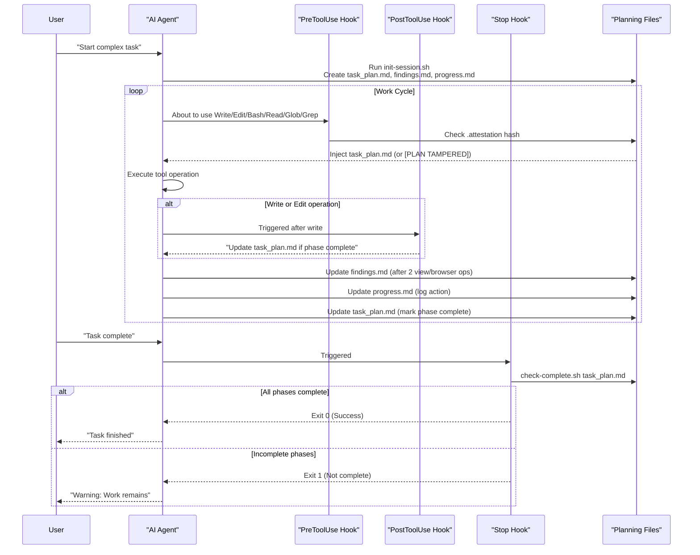
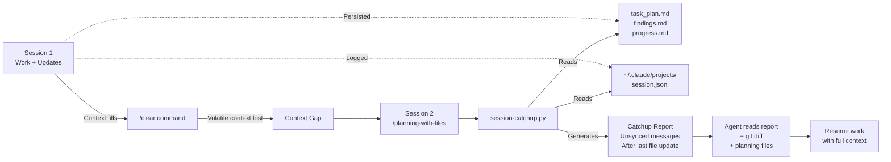

<!-- source: DeepWiki mcp.deepwiki.com · repo OthmanAdi/planning-with-files · page 1 Overview · fetched 2026-10-29 -->

# Overview

<details>
<summary>Relevant source files</summary>

The following files were used as context for generating this wiki page:

- [.claude-plugin/marketplace.json](.claude-plugin/marketplace.json)
- [.claude-plugin/plugin.json](.claude-plugin/plugin.json)
- [.gitignore](.gitignore)
- [CHANGELOG.md](CHANGELOG.md)
- [CITATION.cff](CITATION.cff)
- [CONTRIBUTORS.md](CONTRIBUTORS.md)
- [README.md](README.md)
- [examples/README.md](examples/README.md)
- [skills/planning-with-files/SKILL.md](skills/planning-with-files/SKILL.md)
- [skills/planning-with-files/examples.md](skills/planning-with-files/examples.md)
- [skills/planning-with-files/reference.md](skills/planning-with-files/reference.md)
- [skills/planning-with-files/templates/findings.md](skills/planning-with-files/templates/findings.md)
- [skills/planning-with-files/templates/progress.md](skills/planning-with-files/templates/progress.md)
- [skills/planning-with-files/templates/task_plan.md](skills/planning-with-files/templates/task_plan.md)

</details>


## Purpose and Scope

This document introduces **planning-with-files**, a system that transforms AI coding agents from stateless, volatile workers into persistent, goal-oriented project assistants. It explains the fundamental problem of context window volatility and the solution: using three markdown files (`task_plan.md`, `findings.md`, `progress.md`) as external working memory.

For specific workflow rules and automation details, see [Critical Rules](#4.2) and [Hook System and Automation](#4.3). For installation across different platforms, see [Installation and Platform Support](#3.1). For deep technical details on the three files, see sections [task_plan.md Specification](#7.1), [findings.md Specification](#7.2), and [progress.md Specification](#7.3).

**Sources:** [README.md:1-28](), [skills/planning-with-files/SKILL.md:1-27]()

---

## The Problem: Volatile AI Context

AI coding agents operate within a limited, volatile context window that creates four critical failure modes:

| Problem | Manifestation | Impact |
|---------|---------------|--------|
| **Volatile Memory** | Context lost on `/clear` command | Work disappears, must restart from scratch |
| **Limited Capacity** | ~100K-200K token limit | Cannot hold full project context |
| **Goal Drift** | After 50+ tool calls, original objectives forgotten | Agent wanders off-task, produces irrelevant work |
| **Hidden Errors** | Failures not tracked, same mistakes repeated | Endless loops, no learning from past attempts |

The core issue: **Context Window = RAM**. Like volatile memory in a computer, everything stored in an AI agent's context window disappears when the session resets. For complex multi-step tasks requiring research, decision-making, and error recovery, this volatility makes reliable completion nearly impossible.

**Sources:** [README.md:133-141](), [skills/planning-with-files/SKILL.md:79-85]()

---

## The Solution: Filesystem as Persistent Memory

The `planning-with-files` system implements a pattern inspired by Manus AI (the AI agent company Meta acquired for $2B): **treat the filesystem as external working memory**.

### Core Principle

```
Context Window = RAM (volatile, limited)
Filesystem = Disk (persistent, unlimited)

→ Anything important gets written to disk.
```

For every complex task, the system maintains three persistent markdown files in the project directory:

| File | Purpose | Update Frequency |
|------|---------|------------------|
| `task_plan.md` | Phases, progress, decisions, error log | After each phase completion |
| `findings.md` | Research, requirements, technical decisions | After every 2 view/browser operations |
| `progress.md` | Session logs, test results, action history | Throughout the session |

These files serve as the agent's "working memory on disk," surviving context resets, session boundaries, and even project interruptions.

**Sources:** [README.md:7-12](), [skills/planning-with-files/SKILL.md:79-94]()

---

## System Architecture

### File-Based Memory System

The following diagram shows how the three planning files persist state across the volatile context boundary, incorporating the security attestation layer introduced in v2.37.0.

```mermaid
graph TB
    subgraph VolatileMemory["Volatile Memory (Context Window)"]
        Agent["AI Agent<br/>(e.g. Claude Code)"]
        CurrentContext["Current Task Context<br/>Tools, Observations, Goals"]
    end
    
    subgraph PersistentMemory["Persistent Memory (Filesystem)"]
        TaskPlan["task_plan.md<br/>Phases & Progress<br/>Decisions & Errors"]
        Findings["findings.md<br/>Research & Discoveries<br/>Requirements & Technical Decisions"]
        Progress["progress.md<br/>Session Logs<br/>Test Results & Actions"]
        Attestation[".attestation<br/>SHA-256 Hash"]
    end
    
    subgraph Automation["Automation Layer"]
        PreToolUse["PreToolUse Hook<br/>Read task_plan.md before actions"]
        UserPromptSubmit["UserPromptSubmit Hook<br/>Inject plan context"]
        Stop["Stop Hook<br/>Verify completion"]
        InitSession["init-session.sh / init-session.ps1<br/>Initialize planning files"]
        CheckComplete["check-complete.sh / check-complete.ps1<br/>Verify all phases done"]
        SessionCatchup["session-catchup.py<br/>Recover lost context"]
        AttestPlan["attest-plan.sh<br/>Lock plan with SHA-256"]
    end
    
    Agent -->|"Reads before decisions"| TaskPlan
    Agent -->|"Writes after discoveries"| Findings
    Agent -->|"Logs actions"| Progress
    
    UserPromptSubmit -.->|"Validates hash against"| Attestation
    UserPromptSubmit -.->|"Injects into"| CurrentContext
    PreToolUse -.->|"Injects into"| CurrentContext
    Stop -.->|"Validates"| TaskPlan
    
    InitSession -->|"Creates from templates/"| TaskPlan
    InitSession -->|"Creates from templates/"| Findings
    InitSession -->|"Creates from templates/"| Progress
    
    CheckComplete -->|"Parses status from"| TaskPlan
    SessionCatchup -->|"Analyzes previous"| Progress
    AttestPlan -->|"Computes hash of"| TaskPlan
    AttestPlan -->|"Stores in"| Attestation
    
    ClearCommand["/clear command<br/>(context reset)"] -.->|"Erases"| VolatileMemory
    ClearCommand -.->|"Preserved"| PersistentMemory
```



**Diagram: File-Based Memory System Architecture**

This architecture implements the fundamental trade-off: context is cheap to access but volatile; files are persistent but require explicit read/write operations. The hook system automates these operations, and as of v2.37.0, the `attest-plan.sh` script provides a cryptographic guarantee against silent plan tampering.

**Sources:** [skills/planning-with-files/SKILL.md:7-24](), [CHANGELOG.md:5-17](), [README.md:70-80]()

---

### Hook-Driven Workflow

The system uses platform-native hooks to automate context management:



**Diagram: Hook-Driven Context Management Workflow**

**Hook Implementations:**
- **UserPromptSubmit**: [skills/planning-with-files/SKILL.md:7-10]() - Injects `task_plan.md` (first 50 lines) and `progress.md` (last 20 lines) into every prompt.
- **PreToolUse**: [skills/planning-with-files/SKILL.md:11-15]() - Re-injects `task_plan.md` (first 30 lines) immediately before tool execution to refresh attention.
- **PostToolUse**: [skills/planning-with-files/SKILL.md:16-20]() - Echoes reminder message after Write/Edit operations.
- **Stop**: [skills/planning-with-files/SKILL.md:21-24]() - Runs `check-complete.ps1` or `check-complete.sh` to ensure all phases are marked `complete`.

**Sources:** [skills/planning-with-files/SKILL.md:6-27](), [CHANGELOG.md:71-77]()

---

### Session Recovery System

When context fills and the user runs `/clear`, the system can recover unsynced work from the previous session using `session-catchup.py`.



**Diagram: Session Recovery Mechanism**

The `session-catchup.py` script analyzes JSONL session logs to find conversation that occurred after the last planning file update. This is critical for maintaining continuity in long-running projects.

**Script Location:** `scripts/session-catchup.py`
**Invocation:** [skills/planning-with-files/SKILL.md:40-48]()

**Sources:** [CONTRIBUTORS.md:28-34](), [CHANGELOG.md:93-97](), [skills/planning-with-files/SKILL.md:33-55]()

---

## Platform Support and Distribution

The system supports over 17 AI coding platforms through a standardized plugin and skill structure.

| Platform | Integration Type | Key Files |
|----------|------------------|-----------|
| **Claude Code** | Official Plugin | `.claude-plugin/plugin.json` |
| **Cursor** | Skills | `.cursor/skills/` |
| **Continue** | Skills + Prompts | `.continue/skills/` |
| **Kiro** | Agent Skill | `.kiro/skills/` |
| **Codex** | Session Hooks | `.codex/hooks.json` |
| **Hermes** | Project Plugin | `.hermes/skills/` |

**Cross-Platform Compatibility:**
- **Unix/Linux/macOS**: Uses `/usr/bin/env bash` for shebang portability [CHANGELOG.md:75]().
- **Windows**: Full PowerShell support (`.ps1` scripts) with `RemoteSigned` execution policy [CHANGELOG.md:76]().
- **I18n**: Supports Arabic, German, Spanish, and Chinese (Simplified/Traditional) [CHANGELOG.md:79-85]().

**Sources:** [README.md:66-90](), [.claude-plugin/plugin.json:1-40](), [CHANGELOG.md:34-85]()

---

## Core Components

### Planning Files (Templates)

The system provides three template files that agents copy to project directories:

- **`task_plan.md`**: The roadmap. Contains Goal, Current Phase, Phases list, Key Questions, Decisions Made, and Errors Encountered. [skills/planning-with-files/templates/task_plan.md:1-133]()
- **`findings.md`**: The knowledge base. Stores Requirements, Research Findings, Technical Decisions, and Visual/Browser Findings. [skills/planning-with-files/templates/findings.md:1-96]()
- **`progress.md`**: The chronological log. Tracks actions taken per phase, Test Results, and the "5-Question Reboot Check". [skills/planning-with-files/templates/progress.md:1-115]()

### Helper Scripts

As of v2.37.0, the script manifest includes ten user-facing scripts:

- `init-session.sh / .ps1`: Initializes the 3-file pattern. [CHANGELOG.md:53-57]()
- `check-complete.sh / .ps1`: Validates phase status. [CHANGELOG.md:38-41]()
- `session-catchup.py`: Recovers context from logs. [CHANGELOG.md:93-97]()
- `attest-plan.sh / .ps1`: SHA-256 hash attestation for plan security. [CHANGELOG.md:14-17]()
- `resolve-plan-dir.sh / .ps1`: Handles parallel plan directory resolution. [CHANGELOG.md:37-40]()
- `set-active-plan.sh / .ps1`: Switches between parallel plans. [CHANGELOG.md:37-40]()

**Sources:** [CHANGELOG.md:11-28](), [CHANGELOG.md:37-41](), [skills/planning-with-files/SKILL.md:21-24]()

---

## Command Interface

Users and agents interact with the system via slash commands:

| Command | Script | Description |
|---------|--------|-------------|
| `/plan` | `init-session` | Initialize or resume a planning session. |
| `/plan-status` | `check-complete` | Verify if all phases in the current plan are finished. |
| `/plan-attest` | `attest-plan` | Lock the current `task_plan.md` with a SHA-256 hash. [CHANGELOG.md:13]() |
| `/start` | `init-session` | Legacy initialization command. |

**Sources:** [CHANGELOG.md:13-15](), [README.md:70-75](), [skills/planning-with-files/SKILL.md:3-4]()

---

## When to Use This System

**Use planning-with-files for:**
- Multi-step tasks requiring 3+ sequential operations.
- Research projects involving discovery and documentation.
- Tasks requiring **5+ tool calls** (the threshold for goal drift). [skills/planning-with-files/SKILL.md:3]()
- Projects spanning multiple sessions or requiring context resets.

**Sources:** [skills/planning-with-files/SKILL.md:1-5](), [README.md:68-75]()

---

