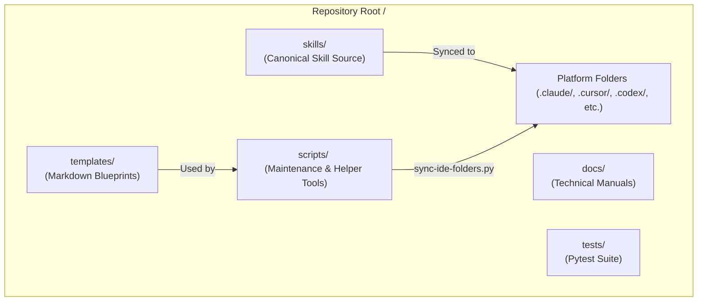
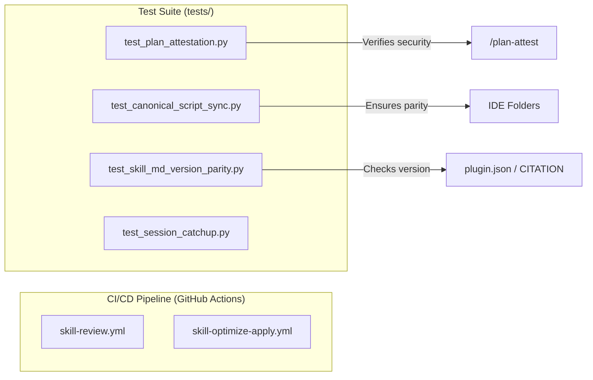

<!-- source: DeepWiki mcp.deepwiki.com · repo OthmanAdi/planning-with-files · page 10 Project Information · fetched 2026-10-29 -->

# Project Information

Relevant source files

The following files were used as context for generating this wiki page:

- [.claude-plugin/marketplace.json](.claude-plugin/marketplace.json)
- [.claude-plugin/plugin.json](.claude-plugin/plugin.json)
- [CHANGELOG.md](CHANGELOG.md)
- [CITATION.cff](CITATION.cff)
- [CONTRIBUTORS.md](CONTRIBUTORS.md)
- [README.md](README.md)
- [skills/planning-with-files/SKILL.md](skills/planning-with-files/SKILL.md)

## Purpose and Scope

This page provides technical information about the `planning-with-files` repository: its structure, community, version history, and maintenance tooling. It serves as a high-level index for project metadata and repository health.

**Sources:** [README.md:1-28](), [.claude-plugin/plugin.json:1-40]()

---

## Community and Contributors

The project grew rapidly after its launch, amassing over 9,600 stars and fostering a diverse ecosystem of forks and extensions. Contributions range from IDE integrations (Cursor, Continue, Kilocode) to internationalization and security hardening.

For a detailed list of contributors and their specific impact on the codebase, see [Contributors and Community](#10.1).

### Project Identity
| Property | Value |
|----------|-------|
| **Version** | 2.37.0 |
| **License** | MIT |
| **Author** | Ahmad Othman Ammar Adi |
| **Repository** | [OthmanAdi/planning-with-files](https://github.com/OthmanAdi/planning-with-files) |

**Sources:** [README.md:16-17](), [CONTRIBUTORS.md:1-110](), [CITATION.cff:1-14]()

---

## Repository Structure

The repository is organized to serve as both a canonical source of truth and a distribution point for 17+ AI agent platforms.

**Diagram: Repository Organization**

For a deep dive into directory purposes and the `sync-ide-folders.py` tool, see [Repository Structure](#10.2).

**Sources:** [CHANGELOG.md:38-40](), [CONTRIBUTORS.md:15-104]()

---

## Changelog and Version History

The project follows semantic versioning, with major milestones including the introduction of session recovery (v2.2.0), parallel planning isolation (v2.36.0), and plan attestation security (v2.37.0).

| Version | Key Feature | Impact |
|---------|-------------|--------|
| **v2.37.0** | Plan Attestation | Prevents prompt injection via SHA-256 hashes |
| **v2.36.0** | Slug Mode | Enables parallel tasks in isolated directories |
| **v2.2.0** | Session Catchup | Restores context from JSONL logs after `/clear` |

For the full version history and feature evolution, see [Changelog](#10.3).

**Sources:** [CHANGELOG.md:5-110](), [README.md:68-100]()

---

## File Management and Tooling

Maintenance of the repository is supported by Python-based automation to ensure parity across all supported IDEs and platforms.

### Maintenance Toolchain
- **`sync-ide-folders.py`**: Propagates changes from the canonical `skills/` directory to all 14+ IDE mirror folders.
- **`bump-version.py`**: Atomically updates version strings across `plugin.json`, `marketplace.json`, `CITATION.cff`, and all `SKILL.md` variants.
- **`.gitignore`**: Configured to ensure templates and scripts are committed while volatile session data (JSONL) and local planning files are ignored.

For details on the release workflow and git configuration, see [File Management and .gitignore](#10.4).

**Sources:** [CHANGELOG.md:15-16](), [CHANGELOG.md:39-41](), [.claude-plugin/plugin.json:3]()

---

## Testing Infrastructure

The project employs a rigorous testing suite to prevent regressions across its multi-platform footprint.

**Diagram: Quality Assurance Workflow**

For an overview of test cases and CI automation, see [Testing Infrastructure](#10.5).

**Sources:** [CHANGELOG.md:16-17](), [CHANGELOG.md:60-61](), [README.md:9-12]()

---

