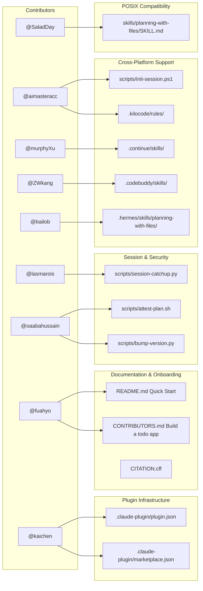
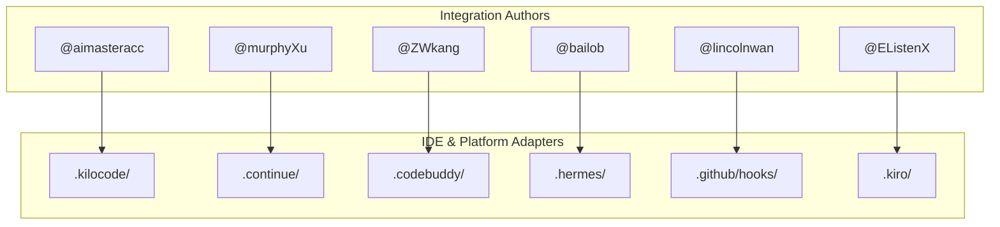

<!-- source: DeepWiki mcp.deepwiki.com · repo OthmanAdi/planning-with-files · page 10.1 Contributors and Community · fetched 2026-10-29 -->

# Contributors and Community

Relevant source files

The following files were used as context for generating this wiki page:

- [.claude-plugin/marketplace.json](.claude-plugin/marketplace.json)
- [.claude-plugin/plugin.json](.claude-plugin/plugin.json)
- [CHANGELOG.md](CHANGELOG.md)
- [CITATION.cff](CITATION.cff)
- [CONTRIBUTORS.md](CONTRIBUTORS.md)
- [README.md](README.md)
- [skills/planning-with-files/SKILL.md](skills/planning-with-files/SKILL.md)

This document catalogs the individuals and organizations who have contributed code, documentation, platform integrations, and testing to `planning-with-files`. It maps contributors to specific code entities (files, directories, scripts) they created or modified, and documents the community growth from a single developer to a multi-platform ecosystem with 9,600+ GitHub stars.

For information about the repository file structure, see **10.2 Repository Structure**. For version history with technical details, see **10.3 Changelog**.

---

## Project Author

**Ahmad Othman Ammar Adi** ([@OthmanAdi](https://github.com/OthmanAdi)) - Original creator and maintainer of `planning-with-files`. Established the core 3-file pattern, hook system, and multi-platform architecture.

Sources: [README.md:7-12](), [CONTRIBUTORS.md:7-8](), [CITATION.cff:6-9]()

---

## Core Contributors by Code Impact

### Contributor-to-Code Entity Mapping

The following diagram maps each contributor to the specific files and directories they created or modified, bridging the natural language contributor names to the code entities in the repository.

Sources: [CONTRIBUTORS.md:10-110](), [CHANGELOG.md:5-70]()

---

## Detailed Contributions

### Plugin Infrastructure: @kaichen
**Impact:** Transformed the project from manual installation to marketplace distribution, enabling 9,600+ users to install via plugin system.

| Contribution | Files Created/Modified | PR |
|--------------|------------------------|-----|
| Plugin structure | [.claude-plugin/plugin.json]() | #9 |
| Marketplace compatibility | [.claude-plugin/marketplace.json]() | #9 |
| Official Standards | [skills/planning-with-files/SKILL.md]() | #9 |

Sources: [CONTRIBUTORS.md:15-19](), [.claude-plugin/plugin.json:1-40]()

### Security and Maintenance: @oaabahussain
**Impact:** Introduced cryptographic plan attestation and atomic versioning to prevent regressions across the 14+ IDE variants.

| Contribution | Files Created/Modified | Issue |
|--------------|------------------------|-----|
| Hash Attestation | [scripts/attest-plan.sh](), [scripts/attest-plan.ps1]() | #150 |
| Version Bumper | [scripts/bump-version.py]() | #151 |
| Parity Testing | [tests/test_skill_md_version_parity.py]() | #151 |

**Technical Detail:** The attestation system uses SHA-256 hashes stored in `.planning/<active-plan>/.attestation` to verify `task_plan.md` before injection [CHANGELOG.md:9-14]().

Sources: [CHANGELOG.md:5-33](), [CONTRIBUTORS.md:107-113]()

### Session Recovery: @lasmarois
**Impact:** Solved context loss after `/clear` commands by analyzing JSONL session logs to recover unsynced work.

| Contribution | Files Created/Modified | PR |
|--------------|------------------------|-----|
| Session recovery script | [scripts/session-catchup.py]() | #33 |
| PreToolUse expansion | [skills/planning-with-files/SKILL.md:11-15]() | #33 |
| Multi-session scanning | [scripts/session-catchup.py]() | #37 |

Sources: [CONTRIBUTORS.md:28-34](), [skills/planning-with-files/SKILL.md:33-54]()

### Platform Expansion
The community has extended `planning-with-files` to over 17 platforms through specific directory structures and adapters.

Sources: [CONTRIBUTORS.md:36-103](), [README.md:56-99]()

---

## Community Growth Story

The project experienced rapid growth, reaching 9,600+ stars in a short period due to its "Manus-style" persistent memory approach [README.md:7-24]().

### Community Ecosystem
Beyond core contributions, the community has built several notable forks and extensions:
*   **devis** ([@st01cs](https://github.com/st01cs)): Interview-first workflow with `/devis:intv` commands [README.md:37]().
*   **multi-manus-planning** ([@kmichels](https://github.com/kmichels)): Multi-project support and git sync [README.md:38]().
*   **plan-cascade** ([@Taoidle](https://github.com/Taoidle)): Multi-level task orchestration and parallel execution [README.md:39]().
*   **agentfund-skill** ([@RioTheGreat-ai](https://github.com/RioTheGreat-ai)): Crowdfunding for AI agents on Base [README.md:40]().

### Internationalization
The community has localized the skill into several languages:
*   **Chinese (Simplified/Traditional):** [@waynelee2048](https://github.com/waynelee2048), [@murphyXu](https://github.com/murphyXu) [CHANGELOG.md:85]().
*   **Arabic, German, Spanish:** Community-led multi-language expansion in v2.33.0 [CHANGELOG.md:79]().

Sources: [README.md:31-54](), [CHANGELOG.md:79-85]()

---

## Recognition and Citation

The project maintains a formal `CITATION.cff` to allow researchers and developers to credit the work properly.

**Metadata Summary:**
*   **Title:** planning-with-files [CITATION.cff:4]()
*   **Abstract:** Claude Code skill implementing Manus-style persistent markdown planning [CITATION.cff:5]()
*   **License:** MIT [CITATION.cff:12]()
*   **Keywords:** agent-skill, planning, manus-style, autonomous-agents [CITATION.cff:15-23]()

Sources: [CITATION.cff:1-24](), [CONTRIBUTORS.md:1-115]()

---

