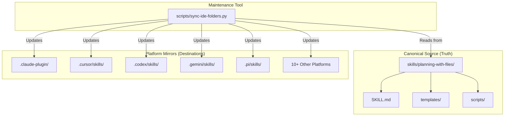
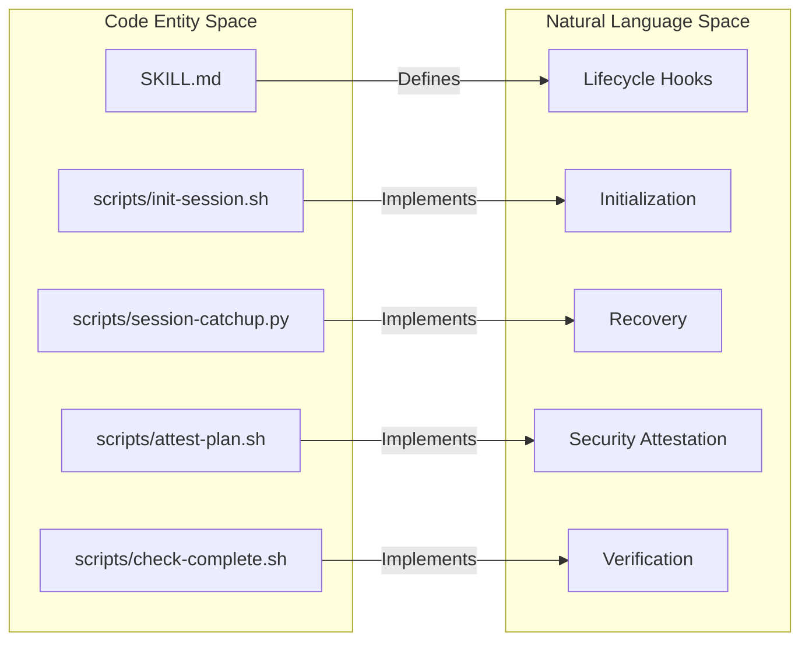

<!-- source: DeepWiki mcp.deepwiki.com · repo OthmanAdi/planning-with-files · page 10.2 Repository Structure · fetched 2026-10-29 -->

# Repository Structure

Relevant source files

The following files were used as context for generating this wiki page:

- [.claude-plugin/marketplace.json](.claude-plugin/marketplace.json)
- [.claude-plugin/plugin.json](.claude-plugin/plugin.json)
- [.gitignore](.gitignore)
- [CHANGELOG.md](CHANGELOG.md)
- [CITATION.cff](CITATION.cff)
- [CONTRIBUTORS.md](CONTRIBUTORS.md)
- [README.md](README.md)
- [examples/README.md](examples/README.md)
- [scripts/sync-ide-folders.py](scripts/sync-ide-folders.py)
- [skills/planning-with-files/SKILL.md](skills/planning-with-files/SKILL.md)
- [skills/planning-with-files/examples.md](skills/planning-with-files/examples.md)
- [skills/planning-with-files/reference.md](skills/planning-with-files/reference.md)
- [skills/planning-with-files/templates/findings.md](skills/planning-with-files/templates/findings.md)
- [skills/planning-with-files/templates/progress.md](skills/planning-with-files/templates/progress.md)
- [skills/planning-with-files/templates/task_plan.md](skills/planning-with-files/templates/task_plan.md)

This document describes the organization of the planning-with-files repository, including the canonical source structure, platform-specific adapters, and the `sync-ide-folders.py` maintenance tool.

## Overview of Distribution Architecture

The repository uses a **multi-tier distribution pattern** to support diverse installation methods: plugin marketplace installs, manual copies, and platform-specific integrations. This ensures that regardless of how a user installs the skill (e.g., `npx skills add` or manual copy), the underlying logic remains consistent.

### The Canonical Source Pattern

The repository maintains a single source of truth for all shared logic (templates, scripts, and references) which is then propagated to platform-specific directories.

**Sources:** [scripts/sync-ide-folders.py:1-20](), [CHANGELOG.md:34-49]()

## Top-Level Directory Structure

The root directory contains the high-level orchestration files, metadata, and the distribution mirrors for various IDEs.

| Directory | Purpose | Key Contents |
|:---|:---|:---|
| `skills/` | **Canonical Source.** The primary location for the skill logic. | `planning-with-files/SKILL.md` |
| `scripts/` | Maintenance and development scripts. | `sync-ide-folders.py`, `bump-version.py` |
| `templates/` | Markdown templates for the 3-file pattern. | `task_plan.md`, `findings.md`, `progress.md` |
| `commands/` | Plugin command definitions for slash commands. | `plan.md`, `start.md` |
| `docs/` | Platform-specific installation and usage guides. | `installation.md`, `hermes.md`, `windows.md` |
| `tests/` | Regression and unit test suite. | `test_canonical_script_sync.py`, `test_plan_attestation.py` |

**Sources:** [README.md:226-277](), [scripts/sync-ide-folders.py:28-55]()

### The Maintenance Tool: `sync-ide-folders.py`

This Python utility ensures that updates to the canonical templates and scripts are byte-identically mirrored across all supported IDE folders.

- **Implementation:** It builds a manifest for each IDE (e.g., `.cursor`, `.gemini`, `.codex`) mapping canonical source files to their target paths [scripts/sync-ide-folders.py:61-104]().
- **Verification:** The `--verify` flag is used in GitHub Actions to catch "drift" where a contributor might update a script in one location but forget another [scripts/sync-ide-folders.py:217-221]().
- **Sync Manifests:** It specifically syncs `TEMPLATES`, `REFERENCES`, and `SCRIPTS` while ignoring platform-specific files like `SKILL.md` or `package.json` [scripts/sync-ide-folders.py:10-16]().

**Sources:** [scripts/sync-ide-folders.py:1-165](), [CHANGELOG.md:34-49]()

## Core Skill Components (`skills/planning-with-files/`)

The `skills/` directory contains the "canonical" version of the skill. This is the source used for the `npx skills add` command.

**Sources:** [skills/planning-with-files/SKILL.md:1-24](), [scripts/sync-ide-folders.py:43-55]()

### Helper Scripts Reference

The `scripts/` directory within the skill bundle contains the operational logic for the planning workflow.

| Script | Language | Role |
|:---|:---|:---|
| `init-session.sh/ps1` | Bash/PS | Creates `task_plan.md`, `findings.md`, and `progress.md` from templates. Supports "slug mode" for parallel tasks [CHANGELOG.md:74](). |
| `check-complete.sh/ps1` | Bash/PS | Analyzes `task_plan.md` to verify if all phases are marked `complete` [CHANGELOG.md:38-41](). |
| `session-catchup.py` | Python | Recovers unsynced context from JSONL session logs after a `/clear` command [CONTRIBUTORS.md:28-35](). |
| `attest-plan.sh/ps1` | Bash/PS | Computes SHA-256 hashes of `task_plan.md` to prevent prompt injection tampering [CHANGELOG.md:9-14](). |
| `resolve-plan-dir.sh/ps1` | Bash/PS | Locates the active plan directory in parallel-plan mode [CHANGELOG.md:74](). |

**Sources:** [scripts/sync-ide-folders.py:43-55](), [CHANGELOG.md:5-29](), [CHANGELOG.md:34-49]()

## Platform-Specific Directories

The repository contains numerous hidden directories (e.g., `.claude/`, `.cursor/`, `.codex/`) that serve as adapters for different AI agent platforms.

### Claude Code (`.claude-plugin/`)
Contains `plugin.json` and `marketplace.json` which define the skill for the Claude Code marketplace [README.md:16](). It uses the `SKILL.md` in the root or canonical path to register hooks like `UserPromptSubmit` and `PreToolUse` [skills/planning-with-files/SKILL.md:6-24]().

### Cursor and Continue (`.cursor/`, `.continue/`)
These directories mirror the canonical skill structure but are tailored for IDE-specific discovery. `.continue/` specifically includes a `prompts/` directory for localized slash commands [CHANGELOG.md:50-55]().

### Codex and OpenCode (`.codex/`, `.opencode/`)
These platforms use a specialized hook adapter. `session-catchup.py` was specifically rewritten to support the Codex rollout JSONL format [CONTRIBUTORS.md:93-97]().

### Security and Maintenance Scripts

The `scripts/` directory at the root includes tools for repository health:

- **`bump-version.py`**: An atomic version bumper that updates the version string across 14 `SKILL.md` variants, `plugin.json`, `marketplace.json`, and `CITATION.cff` simultaneously to prevent regression [CHANGELOG.md:15]().
- **`sync-ide-folders.py`**: As described above, ensures byte-parity across all platform mirrors [scripts/sync-ide-folders.py:1-20]().

**Sources:** [CHANGELOG.md:15-17](), [scripts/sync-ide-folders.py:1-20]()

## Testing Infrastructure (`tests/`)

The repository includes a comprehensive test suite to ensure structural integrity and functional correctness.

| Test File | Focus |
|:---|:---|
| `test_canonical_script_sync.py` | Asserts that scripts in `scripts/` are identical to those in `skills/planning-with-files/scripts/` [CHANGELOG.md:58-61](). |
| `test_plan_attestation.py` | Verifies SHA-256 hash computation and tamper detection logic [CHANGELOG.md:17](). |
| `test_skill_md_version_parity.py` | Fails the build if any platform's `SKILL.md` version diverges from the canonical version [CHANGELOG.md:16](). |
| `test_session_catchup.py` | Validates recovery logic for both standard and Codex JSONL formats [CONTRIBUTORS.md:96](). |

**Sources:** [CHANGELOG.md:5-29](), [CHANGELOG.md:58-61](), [CONTRIBUTORS.md:93-97]()

---

