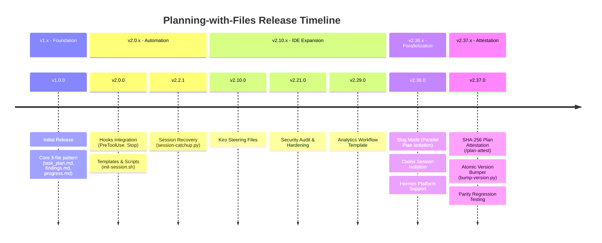
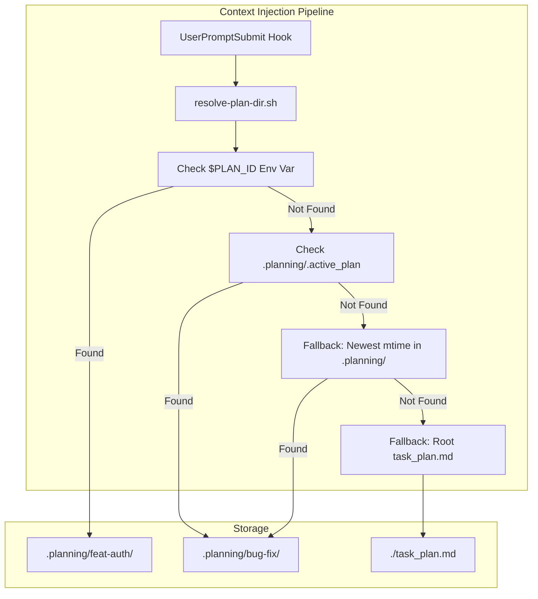
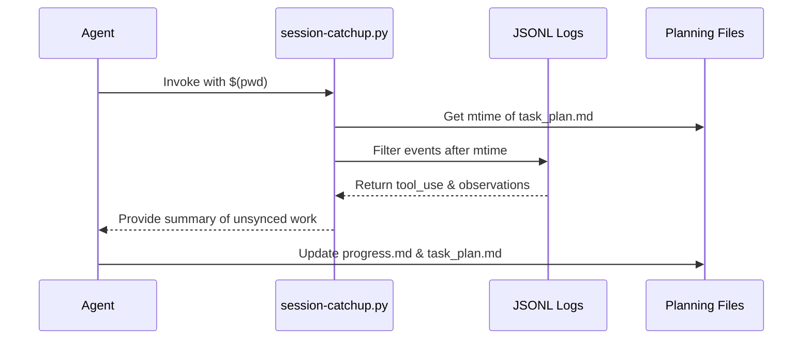

<!-- source: DeepWiki mcp.deepwiki.com · repo OthmanAdi/planning-with-files · page 10.3 Changelog · fetched 2026-10-29 -->

# Changelog

Relevant source files

The following files were used as context for generating this wiki page:

- [.claude-plugin/marketplace.json](.claude-plugin/marketplace.json)
- [.claude-plugin/plugin.json](.claude-plugin/plugin.json)
- [CHANGELOG.md](CHANGELOG.md)
- [CITATION.cff](CITATION.cff)
- [CONTRIBUTORS.md](CONTRIBUTORS.md)
- [README.md](README.md)
- [skills/planning-with-files/SKILL.md](skills/planning-with-files/SKILL.md)

This page documents the complete version history of `planning-with-files` from v1.0.0 through v2.37.0. Each version entry highlights major features such as session recovery, Git checkpoints, multi-platform support, slug-based isolation, plan attestation, and security hardening.

---

## Version History Overview

The project has evolved from a foundational 3-file pattern into a robust security-hardened framework supporting over 17 AI coding platforms with advanced context engineering capabilities.

### Version Timeline and Major Milestones

**Sources:** [CHANGELOG.md:1-120](), [README.md:66-100]()

---

## Version 2.x Series (Current)

### v2.37.0 - Security Attestation & Parity
**Release Date:** May 5, 2026

**Major Features:**
- **Hash Attestation for Plan Injection:** Introduced `/plan-attest` and `attest-plan.sh/ps1` to prevent prompt injection via tampered planning files.
- **Atomic Version Bumper:** `scripts/bump-version.py` now handles 14 `SKILL.md` variants simultaneously to prevent version drift.
- **Regression Testing:** Added `test_skill_md_version_parity.py` and `test_plan_attestation.py`.

**Technical Implementation:**
The `attest-plan.sh` script computes a SHA-256 hash of `task_plan.md` and stores it in `.planning/<active-plan>/.attestation`. During `UserPromptSubmit` or `PreToolUse`, the hook recomputes the hash; if a mismatch occurs, injection is blocked with a `[PLAN TAMPERED]` warning.

**Sources:** [CHANGELOG.md:5-32](), [skills/planning-with-files/SKILL.md:10-15]()

---

### v2.36.0 - Parallel Plan Isolation (Slug Mode)
**Release Date:** May 1, 2026

**Major Features:**
- **Slug Mode:** `init-session.sh` now supports a slug argument to isolate plans in `.planning/<slug>/`.
- **Active Plan Resolution:** Introduced `resolve-plan-dir.sh` and `set-active-plan.sh` to manage which isolated plan the hooks should inject.
- **Codex Session Isolation:** Hooks now route through the resolver to ensure `CODEX_THREAD_ID` matches the correct plan directory.

**Data Flow for Plan Resolution:**

**Sources:** [CHANGELOG.md:74-74](), [README.md:74]()

---

### v2.35.0 - Hermes Platform Support
**Release Date:** April 2026

**Major Features:**
- **Hermes Adapter:** Added support for platform 17 (Hermes) via a project plugin.
- **NLPM Audit Hardening:** Improved Python path resolution and session-catchup injection caps.
- **Pi PowerShell Syntax:** Fixed compatibility for Pi Agent on Windows.

**Sources:** [CHANGELOG.md:76-76](), [CONTRIBUTORS.md:99-103]()

---

### v2.21.0 - Security Hardening
**Major Features:**
- **Prompt Injection Delimiters:** Wrapped injected plan data in `---BEGIN PLAN DATA---` and `---END PLAN DATA---` to prevent the model from executing text inside the plan as instructions.
- **ExecutionPolicy Hardening:** Changed PowerShell policy from `Bypass` to `RemoteSigned`.
- **Path Sanitization:** Fixed Windows path issues that allowed command injection via malformed session logs.

**Sources:** [CHANGELOG.md:73-73](), [skills/planning-with-files/SKILL.md:10-15]()

---

### v2.2.1 - Session Recovery System
**Major Feature:** Automatic context restoration after `/clear`.

**Implementation:**
The `session-catchup.py` script analyzes JSONL logs in `~/.claude/projects/`. It identifies the last timestamp `task_plan.md` was updated and extracts all subsequent tool observations and user prompts to summarize what the agent missed during the context wipe.

**Sources:** [CONTRIBUTORS.md:28-34](), [skills/planning-with-files/SKILL.md:33-55]()

---

## Platform Evolution Table

The following table tracks the expansion of the ecosystem from a single script to a multi-IDE standard.

| Version | Platforms Added | Core Mechanism |
| :--- | :--- | :--- |
| **v1.0.0** | Claude Code (Manual) | Manual file creation |
| **v2.0.0** | Claude Code (Plugin) | `hooks.json` & `SKILL.md` |
| **v2.2.0** | Kilocode, Windows | `.kilocode/rules/`, `.ps1` scripts |
| **v2.3.0** | Codex, OpenCode | `.codex/hooks.json` |
| **v2.7.0** | Gemini CLI | `.gemini/skills/` |
| **v2.8.0** | Continue, VS Code | `.continue/prompts/` |
| **v2.10.0** | Kiro | `.kiro/steering/` |
| **v2.18.0** | GitHub Copilot | `.github/hooks/` |
| **v2.35.0** | Hermes | Hermes project plugin |

**Sources:** [README.md:66-100](), [CHANGELOG.md:34-110]()

---

## Legacy Version Archive (v1.x)

### v1.0.0 - The 3-File Pattern
**Release Date:** January 7, 2026
Initial release establishing the "Filesystem as Working Memory" principle. It introduced the core trio:
1. `task_plan.md`: High-level phase tracking.
2. `findings.md`: Persistent research storage (2-Action Rule).
3. `progress.md`: Granular session logging.

**Sources:** [README.md:126-159](), [CHANGELOG.md:522-532]()

---

## Summary of Major Scripts

| Script | Added | Purpose |
| :--- | :--- | :--- |
| `init-session.sh` | v2.0.0 | Creates planning files from templates. |
| `session-catchup.py` | v2.2.1 | Recovers context from JSONL logs after `/clear`. |
| `check-complete.sh` | v2.0.0 | Quality gate for the `Stop` hook. |
| `resolve-plan-dir.sh` | v2.36.0 | Finds the correct isolated plan directory. |
| `attest-plan.sh` | v2.37.0 | Generates SHA-256 hash for security attestation. |
| `bump-version.py` | v2.37.0 | Synchronizes versions across 14+ platforms. |

**Sources:** [CHANGELOG.md:15-27](), [CHANGELOG.md:38-40]()

---

