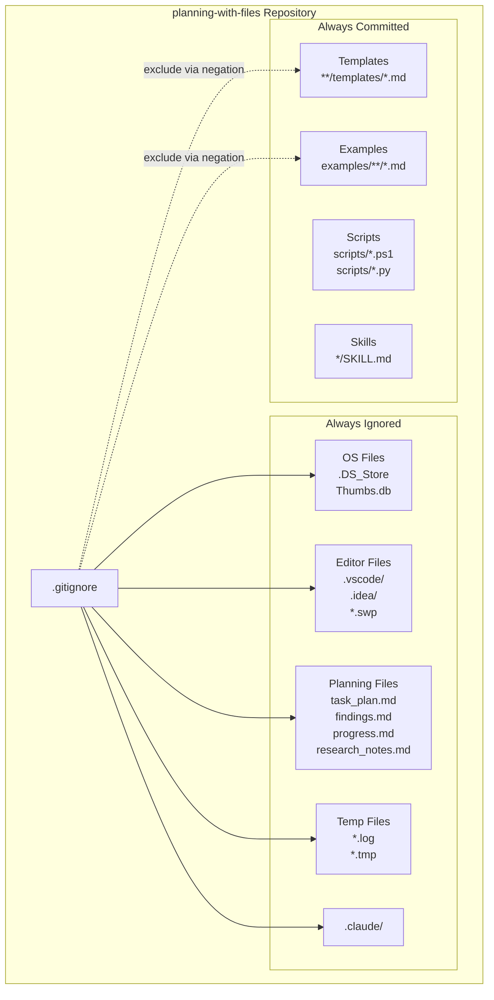
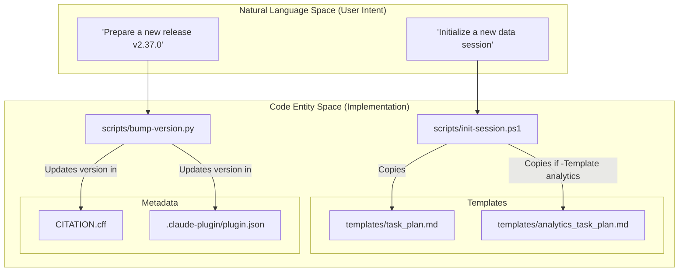

<!-- source: DeepWiki mcp.deepwiki.com · repo OthmanAdi/planning-with-files · page 10.4 File Management and .gitignore · fetched 2026-10-29 -->

# File Management and .gitignore

Relevant source files

The following files were used as context for generating this wiki page:

- [.gitignore](.gitignore)
- [examples/README.md](examples/README.md)
- [scripts/bump-version.py](scripts/bump-version.py)
- [scripts/init-session.ps1](scripts/init-session.ps1)
- [skills/planning-with-files/examples.md](skills/planning-with-files/examples.md)
- [skills/planning-with-files/reference.md](skills/planning-with-files/reference.md)
- [skills/planning-with-files/templates/findings.md](skills/planning-with-files/templates/findings.md)
- [skills/planning-with-files/templates/progress.md](skills/planning-with-files/templates/progress.md)
- [skills/planning-with-files/templates/task_plan.md](skills/planning-with-files/templates/task_plan.md)
- [templates/analytics_findings.md](templates/analytics_findings.md)
- [templates/analytics_task_plan.md](templates/analytics_task_plan.md)

This document explains version control strategies for planning-with-files: what files should be committed to version control, what should be ignored, and how users should manage planning files in their own projects. It covers both the planning-with-files repository itself and user projects that consume the skill.

For information about the repository structure, see [Repository Structure](#10.2). For installation methods, see [Installation and Platform Support](#3.1).

---

## Purpose and Scope

The planning-with-files system involves three distinct categories of files, each with different version control requirements:

1. **Skill infrastructure** (templates, scripts, SKILL.md) - committed in the planning-with-files repository.
2. **User-generated planning files** (task_plan.md, findings.md, progress.md) - user's choice in their projects.
3. **Session metadata** (JSONL logs) - always ignored, stored in platform directories.
4. **Release and Analytics metadata** - variant templates and versioning scripts used by maintainers.

This page clarifies what belongs where and provides .gitignore patterns for both repository maintainers and end users.

---

## File Categories and Version Control Status

### Repository Infrastructure Files

These files define the skill and should always be committed to the planning-with-files repository:

| Category | Files | Location | Version Control |
|----------|-------|----------|-----------------|
| **Templates** | `task_plan.md`, `findings.md`, `progress.md` | `templates/`, `skills/planning-with-files/templates/` | ✅ Commit |
| **Analytics Variants** | `analytics_task_plan.md`, `analytics_findings.md` | `templates/` | ✅ Commit |
| **Scripts** | `init-session.ps1`, `bump-version.py` | `scripts/` | ✅ Commit |
| **Skill Definitions** | `SKILL.md`, `examples.md`, `reference.md` | `skills/planning-with-files/` | ✅ Commit |
| **Plugin Manifests** | `plugin.json`, `marketplace.json` | `.claude-plugin/` | ✅ Commit |

**Sources:** [.gitignore:19-22](), [scripts/init-session.ps1:15](), [scripts/bump-version.py:40-58](), [templates/analytics_task_plan.md:1-7]()

### User-Generated Planning Files

These files are created by users in their project root when invoking the skill:

| File | Purpose | Location | Recommended Strategy |
|------|---------|----------|---------------------|
| `task_plan.md` | Phase tracking, decisions, errors | Project root | User choice (often ignored) |
| `findings.md` | Research, technical decisions | Project root | User choice (often ignored) |
| `progress.md` | Session logs, test results | Project root | User choice (often ignored) |

**User Choice Rationale:**
- **Commit** if you want to preserve task history across team members or sessions.
- **Ignore** if these are temporary working files for a single developer's workflow.
- The planning-with-files repository itself ignores these files (they're meta - "I used this skill to build this skill!") via [.gitignore:12-17]().

---

## The Repository .gitignore Configuration

**Diagram: Repository .gitignore Strategy**

The [.gitignore:1-38]() file implements a whitelist/blacklist pattern using negation rules.

### Key Patterns Explained

#### 1. Ignoring Planning Files
The repo ignores standard planning files at the root level because the maintainers use the skill to develop the skill itself [.gitignore:12-17]().

#### 2. Preserving Templates via Negation
The `!` prefix negates the previous ignore patterns. This ensures that files in `examples/` and any `templates/` directory (e.g., `skills/planning-with-files/templates/task_plan.md`) are committed [.gitignore:19-22]().

#### 3. Analytics Template Variants
The system includes specialized templates for data analytics workflows:
- `templates/analytics_task_plan.md` [.templates/analytics_task_plan.md:1-7]()
- `templates/analytics_findings.md` [.templates/analytics_findings.md:1-6]()

These are selected during session initialization via the `-Template analytics` flag in `init-session.ps1` [scripts/init-session.ps1:2-7]().

---

## The bump-version.py Release Workflow

The repository maintains a "parity set" of 19+ files that must share the exact same version number to avoid regressions. The `bump-version.py` script automates this process [scripts/bump-version.py:4-8]().

### Parity Set Components
The script targets four kinds of files:
1. **skill_md**: Version field in `SKILL.md` (e.g., `skills/planning-with-files/SKILL.md`) [scripts/bump-version.py:41-54]().
2. **plugin_json**: The `version` key in `.claude-plugin/plugin.json` [scripts/bump-version.py:55]().
3. **marketplace_json**: The `version` key in `.claude-plugin/marketplace.json` [scripts/bump-version.py:56]().
4. **citation_cff**: The `version` field in the root `CITATION.cff` [scripts/bump-version.py:57]().

### Implementation Logic
The script uses regex to perform atomic updates across the repo:
- `bump_skill_md`: Searches for `version: "..."` [scripts/bump-version.py:71-83]().
- `bump_plugin_or_marketplace`: Searches for `"version": "..."` [scripts/bump-version.py:86-105]().
- `bump_citation_cff`: Handles both quoted and unquoted version fields [scripts/bump-version.py:108-121]().

---

## File Location Mapping

**Diagram: Mapping Intent to Code Entities**

### Session Data Flow

When a user initializes a session, `init-session.ps1` resolves the template directory based on the script's location [scripts/init-session.ps1:13-15](). It then checks if the planning files already exist to prevent overwriting [scripts/init-session.ps1:78-80]().

**Sources:** [scripts/init-session.ps1:1-167](), [scripts/bump-version.py:1-184](), [templates/analytics_task_plan.md:1-107]()

---

## Summary of File Management Rules

| Category | File | .gitignore Status | Reason |
|----------|------|-------------------|--------|
| **Source** | `scripts/*.ps1` | ✅ Committed | Required for skill functionality. |
| **Source** | `templates/*.md` | ✅ Committed | Blueprints for planning files. |
| **Source** | `bump-version.py` | ✅ Committed | Release automation tool. |
| **User Data** | `task_plan.md` | ❌ Ignored in Repo | Specific to the current task context. |
| **User Data** | `findings.md` | ❌ Ignored in Repo | Specific to the current task context. |
| **User Data** | `progress.md` | ❌ Ignored in Repo | Specific to the current task context. |
| **Platform** | `.claude/` | ❌ Ignored | Platform-managed session logs. |

**Sources:** [.gitignore:1-38](), [scripts/init-session.ps1:25-112](), [scripts/bump-version.py:14-26]()

---

