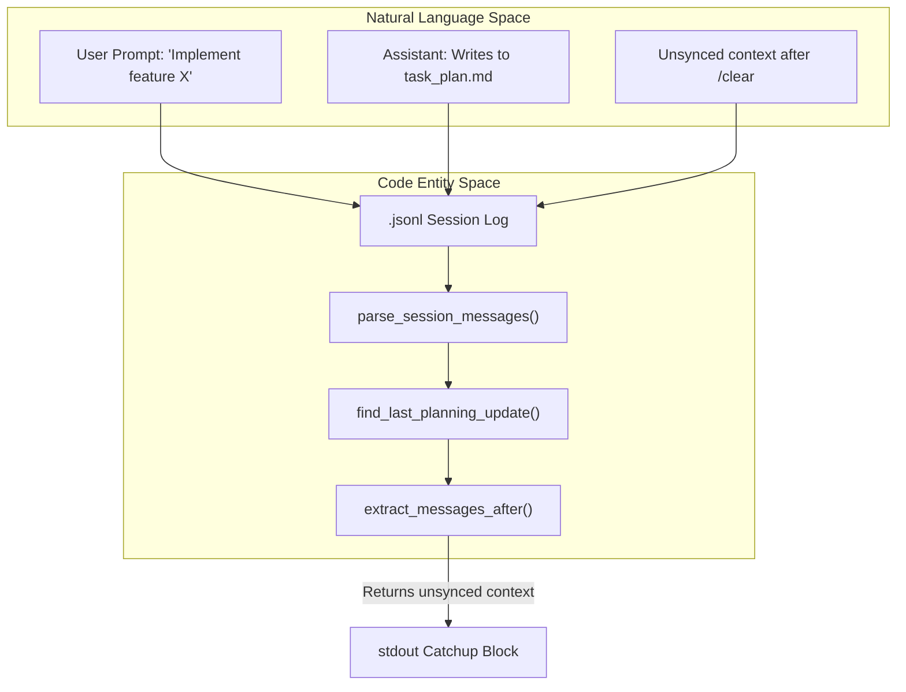
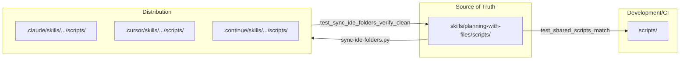

<!-- source: DeepWiki mcp.deepwiki.com · repo OthmanAdi/planning-with-files · page 10.5 Testing Infrastructure · fetched 2026-10-29 -->

# Testing Infrastructure

Relevant source files

The following files were used as context for generating this wiki page:

- [.codebuddy/skills/planning-with-files/scripts/session-catchup.py](.codebuddy/skills/planning-with-files/scripts/session-catchup.py)
- [.codex/skills/planning-with-files/scripts/session-catchup.py](.codex/skills/planning-with-files/scripts/session-catchup.py)
- [.continue/skills/planning-with-files/scripts/session-catchup.py](.continue/skills/planning-with-files/scripts/session-catchup.py)
- [.factory/skills/planning-with-files/scripts/session-catchup.py](.factory/skills/planning-with-files/scripts/session-catchup.py)
- [.gemini/skills/planning-with-files/scripts/session-catchup.py](.gemini/skills/planning-with-files/scripts/session-catchup.py)
- [.github/workflows/skill-optimize-apply.yml](.github/workflows/skill-optimize-apply.yml)
- [.github/workflows/skill-review.yml](.github/workflows/skill-review.yml)
- [.pi/skills/planning-with-files/scripts/session-catchup.py](.pi/skills/planning-with-files/scripts/session-catchup.py)
- [skills/planning-with-files/scripts/session-catchup.py](skills/planning-with-files/scripts/session-catchup.py)
- [tests/test_canonical_script_sync.py](tests/test_canonical_script_sync.py)
- [tests/test_plan_attestation.py](tests/test_plan_attestation.py)
- [tests/test_session_catchup.py](tests/test_session_catchup.py)

The `planning-with-files` testing infrastructure ensures the reliability of session recovery, script synchronization across IDE platforms, and the security of plan attestations. The suite combines Python-based unit tests for complex logic (like JSONL log parsing) and shell-based regression tests for cross-platform helper scripts.

## Test Suite Overview

The test suite is located in the `tests/` directory and covers the critical paths of the planning lifecycle, from initialization to security verification.

| Test File | Target Component | Key Verification |
| :--- | :--- | :--- |
| `test_session_catchup.py` | `session-catchup.py` | Validates recovery of unsynced context from `.jsonl` session logs. |
| `test_canonical_script_sync.py` | `sync-ide-folders.py` | Ensures helper scripts remain byte-identical across all IDE skill folders. |
| `test_plan_attestation.py` | `attest-plan.sh` | Verifies SHA-256 hash generation and tamper detection for plans. |
| `test_init_session_slug.py` | `init-session.sh` | Validates the creation of isolated plan directories using Slug Mode. |
| `test_resolve_plan_dir.py` | `resolve-plan-dir.sh` | Confirms correct resolution of active plan paths vs. legacy root plans. |

Sources: `[tests/test_session_catchup.py:1-20]()`, `[tests/test_canonical_script_sync.py:1-17]()`, `[tests/test_plan_attestation.py:1-11]()`

## Session Recovery Testing (`test_session_catchup.py`)

This test suite focuses on `session-catchup.py`, which is responsible for analyzing persistent session logs to find "unsynced" context—messages occurring after the last known planning file update.

### Data Flow: Session Log Analysis
The following diagram illustrates how the test suite simulates a platform-specific session log (e.g., Claude Code or Codex) and verifies the extraction of post-update messages.

**Session Catchup Data Flow**

Sources: `[.codex/skills/planning-with-files/scripts/session-catchup.py:180-189]()`, `[tests/test_session_catchup.py:146-162]()`

### Implementation Details
*   **Module Loading**: The test uses `importlib.util` to dynamically load the script from the `skills/` directory to ensure it tests the exact code shipped to users `[tests/test_session_catchup.py:19-27]()`.
*   **Codex Logic**: Specifically tests the `patch_apply_end` event type used by Codex to identify successful file modifications `[tests/test_session_catchup.py:146-162]()`.
*   **Subagent Filtering**: Verifies that the script ignores sessions generated by subagents or worker threads by checking the `source` payload in `session_meta` `[tests/test_session_catchup.py:125-144]()`.

## Script Synchronization Testing (`test_canonical_script_sync.py`)

Because the repository maintains multiple copies of helper scripts (one top-level and one per IDE folder), this test prevents "version drift."

### Synchronization Architecture

Sources: `[tests/test_canonical_script_sync.py:27-47]()`, `[tests/test_canonical_script_sync.py:79-93]()`

### Key Verification Logic
*   **Byte-Identity**: Uses `filecmp.cmp` to ensure that critical scripts like `init-session.sh` and `attest-plan.sh` are identical between the `scripts/` root and the canonical `skills/` directory `[tests/test_canonical_script_sync.py:51-77]()`.
*   **Verification Mode**: Executes `sync-ide-folders.py --verify` to confirm that no manual edits were made to IDE-specific folders that haven't been synced from the canonical source `[tests/test_canonical_script_sync.py:79-93]()`.

## Plan Attestation Testing (`test_plan_attestation.py`)

This suite verifies the security boundary introduced in v2.37.0, ensuring that `task_plan.md` has not been tampered with by untrusted tool outputs.

### Verification Workflow
1.  **Attestation Creation**: Runs `attest-plan.sh` to generate a SHA-256 hash of the current `task_plan.md` `[tests/test_plan_attestation.py:61-71]()`.
2.  **Tamper Detection**: Manually modifies the plan file and verifies that the fresh hash no longer matches the stored attestation, which would trigger the `PLAN TAMPERED` warning in a real session `[tests/test_plan_attestation.py:91-104]()`.
3.  **Slug Mode Support**: Confirms that when an active plan directory exists (Slug Mode), the attestation is stored inside `.planning/<slug>/.attestation` rather than the project root `.plan-attestation` `[tests/test_plan_attestation.py:106-123]()`.

Sources: `[tests/test_plan_attestation.py:38-130]()`

## GitHub Actions Workflows

The repository uses automated workflows to maintain skill quality and facilitate contributions.

### Skill Review and Optimization
*   **`skill-review.yml`**: Triggered on pull requests modifying `SKILL.md`. It uses the `tesslio/skill-review-and-optimize` action to generate a quality score and suggest improvements via PR comments `.github/workflows/skill-review.yml:1-27`.
*   **`skill-optimize-apply.yml`**: Allows maintainers to apply AI-suggested optimizations by commenting `/apply-optimize` on a PR. The workflow then commits the changes directly to the branch `.github/workflows/skill-optimize-apply.yml:1-26`.

Sources: `[.github/workflows/skill-review.yml:1-27]()`, `[.github/workflows/skill-optimize-apply.yml:1-26]()`

---

