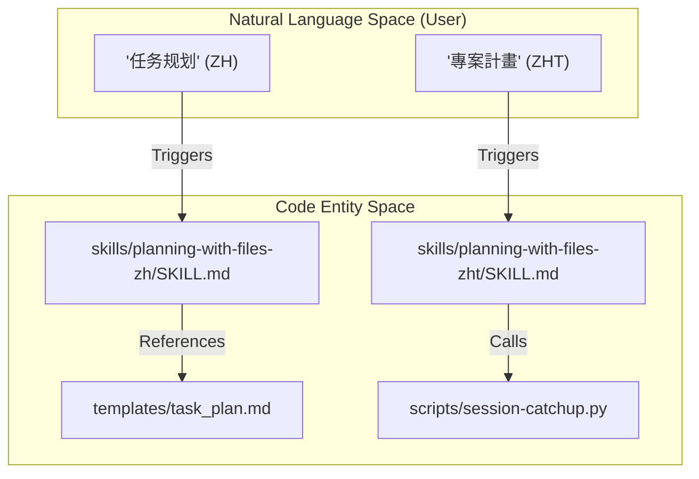
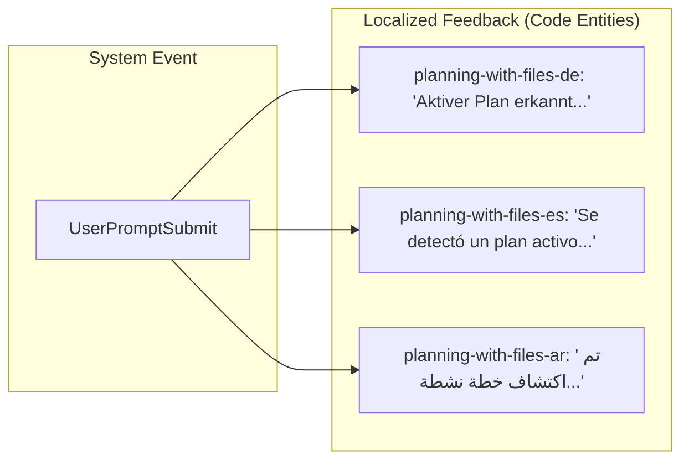

<!-- source: DeepWiki mcp.deepwiki.com · repo OthmanAdi/planning-with-files · page 11 Internationalization · fetched 2026-10-29 -->

# Internationalization

Relevant source files

The following files were used as context for generating this wiki page:

- [skills/planning-with-files-ar/SKILL.md](skills/planning-with-files-ar/SKILL.md)
- [skills/planning-with-files-de/SKILL.md](skills/planning-with-files-de/SKILL.md)
- [skills/planning-with-files-es/SKILL.md](skills/planning-with-files-es/SKILL.md)
- [skills/planning-with-files-zh/SKILL.md](skills/planning-with-files-zh/SKILL.md)
- [skills/planning-with-files-zht/SKILL.md](skills/planning-with-files-zht/SKILL.md)

The `planning-with-files` system provides localized variants of the core skill to support AI agents operating in multiple languages. These variants are not mere translations; they include localized trigger phrases, templates, and hook messages tailored to the specific linguistic context of the user, while maintaining functional parity with the canonical English version.

## Overview of Localized Variants

The project currently supports five localized variants alongside the primary English skill. Each variant mirrors the 2.37.0 specification, including support for session recovery, the 3-file pattern, and the Manus-style "Filesystem as Disk" architecture [skills/planning-with-files-zh/SKILL.md:27-33]().

### Language Support Matrix

| Language | Skill Name | Primary Trigger Phrases |
| :--- | :--- | :--- |
| **Simplified Chinese** | `planning-with-files-zh` | 任务规划, 项目计划, 分解任务 |
| **Traditional Chinese** | `planning-with-files-zht` | 任務規劃, 專案計畫, 拆解任務 |
| **German** | `planning-with-files-de` | Aufgabenplanung, Projektplanung |
| **Spanish** | `planning-with-files-es` | planificación de tareas, analizar tareas |
| **Arabic** | `planning-with-files-ar` | تخطيط المهام, إدارة المشاريع |

Sources: [skills/planning-with-files-zh/SKILL.md:2-3](), [skills/planning-with-files-zht/SKILL.md:2-3](), [skills/planning-with-files-de/SKILL.md:2-3](), [skills/planning-with-files-es/SKILL.md:2-3](), [skills/planning-with-files-ar/SKILL.md:2-3]()

## Structural Mapping: Natural Language to Code Entities

The following diagrams illustrate how localized user intent (Natural Language Space) maps to specific technical implementations within the codebase (Code Entity Space).

### Intent Mapping for Chinese Variants
Title: Localization of User Intent to Skill Entities (ZH/ZHT)

Sources: [skills/planning-with-files-zh/SKILL.md:3](), [skills/planning-with-files-zht/SKILL.md:3](), [skills/planning-with-files-zht/SKILL.md:44]()

### Hook Message Localization
Title: Localization of Automated System Feedback

Sources: [skills/planning-with-files-de/SKILL.md:10](), [skills/planning-with-files-es/SKILL.md:10](), [skills/planning-with-files-ar/SKILL.md:10]()

## Maintenance and Synchronization

To ensure that localized variants do not drift from the core English logic, the project utilizes a centralized synchronization strategy. While the UI and prompts are localized, the underlying helper scripts remain shared or mirrored across the platform-specific directories.

*   **Version Parity**: All localized variants are maintained at version `2.37.0` to match the canonical release [skills/planning-with-files-zh/SKILL.md:27]().
*   **Shared Logic**: Localized variants call the same Python-based recovery logic via `session-catchup.py` [skills/planning-with-files-es/SKILL.md:42]().
*   **Template Consistency**: Each variant instructs the agent to reference the standard templates in the `${CLAUDE_PLUGIN_ROOT}/templates/` directory, ensuring the 3-file structure remains consistent regardless of language [skills/planning-with-files-de/SKILL.md:60-61]().

## Localized Skill Details

### Chinese Variants (zh / zht)
The Chinese variants support both Simplified and Traditional characters. They include specific instructions for recovering context after a `/clear` command using `git diff --stat` and the `session-catchup.py` script.
For details, see [Chinese Variants (zh / zht)](#11.1).

### German, Spanish, and Arabic Variants
These variants provide full translations of the 6 Critical Rules (e.g., "Regla de dos operaciones" in Spanish or "Zwei-Schritte-Regel" in German) and the 3-Strike Error Protocol.
For details, see [German, Spanish, and Arabic Variants](#11.2).

Sources: [skills/planning-with-files-zh/SKILL.md:35-56](), [skills/planning-with-files-es/SKILL.md:100-101](), [skills/planning-with-files-de/SKILL.md:100-101]()

---

