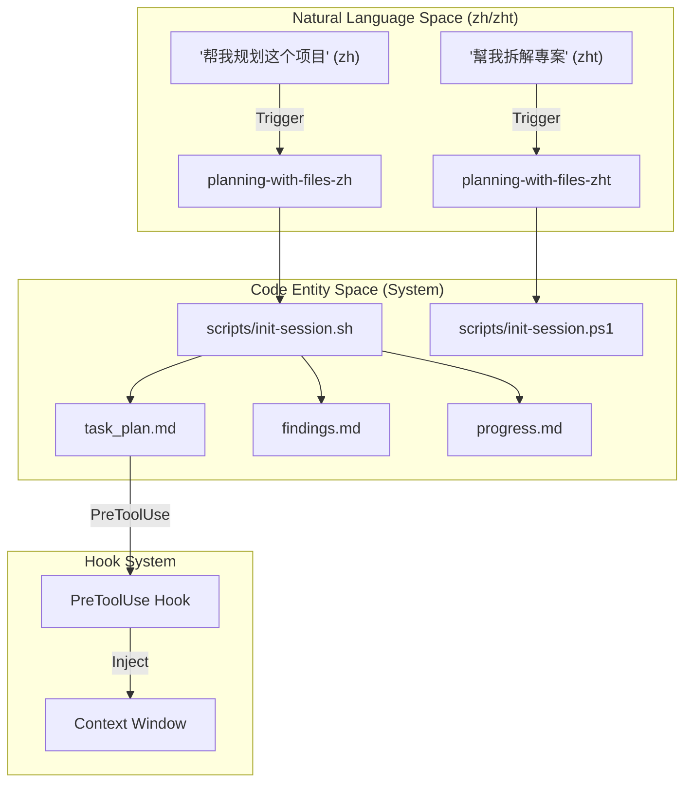
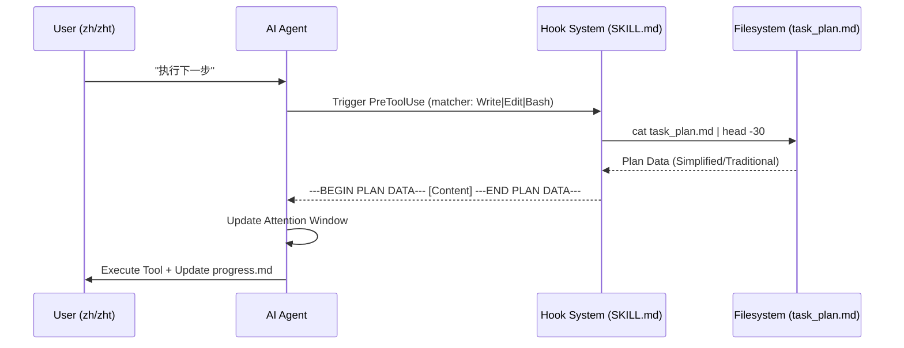

<!-- source: DeepWiki mcp.deepwiki.com · repo OthmanAdi/planning-with-files · page 11.1 Chinese Variants (zh / zht) · fetched 2026-10-29 -->

# Chinese Variants (zh / zht)

Relevant source files

The following files were used as context for generating this wiki page:

- [skills/planning-with-files-zh/SKILL.md](skills/planning-with-files-zh/SKILL.md)
- [skills/planning-with-files-zh/scripts/check-complete.sh](skills/planning-with-files-zh/scripts/check-complete.sh)
- [skills/planning-with-files-zh/scripts/init-session.sh](skills/planning-with-files-zh/scripts/init-session.sh)
- [skills/planning-with-files-zht/SKILL.md](skills/planning-with-files-zht/SKILL.md)
- [skills/planning-with-files-zht/scripts/check-complete.ps1](skills/planning-with-files-zht/scripts/check-complete.ps1)
- [skills/planning-with-files-zht/scripts/init-session.ps1](skills/planning-with-files-zht/scripts/init-session.ps1)
- [skills/planning-with-files-zht/scripts/session-catchup.py](skills/planning-with-files-zht/scripts/session-catchup.py)
- [skills/planning-with-files-zht/templates/findings.md](skills/planning-with-files-zht/templates/findings.md)
- [skills/planning-with-files-zht/templates/progress.md](skills/planning-with-files-zht/templates/progress.md)
- [skills/planning-with-files-zht/templates/task_plan.md](skills/planning-with-files-zht/templates/task_plan.md)

The Chinese variants of the `planning-with-files` skill provide localized support for Simplified Chinese (`planning-with-files-zh`) and Traditional Chinese (`planning-with-files-zht`). These variants are functional mirrors of the canonical English skill, implementing the same 3-file pattern (task_plan.md, findings.md, progress.md) and automation hooks, but with localized trigger phrases, templates, and console feedback.

## Localization Architecture

The Chinese variants maintain parity with the core system by localizing the prompt engineering and user-facing strings while retaining the same underlying script logic and file naming conventions. This ensures that a session started in English can be managed by a Chinese-localized agent and vice versa, provided the file structure remains consistent.

### Variant Comparison

| Feature | Simplified Chinese (zh) | Traditional Chinese (zht) |
| :--- | :--- | :--- |
| **Skill Name** | `planning-with-files-zh` | `planning-with-files-zht` |
| **Trigger Phrases** | 任务规划, 项目计划, 分解任务 | 任務規劃, 專案計畫, 拆解專案 |
| **Primary File** | `task_plan.md` | `task_plan.md` |
| **Templates** | Localized (zh) | Localized (zht) |
| **Hook Language** | Simplified Chinese | Traditional Chinese |

Sources: [skills/planning-with-files-zh/SKILL.md:1-3](), [skills/planning-with-files-zht/SKILL.md:1-3]()

## Trigger Phrases and Invocation

The Chinese variants are designed to be invoked when users request complex planning or multi-step project organization in Chinese.

### Natural Language to Skill Mapping
The following diagram illustrates how user intent in Chinese maps to the specific skill entities and their underlying script infrastructure.

**Chinese Variant Invocation Flow**

Sources: [skills/planning-with-files-zh/SKILL.md:3](), [skills/planning-with-files-zht/SKILL.md:3](), [skills/planning-with-files-zh/scripts/init-session.sh:1-125]()

## Localized Hook System

Both Chinese variants implement the same hook architecture as the canonical skill, ensuring that the AI remains "anchored" to the plan regardless of session resets or context volatility.

### Hook Implementation Detail
- **UserPromptSubmit**: Detects existing plans and reminds the agent to read them. For example, `planning-with-files-zh` outputs: `[planning-with-files-zh] 检测到活跃计划...请立即读取。` [skills/planning-with-files-zh/SKILL.md:7-10]().
- **PreToolUse**: Automatically injects the first 30 lines of `task_plan.md` into the context before any tool execution (Write, Edit, Bash, etc.) to combat goal drift [skills/planning-with-files-zh/SKILL.md:11-15]().
- **PostToolUse**: Prompts the agent to update `progress.md` after file modifications [skills/planning-with-files-zht/SKILL.md:16-20]().
- **Stop**: Executes localized completion checks (`check-complete.sh` or `check-complete.ps1`) to report the status of remaining phases [skills/planning-with-files-zh/SKILL.md:21-24]().

**Hook Execution Data Flow**

Sources: [skills/planning-with-files-zh/SKILL.md:6-24](), [skills/planning-with-files-zht/SKILL.md:6-24]()

## Localized Templates and Scripts

The variants include localized versions of the core templates to ensure the AI's internal reasoning and logs are consistent with the user's preferred language.

### Template Structure
- **task_plan.md**: Includes tables for "已做决策" (Decisions Made) and "遇到的错误" (Errors Encountered) [skills/planning-with-files-zht/templates/task_plan.md:45-54]().
- **findings.md**: Specifically includes a section for "视觉/浏览器发现" (Visual/Browser Findings) to enforce the 2-Action Rule for multimodal data [skills/planning-with-files-zht/templates/findings.md:22-29]().
- **progress.md**: Features the "五问重启检查" (5-Question Reboot Check) to facilitate context restoration [skills/planning-with-files-zht/templates/progress.md:30-38]().

### Automated Scripts
The variants provide shell and PowerShell scripts for session management:
1. **init-session.sh / .ps1**: Bootstraps the three files using the localized HEREDOC templates [skills/planning-with-files-zh/scripts/init-session.sh:14-116]().
2. **check-complete.sh / .ps1**: Uses `grep` or regex to count completed phases based on localized status strings like `**状态：** complete` [skills/planning-with-files-zh/scripts/check-complete.sh:17-26]().
3. **session-catchup.py**: A shared Python utility that analyzes JSONL logs to identify unsynced changes after a `/clear` command, supporting both `claude` and `codex` session formats [skills/planning-with-files-zht/scripts/session-catchup.py:170-179]().

Sources: [skills/planning-with-files-zh/scripts/init-session.sh:1-125](), [skills/planning-with-files-zh/scripts/check-complete.sh:1-46](), [skills/planning-with-files-zht/scripts/session-catchup.py:1-216]()

## Key Rules (Localized)

The Chinese variants enforce the same core Manus principles:
1. **先建立计划 (Create Plan First)**: No complex tasks without `task_plan.md` [skills/planning-with-files-zh/SKILL.md:99-100]().
2. **两步操作规则 (2-Action Rule)**: Save findings every 2 browser/view actions to prevent multimodal data loss [skills/planning-with-files-zh/SKILL.md:102-105]().
3. **决策前先读取 (Read Before Decide)**: Refresh goals in the attention window before major actions [skills/planning-with-files-zht/SKILL.md:107-108]().
4. **三次失败协定 (3-Strike Protocol)**:
    - Strike 1: 诊断并修复 (Diagnose & Fix)
    - Strike 2: 替代方案 (Alternative Approach)
    - Strike 3: 重新思考 (Rethink/Ask User) [skills/planning-with-files-zh/SKILL.md:140-162]().

Sources: [skills/planning-with-files-zh/SKILL.md:97-162](), [skills/planning-with-files-zht/SKILL.md:97-162]()

---

