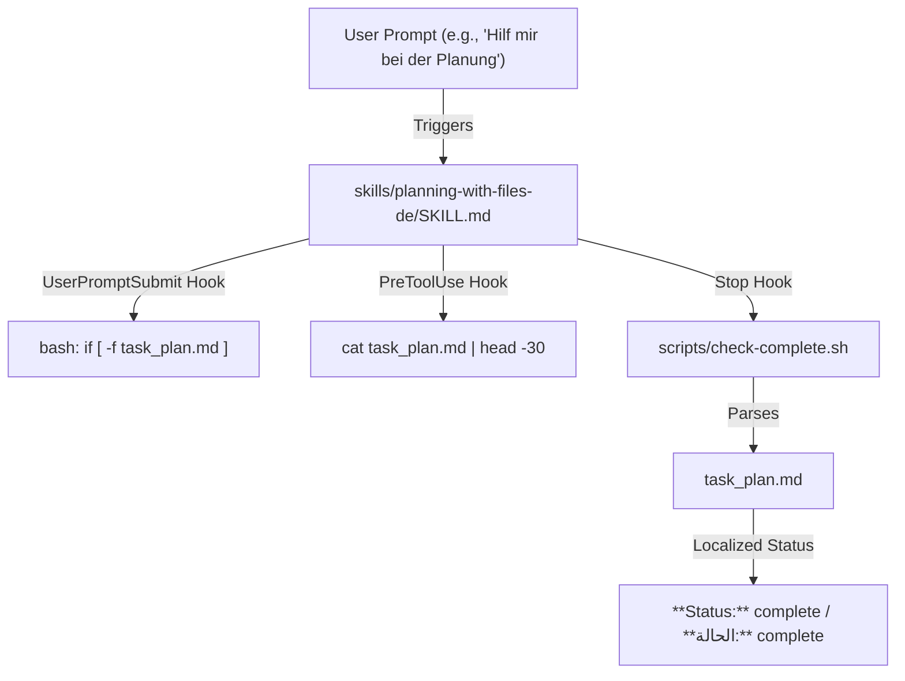
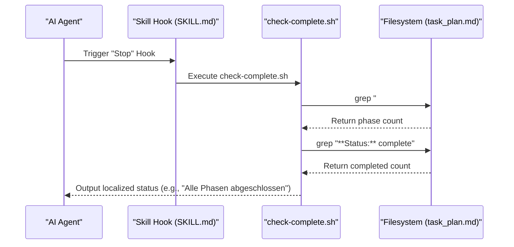

<!-- source: DeepWiki mcp.deepwiki.com · repo OthmanAdi/planning-with-files · page 11.2 German, Spanish, and Arabic Variants · fetched 2026-10-29 -->

# German, Spanish, and Arabic Variants

Relevant source files

The following files were used as context for generating this wiki page:

- [skills/planning-with-files-ar/SKILL.md](skills/planning-with-files-ar/SKILL.md)
- [skills/planning-with-files-ar/scripts/check-complete.sh](skills/planning-with-files-ar/scripts/check-complete.sh)
- [skills/planning-with-files-ar/scripts/init-session.sh](skills/planning-with-files-ar/scripts/init-session.sh)
- [skills/planning-with-files-de/SKILL.md](skills/planning-with-files-de/SKILL.md)
- [skills/planning-with-files-de/scripts/check-complete.sh](skills/planning-with-files-de/scripts/check-complete.sh)
- [skills/planning-with-files-es/SKILL.md](skills/planning-with-files-es/SKILL.md)
- [skills/planning-with-files-es/scripts/check-complete.sh](skills/planning-with-files-es/scripts/check-complete.sh)

The `planning-with-files` system provides localized variants for German (`planning-with-files-de`), Spanish (`planning-with-files-es`), and Arabic (`planning-with-files-ar`). These variants allow AI agents to operate using the Manus-style 3-file pattern while communicating and documenting in the user's preferred language. Each variant mirrors the canonical English skill's logic, including automated hooks, session recovery, and template structures, but uses localized trigger phrases and status indicators.

## Overview of Localized Variants

Each localized skill variant is defined in its own directory within the `skills/` folder. They are designed to be functionally identical to the English version while providing a native experience for non-English speaking developers and users.

### Trigger Phrases and Metadata
The skills are activated by specific keywords defined in their respective `SKILL.md` files.

| Variant | Name | Trigger Phrases (Examples) |
| :--- | :--- | :--- |
| **German** | `planning-with-files-de` | Aufgabenplanung, Projektplanung, Arbeitsplan erstellen [skills/planning-with-files-de/SKILL.md:3-3]() |
| **Spanish** | `planning-with-files-es` | planificación de tareas, crear plan de trabajo, analizar tareas [skills/planning-with-files-es/SKILL.md:3-3]() |
| **Arabic** | `planning-with-files-ar` | تخطيط المهام، إدارة المشاريع، خطة العمل [skills/planning-with-files-ar/SKILL.md:3-3]() |

### Data Flow: Natural Language to Code Entity
The following diagram illustrates how a localized user prompt triggers the skill and interacts with the underlying localized scripts and templates.

**Localized Skill Execution Flow**

Sources: [skills/planning-with-files-de/SKILL.md:6-24](), [skills/planning-with-files-ar/scripts/check-complete.sh:16-19](), [skills/planning-with-files-es/scripts/check-complete.sh:16-19]()

## Localized Templates and Scripts

The variants utilize localized versions of the core planning files: `task_plan.md`, `findings.md`, and `progress.md`. While the file names remain in English for cross-platform tool compatibility, the internal content is translated.

### Initialization Scripts
The `init-session.sh` scripts for each language (e.g., `skills/planning-with-files-ar/scripts/init-session.sh`) generate these files with localized headers and phase descriptions.

*   **Arabic Example**: The script defines the goal as "الهدف" and phases as "المراحل" [skills/planning-with-files-ar/scripts/init-session.sh:17-23]().
*   **Status Indicators**: Despite the localization of headers, the machine-readable status values (e.g., `in_progress`, `complete`, `pending`) are often kept in English or paired with localized keys to ensure `check-complete.sh` can parse them reliably [skills/planning-with-files-ar/scripts/check-complete.sh:17-19]().

### Completion Checking Logic
The `check-complete.sh` script is localized to recognize language-specific section headers while maintaining the same logic for counting phases.

**Comparison of Phase Detection**
| File | Grep Pattern for Phases | Grep Pattern for Status |
| :--- | :--- | :--- |
| `planning-with-files-de` | `### Phase` [skills/planning-with-files-de/scripts/check-complete.sh:14-14]() | `**Status:** complete` [skills/planning-with-files-de/scripts/check-complete.sh:17-17]() |
| `planning-with-files-ar` | `### المرحلة` [skills/planning-with-files-ar/scripts/check-complete.sh:14-14]() | `**الحالة:** complete` [skills/planning-with-files-ar/scripts/check-complete.sh:17-17]() |
| `planning-with-files-es` | `### Phase` [skills/planning-with-files-es/scripts/check-complete.sh:14-14]() | `**Estado:** complete` [skills/planning-with-files-es/scripts/check-complete.sh:17-17]() |

Sources: [skills/planning-with-files-de/scripts/check-complete.sh:14-26](), [skills/planning-with-files-ar/scripts/check-complete.sh:14-26](), [skills/planning-with-files-es/scripts/check-complete.sh:14-26]()

## Automation Hooks

All localized variants implement the same four-hook architecture as the canonical version to manage the agent's attention and persist findings.

1.  **UserPromptSubmit**: Reminds the agent to read existing plan files if they are detected in the project root [skills/planning-with-files-de/SKILL.md:7-10]().
2.  **PreToolUse**: Automatically injects the first 30 lines of `task_plan.md` before any file or bash operation to keep goals in the active context window [skills/planning-with-files-es/SKILL.md:11-15]().
3.  **PostToolUse**: Prompts the agent to update `progress.md` after any write/edit operation [skills/planning-with-files-ar/SKILL.md:16-20]().
4.  **Stop**: Executes the localized `check-complete.sh` (or `.ps1` on Windows) to report the final status of the task [skills/planning-with-files-de/SKILL.md:21-24]().

**Hook Implementation Diagram**

Sources: [skills/planning-with-files-de/SKILL.md:21-24](), [skills/planning-with-files-de/scripts/check-complete.sh:14-46]()

## Syncing with Canonical Skill

The repository uses `sync-ide-folders.py` to maintain parity between the canonical English skill and the localized variants. While the content is localized, the versioning and core logic updates are propagated across all variants to ensure that features like `session-catchup.py` work globally.

*   **Session Recovery**: All localized variants reference `scripts/session-catchup.py` for context restoration after a `/clear` command [skills/planning-with-files-de/SKILL.md:42-43](), [skills/planning-with-files-es/SKILL.md:42-43]().
*   **Version Parity**: As of the current documentation, all variants are synchronized to version `2.37.0` [skills/planning-with-files-ar/SKILL.md:26-26](), [skills/planning-with-files-es/SKILL.md:26-26](), [skills/planning-with-files-de/SKILL.md:26-26]().

Sources: [skills/planning-with-files-de/SKILL.md:33-54](), [skills/planning-with-files-es/SKILL.md:33-54](), [skills/planning-with-files-ar/SKILL.md:33-54]()

---

