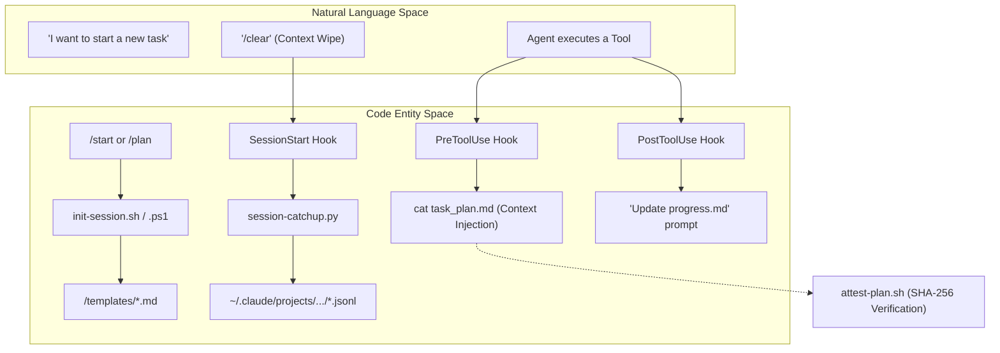
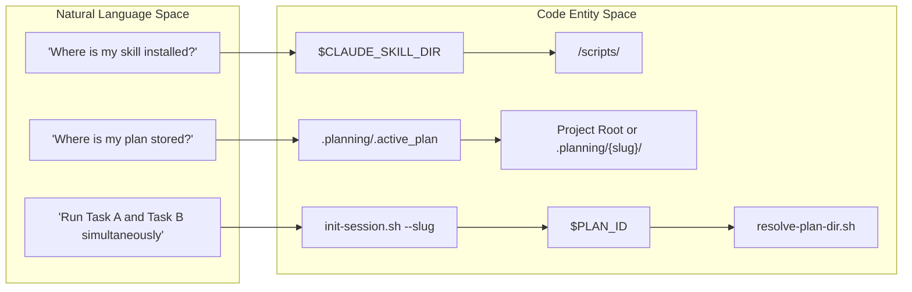

<!-- source: DeepWiki mcp.deepwiki.com · repo OthmanAdi/planning-with-files · page 12 Glossary · fetched 2026-10-29 -->

# Glossary

Relevant source files

The following files were used as context for generating this wiki page:

- [.claude-plugin/marketplace.json](.claude-plugin/marketplace.json)
- [.claude-plugin/plugin.json](.claude-plugin/plugin.json)
- [.codebuddy/skills/planning-with-files/scripts/session-catchup.py](.codebuddy/skills/planning-with-files/scripts/session-catchup.py)
- [.codex/skills/planning-with-files/SKILL.md](.codex/skills/planning-with-files/SKILL.md)
- [.codex/skills/planning-with-files/scripts/session-catchup.py](.codex/skills/planning-with-files/scripts/session-catchup.py)
- [.continue/skills/planning-with-files/scripts/session-catchup.py](.continue/skills/planning-with-files/scripts/session-catchup.py)
- [.cursor/skills/planning-with-files/SKILL.md](.cursor/skills/planning-with-files/SKILL.md)
- [.factory/skills/planning-with-files/scripts/session-catchup.py](.factory/skills/planning-with-files/scripts/session-catchup.py)
- [.gemini/skills/planning-with-files/scripts/session-catchup.py](.gemini/skills/planning-with-files/scripts/session-catchup.py)
- [.gitignore](.gitignore)
- [.opencode/skills/planning-with-files/SKILL.md](.opencode/skills/planning-with-files/SKILL.md)
- [.pi/skills/planning-with-files/scripts/session-catchup.py](.pi/skills/planning-with-files/scripts/session-catchup.py)
- [CHANGELOG.md](CHANGELOG.md)
- [CITATION.cff](CITATION.cff)
- [CONTRIBUTORS.md](CONTRIBUTORS.md)
- [README.md](README.md)
- [examples/README.md](examples/README.md)
- [skills/planning-with-files/SKILL.md](skills/planning-with-files/SKILL.md)
- [skills/planning-with-files/examples.md](skills/planning-with-files/examples.md)
- [skills/planning-with-files/reference.md](skills/planning-with-files/reference.md)
- [skills/planning-with-files/scripts/check-complete.sh](skills/planning-with-files/scripts/check-complete.sh)
- [skills/planning-with-files/scripts/init-session.sh](skills/planning-with-files/scripts/init-session.sh)
- [skills/planning-with-files/scripts/session-catchup.py](skills/planning-with-files/scripts/session-catchup.py)
- [skills/planning-with-files/templates/findings.md](skills/planning-with-files/templates/findings.md)
- [skills/planning-with-files/templates/progress.md](skills/planning-with-files/templates/progress.md)
- [skills/planning-with-files/templates/task_plan.md](skills/planning-with-files/templates/task_plan.md)
- [tests/test_session_catchup.py](tests/test_session_catchup.py)

This page provides definitions for codebase-specific terms, jargon, and domain concepts used in the `planning-with-files` repository. It serves as a technical reference for onboarding engineers to understand the implementation details and data flow of the system.

## Foundational Concepts

### 3-File Pattern
The core architectural pattern of the system. It treats the filesystem as "working memory on disk" to overcome the volatility and size limits of AI context windows [skills/planning-with-files/SKILL.md:78-85](). It consists of three specific Markdown files: `task_plan.md`, `findings.md`, and `progress.md` [skills/planning-with-files/SKILL.md:87-94]().

### Context Window as RAM / Filesystem as Disk
A conceptual framework where the AI's immediate context window is treated like volatile RAM (fast but limited and easily cleared), while the local filesystem acts as a persistent hard disk (unlimited and stable) [skills/planning-with-files/SKILL.md:78-85]().

### Manus-Style Planning
Refers to a workflow where an AI agent maintains a persistent, structured plan that it updates after every major action, mimicking the high-reliability agent architecture popularized by companies like Manus [README.md:7-7]().

## Technical Terms & Entities

### PLAN_ID
A unique identifier used in **Slug Mode** to isolate parallel planning sessions [CONTRIBUTORS.md:77-80](). It is typically stored in the `.planning/.active_plan` file or passed via environment variables to resolve which directory contains the current session's state [skills/planning-with-files/SKILL.md:10-10]().

### Slug Mode
An isolation feature introduced in v2.36.0 that allows multiple independent tasks to run in the same project directory without state collision [CHANGELOG.md:74-74](). It creates isolated directories under `.planning/{slug}/` [CONTRIBUTORS.md:77-80]().
*   **Implementation**: Managed by `init-session.sh` and resolved by `resolve-plan-dir.sh` [CHANGELOG.md:38-39]().

### Session Catchup
The process of analyzing previous session logs (JSONL files) to recover context that was lost due to a `/clear` command or session restart [CONTRIBUTORS.md:29-30]().
*   **Key Script**: `session-catchup.py` [skills/planning-with-files/SKILL.md:42-43]().
*   **Logic**: It parses tool call history to find the last time planning files were updated and identifies "unsynced" actions that occurred afterward [CHANGELOG.md:87-87]().

### Plan Attestation
A security feature (v2.37.0) that prevents prompt injection via tampered planning files [CHANGELOG.md:9-9]().
*   **Mechanism**: A SHA-256 hash of `task_plan.md` is stored in `.attestation` or `.plan-attestation` [CHANGELOG.md:9-9]().
*   **Enforcement**: The `UserPromptSubmit` and `PreToolUse` hooks re-calculate the hash; if it mismatches, the plan injection is blocked [skills/planning-with-files/SKILL.md:10-15]().

### 2-Action Rule
A critical heuristic requiring the agent to save findings to `findings.md` after every two research-oriented operations (view, browser, search) to prevent information loss [skills/planning-with-files/SKILL.md:100-103]().

### 3-Strike Error Protocol
A structured escalation path for handling persistent failures:
1.  **Diagnose & Fix**: Target the root cause.
2.  **Alternative Approach**: Change tools or methods.
3.  **Broader Rethink**: Question assumptions and update the plan.
4.  **Escalate**: Request human intervention after 3 failures [skills/planning-with-files/SKILL.md:130-152]().

## Code Entity Mapping

### Natural Language Space to Code Entity Space: Execution Flow
The following diagram maps high-level user actions and system triggers to the specific code entities that handle them.

**Diagram: System Execution Mapping**

**Sources**: [skills/planning-with-files/SKILL.md:1-24](), [CHANGELOG.md:9-15](), [CONTRIBUTORS.md:28-35]()

### Natural Language Space to Code Entity Space: Session Isolation
This diagram illustrates how the system manages state across different environments and parallel tasks.

**Diagram: State and Isolation Mapping**

**Sources**: [CHANGELOG.md:74-74](), [CHANGELOG.md:38-40](), [skills/planning-with-files/SKILL.md:56-65]()

## Glossary Table

| Term | Definition | Code Pointers |
| :--- | :--- | :--- |
| **Active Plan** | The specific directory or file set currently being used for planning. | [skills/planning-with-files/SKILL.md:10-10](), `.planning/.active_plan` |
| **Analytics Template** | A specialized version of the 3-file pattern for data exploration tasks. | [CHANGELOG.md:84-84](), `templates/analytics_task_plan.md` |
| **Check Complete** | A verification step performed when a session stops to ensure all phases are marked done. | [skills/planning-with-files/SKILL.md:24-24](), `scripts/check-complete.sh` |
| **Context Injection** | The automated process of inserting the current plan into the LLM's prompt. | [skills/planning-with-files/SKILL.md:10-15](), `UserPromptSubmit` hook |
| **Hook** | An event-driven trigger (e.g., `PreToolUse`) that executes a command or script. | [skills/planning-with-files/SKILL.md:6-24]() |
| **JSONL Logs** | Persistent logs of agent actions used by `session-catchup.py` for recovery. | [CONTRIBUTORS.md:28-35](), `~/.claude/projects/` |
| **Parity Locked** | Files that must remain byte-identical across all 14+ IDE/Language variants. | [CHANGELOG.md:15-16](), `scripts/bump-version.py` |
| **PLAN TAMPERED** | Error message displayed when the SHA-256 hash of a plan fails attestation. | [CHANGELOG.md:9-9](), `scripts/attest-plan.sh` |
| **Skill Directory** | The installation path where templates and scripts reside. | [skills/planning-with-files/SKILL.md:61-65](), `$CLAUDE_SKILL_DIR` |
| **Stop Hook** | A hook that triggers `check-complete` logic when the agent finishes its current turn. | [skills/planning-with-files/SKILL.md:21-24]() |

**Sources**: [CHANGELOG.md:5-17](), [CHANGELOG.md:74-84](), [skills/planning-with-files/SKILL.md:1-24](), [CONTRIBUTORS.md:28-35]()