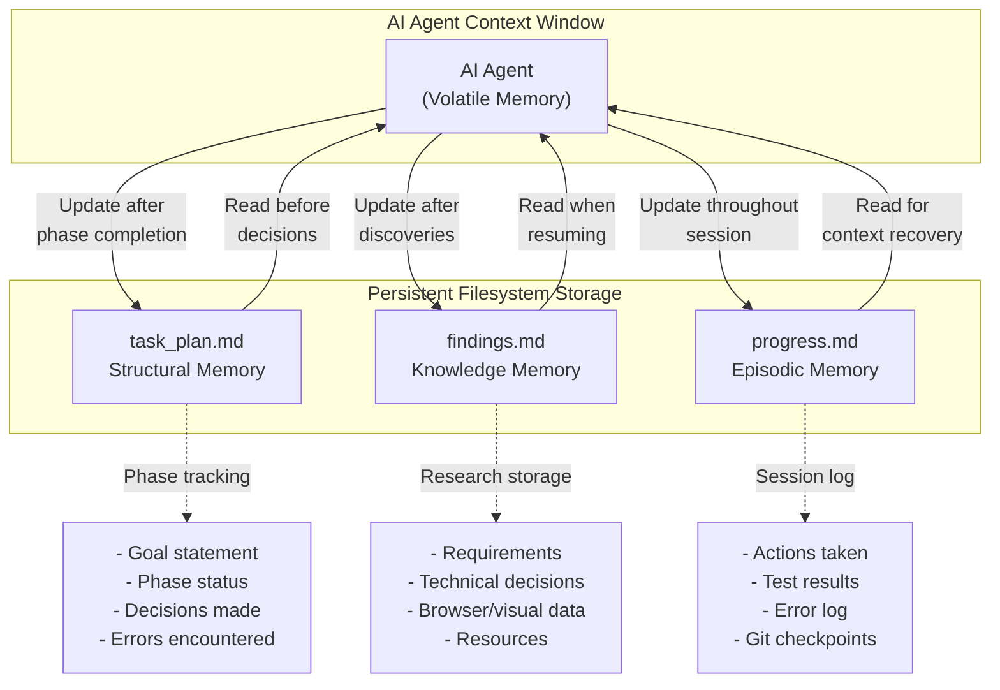
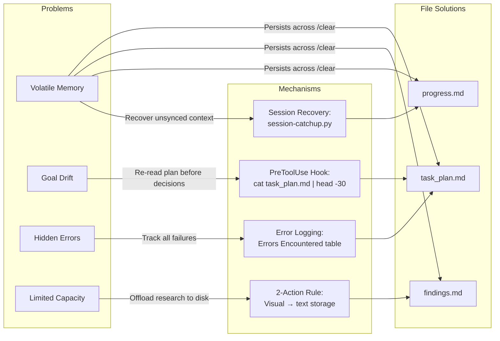
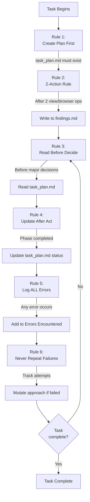
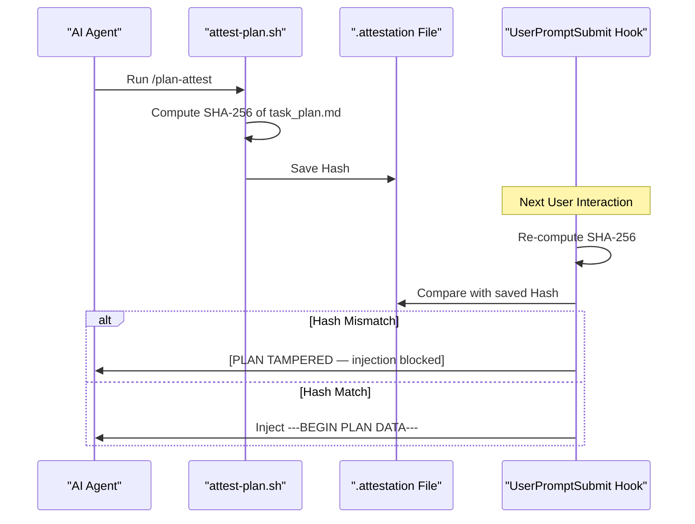
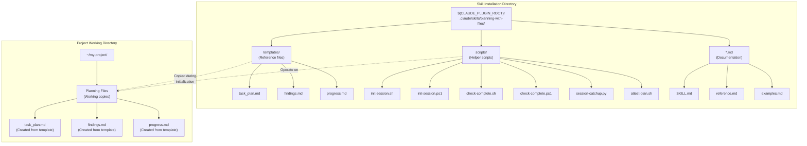

<!-- source: DeepWiki mcp.deepwiki.com · repo OthmanAdi/planning-with-files · page 2 Core Concepts · fetched 2026-10-29 -->

# Core Concepts

<details>
<summary>Relevant source files</summary>

The following files were used as context for generating this wiki page:

- [.claude-plugin/marketplace.json](.claude-plugin/marketplace.json)
- [.claude-plugin/plugin.json](.claude-plugin/plugin.json)
- [.gitignore](.gitignore)
- [CHANGELOG.md](CHANGELOG.md)
- [CITATION.cff](CITATION.cff)
- [CONTRIBUTORS.md](CONTRIBUTORS.md)
- [README.md](README.md)
- [examples/README.md](examples/README.md)
- [skills/planning-with-files/SKILL.md](skills/planning-with-files/SKILL.md)
- [skills/planning-with-files/examples.md](skills/planning-with-files/examples.md)
- [skills/planning-with-files/reference.md](skills/planning-with-files/reference.md)
- [skills/planning-with-files/templates/findings.md](skills/planning-with-files/templates/findings.md)
- [skills/planning-with-files/templates/progress.md](skills/planning-with-files/templates/progress.md)
- [skills/planning-with-files/templates/task_plan.md](skills/planning-with-files/templates/task_plan.md)

</details>


## Purpose and Scope

This section introduces the foundational principles of planning-with-files: why persistent files solve AI agent limitations, how the 3-file pattern works, and the core mental model of "filesystem as working memory."

For detailed specifications of each file's structure, see [Technical Reference](#7). For practical examples of applying these concepts, see [Examples and Patterns](#6). For the Manus AI principles that inspired this system, see [Manus Principles Deep Dive](#8).

## The Fundamental Problem

AI agents operate within **context windows** that exhibit four critical limitations:

| Problem | Impact | Example Scenario |
|---------|--------|------------------|
| **Volatile Memory** | Context lost on `/clear` | Agent completes Phase 1-2, user clears context, work forgotten |
| **Limited Capacity** | ~100K-200K tokens maximum | Cannot hold entire codebase + conversation history |
| **Goal Drift** | Loses track of objectives after 50+ tool calls | Starts implementing wrong feature or optimizing wrong metric |
| **Hidden Errors** | No persistent tracking of failures | Repeats same failing API call 5 times without learning |

These limitations mean AI agents cannot reliably complete multi-step tasks spanning multiple sessions or requiring extended tool use.

Sources: [skills/planning-with-files/SKILL.md:56-109]()

---

## The Solution: Filesystem as Persistent Memory

Planning-with-files implements a simple principle:

```
Context Window = RAM (volatile, limited)
Filesystem = Disk (persistent, unlimited)

→ Anything important gets written to disk.
```

By externalizing working memory to markdown files, the system provides:
- **Persistence**: Survives `/clear` commands and session termination.
- **Unlimited storage**: No token limits on filesystem.
- **Structured tracking**: Phases, errors, decisions explicitly documented.
- **Cross-session continuity**: Planning files enable context recovery via `session-catchup.py`.

This transforms AI agents from **stateless session workers** into **stateful project assistants**.

Sources: [skills/planning-with-files/SKILL.md:78-85](), [skills/planning-with-files/SKILL.md:33-54]()

---

## The 3-File Pattern

The core solution uses three markdown files, each serving a distinct purpose:

### File Responsibilities



**File Purpose Table**

| File | Purpose | When to Update | Template Path |
|------|---------|----------------|---------------|
| `task_plan.md` | Phases, progress, decisions | After each phase completion | `templates/task_plan.md` |
| `findings.md` | Research, discoveries | After ANY discovery | `templates/findings.md` |
| `progress.md` | Session log, test results | Throughout session | `templates/progress.md` |

Sources: [skills/planning-with-files/SKILL.md:87-94](), [skills/planning-with-files/SKILL.md:78-85]()

---

## Problem-Solution Mapping

Each file in the 3-file pattern directly addresses one or more of the four core problems:

### How Files Solve Problems



**Problem Resolution Details**

| Problem | File | Mechanism | Implementation |
|---------|------|-----------|----------------|
| **Volatile Memory** | All 3 files | Filesystem persistence | Files survive `/clear`, stored in project root. |
| **Goal Drift** | `task_plan.md` | Attention manipulation | `PreToolUse` hook reads plan before every tool call [skills/planning-with-files/SKILL.md:11-15](). |
| **Hidden Errors** | `task_plan.md` | Explicit error logging | "Errors Encountered" table tracks all failures [skills/planning-with-files/templates/task_plan.md:109-121](). |
| **Limited Capacity** | `findings.md` | Context offloading | Browser/visual data immediately written to text. |

Sources: [skills/planning-with-files/SKILL.md:11-26](), [skills/planning-with-files/SKILL.md:95-131]()

---

## Critical Rules for File Management

Six rules govern when and how to update planning files. These rules encode the system's core workflow:

### The 6 Critical Rules



**Rule Details**

| Rule | Purpose | File Affected | Code Reference |
|------|---------|---------------|----------------|
| **Create Plan First** | Establish structure before execution | `task_plan.md` | [skills/planning-with-files/SKILL.md:97-98]() |
| **2-Action Rule** | Prevent visual data loss | `findings.md` | [skills/planning-with-files/SKILL.md:100-103]() |
| **Read Before Decide** | Combat goal drift | `task_plan.md` | [skills/planning-with-files/SKILL.md:105-106]() |
| **Update After Act** | Track progress | `task_plan.md` | [skills/planning-with-files/SKILL.md:108-113]() |
| **Log ALL Errors** | Build failure knowledge | `task_plan.md` | [skills/planning-with-files/SKILL.md:114-123]() |
| **Never Repeat Failures** | Force approach mutation | All files | [skills/planning-with-files/SKILL.md:125-131]() |

Sources: [skills/planning-with-files/SKILL.md:95-131]()

---

## Security and Integrity: Plan Attestation

Starting in v2.37.0, the system introduces **Hash Attestation** to prevent unauthorized or accidental modification of the plan by untrusted external tools or model hallucinations.

### Attestation Flow



Sources: [CHANGELOG.md:5-15](), [skills/planning-with-files/SKILL.md:7-10]()

---

## File Location and Organization

Planning files exist in **two distinct locations** with different purposes:

### File Location Architecture



**Location Rules**

| Location | What Goes There | Why | Committed to Git? |
|----------|-----------------|-----|-------------------|
| Skill directory (`${CLAUDE_PLUGIN_ROOT}/`) | Templates, scripts, reference docs | Shared across projects | Yes (in repo) |
| Your project directory | `task_plan.md`, `findings.md`, `progress.md` | Project-specific working memory | User choice |

**Critical**: Planning files must be created in your project root, not in the skill installation directory. The `init-session.sh` script creates them in the current directory [skills/planning-with-files/SKILL.md:56-65]().

Sources: [skills/planning-with-files/SKILL.md:56-76](), [CHANGELOG.md:26-28]()

---

## Summary

The core concepts of planning-with-files rest on three principles:

1. **Filesystem as Memory**: Treating the filesystem as persistent working memory solves the volatile context window problem.
2. **3-File Pattern**: Separating structural memory (`task_plan.md`), knowledge memory (`findings.md`), and episodic memory (`progress.md`) creates organized persistence.
3. **Rule-Based Updates**: Six critical rules automate when to read/write files, preventing common failure modes.
4. **Security Hardening**: Hash attestation ensures the integrity of the persistent plan against unauthorized edits.

Sources: [skills/planning-with-files/SKILL.md:78-131](), [CHANGELOG.md:5-15]()

---

