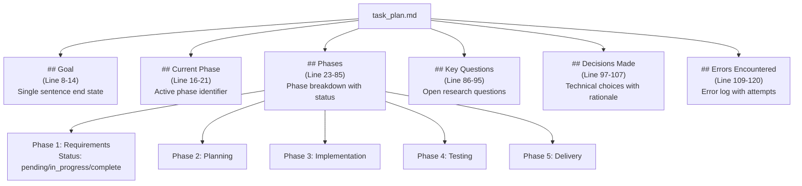
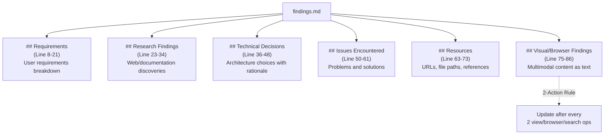
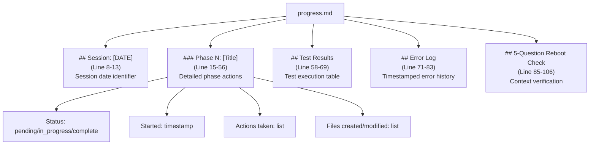
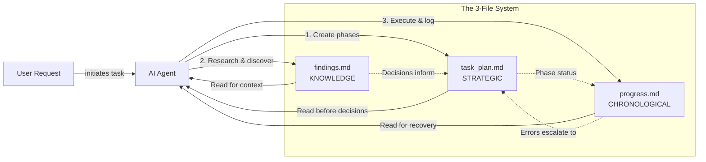
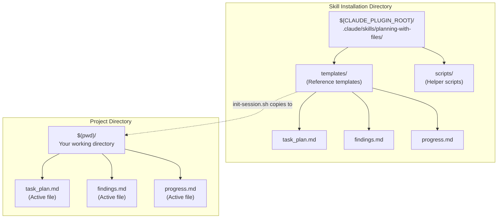

<!-- source: DeepWiki mcp.deepwiki.com · repo OthmanAdi/planning-with-files · page 2.1 The 3-File Pattern · fetched 2026-10-29 -->

# The 3-File Pattern

<details>
<summary>Relevant source files</summary>

The following files were used as context for generating this wiki page:

- [.claude-plugin/marketplace.json](.claude-plugin/marketplace.json)
- [.claude-plugin/plugin.json](.claude-plugin/plugin.json)
- [.codex/skills/planning-with-files/templates/findings.md](.codex/skills/planning-with-files/templates/findings.md)
- [.codex/skills/planning-with-files/templates/progress.md](.codex/skills/planning-with-files/templates/progress.md)
- [.codex/skills/planning-with-files/templates/task_plan.md](.codex/skills/planning-with-files/templates/task_plan.md)
- [.gitignore](.gitignore)
- [CHANGELOG.md](CHANGELOG.md)
- [CITATION.cff](CITATION.cff)
- [CONTRIBUTORS.md](CONTRIBUTORS.md)
- [README.md](README.md)
- [examples/README.md](examples/README.md)
- [skills/planning-with-files/SKILL.md](skills/planning-with-files/SKILL.md)
- [skills/planning-with-files/examples.md](skills/planning-with-files/examples.md)
- [skills/planning-with-files/reference.md](skills/planning-with-files/reference.md)
- [skills/planning-with-files/templates/findings.md](skills/planning-with-files/templates/findings.md)
- [skills/planning-with-files/templates/progress.md](skills/planning-with-files/templates/progress.md)
- [skills/planning-with-files/templates/task_plan.md](skills/planning-with-files/templates/task_plan.md)

</details>


## Purpose and Scope

This page explains the core 3-file pattern that forms the foundation of planning-with-files: `task_plan.md`, `findings.md`, and `progress.md`. It covers the purpose of each file, their structure, when to update them, and how they work together as persistent external memory for AI agents.

For information about the problems this pattern solves, see [2.2 Problems and Solutions](). For the philosophical foundation of using the filesystem as memory, see [2.3 Filesystem as Working Memory](). For detailed technical specifications of each file's structure, see [7.1 task_plan.md Specification](), [7.2 findings.md Specification](), and [7.3 progress.md Specification]().

---

## Pattern Overview

The 3-file pattern externalizes AI agent working memory to three markdown files in the project root directory. Each file serves a distinct purpose in the persistence layer:

| File | Role | Primary Update Trigger |
|------|------|----------------------|
| `task_plan.md` | Strategic roadmap | Phase completion, decisions, errors |
| `findings.md` | Knowledge accumulation | Discoveries, research, technical decisions |
| `progress.md` | Chronological log | Actions taken, test results, session tracking |

The pattern follows the principle stated in [skills/planning-with-files/SKILL.md:81-85]():

```
Context Window = RAM (volatile, limited)
Filesystem = Disk (persistent, unlimited)

→ Anything important gets written to disk.
```

**Sources:** [skills/planning-with-files/SKILL.md:81-94](), [.claude-plugin/plugin.json:1-40]()

---

## task_plan.md: The Strategic Roadmap

### Purpose

`task_plan.md` is the primary navigation and decision-tracking document. It answers the questions "Where am I?" and "Where am I going?" from the 5-Question Reboot Test.

The file contains the following sections as defined in [skills/planning-with-files/templates/task_plan.md:1-133]():

**Strategic Roadmap Component Diagram**


### Structure and Sections

#### Goal Section
Single-sentence statement of the task's end state [skills/planning-with-files/templates/task_plan.md:8-14](). Re-reading this section provides "attention manipulation" by refreshing the objective in the context window.

#### Current Phase
String identifier indicating which phase is active (e.g., "Phase 1", "Phase 3") [skills/planning-with-files/templates/task_plan.md:16-21](). Updated as work progresses through phases.

#### Phases Section
Each phase contains a checklist and a **Status** field with values: `pending`, `in_progress`, or `complete` [skills/planning-with-files/templates/task_plan.md:40-44]().

#### Errors Encountered Table
Three-column table tracking:
- **Error**: Description of what failed.
- **Attempt**: Numeric attempt counter (1, 2, 3, ...).
- **Resolution**: How the error was addressed.

This table is critical for implementing Rule 6: "Never Repeat Failures" [skills/planning-with-files/SKILL.md:126-130]().

### Update Timing

| Trigger | Action |
|---------|--------|
| Phase completion | Change status to `complete`, move to next phase [skills/planning-with-files/SKILL.md:108-113]() |
| Error encountered | Add row to Errors Encountered table [skills/planning-with-files/SKILL.md:114-123]() |
| Technical decision | Add row to Decisions Made table [skills/planning-with-files/templates/task_plan.md:97-107]() |
| Before major decision | **Read** file to refresh context (Rule 3) [skills/planning-with-files/SKILL.md:105-106]() |

**Sources:** [skills/planning-with-files/templates/task_plan.md:1-133](), [skills/planning-with-files/SKILL.md:97-130]()

---

## findings.md: The Knowledge Base

### Purpose

`findings.md` is the persistent knowledge store for all discoveries and research results. It prevents multimodal information loss through the 2-Action Rule.

**Knowledge Persistence Structure**


### The 2-Action Rule

The 2-Action Rule is the most critical update pattern for `findings.md`. As stated in [skills/planning-with-files/SKILL.md:100-103]():

> "After every 2 view/browser/search operations, IMMEDIATELY save key findings to text files."

This rule exists because multimodal content (images, PDFs, browser screenshots) does not persist in the context window. Visual information must be converted to text and written to disk before context resets [skills/planning-with-files/templates/findings.md:75-87]().

### Update Timing

| Trigger | Section to Update | Rationale |
|---------|-------------------|-----------|
| After 2 view/browser/search ops | Visual/Browser Findings | Prevent multimodal information loss [skills/planning-with-files/SKILL.md:100-103]() |
| Discovery during exploration | Research Findings | Capture key insights [skills/planning-with-files/templates/findings.md:23-34]() |
| Technical choice made | Technical Decisions | Document rationale for future reference [skills/planning-with-files/templates/findings.md:36-48]() |
| Useful resource found | Resources | Preserve URLs/paths for later [skills/planning-with-files/templates/findings.md:63-73]() |

**Sources:** [skills/planning-with-files/templates/findings.md:1-96](), [skills/planning-with-files/SKILL.md:100-103]()

---

## progress.md: The Chronological Log

### Purpose

`progress.md` is the session-level action log. It answers "What have I done?" and provides detailed timestamps and action history for session recovery.

**Chronological Log Structure**


### 5-Question Reboot Check

The 5-Question Reboot Check in [skills/planning-with-files/templates/progress.md:85-106]() provides a self-test for context integrity:

| Question | Answer Source |
|----------|---------------|
| Where am I? | Current phase in `task_plan.md` |
| Where am I going? | Remaining phases in `task_plan.md` |
| What's the goal? | Goal statement in `task_plan.md` |
| What have I learned? | See `findings.md` |
| What have I done? | See `progress.md` (current file) |

### Update Timing

| Trigger | Action |
|---------|--------|
| Phase completion | Add completed phase entry with actions/files [skills/planning-with-files/templates/progress.md:15-56]() |
| Error occurs | Add row to Error Log with timestamp [skills/planning-with-files/templates/progress.md:71-83]() |
| Test executed | Add row to Test Results table [skills/planning-with-files/templates/progress.md:58-69]() |

**Sources:** [skills/planning-with-files/templates/progress.md:1-115](), [skills/planning-with-files/SKILL.md:87-94]()

---

## How the Files Work Together

### Information Flow and Separation of Concerns

**System Information Flow**


### Distinction Between Files

| File | Granularity | Time Orientation | Primary Question Answered |
|------|-------------|------------------|---------------------------|
| `task_plan.md` | Phase-level | Future-oriented (roadmap) | "What phases remain?" |
| `findings.md` | Knowledge-level | Timeless (reference) | "What did we learn?" |
| `progress.md` | Action-level | Past-oriented (history) | "What did we do?" |

**Sources:** [skills/planning-with-files/SKILL.md:87-94](), [skills/planning-with-files/examples.md:98-121]()

---

## File Location and Lifecycle

### Directory Structure

The planning files exist in two locations with distinct purposes:

**File Location Mapping**


As documented in [skills/planning-with-files/SKILL.md:56-65]():

| Location | Contents |
|----------|----------|
| Skill directory (`${CLAUDE_PLUGIN_ROOT}/`) | Templates, scripts, reference docs |
| Project directory (current working dir) | `task_plan.md`, `findings.md`, `progress.md` |

### Security and Attestation

As of v2.37.0, `task_plan.md` can be locked with a SHA-256 hash using the `/plan-attest` command [CHANGELOG.md:5-9](). The `UserPromptSubmit` and `PreToolUse` hooks verify this hash before injecting plan data into the context window [skills/planning-with-files/SKILL.md:6-15]().

**Sources:** [skills/planning-with-files/SKILL.md:56-65](), [CHANGELOG.md:5-14](), [skills/planning-with-files/SKILL.md:6-15]()

---

