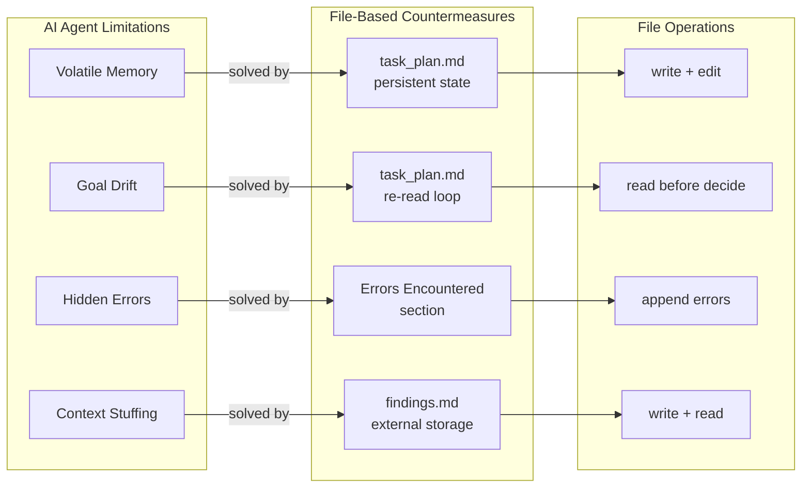
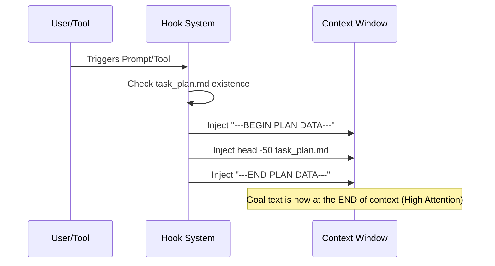

<!-- source: DeepWiki mcp.deepwiki.com · repo OthmanAdi/planning-with-files · page 2.2 Problems and Solutions · fetched 2026-10-29 -->

# Problems and Solutions

<details>
<summary>Relevant source files</summary>

The following files were used as context for generating this wiki page:

- [.claude-plugin/marketplace.json](.claude-plugin/marketplace.json)
- [.claude-plugin/plugin.json](.claude-plugin/plugin.json)
- [.codex/skills/planning-with-files/SKILL.md](.codex/skills/planning-with-files/SKILL.md)
- [.cursor/skills/planning-with-files/SKILL.md](.cursor/skills/planning-with-files/SKILL.md)
- [.gitignore](.gitignore)
- [.opencode/skills/planning-with-files/SKILL.md](.opencode/skills/planning-with-files/SKILL.md)
- [CHANGELOG.md](CHANGELOG.md)
- [CITATION.cff](CITATION.cff)
- [CONTRIBUTORS.md](CONTRIBUTORS.md)
- [README.md](README.md)
- [examples/README.md](examples/README.md)
- [skills/planning-with-files/SKILL.md](skills/planning-with-files/SKILL.md)
- [skills/planning-with-files/examples.md](skills/planning-with-files/examples.md)
- [skills/planning-with-files/reference.md](skills/planning-with-files/reference.md)
- [skills/planning-with-files/templates/findings.md](skills/planning-with-files/templates/findings.md)
- [skills/planning-with-files/templates/progress.md](skills/planning-with-files/templates/progress.md)
- [skills/planning-with-files/templates/task_plan.md](skills/planning-with-files/templates/task_plan.md)

</details>


## Purpose and Scope

This page maps specific AI agent limitations to their file-based countermeasures in the `planning-with-files` system. Each problem is analyzed with its root cause and paired with the concrete file operations and structures that solve it. This documentation covers the architecture that enables agents to function like the Manus-style agents [README.md:5-10]().

---

## The Problem-Solution Architecture

AI agents face four fundamental limitations that prevent effective long-running task execution. The `planning-with-files` system addresses each limitation through persistent filesystem operations rather than relying on volatile in-memory state.

**Problem-Solution Mapping Diagram**



Sources: [README.md:78-85](), [skills/planning-with-files/SKILL.md:81-85]()

---

## Problem 1: Volatile Memory

### Description

Many AI tools store task state in ephemeral memory (e.g., internal `TodoWrite` caches). When the context resets—which happens naturally during long conversations or when hitting token limits—all planning information vanishes. The agent loses track of what phases are complete, what decisions were made, and what the original goal was.

### Root Cause

The context window in LLMs acts as volatile RAM. Without a persistent storage mechanism, context resets (invoked by commands like `/clear`) are fatal for multi-step tasks that exceed the model's capacity or require breaks in execution.

### File-Based Countermeasure

**`task_plan.md` as persistent state container**

Instead of using volatile in-memory structures, the system writes all planning information to `task_plan.md` on disk. This file persists across context resets, session boundaries, and system restarts [README.md:82]().

**Key sections that maintain state in `task_plan.md`:**

| Section | Persistence Guarantee |
|---------|----------------------|
| `## Goal` | Original intent survives indefinitely [skills/planning-with-files/templates/task_plan.md:8-14]() |
| `## Phases` | Checkbox state (`[x]` vs `[ ]`) tracks completion [skills/planning-with-files/templates/task_plan.md:23-44]() |
| `## Decisions Made` | Historical record of rationale [skills/planning-with-files/templates/task_plan.md:97-107]() |
| `## Current Phase` | Explicit pointer to active work [skills/planning-with-files/templates/task_plan.md:16-21]() |

**File operations used:**
- `Write`: Initial creation of plan from template.
- `Edit`: Update checkboxes and status without rewriting entire file.
- `Read`: Restore state after context reset via `session-catchup.py` [skills/planning-with-files/SKILL.md:42-47]().

Sources: [README.md:81-85](), [skills/planning-with-files/SKILL.md:33-54](), [skills/planning-with-files/templates/task_plan.md:1-133]()

---

## Problem 2: Goal Drift

### Description

After approximately 50 tool calls, language models exhibit a "lost in the middle" effect. Original goals, stated at the beginning of the context, receive minimal attention weight compared to recent messages. The agent begins solving a subtly different problem than originally requested.

### Root Cause

Attention mechanisms in transformer models weight recent tokens more heavily than distant tokens. In a long context window, the model's attention focuses on the most recent observations, not the original goal.

### File-Based Countermeasure

**Re-reading `task_plan.md` to manipulate attention window**

[skills/planning-with-files/SKILL.md:105-106]() explains the core mechanism:
> "Before major decisions, read the plan file. This keeps goals in your attention window."

The `UserPromptSubmit` and `PreToolUse` hooks [skills/planning-with-files/SKILL.md:7-15]() automate this pattern by injecting the plan content directly into the prompt.

**Attention manipulation pattern in hooks:**



The goal text now appears at the end of the context where attention is strongest. This re-reading happens automatically before every major tool execution (Write, Edit, Bash, Read, Glob, Grep) [skills/planning-with-files/SKILL.md:12-15]().

Sources: [skills/planning-with-files/SKILL.md:7-20](), [skills/planning-with-files/SKILL.md:105-106]()

---

## Problem 3: Hidden Errors

### Description

AI agents often attempt to hide failures or retry silently. This wastes tokens on repeated mistakes and prevents learning. Without an external log, the agent has no record of what failed in previous turns.

### Root Cause

Without explicit error logging, failed attempts disappear from the agent's working memory after a context reset or simply move too far up the attention window to be relevant.

### File-Based Countermeasure

**`Errors Encountered` section in `task_plan.md`**

[skills/planning-with-files/SKILL.md:114-115]() mandates: "Log ALL Errors." The `task_plan.md` template includes a structured table for this purpose:

```markdown
## Errors Encountered
| Error | Attempt | Resolution |
|-------|---------|------------|
| [Error Name] | [Num] | [How it was fixed] |
```
[skills/planning-with-files/templates/task_plan.md:109-121]()

**The 3-Strike Error Protocol:**
1. **Attempt 1**: Diagnose & Fix.
2. **Attempt 2**: Alternative Approach (Never repeat the exact same failing action).
3. **Attempt 3**: Broader Rethink.
4. **After 3 Failures**: Escalate to User [.cursor/skills/planning-with-files/SKILL.md:130-152]().

Sources: [skills/planning-with-files/SKILL.md:114-130](), [skills/planning-with-files/templates/task_plan.md:109-121](), [.cursor/skills/planning-with-files/SKILL.md:130-152]()

---

## Problem 4: Context Stuffing

### Description

Agents attempt to keep all research findings, code snippets, and documentation directly in the conversation context. This degrades model performance, increases token costs, and eventually hits context limits.

### Root Cause

[skills/planning-with-files/SKILL.md:81-82]() explains the core principle:
`Context Window = RAM (volatile, limited)` vs `Filesystem = Disk (persistent, unlimited)`.

### File-Based Countermeasure

**`findings.md` as external storage for research**

The agent is instructed to offload data to `findings.md` after any discovery [skills/planning-with-files/SKILL.md:89-93](). This is enforced by the **2-Action Rule**:
> "After every 2 view/browser/search operations, IMMEDIATELY save key findings to text files." [skills/planning-with-files/SKILL.md:100-103]()

**Context Offloading Pattern:**

Instead of keeping 10,000 tokens of research in context:
1. Agent performs research.
2. Agent writes findings to `findings.md`.
3. Agent summarizes: "Found requirements; stored in findings.md."
4. Subsequent turns only consume tokens for the summary, not the raw data.

Sources: [skills/planning-with-files/SKILL.md:81-103](), [skills/planning-with-files/SKILL.md:154-164]()

---

## Comprehensive Problem-Solution Matrix

| Problem | Root Cause | File Countermeasure | Implementation Entity |
|---------|-----------|---------------------|-----------------------|
| **Volatile Memory** | Context resets | `task_plan.md` | `init-session.sh` [CHANGELOG.md:203]() |
| **Goal Drift** | Attention decay | Hook-based injection | `UserPromptSubmit` Hook [skills/planning-with-files/SKILL.md:7-10]() |
| **Hidden Errors** | Silent retries | `Errors Encountered` table | `task_plan.md` Template [skills/planning-with-files/templates/task_plan.md:109]() |
| **Context Stuffing** | Token accumulation | `findings.md` offloading | `2-Action Rule` [skills/planning-with-files/SKILL.md:100]() |
| **Plan Tampering** | Unauthorized edits | SHA-256 Attestation | `/plan-attest` command [CHANGELOG.md:9-13]() |

---

## Implementation Security: Plan Attestation

A secondary problem introduced by persistent files is the risk of the model or a process silently modifying the plan without user oversight. Version 2.37.0 introduced **Hash Attestation** to solve this [CHANGELOG.md:5-15]().

1. **Generation**: User runs `/plan-attest` (or `attest-plan.sh`).
2. **Storage**: A SHA-256 hash of `task_plan.md` is stored in `.planning/<active-plan>/.attestation` [CHANGELOG.md:9]().
3. **Verification**: On every hook fire (`UserPromptSubmit` or `PreToolUse`), the system recomputes the hash.
4. **Enforcement**: If the hash mismatches, injection is blocked and the model is alerted: `[PLAN TAMPERED — injection blocked]` [skills/planning-with-files/SKILL.md:10-15]().

Sources: [CHANGELOG.md:5-18](), [skills/planning-with-files/SKILL.md:7-15]()

---

