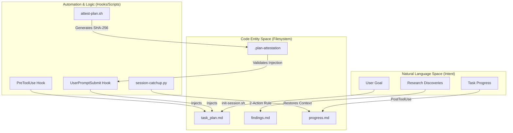
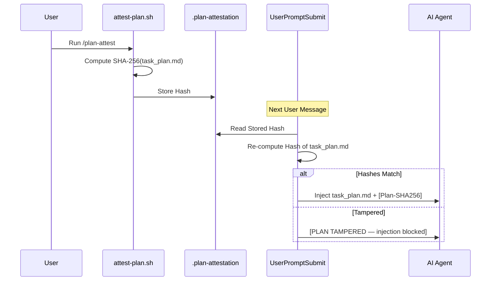

<!-- source: DeepWiki mcp.deepwiki.com · repo OthmanAdi/planning-with-files · page 2.3 Filesystem as Working Memory · fetched 2026-10-29 -->

# Filesystem as Working Memory

<details>
<summary>Relevant source files</summary>

The following files were used as context for generating this wiki page:

- [.claude-plugin/marketplace.json](.claude-plugin/marketplace.json)
- [.claude-plugin/plugin.json](.claude-plugin/plugin.json)
- [.gitignore](.gitignore)
- [CHANGELOG.md](CHANGELOG.md)
- [CITATION.cff](CITATION.cff)
- [CONTRIBUTORS.md](CONTRIBUTORS.md)
- [README.md](README.md)
- [examples/README.md](examples/README.md)
- [skills/planning-with-files/SKILL.md](skills/planning-with-files/SKILL.md)
- [skills/planning-with-files/examples.md](skills/planning-with-files/examples.md)
- [skills/planning-with-files/reference.md](skills/planning-with-files/reference.md)
- [skills/planning-with-files/templates/findings.md](skills/planning-with-files/templates/findings.md)
- [skills/planning-with-files/templates/progress.md](skills/planning-with-files/templates/progress.md)
- [skills/planning-with-files/templates/task_plan.md](skills/planning-with-files/templates/task_plan.md)

</details>


## Purpose and Scope

This page provides a deep dive into the foundational principle of the `planning-with-files` architecture: **treating the filesystem as persistent, unlimited working memory**. While standard AI interactions rely on a volatile context window (RAM), this system offloads state, research, and progress to markdown files (Disk). 

This page covers the technical implementation of the Context Window vs. Filesystem trade-off, KV-cache optimization through deterministic serialization, attention manipulation via hooks, and the conceptual 6 Manus Principles.

---

## The Core Principle: Context = RAM, Filesystem = Disk

In the `planning-with-files` paradigm, the AI agent's internal state is managed through a clear hardware analogy.

| Component | Analog | Characteristics | Role in System |
| :--- | :--- | :--- | :--- |
| **Context Window** | **RAM** | Volatile, expensive, limited size, high attention. | Active reasoning, tool selection, and immediate observation processing. |
| **Filesystem** | **Disk** | Persistent, free, unlimited size, searchable. | Storing `task_plan.md`, `findings.md`, and `progress.md`. |

### The Volatility Problem
Standard AI agents suffer from "Context Stuffing" and "Attention Degradation." As a conversation grows, the original goal (at the top of the context) loses salience (the "lost in the middle" phenomenon). Furthermore, commands like `/clear` or session timeouts wipe the "RAM," causing the agent to lose all progress.

### The Filesystem Solution
By writing every decision, finding, and error to disk, the agent creates a **persistent state**. Even if the context is wiped, the agent can re-read the files to reconstruct its entire "mental model" in a single tool call.

**Sources:** [skills/planning-with-files/SKILL.md:78-85](), [skills/planning-with-files/reference.md:7-17]()

---

## Technical Architecture: Natural Language to Code Entity Space

The following diagrams illustrate how abstract memory concepts map to specific code entities and automated hooks within the codebase.

### Diagram: Memory Flow and Hook Automation
This diagram shows how the system automatically moves data between the volatile "Attention" (Context) and persistent "Memory" (Filesystem) using specific hooks defined in `SKILL.md`.



**Sources:** [skills/planning-with-files/SKILL.md:6-24](), [CHANGELOG.md:9-15](), [CONTRIBUTORS.md:28-34]()

---

## KV-Cache Optimization and Attention Manipulation

The system uses specific technical strategies to ensure the agent remains performant and focused.

### 1. KV-Cache Optimization
Every token in an AI's context window is re-processed unless it can be cached. The `planning-with-files` system optimizes for this by:
*   **Stable Prefixes**: Files like `task_plan.md` use structured headers.
*   **Append-Only Logging**: `progress.md` and `findings.md` are primarily append-only, which allows the LLM provider to cache the "prefix" of the file, significantly reducing latency and cost ($0.30/MTok vs $3/MTok).
*   **Deterministic Serialization**: Using templates like `templates/task_plan.md` ensures the agent writes data in a consistent format that the model can parse efficiently.

### 2. Attention Manipulation (Recitation)
The `PreToolUse` hook in `SKILL.md` acts as an "Attention Refresh" mechanism. By injecting the first 30 lines of `task_plan.md` before every tool execution, the system forces the agent to "recite" its goal, keeping it at the very end of the context (the high-attention zone).

```bash
# Implementation of Attention Refresh in SKILL.md
if [ -f task_plan.md ]; then 
    echo '---BEGIN PLAN DATA---'; 
    cat task_plan.md | head -30; 
    echo '---END PLAN DATA---'; 
fi
```

**Sources:** [skills/planning-with-files/SKILL.md:11-15](), [CHANGELOG.md:77-80]()

---

## The 6 Manus Principles (Conceptual Level)

The `planning-with-files` skill is built on the 6 principles that allowed Manus AI to achieve high-fidelity agentic behavior.

1.  **Filesystem as External Memory**: Never trust the context window for long-term storage.
2.  **Attention Manipulation (Recitation)**: Re-read the plan before every major decision to prevent goal drift.
3.  **KV-Cache Optimization**: Use stable, append-only structures to minimize token costs and latency.
4.  **Logit Masking (Implicit)**: By providing structured templates, we constrain the model's output space to valid planning steps.
5.  **Keep Wrong Turns**: Principles 5 and 6 of the Manus pattern require logging ALL errors in `task_plan.md` to prevent the agent from repeating failures.
6.  **Controlled Variation**: When an action fails, the agent must mutate its approach (e.g., changing a search query) rather than retrying the same tool call.

**Sources:** [skills/planning-with-files/SKILL.md:95-130](), [README.md:7-12]()

---

## Security and Integrity: Plan Attestation

As of v2.37.0, the system treats the "Working Memory" as a security boundary. Since the plan is injected into the context, a compromised `task_plan.md` could lead to prompt injection.

### Diagram: Plan Attestation Workflow
This diagram shows how `attest-plan.sh` creates a cryptographic link between the user's approved plan and the automated injection system.



**Sources:** [CHANGELOG.md:5-15](), [skills/planning-with-files/SKILL.md:10-15]()

### Key Security Entities
*   **`attest-plan.sh` / `attest-plan.ps1`**: Scripts that compute the SHA-256 hash of the current `task_plan.md`. [CHANGELOG.md:14-15]()
*   **`.plan-attestation`**: A hidden file storing the trusted hash. [CHANGELOG.md:9-10]()
*   **`TAMPERED` flag**: Logic within the `UserPromptSubmit` hook that blocks context injection if the file was modified without re-attestation. [skills/planning-with-files/SKILL.md:10]()

**Sources:** [CHANGELOG.md:5-15](), [skills/planning-with-files/SKILL.md:10-15]()

---

