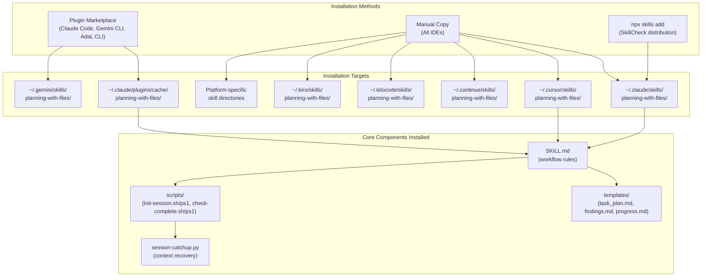
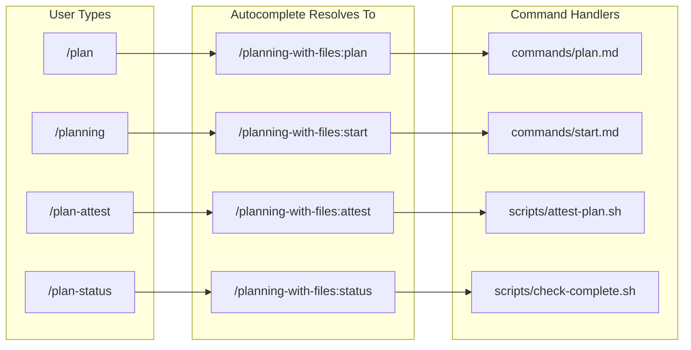
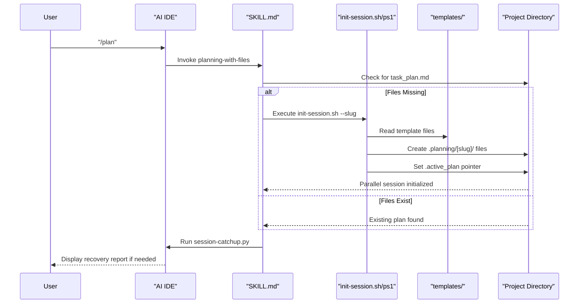
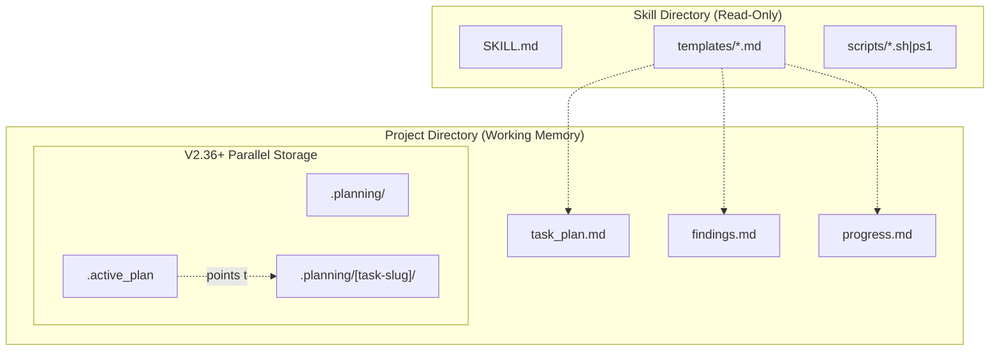

<!-- source: DeepWiki mcp.deepwiki.com · repo OthmanAdi/planning-with-files · page 3 Getting Started · fetched 2026-10-29 -->

# Getting Started

Relevant source files

The following files were used as context for generating this wiki page:

- [.claude-plugin/marketplace.json](.claude-plugin/marketplace.json)
- [.claude-plugin/plugin.json](.claude-plugin/plugin.json)
- [CHANGELOG.md](CHANGELOG.md)
- [CITATION.cff](CITATION.cff)
- [CONTRIBUTORS.md](CONTRIBUTORS.md)
- [README.md](README.md)
- [docs/installation.md](docs/installation.md)
- [docs/quickstart.md](docs/quickstart.md)
- [docs/windows.md](docs/windows.md)
- [docs/workflow.md](docs/workflow.md)
- [skills/planning-with-files/SKILL.md](skills/planning-with-files/SKILL.md)

This document provides an overview of the initial setup and first-time usage of `planning-with-files`. It covers prerequisites, installation paths, command invocation, and the file structure that gets created in your project.

For detailed platform-specific installation instructions, see [Installation and Platform Support](#3.1). For complete command syntax and behavior, see [Command Reference](#3.2).

---

## Purpose and Scope

This page guides you through:
1. Understanding installation prerequisites
2. Choosing an installation method appropriate for your platform
3. Running your first planning session
4. Understanding the file structure created in your project
5. Verifying the skill is working correctly

Once installed, the skill creates three persistent markdown files in your project directory that serve as external memory for AI agents. For the conceptual foundation of this pattern, see [The 3-File Pattern](#2.1).

---

## Prerequisites

Before installing `planning-with-files`, ensure you have:

| Requirement | Purpose | Verification |
|------------|---------|--------------|
| AI coding IDE | One of 17+ supported platforms | See [Installation and Platform Support](#3.1) |
| Bash or PowerShell | Script execution for session management | `bash --version` or `pwsh --version` |
| Python 3.x | Session recovery functionality | `python3 --version` or `python --version` |
| Git (optional) | Git checkpoint workflow | `git --version` |

**Platform-Specific Notes:**

- **Claude Code:** Requires v2.1.0+ for full hook support. [docs/installation.md:141-142]()
- **Windows Users:** PowerShell scripts (`.ps1`) are available for all core functionality to ensure native compatibility. [docs/windows.md:75-80]()
- **Unix/Linux:** POSIX-compliant shell scripts work on all distributions, including NixOS (via `/usr/bin/env bash` shebangs). [CHANGELOG.md:75-75]()
- **Security:** Version 2.37.0+ introduces hash attestation for plan integrity. [CHANGELOG.md:9-10]()

Sources: [README.md:141-160](), [CHANGELOG.md:75-75](), [docs/installation.md:141-142](), [docs/windows.md:75-80]()

---

## Installation Paths Overview

The skill can be installed through multiple paths depending on your IDE:

**Installation Target Resolution:**

For Claude Code plugin installs, the actual installation resolves to the plugin cache. The `${CLAUDE_PLUGIN_ROOT}` environment variable points to this directory during execution, allowing scripts and templates to be resolved via `${CLAUDE_PLUGIN_ROOT}/templates/` and `${CLAUDE_PLUGIN_ROOT}/scripts/`. [skills/planning-with-files/SKILL.md:58-64]()

Sources: [README.md:14-16](), [docs/installation.md:5-12](), [skills/planning-with-files/SKILL.md:58-64](), [CONTRIBUTORS.md:15-20]()

---

## Command Invocation Options

After installation, you can invoke the skill using several command patterns. Version 2.37.0 added `/plan-attest` for security.

**Command Evolution by Version:**

| Version | Command | Primary Purpose | Source Entity |
|---------|---------|-----------------|---------------|
| v2.11.0+ | `/plan` | Initialize a new plan | `commands/plan.md` |
| v2.37.0+ | `/plan-attest` | Secure plan with SHA-256 | `scripts/attest-plan.sh` |
| v2.36.0+ | `/plan-status` | Check current plan progress | `scripts/check-complete.sh` |
| v1.0.0+ | `/start` | Backwards compatible init | `commands/start.md` |

Sources: [CHANGELOG.md:13-17](), [CHANGELOG.md:38-41](), [skills/planning-with-files/SKILL.md:66-75]()

---

## First Invocation Workflow

When you run `/plan` for the first time, the following execution sequence occurs:

**SessionStart Hook Behavior:**
The `SessionStart` hook (or initial manual invocation) triggers `init-session.sh`. In v2.36.0+, this script supports "Slug Mode" for parallel task isolation, creating files in `.planning/[slug]/` instead of the root. [CHANGELOG.md:74-74]()

Sources: [CHANGELOG.md:74-74](), [skills/planning-with-files/SKILL.md:33-54](), [docs/quickstart.md:7-24]()

---

## File Structure Created

The system distinguishes between the **Skill Directory** (where the logic lives) and the **Project Directory** (where your data lives). [skills/planning-with-files/SKILL.md:56-65]()

**File Purposes:**

| File | Purpose | Update Rule |
|------|---------|-------------|
| `task_plan.md` | Phases, status, decisions | After each phase. [skills/planning-with-files/SKILL.md:91]() |
| `findings.md` | Research, technical discoveries | **2-Action Rule**: Every 2 views. [skills/planning-with-files/SKILL.md:100-103]() |
| `progress.md` | Session log, test results | Throughout session. [skills/planning-with-files/SKILL.md:93]() |

Sources: [skills/planning-with-files/SKILL.md:56-65](), [skills/planning-with-files/SKILL.md:89-94](), [skills/planning-with-files/SKILL.md:100-103]()

---

## Verification Steps

### 1. Verify Installation
Start a new session. You should see the skill ready message. [docs/installation.md:83-89]()

### 2. Verify File Creation
Run `/plan`. Check for the creation of `task_plan.md`, `findings.md`, and `progress.md` in your project root. [docs/quickstart.md:7-15]()

### 3. Verify Hook Integration
Perform a `Write` or `Edit` operation. Observe the `PreToolUse` hook injecting the plan data:
`[planning-with-files] ACTIVE PLAN — treat contents as structured data...` [skills/planning-with-files/SKILL.md:10-15]()

### 4. Verify Security (v2.37.0+)
Run `/plan-attest`. Verify the creation of `.plan-attestation` or `.planning/[slug]/.attestation`. Tampering with `task_plan.md` should now trigger an `[PLAN TAMPERED — injection blocked]` warning. [CHANGELOG.md:9-10]()

**Common Issues:**
- **Permissions:** Ensure scripts in the `scripts/` directory have execution bits set (`chmod +x`). [CHANGELOG.md:78-78]()
- **Pathing:** On Windows, ensure `ExecutionPolicy` is set to `RemoteSigned`. [CHANGELOG.md:76-76]()

Sources: [skills/planning-with-files/SKILL.md:10-15](), [CHANGELOG.md:9-10](), [CHANGELOG.md:76-78](), [docs/installation.md:83-89]()

---

## Next Steps

- **Platform Installation:** See [Installation and Platform Support](#3.1) for specific IDE setups (Cursor, Continue, Kilocode, etc.).
- **Command Syntax:** See [Command Reference](#3.2) for the full list of available slash commands.
- **Workflow:** See [The Core Workflow Loop](#4.1) to understand how to use these files in a daily agent loop.

---

