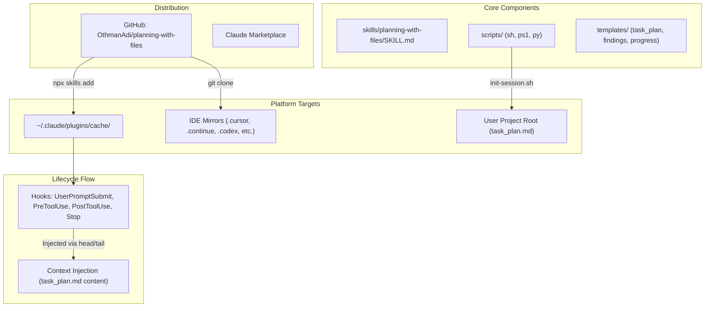
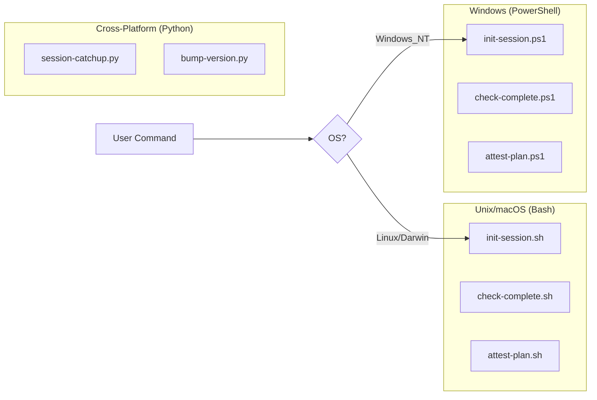

<!-- source: DeepWiki mcp.deepwiki.com · repo OthmanAdi/planning-with-files · page 3.1 Installation and Platform Support · fetched 2026-10-29 -->

# Installation and Platform Support

<details>
<summary>Relevant source files</summary>

The following files were used as context for generating this wiki page:

- [.claude-plugin/marketplace.json](.claude-plugin/marketplace.json)
- [.claude-plugin/plugin.json](.claude-plugin/plugin.json)
- [CHANGELOG.md](CHANGELOG.md)
- [CITATION.cff](CITATION.cff)
- [CONTRIBUTORS.md](CONTRIBUTORS.md)
- [README.md](README.md)
- [docs/installation.md](docs/installation.md)
- [docs/quickstart.md](docs/quickstart.md)
- [docs/troubleshooting.md](docs/troubleshooting.md)
- [docs/windows.md](docs/windows.md)
- [docs/workflow.md](docs/workflow.md)
- [skills/planning-with-files/SKILL.md](skills/planning-with-files/SKILL.md)
- [templates/findings.md](templates/findings.md)
- [templates/progress.md](templates/progress.md)
- [templates/task_plan.md](templates/task_plan.md)

</details>


This document provides a comprehensive guide to installing `planning-with-files` across 17+ supported platforms. It covers the plugin marketplace, manual installation, cross-platform script support (Bash/PowerShell), and platform-specific configurations.

For detailed command usage, see [Command Reference](#3.2). For technical details on automation, see [Hook System Reference](#7.5).

---

## Supported Platforms Overview

Planning-with-files supports a wide array of AI coding assistants by adapting its core skill structure to each platform's specific directory and hook requirements.

| Platform | Directory | Primary Format |
| :--- | :--- | :--- |
| **Claude Code** | `~/.claude/plugins/` | Plugin + SKILL.md |
| **Cursor** | `.cursor/skills/` | SKILL.md |
| **Continue** | `.continue/skills/` | SKILL.md + .prompt |
| **Kilocode** | `.kilocode/rules/` | Rules-based MD |
| **Codex** | `.codex/skills/` | SKILL.md + Lifecycle Hooks |
| **OpenCode** | `.opencode/skills/` | SKILL.md |
| **Gemini CLI** | `.gemini/skills/` | Agent Skills |
| **Pi Agent** | `.pi/skills/` | Agent Skills |
| **Kiro** | `.kiro/skills/` | Agent Skills + Steering |
| **Hermes** | `.hermes/plugins/` | Python Adapter + Tools |
| **GitHub Copilot** | `.github/hooks/` | JSON Hook Manifest |
| **Moltbot / Factory** | `.factory/skills/` | Workspace Skills |

**Sources:** [README.md:5-16](), [CONTRIBUTORS.md:9-105](), [.claude-plugin/plugin.json:1-40]()

---

## Installation Architecture

The codebase is organized into a canonical skill directory and platform-specific mirrors. The `sync-ide-folders.py` script ensures parity across all 14+ variant folders.



**System Architecture Diagram** - Bridges the repository source to the installed IDE environment. The `SKILL.md` file defines the hooks that automate context injection from the project-level planning files.

**Sources:** [README.md:227-277](), [skills/planning-with-files/SKILL.md:1-24](), [CHANGELOG.md:26-29]()

---

## Claude Code Installation (Primary)

### Method 1: Marketplace (Recommended)
Claude Code v2.1.0+ allows direct installation from the marketplace. This ensures proper hook integration and automatic updates.

```bash
/plugin marketplace add OthmanAdi/planning-with-files
/plugin install planning-with-files@planning-with-files
```

**Sources:** [docs/installation.md:5-12](), [CHANGELOG.md:535-541]()

### Method 2: Manual (Skills Only)
If you only want the core skill without the full plugin structure, clone the repo and copy the `skills` directory.

```bash
git clone https://github.com/OthmanAdi/planning-with-files.git
cp -r planning-with-files/skills/* ~/.claude/skills/
```

**Sources:** [docs/installation.md:60-69]()

---

## Platform-Specific Configurations

### Cursor and Continue
Both IDEs use a `.skills/` or `.prompts/` directory within the user's configuration or project root.

*   **Cursor:** Copy to `.cursor/skills/planning-with-files/`.
*   **Continue:** Copy to `.continue/skills/` and add `.continue/prompts/planning-with-files.prompt` for slash command support.

**Sources:** [CONTRIBUTORS.md:49-54](), [CHANGELOG.md:55-61]()

### Codex and OpenCode
These platforms utilize a Python-based hook adapter and session isolation via `CODEX_THREAD_ID`.

*   **Codex:** Uses `.codex/hooks.json` for full lifecycle hooks (SessionStart, PreToolUse, etc.).
*   **Session Recovery:** Rewritten in v2.32.0 to support Codex rollout JSONL formats.

**Sources:** [CHANGELOG.md:78-82](), [CONTRIBUTORS.md:93-98]()

### Hermes Adapter (Platform 17)
Hermes uses a project plugin and Python tools for initialization and status tracking.

*   **Tools:** `planning_with_files_init`, `planning_with_files_status`, `planning_with_files_check_complete`.
*   **Integration:** Bundled inside `.hermes/skills/planning-with-files/`.

**Sources:** [CHANGELOG.md:99-104](), [CONTRIBUTORS.md:99-104]()

---

## Cross-Platform Script Support (Windows/Unix)

The skill provides dual-script support for all core operations to ensure Windows parity.



**Script Execution Matrix** - Demonstrates how the system selects between `.sh` and `.ps1` based on the environment. `session-catchup.py` serves as the universal context recovery tool.

**Sources:** [CHANGELOG.md:14-17](), [CHANGELOG.md:53-57](), [CONTRIBUTORS.md:36-41]()

### Key Scripts
*   `init-session.sh/.ps1`: Creates the 3-file pattern from templates. Supports `--template analytics` (v2.29.0) and `--slug` mode for parallel tasks (v2.36.0). [CHANGELOG.md:74-87]()
*   `check-complete.sh/.ps1`: Verified by the `Stop` hook to ensure all phases in `task_plan.md` are marked `complete`. [skills/planning-with-files/SKILL.md:21-24]()
*   `attest-plan.sh/.ps1`: (v2.37.0) Computes SHA-256 hash of `task_plan.md` to prevent prompt injection tampering. [CHANGELOG.md:5-15]()

---

## Security and Verification

### Plan Attestation (v2.37.0)
To prevent unauthorized modification of the plan by the model during a session, users can "lock" the plan.

1.  **Command:** `/plan-attest`
2.  **Implementation:** Generates a hash in `.planning/<plan-id>/.attestation`.
3.  **Enforcement:** The `UserPromptSubmit` and `PreToolUse` hooks re-verify the hash. If a mismatch occurs, injection is blocked with a `[PLAN TAMPERED]` warning.

**Sources:** [CHANGELOG.md:5-11](), [skills/planning-with-files/SKILL.md:7-15]()

### Verifying Installation
After installation, verify the skill is active by checking the version or running the initialization script:

```bash
# Check version (Canonical)
grep "version:" ~/.claude/skills/planning-with-files/SKILL.md

# Run initialization
sh ~/.claude/skills/planning-with-files/scripts/init-session.sh
```

**Sources:** [docs/installation.md:83-90](), [CHANGELOG.md:15-17]()

---
**Sources:**
- [README.md:1-100]()
- [CHANGELOG.md:1-100]()
- [skills/planning-with-files/SKILL.md:1-133]()
- [docs/installation.md:1-169]()
- [docs/quickstart.md:1-110]()
- [CONTRIBUTORS.md:1-110]()

---

