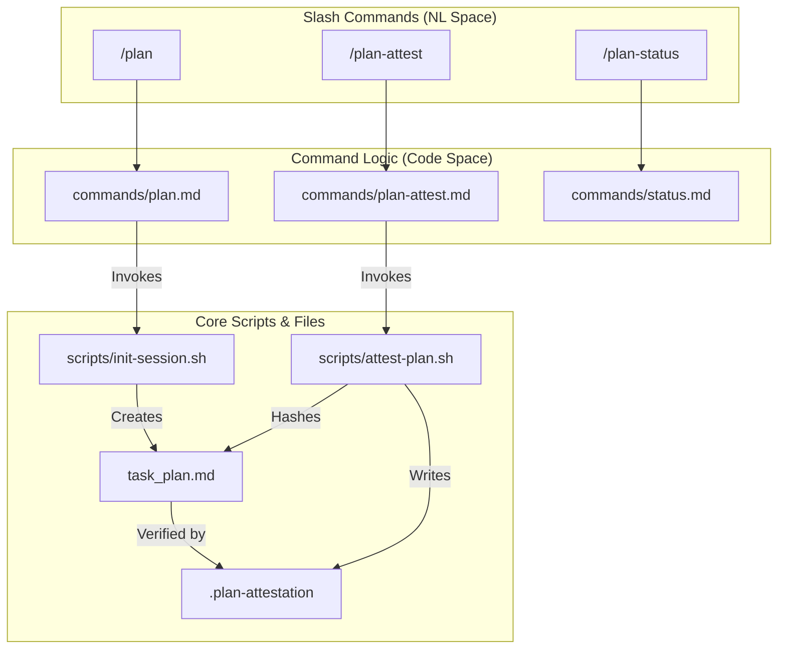
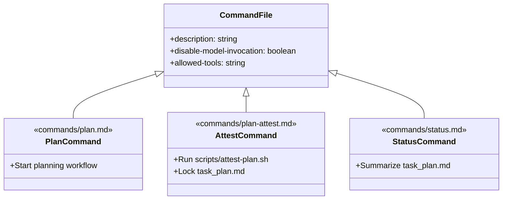

<!-- source: DeepWiki mcp.deepwiki.com · repo OthmanAdi/planning-with-files · page 3.2 Command Reference · fetched 2026-10-29 -->

# Command Reference

Relevant source files

The following files were used as context for generating this wiki page:

- [.claude-plugin/marketplace.json](.claude-plugin/marketplace.json)
- [.claude-plugin/plugin.json](.claude-plugin/plugin.json)
- [CHANGELOG.md](CHANGELOG.md)
- [CITATION.cff](CITATION.cff)
- [CONTRIBUTORS.md](CONTRIBUTORS.md)
- [README.md](README.md)
- [commands/plan-attest.md](commands/plan-attest.md)
- [commands/plan.md](commands/plan.md)
- [commands/start.md](commands/start.md)
- [commands/status.md](commands/status.md)
- [skills/planning-with-files/SKILL.md](skills/planning-with-files/SKILL.md)

This document provides a complete reference for all slash commands available in the `planning-with-files` skill. It covers the primary planning commands (`/plan`, `/planning`, `/start`), the administrative status command (`/plan-status`), and the security-focused attestation command (`/plan-attest`).

For information about using these commands in practice, see **4.1 The Core Workflow Loop**. For platform-specific command invocation, see **3.1 Installation and Platform Support**.

---

## Command Overview

The `planning-with-files` skill provides several slash command variations optimized for different use cases and security needs.

| Command | Autocomplete Trigger | Version Added | Implementation File | Recommended For |
|---------|---------------------|---------------|---------------------|-----------------|
| `/planning-with-files:plan` | `/plan` | v2.11.0 | `commands/plan.md` | Quick access (shortest path) |
| `/planning-with-files:start` | `/start` | v2.6.0 | `commands/start.md` | Initializing complex tasks |
| `/planning-with-files:status` | `/plan-status` | v2.20.0 | `commands/status.md` | Quick progress checks |
| `/planning-with-files:attest` | `/plan-attest` | v2.37.0 | `commands/plan-attest.md` | Security locking/tamper detection |

**Sources:** [README.md:70-81](), [CHANGELOG.md:11-15](), [commands/plan.md:1-3](), [commands/plan-attest.md:1-5]()

---

## Command Architecture and Data Flow

The following diagram bridges the "Natural Language Space" (Slash Commands) to the "Code Entity Space" (Scripts and Templates).

**Command-to-Code Mapping**

**Sources:** [commands/plan.md:1-13](), [commands/plan-attest.md:1-24](), [CHANGELOG.md:13-17](), [skills/planning-with-files/SKILL.md:10-15]()

---

## Detailed Command Reference

### `/plan` and `/start`
**Purpose:** Initializes the 3-file pattern in the current project directory.

*   **Behavior:** These commands invoke the main skill workflow. If `task_plan.md` is missing, they trigger `init-session.sh` (or `.ps1`) to create files from templates.
*   **Implementation:** `commands/plan.md` and `commands/start.md` are thin wrappers that instruct the model to follow the `planning-with-files` skill exactly [commands/plan.md:5-12](), [commands/start.md:6-7]().
*   **Template Usage:** Pulls from `templates/task_plan.md`, `templates/findings.md`, and `templates/progress.md` [commands/plan.md:7-10]().

### `/plan-status`
**Purpose:** Displays a compact summary of current progress without reading the full files into context.

*   **Output:** Shows Current Phase, progress percentage, a list of phases with status icons (⏸️, 🔄, ✅, ❌), and counts of logged errors [commands/status.md:9-37]().
*   **File Resolution:** Reads `task_plan.md` from the project root [commands/status.md:5]().

### `/plan-attest`
**Purpose:** Cryptographically locks the `task_plan.md` to prevent silent tampering by the AI or external processes.

*   **Mechanism:** Computes a SHA-256 hash of `task_plan.md` and stores it in `.planning/<active-plan>/.attestation` (parallel mode) or `./.plan-attestation` (legacy mode) [commands/plan-attest.md:10-12]().
*   **Flags:**
    *   `--show`: Prints the currently stored hash [commands/plan-attest.md:20]().
    *   `--clear`: Removes the attestation to allow editing [commands/plan-attest.md:21]().
*   **Integration:** Once attested, the `UserPromptSubmit` and `PreToolUse` hooks verify the hash. If the file is modified without re-attesting, the hook blocks injection and alerts the user: `[PLAN TAMPERED — injection blocked]` [skills/planning-with-files/SKILL.md:10](), [CHANGELOG.md:9]().

**Sources:** [commands/plan-attest.md:1-24](), [CHANGELOG.md:5-15](), [skills/planning-with-files/SKILL.md:10-15]()

---

## Command Implementation Structure

Commands are defined as Markdown files within the `commands/` directory. These files use YAML frontmatter to define behavior for the Claude Code plugin system.

**Commands Directory Mapping**

**Sources:** [commands/plan.md:1-3](), [commands/plan-attest.md:1-5](), [commands/status.md:1-3]()

---

## Evolution of Commands

The command set has expanded from simple initialization to complex security and parallel task management.

| Version | Milestone | Key Command Change |
|---------|-----------|--------------------|
| **v1.0.0** | Launch | Manual invocation of `SKILL.md` |
| **v2.6.0** | Plugin Support | Added `/start` via `commands/start.md` |
| **v2.11.0** | UX Polish | Added `/plan` for faster autocomplete [CHANGELOG.md:144]() |
| **v2.20.0** | Status | Added `/plan-status` for quick summaries |
| **v2.36.0** | Parallelism | Scripts added to support `PLAN_ID` and slug mode [CHANGELOG.md:74]() |
| **v2.37.0** | Security | Added `/plan-attest` for SHA-256 verification [CHANGELOG.md:9-13]() |

**Sources:** [CHANGELOG.md:5-81](), [README.md:70-85]()

---

## Troubleshooting Commands

*   **Command not found:** Ensure the plugin is installed (`claude plugins list`). If using a manual install, ensure `SKILL.md` is in `~/.claude/skills/planning-with-files/` [README.md:173-176]().
*   **Attestation Mismatch:** If you see `[PLAN TAMPERED]`, you have edited `task_plan.md` manually. Run `/plan-attest` to approve the new content or `/plan-attest --clear` to remove the lock [commands/plan-attest.md:23-24]().
*   **Parallel Sessions:** If working on multiple tasks, ensure you use `export PLAN_ID=your-slug` so commands like `/plan-attest` resolve to the correct subdirectory in `.planning/` [CHANGELOG.md:14-15]().

**Sources:** [commands/plan-attest.md:10-24](), [CHANGELOG.md:74](), [README.md:173-176]()

---

