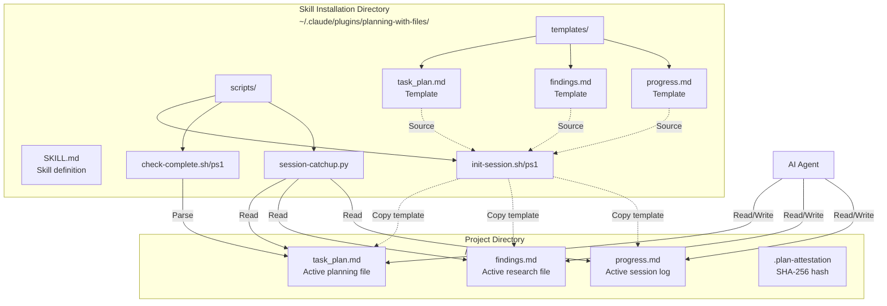
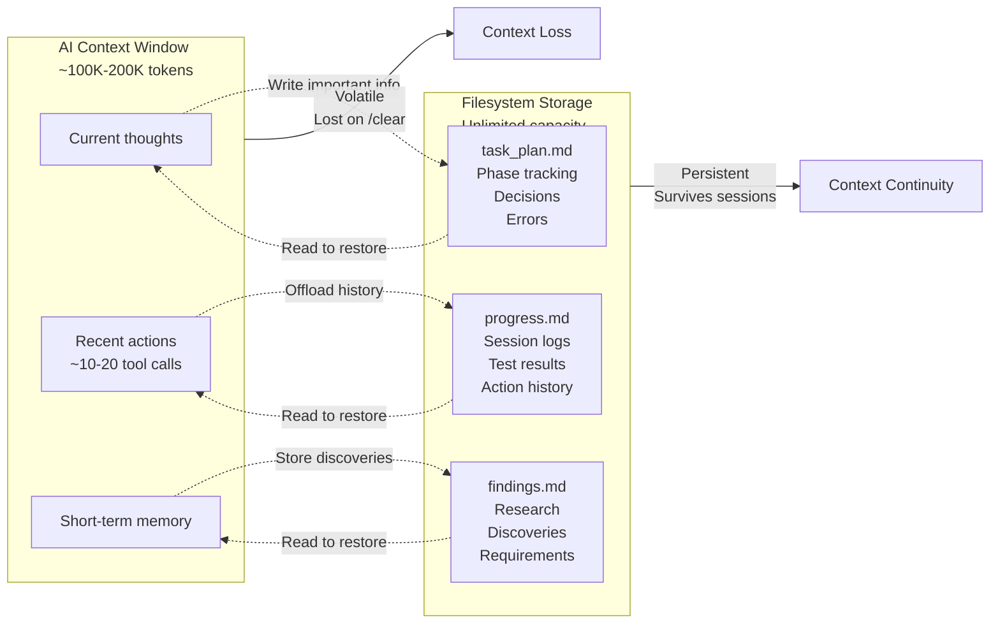

<!-- source: DeepWiki mcp.deepwiki.com · repo OthmanAdi/planning-with-files · page 4 Using the Skill · fetched 2026-10-29 -->

# Using the Skill

<details>
<summary>Relevant source files</summary>

The following files were used as context for generating this wiki page:

- [.claude-plugin/marketplace.json](.claude-plugin/marketplace.json)
- [.claude-plugin/plugin.json](.claude-plugin/plugin.json)
- [.gitignore](.gitignore)
- [CHANGELOG.md](CHANGELOG.md)
- [CITATION.cff](CITATION.cff)
- [CONTRIBUTORS.md](CONTRIBUTORS.md)
- [README.md](README.md)
- [examples/README.md](examples/README.md)
- [skills/planning-with-files/SKILL.md](skills/planning-with-files/SKILL.md)
- [skills/planning-with-files/examples.md](skills/planning-with-files/examples.md)
- [skills/planning-with-files/reference.md](skills/planning-with-files/reference.md)
- [skills/planning-with-files/templates/findings.md](skills/planning-with-files/templates/findings.md)
- [skills/planning-with-files/templates/progress.md](skills/planning-with-files/templates/progress.md)
- [skills/planning-with-files/templates/task_plan.md](skills/planning-with-files/templates/task_plan.md)

</details>


## Purpose and Scope

This section documents the practical usage of `planning-with-files` in your daily AI agent workflow. It covers how the skill integrates into agent operations, the critical rules that govern behavior, the hook system that automates context management, and guidelines for when to invoke this pattern.

**For installation instructions**, see [Installation and Platform Support](#3.1). **For complete examples and walkthroughs**, see [Examples and Patterns](#6). **For detailed file specifications and technical reference**, see [Technical Reference](#7).

This section is organized into four subsections:

| Subsection | Coverage |
|------------|----------|
| [The Core Workflow Loop](#4.1) | How the 7-step agent loop integrates with planning files |
| [Critical Rules](#4.2) | The 6 non-negotiable rules that govern agent behavior |
| [Hook System and Automation](#4.3) | How hooks automate context management at key lifecycle points |
| [When to Use This Pattern](#4.4) | Guidelines for appropriate use cases vs. when to skip |

Sources: [skills/planning-with-files/SKILL.md:1-249]()

---

## High-Level Usage Flow

The following diagram shows how `planning-with-files` integrates into the typical AI agent workflow, from initialization through task completion.

### Workflow Integration Diagram

```mermaid
flowchart TD
    Start["User invokes /plan or /planning"]
    
    Start --> CheckSession["SessionStart Hook<br/>Check for session recovery"]
    CheckSession --> Recovery{"Unsynced<br/>context?"}
    
    Recovery -->|"Yes"| RunCatchup["session-catchup.py<br/>Analyze JSONL logs"]
    Recovery -->|"No"| CheckFiles["Check for planning files<br/>task_plan.md, findings.md, progress.md"]
    
    RunCatchup --> ShowReport["Display catchup report<br/>git diff + file updates"]
    ShowReport --> CheckFiles
    
    CheckFiles --> FilesExist{"Files<br/>exist?"}
    FilesExist -->|"No"| InitSession["init-session.sh/ps1<br/>Create from templates"]
    FilesExist -->|"Yes"| ReadPlan["Read task_plan.md<br/>Get current phase"]
    
    InitSession --> ReadPlan
    
    ReadPlan --> WorkLoop["Enter Work Loop"]
    
    WorkLoop --> PreHook["PreToolUse Hook<br/>cat task_plan.md | head -30"]
    PreHook --> ToolExec["Execute tool<br/>Write/Edit/Bash/Read/etc"]
    ToolExec --> PostHook["PostToolUse Hook<br/>Remind to update status"]
    
    PostHook --> UpdateFiles["Update planning files<br/>Per 2-Action Rule"]
    UpdateFiles --> CheckPhase{"Phase<br/>complete?"}
    
    CheckPhase -->|"No"| MoreWork{"More work<br/>needed?"}
    CheckPhase -->|"Yes"| MarkComplete["Update task_plan.md<br/>Mark phase complete"]
    
    MarkComplete --> MoreWork
    
    MoreWork -->|"Yes"| WorkLoop
    MoreWork -->|"No"| StopHook["Stop Hook<br/>check-complete.sh/ps1"]
    
    StopHook --> VerifyComplete{"All phases<br/>complete?"}
    
    VerifyComplete -->|"Yes"| DeliverSuccess["Deliver to user<br/>Exit 0"]
    VerifyComplete -->|"No"| WarnIncomplete["Warn user<br/>Work remains<br/>Exit 1"]
    
    WarnIncomplete --> End["Session end"]
    DeliverSuccess --> End
```



**Key Integration Points:**

| Integration Point | File/Script | Purpose |
|------------------|-------------|---------|
| Session initialization | `scripts/init-session.sh` [scripts/init-session.sh:1-50]() | Creates planning files from templates |
| Context recovery | `scripts/session-catchup.py` [skills/planning-with-files/SKILL.md:42-43]() | Analyzes JSONL logs to restore context |
| Attention refresh | `PreToolUse` hook command | Injects plan into context before tool use [skills/planning-with-files/SKILL.md:11-15]() |
| Status reminders | `PostToolUse` hook command | Prompts agent to update after file edits [skills/planning-with-files/SKILL.md:16-20]() |
| Completion check | `scripts/check-complete.sh` [skills/planning-with-files/SKILL.md:24-24]() | Verifies all phases marked complete |

Sources: [skills/planning-with-files/SKILL.md:15-53](), [skills/planning-with-files/SKILL.md:60-78](), [skills/planning-with-files/SKILL.md:226-231]()

---

## File Location and Command Flow

Understanding where files are created and how commands flow through the system is critical for proper usage.

### File Location Architecture



**Security Note:** As of v2.37.0, the `/plan-attest` command (via `scripts/attest-plan.sh`) can be used to lock `task_plan.md` with a SHA-256 hash stored in `.plan-attestation` or `.planning/<active-plan>/.attestation`. If the file is tampered with, hook-based injection is blocked. [CHANGELOG.md:9-14]()

**Critical Distinction:**

| Location Type | What Goes There | Committed to Git? |
|--------------|-----------------|-------------------|
| Skill directory | Templates, scripts, reference docs | Yes (skill distribution) |
| Project directory | `task_plan.md`, `findings.md`, `progress.md` | User choice (see [File Management and .gitignore](#10.4)) |

Sources: [skills/planning-with-files/SKILL.md:56-76](), [CHANGELOG.md:9-17]()

---

## Core Principle: Filesystem as External Memory

The fundamental pattern underlying all usage is the externalization of working memory to persistent storage.

### Memory Architecture Diagram



**Core Equation:**

```
Context Window = RAM (volatile, limited)
Filesystem     = Disk (persistent, unlimited)

→ Anything important gets written to disk [skills/planning-with-files/SKILL.md:81-85]
```

This principle drives all usage patterns:
- **Read before major decisions** to refresh goals in attention [skills/planning-with-files/SKILL.md:105-106]()
- **Write after discoveries** to prevent information loss (2-Action Rule) [skills/planning-with-files/SKILL.md:100-103]()
- **Update after phase completion** to persist progress [skills/planning-with-files/SKILL.md:108-113]()
- **Log all errors** to build a persistent knowledge base [skills/planning-with-files/SKILL.md:114-123]()

Sources: [skills/planning-with-files/SKILL.md:78-131]()

---

## File Purpose Summary

Each of the three planning files serves a distinct purpose in the workflow.

| File | Primary Purpose | Update Frequency | Typical Size |
|------|----------------|------------------|--------------|
| `task_plan.md` | Phase tracking, progress status, decisions, errors | After each phase completion | 500-2000 tokens |
| `findings.md` | Research results, requirements, technical decisions | After every 2 view/browser ops | 1000-5000 tokens |
| `progress.md` | Session logs, test results, action history | Throughout session | 2000-10000 tokens |

### Update Trigger Matrix

| Event | Update `task_plan.md` | Update `findings.md` | Update `progress.md` |
|-------|----------------------|---------------------|---------------------|
| Phase completed | ✓ (mark complete) | - | ✓ (log phase end) |
| Error encountered | ✓ (add to Errors table) | - | ✓ (log error details) |
| Decision made | ✓ (add to Decisions table) | ✓ (if technical) | - |
| Discovery made | - | ✓ (always) | - |
| View/browser/search (every 2) | - | ✓ (2-Action Rule) | - |
| Test executed | - | - | ✓ (log results) |
| File created/modified | ✓ (note in current phase) | - | ✓ (log action) |

Sources: [skills/planning-with-files/SKILL.md:87-94](), [skills/planning-with-files/templates/task_plan.md:109-121](), [skills/planning-with-files/templates/findings.md:90-94]()

---

## The 5-Question Reboot Test

At any point during task execution, the agent should be able to answer these five questions by reading the planning files. This validates that context management is functioning correctly.

| Question | Answer Source | File | Section |
|----------|---------------|------|---------|
| **Where am I?** | Current phase status | `task_plan.md` | Current Phase field |
| **Where am I going?** | Remaining phases | `task_plan.md` | Phases table |
| **What's the goal?** | High-level objective | `task_plan.md` | Goal field |
| **What have I learned?** | Research and discoveries | `findings.md` | All sections |
| **What have I done?** | Action history | `progress.md` | Session logs + Actions Taken |

**Usage Pattern:** The `5-Question Reboot Check` is explicitly documented in `progress.md` to verify context solidity after breaks or resets. [skills/planning-with-files/templates/progress.md:85-106]()

Sources: [skills/planning-with-files/templates/progress.md:85-106]()

---

## Subsection Overview

The following subsections provide detailed coverage of each aspect of using the skill:

### [The Core Workflow Loop](#4.1)
Explains the 7-step agent loop and how planning files integrate at each step. Reference `docs/workflow.md` diagrams.

### [Critical Rules](#4.2)
Documents the 6 critical rules:
1. **Create Plan First**: [skills/planning-with-files/SKILL.md:97-98]()
2. **2-Action Rule**: [skills/planning-with-files/SKILL.md:100-103]()
3. **Read Before Decide**: [skills/planning-with-files/SKILL.md:105-106]()
4. **Update After Act**: [skills/planning-with-files/SKILL.md:108-113]()
5. **Log ALL Errors**: [skills/planning-with-files/SKILL.md:114-123]()
6. **Never Repeat Failures**: [skills/planning-with-files/SKILL.md:125-130]()

### [Hook System and Automation](#4.3)
Explains the lifecycle hooks (`UserPromptSubmit`, `PreToolUse`, `PostToolUse`, `Stop`) that automate plan injection and status reminders. [skills/planning-with-files/SKILL.md:6-24]()

### [When to Use This Pattern](#4.4)
Guidelines for invoking the pattern on complex multi-step tasks, research projects, or tasks requiring >5 tool calls. [skills/planning-with-files/SKILL.md:3-3]()

---

## Navigation

- **Previous:** [Command Reference](#3.2) - Slash commands and invocation
- **Next:** [The Core Workflow Loop](#4.1) - Detailed agent loop integration
- **Related:** [Examples and Patterns](#6) - Complete task walkthroughs
- **Related:** [Technical Reference](#7) - File specifications and script details

---

