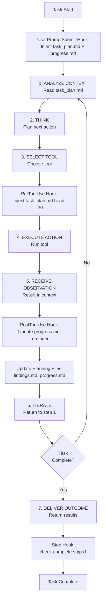
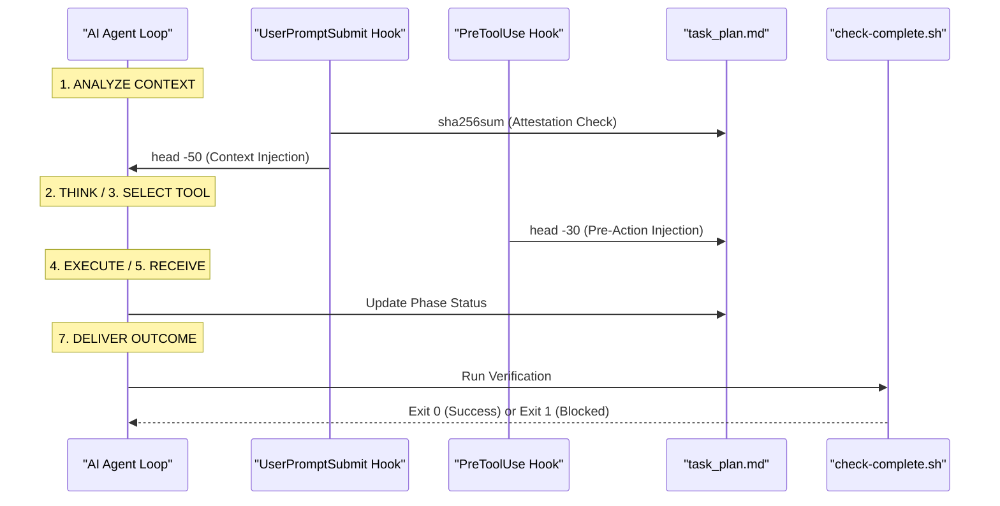

<!-- source: DeepWiki mcp.deepwiki.com · repo OthmanAdi/planning-with-files · page 4.1 The Core Workflow Loop · fetched 2026-10-29 -->

# The Core Workflow Loop

Relevant source files

The following files were used as context for generating this wiki page:

- [.claude-plugin/marketplace.json](.claude-plugin/marketplace.json)
- [.claude-plugin/plugin.json](.claude-plugin/plugin.json)
- [.codex/skills/planning-with-files/SKILL.md](.codex/skills/planning-with-files/SKILL.md)
- [.cursor/skills/planning-with-files/SKILL.md](.cursor/skills/planning-with-files/SKILL.md)
- [.gitignore](.gitignore)
- [.opencode/skills/planning-with-files/SKILL.md](.opencode/skills/planning-with-files/SKILL.md)
- [CHANGELOG.md](CHANGELOG.md)
- [CITATION.cff](CITATION.cff)
- [CONTRIBUTORS.md](CONTRIBUTORS.md)
- [README.md](README.md)
- [examples/README.md](examples/README.md)
- [skills/planning-with-files/SKILL.md](skills/planning-with-files/SKILL.md)
- [skills/planning-with-files/examples.md](skills/planning-with-files/examples.md)
- [skills/planning-with-files/reference.md](skills/planning-with-files/reference.md)
- [skills/planning-with-files/templates/findings.md](skills/planning-with-files/templates/findings.md)
- [skills/planning-with-files/templates/progress.md](skills/planning-with-files/templates/progress.md)
- [skills/planning-with-files/templates/task_plan.md](skills/planning-with-files/templates/task_plan.md)

## Purpose and Scope

This document explains the 7-step agent loop that forms the operational heart of AI agent execution, and how the planning-with-files system integrates with each step. The agent executes this loop continuously, cycling through dozens of iterations for complex tasks while maintaining context through persistent files.

The loop is based on the **Manus architecture principles** and is augmented by the hook system (e.g., `UserPromptSubmit`, `PreToolUse`, `PostToolUse`) that automatically injects context and reminds the agent to update planning files.

**Sources:** [skills/planning-with-files/reference.md:132-164](), [skills/planning-with-files/SKILL.md:6-27]()

---

## The 7-Step Agent Loop

The agent operates in a continuous 7-step loop until the task is complete. Each step has a specific purpose and may trigger hook operations or file updates.

### Loop Steps Overview

| Step | Purpose | Planning File Integration | Hook Triggers |
|------|---------|---------------------------|---------------|
| 1. ANALYZE CONTEXT | Understand user intent and current state | Read `task_plan.md` to refresh goals | `UserPromptSubmit` |
| 2. THINK | Decide next logical action | Consider phase status in `task_plan.md` | - |
| 3. SELECT TOOL | Choose appropriate tool | - | `PreToolUse` hook fires |
| 4. EXECUTE ACTION | Run tool in sandbox | Tool modifies files or gathers data | - |
| 5. RECEIVE OBSERVATION | Result appended to context | Store findings in `findings.md` | `PostToolUse` hook fires |
| 6. ITERATE | Return to step 1 | Update `progress.md` with action | - |
| 7. DELIVER OUTCOME | Send results to user | Verify completion via `check-complete.sh` | `Stop` hook fires |

**Sources:** [skills/planning-with-files/reference.md:132-164](), [skills/planning-with-files/SKILL.md:6-27]()

---

## High-Level Loop Architecture

The following diagram shows the 7-step loop and how it integrates with the planning files and hook system:

**Sources:** [skills/planning-with-files/SKILL.md:7-24](), [skills/planning-with-files/reference.md:132-164]()

---

## Step 1: ANALYZE CONTEXT

The agent begins each loop iteration by analyzing the current context. The `UserPromptSubmit` hook ensures the agent sees the latest plan data before responding to a user message.

### Planning File Integration
The hook command in [skills/planning-with-files/SKILL.md:10]() performs several key actions:
- **Attestation Check**: Verifies `task_plan.md` hasn't been tampered with via SHA-256 hash.
- **Context Injection**: Injects the first 50 lines of `task_plan.md` and the last 20 lines of `progress.md`.
- **Instruction Masking**: Frames plan data with `---BEGIN PLAN DATA---` delimiters to prevent the agent from confusing data with instructions.

**Sources:** [skills/planning-with-files/SKILL.md:10](), [CHANGELOG.md:9-15]()

---

## Step 2: THINK

The agent decides what action to take next based on the injected context.

### Read-Before-Decide Pattern
As stated in [skills/planning-with-files/SKILL.md:105-106]():
> Before major decisions, read the plan file. This keeps goals in your attention window.

This refreshes the "Attention Window" (KV-cache) with the high-level goals from `task_plan.md`, preventing goal drift during long-running tasks.

**Sources:** [skills/planning-with-files/SKILL.md:105-106](), [skills/planning-with-files/reference.md:142-145]()

---

## Step 3: SELECT TOOL

The agent chooses one tool to execute. The `PreToolUse` hook fires for specific tools (`Write`, `Edit`, `Bash`, `Read`, `Glob`, `Grep`).

### Hook Implementation
The hook in [skills/planning-with-files/SKILL.md:15]() re-injects the first 30 lines of `task_plan.md` immediately before the tool is called. This ensures that even if the context window is full, the most recent "memory" the agent has is the current plan.

**Sources:** [skills/planning-with-files/SKILL.md:11-15]()

---

## Step 4: EXECUTE ACTION

The tool runs in the environment.

### Hash Attestation (v2.37.0)
If the user has run `/plan-attest`, the hook scripts (`UserPromptSubmit` and `PreToolUse`) recompute the SHA-256 of `task_plan.md`. If a mismatch is detected, the injection is blocked, and the agent receives a `[PLAN TAMPERED]` warning. This protects the agent from malicious prompt injections that might try to edit the plan file silently.

**Sources:** [CHANGELOG.md:9-15](), [skills/planning-with-files/SKILL.md:10]()

---

## Step 5: RECEIVE OBSERVATION

The tool result is returned. The `PostToolUse` hook fires after `Write` or `Edit` actions.

### PostToolUse Reminder
The hook in [skills/planning-with-files/SKILL.md:20]() issues a system reminder:
> `Update progress.md with what you just did. If a phase is now complete, update task_plan.md status.`

### The 2-Action Rule
Agents must follow the **2-Action Rule** [skills/planning-with-files/SKILL.md:100-103](): after every 2 search/view operations, they must save findings to `findings.md`.

**Sources:** [skills/planning-with-files/SKILL.md:20](), [skills/planning-with-files/SKILL.md:100-103]()

---

## Step 6: ITERATE

The agent updates the persistent files before starting the next loop.

### Error Logging
If an action fails, the agent follows the **3-Strike Error Protocol** [skills/planning-with-files/SKILL.md:130-152]():
1. **Diagnose & Fix**: Read error, apply fix.
2. **Alternative Approach**: Use a different tool or library.
3. **Broader Rethink**: Question assumptions.

Every failure must be logged in the `Errors Encountered` table of `task_plan.md` [skills/planning-with-files/templates/task_plan.md:109-121]().

**Sources:** [skills/planning-with-files/SKILL.md:130-152](), [skills/planning-with-files/templates/task_plan.md:109-121]()

---

## Step 7: DELIVER OUTCOME

When the agent attempts to finish, the `Stop` hook triggers.

### Completion Verification
The hook calls `check-complete.sh` (or `.ps1` on Windows) [skills/planning-with-files/SKILL.md:24](). This script parses `task_plan.md` to ensure all phases are marked as `complete`. If phases are still `pending` or `in_progress`, the delivery is blocked, forcing the agent back into the loop.

**Sources:** [skills/planning-with-files/SKILL.md:21-24](), [skills/planning-with-files/scripts/check-complete.sh:1-45]()

---

## Summary of Integration Points

The following diagram maps code entities to the logical workflow steps:

**Sources:** [skills/planning-with-files/SKILL.md:7-24](), [CHANGELOG.md:9-15](), [skills/planning-with-files/scripts/check-complete.sh:1-45]()

---

