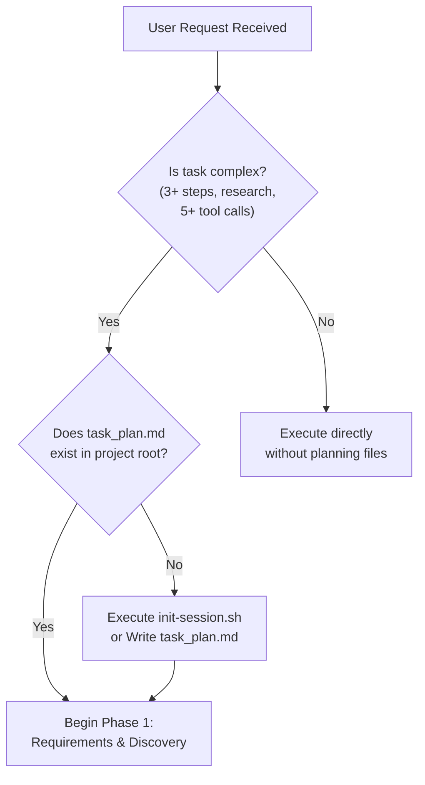
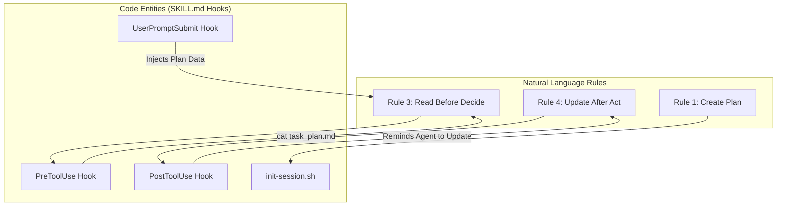

<!-- source: DeepWiki mcp.deepwiki.com · repo OthmanAdi/planning-with-files · page 4.2 Critical Rules · fetched 2026-10-29 -->

# Critical Rules

<details>
<summary>Relevant source files</summary>

The following files were used as context for generating this wiki page:

- [.codebuddy/skills/planning-with-files/SKILL.md](.codebuddy/skills/planning-with-files/SKILL.md)
- [.codex/skills/planning-with-files/SKILL.md](.codex/skills/planning-with-files/SKILL.md)
- [.cursor/skills/planning-with-files/SKILL.md](.cursor/skills/planning-with-files/SKILL.md)
- [.factory/skills/planning-with-files/SKILL.md](.factory/skills/planning-with-files/SKILL.md)
- [.gitignore](.gitignore)
- [.mastracode/skills/planning-with-files/SKILL.md](.mastracode/skills/planning-with-files/SKILL.md)
- [.opencode/skills/planning-with-files/SKILL.md](.opencode/skills/planning-with-files/SKILL.md)
- [examples/README.md](examples/README.md)
- [skills/planning-with-files/examples.md](skills/planning-with-files/examples.md)
- [skills/planning-with-files/reference.md](skills/planning-with-files/reference.md)
- [skills/planning-with-files/templates/findings.md](skills/planning-with-files/templates/findings.md)
- [skills/planning-with-files/templates/progress.md](skills/planning-with-files/templates/progress.md)
- [skills/planning-with-files/templates/task_plan.md](skills/planning-with-files/templates/task_plan.md)

</details>


## Purpose and Scope

This page documents the six mandatory operational rules that govern the `planning-with-files` skill's behavior. These rules are non-negotiable constraints that AI agents (Claude Code, Cursor, etc.) must follow when executing complex tasks using the 3-File Pattern. Each rule addresses a specific failure mode—such as goal drift, context window saturation, or repeated failures—observed in AI agent execution.

These rules implement the "Manus Principles" of context engineering, treating the filesystem as a persistent "working memory on disk" to overcome the volatility of AI context windows [.codex/skills/planning-with-files/SKILL.md:32-32](), [.codex/skills/planning-with-files/SKILL.md:77-83]().

---

## Overview of the Six Rules

The `planning-with-files` system enforces six critical rules explicitly defined in the skill specification [.codex/skills/planning-with-files/SKILL.md:93-128]().

| Rule | File Target | Operation | Timing | Addresses Problem |
|------|-------------|-----------|--------|-------------------|
| 1. Create Plan First | `task_plan.md` | Write | Before task execution | Goal drift, unstructured work |
| 2. The 2-Action Rule | `findings.md` | Write/Append | Every 2 research actions | Multimodal/visual data loss |
| 3. Read Before Decide | `task_plan.md` | Read | Before major decisions | Attention decay, context loss |
| 4. Update After Act | `task_plan.md` | Edit | After each phase | Progress tracking, state loss |
| 5. Log ALL Errors | `task_plan.md` | Edit (Errors table) | When error occurs | Repeated failures, hidden errors |
| 6. Never Repeat Failures | N/A | Logic | Post-failure retry | Infinite loops, approach stagnation |

**Sources:** [.codex/skills/planning-with-files/SKILL.md:93-128](), [skills/planning-with-files/reference.md:179-186]()

---

## Rule 1: Create Plan First

### Specification
"Never start a complex task without `task_plan.md`. Non-negotiable." [.codex/skills/planning-with-files/SKILL.md:95-96]()

Before executing any work requiring 5+ tool calls, the agent must initialize `task_plan.md` using the provided template [skills/planning-with-files/templates/task_plan.md:1-133](). This file serves as the foundational state document.

### Enforcement Flow
**Diagram: Rule 1 Initialization Logic**


**Sources:** [.codex/skills/planning-with-files/SKILL.md:95-96](), [.codex/skills/planning-with-files/SKILL.md:177-185](), [skills/planning-with-files/templates/task_plan.md:1-6]()

---

## Rule 2: The 2-Action Rule

### Specification
"After every 2 view/browser/search operations, IMMEDIATELY save key findings to text files." [.codex/skills/planning-with-files/SKILL.md:98-99]()

This rule is critical for multimodal agents. Visual information (screenshots, PDF renders, browser states) is highly volatile and often lost during context compression or window sliding.

### Implementation Pattern
The agent must capture visual/multimodal content as text in `findings.md` immediately [skills/planning-with-files/templates/findings.md:75-87]().

| Action | Result Type | Rule Action |
|--------|-------------|-------------|
| `browser_view` | Screenshot/HTML | Extract text findings to `findings.md` |
| `read_pdf` | Visual Layout | Describe layout/content in `findings.md` |
| `web_search` | List of links | Save relevant URLs to `findings.md` |

**Sources:** [.codex/skills/planning-with-files/SKILL.md:98-101](), [skills/planning-with-files/templates/findings.md:89-96]()

---

## Rule 3: Read Before Decide

### Specification
"Before major decisions, read the plan file. This keeps goals in your attention window." [.codex/skills/planning-with-files/SKILL.md:103-104]()

This implements the **Recitation Principle**: re-reading the plan pushes the global goal into the model's most recent attention span, counteracting the "lost in the middle" effect [skills/planning-with-files/reference.md:43-54]().

### Attention Manipulation Mechanism
**Diagram: Attention Window Refresh**

```mermaid
sequenceDiagram
    participant Agent as "Agent (Context Window)"
    participant Disk as "Filesystem (task_plan.md)"
    
    Note over Agent: "Context is full (~50 tool calls).<br/>Original goal is at the very top (forgotten)."
    Agent->>Disk: "Read task_plan.md"
    Disk-->>Agent: "Goal: Fix Auth Bug; Current Phase: 3"
    Note over Agent: "Goal is now at the BOTTOM of context.<br/>Attention is maximized for next decision."
```
**Sources:** [skills/planning-with-files/reference.md:43-54](), [skills/planning-with-files/examples.md:189-202]()

---

## Rule 4: Update After Act

### Specification
After completing any phase:
- Mark phase status: `in_progress` → `complete` [.codex/skills/planning-with-files/SKILL.md:108-108]()
- Update `task_plan.md` and `progress.md` [.codex/skills/planning-with-files/SKILL.md:107-111]()

### Status Transitions
The system uses standardized status values to ensure programmatic checking via `check-complete.sh` [.codex/skills/planning-with-files/SKILL.md:24-24]().

*   **pending**: Not started yet.
*   **in_progress**: Currently active phase.
*   **complete**: Successfully finished.

**Sources:** [skills/planning-with-files/templates/task_plan.md:40-44](), [skills/planning-with-files/templates/task_plan.md:130-130]()

---

## Rule 5: Log ALL Errors

### Specification
"Every error goes in the plan file. This builds knowledge and prevents repetition." [.codex/skills/planning-with-files/SKILL.md:112-113]()

Agents must document every tool failure or logic error in the **Errors Encountered** table of `task_plan.md` [skills/planning-with-files/templates/task_plan.md:109-121]().

### Required Table Format
| Error | Attempt | Resolution |
|-------|---------|------------|
| `FileNotFoundError` | 1 | Created default config |
| `API timeout` | 2 | Added retry logic |

**Sources:** [.codex/skills/planning-with-files/SKILL.md:115-121](), [skills/planning-with-files/templates/task_plan.md:109-121]()

---

## Rule 6: Never Repeat Failures

### Specification
`if action_failed: next_action != same_action` [.codex/skills/planning-with-files/SKILL.md:124-128]()

If a tool call fails, the agent is strictly forbidden from repeating the exact same call. It must "mutate the approach" by changing parameters, using a different tool, or rethinking the strategy.

### The 3-Strike Error Protocol
This protocol governs the escalation logic when Rule 6 is triggered [.codex/skills/planning-with-files/SKILL.md:130-152]():

1.  **Strike 1: Diagnose & Fix** — Identify root cause and apply a targeted fix.
2.  **Strike 2: Alternative Approach** — Use a different method, tool, or library.
3.  **Strike 3: Broader Rethink** — Question assumptions and search for new solutions.
4.  **Final:** Escalate to the user with the full error log.

**Sources:** [.codex/skills/planning-with-files/SKILL.md:124-152](), [skills/planning-with-files/examples.md:161-186]()

---

## Technical Implementation and Hooks

The rules are enforced through a combination of skill instructions and automated hooks that trigger shell commands during the agent loop [.codex/skills/planning-with-files/SKILL.md:6-24]().

### Rule-to-Code Mapping
**Diagram: Logic-to-Code Association**



### Hook Details
*   **PreToolUse**: Automatically executes `cat task_plan.md | head -30` before tools like `Write`, `Edit`, or `Bash` to satisfy Rule 3 [.codex/skills/planning-with-files/SKILL.md:11-15]().
*   **PostToolUse**: Triggers a reminder to update `progress.md` and `task_plan.md` after any file modification, enforcing Rule 4 [.codex/skills/planning-with-files/SKILL.md:16-20]().
*   **Stop**: Runs `check-complete.sh` to verify all phases are marked `complete` before the session ends [.codex/skills/planning-with-files/SKILL.md:21-24]().

**Sources:** [.codex/skills/planning-with-files/SKILL.md:6-24](), [skills/planning-with-files/reference.md:130-164]()

---

