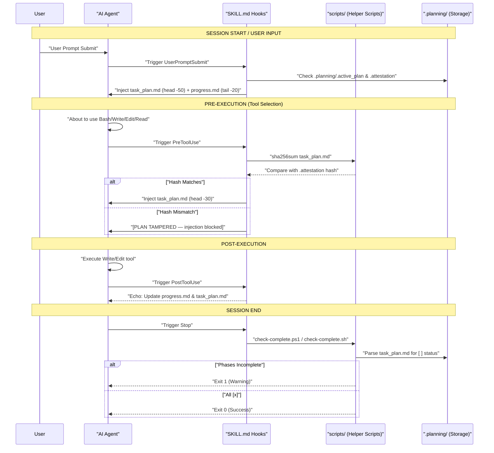
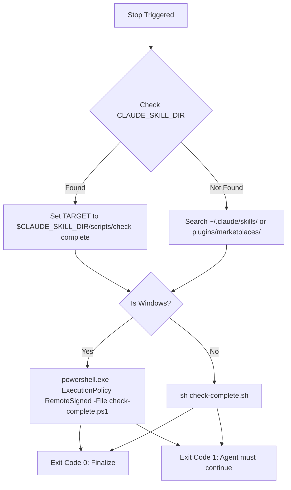

<!-- source: DeepWiki mcp.deepwiki.com · repo OthmanAdi/planning-with-files · page 4.3 Hook System and Automation · fetched 2026-10-29 -->

# Hook System and Automation

<details>
<summary>Relevant source files</summary>

The following files were used as context for generating this wiki page:

- [.claude-plugin/marketplace.json](.claude-plugin/marketplace.json)
- [.claude-plugin/plugin.json](.claude-plugin/plugin.json)
- [.cursor/hooks.json](.cursor/hooks.json)
- [.cursor/hooks.windows.json](.cursor/hooks.windows.json)
- [.cursor/hooks/post-tool-use.ps1](.cursor/hooks/post-tool-use.ps1)
- [.cursor/hooks/post-tool-use.sh](.cursor/hooks/post-tool-use.sh)
- [.cursor/hooks/stop.ps1](.cursor/hooks/stop.ps1)
- [.cursor/hooks/stop.sh](.cursor/hooks/stop.sh)
- [.cursor/hooks/user-prompt-submit.ps1](.cursor/hooks/user-prompt-submit.ps1)
- [.cursor/hooks/user-prompt-submit.sh](.cursor/hooks/user-prompt-submit.sh)
- [.github/hooks/scripts/error-occurred.sh](.github/hooks/scripts/error-occurred.sh)
- [.github/hooks/scripts/pre-tool-use.sh](.github/hooks/scripts/pre-tool-use.sh)
- [.github/hooks/scripts/session-start.sh](.github/hooks/scripts/session-start.sh)
- [.mastracode/hooks.json](.mastracode/hooks.json)
- [CHANGELOG.md](CHANGELOG.md)
- [CITATION.cff](CITATION.cff)
- [CONTRIBUTORS.md](CONTRIBUTORS.md)
- [README.md](README.md)
- [skills/planning-with-files/SKILL.md](skills/planning-with-files/SKILL.md)

</details>


## Purpose and Scope

This document describes the hook system that automates context management in planning-with-files. Hooks are automated commands that execute at specific points in the agent lifecycle, implementing the Manus principle of "attention manipulation" by keeping planning files in the agent's context window without manual intervention. In version 2.37.0, the system also incorporates cryptographic attestation to ensure the integrity of the planning context being injected.

**Sources:** [README.md:163-171](), [skills/planning-with-files/SKILL.md:1-27]()

---

## Hook Types Overview

The system implements four hook types that trigger at different lifecycle stages across supported platforms:

| Hook Name | When It Fires | Primary Purpose | Added/Updated |
|-----------|---------------|-----------------|---------------|
| `SessionStart` / `UserPromptSubmit` | Start of session or every user message | Inject `task_plan.md` + `progress.md` | v2.37.0 (Attestation) |
| `PreToolUse` | Before Write/Edit/Bash/Read/Glob/Grep | Inject `task_plan.md` into context | v2.37.0 (Attestation) |
| `PostToolUse` | After Write/Edit operations | Remind agent to update status | v2.1.0 |
| `Stop` | When agent is about to deliver final output | Verify all phases complete | v2.36.1 (Hardening) |

**Sources:** [skills/planning-with-files/SKILL.md:6-24](), [CHANGELOG.md:5-15]()

---

## Hook Lifecycle and Entity Mapping

The following diagram bridges the Natural Language lifecycle events to the specific Code Entities (scripts and files) used by the hook system.



**Sources:** [skills/planning-with-files/SKILL.md:6-24](), [CHANGELOG.md:9-17]()

---

## UserPromptSubmit / SessionStart Hook

This hook fires on every user message (`UserPromptSubmit`) or at the beginning of a session. It ensures the agent always has the current state of the plan and recent progress, even after a context-clearing command like `/clear`.

### Attestation Logic (v2.37.0)
The hook now performs a SHA-256 integrity check. If a plan has been locked using `/plan-attest`, the hook re-computes the hash of `task_plan.md` and compares it to the stored hash in `.planning/<active-plan>/.attestation` or `.plan-attestation`.

**Sources:** [skills/planning-with-files/SKILL.md:10](), [CHANGELOG.md:9-14]()

### Behavior
1. **Hash Verification**: Uses `sha256sum` or `shasum -a 256`.
2. **Injection**: If valid, injects the first 50 lines of `task_plan.md` and the last 20 lines of `progress.md`.
3. **Tamper Protection**: If the hash doesn't match, it blocks injection and outputs `[PLAN TAMPERED — injection blocked]`.

**Sources:** [skills/planning-with-files/SKILL.md:10]()

---

## PreToolUse Hook

The `PreToolUse` hook implements "attention manipulation" by automatically reading the plan before major operations.

### Matcher Pattern
The hook triggers on: `Write|Edit|Bash|Read|Glob|Grep`.

**Sources:** [skills/planning-with-files/SKILL.md:12]()

### Context Injection
It injects the first 30 lines of `task_plan.md` surrounded by `---BEGIN PLAN DATA---` and `---END PLAN DATA---` delimiters to prevent prompt injection and help the model distinguish plan data from instructions.

**Sources:** [skills/planning-with-files/SKILL.md:15](), [CHANGELOG.md:77-78]()

---

## PostToolUse Hook

This hook acts as a persistent reminder to maintain the "Filesystem as Working Memory" principle.

### Configuration
```yaml
PostToolUse:
  - matcher: "Write|Edit"
    hooks:
      - type: command
        command: "if [ -f task_plan.md ]; then echo '[planning-with-files] Update progress.md with what you just did. If a phase is now complete, update task_plan.md status.'; fi"
```

**Sources:** [skills/planning-with-files/SKILL.md:16-20]()

---

## Stop Hook

The `Stop` hook acts as a quality gate, verifying all phases are complete before the agent delivers final output.

### Technical Implementation and Hardening
In v2.36.1, the `Stop` hook was hardened to eliminate broad cache searches for security (addressing `COMMAND_EXECUTION` risks). It now resolves the script path via the `$CLAUDE_SKILL_DIR` environment variable or specific known install paths.

**Sources:** [CHANGELOG.md:75-76](), [skills/planning-with-files/SKILL.md:24]()

### Execution Logic
The hook attempts to execute `check-complete.ps1` (Windows) or `check-complete.sh` (POSIX). On Windows, it uses `-ExecutionPolicy RemoteSigned` for improved security over the previous `Bypass` policy.



**Sources:** [skills/planning-with-files/SKILL.md:24](), [CHANGELOG.md:76-77]()

---

## Platform-Specific Hook Files

While `SKILL.md` is the canonical source for Claude Code, other platforms use specific adapter scripts:

| Platform | Hook Config File | Implementation Scripts |
|----------|------------------|------------------------|
| **GitHub Copilot** | `.github/hooks/planning-with-files.json` | `.github/hooks/scripts/session-start.sh`, `pre-tool-use.sh` |
| **Cursor** | `.cursor/hooks.json` | `.cursor/hooks/user-prompt-submit.sh`, `stop.sh` |
| **Mastra** | `.mastracode/hooks.json` | Inline shell commands |
| **Codex** | `.codex/hooks.json` | `codex_hook_adapter.py` |

**Sources:** [CONTRIBUTORS.md:71-74](), [.mastracode/hooks.json:1-35](), [.github/hooks/scripts/session-start.sh:1-47]()

---

## Summary of Automation Scripts

| Script | Hook Association | Role |
|--------|------------------|------|
| `session-catchup.py` | `SessionStart` | Recovers context from JSONL logs after `/clear`. |
| `check-complete.sh/ps1` | `Stop` | Parses `task_plan.md` for incomplete phases. |
| `attest-plan.sh/ps1` | `/plan-attest` | Generates the SHA-256 hash for hook verification. |
| `resolve-plan-dir.sh` | All Hooks | Locates the active plan directory in slug/parallel mode. |

**Sources:** [CHANGELOG.md:14-15](), [CHANGELOG.md:38-40](), [skills/planning-with-files/SKILL.md:33-48]()

---

