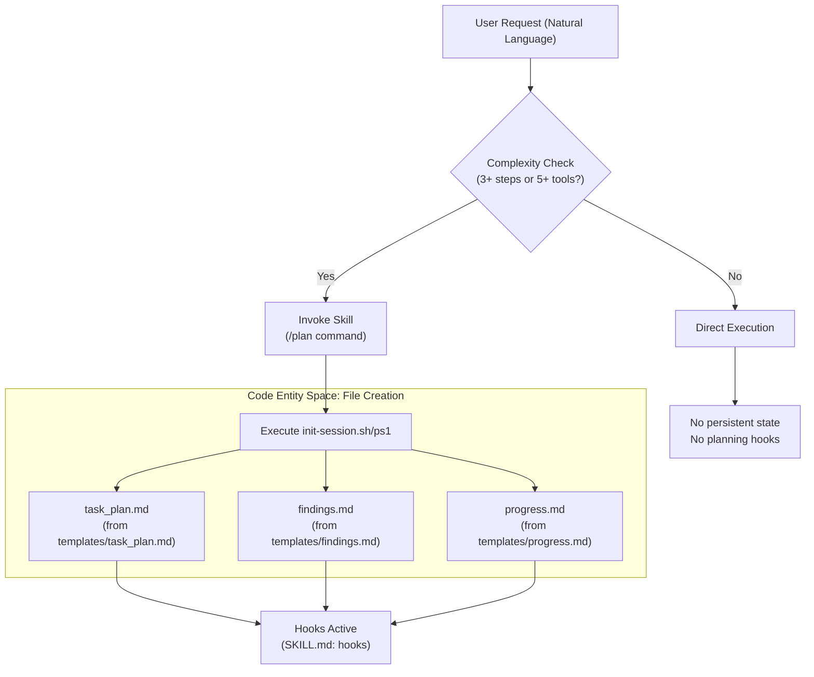
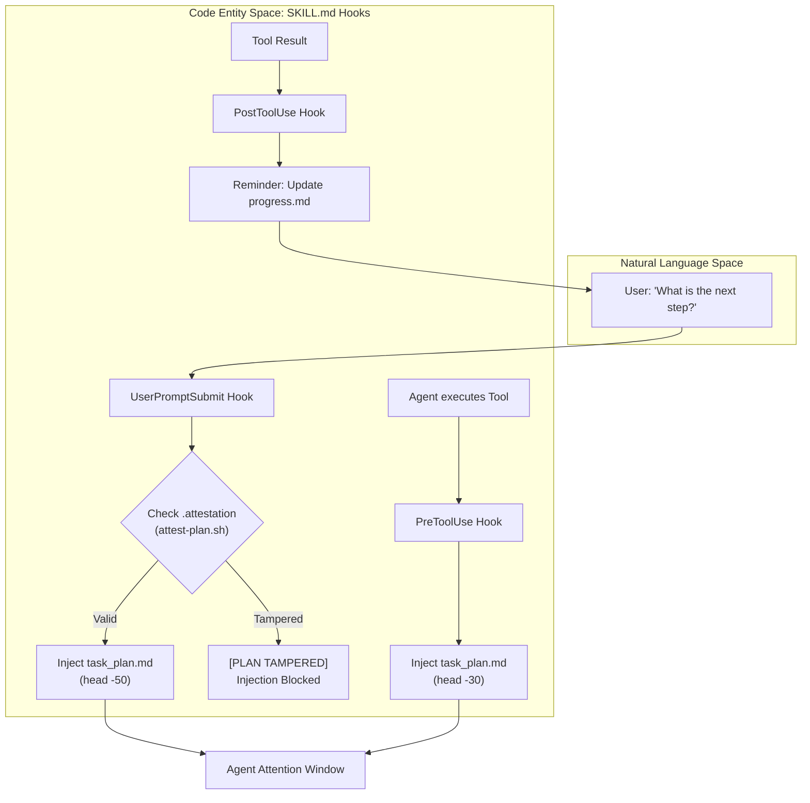

<!-- source: DeepWiki mcp.deepwiki.com · repo OthmanAdi/planning-with-files · page 4.4 When to Use This Pattern · fetched 2026-10-29 -->

# When to Use This Pattern

Relevant source files

The following files were used as context for generating this wiki page:

- [.claude-plugin/marketplace.json](.claude-plugin/marketplace.json)
- [.claude-plugin/plugin.json](.claude-plugin/plugin.json)
- [.codex/skills/planning-with-files/SKILL.md](.codex/skills/planning-with-files/SKILL.md)
- [.cursor/skills/planning-with-files/SKILL.md](.cursor/skills/planning-with-files/SKILL.md)
- [.opencode/skills/planning-with-files/SKILL.md](.opencode/skills/planning-with-files/SKILL.md)
- [CHANGELOG.md](CHANGELOG.md)
- [CITATION.cff](CITATION.cff)
- [CONTRIBUTORS.md](CONTRIBUTORS.md)
- [README.md](README.md)
- [skills/planning-with-files/SKILL.md](skills/planning-with-files/SKILL.md)

This page provides guidelines for determining when to invoke the planning-with-files skill versus working without it. It focuses on task complexity metrics, the trade-off between setup overhead and long-term benefits, and specific use case patterns.

## Purpose and Scope

The planning-with-files pattern introduces overhead: it requires creating three files (`task_plan.md`, `findings.md`, `progress.md`), maintaining them throughout execution, and following critical rules. This investment pays off for complex tasks but creates unnecessary friction for simple operations. This page defines the boundary between appropriate and inappropriate use cases.

Sources: [skills/planning-with-files/SKILL.md:87-94](), [skills/planning-with-files/SKILL.md:177-190]()

## Core Decision Criteria

The system uses specific quantitative and qualitative thresholds to determine applicability:

| Criterion | Threshold | Rationale |
|-----------|-----------|-----------|
| **Tool Calls** | >5 operations | Context window begins degrading; planning files prevent goal drift. |
| **Task Steps** | ≥3 distinct steps | Multi-step tasks require progress tracking to avoid losing state. |
| **Research** | Any | Prevents visual/multimodal information from being lost. |
| **Continuity** | May span `/clear` | Planning files persist across session terminations and resets. |

**Decision Rule:** If ANY criterion is met, use planning-with-files.

Sources: [skills/planning-with-files/SKILL.md:3-4](), [skills/planning-with-files/SKILL.md:177-185]()

## Decision Flowchart: Natural Language to Code Space

This diagram bridges the user's intent (Natural Language) to the specific code entities and scripts that handle the initialization.

**Task Initialization Flow**

Sources: [skills/planning-with-files/SKILL.md:6-24](), [skills/planning-with-files/SKILL.md:177-185](), [CHANGELOG.md:203-206]()

## Detailed Use Cases

### 1. Multi-Step Construction Tasks
**Pattern:** Tasks requiring distinct phases such as requirements analysis, design, implementation, and testing.
*   **Implementation:** Phases are tracked in `task_plan.md`.
*   **Automation:** The `PostToolUse` hook in `SKILL.md` triggers a reminder to update status after edits [skills/planning-with-files/SKILL.md:16-20]().

### 2. Research and Discovery Tasks
**Pattern:** Tasks involving search or browser operations that produce multimodal content.
*   **Rule:** The **2-Action Rule** [skills/planning-with-files/SKILL.md:100-103]().
*   **Code Mapping:** Findings are stored in `findings.md`. This prevents the "Context Window = RAM" (volatile) from losing data that should be on "Filesystem = Disk" (persistent) [skills/planning-with-files/SKILL.md:78-85]().

### 3. Long-Running Sessions & Recovery
**Pattern:** Tasks that exceed the context window or require `/clear`.
*   **Code Entity:** `session-catchup.py` [skills/planning-with-files/SKILL.md:40-48]().
*   **Behavior:** When resuming, the system uses the script to analyze `JSONL` logs and update the planning files with unsynced context [skills/planning-with-files/SKILL.md:50-54]().

Sources: [skills/planning-with-files/SKILL.md:33-54](), [skills/planning-with-files/SKILL.md:78-85](), [skills/planning-with-files/SKILL.md:100-103]()

## Read vs. Write Decision Matrix

To optimize KV-cache and maintain context, the following matrix guides tool selection:

| Situation | Action | Reason |
|-----------|--------|--------|
| Just wrote a file | **DON'T read** | Content is still in the active context window. |
| Viewed image/PDF | **Write findings** | Multimodal data must be converted to text before loss. |
| Browser returned data | **Write to file** | Screenshots and transient HTML don't persist. |
| Starting new phase | **Read plan** | Re-orient the agent's attention to the next goal. |
| Error occurred | **Read relevant file** | Need current state to diagnose via 3-Strike Protocol. |
| Resuming after gap | **Read all files** | Restore "Working Memory" from disk. |

Sources: [skills/planning-with-files/SKILL.md:154-164](), [skills/planning-with-files/SKILL.md:105-107]()

## System Architecture: Context Injection Logic

This diagram illustrates how the codebase (specifically `SKILL.md` hooks) maintains the pattern once active.

**Context Maintenance Logic**

Sources: [skills/planning-with-files/SKILL.md:6-21](), [CHANGELOG.md:9-17]()

## When to Skip: Non-Use Cases

The pattern should be skipped for simple, atomic operations to avoid "Context Stuffing":
*   **Simple questions:** No execution required.
*   **Single-file edits:** Entire context fits in one `Read` or `Edit` call.
*   **Quick lookups:** Tasks that can be completed in < 3 tool calls.

Sources: [skills/planning-with-files/SKILL.md:186-190]()

## Cost-Benefit Summary

| Component | Cost (Time/Tokens) | Benefit |
|-----------|-------------------|---------|
| **Setup** | ~1-2 minutes | Prevents 10-30 mins of recovery time if context is lost. |
| **Maintenance** | ~30s per phase | KV-Cache optimization; avoids "re-reading the world." |
| **Attestation** | Minimal (`/plan-attest`) | Cryptographic guarantee against plan tampering [CHANGELOG.md:9-17](). |

**Final Recommendation:** When in doubt, initialize. The `PreToolUse` hook ensures that once files exist, the agent's "Working Memory" is automatically refreshed without manual user intervention [skills/planning-with-files/SKILL.md:11-15]().

Sources: [skills/planning-with-files/SKILL.md:11-15](), [CHANGELOG.md:13-14]()

---

