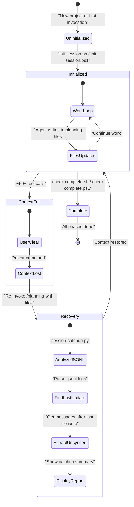
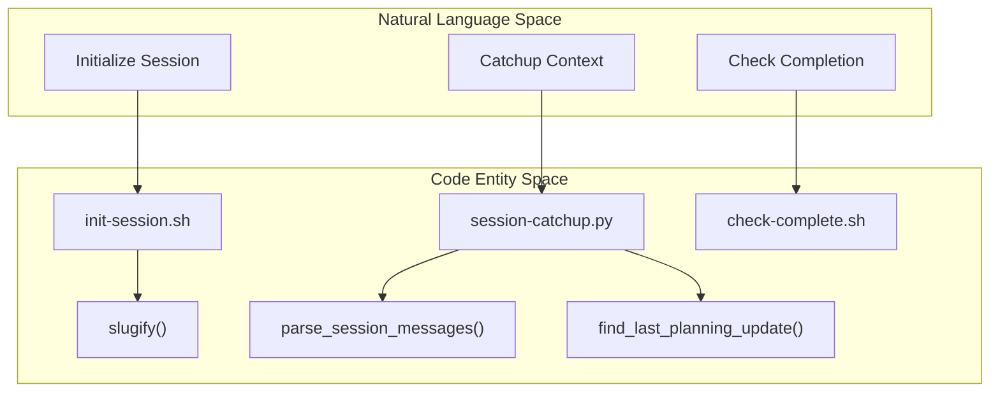
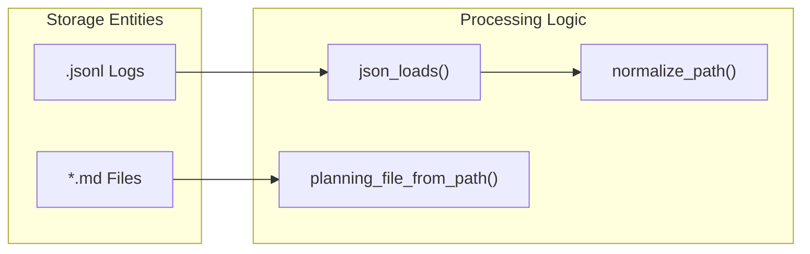

<!-- source: DeepWiki mcp.deepwiki.com · repo OthmanAdi/planning-with-files · page 5 Session Management · fetched 2026-10-29 -->

# Session Management

Relevant source files

The following files were used as context for generating this wiki page:

- [.codebuddy/skills/planning-with-files/scripts/session-catchup.py](.codebuddy/skills/planning-with-files/scripts/session-catchup.py)
- [.codex/skills/planning-with-files/scripts/session-catchup.py](.codex/skills/planning-with-files/scripts/session-catchup.py)
- [.continue/skills/planning-with-files/scripts/session-catchup.py](.continue/skills/planning-with-files/scripts/session-catchup.py)
- [.factory/skills/planning-with-files/scripts/session-catchup.py](.factory/skills/planning-with-files/scripts/session-catchup.py)
- [.gemini/skills/planning-with-files/scripts/session-catchup.py](.gemini/skills/planning-with-files/scripts/session-catchup.py)
- [.pi/skills/planning-with-files/scripts/session-catchup.py](.pi/skills/planning-with-files/scripts/session-catchup.py)
- [skills/planning-with-files/scripts/check-complete.sh](skills/planning-with-files/scripts/check-complete.sh)
- [skills/planning-with-files/scripts/init-session.sh](skills/planning-with-files/scripts/init-session.sh)
- [skills/planning-with-files/scripts/session-catchup.py](skills/planning-with-files/scripts/session-catchup.py)
- [tests/test_session_catchup.py](tests/test_session_catchup.py)

## Purpose and Scope

Session Management encompasses the mechanisms that enable planning-with-files to maintain continuity across AI agent sessions, despite context window limitations and session resets. This section covers the lifecycle from session initialization through context loss and recovery.

For details on the 3-file pattern itself, see [The 3-File Pattern](#2.1). For hook system mechanics, see [Hook System and Automation](#4.3). For script technical specifications, see [Helper Scripts Reference](#7.4).

---

## The Session Continuity Problem

AI agents operate with volatile context windows that reset under several conditions:

| Reset Trigger | Impact | Frequency |
|--------------|--------|-----------|
| `/clear` command | Total context loss | User-initiated |
| Context window full | Auto-compaction or manual clear | Every 50+ tool calls |
| Session timeout | Complete state loss | Idle sessions |
| IDE restart | All in-memory state lost | Development workflow |

Without session management, each reset forces the agent to start from scratch, losing in-progress work not yet committed to planning files and decision context from recent tool calls.

---

## Session Lifecycle Architecture

**Diagram: Session State Machine**

This state machine shows how sessions transition through initialization, work, context loss, and recovery. The helper scripts (`init-session.sh`, `session-catchup.py`, `check-complete.sh`) manage these transitions.

Sources: [skills/planning-with-files/scripts/check-complete.sh:1-47](), [skills/planning-with-files/scripts/init-session.sh:1-15]()

---

## The Four Session Management Components

### 5.1 Session Initialization
Session initialization creates the 3-file pattern structure. `init-session.sh` supports a **Slug Mode** (introduced to address parallel task isolation) which writes plans under `.planning/<date>-<slug>/` and pins the active plan via a `.active_plan` pointer [skills/planning-with-files/scripts/init-session.sh:11-14]().

**Key Scripts:**
- `scripts/init-session.sh` [skills/planning-with-files/scripts/init-session.sh:1-269]()
- `scripts/init-session.ps1`

For details, see [Session Initialization](#5.1).

### 5.2 Session Recovery and Context Restoration
The `session-catchup.py` script analyzes JSONL logs (e.g., from Claude Code or Codex) to find unsynced context. It identifies the last planning file update by searching for `patch_apply_end` events or specific file write patterns [skills/planning-with-files/scripts/session-catchup.py:209-213]().

**Key Script:**
- `scripts/session-catchup.py` [skills/planning-with-files/scripts/session-catchup.py:1-213]()

For details, see [Session Recovery and Context Restoration](#5.2).

### 5.3 Git Checkpoint Workflow
This workflow implements the "one phase, one commit" pattern. The system uses git as a persistent rollback point. Each phase in `task_plan.md` should correspond to a verifiable state in version control.

For details, see [Git Checkpoint Workflow](#5.3).

### 5.4 Plan Attestation and Security
Introduced in v2.37.0, plan attestation uses SHA-256 hashes to prevent "plan tampering" where an agent might be misled by untrusted content injected into `findings.md`. The `attest-plan.sh` script generates a signature for `task_plan.md` to ensure the integrity of the primary goal.

For details, see [Plan Attestation and Security](#5.4).

---

## Entity Mapping: Logic to Code

The following diagram maps high-level session concepts to the specific Python functions and shell logic that implement them.

**Diagram: Logic to Code Entity Mapping**

Sources: [skills/planning-with-files/scripts/init-session.sh:60-66](), [skills/planning-with-files/scripts/session-catchup.py:180-189](), [skills/planning-with-files/scripts/check-complete.sh:35-45]()

---

## Session Data Persistence

Session data persists in two parallel systems:

### Planning Files (Explicit Storage)
Files like `task_plan.md` and `findings.md` are the "Source of Truth" for the agent's state.

### JSONL Session Logs (Implicit Storage)
`session-catchup.py` parses platform-specific logs (e.g., `~/.claude/projects/<hash>.jsonl`) to reconstruct history. It handles path normalization across environments, such as converting Git Bash paths to Windows-native paths [skills/planning-with-files/scripts/session-catchup.py:46-69]().

**Diagram: Data Persistence Processing**

Sources: [skills/planning-with-files/scripts/session-catchup.py:26-35](), [skills/planning-with-files/scripts/session-catchup.py:192-198]()

---

## Cross-Platform Script Execution

The system maintains parity between Bash and PowerShell scripts. `check-complete.sh` uses `grep` to count phases and statuses (`complete`, `in_progress`, `pending`) [skills/planning-with-files/scripts/check-complete.sh:13-26](), while its PowerShell counterpart performs the same logic for Windows environments.

Sources: [skills/planning-with-files/scripts/check-complete.sh:1-47](), [skills/planning-with-files/scripts/init-session.sh:1-15]()

---

