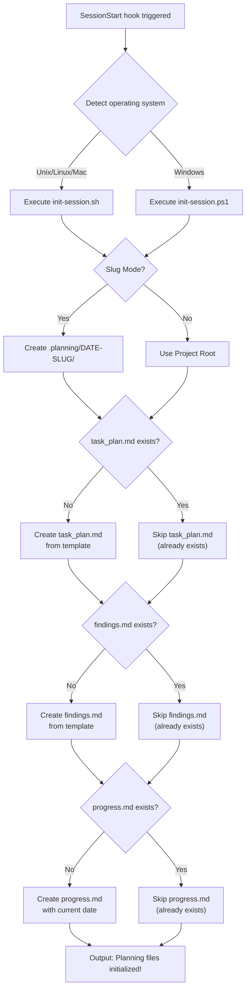
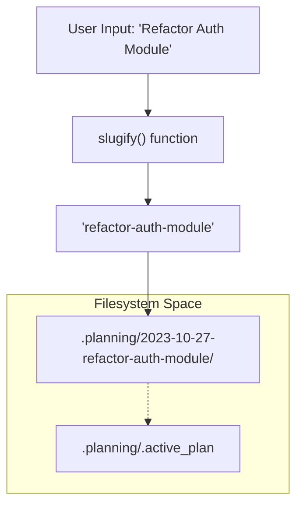
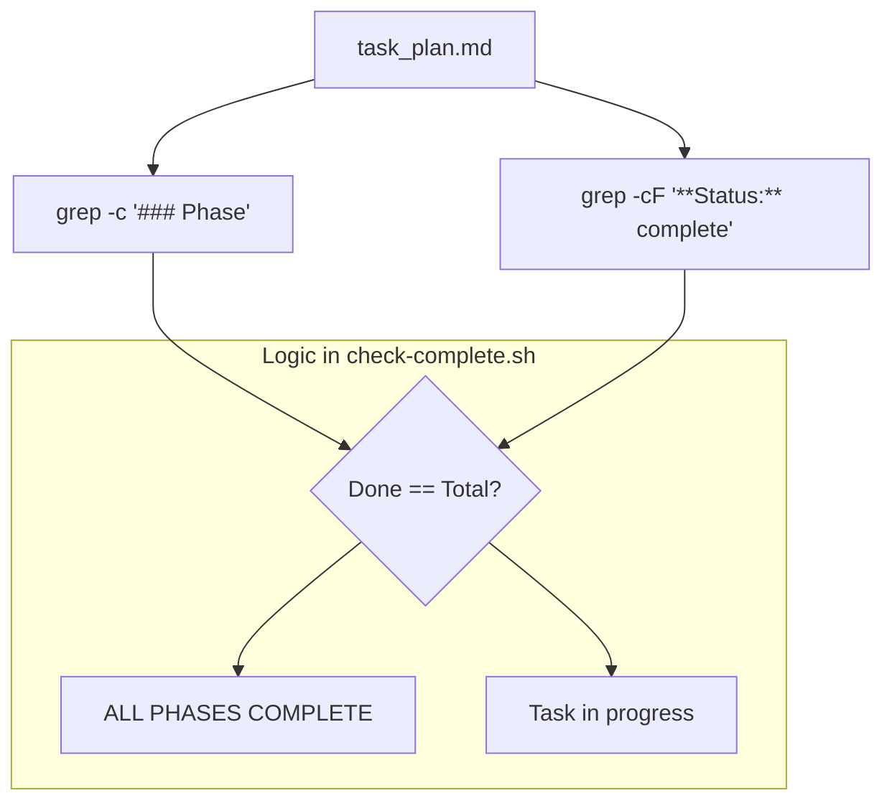

<!-- source: DeepWiki mcp.deepwiki.com · repo OthmanAdi/planning-with-files · page 5.1 Session Initialization · fetched 2026-10-29 -->

# Session Initialization

Relevant source files

The following files were used as context for generating this wiki page:

- [scripts/check-complete.sh](scripts/check-complete.sh)
- [scripts/check-continue.sh](scripts/check-continue.sh)
- [scripts/init-session.ps1](scripts/init-session.ps1)
- [scripts/init-session.sh](scripts/init-session.sh)
- [skills/planning-with-files/scripts/check-complete.sh](skills/planning-with-files/scripts/check-complete.sh)
- [skills/planning-with-files/scripts/init-session.sh](skills/planning-with-files/scripts/init-session.sh)
- [templates/analytics_findings.md](templates/analytics_findings.md)
- [templates/analytics_task_plan.md](templates/analytics_task_plan.md)

Session initialization is the process of creating and verifying the three core planning files (`task_plan.md`, `findings.md`, `progress.md`) at the start of a new work session. This process is automated by the `init-session` scripts and triggered by the `SessionStart` hook when an AI agent begins working with the planning-with-files skill.

This page covers the initialization scripts, file creation logic, template structures, and cross-platform compatibility. For information about recovering context from previous sessions, see [Session Recovery and Context Restoration](#5.2). For details on the hook system that triggers initialization, see [Hook System and Automation](#4.3).

## Purpose and Scope

Session initialization solves the "cold start" problem for AI agents by ensuring a consistent workspace structure exists before any work begins. The initialization process:

1. Creates the three planning files from templates if they don't exist.
2. Supports **Slug Mode** for parallel task isolation, placing files in `.planning/<date>-<slug>/` [skills/planning-with-files/scripts/init-session.sh:11-14]().
3. Populates files with standard section headers and placeholder content.
4. Sets initial phase status to `in_progress` for Phase 1 [skills/planning-with-files/scripts/init-session.sh:108]().
5. Timestamps the session in `progress.md` [skills/planning-with-files/scripts/init-session.sh:173]().
6. Ensures idempotency (safe to run multiple times without overwriting existing work) [skills/planning-with-files/scripts/init-session.sh:227]().

## Initialization Flow

**Diagram: Session Initialization Process**

Sources: [skills/planning-with-files/scripts/init-session.sh:1-280](), [scripts/init-session.ps1:1-167]()

## The init-session Scripts

The system provides implementation for bash and PowerShell to ensure cross-platform compatibility.

### Bash Version (init-session.sh)

The bash script handles both legacy root-level file creation and modern slug-based isolation.

**Script Location and Invocation:**
- Path: [skills/planning-with-files/scripts/init-session.sh:1]()
- Usage: `./init-session.sh [--template TYPE] [--plan-dir] [project-name]` [skills/planning-with-files/scripts/init-session.sh:5-9]()

**Key Implementation Details:**

| Component | Implementation | Purpose |
|-----------|---------------|---------|
| Template Choice | `--template analytics` | Uses `analytics_task_plan.md` etc. [skills/planning-with-files/scripts/init-session.sh:220]() |
| Slug Mode | `SLUG_MODE=1` | Triggered by project name or `--plan-dir` [skills/planning-with-files/scripts/init-session.sh:55-58]() |
| Active Plan Pointer | `.planning/.active_plan` | Points to the current isolated session directory [skills/planning-with-files/scripts/init-session.sh:14]() |
| UUID Generation | `short_uuid()` | Generates 8-char hex suffix for untitled plans [skills/planning-with-files/scripts/init-session.sh:68-90]() |

Sources: [skills/planning-with-files/scripts/init-session.sh:1-280]()

### PowerShell Version (init-session.ps1)

The PowerShell script provides equivalent functionality for Windows environments, focusing on template-based root-level initialization.

**Key Implementation Details:**

| Component | Implementation | Purpose |
|-----------|---------------|---------|
| Parameter | `param([string]$ProjectName, [string]$Template)` [scripts/init-session.ps1:5-8]() | Handles input parameters |
| Template Validation | `if ($Template -ne "default"...)` [scripts/init-session.ps1:20-23]() | Ensures valid template selection |
| UTF8 Encoding | `Out-File -Encoding UTF8` [scripts/init-session.ps1:75]() | Ensures cross-platform file readability |

Sources: [scripts/init-session.ps1:1-167]()

## Slug Mode and Isolation

Slug mode (introduced in v2.x) addresses parallel multi-task isolation [skills/planning-with-files/scripts/init-session.sh:12]().

1. **Slugification**: The `slugify()` function converts project names into URL-friendly strings (lowercase, alphanumeric, collapsed dashes) [skills/planning-with-files/scripts/init-session.sh:60-66]().
2. **Directory Structure**: Files are created under `.planning/${DATE}-${SLUG}/` [skills/planning-with-files/scripts/init-session.sh:266]().
3. **Active Plan Pointer**: The script writes the absolute path of the new directory to `${PLAN_ROOT}/.active_plan` [skills/planning-with-files/scripts/init-session.sh:271](). This allows other scripts like `resolve-plan-dir.sh` to locate the current active session.

**Diagram: Natural Language to Slug Isolation**

Sources: [skills/planning-with-files/scripts/init-session.sh:60-66, 253-275]()

## File Creation Logic and Templates

The script uses `create_files_in()` to handle the logic of template selection and file writing [skills/planning-with-files/scripts/init-session.sh:213]().

### Template Variants
The system supports two primary template types:
- **Default**: Standard software development phases (Requirements, Planning, Implementation, Testing, Delivery) [skills/planning-with-files/scripts/init-session.sh:104-128]().
- **Analytics**: Data-centric phases (Discovery, Exploratory Analysis, Hypothesis Testing, Synthesis) [templates/analytics_task_plan.md:25-67]().

### task_plan.md Structure
Created with `write_default_task_plan()` [skills/planning-with-files/scripts/init-session.sh:92]().
- **Status Markers**: Uses `**Status:** in_progress`, `**Status:** pending`, or `**Status:** complete` [skills/planning-with-files/scripts/init-session.sh:108-128]().
- **Tables**: Includes "Decisions Made" and "Errors Encountered" [skills/planning-with-files/scripts/init-session.sh:130-136]().

### progress.md Structure
Created with `write_default_progress()` or `write_analytics_progress()` [skills/planning-with-files/scripts/init-session.sh:163, 188]().
- **Session Metadata**: Stamps the current date [skills/planning-with-files/scripts/init-session.sh:169]().
- **Action Log**: Provides a placeholder for the agent to log tool calls [skills/planning-with-files/scripts/init-session.sh:175]().

Sources: [skills/planning-with-files/scripts/init-session.sh:92-211](), [templates/analytics_task_plan.md:1-107]()

## Verification and Completion

After file creation, the system often runs `check-complete.sh` via hooks to verify the state.

| Script | Purpose | Implementation |
|--------|---------|----------------|
| `check-complete.sh` | Counts total phases vs complete/pending/in_progress | Uses `grep -c` on status strings [skills/planning-with-files/scripts/check-complete.sh:14-26]() |
| `check-continue.sh` | Verifies integration files exist for Continue platform | Checks for `.prompt` and `.sh` files [scripts/check-continue.sh:7-24]() |

**Diagram: Completion Status Detection**

Sources: [skills/planning-with-files/scripts/check-complete.sh:1-46]()

---

