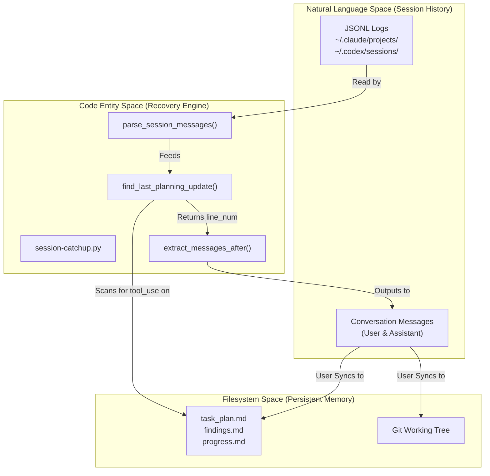
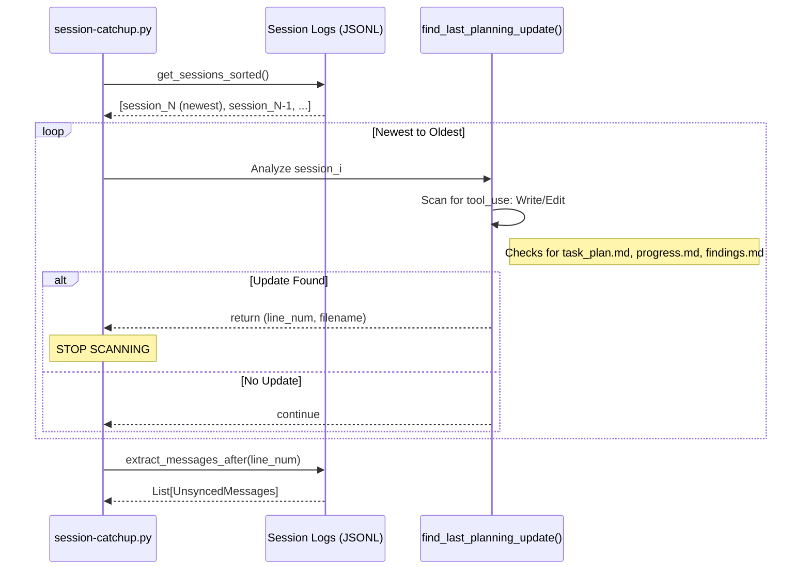

<!-- source: DeepWiki mcp.deepwiki.com · repo OthmanAdi/planning-with-files · page 5.2 Session Recovery and Context Restoration · fetched 2026-10-29 -->

# Session Recovery and Context Restoration

Relevant source files

The following files were used as context for generating this wiki page:

- [.codebuddy/skills/planning-with-files/scripts/session-catchup.py](.codebuddy/skills/planning-with-files/scripts/session-catchup.py)
- [.codex/skills/planning-with-files/scripts/session-catchup.py](.codex/skills/planning-with-files/scripts/session-catchup.py)
- [.continue/skills/planning-with-files/scripts/session-catchup.py](.continue/skills/planning-with-files/scripts/session-catchup.py)
- [.factory/skills/planning-with-files/scripts/session-catchup.py](.factory/skills/planning-with-files/scripts/session-catchup.py)
- [.gemini/skills/planning-with-files/scripts/session-catchup.py](.gemini/skills/planning-with-files/scripts/session-catchup.py)
- [.pi/skills/planning-with-files/scripts/session-catchup.py](.pi/skills/planning-with-files/scripts/session-catchup.py)
- [docs/opencode.md](docs/opencode.md)
- [scripts/session-catchup.py](scripts/session-catchup.py)
- [skills/planning-with-files/scripts/session-catchup.py](skills/planning-with-files/scripts/session-catchup.py)
- [tests/test_session_catchup.py](tests/test_session_catchup.py)

## Purpose and Scope

This page explains the session recovery mechanism that allows `planning-with-files` to restore context after running `/clear` in Claude Code or switching sessions in other AI IDEs. It covers the `session-catchup.py` script, JSONL session log analysis across multiple platforms (Claude Code, Codex, OpenCode, etc.), the recovery algorithm, and the workflow for synchronizing unsynced work.

**Sources:** [.codebuddy/skills/planning-with-files/scripts/session-catchup.py:1-9](), [docs/opencode.md:86-95]()

---

## The Context Loss Problem

When an AI agent's context window fills up (typically after 50+ tool calls), users must run `/clear` or reset the session. This reset creates a new session but results in complete context loss of the conversation history.

### What Persists vs. What is Lost

| Storage Location | After `/clear` | Content |
|-----------------|----------------|---------|
| Planning files (`task_plan.md`, `findings.md`, `progress.md`) | ✅ Persists | Explicit documentation of work |
| JSONL session logs | ✅ Persists | Complete conversation history (on disk) |
| Git commits | ✅ Persists | Code changes with checkpoint messages |
| **Conversation History (RAM)** | ❌ **Lost** | **The Agent's active memory** |

**The Gap:** Work completed after the last planning file update but before the context reset exists only in JSONL logs, not in the planning files.

**Sources:** [.codebuddy/skills/planning-with-files/scripts/session-catchup.py:5-7](), [docs/opencode.md:93-94]()

---

## Session Recovery Architecture

The recovery system bridges the gap between sessions by analyzing JSONL logs to find unsynced work, then presenting it for manual synchronization.

**Figure: Session Recovery Data Flow**

**Sources:** [.codebuddy/skills/planning-with-files/scripts/session-catchup.py:180-190](), [.codebuddy/skills/planning-with-files/scripts/session-catchup.py:210-213]()

---

## JSONL Session Storage

The system supports multiple AI IDEs by resolving their specific session storage formats and locations.

### Storage Resolution Logic

| IDE | Storage Location | Discovery Function |
|-----|------------------|-------------------|
| **Claude Code** | `~/.claude/projects/` | `get_claude_project_dir()` |
| **Codex** | `~/.codex/sessions/` | `get_codex_sessions()` |
| **OpenCode** | `~/.local/share/opencode/storage/` | `get_project_dir_opencode()` |

**Path Sanitization (Claude Code):** Project paths are converted to safe directory names by replacing separators and colons with hyphens [skills/planning-with-files/scripts/session-catchup.py:72-83]().

**Sources:** [.codebuddy/skills/planning-with-files/scripts/session-catchup.py:72-83](), [scripts/session-catchup.py:56-71](), [tests/test_session_catchup.py:37-43]()

---

## The session-catchup.py Script

### Core Recovery Engine

The script operates by identifying the "last known good state" (the last time a planning file was written) and extracting everything that happened after that point.

**Figure: Multi-Session Scanning Logic**

**Sources:** [.codebuddy/skills/planning-with-files/scripts/session-catchup.py:86-91](), [.codebuddy/skills/planning-with-files/scripts/session-catchup.py:192-206](), [tests/test_session_catchup.py:146-163]()

### Key Functions

#### `find_last_planning_update(messages: List[Dict])`
Scans a list of parsed messages to find the most recent `tool_use` (Claude Code) or `patch_apply_end` (Codex) event targeting the 3-file pattern.
- **Implementation:** [.codebuddy/skills/planning-with-files/scripts/session-catchup.py:210-213]()
- **Codex Specifics:** Uses structured patch events instead of parsing tool text [tests/test_session_catchup.py:146-157]().

#### `extract_messages_after(messages: List[Dict], after_line: int)`
Collects all user prompts and assistant actions that occurred after the detected anchor point.
- **Filtering:** It filters out meta-messages and system commands to keep the recovery report concise [.codebuddy/skills/planning-with-files/scripts/session-catchup.py:180-189]().
- **Implementation:** [tests/test_session_catchup.py:184-186]()

---

## Recovery Workflow: The 5-Question Reboot Check

Once `session-catchup.py` identifies the unsynced context, the user (or agent) should follow the 5-Question Reboot Check to restore full state. This is typically performed after the script outputs the "UNSYNCED CONTEXT" report.

| Question | Action |
|----------|--------|
| **1. What was the last successful action?** | Verify against `progress.md` and `git log`. |
| **2. What was in progress during the crash?** | Check `session-catchup.py` output for tool calls. |
| **3. Are there any "hidden" file changes?** | Run `git diff` to see unsynced implementation work. |
| **4. What is the immediate next step?** | Update `task_plan.md` "Current Phase". |
| **5. Does the current plan still make sense?** | Re-read `findings.md` to ensure no goal drift. |

**Sources:** [scripts/session-catchup.py:270-274](), [docs/opencode.md:93-94]()

---

## Implementation Details and Edge Cases

### Substantial Session Filter
The script ignores "trivial" sessions (less than 5000 bytes) to avoid noise from aborted starts or simple command queries.
- **Constant:** `MIN_SESSION_BYTES = 5000` [.codebuddy/skills/planning-with-files/scripts/session-catchup.py:23]()
- **Function:** `is_substantial_session(session: Path)` [.codebuddy/skills/planning-with-files/scripts/session-catchup.py:100-105]()

### Performance Optimizations
- **JSON Parsing:** Prefers `orjson` if available for high-performance parsing of large `.jsonl` files, falling back to standard `json` to remain dependency-free [.codebuddy/skills/planning-with-files/scripts/session-catchup.py:17-35]().
- **Early Exit:** Stops scanning previous sessions as soon as the most recent planning update is found, preventing unnecessary disk I/O on old history [.codebuddy/skills/planning-with-files/scripts/session-catchup.py:86-91]().

### Platform Limitations
- **OpenCode:** Currently has limited support due to different storage formats (`.json` vs `.jsonl`). Users are advised to manually read planning files after a `/clear` in OpenCode until full parsing is implemented [docs/opencode.md:86-95]().
- **Codex:** Uses `CODEX_THREAD_ID` to isolate sessions and `patch_apply_end` events for high-fidelity update detection [.codebuddy/skills/planning-with-files/scripts/session-catchup.py:127-135](), [tests/test_session_catchup.py:146-157]().

**Sources:** [.codebuddy/skills/planning-with-files/scripts/session-catchup.py:17-35](), [docs/opencode.md:86-95](), [tests/test_session_catchup.py:125-144]()

---

