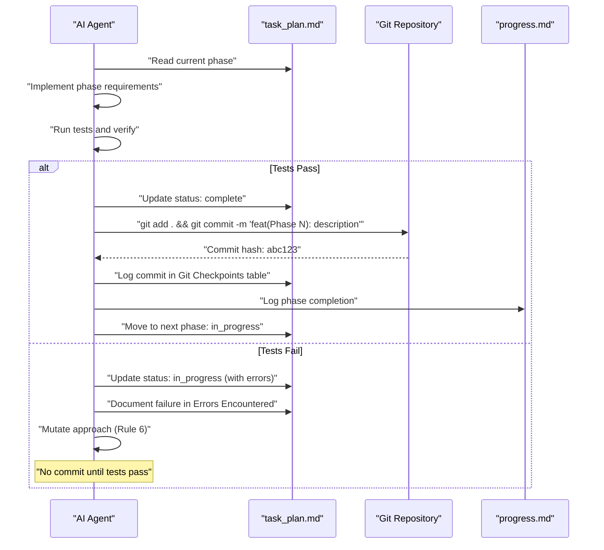
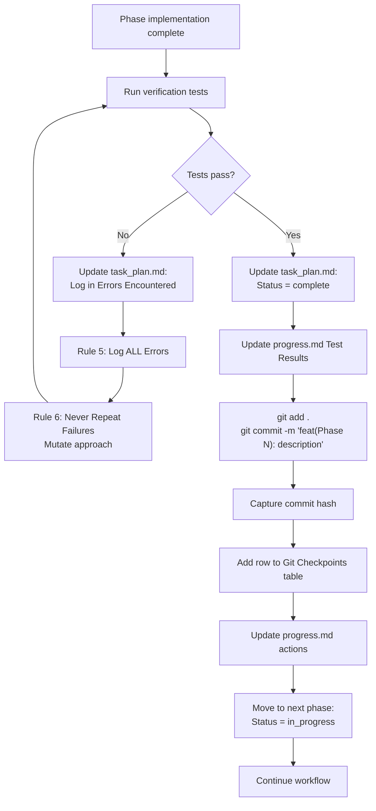
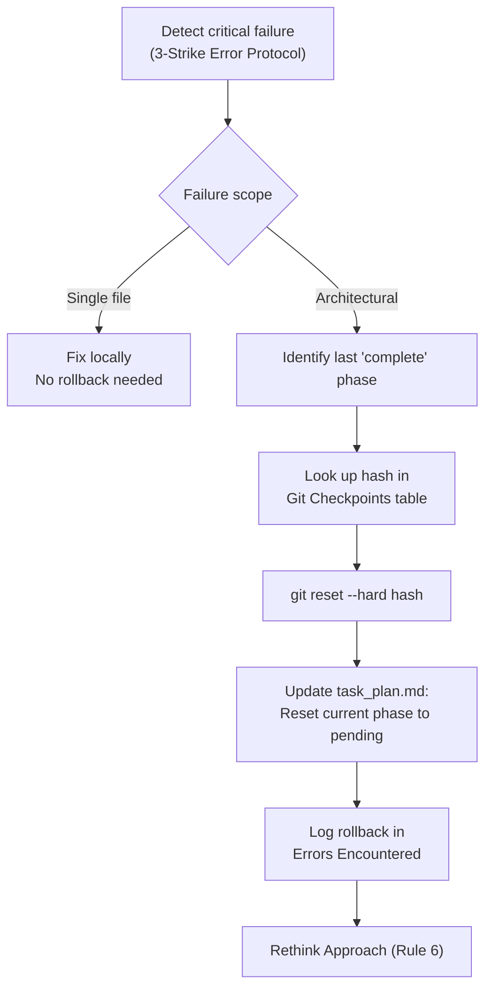
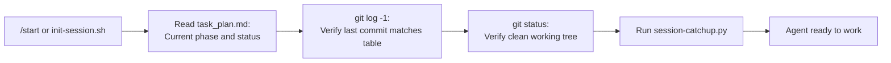

<!-- source: DeepWiki mcp.deepwiki.com · repo OthmanAdi/planning-with-files · page 5.3 Git Checkpoint Workflow · fetched 2026-10-29 -->

# Git Checkpoint Workflow

<details>
<summary>Relevant source files</summary>

The following files were used as context for generating this wiki page:

- [.claude-plugin/marketplace.json](.claude-plugin/marketplace.json)
- [.claude-plugin/plugin.json](.claude-plugin/plugin.json)
- [.gitignore](.gitignore)
- [CHANGELOG.md](CHANGELOG.md)
- [CITATION.cff](CITATION.cff)
- [CONTRIBUTORS.md](CONTRIBUTORS.md)
- [README.md](README.md)
- [examples/README.md](examples/README.md)
- [skills/planning-with-files/SKILL.md](skills/planning-with-files/SKILL.md)
- [skills/planning-with-files/examples.md](skills/planning-with-files/examples.md)
- [skills/planning-with-files/reference.md](skills/planning-with-files/reference.md)
- [skills/planning-with-files/templates/findings.md](skills/planning-with-files/templates/findings.md)
- [skills/planning-with-files/templates/progress.md](skills/planning-with-files/templates/progress.md)
- [skills/planning-with-files/templates/task_plan.md](skills/planning-with-files/templates/task_plan.md)

</details>


This document explains the Git-based checkpoint system for managing long-running agent tasks. It describes the "one phase, one commit" pattern, the Git Checkpoints table in `task_plan.md`, and how to use Git commits as rollback points during multi-phase execution.

For information about session initialization and planning file creation, see [Session Initialization](5.1). For session recovery after context loss, see [Session Recovery and Context Restoration](5.2). For the overall structure of `task_plan.md`, see [task_plan.md Specification](7.1).

---

## Purpose and Scope

The Git Checkpoint Workflow addresses a critical problem in long-running agent tasks: **how to safely experiment and recover from failed implementations without losing working code**. By creating Git commits at phase boundaries, agents can:

- Create explicit rollback points before risky changes.
- Track which commits correspond to which phases.
- Recover from failures by reverting to known-good states.
- Maintain a clear history of task progression.

This workflow integrates with the 3-file pattern by storing checkpoint metadata in `task_plan.md`, enabling both human and AI agents to understand the relationship between Git history and task phases.

Sources: [skills/planning-with-files/SKILL.md:95-131](), [skills/planning-with-files/templates/task_plan.md:109-121]()

---

## The One Phase, One Commit Pattern

### Core Principle

The checkpoint workflow follows a strict discipline: **complete one phase, verify it passes tests, then commit immediately**. This creates a linear correspondence between task phases and Git commits:

```
Phase 1 (Requirements) → ✅ Pass → git commit
Phase 2 (Planning)      → ✅ Pass → git commit  
Phase 3 (Implementation)→ ✅ Pass → git commit
Phase 4 (Testing)       → ✅ Pass → git commit
Phase 5 (Delivery)      → ✅ Pass → git commit
```

This pattern provides:
- **Atomic rollback**: Revert one phase without affecting others.
- **Clear audit trail**: Each commit represents verified, working state.
- **Session continuity**: New sessions can identify the last successful phase.
- **Failure isolation**: Failed phases don't contaminate working code.

### Workflow Sequence



Sources: [skills/planning-with-files/SKILL.md:108-131](), [skills/planning-with-files/templates/task_plan.md:30-85]()

---

## Git Checkpoints Table Structure

The Git Checkpoints table in `task_plan.md` records the relationship between phases and commits. This table is maintained by the AI agent and serves as both documentation and operational metadata.

### Table Schema

| Phase | Status | Commit Hash | Commit Message | Timestamp | Notes |
|-------|--------|-------------|----------------|-----------|-------|
| Phase identifier | complete/pending | Short hash | Conventional commit | ISO-8601 | Optional context |

### Status Values

The workflow uses standardized status values defined in the template [skills/planning-with-files/templates/task_plan.md:40-44]():

| Value | Meaning | Action Required |
|------|---------|-----------------|
| `pending` | Not started yet | Plan before implementing |
| `in_progress` | Currently working on this | Complete and verify |
| `complete` | Finished this phase | Commit and move to next phase |

### Example Checkpoint Table

```markdown
## Git Checkpoints

| Phase | Status | Commit Hash | Commit Message | Timestamp | Notes |
|-------|--------|-------------|----------------|-----------|-------|
| Phase 1: Requirements | complete | `a1b2c3d` | `feat(requirements): define api endpoints` | 2026-05-01T10:30Z | Approved |
| Phase 2: Planning | complete | `e4f5g6h` | `feat(planning): design database schema` | 2026-05-01T11:45Z | Using JSON |
| Phase 3: Implementation | in_progress | - | - | - | Working on auth |
```

Sources: [skills/planning-with-files/templates/task_plan.md:23-44](), [skills/planning-with-files/templates/task_plan.md:109-121]()

---

## Checkpoint Creation Workflow

### Manual Checkpoint Creation

When working with the planning-with-files skill, the AI agent should create checkpoints following this procedure:



Sources: [skills/planning-with-files/SKILL.md:108-131](), [skills/planning-with-files/templates/progress.md:58-70]()

---

## Using Checkpoints for Rollback

### Rollback Decision Tree

When an agent encounters a "3-Strike" failure (repeated failures despite mutation), it should use the checkpoint table to reset.



Sources: [skills/planning-with-files/SKILL.md:126-131](), [skills/planning-with-files/examples.md:161-187]()

### Rollback Example

Scenario: Phase 3 (Implementation) fails. Agent rolls back to Phase 2 (Planning).

**Step 1: Identify rollback target**
The agent reads `task_plan.md` and finds the last entry in the Git Checkpoints table with `complete` status.

**Step 2: Perform rollback**
```bash
git reset --hard e4f5g6h
```

**Step 3: Update task_plan.md**
The agent updates the `Errors Encountered` table [skills/planning-with-files/templates/task_plan.md:109-121]() to explain the rollback.

Sources: [skills/planning-with-files/SKILL.md:114-123](), [skills/planning-with-files/templates/task_plan.md:109-121]()

---

## Integration with Session Management

### Session Start: Checkpoint Verification

When a new session begins, the `init-session.sh` script (or its platform-specific variant) is used to establish the baseline.



Sources: [CHANGELOG.md:38-40](), [skills/planning-with-files/SKILL.md:33-54]()

### Session Recovery: Using Checkpoints to Restore Context

After a `/clear` command, checkpoints provide concrete restoration points. The `session-catchup.py` script [skills/planning-with-files/SKILL.md:42]() analyzes logs to find the delta between the last checkpoint and the current state.

1. **Checkpoints** reveal which phases were completed.
2. **Git diff** shows code changes since the last checkpoint.
3. **Recovery workflow**: The agent reads the diff, reads the planning files, and updates the `progress.md` log to reflect the unsynced work [skills/planning-with-files/SKILL.md:50-54]().

Sources: [CHANGELOG.md:87-88](), [CONTRIBUTORS.md:28-34]()

---

## Test Results Integration

The checkpoint workflow requires verification before committing. Test results are tracked in the `progress.md` file [skills/planning-with-files/templates/progress.md:58-70]().

### Test Results Table in progress.md

| Test | Input | Expected | Actual | Status |
|------|-------|----------|--------|--------|
| Unit Test A | `cmd --arg` | Success | Success | ✓ |

**Rule**: Only create a checkpoint commit when the most recent test row for that phase shows a passing status.

Sources: [skills/planning-with-files/templates/progress.md:67-69]()

---

## Best Practices

### 1. Never Commit Untested Code
Always run tests before updating the status to `complete` in `task_plan.md` and committing.

### 2. Keep Working Tree Clean Between Phases
Before moving from `pending` to `in_progress` on a new phase, ensure `git status` shows no uncommitted changes from the previous phase.

### 3. Update Git Checkpoints Table Immediately
The timing is critical:
1. Tests pass.
2. Update `task_plan.md` phase status.
3. `git commit`.
4. Update `Git Checkpoints` table in `task_plan.md`.

### 4. Document Rollback Decisions
When rolling back, always explain why in the `Errors Encountered` table of `task_plan.md` [skills/planning-with-files/templates/task_plan.md:109-121](). This prevents the agent from repeating the same failed approach (Rule 6).

Sources: [skills/planning-with-files/SKILL.md:114-131](), [skills/planning-with-files/examples.md:161-187]()

---

