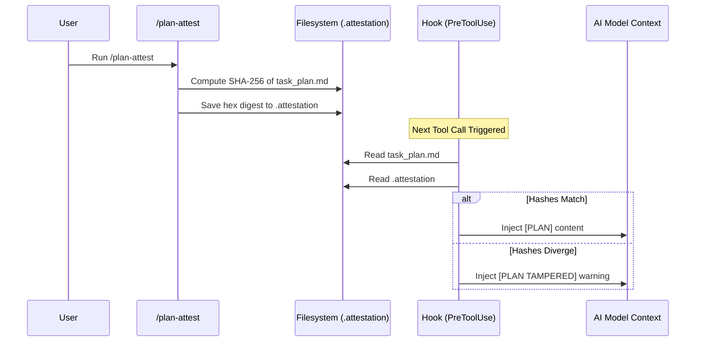
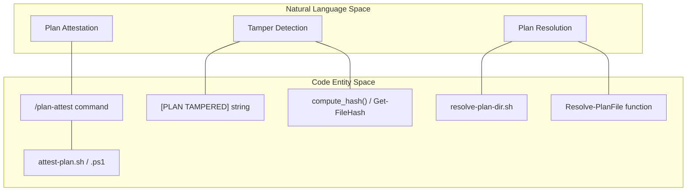

<!-- source: DeepWiki mcp.deepwiki.com · repo OthmanAdi/planning-with-files · page 5.4 Plan Attestation and Security · fetched 2026-10-29 -->

# Plan Attestation and Security

Relevant source files

The following files were used as context for generating this wiki page:

- [.codebuddy/skills/planning-with-files/scripts/attest-plan.ps1](.codebuddy/skills/planning-with-files/scripts/attest-plan.ps1)
- [.codebuddy/skills/planning-with-files/scripts/attest-plan.sh](.codebuddy/skills/planning-with-files/scripts/attest-plan.sh)
- [.codex/skills/planning-with-files/scripts/attest-plan.ps1](.codex/skills/planning-with-files/scripts/attest-plan.ps1)
- [.codex/skills/planning-with-files/scripts/attest-plan.sh](.codex/skills/planning-with-files/scripts/attest-plan.sh)
- [.continue/skills/planning-with-files/scripts/attest-plan.ps1](.continue/skills/planning-with-files/scripts/attest-plan.ps1)
- [.continue/skills/planning-with-files/scripts/attest-plan.sh](.continue/skills/planning-with-files/scripts/attest-plan.sh)
- [commands/plan-attest.md](commands/plan-attest.md)
- [scripts/attest-plan.ps1](scripts/attest-plan.ps1)
- [scripts/attest-plan.sh](scripts/attest-plan.sh)
- [tests/test_plan_attestation.py](tests/test_plan_attestation.py)

Plan Attestation, introduced in v2.37.0, provides a cryptographic mechanism to ensure the integrity of the `task_plan.md` file before it is injected into the AI model's context. By locking the plan with a SHA-256 hash, the system prevents "silent tampering"—where an agent or external process might modify the plan without explicit user approval—and maintains a strict security boundary between trusted planning documents and untrusted execution logs.

## The /plan-attest Command

The `/plan-attest` command is the primary interface for users to lock their current plan. It is designed to be run after a plan has been finalized or intentionally edited by the user [commands/plan-attest.md:1-7]().

### Command Flags
*   `--show`: Prints the currently stored SHA-256 hash and its file location [commands/plan-attest.md:20-20]().
*   `--clear`: Removes the attestation, effectively "re-opening" the plan for modification without triggering warnings [commands/plan-attest.md:21-21]().

### Security Flow: Attestation and Injection
The following diagram illustrates the lifecycle of a plan from creation to secure injection.

**Plan Integrity Lifecycle**

Sources: [commands/plan-attest.md:9-23](), [scripts/attest-plan.sh:4-6]()

## Implementation: attest-plan Scripts

The attestation logic is implemented in two platform-specific scripts: `attest-plan.sh` (POSIX) and `attest-plan.ps1` (PowerShell). These scripts perform three core functions: plan resolution, hash computation, and attestation storage.

### Plan Resolution Logic
The scripts resolve the active `task_plan.md` using a specific priority order to support both legacy root-level plans and modern parallel (slug-based) plans [scripts/attest-plan.sh:8-13]():
1.  `$PLAN_ID` environment variable.
2.  `.planning/.active_plan` pointer file.
3.  The newest directory in `.planning/` by modification time.
4.  Legacy `task_plan.md` at the project root.

### Storage Locations
Depending on the resolution mode, the `.attestation` file is stored in different locations:
*   **Parallel Mode**: `${plan_dir}/.attestation` [scripts/attest-plan.sh:47-47]().
*   **Legacy Mode**: `./.plan-attestation` at the project root [scripts/attest-plan.sh:45-45]().

### SHA-256 Computation
The scripts use native system utilities to ensure performance and reliability.
*   **POSIX**: Attempts `sha256sum`, falling back to `shasum -a 256` [scripts/attest-plan.sh:53-56]().
*   **PowerShell**: Uses `Get-FileHash -Algorithm SHA256` [scripts/attest-plan.ps1:112-112]().

**Entity Mapping: Attestation Components**

Sources: [scripts/attest-plan.sh:24-61](), [scripts/attest-plan.ps1:34-80](), [commands/plan-attest.md:15-18]()

## Security Boundary and Tamper Detection

The system maintains a strict security boundary between different file types:
*   **Trusted (`task_plan.md`)**: Contains the roadmap and goals. This is the only file subject to attestation [commands/plan-attest.md:2-2]().
*   **Untrusted (`findings.md`)**: Contains external research and web content. It is never used for plan injection and thus does not require attestation.

### PLAN TAMPERED Detection
Every `UserPromptSubmit` and `PreToolUse` hook compares the current hash of `task_plan.md` against the stored attestation. If they diverge, the injection of the plan is blocked, and the model receives a `[PLAN TAMPERED — injection blocked]` warning [commands/plan-attest.md:23-23](). This forces the model to stop and ask the user to re-verify the plan via `/plan-attest`.

### Delimiter Framing
To further secure the context, plan content is framed using unique delimiters. This ensures that the model can distinguish between injected system-level instructions (the plan) and the ongoing conversation or tool outputs.

| Feature | Implementation | Purpose |
| :--- | :--- | :--- |
| **Integrity** | SHA-256 Hash | Ensures file has not changed byte-for-byte. |
| **Resolution** | `resolve-plan-dir.sh` | Finds the correct plan in multi-task environments. |
| **Gating** | Hook-level check | Prevents tampered plans from reaching the model. |
| **Visibility** | `--show` flag | Allows users to audit the current lock state. |

Sources: [scripts/attest-plan.sh:100-107](), [scripts/attest-plan.ps1:112-117](), [commands/plan-attest.md:23-23](), [tests/test_plan_attestation.py:91-104]()

---

