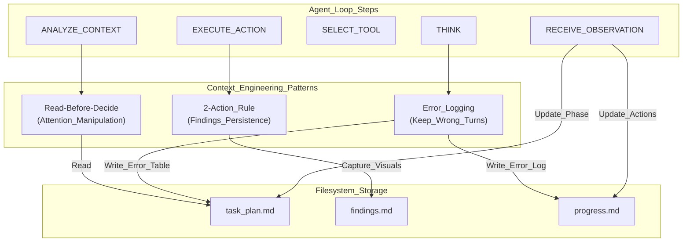
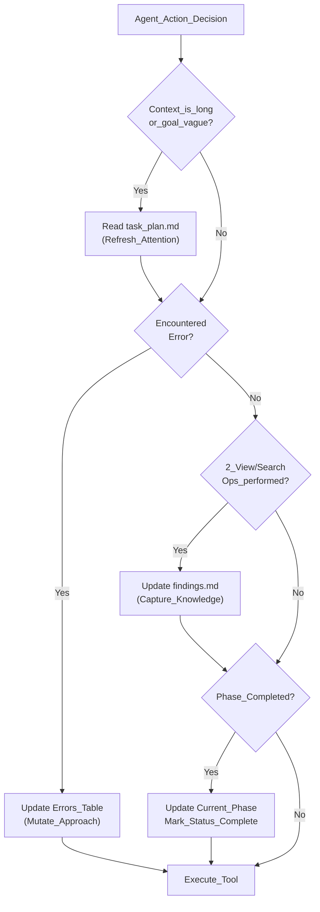

<!-- source: DeepWiki mcp.deepwiki.com · repo OthmanAdi/planning-with-files · page 6 Examples and Patterns · fetched 2026-10-29 -->

# Examples and Patterns

Relevant source files

The following files were used as context for generating this wiki page:

- [.codebuddy/skills/planning-with-files/references/examples.md](.codebuddy/skills/planning-with-files/references/examples.md)
- [.codex/skills/planning-with-files/references/examples.md](.codex/skills/planning-with-files/references/examples.md)
- [.continue/skills/planning-with-files/examples.md](.continue/skills/planning-with-files/examples.md)
- [.cursor/skills/planning-with-files/examples.md](.cursor/skills/planning-with-files/examples.md)
- [.factory/skills/planning-with-files/examples.md](.factory/skills/planning-with-files/examples.md)
- [.gemini/skills/planning-with-files/references/examples.md](.gemini/skills/planning-with-files/references/examples.md)
- [.gitignore](.gitignore)
- [.mastracode/skills/planning-with-files/references/examples.md](.mastracode/skills/planning-with-files/references/examples.md)
- [.opencode/skills/planning-with-files/examples.md](.opencode/skills/planning-with-files/examples.md)
- [docs/factory.md](docs/factory.md)
- [examples/README.md](examples/README.md)
- [skills/planning-with-files/examples.md](skills/planning-with-files/examples.md)
- [skills/planning-with-files/reference.md](skills/planning-with-files/reference.md)
- [skills/planning-with-files/templates/findings.md](skills/planning-with-files/templates/findings.md)
- [skills/planning-with-files/templates/progress.md](skills/planning-with-files/templates/progress.md)
- [skills/planning-with-files/templates/task_plan.md](skills/planning-with-files/templates/task_plan.md)

This section provides practical examples and patterns for using planning-with-files in real-world scenarios. Each pattern demonstrates how the 3-file system (`task_plan.md`, `findings.md`, `progress.md`) solves specific problems in AI agent workflows, such as goal drift and volatile memory.

For detailed specifications of each file, see [Technical Reference](#7). For the core workflow loop, see [The Core Workflow Loop](#4.1). For installation and setup, see [Installation and Platform Support](#3.1).

---

## Purpose and Scope

This section documents proven patterns for:

1.  **Workflow Patterns**: Step-by-step execution sequences with file updates.
2.  **Error Handling**: The 3-Strike Protocol and error recovery strategies.
3.  **Context Management**: Read-before-decide and attention manipulation techniques.
4.  **Anti-Patterns**: Common mistakes and how to avoid them.

Each pattern includes concrete examples showing when to read vs write files, how to update planning documents, and how hook automation integrates with manual updates.

---

## Pattern Categories and Code Mapping

The following diagram maps abstract patterns to concrete code entities and template structures within the repository:

**Diagram: Pattern Categories to Code Entity Mapping**

```mermaid
graph TB
    subgraph "Workflow_Patterns"
        WF1["Complete_Task_Walkthrough"]
        WF2["Session_Init_Pattern"]
        WF3["Phase_Completion_Pattern"]
    end
    
    subgraph "Error_Patterns"
        EP1["3-Strike_Protocol"]
        EP2["Error_Logging_Pattern"]
        EP3["Approach_Mutation_Pattern"]
    end
    
    subgraph "Context_Patterns"
        CP1["Read-Before-Decide"]
        CP2["2-Action_Rule"]
        CP3["5-Question_Reboot"]
    end
    
    subgraph "Anti-Patterns"
        AP1["TodoWrite_Instead_of_Files"]
        AP2["Repeating_Failures"]
        AP3["Wrong_Directory"]
    end
    
    subgraph "Code_Entities"
        F1["task_plan.md"]
        F2["findings.md"]
        F3["progress.md"]
        
        T1["templates/task_plan.md"]
        T2["templates/findings.md"]
        T3["templates/progress.md"]
    end
    
    subgraph "Manus_Principles"
        MP3["Principle_3:_Filesystem_as_Disk"]
        MP4["Principle_4:_Attention_Recitation"]
        MP5["Principle_5:_Keep_Wrong_Turns"]
    end
    
    WF1 --> F1
    WF1 --> F2
    WF1 --> F3
    WF2 --> T1
    WF2 --> T2
    WF2 --> T3
    WF3 --> F1
    
    EP1 --> MP5
    EP2 --> F1
    EP2 --> F3
    EP3 --> MP5
    
    CP1 --> MP4
    CP1 --> F1
    CP2 --> F2
    CP3 --> F3
    
    AP1 --> MP3
    AP2 --> MP5
    AP3 --> MP3
```

**Sources:** [skills/planning-with-files/reference.md:5-75](), [skills/planning-with-files/templates/task_plan.md:1-133](), [skills/planning-with-files/templates/findings.md:1-96](), [skills/planning-with-files/templates/progress.md:1-115]()

---

## Pattern Implementation Architecture

This diagram shows how patterns are implemented through the interaction of agent actions and the 3-file "Working Memory on Disk" [skills/planning-with-files/templates/task_plan.md:3-4]():

**Diagram: Pattern Implementation Flow**

**Sources:** [skills/planning-with-files/reference.md:130-164](), [skills/planning-with-files/templates/task_plan.md:109-121](), [skills/planning-with-files/templates/findings.md:90-95]()

---

## Core Pattern Table

The following table categorizes patterns by type and links them to their primary files and conceptual roots:

| Pattern Type | Pattern Name | Primary Files | Conceptual Root | Child Page |
| :--- | :--- | :--- | :--- | :--- |
| **Workflow** | Complete Task Walkthrough | `task_plan.md`, `findings.md`, `progress.md` | Agent Loop [reference.md:130-164]() | [Complete Task Walkthrough](#6.1) |
| **Error** | 3-Strike Protocol | `task_plan.md` | Principle 5: Keep Wrong Turns [reference.md:56-64]() | [Error Recovery Pattern](#6.2) |
| **Error** | Error Logging | `task_plan.md`, `progress.md` | Error Table [task_plan.md:109-121]() | [Error Recovery Pattern](#6.2) |
| **Context** | Read-Before-Decide | `task_plan.md` | Principle 4: Recitation [reference.md:42-54]() | [Read-Before-Decide Pattern](#6.3) |
| **Context** | 2-Action Rule | `findings.md` | Multimodal Persistence [findings.md:75-86]() | [Read-Before-Decide Pattern](#6.3) |
| **Context** | 5-Question Reboot | `progress.md` | Reboot Check [progress.md:85-106]() | [Read-Before-Decide Pattern](#6.3) |
| **Anti-Pattern** | Silent Retries | `task_plan.md` | Error Recovery Signal [reference.md:63-64]() | [Anti-Patterns to Avoid](#6.4) |
| **Anti-Pattern** | Meta-File Misuse | `.gitignore` | Filesystem Cleanliness [.gitignore:12-38]() | [Anti-Patterns to Avoid](#6.4) |

**Sources:** [skills/planning-with-files/reference.md:1-213](), [skills/planning-with-files/templates/progress.md:85-106](), [skills/planning-with-files/examples.md:161-185]()

---

## Read vs Write Decision Logic

This decision tree illustrates the "Read-Before-Decide" and "Update-After-Act" logic used to manage the context window effectively:

**Diagram: Read vs Write Decision Tree**

**Sources:** [skills/planning-with-files/examples.md:189-203](), [skills/planning-with-files/templates/findings.md:90-95](), [skills/planning-with-files/templates/task_plan.md:125-132]()

---

## Child Pages Overview

This section contains the following detailed pattern guides:

*   **[Complete Task Walkthrough](#6.1)**: A step-by-step example of a Todo App build, showing how `task_plan.md`, `findings.md`, and `progress.md` evolve from initial state to completion. [examples/README.md:5-264]().
*   **[Error Recovery Pattern](#6.2)**: Documentation of the 3-Strike Error Protocol. Explains why silent retries are prohibited and how logging errors in the `task_plan.md` table prevents repetition. [examples.md:161-185]().
*   **[Read-Before-Decide Pattern](#6.3)**: Detailed guide on "Attention Manipulation." Explains how re-reading the plan pushes global goals into the model's recent attention span to handle ~50 tool calls without drift. [reference.md:42-54]().
*   **[Anti-Patterns to Avoid](#6.4)**: Covers common pitfalls such as silent retries, failing to capture visual findings, and writing planning files to the wrong directory (e.g., skill directory vs project root). [examples.md:165-171](), [.gitignore:12-38]().

**Sources:** [skills/planning-with-files/examples.md:1-203](), [examples/README.md:1-264](), [skills/planning-with-files/reference.md:1-213]()

---

