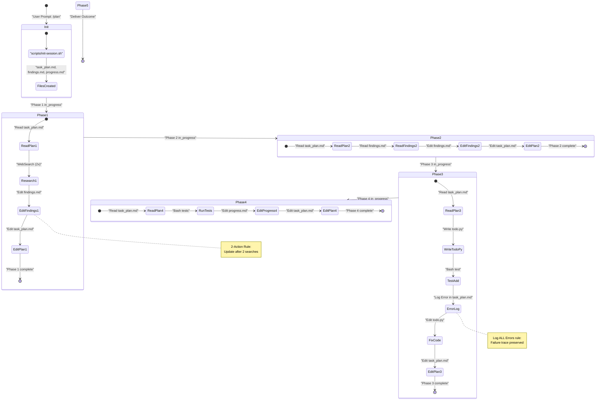
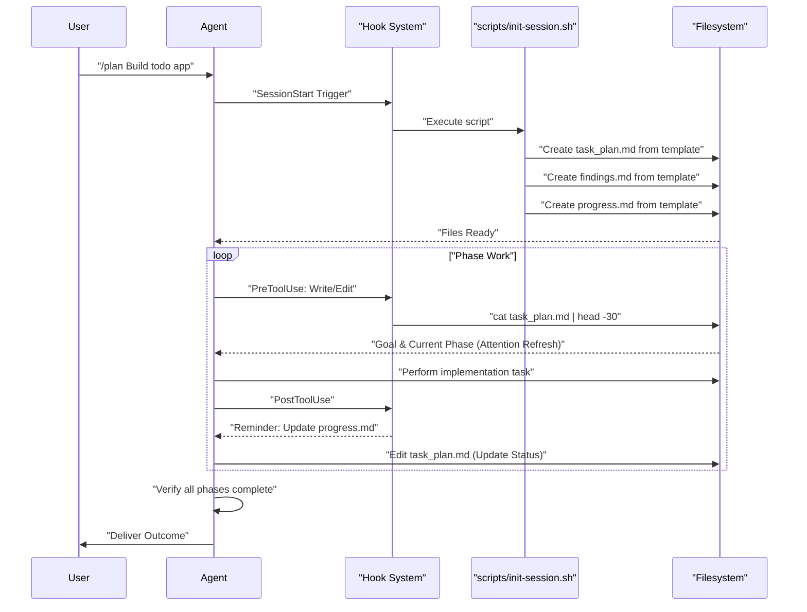

<!-- source: DeepWiki mcp.deepwiki.com · repo OthmanAdi/planning-with-files · page 6.1 Complete Task Walkthrough · fetched 2026-10-29 -->

# Complete Task Walkthrough

<details>
<summary>Relevant source files</summary>

The following files were used as context for generating this wiki page:

- [.codebuddy/skills/planning-with-files/references/examples.md](.codebuddy/skills/planning-with-files/references/examples.md)
- [.codex/skills/planning-with-files/references/examples.md](.codex/skills/planning-with-files/references/examples.md)
- [.continue/skills/planning-with-files/examples.md](.continue/skills/planning-with-files/examples.md)
- [.cursor/skills/planning-with-files/examples.md](.cursor/skills/planning-with-files/examples.md)
- [.factory/skills/planning-with-files/examples.md](.factory/skills/planning-with-files/examples.md)
- [.gemini/skills/planning-with-files/references/examples.md](.gemini/skills/planning-with-files/references/examples.md)
- [.gitignore](.gitignore)
- [.mastracode/skills/planning-with-files/references/examples.md](.mastracode/skills/planning-with-files/references/examples.md)
- [.opencode/skills/planning-with-files/examples.md](.opencode/skills/planning-with-files/examples.md)
- [.pi/skills/planning-with-files/examples.md](.pi/skills/planning-with-files/examples.md)
- [docs/factory.md](docs/factory.md)
- [examples/README.md](examples/README.md)
- [skills/planning-with-files/examples.md](skills/planning-with-files/examples.md)
- [skills/planning-with-files/reference.md](skills/planning-with-files/reference.md)
- [skills/planning-with-files/templates/findings.md](skills/planning-with-files/templates/findings.md)
- [skills/planning-with-files/templates/progress.md](skills/planning-with-files/templates/progress.md)
- [skills/planning-with-files/templates/task_plan.md](skills/planning-with-files/templates/task_plan.md)

</details>


## Purpose and Scope

This page demonstrates a complete execution of the 3-File Pattern through all 5 phases, showing exact file operations, content evolution, and state transitions as an AI agent progresses from requirements gathering through final delivery. This walkthrough uses a concrete implementation task (building a CLI todo app) to show how `task_plan.md`, `findings.md`, and `progress.md` evolve together.

For high-level workflow concepts, see page 4.1. For the theoretical principles, see page 8.1.

## Example Task Context

**User Request:** "Build a simple command-line todo app in Python that can add, list, and delete tasks."

**Complexity Assessment:** This is a multi-phase task requiring:
- Requirements analysis
- Technical planning
- Code implementation
- Testing and verification
- Approximately 20+ tool calls

**Decision:** Activate 3-File Pattern based on criteria from page 4.4 (complex multi-step task with implementation).

**Sources:** [examples/README.md:1-17]()

---

## Session Initialization

### Operations Performed

Before any work begins, the agent initializes the planning files using the `init-session.sh` script (or `init-session.ps1` on Windows).

```bash
# Agent executes init-session.sh
bash ${CLAUDE_PLUGIN_ROOT}/scripts/init-session.sh
```

This creates three files from templates:

| File | Template Source | Purpose |
|------|----------------|---------|
| `task_plan.md` | [skills/planning-with-files/templates/task_plan.md:1-133]() | Phase tracking and decision log |
| `findings.md` | [skills/planning-with-files/templates/findings.md:1-96]() | Research and technical decisions |
| `progress.md` | [skills/planning-with-files/templates/progress.md:1-115]() | Session logs and test results |

The hook system automatically triggers this initialization via the `SessionStart` hook.

### File Content: task_plan.md (Initial State)

```markdown
# Task Plan: Build Command-Line Todo App

## Goal
Create a Python CLI todo app with add, list, and delete functionality.

## Current Phase
Phase 1

## Phases

### Phase 1: Requirements & Discovery
- [ ] Understand user intent
- [ ] Identify constraints and requirements
- [ ] Document findings in findings.md
- **Status:** in_progress

### Phase 2: Planning & Structure
- [ ] Define technical approach
- [ ] Create project structure
- [ ] Document decisions with rationale
- **Status:** pending

### Phase 3: Implementation
- [ ] Write todo.py with core functions
- [ ] Implement add functionality
- [ ] Implement list functionality
- [ ] Implement delete functionality
- **Status:** pending

### Phase 4: Testing & Verification
- [ ] Test add operation
- [ ] Test list operation
- [ ] Test delete operation
- [ ] Verify error handling
- **Status:** pending

### Phase 5: Delivery
- [ ] Review code quality
- [ ] Ensure all features work
- [ ] Deliver to user
- **Status:** pending

## Key Questions
1. Should tasks persist between sessions? (Yes - need file storage)
2. What format for storing tasks? (JSON file)
3. Command-line interface style? (Simple argparse)

## Decisions Made
| Decision | Rationale |
|----------|-----------|
|          |           |

## Errors Encountered
| Error | Attempt | Resolution |
|-------|---------|------------|
|       | 1       |            |

## Notes
- Update phase status as you progress: pending → in_progress → complete
- Re-read this plan before major decisions (attention manipulation)
- Log ALL errors - they help avoid repetition
```

### File Content: findings.md (Initial State)

```markdown
# Findings & Decisions

## Requirements
- Command-line interface
- Add tasks
- List all tasks
- Delete tasks
- Python implementation
- Tasks should persist (survive app restart)

## Research Findings
- (To be filled as we explore)

## Technical Decisions
| Decision | Rationale |
|----------|-----------|
|          |           |

## Issues Encountered
| Issue | Resolution |
|-------|------------|
|       |            |

## Resources
- Python argparse documentation (to be referenced)

## Visual/Browser Findings
- (To be updated after research)

---
*Update this file after every 2 view/browser/search operations*
*This prevents visual information from being lost*
```

### File Content: progress.md (Initial State)

```markdown
# Progress Log

## Session: 2026-01-15

### Phase 1: Requirements & Discovery
- **Status:** in_progress
- **Started:** 2026-01-15 10:00
- Actions taken:
  - Created task_plan.md
  - Created findings.md
  - Created progress.md
- Files created/modified:
  - task_plan.md (created)
  - findings.md (created)
  - progress.md (created)

### Phase 2: Planning & Structure
- **Status:** pending
- Actions taken:
  -
- Files created/modified:
  -

## Test Results
| Test | Input | Expected | Actual | Status |
|------|-------|----------|--------|--------|
|      |       |          |        |        |

## Error Log
| Timestamp | Error | Attempt | Resolution |
|-----------|-------|---------|------------|
|           |       | 1       |            |

## 5-Question Reboot Check
| Question | Answer |
|----------|--------|
| Where am I? | Phase 1 - Requirements & Discovery |
| Where am I going? | Phase 2-5: Planning, Implementation, Testing, Delivery |
| What's the goal? | Build Python CLI todo app with add/list/delete |
| What have I learned? | See findings.md |
| What have I done? | Created planning files |

---
*Update after completing each phase or encountering errors*
```

### Why This Structure

Each section serves a specific function as defined in page 7.1 (task_plan.md Specification):

| Section | Purpose | Implementation |
|---------|---------|----------------|
| `Goal` | Single-line goal statement | Read by PreToolUse hook to refresh attention |
| `Current Phase` | Explicit phase marker | Updated after each phase completion |
| `Phases` | Checkbox-based progress tracking | Parsed by verification scripts |
| `Key Questions` | Scope boundaries | Guides research and prevents goal drift |
| `Decisions Made` | Accumulated architectural choices | Table format for clarity |
| `Errors Encountered` | Failure trace preservation | Implements "Log ALL Errors" rule |

**Sources:** [examples/README.md:17-168](), [skills/planning-with-files/templates/task_plan.md:1-133](), [skills/planning-with-files/templates/findings.md:1-96](), [skills/planning-with-files/templates/progress.md:1-115]()

---

## Phase 1: Requirements & Discovery

### PreToolUse Hook Activation

Before each tool operation, a `PreToolUse` hook automatically executes a command to read the plan. This injects the first 30 lines (Goal, Current Phase, and first few phases) into the agent's attention window before every action.

```bash
cat task_plan.md 2>/dev/null | head -30 || true
```

### Operations Sequence

```bash
1. Read task_plan.md              # Hook already executed, manual read for detail
2. Read findings.md               # Load current requirements
3. WebSearch "python argparse cli" # Research CLI patterns
4. WebSearch "python json storage" # Research persistence
5. Edit findings.md               # Update research findings (2-Action Rule)
6. Edit task_plan.md              # Update phase status and key questions
```

### File Content: findings.md (After Research)

```markdown
# Findings & Decisions

## Requirements
- Command-line interface
- Add tasks
- List all tasks
- Delete tasks
- Python implementation
- Tasks should persist (survive app restart)

## Research Findings
- Python's `argparse` module is perfect for CLI subcommands
- `json` module handles file persistence easily
- Standard pattern: `python todo.py <command> [args]`
- File structure: Single `todo.py` file is sufficient for this scope

## Technical Decisions
| Decision | Rationale |
|----------|-----------|
|          |           |

## Issues Encountered
| Issue | Resolution |
|-------|------------|
|       |            |

## Resources
- Python argparse documentation: https://docs.python.org/3/library/argparse.html
- Python json module: https://docs.python.org/3/library/json.html

## Visual/Browser Findings
- Reviewed argparse examples - subcommand pattern is straightforward
- JSON file format: array of objects with `id` and `task` fields

---
*Update this file after every 2 view/browser/search operations*
*This prevents visual information from being lost*
```

### The 2-Action Rule in Practice

Notice that after **2 WebSearch operations** (viewing documentation), the agent immediately updated `findings.md`. This implements the "2-Action Rule" from the findings template:

> "Update this file after every 2 view/browser/search operations. This prevents visual information from being lost."

This prevents loss of visual/multimodal information from documentation pages that the AI context might otherwise discard.

**Sources:** [examples/README.md:171-284](), [skills/planning-with-files/templates/findings.md:90-96]()

---

## Phase 2: Planning & Structure

### Operations Sequence

```bash
1. Read task_plan.md              # PreToolUse hook already executed
2. Read findings.md               # Load research results
3. Edit findings.md               # Add technical decisions
4. Edit task_plan.md              # Mark Phase 2 complete, advance to Phase 3
5. Edit progress.md               # Log phase completion
```

### File Content: findings.md (With Technical Decisions)

```markdown
# Findings & Decisions

## Requirements
- Command-line interface
- Add tasks
- List all tasks
- Delete tasks
- Python implementation
- Tasks should persist (survive app restart)

## Research Findings
- Python's `argparse` module is perfect for CLI subcommands
- `json` module handles file persistence easily
- Standard pattern: `python todo.py <command> [args]`
- File structure: Single `todo.py` file is sufficient for this scope

## Technical Decisions
| Decision | Rationale |
|----------|-----------|
| Use JSON for storage | Simple, human-readable, built-in Python support |
| argparse with subcommands | Clean CLI: `python todo.py add "task"`, `python todo.py list` |
| Store in todos.json | Standard location, easy to find and debug |
| Single file structure | Simple enough for one file, can refactor later if needed |
```

**Sources:** [examples/README.md:171-319](), [skills/planning-with-files/templates/findings.md:36-49]()

---

## Phase 3: Implementation (With Error Recovery)

### Operations Sequence

```bash
1. Read task_plan.md              # PreToolUse hook executed
2. Write todo.py                  # Create initial implementation
3. Bash "python todo.py add 'Buy milk'"  # Test add functionality
4. Read todo.py                   # Check implementation after error
5. Edit todo.py                   # Fix FileNotFoundError
6. Bash "python todo.py add 'Buy milk'"  # Retry
7. Bash "python todo.py list"     # Test list - JSONDecodeError
8. Edit todo.py                   # Fix empty file handling
9. Edit task_plan.md              # Log errors and mark phases complete
10. Edit progress.md              # Update error log and test results
```

### The 3-Strike Error Protocol

This implementation demonstrates the 3-Strike Error Protocol:

| Attempt | Error | Action Taken | Protocol Step |
|---------|-------|--------------|---------------|
| 1 | FileNotFoundError | Added `os.path.exists()` check | Diagnose & Fix |
| 2 | JSONDecodeError | Added empty file handling | Alternative Approach |
| Success | - | Code works correctly | - |

The agent logged both errors in `task_plan.md` per the "Log ALL Errors" rule:
> "Log ALL errors - they help avoid repetition. Add immediately when an error occurs, even if you fix it quickly."

**Sources:** [examples/README.md:353-495](), [skills/planning-with-files/templates/task_plan.md:109-121](), [skills/planning-with-files/reference.md:56-64]()

---

## Phase 4: Testing & Verification

### File Content: progress.md (With Test Results)

```markdown
# Progress Log

## Session: 2026-01-15

## Test Results
| Test | Input | Expected | Actual | Status |
|------|-------|----------|--------|--------|
| Add task | `python todo.py add "Task 1"` | Task added | Task 1 added with ID 1 | ✓ |
| Add task | `python todo.py add "Task 2"` | Task added | Task 2 added with ID 2 | ✓ |
| List tasks | `python todo.py list` | Shows 2 tasks | Shows ID 1 and 2 correctly | ✓ |
| Delete task | `python todo.py delete 1` | Task 1 removed | Deleted successfully | ✓ |
| List after delete | `python todo.py list` | Shows only Task 2 | Shows only ID 2 | ✓ |

## Error Log
| Timestamp | Error | Attempt | Resolution |
|-----------|-------|---------|------------|
| 2026-01-15 10:35 | FileNotFoundError when reading todos.json | 1 | Added file existence check |
| 2026-01-15 10:37 | JSONDecodeError on empty file | 2 | Added explicit empty file handling |

## 5-Question Reboot Check
| Question | Answer |
|----------|--------|
| Where am I? | Phase 4 - Testing & Verification |
| Where am I going? | Phase 5: Delivery |
| What's the goal? | Build Python CLI todo app with add/list/delete |
| What have I learned? | Need to handle file not existing, empty file edge cases |
| What have I done? | Completed implementation and testing, all tests pass |
```

**Sources:** [examples/README.md:425-495](), [skills/planning-with-files/templates/progress.md:58-106]()

---

## Phase 5: Delivery

### Verification Logic

The agent finalizes the task by ensuring all phases in `task_plan.md` are marked as complete. This is often verified by a `check-complete.sh` script that parses the markdown.

### Final Verification Before Delivery

The final `Read task_plan.md` operation ensures:
- All 5 phases show `Status: complete`
- All checkboxes are marked `[x]`
- All `Key Questions` are answered
- All errors in `Errors Encountered` have resolutions
- The `Goal` statement matches the deliverable

**Sources:** [examples/README.md:499-569](), [skills/planning-with-files/reference.md:130-164]()

---

## File State Evolution Across 5 Phases

**Diagram: File Mutations and State Transitions**



**Sources:** [examples/README.md:1-569](), [skills/planning-with-files/reference.md:130-164]()

---

## Hook System Integration

**Diagram: Hook Triggers and File Operations**



**Sources:** [docs/factory.md:138-151](), [skills/planning-with-files/reference.md:42-54]()

---

## File Operations Breakdown

### Tool Call Classification

The complete task typically requires **25-30 tool calls** distributed across 5 phases:

| Phase | Tool Calls | Operations | Purpose |
|-------|-----------|------------|---------|
| Init | 1 | `Bash` init-session.sh | Create planning files from templates |
| Phase 1 | 5 | `Read` (2x), `WebSearch` (2x), `Edit` (1x) | Requirements gathering |
| Phase 2 | 4 | `Read` (2x), `Edit` (2x) | Technical planning |
| Phase 3 | 10 | `Read` (1x), `Write` (1x), `Bash` (4x), `Edit` (4x) | Implementation with error recovery |
| Phase 4 | 8 | `Read` (1x), `Bash` (5x), `Edit` (2x) | Testing and verification |
| Phase 5 | 3 | `Read` (1x), `Edit` (1x), `Stop` | Final verification and delivery |

### Key Observations

1.  **Read Operations Frequency:** The `task_plan.md` file is read at the start of every loop. This implements **Attention Manipulation** by repeatedly bringing the `Goal` section into the model's recent attention span, preventing goal drift.
2.  **2-Action Rule:** The agent never performs more than two research or view actions without documenting findings. This ensures that visual or browser-based data is offloaded to the filesystem before the context window rotates.
3.  **Error Logging:** Errors are never "fixed and forgotten." Every `FileNotFoundError` or `JSONDecodeError` is logged in the `Errors Encountered` table of `task_plan.md` to prevent approach repetition.

**Sources:** [examples/README.md:1-569](), [skills/planning-with-files/reference.md:130-175](), [skills/planning-with-files/reference.md:42-54]()

---

