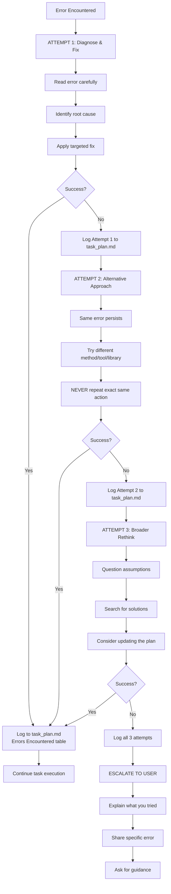
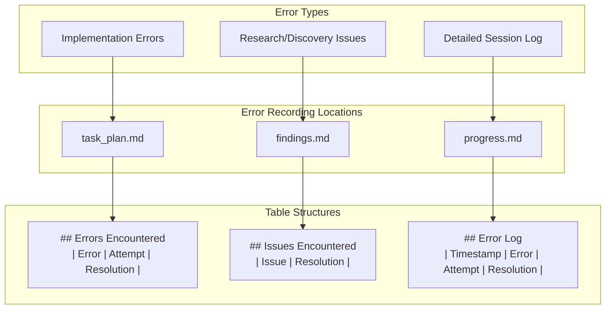
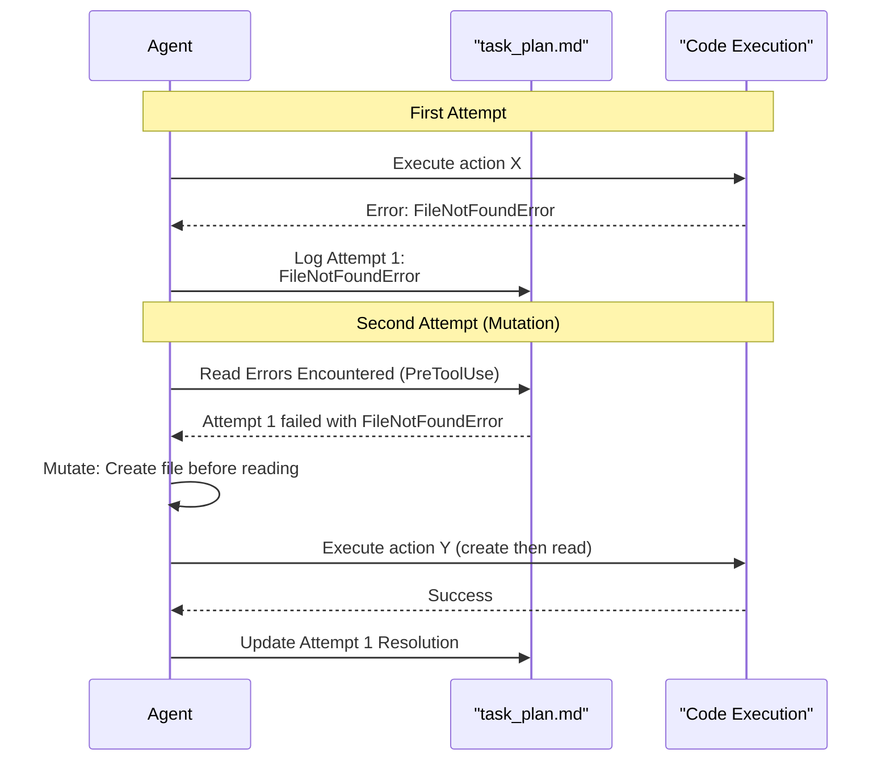

<!-- source: DeepWiki mcp.deepwiki.com · repo OthmanAdi/planning-with-files · page 6.2 Error Recovery Pattern · fetched 2026-10-29 -->

# Error Recovery Pattern

<details>
<summary>Relevant source files</summary>

The following files were used as context for generating this wiki page:

- [.codebuddy/skills/planning-with-files/SKILL.md](.codebuddy/skills/planning-with-files/SKILL.md)
- [.factory/skills/planning-with-files/SKILL.md](.factory/skills/planning-with-files/SKILL.md)
- [.gitignore](.gitignore)
- [.mastracode/skills/planning-with-files/SKILL.md](.mastracode/skills/planning-with-files/SKILL.md)
- [examples/README.md](examples/README.md)
- [skills/planning-with-files/examples.md](skills/planning-with-files/examples.md)
- [skills/planning-with-files/reference.md](skills/planning-with-files/reference.md)
- [skills/planning-with-files/templates/findings.md](skills/planning-with-files/templates/findings.md)
- [skills/planning-with-files/templates/progress.md](skills/planning-with-files/templates/progress.md)
- [skills/planning-with-files/templates/task_plan.md](skills/planning-with-files/templates/task_plan.md)

</details>


## Purpose and Scope

This document describes the systematic error recovery protocol used in `planning-with-files` to handle failures during task execution. The pattern defines a structured 3-strike approach to debugging, error logging mechanics, and the principle of approach mutation to prevent repeated failures. 

By treating the filesystem as persistent memory, the agent ensures that "wrong turns" are preserved in context, allowing the model to implicitly update its beliefs and reduce mistake repetition.

---

## The 3-Strike Error Protocol

The error recovery pattern implements a graduated escalation strategy that prevents agents from repeating the same failing action while maintaining structured documentation of all attempts.

### Protocol Flow



**Sources:** [.mastracode/skills/planning-with-files/SKILL.md:130-152](), [.factory/skills/planning-with-files/SKILL.md:121-143]()

### Attempt 1: Diagnose & Fix
The first attempt focuses on targeted problem-solving:
- **Read error carefully**: Analyze the specific output or stack trace.
- **Identify root cause**: Determine why the failure occurred.
- **Apply targeted fix**: Implement a direct correction based on the diagnosis.

### Attempt 2: Alternative Approach
If the same error persists, the agent must shift strategy:
- **Same error?** Try a different method entirely.
- **Different tool/library?** Swap the implementation details.
- **Enforcement**: NEVER repeat the exact same failing action.

### Attempt 3: Broader Rethink
If implementation still fails, the agent questions fundamental assumptions:
- **Question assumptions**: Is the technical approach valid?
- **Search for solutions**: Use web search or documentation.
- **Update the plan**: Consider structural changes to `task_plan.md`.

### Escalation Threshold
After 3 failures, the agent must escalate to the user, providing the specific error and a summary of what was tried.

---

## Error Logging Structure

Errors are logged in structured markdown tables across the three primary planning files to maintain a queryable history.

### Error Table Format in task_plan.md
This table serves as the primary record for "wrong turns" to prevent repetition.

```markdown
## Errors Encountered
| Error | Attempt | Resolution |
|-------|---------|------------|
| FileNotFoundError | 1 | Created default config |
| API timeout | 2 | Added retry logic |
```

**Sources:** [skills/planning-with-files/templates/task_plan.md:109-121](), [.mastracode/skills/planning-with-files/SKILL.md:115-121]()

### Error Table Format in progress.md
The `progress.md` file maintains a more detailed, timestamped log of errors within the session.

```markdown
## Error Log
| Timestamp | Error | Attempt | Resolution |
|-----------|-------|---------|------------|
| 2026-01-15 10:35 | FileNotFoundError | 1 | Added file existence check |
```

**Sources:** [skills/planning-with-files/templates/progress.md:71-84]()

### File Location Mapping



**Sources:** [skills/planning-with-files/templates/task_plan.md:109-121](), [skills/planning-with-files/templates/findings.md:50-62](), [skills/planning-with-files/templates/progress.md:71-84]()

---

## The "Never Repeat Failures" Principle

### Core Rule
The system operates on a fundamental logic gate:
```python
if action_failed:
    next_action != same_action
```
**Sources:** [.mastracode/skills/planning-with-files/SKILL.md:123-128](), [skills/planning-with-files/reference.md:205-206]()

### Implementation Example



**Sources:** [.mastracode/skills/planning-with-files/SKILL.md:123-152](), [skills/planning-with-files/reference.md:42-54]()

---

## Read Before Retry Decision Matrix

When an error occurs, the agent uses the following matrix to decide when to read files to refresh its attention window.

| Situation | Action | Reason |
|-----------|--------|--------|
| Error occurred | Read relevant file | Need current state to fix |
| Alternative approach needed | Read plan/findings | Re-orient if context is stale |
| Starting new phase | Read plan/findings | Refresh goals in attention window |
| Resuming after gap | Read all planning files | Recover state and history |

**Sources:** [.mastracode/skills/planning-with-files/SKILL.md:154-163](), [.factory/skills/planning-with-files/SKILL.md:145-154]()

---

## Integration with Hook System

The hook system automates error-aware context management by injecting planning data into the agent's window.

### PreToolUse Hook and Error Context
Before every tool use (Write, Edit, Bash, etc.), the system executes:
`cat task_plan.md 2>/dev/null | head -30 || true`
This ensures the `Errors Encountered` table and `Current Phase` are at the very bottom of the context (the "attention window").

**Sources:** [.mastracode/skills/planning-with-files/SKILL.md:11-15](), [.codebuddy/skills/planning-with-files/SKILL.md:11-15]()

### PostToolUse Reminder
After a modification tool is used, the system prompts:
`Update progress.md with what you just did. If a phase is now complete, update task_plan.md status.`
This forces the agent to document the result of the action, including any errors.

**Sources:** [.mastracode/skills/planning-with-files/SKILL.md:16-20](), [.codebuddy/skills/planning-with-files/SKILL.md:16-20]()

---

## Concrete Error Recovery Example

### Scenario: API Integration Failure

1.  **Attempt 1: Diagnose & Fix**
    *   **Action**: `Read config.json`
    *   **Error**: `FileNotFoundError`
    *   **Logging**: Agent updates `task_plan.md` Errors table: `| FileNotFoundError | 1 | Will create default config |`
    *   **Fix**: Agent writes a default `config.json`.

2.  **Attempt 2: Alternative Approach**
    *   **Action**: `Read config.json`
    *   **Success**: File now exists.

**Sources:** [skills/planning-with-files/examples.md:161-186]()

---

## Anti-Patterns in Error Recovery

| Don't | Do Instead |
|-------|------------|
| Silent retries | Log ALL errors in `task_plan.md` |
| Repeating failed actions | Mutate the approach (different tool/method) |
| Using TodoWrite tool | Use markdown files as "memory on disk" |
| Hiding "wrong turns" | Keep failed actions and stack traces in context |

**Sources:** [.mastracode/skills/planning-with-files/SKILL.md:123-128](), [skills/planning-with-files/reference.md:55-64](), [.factory/skills/planning-with-files/SKILL.md:211-215]()

---

